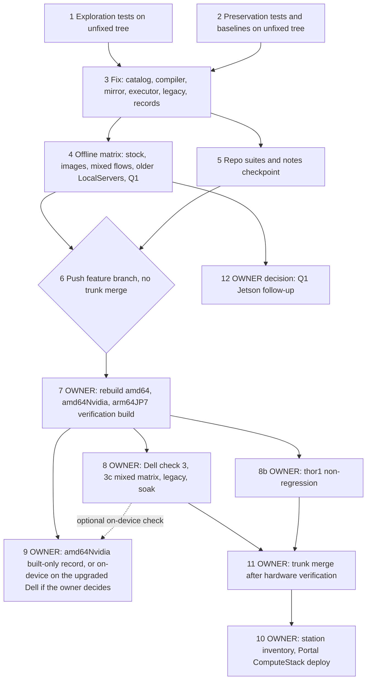

# Implementation Plan

## Overview

This plan implements `bugfix.md` and `design.md` through the bug-condition
workflow.

**The bug.** On Ubuntu 22.04 / GStreamer 1.20.3 LocalServer images, a JPEG
file chain (`… jpegparse ! jpegdec ! videoconvert …`) whose downstream
offers an RGB-family format first makes `jpegdec` take libjpeg-turbo's
direct-output path. That covers an RGB consumer and an unconstrained tail
such as `videoconvert ! fakesink`, which negotiates xBGR. That path
fails (`Improper call to JPEG library in state 205`, then `No valid frames
decoded before end of stream`). Verified on the lab Dell, amd64 1.0.51, 6 of
6 runs.

**The fix.** One `capsfilter caps=JPEGDEC_NATIVE_CAPS`
(`I420;Y42B;Y444;GRAY8;RGB`, I420 first) goes right after `jpegdec`, only on
`x86_64`, `x86_64_nvidia` and `arm64_cpu`:
- the Portal catalog `_jpeg_file_chain`, plus the byte-identical vendored
  copy (design C1, C2);
- a device-side normalization of documents packaged before the fix (C3);
- the legacy builder (C4).

Two feed-first rules keep mixed documents safe, on the same arches. The
compiler emits the frame-feed segment first in new packages (C1b, both
compiler copies), and the executor moves it first in pre-fix packages
(C3b). JP5, JP6 and JP7 stay byte-identical.

**The owner's gate.** "It is important those flows do not break." Mixed
flows (a JPEG file source plus any frame-feed source, either order, either
package shape, bridged or not) are a hard acceptance gate (bugfix 3.11,
AC 11 to 15). Design D11 maps R1 to R5 onto the unit matrix (tasks 1 and
2), the offline matrix (task 4), the Dell (task 8) and thor1 (task 8b).
R2 needs all four LocalServer images (JP5, JP6, arm64 CPU, JP7). If one
can't be resolved, the work stops for the owner; it is never skipped
(task 4, Image rule). The Q1 decision is task 12.

**Gates and order.**
- Tasks 1 and 2 run on the UNFIXED tree first, and their tests and goldens
  are frozen from then on.
- Tasks 3 to 5 are local only. They authorize no push, deploy, build or
  device action.
- Task 6 is the documented push gate. It pushes a feature branch, after the
  owner confirms that build source, and never merges into the trunk unless
  the owner directs it there.
- Tasks 7 to 12 are owner-gated and stay UNCHECKED in this run: the
  rebuilds, the Dell and thor1 verification, the Portal deploy, the trunk
  merge and the Q1 decision. Per `.kiro/steering/builds.md`, on-device code
  reaches the trunk only after real-hardware verification, which is a
  later, separate run.

**Test commands.** All are finite, run with `-p no:cacheprovider` and
`PYTHONDONTWRITEBYTECODE=1`, and write nothing tracked into the tree
(Hypothesis may create the gitignored `.hypothesis/`).

- workflow_core suite:
  `cd edge-cv-portal/backend && python3 -m pytest layers/workflow_core/tests/ -q -p no:cacheprovider`.
  Unfixed tree, design iteration 3: 1022 passed, 1 failed (pre-existing,
  see Notes), 1 skipped, about 2 minutes.
- Backend directories, on the host, one directory per invocation (the
  directories have no `__init__.py`, so basenames can collide):
  `PYTHONPATH=src/backend:test/backend-test python3 -m pytest test/backend-test/<dir>/ --noconftest --continue-on-collection-errors -q -p no:cacheprovider`.
  The directories: `workflow_engine/`, `static_image_camera/`,
  `stream_ingest/`, `output_bindings_fixes/`, `api-endpoints/`, `utils/`,
  `resources/` and `csi_nvargus_optional/`.
  - Without `--continue-on-collection-errors`, `workflow_engine/` stops at
    collection: `test_mqtt_publish_retain.py` imports `utils.ipc_client`,
    which needs `awsiot` (`ModuleNotFoundError`). Record that error as
    pre-existing.
  - Reference only (review 2's partial scratch export of 48841a0, not
    authoritative; task 2 records the real counts): `workflow_engine/` gave
    1845 passed, 3 failed, 12 skipped, 5 errors. The ids were
    `test_component_log_bounds.py::TestPipelineRunnerLines` (4 errors), the
    `test_mqtt_publish_retain.py` collection error,
    `test_opcua_binding_preservation.py` (2 failures) and
    `test_property_python_bridge_process_frame.py::test_property_4_process_frame_contract_round_trip`.
- Legacy builder tests import `gi`, so they run only in the JP5 `flask-app`
  container. The steering command runs by image ID, with the tree mounted
  at `/w/repo`, never at `/repo` (review 6, finding 1):
  `docker run --rm --pull never -v "$(pwd)":/w/repo:ro -w /w/repo -e PYTHONDONTWRITEBYTECODE=1 -e PYTHONPATH=/w/repo/src/backend:/w/repo/test/backend-test --entrypoint bash "$IMG" -lc 'PY=$(command -v python3.11 || command -v python3.10); $PY -m pip install --no-cache-dir --quiet pytest sarge testfixtures hypothesis; $PY -m pytest <files> -q -p no:cacheprovider --noconftest'`.
  Pre-fix baseline: `test_pipeline_builder.py`, 12 passed, with
  `gstreamer.pipeline_builder` loaded from
  `/w/repo/src/backend/gstreamer/pipeline_builder.py` (design iteration 7).
  - Why not `/repo`. The repo root holds a tracked `__init__.py`, so
    pytest collects the mount as a package. While the first test sets up,
    pytest's `Package.setup` imports that `__init__.py` and puts the
    package's parent directory first on `sys.path`. For `/repo` that is
    `/`, where every LocalServer image bakes its own backend (`/app.py`,
    `/gstreamer`, `/model`, `/utils`, `/workflow_engine`). From then on,
    any backend package not yet imported resolves to the image's copy.
    `test_pipeline_builder.py` imports `GstPipelineBuilder` in `setUp`, so
    run on its own under `/repo` it tests the JP5 image's baked
    `/gstreamer/pipeline_builder.py`, not the tree's; it still passes
    today only because both copies of `_add_file_image_source` are still
    identical. Under `/w/repo` the inserted directory is `/w`, which holds
    only the mount. Review 6 measured this, and design iteration 7
    re-measured it (verification-notes, "Design iteration 7").
  - The same rule covers every pytest run in a LocalServer image here.
    The verbatim gate body of task 5 item 5 is the one exception: it runs
    at `/repo` exactly as the build runs it.
  - The mount is read-only, so these runs write nothing into the tree.
    The one run that writes is task 2's legacy golden capture. It adds a
    read-write mount of only `test/backend-test/gstreamer/goldens/`, and
    a container then hands that directory back to the host user (review
    7, finding 1).
  - `$IMG`, here and in task 5, is the image ID that task 4's Image rule
    resolves for the label `flask-app:latest`. It must report Ubuntu
    20.04.6, GStreamer 1.16.3 and `gi` for python3.11 (the JP5 build).
  - Never run the name itself. A local component build, or a `docker load`
    of a build artifact, moves `flask-app:latest` to another image (task
    7), and a command that runs the name would follow that move without
    notice (review 4, finding 3).
- Portal function tests need Python 3.10+ (the shared layer's `urllib3`
  fails on the host's 3.9), so they run in the local `dda-portal-test:py311`
  image, with `edge-cv-portal/` mounted so `infrastructure/lib/compute-stack.ts`
  resolves:
  `docker run --rm --pull never --network none -v "$(pwd)/edge-cv-portal":/p:ro -w /p/backend -e PYTHONDONTWRITEBYTECODE=1 --entrypoint sh dda-portal-test:py311 -c 'python -m pytest -q -p no:cacheprovider <files>'`.
  The named files (`tests/`): `test_workflow_packaging_binding_points.py`,
  `test_unified_input_camera_binding.py`, `test_property_aravis_binding_points.py`,
  `test_property_aravis_free_packaging_identity.py`,
  `test_property_python_source_packaging.py`, `test_property_stream_binding_points.py`,
  `test_python_source_packaging_points.py`, `test_stream_binding_deployment.py`,
  `test_property_stream_binding_compatibility.py`,
  `test_property_aravis_type_compatibility.py`, `test_camera_binding_submission.py`,
  `test_camera_binding_validation.py`, `test_stream_camera_feature_floor_coverage.py`,
  `test_camera_source_removal_completeness.py`, `test_pin_video_routes_examples.py`,
  `test_stream_free_packaging_preservation.py` (it compiles an icam + CSI +
  Aravis document for all six arches, so C1b reorders it on x86_64 and
  arm64_cpu; its assertions read as order-agnostic, so it should pass),
  plus the new `test_feed_segment_first_packaging.py`. Design iteration 3,
  with C1b applied, over the first 15 files: 250 passed, 4 skipped (the 4
  errors seen came from a mount without `infrastructure/`).
  `test_stream_free_packaging_preservation.py` was added in iteration 4.
  Review 4 ran it with C1b applied in `dda-portal-test:py311`: 94 passed,
  importing the patched layer. Task 2 records its baseline. The whole
  `tests/` directory didn't finish within about 48 minutes in that
  container, so it is not required; run it in the background when
  practical and record the result.

Property-based tasks carry `**Property N**` labels (design, Correctness
Properties). Run them with the warning: "This test run contains
property-based tests and may generate/shrink counterexamples."

## Task Dependency Graph

```json
{
  "schemaVersion": 1,
  "waves": [
    {"wave": 1, "tasks": ["1", "2"], "dependsOn": [], "parallel": true, "gate": "unfixed tree only; task 1 must fail on its bug-condition cases, task 2 must pass and records every task 5 baseline from a pristine 48841a0 worktree; both frozen thereafter"},
    {"wave": 2, "tasks": ["3"], "dependsOn": ["1", "2"], "parallel": false},
    {"wave": 3, "tasks": ["4", "5"], "dependsOn": ["3"], "parallel": true, "gate": "local and offline only"},
    {"wave": 4, "tasks": ["6"], "dependsOn": ["4", "5"], "parallel": false, "gate": "push gate: feature branch only, never the trunk"},
    {"wave": 5, "tasks": ["7"], "dependsOn": ["6"], "parallel": false, "gate": "OWNER-GATED, unchecked here; builds one at a time"},
    {"wave": 6, "tasks": ["8", "8b", "9"], "dependsOn": ["7"], "parallel": false, "gate": "OWNER-GATED, unchecked here; the lab Dell GPU upgrade is a pending owner decision: task 8 runs on the amd64 LocalServer first, and task 9's optional on-device check comes only after task 8"},
    {"wave": 7, "tasks": ["11"], "dependsOn": ["8", "8b"], "parallel": false, "gate": "OWNER-GATED later separate run"},
    {"wave": 8, "tasks": ["10"], "dependsOn": ["11"], "parallel": false, "gate": "OWNER-GATED later"},
    {"wave": 9, "tasks": ["12"], "dependsOn": ["4"], "parallel": false, "gate": "OWNER decision only; nothing is implemented in this spec"}
  ],
  "edges": [["1","3"],["2","3"],["3","4"],["3","5"],["4","6"],["5","6"],["6","7"],["7","8"],["7","8b"],["7","9"],["8","11"],["8b","11"],["11","10"],["4","12"]]
}
```



## Tasks

- [x] 1. Write and run bug-condition exploration tests on the UNFIXED tree
  - **Property 1: Fix**, **Property 2: Idempotence**, **Property 4:
    Totality**, **Property 5: Catalog**, **Property 7: Feed-first
    (device)**, **Property 8: Fed caps**, **Property 9: Feed-first
    (compile)** (design).
  - **CRITICAL**: write and run this before any production edit. The
    bug-condition cases MUST FAIL on unfixed code. Don't change production
    code or weaken an assertion in response.
  - Look up new names with `getattr(module, NAME, None)` and assert. A
    missing constant or function then fails per case instead of breaking
    test collection.
  - New file
    `edge-cv-portal/backend/layers/workflow_core/tests/test_jpegdec_native_caps.py`:
    - (a) `JPEGDEC_NATIVE_CAPS` equals the exact design string. It has five
      `;`-separated structures, I420 first, and no `{` or `}`.
      `compiler._resolve_value(c, {})` returns it unchanged.
      `JPEGDEC_NATIVE_CAPS_ARCHS == ("x86_64", "x86_64_nvidia", "arm64_cpu")`,
      and the compiler module's `JPEGDEC_NATIVE_CAPS_ARCHS` is the same
      object.
    - (b) Property 5: for `folder_source` and `csi_camera_source` on each
      constrained arch, the chain's factories are `filesrc, emexifextract,
      jpegparse, jpegdec, capsfilter, videoconvert, videoflip`, with
      `element_chain[4]["args_template"] == {"caps": JPEGDEC_NATIVE_CAPS}`.
    - (c) Compiling the `folder_source → capture` graph used by
      `test_compiler_compile.py` for `x86_64` puts `capsfilter` at index 4 of
      the source's elements, with the source `nodeId`.
    - (c2) Property 9: the mixed graphs of design C5 ({`folder_source`,
      `csi_camera_source`} first in graph order × the four frame-feed
      types, each into its own `capture`, plus the fan-in variant) compiled
      for each constrained arch with `simulation=False`. The feed segment
      is at index 0. The other segments keep the relative order of the
      graph-order compile, and every segment `name`, `from`, `linkTo` and
      tee/funnel `name` arg is unchanged.
    - (c3) Property 9, Hypothesis over
      `getattr(compiler_module, "_feed_segment_first", None)` as design C5
      describes: the first frame-feed segment ends at index 0; when it is
      already there, or absent, or the arch isn't constrained, the input
      list object itself is returned. Some generated lists carry a second
      frame-feed segment to pin the stop-at-first rule.
    - Expected: (a) to (c3) FAIL.
  - New Portal function case (container command), in
    `edge-cv-portal/backend/tests/test_feed_segment_first_packaging.py`:
    - (c4) the icam + Aravis graph's icam slot is at segment 1 for x86_64
      and segment 0 for arm64_jp5. Expected: FAIL (x86_64 is 0 today).
  - New file `test/backend-test/workflow_engine/test_jpegdec_native_caps.py`:
    - (d) `WorkflowExecutor._constrain_jpegdec_output`, with Hypothesis.
      Generators: segments that mix the catalog sequence, near-misses
      (`jpegdec ! fakesink`, `jpegparse ! jpegdec ! capsfilter`, reversed
      order), non-dict elements, missing keys and nested junk, across every
      arch id plus `"unknown"` and `None`. Assertions:
      - P1: one capsfilter per sequence, carrying `jpegdec`'s `nodeId`, and
        the return value equals the count;
      - P2: a second call returns 0 and leaves the document unchanged;
      - P3: an arch outside the set, or no sequence, leaves the document
        deep-equal to its copy and returns 0;
      - P4: arbitrary JSON values never raise. Besides the generator, list
        `{"segments": true}`, `{"segments": 1.5}`, `{"segments": 5}` and
        `{"segments": "s"}` as explicit `@example`s.
    - (d2) `WorkflowExecutor._feed_segment_first`, with Hypothesis (P7).
      Generators: segment lists that place a fed appsrc segment (`appsrc`
      with `args.name == "appsrc"` and a `caps` arg) at a random index among
      file-chain, `from` (tee branch), `linkTo` and junk segments, plus
      near-misses (`appsrc_n1`, `py_out_py1`, an appsrc that isn't
      `elements[0]`, an appsrc segment with a `from`), across every arch id
      plus `"unknown"` and `None`. Assertions:
      - on a constrained arch the fed segment ends at index 0, the others
        keep their relative order and identity, and the return value is
        `index > 0`;
      - a second call returns False and changes nothing;
      - any other arch, or no fed appsrc, leaves the document deep-equal
        and returns False;
      - the P4 explicit examples never raise.
    - (e) Compile `folder_source → capture` with the vendored compiler for
      `x86_64` and render it with `rendering.render_launch_string`. The
      result contains
      `jpegdec idct-method=2 ! capsfilter caps="video/x-raw,format=I420;video/x-raw,format=Y42B;video/x-raw,format=Y444;video/x-raw,format=GRAY8;video/x-raw,format=RGB" ! videoconvert`.
    - (f) `execute()` with a stubbed `GstPipelineManager`, following the
      fixtures in `test_workflow_pipeline_executor.py` and
      `workflow_engine_test_utils.py`. Register a pre-fix `x86_64` document
      holding the catalog sequence. The launch string handed to the stub
      contains the capsfilter exactly once.
    - (g) The executor module's `JPEGDEC_NATIVE_CAPS` and
      `JPEGDEC_NATIVE_CAPS_ARCHS` are the vendored constants (identity,
      `is`). The legacy builder has no module attribute (lazy import), so it
      is checked by (h)'s rendered token instead.
    - Expected: (d) to (g) FAIL.

  - New file `test/backend-test/workflow_engine/test_jpegdec_mixed_feed_matrix.py`
    (design C5 and D11; shared builders and the local `_seed_run(…, arch)`
    go in this file, and the reused fixture modules are imported, never
    edited):
    - The row space: arch {x86_64, x86_64_nvidia, arm64_cpu, arm64_jp5,
      arm64_jp6, arm64_jp7} × feed {Aravis `make_frame(4, 2, 1)`, Aravis
      `make_frame(4, 2, 3)`, stream (`FakeStreamManager`, an RGB
      `StreamFrame`, on_trigger), Python source (a real producer returning
      a 2x2 RGB frame)} × order {file first, feed first} × shape {pre-fix,
      fixed} × run {non-bridged, bridged}. Jetson rows use their real shape
      only (pre-fix; JP6 `pngdec`). Plus the `csi_camera_source` subset.
    - (i) Bug rows, Property 8: constrained arches, file first, and either
      the fixed shape non-bridged (all four feeds), or bridged with an
      Aravis feed (both shapes). Assert the production consumer of the
      row's run yields the frame caps: non-bridged, the first `caps=`
      clause (`re.search(r"caps=([^!]+)", launch)`, stripped) is one
      whitespace-free token equal to `WorkflowExecutor._frame_caps(frame)`;
      bridged, `python_bridge._fed_frame_caps(launch, frame)` equals that
      plus `,width=W,height=H`. Expected: FAIL. The fixed shape yields the
      quoted capsfilter string. The bridged Aravis rows yield the run-on
      `video/x-raw,format=RGB appsrc name=py_out_py1 …` clause (bugfix 1.6).
    - (i2) Order rows, Property 8: every constrained file-first row. The
      recorded launch string starts with `appsrc name=appsrc caps=`.
      Expected: FAIL, because it starts with `filesrc`.
    - (i3) Capsfilter count rows, AC 12: every constrained pre-fix-shape
      row (both orders, all feeds, both runs, plus the `csi_camera_source`
      subset). The recorded launch string contains the design caps string
      (1(a)'s literal) exactly once per file source. Make it its own
      parametrized test. Expected: FAIL (0 occurrences; C3 doesn't exist
      yet).
    - Every row asserts the execution row is `completed`, so a fixture
      problem can't pass as a bug.
  - New legacy cases in `test/backend-test/gstreamer/test_pipeline_builder.py`,
    run in the container with the Overview command (tree at `/w/repo`):
    - (h) With `workflow_engine.environment.device_arch` patched to
      `x86_64`, and then to `arm64_cpu`, the folder-input string contains
      `jpegdec idct-method=2 ! capsfilter caps="<JPEGDEC_NATIVE_CAPS>" !
      videoconvert`, with the expected token built from the imported
      vendored constant (design D5). Expected: FAIL.
    - Each new case first asserts that it tests the tree's builder, so a
      run against an image's baked copy fails loudly instead of testing
      the wrong file (review 6, finding 1). `self.pipeline_builder` is the
      `GstPipelineBuilder` the class's `setUp` creates; add `import
      inspect` at the top of the file:

      ```python
      assert inspect.getsourcefile(type(self.pipeline_builder)) == os.path.join(
          os.getcwd(), "src", "backend", "gstreamer", "pipeline_builder.py"), \
          "the legacy cases must test the tree's builder"
      ```

      Measured on a scratch export in a throwaway case of the same class
      shape (design iteration 7): under `/repo` it fails with the image's
      `/gstreamer/pipeline_builder.py`; under `/w/repo` it passes. The
      build's gate body never runs this file (its first block runs five
      other files), so the assertion can't fail a component build.
  - Offline counterexamples, in throwaway `--rm` containers (task 4's
    workspace rule and Image rule):
    - task 4.1's matrix script on stock `ubuntu:22.04` (native, by name
      with `--pull never`, task 4's Stock images rule) in unfixed mode
      only. The unfixed chain fails for at least the 4:4:4, grayscale and
      RGB-colourspace kinds, and U0 fails for at least 4:4:4. The
      `GST_DEBUG=jpegdec:5` run shows `format_convert=1` and `Improper call
      to JPEG library in state 205`;
    - the bridged run-on shape of bugfix 1.6 in the arm64 CPU image (label
      `flask-app:arm64-1.1.0`, resolved and run by image ID with `--pull
      never`, as task 4's Image rule says) with the unfixed tree mounted.
      Run it with task 4's row command and under its Provenance rule: the
      tree's modules, not the image's baked ones, and `--init` with
      unbuffered output, so the abort exits 134 and the row's provenance
      lines survive it (review 7, finding 3). Expected: a 3-byte/pixel fed
      frame aborts the process (exit 134), and a 1-byte/pixel frame raises
      `PipelineExecutionException`. Exit 133, or missing provenance lines,
      means the row ran as the container's PID 1 or buffered: a harness
      error, so re-run it with the row command. If the label doesn't
      resolve to exactly one image with Ubuntu 22.04.5 / GStreamer 1.20.3,
      STOP and ask the owner.
  - Record every failing case and the counterexamples in
    `verification-notes.md` under "Task 1", with the command lines. Mark
    this task complete only after the failures are reproduced.
  - _Requirements: 1.1, 1.2, 1.3, 1.4, 1.5, 1.6, 2.1, 2.2, 2.3, 2.4, 2.8,
    2.9, 2.10_

- [x] 2. Write and run preservation tests on the UNFIXED tree (observation-first)
  - **Property 3: Preservation**, **Property 8: Fed caps** (preserved
    rows), **Property 9** (unconstrained compiles).
  - Capture goldens from the UNFIXED tree on first run, then assert byte
    equality afterwards, with a local capture-or-assert helper (the
    `_cmake_preservation_support.capture_or_assert_text` pattern). Serialize
    JSON goldens with `json.dumps(..., indent=2, sort_keys=True)` plus a
    trailing newline. Never recapture after task 3.
  - Portal (same new file as 1a). Two frozen goldens that task 3.6 never
    touches:
    - `edge-cv-portal/backend/layers/workflow_core/tests/goldens/jpegdec_native_caps/unconstrained_mappings.json`:
      descriptor → arch → `dataclasses.asdict(mapping)`, for
      `folder_source` and `csi_camera_source` on `arm64_jp5`, `arm64_jp6`,
      `arm64_jp7` and `sim`. Also assert the live mappings equal their
      `catalog_baseline.json` entries, as a second guard;
    - `…/goldens/jpegdec_native_caps/unconstrained_mixed_compiles.json`:
      `CompiledPipelineDocument.to_dict()` for every mixed graph of 1(c2)
      on `arm64_jp5`, `arm64_jp6` and `arm64_jp7`, and on `x86_64` with
      `simulation=True`;
    - a feed-first graph and a single-source graph compile to the same
      document whether `_feed_segment_first` exists or not (compare with
      the function patched to identity when it exists);
    - record both goldens' sha256 in verification-notes "Task 2". Task 5
      checks they are unchanged.
    - Expected: PASS pre-fix (the first run captures, the second asserts).
  - Portal function test (container),
    `edge-cv-portal/backend/tests/test_feed_segment_first_packaging.py`:
    the icam point's slot addresses the `v4l2src` `device` argument
    (`_rendered_slot_value` returns the node's `device`) on x86_64 and
    arm64_jp5, whatever the segment order. Expected: PASS before and after.
  - Backend, single source (`test_jpegdec_native_caps.py`): golden launch
    strings under `test/backend-test/workflow_engine/goldens/jpegdec_native_caps/`.
    Run `execute()` with the stubbed manager for:
    - catalog-shaped documents for `arm64_jp5` and `arm64_jp7`;
    - a JP6 `pngdec` document;
    - the fixture shape `filesrc ! jpegdec ! fakesink` for `x86_64`;
    - an `x86_64` document whose chain already holds the capsfilter;
    - a single-source Aravis document (`make_aravis_document`) for
      `x86_64`, whose appsrc segment is already first.
    Expected: PASS pre-fix and post-fix.
  - Backend mirror guard (design D6, C5): in
    `test/backend-test/workflow_engine/test_vendored_catalog_mirror.py`,
    append `"compiler/compiler.py"` to `MIRRORED_SHARED_MODULE_RELPATHS` and
    add one bullet to the comment above the tuple: the device never imports
    the compiler, but the lab harness and the backend compile tests do, so
    the vendored copy must stay an exact mirror. Change nothing else in the
    file. Expected: the new
    `test_vendored_shared_module_is_byte_identical_to_portal_copy[compiler/compiler.py]`
    case PASSES pre-fix (the copies are byte-identical at 48841a0) and
    post-fix (after C2). There is no separate sha256 test.
  - Backend, mixed matrix (`test_jpegdec_mixed_feed_matrix.py`):
    - Jetson rows: every arm64_jp5, arm64_jp6 and arm64_jp7 row of task 1's
      row space (feeds × orders × runs, their real shape), plus the
      `csi_camera_source` Jetson rows. Capture each recorded launch string
      as a golden under `goldens/jpegdec_native_caps/mixed/` (one text
      file per row, named after the row id), then assert byte equality.
    - Preserved constrained rows, Property 8: every constrained row that is
      not a task 1(i) bug row. That is, the pre-fix shape non-bridged (both
      orders, all feeds); the pre-fix shape bridged, feed first (all feeds)
      or file first with a stream or Python-source feed; the fixed shape,
      feed first (all feeds, both runs); and the fixed shape, file first,
      bridged, with a stream or Python-source feed. Assert the production
      consumer of the row's run yields the frame caps, as in 1(i). Expected:
      PASS pre-fix. After the fix, the pre-fix non-bridged file-first rows
      still pass only if C3b ships with C3. That is the "C3 never without
      C3b" guard.
    - Capsfilter count, AC 12: every constrained fixed-shape row (both
      orders, all feeds, both runs, plus the `csi_camera_source` subset).
      The recorded launch string contains the design caps string exactly
      once per file source. Make it its own parametrized test, so the
      failing consumer assertion of the 1(i) rows can't mask it. Expected:
      PASS pre-fix and post-fix. This guards against C3 inserting a second
      capsfilter.
  - Legacy (container, the tree at `/w/repo`): capture goldens of the
    folder-input string with `device_arch` patched to `arm64_jp5`, and of
    the JP6 PNG branch with `_is_jp6` patched to `True` and the Pillow
    stager stubbed. Each of these cases first makes 1(h)'s
    `inspect.getsourcefile` assertion, so a golden can never be captured
    from an image's baked builder (review 6, finding 1: under `/repo` the
    goldens would record `/gstreamer/pipeline_builder.py`).
    - Location: `test/backend-test/gstreamer/goldens/jpegdec_native_caps/`,
      one text file per case. The helper resolves it from
      `os.path.dirname(os.path.abspath(__file__))`, never from the working
      directory, and creates it with `os.makedirs(..., exist_ok=True)` as
      the cited helper does.
    - The Overview command mounts the tree read-only, so a first run with
      it can't write the goldens (review 7, finding 1: `OSError: [Errno
      30] Read-only file system`), and the file can't run on the host
      (`gi`). So capture once, here, on the unfixed tree: the Overview
      command plus a read-write mount of only the goldens directory. The
      container runs as root, so then hand the directory back to the host
      user and check it. From the worktree root:

      ```bash
      GD=test/backend-test/gstreamer/goldens
      mkdir -p "$GD"   # on the host first, so the directory belongs to the host user
      docker run --rm --pull never -v "$(pwd)":/w/repo:ro -v "$(pwd)/$GD":"/w/repo/$GD" -w /w/repo \
        -e PYTHONDONTWRITEBYTECODE=1 -e PYTHONPATH=/w/repo/src/backend:/w/repo/test/backend-test \
        --entrypoint bash "$IMG" -lc 'PY=$(command -v python3.11 || command -v python3.10); $PY -m pip install --no-cache-dir --quiet pytest sarge testfixtures hypothesis; $PY -m pytest test/backend-test/gstreamer/test_pipeline_builder.py -q -p no:cacheprovider --noconftest'
      docker run --rm --pull never --network none -v "$(pwd)/$GD":/g --entrypoint chown "$IMG" -R "$(id -u):$(id -g)" /g
      [ -z "$(find "$GD" ! -user "$(id -u)")" ] && echo "goldens owned by the host user" || echo "STOP: root-owned entries under $GD"
      ```

      - In the capture run, these golden cases pass (they write), and
        1(h)'s cases fail, as task 1 expects. Record both.
      - Without the host `mkdir`, the run still works, but Docker creates
        the missing source directory itself, as root (design iteration
        8). The `chown` covers that too, and the `mkdir` keeps it from
        happening.
      - Every later run (the second run here, 3.5 and task 5) uses the
        plain read-only Overview command, so the helper only reads.
      - Design iteration 8 measured the mounts with a stand-in helper in
        the JP5 image: the capture run wrote its golden as uid 0, and a
        write outside the goldens directory failed with `Read-only file
        system`. After the `chown`, no entry was left that the host user
        didn't own. The plain read-only run then asserted.
    - Record each golden's sha256 in verification-notes "Task 2". Task 5
      checks they are unchanged.
    - Expected: PASS pre-fix (the capture run writes, the read-only run
      asserts) and post-fix.
  - The existing preservation suites stay authoritative and untouched:
    `test_bug_catalog_preservation.py`, `test_catalog_stream_and_analytics.py`,
    `test_folder_source_consumption_*`, `test_workflow_run_log.py`, and the
    CSI surface suite except for the 3 entries D7 rebaselines.

  - **Unfixed-tree baselines for task 5 (pristine worktree).** Task 5 must
    tell pre-existing failures from new ones (AC 9), so its whole command
    list runs here first, against an untouched checkout of 48841a0:
    1. `git -C /home/ubuntu/github/jp5/main/jpeg-folder-decode worktree add --detach "$HOME/dda-tmp/jpeg-baseline-48841a0" 48841a0`
       (outside the repo; snap Docker can see `$HOME`).
    2. In that worktree, run every task 5 command exactly as written:
       - the workflow_core suite;
       - on the host, each backend directory of the Overview, one
         invocation each, with `--continue-on-collection-errors`;
       - in the JP5 `flask-app` container (`"$IMG"`, the Overview
         command), `test/backend-test/gstreamer/`, with this worktree
         mounted read-only as `/w/repo`, never `/repo` (Overview).
         For reference only (this step records the real counts),
         review 6 measured the directory at 48841a0 under both mounts,
         with its test packages supplied offline: 36 failed and 77
         passed, with the same failing ids under each mount. Of those, 16
         are in `test_gst_pipeline_executor.py`, 5 in
         `test_property_appsrc_frame_stride.py` and 15 in
         `test_property_appsrc_frame_stride_preservation.py`. Under
         `/repo` the run tested the tree only because other files import
         `gstreamer.*` during collection. Then run
         `test_pipeline_builder.py` on its own, as task 5 item 3 does
         (expected here: 12 passed);
       - in the `dda-portal-test:py311` container, the named Portal files
         (the new `test_feed_segment_first_packaging.py` doesn't exist
         there yet);
       - the two steering guard suites;
       - `build-custom.sh`'s in-image gate body, exactly as task 5 item 5
         builds and runs it: the derived copy (`set +e` plus an ERR trap,
         so every gate runs), in the same JP5 container, against a
         writable throwaway copy of THIS pristine worktree, made with item
         5's `git ls-files … | tar` line from this worktree's root. Never
         mount the worktree itself (item 5 says why). It includes the full
         `test/backend-test/security/preservation/` suite, which is
         mandatory. Judge it by item 5's pass rule. Expected here: the
         first block and the stream camera components gate fail, for
         image-content reasons (review 5 measured 57 failed, 6 passed and
         2 failed, 13 passed, 7 errors at 48841a0), and the six audit
         gates pass. Record those two blocks' failing ids as pre-existing,
         with the recorded grep lines (`Running …`, `GATE-CMD-FAILED`,
         `FAILED`/`ERROR` ids and the pytest summary lines). A failing
         audit gate here is a STOP for the owner, not a baseline;
       - `test/python_version_audit.py`.
    3. Record each command, its counts and the exact ids of every failing
       or erroring test (collection errors included) under
       verification-notes "Task 2". For the gate body, the counts are the
       pytest summary lines that item 5's grep keeps (the log itself is
       deleted), and each gate's verdict is recorded under item 5's pass
       rule.
    4. Remove it with `git -C /home/ubuntu/github/jp5/main/jpeg-folder-decode worktree remove --force "$HOME/dda-tmp/jpeg-baseline-48841a0"`,
       then confirm `git worktree list` no longer shows it. Task 4 and task
       8 need the unfixed tree too; they recreate this worktree the same
       way and remove it afterwards.
    If task 6 later merges a moved `origin/integration/all-specs`, repeat
    this at the new merge base before re-running task 5.
  - _Requirements: 3.1, 3.2, 3.3, 3.5, 3.6, 3.7, 3.8, 3.10, 3.11, 3.12;
    Acceptance Criteria 9, 11, 12_

- [x] 3. Implement the fix (design C1 to C6)

  - [x] 3.1 Portal workflow_core: catalog (C1) and compiler (C1b)
    - In `edge-cv-portal/backend/layers/workflow_core/python/workflow_core/catalog/nodes.py`:
      - add `JPEGDEC_NATIVE_CAPS` and `JPEGDEC_NATIVE_CAPS_ARCHS`, with the
        comments from the design, above `_jpeg_file_chain`;
      - change the helper to `_jpeg_file_chain(location_template, arch)`, as
        in C1, and update its leading comment;
      - update all 10 call sites (5 in `CSI_CAMERA_SOURCE`, 5 in
        `FOLDER_SOURCE`) to pass the mapping's own arch.
    - In `…/workflow_core/compiler/compiler.py`: extend the two imports,
      add `_feed_segment_first` next to `_build_segments`, and call it right
      after `_build_segments` in `compile()` under `if not simulation:`,
      exactly as in C1b.
    - Nothing else changes: `_jp6_png_staged_chain`,
      `_dataset_fed_sim_source`, `plugin_dependencies`, other descriptors,
      `models.py` and the rest of `compile()` stay as they are.
    - _Requirements: 2.1, 2.2, 2.9, 3.1, 3.3, 3.4_

  - [x] 3.2 Re-sync the two vendored files (C2, D6)
    - Copy `edge-cv-portal/backend/layers/workflow_core/python/workflow_core/catalog/nodes.py`
      over `src/backend/workflow_engine/vendor/workflow_core/catalog/nodes.py`,
      and `…/compiler/compiler.py` over
      `src/backend/workflow_engine/vendor/workflow_core/compiler/compiler.py`.
      `cmp` each pair; both must be byte-identical.
    - Do NOT run `re_vendor.sh`: it would also copy the Portal-only
      `catalog/platforms.py` and the Portal `catalog/__init__.py`.
    - Run the vendor README's `diff -r … -x '__pycache__'`. It must list only
      `catalog/__init__.py` and `catalog/platforms.py`.
    - Confirm `git status` shows exactly two modified files under
      `src/backend/workflow_engine/vendor/`.
    - Run `test/backend-test/workflow_engine/test_vendored_catalog_mirror.py`;
      all cases must pass, including task 2's `compiler/compiler.py` case.
    - _Requirements: 2.5_

  - [x] 3.3 Executor normalization and feed-segment rule (C3, C3b)
    - In `src/backend/workflow_engine/pipeline_executor.py`:
      - add the module-level import of both constants from
        `workflow_engine.vendor.workflow_core.catalog.nodes`;
      - add the module-private `_factory(x)` helper and the static method
        `_constrain_jpegdec_output(document, arch) -> int`, exactly as in C3,
        next to `_ensure_terminal_sink`;
      - add the static method `_feed_segment_first(document, arch) -> bool`,
        exactly as in C3b, next to `_constrain_jpegdec_output`;
      - on the line before `self._ensure_terminal_sink(document)` in
        `execute()`, call
        `self._constrain_jpegdec_output(document, registration.arch)`, then
        on the next line `self._feed_segment_first(document, registration.arch)`.
        The two terminal fix-ups keep their order after them.
    - Don't wrap either call in a `try`/`except`; the design's Error
      Handling says why.
    - C1, C1b, C3 and C3b ship together, in the same commit (design D10).
    - `gst_pipeline.py` and `python_bridge.py` are NOT changed.
    - _Requirements: 1.4, 1.5, 1.6, 2.4, 2.8, 2.10, 3.6, 3.8, 3.10_

  - [x] 3.4 Legacy builder (C4)
    - In `src/backend/gstreamer/pipeline_builder.py`,
      `_add_file_image_source`, non-JP6 branch: add the lazy imports and the
      gated `capsfilter` `PluginDefinition` (C4) right after `jpegdec` and
      before `videoconvert`.
    - The JP6 branch and every other builder method stay unchanged.
    - _Requirements: 1.2, 2.3, 3.1, 3.2, 3.7_

  - [x] 3.5 Update the intended exact-chain expectations (C5)
    - Update only the expected chain, to the new exact chain. Never delete or
      loosen an assertion. Exactly these three:
      - `test_catalog_content.py`, `test_mappings_read_the_csi_capture_file`:
        split the arch loop. `x86_64`, `x86_64_nvidia` and `arm64_cpu`
        expect 7 elements. `arm64_jp5`, plus the newly asserted `arm64_jp7`,
        expect 6.
      - `test_compiler_compile.py`, `test_chain_elements_tagged_with_node_id`.
      - `test_pipeline_builder.py`, `test_pipeline_definition_with_folder_input`:
        patch `device_arch` to `x86_64`, and the expected string gains the
        capsfilter.
    - Run only those three files now; the third runs in the container
      with the Overview command (tree at `/w/repo`). Under a `/repo` mount
      it would test the image's baked builder, and the updated
      expectation would fail although C4 is correct (review 6, finding 1).
    - **Expected failures until 3.6 and 3.7** (design D7, measured with C1,
      C2 and C1b applied). These five are resolved only by the scoped
      refresh and `_write_golden()`. Never edit these tests or the JSON by
      hand:
      - `test_bug_catalog_preservation.py::TestCatalogPreservation::test_non_llm_descriptor_is_byte_identical_to_baseline`;
      - `test_bug_catalog_preservation.py::TestCatalogPreservation::test_every_non_llm_descriptor_is_byte_identical_exhaustively`;
      - `test_catalog_stream_and_analytics.py::TestCatalogAppendIsAdditive::test_every_pre_existing_descriptor_content_is_byte_identical`;
      - `test_property_zero_trigger_preservation.py::test_legacy_workflow_compilation_matches_committed_golden`;
      - `test_property_no_new_trigger_preservation.py::test_zero_trigger_golden_comparison_unchanged`.
    - _Requirements: 2.1, 2.3, 3.4_

  - [x] 3.6 Catalog baseline scoped refresh and maintenance log (D7)
    - Follow `src/backend/workflow_engine/vendor/README.md`, "Scoped
      refresh", steps 1 to 5, with step 4 corrected (design D7):
      1. Load the committed `catalog_baseline.json`.
      2. Replace ONLY `folder_source` and `csi_camera_source` with their live
         `dataclasses.asdict(...)`.
      3. Assert that the type-id set still equals the live catalog's.
      4. Re-dump with `json.dumps(baseline, indent=2, sort_keys=True,
         ensure_ascii=False)` plus a trailing newline, written as UTF-8. Do
         NOT use the README's form with `ensure_ascii` at its default: the
         committed file holds 15 literal em dashes, which that form rewrites
         as `\u2014`. Those extra deltas would trip step 5.
      5. Review `git diff --stat` and `git diff`. Expected: 36 insertions,
         0 deletions, exactly 6 inserted capsfilter element blocks (the
         x86_64, x86_64_nvidia and arm64_cpu mappings of each descriptor).
         Anything else means stop.
    - Run the refresh as this one-off snippet, from
      `edge-cv-portal/backend/layers/workflow_core`, with
      `PYTHONDONTWRITEBYTECODE=1 python3 -` and the snippet on stdin. Don't
      commit a generator script. The first assertion stops before any write
      if the committed formatting doesn't round-trip.

      ```python
      import dataclasses, json, sys
      sys.path.append("python")
      from workflow_core.catalog import NODE_CATALOG, get_node_type

      path = "tests/catalog_baseline.json"
      with open(path, "rb") as fh:
          raw = fh.read()
      baseline = json.loads(raw.decode("utf-8"))

      def dump(data):
          return (json.dumps(data, indent=2, sort_keys=True, ensure_ascii=False) + "\n").encode("utf-8")

      assert dump(baseline) == raw, "baseline formatting does not round-trip; stop"
      for type_id in ("folder_source", "csi_camera_source"):
          baseline[type_id] = dataclasses.asdict(get_node_type(type_id))
      assert set(baseline) == {d.type_id for d in NODE_CATALOG}
      with open(path, "wb") as fh:
          fh.write(dump(baseline))
      ```

      Design iteration 4 ran it on a scratch export with C1 applied and got
      exactly the expected diff.
    - Don't edit the vendor README; task 3.2 allows exactly two modified
      files under `vendor/`. Its step 4 is backlogged (Notes).
    - Append one paragraph to the maintenance-log comment block above
      `_LLM_PRESERVED_PARAMETERS` in `test_bug_catalog_preservation.py`. It
      states that `jpeg-folder-source-decode-ubuntu2204` inserted the
      native-caps capsfilter into the x86_64, x86_64_nvidia and arm64_cpu
      mappings of `folder_source` and `csi_camera_source`, that only those
      two entries were regenerated per the same maintenance path, and that
      every other recording, `mqtt_publish` included, is untouched.
    - Run both baseline consumers, `test_bug_catalog_preservation.py` and
      `test_catalog_stream_and_analytics.py`; both must pass.
    - _Requirements: 2.6, 3.5_

  - [x] 3.7 Zero-trigger compile golden (D7)
    - Regenerate with this command, which appends the layer path the way
      the suite's `conftest.py` does:
      `cd edge-cv-portal/backend/layers/workflow_core && PYTHONDONTWRITEBYTECODE=1 python3 -c "import sys; sys.path.insert(0, '.'); sys.path.append('python'); from tests.test_property_zero_trigger_preservation import _write_golden; _write_golden()"`.
    - Don't use the command in the test module's docstring
      (`PYTHONPATH=python …`). It puts the layer's bundled x86_64 cp311
      `rpds` ahead of the host's packages and fails on the aarch64 host with
      `ModuleNotFoundError: No module named 'rpds.rpds'` (reproduced in
      design iteration 4). Don't edit the docstring either; it's backlogged
      (Notes).
    - Review the diff. Expected: 21 insertions, 0 deletions, one 7-line
      capsfilter block in each of the `x86_64`, `x86_64_nvidia` and
      `arm64_cpu` `folder_capture` documents, and nothing else (measured on
      a scratch export with C1 applied, design iteration 4).
    - Run `test_property_zero_trigger_preservation.py` and
      `test_property_no_new_trigger_preservation.py`; both must pass.
    - _Requirements: 2.6_

  - [x] 3.8 CSI consumers sha256 golden (D7)
    - In `test/backend-test/csi_nvargus_optional/goldens/backend_csi_consumers_sha256.json`,
      set the entries for `pipeline_builder.py`, `pipeline_executor.py` and
      the vendored `catalog/nodes.py` to the `sha256sum` of the final files.
      Leave `csi_capture.py` as it is.
    - Note in verification-notes.md that the `nodes.py` entry has been stale
      since 6bda4de (a pre-existing failure), and that this rebaseline
      records the post-fix value.
    - Run `test_preservation_csi_surface.py`; all cases must pass.
    - Do this after every source edit is final.
    - _Requirements: 2.6_

  - [x] 3.9 Run the full suites
    - Run the workflow_core suite and every backend directory of the
      Overview. The only allowed failures are the pre-existing ids task 2
      recorded. Any other failure means STOP and investigate. Never update
      a test to make it pass here.
    - _Requirements: 2.6, 3.5, 3.6_

- [x] 4. Offline verification in throwaway containers
  - **Property 6: Runtime**, **Property 8: Fed caps**, **Property 10: Older
    LocalServers.**
  - **Workspace.** Use `$HOME/dda-tmp/jpeg-folder-decode-matrix/`, outside
    the repo (snap Docker can't see host `/tmp`). Run every container with
    `--rm` and `--network none` (except the stock-image `apt-get` step),
    mount the repo read-only, and delete the workspace after recording.
    - The containers run as root, and the rows write sink files, handler
      files, staged PNGs and `COMPONENT_WORK_PATH` contents to `/work`.
      The host user can't delete those (review 7, NIT 6). So empty the
      workspace with a container that mounts only the workspace, then
      remove the directory and check:

      ```bash
      W="$HOME/dda-tmp/jpeg-folder-decode-matrix"
      docker run --rm --pull never --network none -v "$W":/g --entrypoint find "$IMG" /g -mindepth 1 -delete
      rmdir "$W" && [ ! -e "$W" ] && echo "workspace removed" || echo "STOP: workspace left"
      ```

    - `$IMG` is any LocalServer image ID the Image rule resolved, for
      example the JP5 one.
    - The review's form mounts all of `$HOME/dda-tmp` read-write into the
      root container. This one keeps that container away from the other
      scratch directories there.
    - Design iteration 8 ran it on a scratch workspace that a container
      had written to. The host user's `rm -rf` failed with `Permission
      denied`, and these two lines left nothing.
  - **Provenance rule (design iteration 7, extending review 6's finding
    1).** Every LocalServer image bakes its backend at `/`, and its working
    directory is `/` (the JP5, JP6, arm64 CPU, JP7 and amd64 images all
    report an empty or `/` WorkingDir). `python3 -c`, `python3 -m` and
    stdin scripts put the working directory first on `sys.path`, ahead of
    `PYTHONPATH`. That is Python's documented rule, and it was measured
    for `-c`. Measured in the JP5 image with
    `PYTHONPATH=/repo/src/backend`: `python3.11 -c` from the default
    working directory imported `/workflow_engine/pipeline_executor.py` and
    `/gstreamer/gst_pipeline.py`, the image's baked copies, while a script
    run by file path, or `-c` with `-w` set to a directory without backend
    packages, imported the tree's. A row that silently ran baked code
    would test the image's older executor instead of the tree's. Its
    result, whether a pass, an `AttributeError` or an abort, would say
    nothing about the fix. So, in every step that runs the
    tree's Python code in a LocalServer image (task 1's bridged
    counterexample, 4.3 if it compiles there, 4.4 and 4.6):
    - mount the tree at `/w/repo` (read-only) and the workspace at
      `/work`, set `-w /work`, and run each row's script by file path
      (`python3.11 /work/<row>.py`, or the image's `gi` Python), never
      with `-c`, `-m` or stdin from `/`;
    - run every row with the Image rule's row command, the own-code rows
      of 4.5 and task 7 included. It adds `--init` and `-e
      PYTHONUNBUFFERED=1` (review 7, finding 3). With
      `--init`, Docker's init process is the container's PID 1 and the
      row's Python is its child, so an abort ends the row with exit 134.
      Without it, Python is PID 1, and a process that is PID 1 ignores a
      SIGABRT it has no handler for. Measured in the JP5 image, the
      row then exits 133. Under amd64 emulation, review 7's container
      kept running (still up after 18 minutes, and only `docker rm -f`
      ended it);
    - have each row print its provenance lines before it builds the
      pipeline: `__file__` of `workflow_engine.pipeline_executor`,
      `workflow_engine.python_bridge` and `gstreamer.gst_pipeline`. The
      row command's `PYTHONUNBUFFERED=1` makes them reach the log even
      when the row aborts; without it stdout is a block-buffered pipe,
      and an abort loses them (or print with `flush=True`). Require each
      to start with `/w/repo/src/backend/`. A step that runs
      the unfixed tree's code from a second mount (for example 4.4's
      pre-fix compiles from the pristine worktree) requires that mount's
      prefix. Rows that deliberately run the image's own code (4.5, and
      task 7's built-image rows: `PYTHONPATH=/`, no repo code on the
      path) require `/workflow_engine/` and `/gstreamer/` instead;
    - judge exit codes as the row command gives them. An expected abort
      (task 1's bridged counterexample, 4.4's counterexample, 4.5's
      file-first rows) is exit 134 with the row's provenance lines in the
      log. Any other non-zero exit of a fixed row is a fail;
    - a provenance mismatch is a harness error: fix the run and repeat
      it, and never judge that row's outcome. So is exit 133, or a log
      without the row's provenance lines: the row didn't run with the row
      command.
    The stock-image rows of 4.1 and the `gst-launch-1.0` rows of 4.2 run
    no tree code, so the rule doesn't apply to them. An image whose `/`
    holds no `workflow_engine` can't run these rows at all. That is the
    local amd64 image, which serves 4.2 only (review 7, finding 2; see
    4.5).
  - **Images.** Each row gives a label, then the OS / GStreamer the image
    must report:
    - JP5 `flask-app:latest` (20.04.6 / 1.16.3);
    - JP6 `flask-app:1.0.46` (22.04.3 / 1.20.3; its `gi` is for python3.10
      only);
    - arm64 CPU `flask-app:arm64-1.1.0` (22.04.5 / 1.20.3);
    - JP7 `flask-app:arm64JP7-1.0.45` (24.04.3 / 1.24.2);
    - amd64 `flask-app-amd64:extracted` (20.04.6 / 1.16.3, emulated), for
      4.2 only: it predates the workflow engine (4.5).

    Add the branch-built amd64 22.04 image when the owner's build exists;
    otherwise tasks 7 and 8 cover it. In these images, set
    `GST_PLUGIN_PATH=/usr/lib/panoramagst` and `COMPONENT_WORK_PATH` to a
    scratch directory, and choose the Python that can `import gi`.
  - **Image rule (review 3, finding 3).** The tags above are redacted
    labels: the repository basename and tag, without the registry prefix
    that several local copies carry (the prefix holds an account id).
    `docker run flask-app:arm64-1.1.0` therefore fails with "Unable to find
    image" and attempts a Docker Hub pull. So:
    - resolve each label by tag to exactly one local image ID, never pull,
      and run the container by that ID with `--pull never`;
    - identify each image only by its label and its 12-character image
      ID, never by the resolved repository name. Also record the OS /
      GStreamer / `gi` Python the image reports (R2 asks for the JP6
      image's GStreamer version);
    - for an R2 image (JP5, JP6, arm64 CPU, JP7), STOP and ask the owner
      when the label resolves to no image or to more than one image ID, or
      when the image reports another OS or GStreamer than its row. Never
      record an R2 row as "not run". A local component build retags
      `flask-app:latest`, so the version check matters;
    - for the amd64 image, the same failures are recorded as not run (AC 2
      covers images that are available).

    ```bash
    # $1: the label as an extended regex, e.g. 'flask-app:arm64-1\.1\.0'.
    resolve() {
      docker images --no-trunc --format '{{.Repository}}:{{.Tag}} {{.ID}}' \
        | grep -E "^([^ ]*/)?$1 " | cut -d' ' -f2 | sort -u
    }
    IMG=$(resolve 'flask-app:arm64-1\.1\.0')
    [ "$(printf '%s\n' "$IMG" | grep -c .)" = 1 ] \
      || { echo "label flask-app:arm64-1.1.0: missing or ambiguous; STOP and ask the owner"; exit 1; }
    docker run --rm --pull never --network none --entrypoint sh "$IMG" -c \
      '. /etc/os-release; echo "$PRETTY_NAME"; gst-launch-1.0 --version | sed -n 2p'
    # The row command (Provenance rule): every row that runs Python in a LocalServer image.
    docker run --rm --init --pull never --network none -e PYTHONUNBUFFERED=1 \
      -v "$(pwd)":/w/repo:ro -v "$HOME/dda-tmp/jpeg-folder-decode-matrix":/work -w /work … \
      --entrypoint python3.11 "$IMG" /work/<row>.py
    ```

    The row command's `--init` and `-e PYTHONUNBUFFERED=1` come from
    review 7, finding 3 (Provenance rule). Also add `--init` to the
    `gst-launch-1.0` containers of 4.1's emulated row and of 4.2. A
    process that exits normally doesn't notice it, and it keeps an abort
    from leaving an emulated container running.

    This differs from review 3's snippet in two ways. The review's
    `grep … | head -1` would silently take one of several matches: on the
    implementation host the stock label `ubuntu:22.04` matches two local
    images of different architectures. And running by ID keeps the
    registry URI off every command line and log. On 2026-10-09 all four R2
    labels resolved to exactly one image each, reporting their row's
    versions (verification-notes, "Design iteration 4"). Design iterations
    5 to 8 resolved the same four image IDs again; iterations 7
    (2026-10-12) and 8 (2026-10-14) also re-ran the probe on each of them. Each Docker CLI call took about
    25 s on that host, so give these steps generous timeouts.
  - **Stock images (review 4, finding 2).** These are the rows of 4.1, and
    none of them is an R2 row.
    - The native rows run by name with `--pull never`. On the
      implementation host `ubuntu:20.04`, `ubuntu:22.04` and
      `ubuntu:24.04` name local arm64 images (design iteration 5).
    - The emulated 22.04 row runs by the local amd64 image's ID (4.1). The
      plain name `ubuntu:22.04` is the arm64 image, so `docker run --pull
      never --platform linux/amd64 ubuntu:22.04` fails with a platform
      mismatch.
    - Never pull or retag a stock tag. Without `--pull never` that command
      would fetch the amd64 variant, and on this host's image store it
      would move the shared `ubuntu:22.04` tag to it. A later native row
      would then run emulated without notice. Each stock container records
      `uname -m` (4.1 step 1), which makes such a move visible.
    - If a native stock image isn't local, don't pull it yourself. Record
      the row as not run and ask the owner; AC 1 stays open until it runs.
      If no local amd64 image matches, record the emulated row as not run.

  - [x] 4.1 Stock matrix (P6)
    - Run one script in `ubuntu:20.04` (1.16.3), `ubuntu:22.04` (1.20.3) and
      `ubuntu:24.04` (1.24.2), by name with `--pull never` (task 4, Stock
      images). Network stays on for `apt-get`.
    - On an arm64 host, also run the emulated 22.04 row by image ID:
      resolve `'ubuntu:22\.04'` with the Image rule, and keep the one ID
      whose `docker image inspect --format '{{.Architecture}}'` is `amd64`.
      Run the script in it with `--platform linux/amd64 --pull never`. If
      no local amd64 image matches, record this row as not run.
    - The script:
      1. `apt-get install -y --no-install-recommends gstreamer1.0-tools
         gstreamer1.0-plugins-base gstreamer1.0-plugins-good
         libjpeg-turbo-progs`. Then record `uname -m`, the OS,
         `gst-launch-1.0 --version`, the package versions and
         `gst-inspect-1.0 jpegdec`'s SRC template.
      2. Generate the 12 JPEG kinds:
         `videotestsrc num-buffers=1 ! video/x-raw,format=F,width=640,height=480 ! jpegenc ! filesink`
         with F = I420, Y42B, Y444 and GRAY8; I420 at 577x769; then `djpeg
         -pnm` of the 4:2:0 file and `cjpeg` with `-rgb`, `-progressive`,
         `-sample 2x1`, `-sample 1x1`, `-sample 1x2`, `-sample 4x1` and
         `-grayscale`.
      3. For each kind, run the unfixed chain (U) and the fixed chain (X)
         with `gst-launch-1.0 -v`. Pass the pipeline as separate argv tokens
         after `set -f`.
         - U: `filesrc blocksize=-1 location=F ! jpegparse ! jpegdec idct-method=2 ! videoconvert ! videoflip method=automatic ! video/x-raw,format=RGB ! fakesink`
         - X: U with
           `capsfilter caps="video/x-raw,format=I420;video/x-raw,format=Y42B;video/x-raw,format=Y444;video/x-raw,format=GRAY8;video/x-raw,format=RGB"`
           right after `jpegdec`.
         - U0: `filesrc blocksize=-1 location=F ! jpegparse ! jpegdec idct-method=2 ! videoconvert ! fakesink`
           (no RGB request: the unconstrained downstream of the Dell's
           diag-narrowing cases 3 and 10).
         - X0: U0 with the same capsfilter right after `jpegdec`.
      4. Record each exit code and the `jpegdec0.GstPad:src: caps` format.
    - Expected: X and X0 exit 0 for all 12 kinds on every image, with I420
      for the 9 YCbCr kinds, GRAY8 for the 2 grayscale kinds and RGB for
      `-rgb`. U fails on 1.20.3 for at least the 4:4:4, grayscale and
      RGB-colourspace kinds, and passes on 1.16.3 and 1.24.2. U0 fails on
      1.20.3 for at least 4:4:4 (review 3 measured xBGR and exit 1 there).
      Record U0 on 1.16.3 and 1.24.2 as observed; it is a counterexample
      row, not a pass condition. Any X or X0 failure refutes the design:
      STOP and re-design (no tweak-and-retry).

  - [x] 4.2 LocalServer images, real `emexifextract` (AC 2)
    - In the JP5, arm64 CPU, JP7 and amd64 images, run U and X with
      `emexifextract` before `jpegparse`, on 576x768 4:2:0, 320x240 4:2:0,
      640x480 grayscale, and an EXIF orientation-6 640x480 JPEG at 4:4:4 and
      at 4:2:0.
    - Expected: X passes everywhere, and the orientation-6 cases end at caps
      480x640. On 1.20.3, U fails at least the 4:4:4 orientation case.

  - [x] 4.3 Rendered check 3 string
    - Compile `folder_source → custom_python → capture` for `x86_64` with the
      vendored compiler on the fixed tree (the Dell's check 3 graph), then
      render it. Take the source segment up to `videoflip method=automatic`
      and append `! video/x-raw,format=RGB ! fakesink`. Run it in the arm64
      CPU image on a 4:4:4 JPEG. Expected: exit 0.

  - [x] 4.4 Mixed-flow matrix in the LocalServer images (R2, AC 13, P8)
    - Images: JP5, JP6, arm64 CPU and JP7, all four required, resolved and
      run by the Image rule above. The repo's fixed tree is mounted
      read-only at `/w/repo` and put on `PYTHONPATH` (`src/backend` and
      the vendor directory), and every row follows the Provenance rule.
    - Documents: the graph `folder_source → capture` plus `<feed> → capture`,
      with the folder node first in graph order, for each feed type
      (`aravis_camera_source`, `custom_python_source`, `rtsp_camera_source`),
      plus a bridged variant with a pass-through `custom_python`
      (`input_port_type`/`output_port_type` VideoFrames) on the file branch.
      Shapes, per image arch:
      - fixed shape: compiled by the fixed tree's vendored compiler (for the
        arm64 CPU image, compile for `arm64_cpu`, so C1 and C1b apply);
      - pre-fix shape: compiled by the unfixed tree (a pristine 48841a0
        worktree, created and removed as in task 2), then run through C3
        and C3b, so they act together in GStreamer;
      - feed-first and file-first orders: both, by graph order (the
        compiler keeps file-first only where C1b doesn't apply).
      For JP5, JP6 and JP7, compile for that image's own arch.
    - Frames: Aravis 64x48 at 1 and at 3 bytes/pixel with no `format`; a
      stream frame (`format` "RGB", as `_prepare_stream_frame_feed` builds
      it); a Produced_Frame (`format` "RGB" and "BGR").
    - Per row, in its own process: first point the `filesrc` at a generated
      4:4:4 JPEG and replace each `emlcapture` element with `multifilesink
      location=<dir>/sink<N>_%05d.bin`, so buffers can be counted afterwards
      even inside `run_bridged_pipeline`. Then apply the fixed tree's
      rewrites in `execute()` order: `_point_appsrc_at_frame_feed`; for
      bridged rows, `python_bridge.rewrite_document`; `_stage_frame_sources`
      (JP6 stages its PNG with the image's Pillow); C3; C3b;
      `_ensure_terminal_sink`. Render with `rendering.render_launch_string`,
      and:
      - non-bridged rows: `Gst.parse_launch`, the production
        `GstPipelineManager().create_buffer(launch, pipeline, frame)`,
        PLAYING, push, end-of-stream, then wait up to 10 s for EOS or ERROR;
      - bridged rows: the production `python_bridge.run_bridged_pipeline(
        launch, python_bridge.build_bridges(specs, artifact_dir),
        frame_data=frame)` with a `process_frame(frame, metadata): return
        frame` handler written under `artifact_dir/python/<node>/handler.py`.
    - Pass, per row: EOS, exactly one file per sink (one buffer from each
      source), exit 0, and the fed appsrc's caps equal `_frame_caps(frame)`
      plus the dimensions (read back with `get_property("caps")`, or for
      bridged rows recomputed with `_fed_frame_caps`). Exit 134 is SIGABRT
      under the row command's `--init`, a fail, and so is any other
      non-zero exit.
    - D12 rows (code review 1, finding 3). On JP5, JP6 and JP7 the bridged
      file-first rows with an Aravis frame are design D12's pre-existing
      bridge-appsink shapes: they fail with 48841a0's code today (a
      contained `PipelineExecutionException` at 1 byte/pixel, SIGABRT at 3
      bytes/pixel). Their criterion is R1's: the fixed code renders the
      same launch string and gives the same exit and outcome as 48841a0's.
      Record both outcomes side by side, never as a pass, and hand the rows
      to task 12.
    - Jetson byte identity: for the JP5, JP6 and JP7 rows, the rendered
      launch string from the fixed tree equals the unfixed tree's for the
      same document and frame, byte for byte.
    - Counterexample, recorded, not a pass condition. The fixed compiler
      can't produce a file-first arm64_cpu document (C1b moves the feed
      first), so build it on purpose:
      1. compile the non-bridged Aravis graph (folder node first) for
         `arm64_cpu` with the fixed tree's vendored compiler and
         `compiler._feed_segment_first` patched to identity (C1 without
         C1b);
      2. apply the fixed tree's rewrites in `execute()` order, except C3b;
      3. render, and run it in its own process with the row command.
         Expected: exit 134, with the row's provenance lines in the log.
    - Any failing fixed row refutes D10 or D11: STOP and re-design. A D12
      row whose fixed-code launch string and outcome equal 48841a0's is
      not a refutation (above); one that differs is.

  - [x] 4.5 Older LocalServers (R5, AC 14, P10)
    - Images: arm64 CPU and JP5, by the Image rule. Use each image's OWN
      baked backend code: `PYTHONPATH=/`, no repo code on the path.
    - The local amd64 image (`flask-app-amd64:extracted`) is out of scope
      here (review 7, finding 2). It predates the workflow engine. Its `/`
      holds `app.py`, `gstreamer`, `model` and `utils` but no
      `workflow_engine`, and no `pipeline_executor.py`, `python_bridge.py`
      or `rendering.py` exists anywhere in it (design iteration 8
      re-checked this). So it can't register or run any workflow package,
      and no package from the fixed Portal can reach it.
      - Record that in verification-notes "Task 4", with this evidence.
      - Both images' frame-feed consumers (`create_buffer`,
        `_point_appsrc_at_frame_feed`, `_frame_caps`, `_fed_frame_caps`,
        `render_launch_string`) are byte-identical to 48841a0's, so 4.5
        covers LocalServers built from that code. Older builds can carry
        older consumers (the JP6 1.0.46 image does), but each generation
        checked reads the launch string's first `caps=` and gives the
        renamed appsrc its own caps, which is all C1b relies on. 1.0.50's
        own code isn't local and isn't checked (design review 8). Record
        the five functions' source hashes per image against 48841a0's in
        verification-notes "Task 4".
      - The amd64 image stays in 4.2, which runs only `gst-launch-1.0`.
    - Documents: the fixed-shape packages of 4.4 compiled for `arm64_cpu`
      and for `x86_64` (feed first, capsfilter present), for each feed
      type, non-bridged.
    - Run each with the image's own `_point_appsrc_at_frame_feed`,
      `rendering.render_launch_string` and `GstPipelineManager.create_buffer`,
      with the row command and the 4.4 pass rule.
    - Expected: EOS with one buffer per sink for every feed type (design
      iteration 3 measured this in the arm64 CPU and JP5 images). The same
      documents compiled without C1b (file first: `_feed_segment_first`
      patched to identity, as in 4.4's counterexample) abort with exit 134
      under the row command. Record both.

  - [x] 4.6 Q1 outcome table on JP5, JP6 and JP7 (design D12)
    - Re-run the D12 rows in the JP5, JP6 and JP7 images (Image rule) with
      the fixed tree on the path (Jetson code is unchanged). Add a `jpegenc !
      multifilesink` consumer behind the fed appsrc for the I420 row, so the
      wrong-size buffer reaches a real consumer.
    - Record the outcome per row and image: contained exception, ERROR,
      EOS with swapped or wrong-size frames, or SIGABRT. These rows have no
      pass condition. They feed the owner's decision in task 12.

  - Record the versions, the full result tables, and each image's label and
    image ID in `verification-notes.md`, "Task 4". Never record a resolved
    repository name: it carries the registry host and account id.
  - _Requirements: 2.2, 2.8, 2.9, 2.10, 3.1, 3.2, 3.4, 3.10, 3.11, 3.12;
    Acceptance Criteria 1, 2, 13, 14_

- [x] 5. Repo suites and checkpoint (Properties 1 to 5 and 7 to 9)
  - The baseline is task 2's pristine-worktree run of this same command
    list (verification-notes "Task 2"). A failure is pre-existing only if
    the same test id failed or errored there.
  - After task 3, run them on the fixed tree:
    1. The workflow_core suite (Overview command). Expected: baseline plus
       the new tests. The only allowed failure is the pre-existing
       `TestCatalogMirrorEquality::test_portal_and_vendor_catalog_init_are_byte_identical`.
    2. On the host, every backend directory of the Overview
       (`workflow_engine/`, `static_image_camera/`, `stream_ingest/`,
       `output_bindings_fixes/`, `api-endpoints/`, `utils/`, `resources/`,
       `csi_nvargus_optional/`), one invocation each, with
       `--continue-on-collection-errors`.
    3. In the JP5 `flask-app` container (`"$IMG"`, Overview command, tree
       at `/w/repo`): `test/backend-test/gstreamer/`, and then
       `test_pipeline_builder.py` on its own, because only the single-file
       run would expose a run against the image's baked builder (review
       6, finding 1; 1(h)'s assertion now fails such a run loudly).
    4. In the `dda-portal-test:py311` container: the named Portal files,
       including `test_stream_free_packaging_preservation.py` and the new
       `test_feed_segment_first_packaging.py`.
    5. The security gates, all mandatory:
       - on the host, the steering guard suites
         `test_preservation_out_of_scope_guard.py` and
         `test_preservation_secrets_out_of_scope_guard.py` (steering
         command);
       - in the JP5 `flask-app` container (`"$IMG"`), against a writable
         throwaway copy of the tree under test, `build-custom.sh`'s in-image
         gate body: the single-quoted `bash -c` script of its "Run backend
         unit tests inside the freshly built flask-app image" block. It
         runs, unconditionally and before packaging: the backend unit tests
         (the "first block": a `pip install`, then five test files in one
         pytest call), the stream camera components gate, the full
         `test/backend-test/security/preservation/` suite, and six security
         audit gates with their exploration and negative-fixture suites.
         Running it here keeps the owner's build from failing at that gate
         on something the local runs skipped.
       - **Run a derived copy of the body, not the verbatim body (review
         4, finding 1).** The body's line 1 is `set -e`.
         - In the JP5 image the first block's pytest (body line 8) fails,
           for image-content reasons (pass rule below), so the verbatim
           body stops there. The stream gate, the preservation suite and
           the six audit gates would never run, in task 2's baseline run
           or here, and the comparison would pass without them.
         - Design iteration 5 said the body stops at the stream camera
           components gate. That gate fails too, in every local
           LocalServer image (no `/stream_ingest`, no PyAV, and
           `DDA_STREAM_COMPONENT_GATE=1` turns the test's skips into
           failures), but it comes after the first block (review 5,
           finding 1).
         - Both blocks depend on image contents, which this fix doesn't
           touch. The build runs them in the freshly built image.
       - **Run it against a writable copy of the tree, never the worktree
         (review 5, finding 1).** Review 3's fix said "with the repo
         mounted read-only", and review 5 showed that is wrong:
         - `test/backend-test/conftest.py` has a session-scoped autouse
           fixture, `setup_teardown_actions`, that copies
           `test/backend-test/utils/inference_out_for_test/` to
           `test/backend-test/utils/tmp/` under the working directory.
           Every pytest call in the body without `--noconftest` loads it:
           the first block, and the exploration and negative-fixture calls
           of all six audit gates. Under a read-only mount each of their
           tests errors at setup (`OSError: [Errno 30] Read-only file
           system`): 162 tests, including all 99 exploration and
           negative-fixture tests. Only the six audit scripts, the
           `--noconftest` preservation suite and the stream gate then
           really run, and the comparison with task 2 would still pass;
         - a read-write mount of the worktree is no fix either.
           `LocalServerBaseTestCase.setUp` rewrites the tracked
           `test/backend-test/utils/em-agent-id-testListImages.json`, and
           the run leaves root-owned `.pytest_cache/` and `.hypothesis/`
           entries that the host user can't delete and that would trip
           this task's scope check.

         The build itself mounts its checkout read-write (`-v
         "$REPO_ROOT":/repo`), so a writable copy matches it. The copy
         holds the tree under test: tracked and untracked-not-ignored
         files, uncommitted edits included, without `.git` and ignored
         files. The container runs as root, so a container removes the
         copy afterwards.

         So extract the body verbatim and check it, derive a copy that
         turns line 1's `set -e` into `set +e` and adds an ERR trap that
         logs every failing command, copy the tree, and run the derived
         copy against the tree copy. Every check prints its verdict, and
         the container runs only after all three print OK (review 6,
         finding 2: the earlier `[ … ] && …` lines printed nothing either
         way, and `mkdir -p` reused whatever an interrupted run had left).
         From the worktree root, in three parts.

         Part 1a, the scratch check. Continue only on `scratch OK`. A
         leftover `$G` holds root-owned `.pytest_cache/`, `.hypothesis/`
         and `utils/tmp/` entries under `tree/`, and a new copy would merge
         with them; it may also belong to a run that is still going.

         ```bash
         G="$HOME/dda-tmp/jpeg-gate"
         [ ! -e "$G" ] && echo "scratch OK" || echo "STOP: $G exists; make sure no gate container is running, then remove it with part 3"
         ```

         Part 1b, extract, derive and copy. Continue only if it prints
         `derived copy OK` and `tree copy OK: <n> files`.

         ```bash
         mkdir -p "$G/tree"
         awk '/--entrypoint bash flask-app -c '\''$/ {f=1; next}
              f && /^    '\'' \|\| \{ echo "ERROR: backend unit tests/ {exit}
              f' build-custom.sh > "$G/gate-body.sh"
         head -2 "$G/gate-body.sh"; tail -2 "$G/gate-body.sh"; bash -n "$G/gate-body.sh"
         { echo 'trap '\''echo "GATE-CMD-FAILED rc=$? line=$LINENO"'\'' ERR'
           sed '1s/^ *set -e$/set +e/' "$G/gate-body.sh"; } > "$G/gate-body-all.sh"
         [ "$(sed -n 2p "$G/gate-body-all.sh")" = "set +e" ] && bash -n "$G/gate-body-all.sh" && echo "derived copy OK" || echo "STOP: derived copy"
         wc -l "$G/gate-body.sh" "$G/gate-body-all.sh"   # 141 and 142
         # The tree under test. Never mount the worktree itself.
         git ls-files -z --cached --others --exclude-standard | tar --null -T - -cf - | tar -xf - -C "$G/tree"
         n_tree=$(find "$G/tree" ! -type d | wc -l); n_git=$(git ls-files --cached --others --exclude-standard | wc -l)
         [ "$n_tree" = "$n_git" ] && [ ! -e "$G/tree/.git" ] && echo "tree copy OK: $n_tree files" || echo "STOP: tree copy $n_tree, git lists $n_git"
         ```

         Part 2, the run and the record (only after the three OK lines):

         ```bash
         docker run --rm --pull never -v "$G/tree":/repo -v "$G":/gate:ro -w /repo \
           -e PYTHON_VERSION=3.11 -e PYTHONDONTWRITEBYTECODE=1 \
           --entrypoint bash "$IMG" /gate/gate-body-all.sh > "$G/gate.log" 2>&1
         grep -nE '^Running |GATE-CMD-FAILED|^(FAILED|ERROR) |^=+ .* in [0-9.]+s' "$G/gate.log"   # record this
         ```

         Part 3, the cleanup: after part 2, after a STOP in part 1b, and
         for a leftover `$G` from part 1a once no gate container is
         running (`docker ps`):

         ```bash
         docker run --rm --pull never --network none -v "$G":/g --entrypoint rm "$IMG" -rf /g/tree   # root-owned files
         rm -rf "$G"
         ```

         Checks before the run:
         - The verbatim body starts with `set -e` and ends with the
           dependency audit gate's "passed" echo: 141 lines, `bash -n`
           clean (design iterations 4 to 7).
         - The derived copy is 142 lines, its line 2 is `set +e`, and
           `bash -n` passes (`derived copy OK`).
         - The body holds no `||`, `&&` or `exit` outside comments, so
           under `set +e` every command runs (checked in design iteration
           5).
         - The tree copy holds every listed file and no `.git` (`tree copy
           OK`; a tracked file deleted in the worktree, or a file left in
           a reused `$G`, shows up as a mismatch). Design iteration 6 ran
           the copy line on the unfixed worktree: 4562 files (the 4557
           tracked ones plus the 5 untracked spec files), 325 MiB, and
           `src/backend` and `test/backend-test` compared equal to the
           worktree's (`diff -rq`, `__pycache__` excluded). Design
           iteration 7 ran parts 1a, 1b and 3 as written on the same
           worktree: `scratch OK`, `derived copy OK`, `tree copy OK: 4562
           files`, and part 3 left nothing. With a leftover `$G`, a broken
           line 2 and one extra file in the copy, the three lines printed
           their STOP verdicts.
         - Run it only after `"$IMG"` passes task 4's Image rule for the
           label `flask-app:latest`: one image ID; Ubuntu 20.04.6,
           GStreamer 1.16.3, python3.11, hence `PYTHON_VERSION=3.11`.
         - The body installs its test packages with pip, so this is the one
           container here that needs network. If its pip install (derived
           line 3) fails, every later pytest call fails with it: fix the
           network and re-run, and never judge that log.

         Pass rule, the same as bugfix AC 9 and the design's Error Handling
         row. Judge by the log only: the derived run's exit status is its
         last command's, so it says nothing. The first block is everything
         before the first `Running …` line, because it has no echo of its
         own. Every other gate runs from its `Running …` line to the next
         one, or to the end of the log, and its "… passed." echo prints
         either way.
         - **Expected in the JP5 image.** Two blocks fail for image-content
           reasons this fix doesn't touch, and task 2 records their ids as
           pre-existing:
           - the first block. Its tests import a mix of the tree's and the
             image's backend: the tree's `utils` (imported before the
             switch), and the image's baked `app`, `gstreamer` and `model`
             (`/app.py`, `/gstreamer/pipeline_builder.py`,
             `/model/image_source.py`). Review 5 measured 57 failed and 6
             passed at 48841a0, every failure an `ImportError: cannot
             import name 'is_stream_source_type' from 'model.image_source'`.
             The mechanism is the Overview's (review 6, finding 1): the
             body runs at `/repo`, so pytest's `Package.setup` for the
             repo root's `__init__.py` puts `/` first on `sys.path`, and
             backend packages not yet imported resolve to the image's
             copies. That was traced with a `sys.path` spy on the legacy
             run; the first block has the same mount and package layout,
             and its traceback (`/app.py` → the tree's
             `utils/digital_input_process_manager.py` →
             `/gstreamer/gst_pipeline_executor.py` →
             `/gstreamer/pipeline_builder.py` → `/model/image_source.py`)
             fits it. The failure stays an expected image-content one: it
             is deterministic, this fix touches neither side of the
             mismatch, and the build's freshly built image bakes the same
             commit it tests. The body is never moved to `/w/repo`: it
             runs verbatim, as the build runs it. Its `utils/` and
             `api-endpoints/` files also run on the host in item 2, and
             its fifth file tests a host script this fix doesn't touch;
           - the stream camera components gate. Review 5 measured 2
             failed, 13 passed and 7 errors at 48841a0.
         - **The six audit gates must pass, in task 2's run and here:** no
           `GATE-CMD-FAILED` line inside any of them. Review 5 measured all
           six passing at 48841a0 against a writable copy: the six audit
           scripts; `security/preservation` 142 passed, 10 skipped; and the
           exploration and negative-fixture suites 10 passed and 1 skipped,
           5 passed and 3 skipped, 24 passed, 20 passed and 3 skipped, 19
           passed, and 17 passed.
         - **Stop on:**
           - any `GATE-CMD-FAILED` line inside the six audit gates, in
             either run;
           - any `GATE-CMD-FAILED` line, or `FAILED`/`ERROR` id, in the
             first block or the stream gate that task 2's run didn't show.
         - The `line=` values number the derived copy's lines. At 48841a0
           the expected traps are `line=9` (the first block's pytest) and
           `line=24` (the stream gate's pytest). `build-custom.sh` is
           unchanged by this fix, so the numbers match between the two
           runs.
         - The grep keeps one pytest summary line per pytest call (9 in
           this body) next to the `Running`, trap and `FAILED`/`ERROR`
           lines. Record its output before the `rm`: it is the only copy of
           the counts (review 5, finding 2).

       Then `git diff --stat -- test/backend-test/security/baselines/` must
       be EMPTY.
    6. `test/python_version_audit.py`.
  - The new tests from tasks 1 and 2 now PASS without modification. Record
    the sha256 of each new test file, of the updated
    `test_vendored_catalog_mirror.py`, and of every new golden before and
    after. They must match the task 2 values. The goldens are:
    - the two Portal goldens under
      `edge-cv-portal/backend/layers/workflow_core/tests/goldens/jpegdec_native_caps/`;
    - the backend files under
      `test/backend-test/workflow_engine/goldens/jpegdec_native_caps/`,
      `mixed/` included;
    - the legacy files under
      `test/backend-test/gstreamer/goldens/jpegdec_native_caps/` (review
      7, finding 1).
  - Scope check with `git status --porcelain`. It lists only:
    - the two `nodes.py` copies and the two `compiler/compiler.py` copies;
    - `pipeline_executor.py` and `pipeline_builder.py` (not
      `gst_pipeline.py` or `python_bridge.py`);
    - the new and updated test files, including
      `test/backend-test/workflow_engine/test_vendored_catalog_mirror.py`
      (one tuple entry and one comment bullet), and the new goldens in
      the three directories above;
    - `catalog_baseline.json`, `test_bug_catalog_preservation.py` (the log
      paragraph), `golden_zero_trigger_compilation.json` and
      `backend_csi_consumers_sha256.json`;
    - this spec directory.
  - Hygiene scan over the diff and this spec directory. It must find no
    account id, container registry host, bucket name, device thing name,
    hostname, LAN address, credential, personal name, or internal scanner
    or tool name. Record the patterns used in `verification-notes.md`,
    "Task 5".
  - Record all commands, counts and pre-existing failures in
    `verification-notes.md`, "Task 5", including the gate-body run: that
    it ran as the derived copy against a writable copy of the tree, and
    why (item 5), the three part-1 verdict lines, the image label and ID,
    each gate's verdict under item 5's pass rule, the recorded `grep`
    lines (pytest summary lines included), and the comparison with task
    2's baseline run. For item 3, record the module path the single-file
    `test_pipeline_builder.py` run loaded `gstreamer.pipeline_builder`
    from (1(h)'s assertion pins it to `/w/repo/src/backend/…`).
  - **STOP:** no push, deploy, build or device action happens in this task.
  - _Requirements: 2.5, 2.6, 2.8, 2.9, 3.5, 3.9, 3.10, 3.11; Acceptance
    Criteria 3 to 9, 11 and 12_

- [ ] 6. Gated commit and push of the feature branch (no trunk merge)
  - **GATE:** before executing, present the exact diff scope (task 5's
    list) and the hygiene result.
  - **Owner confirmation of the build source (required).** The owner's
    session instruction was "you will need to push the device fixes to
    remediation so I can build them on the build system for the devices".
    It is the authority for committing and pushing this device fix before
    hardware verification. This spec pushes `spec/jpeg-folder-source-decode`
    instead, because `remediation` equals `integration/all-specs` (48841a0)
    and steering keeps unverified device code off the trunk path, while
    build-source-selection builds any `source_ref`. Ask the owner to confirm
    that the build source is `spec/jpeg-folder-source-decode`, not
    `remediation`, and record the answer in verification-notes "Task 6".
    If the owner directs `remediation`, record those words and follow them.
  - Stage named files only, never `git add .`.
  - Commits:
    - ONE fix commit for code, tests and recorded outputs, for example
      `fix(workflow): pin jpegdec to native formats and keep frame feeds first on Ubuntu 22.04 targets`.
      Its body says what was verified (offline containers and repo suites)
      and what was NOT verified (no device yet), as steering requires. C1,
      C1b, C3 and C3b are all in it.
    - Then a `docs(spec)` commit for this spec directory.
  - Run `git fetch origin`. If `origin/integration/all-specs` moved, merge
    it into the feature branch (never rebase or force) and re-run task 5.
  - Push with `git push -u origin spec/jpeg-folder-source-decode`. The owner
    builds from `source_ref` `spec/jpeg-folder-source-decode`.
  - Unless the owner directs otherwise at the gate above, do NOT merge into
    or push `remediation`, `integration/all-specs` or `main`. That is task
    11, in a later run after hardware verification.
  - This task dispatches no build.
  - _Requirements: bugfix "Validation constraint"; steering builds.md_

### Owner-gated tasks: NOT executed in this run, leave UNCHECKED

- [ ] 7. OWNER: rebuild the affected LocalServer components from the feature branch
  - Builds use `source_ref` `spec/jpeg-folder-source-decode` and run
    strictly one at a time (steering).
  - Pre-build checks:
    - `pgrep` shows no running build;
    - the guard suites are green;
    - `cdk.out` is moved aside;
    - no Portal deploy is running.
  - Components:
    - `aws.edgeml.dda.LocalServer.amd64`, on the dedicated Ubuntu 22.04 x86
      server. Confirm from the build log that the image is still Ubuntu
      22.04 with GStreamer 1.20.3.
    - `aws.edgeml.dda.LocalServer.amd64Nvidia`.
    - `aws.edgeml.dda.LocalServer.arm64` (generic CPU), only when the owner
      next ships it.
    - For task 8b (R4): one `aws.edgeml.dda.LocalServer.arm64JP7`
      verification build for thor1. It is not a release; JP5, JP6 and JP7
      need no release rebuild for this bug (design D3).
  - Record the version of the first amd64, amd64Nvidia and arm64 builds
    that contain C3 and C3b. Task 10's inventory compares against them.
  - **Offline check of each built image (review 4, finding 3).** After each
    build, run task 4.2's U/X check and task 4.4's rows for the build's
    arch on the built `flask-app` image, offline, on the implementation
    host, and record them. The arch is x86_64 for amd64 and amd64Nvidia
    (run with `--platform linux/amd64`, emulated), arm64_cpu for arm64,
    and arm64_jp7 for the arm64JP7 verification build, whose rows also
    keep 4.4's byte-identity check. Run the rows on the image's own baked
    backend code (`PYTHONPATH=/`, as in 4.5), so the check covers what
    ships.
    - The built image isn't local on that host. The copy it can get is the
      component artifact's `flask-app.tar`, and that tar carries the tag
      `flask-app:latest` (`save_image_tar flask-app …` in
      `build-custom.sh`). `docker load` therefore moves the JP5 R2 label
      off its image, and the Overview, task 4 and task 5 commands depend
      on that label.
    - The checks don't run on the build host instead. The amd64 build runs
      on the owner's dedicated server, which this plan doesn't assume
      access to, and a build host's next build retags `flask-app` (the
      steering's shared tags). The artifact is also exactly what the
      device loads.

    Steps, one built image at a time:
    1. `pgrep` shows no build (steering), and no task 4 or task 5
       container is running.
    2. Get the build's artifact zip (`<component>-<arch>.zip`) from the
       published component version, because this plan doesn't assume
       access to the build host (review 5, finding 3). Read its URI from
       that version's recipe,
       `aws greengrassv2 get-component --arn <component version ARN> --recipe-output-format JSON --query recipe --output text | base64 -d`,
       at `Manifests[].Artifacts[].URI` (the one ending in
       `<component>-<arch>.zip`). Copy it into a scratch directory under
       `$HOME/dda-tmp/` with `aws s3 cp <URI> <scratch dir>/
       --expected-bucket-owner <the publishing account's id>`. Both calls
       are reads, and nothing in the account changes. Unzip only
       `custom-build/<component>/flask-app.tar`. Record only the component
       name and version, never the URI, the ARN or the account id: they
       carry the bucket name and the account id.
    3. Read the tags the tar will apply: `tar -xOf flask-app.tar
       manifest.json`, field `RepoTags` (today only `flask-app:latest`).
       For each one that exists locally, record its current image ID. For
       `flask-app:latest` that is the ID task 4's Image rule resolves,
       kept as `JP5` (`f2e221c3e2d1` in design iterations 5 to 8).
    4. Run `docker load -i` on the tar. Set
       `NEW=$(docker image inspect --format '{{.Id}}' <its first RepoTag>)`.
    5. Restore at once, before anything else runs: `docker tag <recorded
       ID> <tag>` for every tag recorded in step 3. Then re-run the Image
       rule for `flask-app:latest`. It must give `JP5` again, reporting
       Ubuntu 20.04.6 / GStreamer 1.16.3. If it doesn't, STOP and ask the
       owner. A tag that wasn't local before the load stays on the loaded
       image.
    6. Record `NEW` under the label `flask-app:<component version>`. The
       label lives in the notes only; no tag is created. Run the Image
       rule's probe on `"$NEW"`. It must report Ubuntu 22.04 / GStreamer
       1.20.3 for amd64, amd64Nvidia and arm64, or Ubuntu 24.04 /
       GStreamer 1.24.2 for arm64JP7. If not, STOP and ask the owner.
    7. Run the checks by `"$NEW"`: the rows with task 4's row command
       (`--rm --init --pull never --network none -e PYTHONUNBUFFERED=1`,
       plus `--platform linux/amd64` for amd64 and amd64Nvidia), under
       its Provenance rule's exit-code rule. Without `--init`, an abort in
       an emulated row leaves the container running instead of failing
       the row (review 7, finding 3).
    8. Delete the scratch directory, and the rows' workspace by task 4's
       Workspace rule. Leave the loaded image in place and record its ID
       for the owner. Don't delete, prune or retag any other image.
  - _Requirements: Acceptance Criterion 2_

- [ ] 8. OWNER: verify on the lab Dell (amd64, CPU)
  - **PENDING OWNER DECISION: the lab Dell's GPU upgrade (2026-10-09).**
    The owner is installing two NVIDIA V100 (Volta) GPUs in the lab Dell.
    Task 8 doesn't block on it, and its pass criteria don't change.
    Recommended order:
    1. Run all of task 8 with the Dell still deployed as an x86_64 CPU
       station on the amd64 LocalServer. Check 3a redeploys the run-2
       `x86_64` package unchanged, and 1.0.51's failure and 1.0.50's pass
       were both measured on the amd64 component, so this is the run the
       amd64 clearing decision needs. The new GPUs don't change how that
       component runs: `recipe-amd64.yaml` runs the artifact's
       `host_scripts/get_nvidia_libs_versions.sh` (`src/host_scripts/` in
       the repo), which selects the `generic` Docker profile on every x86
       host (`tegra` only on an aarch64 Jetson with CUDA present).
    2. Then, optionally, switch the Dell to the amd64Nvidia LocalServer and
       turn task 9 from a built-only record into an on-device check. The
       inputs for that decision are in task 9: NVIDIA's R580 driver branch
       is the last with Volta support; the amd64Nvidia image is CUDA 12.6
       based (`src/backend/Dockerfile.x86_64_nvidia`); and whether that
       image's GPU libraries still support sm_70 is UNVERIFIED, task 9's
       open item, not investigated in this run.
    - Do NOT re-run station quick setup during task 8. After the upgrade it
      would auto-detect the station as `x86_64_nvidia`:
      `station_install/quick_setup/detect_arch.sh` reports that on an x86
      host when `nvidia-smi` runs, `/proc/driver/nvidia/version` exists, or
      `lspci` lists an NVIDIA VGA or 3D controller (no driver needed for
      the last one). Deploy by copy-and-edit of the current deployment, as
      in run 2.
    - Take the snapshot, including the StartedAt and RestartCount baseline,
      after the hardware change and any reboot.
  - Snapshot, then deploy the rebuilt amd64 LocalServer by copy-and-edit, as
    in run 2. Restore afterwards per owner-decisions item 2, unless the owner
    says to keep it.
  - **Harness.** Copy `build_test_workflow.py` from the lab evidence bundle
    and change only three things: a required `--repo` argument replaces the
    hard-coded `REPO`; a required `--arch` replaces the hard-coded target
    (`x86_64` with Greengrass platform `amd64` here; task 8b uses
    `arm64_jp7` with `aarch64`, as the thor1 re-run builder does); and the
    `bindingPoints` it writes match `workflow_packaging.build_binding_points`
    for all three feed types (`pythonSourceBinding`, `aravisBinding` with
    the rendered `camera_id`/`gain`/`exposure`, `streamBinding` with
    `streamProtocol` "rtsp" and the rendered stream parameters). Two
    checkouts feed it:
    - **P packages** (pre-fix shape): `--repo` set to a pristine 48841a0
      worktree, created and removed as in task 2. Assert before any upload:
      no `capsfilter` in the file segment, and the file segment before the
      appsrc segment.
    - **F packages** (fixed shape): `--repo /home/ubuntu/github/jp5/main/jpeg-folder-decode`
      at the pushed commit (record it). Assert before any upload:
      `capsfilter` at index 4 of the file segment with `args.caps ==
      JPEGDEC_NATIVE_CAPS`, and, for mixed graphs, the appsrc segment at
      index 0.
    If an assertion fails, stop.
  - **Check 3a, device normalizer path.** Redeploy the run-2 check 3
    package UNCHANGED. It was compiled before the fix: `folder_source` on
    the single file `/aws_dda/images/dda-dell-r2/canary.jpg` →
    `custom_python` (`255 - frame`) → `capture`. The run-2 RESTORE deleted
    its component version and its S3 zip, so:
    1. re-upload the lab evidence bundle's
       `dell/work/twf-r2/pkg-a/workflow-x86_64.zip` to the S3 URI recorded
       in `pkg-a/recipe.json`;
    2. re-create the component version from `pkg-a/recipe.json`, unedited.
       If Greengrass refuses to re-create that version, bump only the
       recipe's `ComponentVersion` (for example to 1.0.1) and keep the zip
       and its `compiled_pipeline.json` byte-identical;
    3. stage the canary at the location baked into the package,
       `/aws_dda/images/dda-dell-r2/canary.jpg`, as a byte copy (`cp`) of
       `/aws_dda/cookies/test-normal-1.jpg`, the run-2 source. Check its
       sha256 against `dell/after/checks/check3-custom-python/source-sha256.txt`
       (`9fabe604…`) before the run. Never move anything out of
       `/aws_dda/cookies`. The file is byte-identical to the repo's
       `datasets/cookie-dataset/test-images/test-normal-1.jpg`, which
       design iterations 4 to 8 measured offline: SOF0 baseline, 8-bit,
       576x768, all three components sampled 1x1, so 4:4:4 (Pillow
       `get_sampling` 0), EXIF orientation 1. A matching sha256 makes the
       staged copy that measured file, so no sampling read on the Dell is
       needed;
    4. add the component to the copy-and-edit deployment.
    Pass: the run completes; `check3.py`'s inversion proof shows an output
    size equal to the EXIF-oriented source size, Pearson r(output, 255 −
    source) ≥ 0.99, r(output, source) ≤ −0.99, and mean |output − (255 −
    source)| ≤ 3; the run log shows the `Pinned jpegdec to its native
    output formats` INFO line; the logged launch string contains the
    capsfilter exactly once.
  - **Check 3b, catalog path.** The same graph as an F package. Pass: the
    run completes, the numeric rule of 3a holds, and the INFO line is
    absent, because the normalizer has nothing to insert.

  - **Check 3c, the mixed-flow matrix (R3, D11).** Every graph puts
    `folder_source` (the staged canary) first in graph order, feeding its
    own `capture`. Each one is built as a P package and an F package, and
    each package gets its own temporary component. Run them once each
    (on_trigger ones by the run-2 trigger method) before the soak:
    - **3c-python**: plus run 2's A2 `custom_python_source` producer →
      `capture`. Non-bridged.
    - **3c-stream** (a throwaway local RTSP source; security note: it is
      unauthenticated, bound to 127.0.0.1 only, and removed afterwards):
      1. On the Dell, write `$HOME/dda-rtsp-3c/mediamtx.yml` with
         `rtspAddress: 127.0.0.1:8554`, `rtpAddress: 127.0.0.1:8000`,
         `rtcpAddress: 127.0.0.1:8001`, `rtmp: no`, `hls: no`, `webrtc: no`,
         `srt: no`, `api: no`, `metrics: no`, `pprof: no`, and one path
         `dda-3c` whose `runOnInit` is `ffmpeg -re -f lavfi -i
         testsrc=size=640x480:rate=5 -c:v libx264 -preset ultrafast -tune
         zerolatency -pix_fmt yuv420p -g 5 -f rtsp -rtsp_transport tcp
         rtsp://127.0.0.1:8554/dda-3c`, with `runOnInitRestart: yes`. The
         two UDP address lines matter: MediaMTX's documented defaults bind
         its RTP and RTCP listeners on every interface (`:8000`, `:8001`),
         so `rtspAddress` alone doesn't keep the server on localhost.
         `-rtsp_transport tcp` keeps the publisher on its one TCP
         connection to 127.0.0.1:8554, so ffmpeg needs no RTP/RTCP UDP
         sockets of its own. Over the RTSP muxer's UDP transport it could
         open them on every interface, where `grep mediamtx` wouldn't
         show them (review 6, U2). Neither default was checked offline in
         this run; step 2's `ss` check verifies the result on the Dell.
      2. Pull the pinned tag once, record its digest, and run it by that
         digest:
         `docker pull bluenviron/mediamtx:1.9.3-ffmpeg`, then
         `DIGEST=$(docker image inspect --format '{{index .RepoDigests 0}}' bluenviron/mediamtx:1.9.3-ffmpeg)`
         (it reads `bluenviron/mediamtx@sha256:…`; record it), then
         `docker run --rm -d --name dda-rtsp-3c --network host -v
         $HOME/dda-rtsp-3c/mediamtx.yml:/mediamtx.yml:ro "$DIGEST"`. If the
         tag can't be pulled, STOP and ask the owner for a replacement tag.
         Never take the newest tag or any other tag on your own.
         Then check the sockets of the container's two processes. Judge
         only the Local Address column (field 5 of `ss -H` output), and
         require exactly the three expected sockets, each once and
         nothing else (review 6, finding 3; review 7, NIT 4):

         ```bash
         sudo ss -Hlntup | grep -E '"(mediamtx|ffmpeg)"' > "$HOME/dda-rtsp-3c/ss.txt"
         awk '{print $1, $5}' "$HOME/dda-rtsp-3c/ss.txt"   # record this
         [ "$(wc -l < "$HOME/dda-rtsp-3c/ss.txt")" = 3 ] \
           && [ "$(awk '$1=="tcp" && $5=="127.0.0.1:8554"' "$HOME/dda-rtsp-3c/ss.txt" | wc -l)" = 1 ] \
           && [ "$(awk '$1=="udp" && $5=="127.0.0.1:8000"' "$HOME/dda-rtsp-3c/ss.txt" | wc -l)" = 1 ] \
           && [ "$(awk '$1=="udp" && $5=="127.0.0.1:8001"' "$HOME/dda-rtsp-3c/ss.txt" | wc -l)" = 1 ] \
           && echo "localhost only" || echo "STOP: stop the container (step 4) and ask the owner"
         ```

         - Pass: `localhost only`. The file holds exactly three sockets:
           tcp 127.0.0.1:8554 (RTSP), udp 127.0.0.1:8000 (RTP) and udp
           127.0.0.1:8001 (RTCP), each once. So every socket of the two
           processes is on 127.0.0.1.
         - Why each socket is counted on its own. The iteration-7 block
           counted only the expected sockets, so an extra loopback socket
           passed: an ffmpeg UDP socket on 127.0.0.1, or a fourth
           MediaMTX listener (review 7, NIT 4). Review 7's fix added a
           total of three, but kept one combined count for the expected
           sockets. That still passes when one expected socket appears
           twice and another is missing (RTSP twice and no RTCP: three
           lines, all on 127.0.0.1, three matches). Counting each expected
           socket on its own closes that gap.
         - The Peer Address column is not judged. Every listening line
           shows `0.0.0.0:*` (or `[::]:*`) there, so the iteration-6
           wording "only `127.0.0.1` addresses" would have stopped on
           every line.
         - Anything else is a STOP: stop the container as in step 4 and
           ask the owner. That includes an empty file (no MediaMTX
           process visible), a missing, duplicated or extra socket (any
           ffmpeg UDP socket, on any address, included), and an IPv6 or
           wildcard listener.
         - Design iteration 8 checked the rule on synthetic lines in this
           host's `ss -H` format (field 5 is the local address). The
           expected three pass. Ten cases give STOP:
           - RTP on `0.0.0.0`;
           - an extra ffmpeg UDP socket on `0.0.0.0`, and one on
             127.0.0.1;
           - an IPv6 wildcard RTSP listener;
           - only the RTSP listener;
           - an empty file;
           - an extra MediaMTX listener on 127.0.0.1:9997;
           - the RTSP line duplicated;
           - RTSP twice with RTCP missing;
           - RTP twice with RTSP missing.

           Review 7's block passed the last two.
      3. The stream node is `rtsp_camera_source` with `url`
         `rtsp://127.0.0.1:8554/dda-3c` (an anonymous, credential-free
         session; the backend uses host networking). Two graphs:
         **3c-stream-t** with `processing_mode` on_trigger, and
         **3c-stream-c** with `processing_mode` continuous,
         `frames_per_second` 0.5 and `max_frame_age_ms` 4000. 3c-stream-c is
         the crash-loop shape of bugfix 1.5.
      4. Afterwards stop the container (`docker stop dda-rtsp-3c`; `--rm`
         removes it), delete `$HOME/dda-rtsp-3c`, and remove the
         registrations with the restore deployment. Remove the pulled
         MediaMTX image only if it wasn't on the Dell before this task
         (R3: clean up the throwaway source).
    - **3c-aravis**: plus `aravis_camera_source` → `capture` on the Aravis
      Fake camera (`camera_id` as `GET /cameras` reports it for the Fake
      camera's registry id, which is in the lab evidence and stays out of
      committed files). If the Fake camera doesn't grab, use the static
      image camera instead, after recording its pin state, and restore that
      pin state afterwards. Record N/A only if neither grabs, with the
      error. Non-bridged.
    - **3c-aravis-bridged**: as 3c-aravis, with a pass-through
      `custom_python` (`input_port_type`/`output_port_type` VideoFrames) on
      the file branch. Its handler logs one line with the frame's shape and
      format, then returns the frame. If the static image camera grabs, run
      this graph on it as well: its 3-byte/pixel frame is the abort shape of
      bugfix 1.6.
    - **Proof of both frames** (all must hold for every run): the run
      completes without error (each branch must push its one buffer before
      the pipeline reaches EOS); for bridged runs, the handler's log line
      shows the file frame (576x768, the EXIF-oriented canary); and the
      capture output's size matches one of the two sources (both terminal
      captures write the same file, so the last writer wins; pre-existing).
    - **Per-shape log checks**: P packages show both the `Pinned jpegdec`
      and the `Moved the Frame_Feed segment` INFO lines, and their logged
      launch string starts with `appsrc name=appsrc`. F packages show
      neither line, and their logged string also starts with the fed
      appsrc.
    - The backend's StartedAt and RestartCount are unchanged after each run.
  - **Legacy Folder-source model workflow, if safe.**
    1. Create a scratch directory under `/aws_dda/images` holding a COPY of
       one image, and a temporary FOLDER image source on it.
    2. Create a temporary legacy workflow bound to that image source: a
       copy of an existing model workflow's feature configuration.
    3. Run it once. It must decode, with no `jpegdec` error, and produce a
       result.
    4. Delete the temporary workflow, the temporary image source and the
       scratch directory. Clean up any
       `inference-results/<temporary workflowId>/failed/` entry.
    - Never edit, re-point or run the owner's workflows or image sources,
      and never move anything into or out of `/aws_dda/cookies`.
    - Check `/aws_dda/cookies`' file list and sha256s before and after (17
      files, unchanged).
  - **Soak (R3).** At least 30 minutes: `/health` every 17 s; checks 3a,
    3b and every triggered 3c workflow in rotation, one trigger every 60 to
    90 s; 3c-stream-c running continuously throughout. Pass: every run
    completes, `/health` stays ok, and the backend's StartedAt and
    RestartCount don't change.
  - Record the build version and the results in `verification-notes.md`.
    Leave out thing names, hostnames and bucket names.
  - If everything passes, the owner may clear amd64 for station rollout.
    Until then amd64 stays not cleared.
  - _Requirements: 2.7, 2.10, 3.11; Acceptance Criterion 10; bugfix
    completion criterion_

- [ ] 8b. OWNER: Jetson non-regression on thor1 (R4, before task 11)
  - **Recommendation:** thor1 with task 7's arm64JP7 verification build of
    `spec/jpeg-folder-source-decode`. A same-day 1.0.56 baseline exists
    (`thor1-rerun/after/checks/check3-custom-python/pipeline-string.txt` in
    the lab evidence), JP7 runs the direct `jpegdec` chain and the legacy
    non-JP6 branch where C4 runs, and the re-run harness is ready.
    Alternative: MIC-730 (JP5), if the owner weighs the JP5 fleet higher.
    Orin (JP6) would exercise less.
  - Deploy by copy-and-edit, as in the thor1 re-run; packages come from
    task 8's harness copy with `--arch arm64_jp7` and the F checkout.
  - Checks:
    - check 3, single source: build the graph with the 1.0.56 run's node
      ids (`n1` → `py1` → `n3`), so the bridge element names match. The
      logged launch string must equal 1.0.56's `pipeline-string.txt` after
      the same normalization of both strings (bugfix 2.11): keep the text
      after `starting pipeline: `, apply
      `re.sub(r'\b(location|buffer-message-id)=\S+', r'\1=<P>', s)`, and
      compare for equality. Those two values hold the run's canary path and
      capture id; nothing else in 1.0.56's string is run-specific. Neither
      the `Pinned` nor the `Moved` INFO line may appear;
    - one non-bridged mixed flow, `folder_source` first plus a
      `custom_python_source` → `capture`: it completes, the logged string
      keeps the file segment first (JP7 is not a constrained arch), and
      neither INFO line appears. Don't use the bridged Aravis shape: it is
      the pre-existing abort of D12;
    - a temporary legacy folder model workflow, if safe, under task 8's
      legacy rules (C4's lazy imports and `device_arch()` run here);
    - a 30-minute soak with no backend restart;
    - then restore thor1 per owner-decisions item 2.
  - Record the results in `verification-notes.md`, without thing names.
  - _Requirements: 2.11, 3.1; Acceptance Criterion 15; steering builds.md_

- [ ] 9. OWNER: amd64Nvidia, built only (on-device check: PENDING OWNER DECISION)
  - Default: there is no amd64Nvidia lab device yet (owner-decisions item
    4). Record it as "built, not verified on device", with task 7's offline
    image check as the only runtime evidence.
  - **PENDING OWNER DECISION: an on-device check on the upgraded lab Dell
    (2026-10-09).** Once the Dell has its two V100 GPUs and task 8 has
    passed on the amd64 LocalServer, the owner may switch the Dell to the
    amd64Nvidia LocalServer. This task then becomes an on-device check
    instead of a built-only record: task 8's checks (3a, 3b, the 3c mixed
    matrix, the legacy workflow if safe, the soak), deployed by
    copy-and-edit, then restored. x86_64_nvidia is a constrained arch, so
    the owner's mixed-flow gate applies to it as to x86_64. Inputs for the
    decision:
    - task 8 must not re-run station quick setup (it would auto-detect
      `x86_64_nvidia`); switching the LocalServer is a separate, deliberate
      step after task 8;
    - NVIDIA's R580 driver branch is the last with Volta support, so the
      Dell's host driver can't move past R580 (relayed with the upgrade
      plan; not checked against an NVIDIA source in this run);
    - the amd64Nvidia image is CUDA 12.6 based
      (`src/backend/Dockerfile.x86_64_nvidia`:
      `nvidia/cuda:12.6.3-cudnn-devel-ubuntu22.04`);
    - check 3a's run-2 package is compiled for `x86_64`, and
      `device_arch()` returns `x86_64` on every x86 host, so it registers
      under amd64Nvidia too (bugfix Assumptions).
  - **Open item for this task, UNVERIFIED and not investigated in this
    run:** whether the amd64Nvidia image's GPU libraries still support
    Volta (compute capability sm_70). Settle it before an on-device
    amd64Nvidia result is relied on.
  - Record the owner's decision and, if chosen, the results in
    verification-notes, without thing names.
  - _Requirements: Acceptance Criterion 2; owner gate 3.11 (if the
    on-device check is chosen)_

- [ ] 10. OWNER, later: station inventory, then the Portal ComputeStack deploy (WorkflowCoreLayer)
  - Do this after task 11, from the trunk. It can ride with
    security-scan-remediation-high's owner-gated section 8, which deploys the
    same layer. Steering: never deploy while a component build runs, and
    move `cdk.out` aside afterwards.
  - **Precondition (R5, design D10/D11):** the deploy tree contains C1b
    (`_feed_segment_first` is called in `compile()` in both compiler copies,
    and `cmp` shows them identical), and tasks 4.5 (the arm64 CPU and JP5
    images' own code) and 8 (the F packages) passed. Then no station
    precondition applies. If C1b is absent or
    failed, R5's station rule applies instead: every x86_64 and arm64_cpu
    station must run at least the first build that contains C3b (task 7),
    and any failing, offline or unknown station blocks the deploy. The
    "owner accepts in writing" path is not available.
  - **Station inventory (recorded either way):**
    1. For every account and region the Portal deploys to (the use-case
       accounts, reached through the Portal's cross-account role, as
       `deployments.py` does), run `aws greengrassv2 list-core-devices`.
    2. For each device, run `aws greengrassv2 list-installed-components
       --core-device-thing-name <thing> --topology-filter ALL` and read the
       `aws.edgeml.dda.LocalServer.*` component and version (the
       `deployments.get_device_local_server` rule; the arch comes from
       `local_server_component_arch`). The constrained variants are
       `.amd64`, `.amd64Nvidia` and `.arm64`.
    3. `ListInstalledComponents` is device-reported and can be stale
       (`deployment_preflight.py` says so), so cross-check each device's
       latest effective deployment (`list-effective-deployments`, then
       `get-deployment`) and its core device status. Count an offline or
       unknown station as failing.
    4. Record counts per variant and version, and the failing count, in
       verification-notes, with no thing names.
  - Verify by packaging one `folder_source` workflow and one mixed
    `folder_source` + `custom_python_source` workflow: the `x86_64`
    documents carry the capsfilter and, for the mixed one, the appsrc
    segment first. The `arm64_jp5` and `arm64_jp7` documents are unchanged.
  - Repackaging existing workflows is optional; C3 and C3b already cover
    them.
  - _Requirements: design "Device-side vs Packaged", Consequences 1 and 4;
    design D10, D11; bugfix 3.12_

- [ ] 11. OWNER, later separate run: trunk merge after hardware verification
  - Only after tasks 8 and 8b pass: merge the feature branch into
    `remediation` and fast-forward `integration/all-specs` to it, the
    established pattern. Never force.
  - Record in the merge commit or PR what was verified on which device,
    and that any ComputeStack deploy from the trunk from now on publishes
    C1 together with C1b, which task 4.5 showed safe for older LocalServers.
  - Update `verification-notes.md` and close this spec.
  - _Requirements: steering builds.md (on-device code reaches the trunk only
    after real-hardware verification)_

- [ ] 12. OWNER decision: Q1, the pre-existing Jetson first-`caps=` shapes
  - Inputs: design D12, task 4.6's table, and task 4.4's 12 Jetson D12
    rows (bridged, file first, Aravis frame; 2 frames x 2 code versions in
    each of JP5, JP6 and JP7), which fail the same way with 48841a0's code
    and the fix (verification-notes "Task 4"). Ask the owner to
    acknowledge that these rows are recorded as pre-existing, not as
    passes.
  - Recommendation: keep them out of this fix, and open a follow-up spec
    soon that widens C1b and C3b to arm64_jp5, arm64_jp6 and arm64_jp7,
    verified on MIC-730, Orin and thor1, because the bridged shape with a
    3-byte/pixel Aravis frame aborts the backend on every Jetson today.
    Option (a), anchoring the consumers, is the alternative and is not
    implemented without approval.
  - Record the owner's decision in verification-notes. Nothing is
    implemented in this spec.
  - _Requirements: owner requirement Q1; bugfix 1.6, Out of Scope_

## Notes

- Tasks 1 and 2 are frozen once they run on the unfixed tree. Task 5
  re-runs them unchanged and checks that the sha256 of their test files
  (the updated `test_vendored_catalog_mirror.py` included) and goldens
  didn't change.
- **The four halves ship together.** C1 without C1b would make new mixed
  packages abort older LocalServers. C3 without C3b would make pre-fix
  mixed packages abort the fixed LocalServer (design D10). Task 1's
  compile bug rows and task 2's post-C3 preservation rows catch either.
- **Pre-existing, not caused or fixed here:**
  - `TestCatalogMirrorEquality::test_portal_and_vendor_catalog_init_are_byte_identical`
    fails, because the vendor tree deliberately omits `catalog/platforms.py`.
  - The CSI surface golden's `nodes.py` entry has been stale since 6bda4de.
    Task 3.8's rebaseline records the post-fix value and says so.
  - `test/backend-test/workflow_engine/test_mqtt_publish_retain.py` can't
    be collected on the host (`awsiot` missing); hence
    `--continue-on-collection-errors`.
  - Two blocks of `build-custom.sh`'s in-image gate body fail in the local
    JP5 image for image-content reasons. The build runs both in the
    freshly built image.
    - The first block (five backend unit test files): its tests import a
      mix of the tree's `utils` and the image's baked `app`, `gstreamer`
      and `model`, because the body runs at `/repo` (the Overview's
      mechanism). Review 5 measured 57 failed, 6 passed at 48841a0.
    - The stream camera components gate: no local LocalServer image has
      `/stream_ingest` or PyAV.
    So tasks 2 and 5 run the body as a derived copy that keeps going,
    against a writable copy of the tree (task 5 item 5), and record both
    as pre-existing. The six audit gates must still pass.
  - The D12 shapes on JP5, JP6 and JP7 (task 12).
- **Re-sync method:** per-file copies of `catalog/nodes.py` and
  `compiler/compiler.py`, never `re_vendor.sh` (design D6).
- **Tree code in a LocalServer image (review 6, finding 1; design
  iteration 7).** Every LocalServer image bakes its backend at `/`, and
  its working directory is `/`. Run pytest there only with the tree
  mounted below a directory that holds no backend package (`/w/repo`, the
  Overview command), and run scripts by file path from a working
  directory without backend packages, recording module provenance (task
  4, Provenance rule). The verbatim gate body of task 5 item 5 is the one
  exception: it runs at `/repo`, as the build runs it.
- **Rows that can abort (review 7, finding 3).** Every row that runs
  Python in a LocalServer image (tasks 1, 4 and 7) uses task 4's row
  command: `--init`, so an abort exits 134 instead of 133 (or hanging
  under emulation), and `PYTHONUNBUFFERED=1`, so the row's provenance
  lines survive it.
- **Root-owned files (review 7, finding 1 and NIT 6).** Containers run as
  root. Task 2's legacy golden capture is the only run that writes into
  the worktree, and a container `chown` hands its directory back. Task
  4's workspace and task 5's `$G` are removed with a container.
- **Public repo:**
  - devices are named only as "the lab Dell", "thor1", "MIC-730" and "Orin";
  - no Greengrass thing names, hostnames, LAN addresses, account ids,
    registry URIs, bucket names, credentials, personal names, or internal
    scanner or tool names go into any committed file;
  - image references are redacted labels plus local image IDs (task 4's
    Image rule), never a resolved repository name;
  - lab evidence stays in the uncommitted evidence bundle.
- **Backlog, one follow-up each:**
  - the Q1 Jetson follow-up (task 12's decision);
  - D10 option (a): anchor the fed-caps lookup in `create_buffer` and
    `_fed_frame_caps` to the fed appsrc's own `caps=` on every arch;
  - retire JP6's PNG staging (needs Orin verification, design D9);
  - the `sim` mappings and the sandbox's `simulate.py` (D8);
  - the `README.md` and `README_main.md` manual pipelines. The
    `README_main.md` copy is pinned by the security prose golden
    `iam_baseline_readme_prose.md`, so it needs that rebaseline;
  - add `ARCH_ARM64_JP7` to the tuple if a JP7 image moves to a GStreamer
    whose `jpegdec` takes the direct path behind `videoconvert` (re-run task
    4.1's U chain on it first; 1.24.2 has no such path);
  - vendor README "Scoped refresh" step 4 must use `ensure_ascii=False`
    and UTF-8 output (task 3.6), and the `_write_golden()` command in
    `test_property_zero_trigger_preservation.py`'s docstring must append the
    layer path instead of `PYTHONPATH=python` (task 3.7). Neither file is
    edited by this fix;
  - the vendor README's "Current scope" paragraph is stale: the mirror test
    also covers `stream_url.py`, `analytics/*`, `validator/*` and, after
    this fix, `compiler/compiler.py`. Extend the guard to the rest of the
    vendored tree (`compiler/__init__.py`, `compiler/models.py`,
    `serializer/`, `scaffold.py`, or the tree-wide walk the README
    mentions), and reconcile the README's `re_vendor.sh` rule with the
    per-file rule and the `__init__.py` omission;
  - two terminal `emlcapture` elements in one run writing the same file
    (`_route_capture_outputs`);
  - correct the libdlr attribution in the JP6 and JP7 comments in
    `nodes.py`;
  - the cross-run `jpegdec<N>` attribution quirk.
