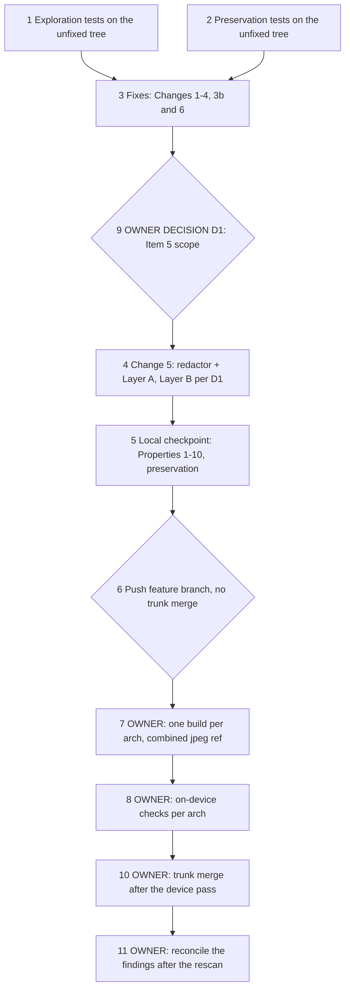

# Implementation Plan

## Overview

This plan implements `bugfix.md` and `design.md` through the bug-condition
workflow for five backend request-handling items, plus one frontend link
(owner decision D5 (b)), in one LocalServer build round batched with the
pending jpeg round.

**The items.** (1) the uncaught-500 body returns internal error text; (2) the
input-image jsonl fallback opens a path without a containment check; (3) the
export route validates `captureIdPath` with an unanchored pattern and no
containment check, (3b) the validation handler logs a rejected query
unmasked, and (3c, owner decision D5 (b)) the result-history download link
joins its credential without `&`; (4) `_failure_reason` returns raw error text
for a non-`GenerationError` on vLLM-capable images; (5) the trigger payload
keeps SigV4 query values in its stored/served/logged sinks (OWNER DECISION D1,
designed both ways).

**The fixes** (design "Changes Required"): fixed 500 body + kept `exc_info` log
(Change 1); `realpath` + strictly-below prefix containment under `INFERENCE_RESULTS_DIR`
(Change 2); anchored `CAPTURED_IDS_PATH_PATTERN` + containment under
`DDA_SYSTEM_FOLDER` (Change 3); the query-log mask (Change 3b); the re-verified
`_failure_reason` helper (Change 4); and the scoped SigV4 redactor applied at
the serve/log sinks (Layer A, no behavior change) and, owner-gated, the stored
column (Layer B, the "download paths stop working" change) (Change 5); and
the `buildExportUrl` export link (Change 6, owner decision D5 (b)).

**Gates and order.**
- Tasks 1 and 2 run on the UNFIXED tree first; their tests and goldens are
  frozen thereafter. Task 1 asserts the fixed behavior, so it fails now and
  passes unchanged after the fix. Task 2 passes both times.
- Tasks 3-5 are local only (host + device-container tests). They authorize no
  push, build, deploy or device action.
- Task 6 is the push gate (feature branch; no trunk merge). The feature-branch
  commit exists only to give the Portal a `source_ref` to build from. This is
  an owner-approved deviation from `.kiro/steering/builds.md` (which asks for a
  device verification before committing edge code), recorded as the jpeg spec's
  task 6 records the same deviation; the steering's rule that on-device code
  reaches the **trunk** only after real-hardware verification is honored by
  deferring the trunk merge to task 10.
- Tasks 7-11 are OWNER-gated: the D1 decision (task 9, gated **before** the
  build), the build round (task 7), the on-device checks (task 8), the trunk
  merge (task 10) and the post-rescan reconciliation (task 11). Tasks 7, 8,
  10 and 11 stay UNCHECKED here; task 9 is checked once the owner's answer is
  recorded (it was given on 2026-10-15).

**Owner decision D1 gates Change 5 and the build.** Task 9 records the owner's
D1 answer; task 4 implements Item 5 per that answer — (a): skip 4.1-4.3; (b1):
4.1 + 4.2 (helper + Layer A); (b2): 4.1-4.3 (also Layer B). Default if
unanswered at the task-9 gate: (b1), recorded in `verification-notes.md`.
The owner answered (b1) on 2026-10-15 (task 9). Changing D1 after the build
(task 7) starts needs another build round per arch, which the owner must
accept explicitly.

**Test commands.** Finite, non-watch:
`PYTHONPATH=src/backend:test/backend-test[:test/backend-test/workflow_engine] pytest <files> --noconftest -p no:cacheprovider`
on the host. Device-container suites (Items 2, 3 containment; anything needing
`gi`/vLLM or a writable `/aws_dda`) run by **image ID** per the steering, never
by the `flask-app:latest` name after a local load. Item 3c uses the SPA's own
scripts in `src/frontend`: `CI=true npm test -- --watchAll=false` and
`npm run build`, after `npm ci --ignore-scripts` (its `prepare` script runs
`husky install`, which writes git config). Property tasks carry
`**Property N**` labels and run with the warning: "This test run contains
property-based tests and may generate/shrink counterexamples."

## Task Dependency Graph

```json
{
  "schemaVersion": 1,
  "waves": [
    {"wave": 1, "tasks": ["1", "2"], "dependsOn": [], "parallel": true, "gate": "unfixed tree only; task 1 cases assert the fixed behavior and must fail, task 2 cases must pass; both frozen thereafter"},
    {"wave": 2, "tasks": ["3"], "dependsOn": ["1", "2"], "parallel": false},
    {"wave": 3, "tasks": ["9"], "dependsOn": ["3"], "parallel": false, "gate": "OWNER DECISION D1; default if unanswered at this gate: (b1), recorded in verification-notes"},
    {"wave": 4, "tasks": ["4"], "dependsOn": ["9"], "parallel": false, "gate": "(a): skip 4.1-4.3; (b1): 4.1+4.2; (b2): 4.1-4.3"},
    {"wave": 5, "tasks": ["5"], "dependsOn": ["4"], "parallel": false, "gate": "local/device-container validation only"},
    {"wave": 6, "tasks": ["6"], "dependsOn": ["5"], "parallel": false, "gate": "explicit push approval (public repo); feature branch only"},
    {"wave": 7, "tasks": ["7"], "dependsOn": ["6"], "parallel": false, "gate": "OWNER-GATED build round; strictly one variant at a time; combined ref build/jpeg-and-input-handling; D1 fixed"},
    {"wave": 8, "tasks": ["8"], "dependsOn": ["7"], "parallel": false, "gate": "OWNER-GATED on-device checks; lab Dell GATED on owner confirming it is up"},
    {"wave": 9, "tasks": ["10"], "dependsOn": ["8"], "parallel": false, "gate": "OWNER-GATED trunk merge after the device pass"},
    {"wave": 10, "tasks": ["11"], "dependsOn": ["10"], "parallel": false, "gate": "OWNER-GATED reconciliation after the main rescan"}
  ],
  "edges": [["1","3"],["2","3"],["3","9"],["9","4"],["4","5"],["5","6"],["6","7"],["7","8"],["8","10"],["10","11"]]
}
```



## Tasks

- [x] 1. Write and run bug-condition exploration tests on the UNFIXED tree
  - **Property 1 (Item 1)**, **Property 3 (Item 2)**, **Property 4 (Item 3)**,
    **Property 9 (Item 3b, fix half)**, **Property 5 (Item 4)**,
    **Item 5 (`not isBugCondition_A`, sink level)**
  - **CRITICAL**: write and run before any production edit. Every case below
    asserts the FIXED (expected) behavior, so it MUST FAIL on the unfixed tree.
    That failure is the counterexample that confirms the defect. The same
    test then PASSES, unchanged, after the fix (task 5). Do not weaken
    assertions or edit production code in response.
  - **Authoring note (property tests):** write the hypothesis property variants
    for Properties 1, 3, 4, 5 and 9 (fix half) **here**, in the same files as
    their example cases below; each FAILS on the unfixed tree. The Property 3
    generator draws
    `st.text(alphabet=st.characters(blacklist_characters="/\x00"))` ∪
    `{".", ".."}` (NUL excluded; see the explicit NUL member below). The
    Property 9 generator defines "names no sensitive key" on
    `str(QueryParams(raw)).lower()`. Property 7/8 are helper-level and are
    authored in task 4.1 (the helper does not exist until then). Every new
    property carries `@settings(max_examples=50, deadline=None)`: the host and
    container runs use `--noconftest`, which drops the suites' hypothesis
    profiles, and the TestClient-driven Properties 4 and 9 would otherwise hit
    the 200 ms default deadline.
  - **NOTE**: no case asserts the bug-present condition. The `¬C` cases
    (legitimate ids, the exact writer shape, a `GenerationError` reason, a
    no-SigV4 payload, a secret-free query) are preservation cases in task 2.
  - Item 1: in a `TestUncaughtExceptionBody` class in
    `test/backend-test/stream_ingest/test_log_redaction.py`, which already
    imports `exception_handlers` and builds a `Request`:
    `try: raise KeyError("source-ref")` /
    `except KeyError as exc: asyncio.run(unhandled_exception_handler(request, exc))`.
    Assert `body["message"] == "Internal Server Error."` and
    `"request_id" in body`. (FAILS unfixed: the message carries
    `KeyError: 'source-ref'`. PASSES after the fix.) Host.
  - Item 2: in `test/backend-test/workflow_engine/test_input_image_containment.py`,
    lift `load_input_image_from_worflow_by_capture_id` with `ast` (the
    `test_overlay_image_serving.py` pattern).
    - In its namespace, stub `validate_token_in_query_param`, make
      `get_is_triton` return `True`, and make `get_inference_result` return
      `None`.
    - Patch `INFERENCE_RESULTS_DIR` to `<tmp>/inference-results`. Install a
      recording `open` shim that maps the literal `/aws_dda/inference-results/`
      prefix to that root.
    - Seed a valid `<tmp>/<cid>.jsonl` one level up, whose `source-ref` names
      an existing temp image.
    - (a) Call with `workflowId=".."`. Assert `HTTPException` 404 and no
      recorded `open` call. (FAILS unfixed: it opens the one-level-up jsonl
      and serves it. PASSES after the fix.)
    - (b) For a contained id whose jsonl is malformed, assert 500 with detail
      exactly `"Server cannot find the input image path."`. (FAILS unfixed:
      the detail carries the exception text and path. PASSES after the fix.)
    - (NUL) An explicit member `captureId="a\x00b"` carrying
      `skipif(sys.version_info < (3, 10))`: assert 404 and no `open`. The
      Property 3 generator excludes `\x00`, so this is the only NUL case; it is
      authoritative in the device container (3.11), skipped on the host (3.9.5).

    Device container by image ID.
  - Item 3: in `test/backend-test/workflow_engine/test_export_path_containment.py`,
    lift the export function over a seeded tree:
    `<tmp>/aws_dda/system/capture-id-path-2025-01-01-00-00-00/` as a
    directory, `<tmp>/target.json` as a JSON list, and `DDA_SYSTEM_FOLDER`
    patched to `<tmp>/aws_dda/system`.
    - (a) Validator: mount the lifted function on a minimal app that registers
      the real `request_validation_exception_handler`. Then `GET` with
      `captureIdPath=/aws_dda/system/capture-id-path-2025-01-01-00-00-00/../../../target.json`.
      Assert 400, and that the stubbed `validate_token_in_query_param`
      recorded no call. (FAILS unfixed: the unanchored pattern accepts. PASSES
      after the anchor.)
    - (b) Containment: call the function directly with
      `<tmp>/aws_dda/system/capture-id-path-2025-01-01-00-00-00/../../../target.json`.
      Assert `HTTPException` 404 and no recorded `open` call at all (the
      unfixed route opens the `..`/symlink path string, not the target's).
      (FAILS unfixed: it opens. PASSES after the fix.)
    - (c) Output encoding: for a missing accepted value, assert the 404 detail
      is exactly
      `"The server can't get the capture id file. Check the path and try again."`.
      (FAILS unfixed: the detail echoes the value. PASSES after the fix.)
    - (d) Symlink (AC5): make `<tmp>/aws_dda/system/capture-id-path-<ts>` a
      **symlink** to a `target.json` outside `<tmp>/aws_dda/system`, call the
      function directly, and assert `HTTPException` 404 with no recorded `open`
      call at all (the unfixed route opens the `..`/symlink path string, not
      the target's). (FAILS unfixed: it resolves and opens the target. PASSES
      after the fix — the only way Item 3's containment branch is reachable
      after anchoring.)

    Device container by image ID.
  - Item 3b: in a `TestRejectedQueryLog` class in the Item 1 module, build a
    `Request` whose raw query string is
    `captureIdPath=/aws_dda/system/capture-id-path-2025-01-01-00-00-00token=DUMMYTOKEN`,
    plus a `RequestValidationError` for that value. Call the real
    `request_validation_exception_handler`. Assert that `"DUMMYTOKEN"` is in no
    `caplog` record and not in the 400 body. (FAILS unfixed, on the log
    assertion. PASSES after Change 3b.) Host.
  - Item 4: in `test/backend-test/text_generation/test_failure_reason.py`,
    assert
    `_failure_reason(ValueError("boom")) == "internal error; see the LocalServer log"`.
    Make the same assertion for a non-`GenerationError` exception carrying a
    `.reason` attribute. (FAILS unfixed: it returns `"boom"` or that
    attribute. PASSES after the fix.) Host.
  - Item 5 (`not isBugCondition_A`, sink level): in
    `test/backend-test/workflow_engine/test_trigger_payload_redaction.py`, drive
    the **real** sink via the executor harness in
    `test/backend-test/workflow_engine/test_trigger_metadata_persistence.py`
    (the `tags:` line is emitted inline in `WorkflowExecutor.execute`,
    `pipeline_executor.py:2371-2375`, not in `_persist_run_metadata`, so a
    hand-built record can't observe Layer A at the production call site):
    1. seed a `WorkflowExecution` row whose `trigger_context_json` embeds a
       dummy presigned-URL payload; use the fake pipeline manager and a temp
       capture root;
    2. run `WorkflowExecutor.execute`;
    3. capture the `"Workflow execution %s completed; tags: %s"` record with
       `caplog` and format it through `RedactingFilter`;
    4. read the persisted `{output_dir}/{capture_id}.json`.

    Assert that none of the dummy credential, date, signature or token
    **values** appears in the persisted JSON or the formatted line. (FAILS
    unfixed; PASSES after Layer A.) Under D1 (a), task 4 marks it
    `xfail(strict=True)`. Host. Dummy SigV4 values use no `AKIA`/`ASIA` prefix
    and `.invalid` hosts.
  - Record each counterexample in `verification-notes.md` "Task 1": the
    failing assertion, the exact unfixed value, and the resolved/opened path.
    Also record the observation that the unfixed constant passes
    `re.search` but fails `re.fullmatch` for the `..`-segment value. That
    observation is not a frozen test, because it would fail after the anchor.
  - **EXPECTED OUTCOME**: every case above FAILS on the unfixed tree, and
    each failure matches the documented counterexample.
  - _Requirements: 1.1, 1.2, 1.3, 1.4, 1.5, 1.6_

- [x] 2. Write and run observation-first preservation tests on the UNFIXED tree
  - **Property 2 (Item 1)**, **Property 9 (Item 3b, preservation half +
    guard)**, **Property 6 (Item 4)**, **Property 8 (Item 5,
    observation-first)**, plus Items 2/3 legitimate-path preservation
  - **IMPORTANT**: observation-first — capture the unfixed behavior as the
    frozen baseline; do not rebaseline after the fix. These are the `¬C`
    cases; each PASSES on the unfixed tree and still PASSES after the fix.
  - Item 1 preservation (Property 2):
    - Over generated `HTTPException`s and `RequestValidationError`s, capture
      the `http_exception_handler` and `request_validation_exception_handler`
      **response bodies** and assert they're unchanged. The fix doesn't touch
      these bodies; Change 3b changes only the handler's log.
    - The uncaught handler's `caplog` record for a raised-and-handled
      `KeyError("source-ref")` carries `exc_info` naming `KeyError` (AC2, kept
      behavior).

    Host.
  - Item 2 preservation, in the Item 2 module:
    - a legitimate slash-free id pair with no `..` serves the seeded jsonl's
      image through the `open` shim (200);
    - with an inference-result row, the route serves the row's image;
    - a contained id with a missing image gets 404.

    Device container.
  - Item 3 preservation, in the Item 3 module:
    - the exact writer-shape `captureIdPath` passes the mounted route's
      validator. Assert only that the handler is entered (the stubbed
      `validate_token_in_query_param` records a call), not the 404 body, which
      the fix changes;
    - a seeded capture-id-path file under the temp tree, called directly,
      yields the zip with the same members and status.

    Device container (host allowed for iteration).
  - Item 3b preservation (Property 9, preservation half and guard), in
    `TestRejectedQueryLog`:
    - For generated query strings naming no sensitive key, the handler's log
      record text equals the unfixed-expression oracle
      `str({"errors": safe_errors, "body": _body_for_log(exc.body), "query_params": request.query_params})`.
      One literal example is also frozen.
    - Structural guard: an `ast` read of `src/backend/endpoints/download_file.py`
      finds `unauthenticated_router = APIRouter()` with no `route_class`
      keyword. That keeps the validation handler the only backend log line
      for a rejected export query.

    Host.
  - Item 4 preservation (Property 6), in `test_failure_reason.py`:
    - `_failure_reason(GenerationError("m", "oom")) == "oom"`;
    - the 502 and SSE bodies for a `GenerationError` with `.reason` are
      `{model_name, reason}` and `{"error": {"reason": ...}}` exactly.

    Host.
  - Item 5 preservation (observation-first), in
    `test/backend-test/workflow_engine/test_trigger_payload_redaction.py`: on
    the unfixed tree, capture the bytes of the metadata JSON and of the
    formatted `tags:` line for a context with no SigV4 value (non-signed query
    params included); freeze them. Host.
  - Run as in task 1.
  - **EXPECTED OUTCOME**: PASS on the unfixed tree; frozen thereafter.
  - _Requirements: 2.6, 3.1, 3.2, 3.3, 3.4_

- [x] 3. Implement Changes 1-4, 3b and 6 (Items 1-4 and 3c)
  - [x] 3.1 Change 1 — fixed 500 body, kept `exc_info` log
    - `src/backend/exceptions/handlers/exception_handlers.py`: return the fixed
      `message` + `request_id` at `:107`; keep `:102` and `:105`; drop the
      now-unused `exception_name` (`:103`). No other handler **body** changes.
    - _Requirements: 1.1, 2.1, 3.1_
  - [x] 3.2 Change 3b — mask the validation handler's query log
    - Same file (`:76`/`:80`): `query_text = str(query_params)`, then
      `logged_query = _body_for_log(query_text)`. Log
      `query_params if logged_query == query_text else logged_query`, so a
      query naming a sensitive key is withheld and a secret-free one keeps
      its exact `QueryParams(...)` text.
    - The 400 response body is unchanged. Don't edit `download_file.py:56` or
      `access_log_router.py` (design DD8).
    - _Requirements: 1.6, 2.6, 3.1_
  - [x] 3.3 Change 2 — input-image containment under `INFERENCE_RESULTS_DIR`
    - `src/backend/endpoints/download_file.py`: import `INFERENCE_RESULTS_DIR`;
      resolve (both `realpath` calls inside the `try`) and guard the sink with
      the strictly-below prefix check `jsonl_file.startswith(base + os.sep)`
      directly in the `if` (design DD1) before `open`; 404 with the fixed detail
      when not contained or on an embedded NUL; make the inner 500 detail the
      fixed string and log at WARNING with `exc_info`; keep the legitimate path
      byte-identical.
    - _Requirements: 1.2, 2.2, 3.2_
  - [x] 3.4 Change 3 — anchor the pattern + export containment under `DDA_SYSTEM_FOLDER`
    - `src/backend/utils/constants.py:109`: anchor `CAPTURED_IDS_PATH_PATTERN`
      with `^...$` and ASCII `[0-9]` digit classes, not `\d` (single consumer
      confirmed; `[0-9]` keeps the validator and a `re.fullmatch` oracle agreed
      since the writer emits ASCII).
    - `src/backend/endpoints/download_file.py`: resolve (realpath inside the
      `try`) and guard with the strictly-below prefix check
      `resolved.startswith(base + os.sep)` plus `os.path.exists(resolved)` in
      the `if` (design DD1) before `open`; 404 with the fixed detail when not
      contained or missing; open the resolved path; drop the input echo from the
      404 detail.
    - _Requirements: 1.3, 2.3, 3.2_
  - [x] 3.5 Change 4 — `_failure_reason` helper (design DD4)
    - `src/backend/endpoints/text_generation.py:423-426`: the
      `GenerationError`-vs-fixed-string helper with the `exc_info` log; no
      call-site or shape change. Note (design DD4): a streaming READY→not-READY
      race now returns the fixed string in the SSE error event instead of the
      not-ready text — accepted, consistent with Item 4.
    - _Requirements: 1.4, 2.4, 3.3_
  - [x] 3.6 Change 6 — the result-history export link (Item 3c, owner decision D5 (b))
    - Unconditional: the owner chose D5 (b) on 2026-10-15.
    - Frontend baseline first, with `src/frontend`'s own scripts on the
      unfixed tree: `npm ci --ignore-scripts`, then
      `CI=true npm test -- --watchAll=false` and `npm run build` (a local
      compile check; no image or component is built). Record the suite and
      build results.
    - Author `src/frontend/src/components/result-history/utils.test.ts`
      before the edit and run it on the unfixed tree. It fails there: there is
      no helper, and the call site still holds the mis-joined template.
      Record the counterexample as an observation of the shipped template:
      for the writer-shape path with auth on, the parsed query holds one
      `captureIdPath` value ending in `token=<credential>` and no `token`.
      - jest unit cases: auth on and off, the writer-shape path, a credential
        holding reserved characters;
      - **Property 10** as a `fast-check` property (`fast-check` is already a
        `src/frontend` devDependency; nothing is added): for any
        `workflowId`, `captureIdPath` and credential, the URL parsed with
        `new URL(…).searchParams` holds exactly the path and, iff auth is on,
        exactly the credential as `token`, under the
        `<workflows endpoint>/<workflowId>/results/export` path;
      - a call-site check: `ResultCardContent.tsx` builds the download link
        through `buildExportUrl`, and the mis-joined template is gone.
    - Add `buildExportUrl` to `src/frontend/src/components/result-history/utils.ts`
      (design Change 6): `encodeURIComponent(captureIdPath)`, and `&token=` +
      `encodeURIComponent(token)` only when auth is on. Use it at
      `ResultCardContent.tsx:302`. No other frontend change.
    - Re-run the SPA suite and build and compare them with the baseline.
    - Its own commit, with its tests (task 6 split (vii)).
    - _Requirements: 1.7, 2.7, 3.7; Acceptance Criterion 16_
  - **STOP**: no push, build, deploy or device action in this task.
  - _Requirements: 2.1-2.4, 2.6, 2.7, 3.1-3.3, 3.5, 3.7_

- [x] 4. Implement Change 5 (Item 5) — redactor + Layer A, Layer B per D1
  - Scope follows task 9's D1 answer (default (b1) if unanswered at the task-9
    gate). Under (a):
    - skip 4.1-4.3 and record the choice;
    - Acceptance Criteria 10 and 11 are N/A;
    - mark the task-1 Item 5 case `xfail(strict=True)`, recording the accepted
      behavior. It asserts the fixed behavior, so it keeps failing by design.
      This is the one sanctioned post-freeze edit; record it in
      verification-notes.
    - The task-2 Item 5 preservation case still applies.
  - [x] 4.1 Add `redact_signed_query`, `_redact_leaves` and `redacted_run_view`
    beside `serialize_trigger_context` in `trigger_runtime.py` (standard-library
    only; mask `***`; total; fixed point; value class per design Property 7;
    `_redact_leaves` keeps a tuple a tuple; `redacted_run_view` never mutates
    its input). **Author the helper
    tests here** in `test_trigger_payload_redaction.py`: Property 7 (masking,
    other-byte preservation, fixed point, non-string passthrough — this covers
    AC11), Property 8 (no-SigV4 context returned byte-identically), and the
    `redacted_run_view` non-mutation case. Dummy SigV4 values use no
    `AKIA`/`ASIA` prefix and `.invalid` hosts. _(b1 and b2)_
    - _Requirements: 2.5, 3.4; Acceptance Criterion 11_
  - [x] 4.2 Layer A (no behavior change): add `from workflow_engine.trigger_runtime
    import redacted_run_view` to `pipeline_executor.py`'s existing
    `from workflow_engine import …` grouping (near `:88`) and
    `from workflow_engine.trigger_runtime import redact_signed_query,
    redacted_run_view` to `api.py` (each module imports only the names it
    uses); dump `redacted_run_view(tag_values or {})`, computed before the file
    is opened, in `_persist_run_metadata`; compute `logged_tags =
    redacted_run_view(tag_values)` inside `try/except RecursionError` (fixed
    placeholder `"<tags withheld: too deeply nested to mask>"`) and pass it as
    the `tags:` log argument; return `redacted_run_view(read_run_metadata(...))`
    from `get_workflow_execution_metadata`; wrap the `/log` text in
    `redact_signed_query(read_run_log(...))`. **Author the serve-time masking
    cases here (AC10 bullet 3):** seed a pre-upgrade run directory whose metadata
    JSON and `run.log` carry unmasked dummy values, call
    `get_workflow_execution_metadata` and `get_workflow_execution_log` from
    `workflow_engine.api` mounted as in `test_overlay_image_serving.py`, and
    assert every SigV4 value reads `***` with every other byte unchanged. Also
    author a case that patches `pipeline_executor.redacted_run_view` to raise
    `RecursionError`, runs `WorkflowExecutor.execute` through the harness, and
    asserts the run is COMPLETED and the `tags:` record carries the
    placeholder. State
    in `verification-notes.md` that this covers runs recorded before the upgrade
    and changes no run behavior. `pipeline_executor.py` is hash-pinned (CSI
    golden): rebaseline the one entry in THIS commit (see task 5) and name it in
    the message. _(b1 and b2)_
    - _Requirements: 2.5, 3.4, 3.6; Acceptance Criterion 10_
  - [ ] 4.3 Layer B (OWNER-GATED on D1 = b2): replace the body of
    `serialize_trigger_context` with `return json.dumps(_redact_leaves(context
    or {}), default=lambda v: redact_signed_query(str(v)))`, so every string
    leaf is masked (not only `payload`) and the payload is never parsed or
    re-serialized. Add the Layer B case (`not isBugCondition_B`):
    `load_trigger_context(stored)["payload"] == redact_signed_query(original)`
    (so `payload_json` re-derives with the same keys), and a SigV4 value in a
    non-`payload` string leaf of the stored context reads `***`.
    Record in `verification-notes.md` that this is the "download paths stop
    working" change. Every SigV4 value a run reads back from its trigger
    payload is then masked:
    - presigned-URL fetches (`output_bindings.py:2313-2321`) fail;
    - signed values surfaced through metadata bindings
      (`resolve_metadata_binding`, `output_bindings.py:460`) or `{trigger.…}`
      placeholders (`llm_inference.render_prompt`, `llm_inference.py:65`)
      read `***`.

    Only under (b2). _(b2 only)_
    - _Requirements: 2.5; owner memo D1, D2.1_
  - **STOP**: no push, build, deploy or device action in this task.
  - _Requirements: 2.5, 3.4, 3.6_

- [x] 5. Local checkpoint — Properties 1-10, preservation suites, build-gate replay
  - Re-run the task-1 tests, unchanged. They now PASS, except the Item 5 case
    under D1 (a), which stays `xfail(strict=True)`. Run the property variants
    here: Properties 1, 3, 4, 5 and 9 (authored in task 1), and the helper-level
    Properties 7 and 8 and the serve-time masking cases (authored in task
    4.1/4.2). Then run the frozen task-2 tests, which still PASS. Record which
    command runs each file: host `--noconftest`, or the device container by
    image ID.
  - Re-run the SPA's suite and build (task 3.6's commands), which include
    Property 10, and compare them with the task-3.6 frontend baseline.
  - Device-container image: the local backend image whose dependencies match
    this tree's pins (today `flask-app:latest`, Python 3.11.9, fastapi
    0.109.2 / pydantic 2.6.4). The image has **no** `pytest` or `hypothesis`, so
    the container run installs them first. Command (by image ID `$IMG`, tree at
    `/w/repo` so `/` doesn't shadow the tree's backend):
    `docker run --rm --pull never -v "$(pwd)":/w/repo:ro -w /w/repo
    -e PYTHONDONTWRITEBYTECODE=1
    -e PYTHONPATH=/w/repo/src/backend:/w/repo/test/backend-test:/w/repo/test/backend-test/workflow_engine
    --entrypoint bash "$IMG" -lc 'PY=$(command -v python3.11 || command -v
    python3.10); $PY -m pip install --no-cache-dir --quiet pytest hypothesis;
    $PY -m pytest <files> -q -p no:cacheprovider --noconftest'` (or
    `--network none` with a mounted wheelhouse). Record its image ID,
    interpreter version, and the installed `pytest`/`hypothesis` versions. If a
    local JP6 backend image (Python 3.10) with the same pins is available, also
    run the two containment modules there and record it. Otherwise record "3.10
    covered by the stdlib probe and the Orin check". The explicit NUL member
    skips below 3.10, so only the container run counts for it.
  - Run the affected existing suites: `test/backend-test/stream_ingest/`
    (log-redaction + the new handler cases), `test/backend-test/text_generation/`,
    `test/backend-test/workflow_engine/` (the new lifted modules), and — in the
    device container only — `api-endpoints/test_inference_result_api.py` and
    `api-endpoints/test_workflows_api.py` (they don't collect on the host).
  - Preservation: run `test/backend-test/csi_nvargus_optional/test_preservation_csi_surface.py`
    and the security guard suite
    (`test/backend-test/security/preservation/test_preservation_out_of_scope_guard.py`,
    `..._secrets_out_of_scope_guard.py`). Only Layer A touches a hash-pinned
    file (`pipeline_executor.py`, CSI golden
    `backend_csi_consumers_sha256.json`): under (b1)/(b2), `sha256sum
    src/backend/workflow_engine/pipeline_executor.py`, update that one golden
    entry in the Layer A commit, and re-run the CSI suite. Changes 1-4 and 3b
    touch no hash-pinned file — confirm with the guard suite. (On the host, the
    CSI consumer golden's `nodes.py` entry is a pre-existing failure unrelated
    to this spec — record it as such.)
  - **Build-gate replay (AC13).** Run `build-custom.sh`'s in-image gate body in
    the local backend image by image ID — the single-quoted `bash -c` script of
    its "Running backend unit tests inside the flask-app image" block (the
    backend unit tests, the stream-component gate, `test/backend-test/security/
    preservation`, and the six security audit gates with their exploration and
    negative-fixture suites). Use jpeg task 5's mechanism: extract the body
    verbatim, derive a copy that turns line 1's `set -e` into `set +e` with an
    ERR trap, run it against a **writable copy** of the tree (never the
    worktree, which the gate's conftest writes into), by image ID. Run the same
    replay on the base commit and compare. Record known off-device failures as
    pre-existing — the first block's auth/user-management unit tests need
    `libtritonserver.so`, and the stream-component gate needs real GStreamer/PyAV
    the local image lacks — and require the six audit gates to pass in both runs.
    Record the results in `verification-notes.md`. (This also de-risks the six
    builds in task 7, which run this same gate in-image before packaging.)
  - For any device-container run, use the image ID per the steering (never the
    `flask-app:latest` name after a local load).
  - Record commands, pass/fail counts, the rebaseline (file + sanctioned path +
    reason) if any, the gate-replay comparison, and any pre-existing unrelated
    failures in `verification-notes.md`.
  - **STOP**: no deploy, push, SSM command, instance action, artifact
    publication or build in this checkpoint.
  - _Requirements: 2.1-2.7, 3.1-3.7; Acceptance Criteria 1-13, 16_

- [ ] 6. Approval-gated commit and push to the feature branch (no trunk merge)
  - **STOP: obtain explicit user approval after task 5. Local completion is not
    push approval.**
  - Present the exact diff scope and run the per-repo secret-hygiene checks over
    the diff: confirm no credentials, tokens, account ids, ARNs, hostnames, LAN
    addresses, thing names, bucket names, registry URIs, personal names or
    analyzer/tool identifiers appear in any added text, and no analyzer
    suppressions were introduced. Re-run the hygiene grep over the whole spec
    dir and record the result.
  - Run the uncommitted wording checklist in the state directory
    (`.agents/localserver-input-handling/wording-checklist.md`, not in this
    repo) over the diff, the commit messages and this spec directory; record
    pass/fail only. The checklist's terms are not listed in this repo.
  - Commit split (design "Rollback Considerations"), each with its own baseline
    update where one applies: (i) Changes 1 + 3b (the handler file); (ii) Change
    2; (iii) Change 3 (constant + export route); (iv) Change 4; (v) Layer A
    (with the CSI golden rebaseline, under b1/b2); (vi) Layer B (under b2);
    (vii) Change 6, the frontend export link (owner decision D5 (b)), with its
    jest tests. Then a `docs(spec)` commit for this spec directory. Each
    commit carries its item's task-1/2 tests and properties; the 4.1 helper
    and its tests ride commit (v).
  - Stage named files only (no `git add .`); messages framed as input
    validation / path containment / output encoding / error-response hardening
    (neutral wording only); each body states what was verified locally and that
    on-device verification is pending. Run `git fetch origin`; if the trunk
    moved, merge it in (never rebase/force) and re-run task 5. Push with
    `git push -u origin spec/localserver-input-handling`. Do NOT merge into or
    push `remediation`/`integration/all-specs`/`main` — that is task 10.
  - This task authorizes the push only, not any build.
  - _Requirements: bugfix "Validation constraint"; steering builds.md_

### OWNER-gated tasks — NOT executed in this run, leave UNCHECKED

- [x] 9. OWNER DECISION: Item 5 accept vs fix (owner memo D1) — gate before the build
  - The owner selects one of:
    - (a) accept;
    - (b1) fix Layer A only: the serve/log sinks, with no behavior change;
    - (b2) fix Layer A + Layer B: also mask the stored column. This accepts
      that every SigV4 value a run reads back from its trigger payload is
      masked. Presigned-URL fetches taken from it stop working, and signed
      values surfaced through metadata bindings or `{trigger.…}` placeholders
      read `***`. Non-signed fields are unchanged.

    Recommendation and the deciding input are in the owner memo. The deciding
    input is whether any deployed workflow consumes a signed value from the
    trigger payload, by fetch, metadata binding or `{trigger.…}` placeholder.
    **Default if unanswered at this gate: (b1)**, recorded in
    `verification-notes.md`.
  - **Placement note.** This task is listed under "OWNER-gated — NOT executed in
    this run", but it is wave 3 (it precedes task 4 in the dependency graph) so
    the implemented Item 5 scope and the build carry the owner's choice. The
    implementation run passes this gate with the default (b1) when the owner is
    silent, records that in `verification-notes.md`, and leaves this box
    UNCHECKED until the owner confirms a choice. Changing D1 after task 7 starts
    needs another build round per arch (owner must accept explicitly).
  - Record the answer and the resulting Item 5 code scope in
    `verification-notes.md` "Task 9".
  - Also record at this gate the D3 answer (it sets task 7's build source),
    the D2.2 answer (no fold: the fold option is not part of this round, and
    any opt-in is a follow-up round) and the D5 answer ((b): task 3.6 is in
    this round).
  - **Owner answers (2026-10-15):** D1 (b1); D2 accepted, D2.2 no fold; D3
    batch; D4 dismiss the six now (applied on 2026-10-15; bugfix "Items
    reviewed and left unchanged"); D5 (b).
  - _Requirements: 2.5; owner memo D1_

- [ ] 7. OWNER: one LocalServer build per architecture, combined with the jpeg round
  - **STOP: separate explicit build approval. Builds run strictly one variant at
    a time (steering).** The owner triggers builds from the Portal.
  - Sequencing (design "Build Rounds"): (1) bring
    `spec/jpeg-folder-source-decode` up to the trunk tip (merge, never
    rebase/force) and re-run its suites; in the merge-up commit, add this
    spec's jpeg folder-source non-regression definition (design "Per-item
    device check content") to jpeg's `verification-notes.md`, stating it
    doesn't replace jpeg task 8b; (2) land this spec's fix commits; (3)
    create `build/jpeg-and-input-handling` from the trunk tip and merge both
    feature branches into it (merge commits; no rebase/force); recompute **every**
    pinned CSI golden entry from the merged tree (resolve the merge conflict in
    `backend_csi_consumers_sha256.json` by `sha256sum` of each merged file —
    `pipeline_builder.py`, `csi_capture.py`, `pipeline_executor.py`,
    `catalog/nodes.py` — never by taking one branch's side, which would drop the
    other's `nodes.py`/`pipeline_executor.py` value), re-run the CSI
    preservation suite and both specs' suites, and record the ref and the
    recomputed hashes in both specs' `verification-notes.md`.
  - This is also the jpeg spec's task 7: these six builds ARE jpeg's task-7
    builds. Run jpeg task 7's offline built-image check (its task 4.2 U/X and
    task 4.4 rows for the build's arch, on the built `flask-app` image) on the
    `amd64`, `amd64Nvidia`, `arm64` and `arm64JP7` builds, and record the
    build-source change (the owner memo D3 answer: build from
    `build/jpeg-and-input-handling`, not `spec/jpeg-folder-source-decode`) in
    jpeg's `verification-notes.md` "Task 6". Perform jpeg task 7's per-build
    duties in full on these builds: confirm from the amd64 build log that the
    image is Ubuntu 22.04 with GStreamer 1.20.3; record the first
    amd64/amd64Nvidia/arm64 versions that contain C3/C3b (for jpeg task 10);
    and run the offline built-image check above.
  - Pushes (public repo): after the hygiene check (task 6's checks and the
    wording checklist) over the merge-up diff and the combined diff, and with
    the owner's approval: `git push origin spec/jpeg-folder-source-decode` and
    `git push -u origin build/jpeg-and-input-handling`. Merge commits only,
    never force.
  - Pre-build checks per `.kiro/steering/builds.md`: `pgrep` shows no running
    build; guard suites green; the build-gate replay (task 5) is green on the
    combined ref; `cdk.out` moved aside; no Portal deploy running; no
    preservation-tracked drift (confirm the recomputed CSI entries are in).
  - Build each architecture ONCE from the combined ref, strictly one variant at
    a time: `amd64`, `amd64Nvidia`, `arm64` (generic CPU), `arm64JP5`,
    `arm64JP6`, `arm64JP7`. jpeg's `arm64JP7` verification build rides along;
    the hardening fixes add the JP5/JP6 builds and share amd64/amd64Nvidia/JP7.
  - Record each build's component name and version in `verification-notes.md`
    (name and version only; no URIs, ARNs or account ids).
  - _Requirements: Acceptance Criterion 14; steering builds.md; owner memo D3_

- [ ] 8. OWNER: on-device verification per architecture
  - **STOP: separate explicit approval. "Done" requires a built-and-deployed
    component (hot-patch is for iteration only).** For each arch: deploy by
    copy-and-edit, exercise the items end-to-end, then soak at least 30 minutes
    with at least 10 workflow runs and at least 10 requests per exercised route,
    confirming no crash/restart/crash-loop; then restore.
  - Device mapping and per-item checks are in design "On-device verification per
    architecture":
    - **arm64JP5 → MIC-730**: Items 1, 2, 3, 3b, 3c, 5 + the jpeg
      folder-source non-regression check (Per-item device check content).
    - **arm64JP6 → Orin**: Items 1, 2, 3, 3b, 3c, 4, 5 + the jpeg
      folder-source non-regression check (Per-item device check content; it
      covers the PNG staging path).
    - **arm64JP7 → thor1**: Items 1, 2, 3, 3b, 3c, 4, 5 (shares the jpeg
      spec's task 8b thor1 verification build).
    - **amd64 → the lab Dell**: Items 1, 2, 3, 3b, 3c, 5. **GATED** on the
      owner confirming the lab Dell is up (offline for a GPU upgrade).
    - **amd64Nvidia → the lab Dell (nvidia profile)**: Items 1, 2, 3, 3b, 3c,
      5. **GATED** on the lab Dell being up and switched; else record
      built-only. jpeg task 9's preconditions apply: switch the lab Dell to
      amd64Nvidia only after jpeg task 8 passes on amd64; don't re-run station
      quick setup; the image's Volta (sm_70) support is UNVERIFIED (jpeg task
      9's open item).
    - **arm64 (generic CPU) → no lab device**: built-only; record the offline
      image check.
  - Per-item checks are in design "Per-item device check content". Each uses a
    deterministic inducer so it can't pass vacuously. On an auth-enabled
    station every check's requests carry a valid credential: `token=<valid>`
    on the download routes (Items 1, 2, 3) and the bearer header on the API
    routes (Item 4's generate routes, Item 5's `/metadata` and `/log`). Item
    3b's request carries only the mis-joined dummy value, which validation
    rejects first.
    - **Item 1:** write a non-JSON scratch file
      `/aws_dda/system/capture-id-path-2000-01-01-00-00-00`, GET export with
      that `captureIdPath` (add `&token=<valid>` on an auth-enabled station),
      expect 500 with body **exactly** `{"message": "Internal Server Error.",
      "request_id": <id>}` and an application-log traceback carrying that id;
      delete the file.
    - **Item 2:** send `GET /workflows/%2E%2E/capture-details/<cid>/input-image`
      (percent-encoded, or `curl --path-as-is` with a literal `/../`, because a
      plain client collapses `/../` before sending) and expect 404 with body
      `message` **exactly** `"Server cannot find the input image path."` — the
      route's own body, not the router-miss `{"detail": "Not Found"}`. Then
      send `GET /workflows/<scratch-wf>/capture-details/a%00b/input-image` and
      expect 404 with the same `message` and a healthy backend (the current
      build answers 500 with the NUL error; on the Orin this is AC4's 3.10
      evidence). If a device rejects the NUL before the route, record that
      outcome and reword AC4's NUL bullet and the three "Orin check" claims to
      "3.10 covered by the stdlib probe only".
    - **Item 3:** POST then GET export with the server-returned `captureIdPath`
      → zip; a value with an appended `/../` → 400 at validation.
    - **Item 3c (frontend, owner decision D5 (b)):** download a few results
      from a workflow's result history in the device SPA and expect the zip;
      with auth off the link carries no `token`. On at least one auth-enabled
      station, the same download succeeds (the current build answers 401),
      the link carries `&token=` as its own parameter (record the shape only,
      never the credential), and `application.log` has no validation-handler
      record for it.
    - **Item 4 (JP6/JP7):** with a multimodal model READY (a text-only model
      ignores the image with a warning and answers 200), POST
      `/text-generation/<model>/generate` and `/generate-stream` with
      `{"prompt": "…", "image": "<base64 of a JPEG cut after its header>"}`;
      expect a 502 whose `reason` starts with
      `"failed to decode the supplied image bytes:"`, and exactly one SSE
      `{"error": {"reason": …}}` event. The truncated JPEG (valid header,
      cut-off data) is used rather than an OOM, which can mark the model FAILED
      and disturb the soak. The unexpected-error path may be "not inducible on
      device; unit-tested only" — record that if so.
    - **jpeg folder-source non-regression (MIC-730, Orin):** (1) a
      `folder_source` → `capture` workflow over a scratch folder of at least 3
      JPEGs completes for each image, and the images are consumed; (2) a
      non-bridged mixed flow (`folder_source` first, plus
      `custom_python_source` → `capture`) completes, and its logged launch
      string keeps the file segment first; (3) neither the `Pinned jpegdec …`
      nor the `Moved the Frame_Feed segment …` INFO line appears in either
      run's `run.log`; (4) on the Orin only, the folder run decodes a staged
      `.dda_decoded.png` (the `pngdec` chain, jpeg design D9) rather than
      `jpegdec`, and both files are consumed after the run. Record the results
      in both specs' notes; this doesn't replace jpeg task 8b (thor1).
  - Item 3b check, per design:
    - send one export request with a mis-joined dummy `token=` value and
      expect 400;
    - confirm the validation handler's record is present with
      `[body withheld: it may contain credentials]` for `query_params`;
    - confirm the dummy value appears in none of `application.log`,
      `service.log` or the container console output.

    No access-log line is expected for the download routes. If the dummy
    value turns up in one, record it and stop. Don't narrow the check.
  - Item 5 (b1/b2) check — exercise the **pre-upgrade** run, which is the (b1)
    promise, not only a new run: before deploying the new build, run one
    workflow on the current build with a dummy signed-URL-shaped payload and
    note its execution id; after deploying, GET its `/metadata` and `/log` and
    confirm every SigV4 value reads `***`, and do the same for one new run and
    the application log. Dummy payloads only; record only masked output. Under
    (b2), confirm the stored column is masked.
  - Record build version, device results (no thing names / hostnames / LAN
    addresses / bucket names) and the sustained-health observation per arch in
    `verification-notes.md`. Keep the spec open until each affected arch has an
    on-device pass or an owner-recorded built-only disposition.
  - _Requirements: 2.1-2.7; Acceptance Criterion 14; steering builds.md_

- [ ] 10. OWNER: trunk merge after the device pass (both specs' hardware gates)
  - **Precondition — merge the combined ref only after BOTH hold:**
    1. this spec's task 8 has passed (MIC-730, Orin, thor1 verified;
       amd64/amd64Nvidia a device pass or an owner-recorded built-only
       disposition); AND
    2. the jpeg spec's own trunk-merge precondition (its task 11): jpeg task 8
       on the lab Dell (amd64) and jpeg task 8b on thor1 have passed.
    The combined ref carries jpeg's Ubuntu-22.04 (x86/arm64-CPU) device fix,
    whose primary hardware check is jpeg task 8 on the lab Dell. This spec's
    task 8 accepts a lab Dell built-only disposition, so merging on task 8 alone
    would land jpeg's fix on the trunk unverified — against jpeg task 11 and the
    steering's CRITICAL rule. Hence both gates.
  - **If (2) can't be met** (for example the lab Dell is still down for its GPU
    upgrade): do NOT merge the combined ref. The owner picks one:
    - (a) wait for the lab Dell; or
    - (b) merge `spec/localserver-input-handling` **alone** to the trunk — its
      fixes were verified on MIC-730/Orin/thor1 in the combined images, with
      amd64/amd64Nvidia left owner-recorded built-only — and leave jpeg to its
      own task 11. Record that the trunk tree then differs from the built
      (combined) tree by jpeg's files. Merge with the same pattern (into
      `remediation`, fast-forward `integration/all-specs`, then merge to
      `main`). jpeg's later trunk merge then meets the same CSI golden
      conflict and recomputes every pinned entry from its merged tree.
  - **When both hold**, this one merge also performs jpeg's task 11:
    - use jpeg's trunk-merge pattern: merge the combined ref into `remediation`,
      then fast-forward `integration/all-specs` to it; then merge to `main`
      (the owner's instruction for this spec);
    - record the merge in jpeg's `verification-notes.md` and carry jpeg task
      11's PR note (any ComputeStack deploy from the trunk now publishes jpeg's
      C1 together with C1b, which jpeg task 4.5 showed safe for older
      LocalServers);
    - merge only; never rebase/force. The PR lists the devices verified on which
      arch, for both specs.
  - **Caveat (L5):** "exactly the built tree" holds only if the trunk didn't
    move since task 7. If it did, merge the interim trunk commits into the
    combined ref first and re-run the CSI recompute if any pinned file moved;
    the trunk then receives the built tree plus those interim commits.
  - **Failure path (either spec's device check fails on the combined images):**
    fix on that spec's own branch, re-merge into the combined ref, rebuild only
    the arch(es) the fix touched (one variant at a time), and re-run both specs'
    checks on those devices. The owner may instead drop the failing spec from
    the combined ref, which needs a rebuild.
  - The feature-branch commit (task 6) existed only to give the Portal a
    `source_ref`; this is where on-device-verified code reaches the trunk, per
    the steering.
  - Update `verification-notes.md` and record the merge.
  - _Requirements: steering builds.md (on-device code reaches the trunk only
    after real-hardware verification); jpeg spec task 11_

- [ ] 11. OWNER: reconcile the findings after the main rescan
  - After the trunk rescan, account for the five changed static-analysis
    findings. Each must be closed, or dismissed with a recorded reason:
    1. `src/backend/exceptions/handlers/exception_handlers.py:107` (Item 1);
    2. `src/backend/endpoints/download_file.py:113` (Item 2);
    3. `src/backend/endpoints/download_file.py:318` (Item 3);
    4. `src/backend/endpoints/download_file.py:323` (Item 3);
    5. `src/backend/endpoints/text_generation.py:660`, with its second path at
       `:713` (Item 4).
  - Expected residual dismissals (fallback only — the strictly-below prefix
    guard is expected to clear the Item 2/3 lines; see design DD1):
    - Item 4's engine-wrapped `GenerationError.reason` path: "contract reason,
      Req 5.7";
    - any containment-guarded Item 2/3 line still flagged: "contained: realpath
      + strictly-below prefix guard".
  - Item 3b's log mask, Item 3c's link and Item 5 have no standalone finding.
    They're verified by Acceptance Criteria 7, 10-12 and 16 and the task-8
    device checks, and aren't counted among the five.
  - The six dismissals in bugfix "Items reviewed and left unchanged" (false
    positive ×3, won't fix ×2, used in tests ×1) were applied on 2026-10-15
    (owner decision D4) and are recorded in `verification-notes.md`; they are
    not part of this task, which handles only the five findings above.
  - Record the rescan outcome per finding (by file:line, as above) in
    `verification-notes.md`.
  - _Requirements: Acceptance Criterion 15_

## Notes

- Tasks 1 and 2 are standalone pre-fix tasks on the UNFIXED tree; both baselines
  are frozen and the fix must make task 1 pass while keeping task 2 passing
  without touching either test.
- Items 2 and 3 use the repo's `realpath` + strictly-below
  `startswith(base + os.sep)` idiom (`run_retention._within`) with the
  `ValueError` guard and the `realpath` calls inside the `try` (design DD1); the
  containment failure reuses each route's existing 404, so no new status surface
  is added. The strictly-below prefix form (not `commonpath` equality) is the
  shape the path-handling rule models as a check, so it is expected to clear the
  rescan. The embedded-NUL case is an explicit skip-guarded member counted only
  in the device container; the Property 3/4 generators exclude `\x00`. The
  device interpreters (3.10 on JP6, 3.11 elsewhere) raise `ValueError` on a NUL;
  the host's 3.9.5 doesn't, so the explicit NUL member skips below 3.10.
- Polarity (all of task 1): each case asserts the fixed behavior, FAILS on the
  unfixed tree and PASSES unchanged after the fix. `¬C` cases are task 2.
- Item 3b's mask sits at the request-validation handler, the only backend log
  line for a rejected export query. The download router isn't access-logged,
  and the Property 9 guard pins that.
- Item 3's anchoring makes the request validator answer the app's existing
  request-validation **400** (`exception_handlers.py:87`), not 422.
- Item 4 affects vLLM-capable images only (JP6, JP7). The residual
  engine-wrapped `GenerationError.reason` path keeps its Req 5.7 reason and is
  dismissed in task 11, not changed. On the streaming path a READY→not-READY
  race now returns the fixed string in the SSE error event (design DD4) —
  accepted, consistent with Item 4.
- Item 5's two layers are independent and revert independently; Layer B is gated
  behind D1 and never lands unacknowledged. Only Layer A touches the
  hash-pinned `pipeline_executor.py`; only its commit carries the CSI golden
  rebaseline.
- Item 3c (owner decision D5 (b)) is the one frontend change. It rides the
  react-webapp image, which every build round produces, so it adds a device
  check but no build round, and its commit (vii) reverts on its own.
- The six static-analysis dispositions live in `bugfix.md` (committed) and
  were applied on 2026-10-15 (owner decision D4); the owner memo at
  `.agents/localserver-input-handling/owner-decisions.md` is the uncommitted
  decision aid, not a committed dependency.
