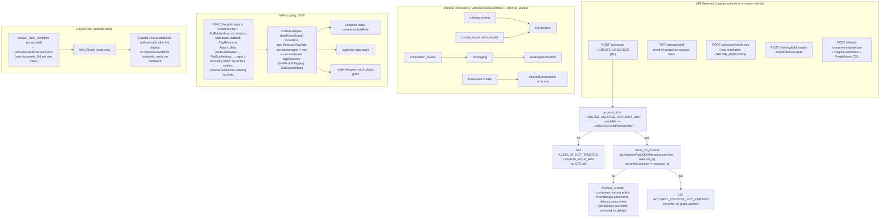

# Design Document

## Overview

This spec closes eight authorization-consistency and IAM-scoping items in the Edge CV Portal, numbered I1–I8, that were identified alongside, and deliberately left out of, the `portal-usecase-bucket-config` change. I1–I7 are code, infrastructure, documentation and account-operation changes; I8 is the stacking and composition rule itself (this spec is stacked on that change, which landed on the trunk `integration/all-specs` at `f191d580` and on main, merged 2026-10-14, and composes with its API shapes: the same flat refusal envelope `{'error': <message>, 'error_code': ...}` — new codes here keep the trunk's `SCREAMING_SNAKE` convention of `rbac_middleware.py:332–371` and of `INSUFFICIENT_PERMISSIONS` at `shared_utils.py:2073` (2064 before the sibling landed), and the one known divergence, the sibling's lowercase bucket codes (eleven, landed lowercase; recorded by task 0.1), is recorded in Requirement 10.2 rather than papered over — the same `log_audit_event` call style, and its single bucket allowlist — `s3_bucket`, `data_s3_bucket`, `additional_s3_buckets`, portal artifacts bucket, extended here by the one use-case bucket field outside it, `inference_uploader_s3_bucket`. Nothing here introduces a second allowlist).

**Technology stack (locked):** Python 3.11 Lambda handlers and the SharedLayer (`shared_utils.py`), with the `boto3`/`botocore` the `portal-usecase-bucket-config` spec vendors into that layer (its R9.13; relied on, not re-pinned — see I5 "Runtime prerequisite"); S3 Control `TagResource` for bucket tags and S3 `PutBucketAbac`/`GetBucketAbac` for ABAC; DynamoDB as today; CDK (TypeScript) for the compute, synthetic-data, node-designer and API stacks; React 18 + Cloudscape + vitest for the frontend; pytest + moto + hypothesis for the backend (Python 3.11 lane), jest + fast-check for infrastructure, bats for the deploy scripts. No new tables, no new API Gateway routes, no new dependency.

The work falls into three classes, kept separate throughout so the owner can see what runs where:

- **Portal-only** (code, CDK, docs, tests; deployed with `deploy-infrastructure.sh`): use-case creation permission and proof of control (I1), source-derived auto-trigger gates (I2), the provision route's authorizer and the route inventory (I3), dead-code removal (I4), the tag-conditioned Lambda-role S3 grant and its ABAC lifecycle (I5), the deploy-time enforcement acknowledgement (I7).
- **Account operations** — **Runbook_Tasks** (requirements glossary): the owner approved running every task once the design is approved, so these are written as executable runbooks (exact commands, pre-checks with expected output, the write, verification, rollback) and executed by the implementation; a failed pre-check stops the task and asks instead of guessing. They are: the ABAC live probe and the tag/ABAC backfill of already-registered buckets before the conditioned grant deploys (I5, tasks 5.3), the portal deploy (9.2), the post-deploy verification's throwaway test resources (9.3's runbook block: buckets, tags, ABAC, throwaway use cases and their cleanup; its IAM, audit and log-scan steps are read-only), generating IAM last-accessed data and reading CloudTrail for the device role, detaching the two hand-attached policies (I6, tasks 6.4–6.5), the station-installer verification against a Fresh_Registration on a lab Jetson (I6, task 6.2's device step, after 9.3), and landing on the trunk (9.4).
- **Device-affecting** (verified on real hardware before being called done, per `.kiro/steering/builds.md`; both are Runbook_Tasks): the reconciled station IAM templates, whose lab verification runs the station installer against a Fresh_Registration on a lab Jetson after the deploy has been verified (6.2), and the policy detachment (I6, 6.5). No device component, recipe or on-device code changes. The reachable lab devices at the time of writing are the JetPack 5, JetPack 6 and JetPack 7 Jetsons; the lab x86 workstation is powered off for a hardware upgrade and is not assumed available.

The owner has answered every decision this spec raised. The decisions are recorded below as **decision records** (D1–D8), each pinned to the chosen option; no alternative is left for the implementer to pick. The D6 detach timing — formerly gate G2 — is now fixed by the owner: **immediately after the portal deploy, with the evidence window taken from historical data** (IAM last-accessed over its lookback, CloudTrail over its retention), not from a future waiting period. One **owner gate** remains and is asked only when reached: **G1** — the D5 fallback (if the tag-condition verification fails for a required action, stop, record the result, and ask before implementing the deploy-time allowlist, including the fresh-install `DATA_BUCKET_ALLOWLIST='*'` acknowledgement that only exists under the fallback).

All evidence cites the trunk at `48841a0` as seen in the worktree. Line numbers were re-read in this worktree at revision time.

## Composition contract with `portal-usecase-bucket-config`

The sibling spec has **landed**: `portal/usecase-bucket-config` — its spec, the vendored SDK, the shared-layer primitives, the handlers, the UI, the docs and its verification record — is on the trunk `integration/all-specs` at `f191d580` and on main (merged 2026-10-14); its deploy runbooks remain the owner's. This contract is pinned to its **requirement and design identifiers**, not to its prose — the prose changed repeatedly while this document was written, and what the implementer reads is the landed code — and the names below were read from its text and **confirmed against its code where a row says so**; task 0.1 re-confirmed every row on the landed trunk before any code was written here (gate satisfied; the landed-differences table at the end of this section). Each row names the identifier, states what this spec relies on, what (if anything) it changes, and what 0.1 must confirm. Names the landing could still change — the attach validator, the attribute of its result that carries the tags it read, the remedy constant, the error-code constants, the vendored SDK version — are recorded from the landed code by 0.1 and never assumed. Where this spec deliberately changes what the sibling specified, the row says **supersession** and names the identifier, so the two specs never silently disagree; **there is no such row at this revision**. The one supersession earlier revisions carried — routing the sibling's tag write through a client-typed helper — was withdrawn when the sibling's landed creation path was read: it supplies the tags **in the `CreateBucket` request** (`CreateBucketConfiguration.Tags`), enables ABAC, reads the tags back and uses S3 Control `TagResource` only as a fallback, so no helper taking an `s3control` client could wrap the primary write; its replacement is a one-line addition inside the sibling's tag-list builder (row R9.4–9.5, task 5.4). The row that was a supersession two revisions ago — the CLI command in the sibling's tag remedy constant — is "confirm, no edit expected": the sibling's text and code already carry the `aws s3control tag-resource` form. **ABAC action spelling:** the sibling landed `s3:PutBucketABAC` (`compute-stack.ts:1083` on the trunk; its R9.12, design §6.1, tasks 0.7/2.1) and grants no `GetBucketABAC`, so this document spells **both** IAM actions with that casing — `s3:PutBucketABAC`, `s3:GetBucketABAC` — everywhere (requirements glossary ABAC_Action_Spelling), the `Get` string derived by the same-casing rule because it has no landed source; 0.1 confirmed the landed `Put` string and recorded the derivation. The **landed-differences table** at the end of this section was filled by 0.1; a difference that changes a behaviour this spec depends on would have stopped 0.1 and asked the owner (Requirement 10.1) — none does.

| Sibling identifier | What this spec relies on | What this spec changes | 0.1 confirms in the landed code |
|---|---|---|---|
| R5.1–5.3; design §1.2 (`BucketConfigError.to_body`, remedy constants) | The refusal envelope: `error`, `error_code`, plus `bucket`, `usecase_id`, `purpose`, `reason`, `remedy` where relevant. Every new refusal here uses `error` + `error_code` (+ `remedy` where one exists). Casing: the sibling's codes are lowercase; this spec's are `SCREAMING_SNAKE` like the trunk's existing codes — a recorded divergence (Requirement 10.2), not a shared convention | nothing | key names; the lowercase codes (eleven at this revision — four class attributes over the base `bucket_config_error`, seven handler literals; 0.1 records the landed set) |
| design §1.4 (`assert_bucket_allowed` audit) | `log_audit_event(user_id, action, resource_type, resource_id, result, details, identity=...)`, `action='s3_bucket_refused'`, `result='denied'`, `details={bucket, purpose, reason}`. Every new audit event here uses the same positional shape with `details.reason` on failure | nothing | call shape |
| R1.2; design §1.3 (`allowed_s3_buckets`) | Allowed_Bucket_Set = `{s3_bucket, data_s3_bucket, *additional_s3_buckets}` (the portal artifacts bucket is outside it). The ABAC lifecycle (I5) runs over this set **plus `inference_uploader_s3_bucket`** (the Results_Bucket_Override, which the sibling does not model because no sink takes it from a request) — the Lifecycle_Set; Portal_Own_Buckets are granted by ARN and excluded by name. The Resolved_Allowlist (Appendix A; the bucket-level list under `'tag-objects-only'`) is the Lifecycle_Set over all use cases plus the Portal_Own_Buckets | nothing | field names |
| design §1.5 (`_select_s3_role_for_bucket`, the verbatim move of the trunk's `get_s3_client_for_bucket` selection, `shared_utils.py:2110–2127`) | The role selector decides which buckets are Portal_Account_Buckets (requirements glossary): those for which it picks a Single_Account_Record's `:root` ARN, so `assume_usecase_role` returns the execution role's own credentials (`1580–1583`). The Attach_Step applies the ABAC_Registration to exactly those; a `data_s3_bucket` reached through `DDAPortalDataAccessRole` and any bucket reached through `DDAPortalAccessRole` are left alone | nothing | the selector's name and that it is importable from the shared layer |
| R10.1–10.3, R10.6, R10.10; design §1.6 (the eligibility probe and the **single attach validator** — `check_bucket_attachable` in the current text) | Eligibility (tags include `dda-portal:managed=true` or `dda-portal:created-by=portal`, read with `GetBucketTagging` through the selector's role) and Unclaimed-ness are checked by one validator that **all four record writers** call before writing — `create_usecase`, `update_usecase`, `create_s3_bucket` (auto-add, with its own tag write as evidence, R10.6) and `data_management.configure_data_account` — and R10.10's guard test enumerates exactly those writers. The eligibility read happens on a tagged bucket whose ABAC is still **off**, so `GetBucketTagging` (and this spec's `GetBucketAbac`) ride on the unconditioned Tag_Discovery_Statement in every scoping | **Wraps, does not modify.** This spec adds `attach_bucket(...)` (the Attach_Step) in the shared layer: it calls the validator, then — for a Portal_Account_Bucket — performs the ABAC_Registration and computes the Registration_Report. The four writers call the Attach_Step where they call the validator today, so every Attach path gets both (I5 "ABAC lifecycle"). The validator itself and R10.10's writer set are unchanged | the validator's landed name and signature; that exactly the four writers call it (R10.10's test passes); which argument carries the eligibility `evidence` for the auto-add |
| R9.4–9.5, R9.11; design §5.5 (`create_s3_bucket`) — **confirmed against the branch** (`usecases.py:1155–1215`) | The tag list is built once by `_portal_bucket_tags(usecase_id)` (`managed=true`, `created-by=portal`, `usecase-id` when known; 1040) and supplied **in the `CreateBucket` request** (`CreateBucketConfiguration.Tags`, 1159); `put_bucket_abac` runs **next** (1187, non-fatal, `abac ∈ {'enabled','failed'}`); the tags are read back (`_read_created_bucket_tags`, the bounded retry) and, only when unconfirmed, **one** fallback `s3control.tag_resource(AccountId=PORTAL_ACCOUNT_ID, ResourceArn=..., Tags=<the same list>)` (1197) followed by one more read; still unconfirmed → 500 `bucket_tagging_failed` (1212), no auto-add. **No `PutBucketTagging` anywhere.** Response (201) `bucket: {name, region, portal_created, tags, abac, added_to_usecase[, add_error]}` | **Addition (task 5.4), one line, no reordering.** `_portal_bucket_tags()` returns its list through the pure validator `assert_portal_tags(...)` (Requirement 7.7), so both consumers — the `CreateBucketConfiguration.Tags` build and the fallback `tag_resource` — receive a validated list by construction; the call order, the read-back, the fallback and the 500 are untouched, and the sibling's key-for-key unit test keeps passing. The response additionally carries `tagged` (`true` on every 201 — the sibling answers 500 otherwise), `abac_enabled`, `iam_reachable`, `remedy` **inside the `bucket` object**, where `abac_enabled := abac == 'enabled' or abac_action in ('enabled', 'already_enabled')` — the auto-add's Attach_Step may itself enable ABAC after a failed creation-time enable, so the creation-time `abac` alone is not the truth (Requirement 7.11). Nothing is deleted from the handler | `_portal_bucket_tags`'s name and its two consumers; the order create-with-tags → ABAC → read-back → fallback; `abac` values; **the response nesting** (the `bucket` object and its keys) |
| R10.7; design §5.4 (`tag_bucket_for_portal` read-only) — **confirmed against the branch** | No `PutBucketTagging` on customer buckets; `create_s3_bucket` is the portal's only tag writer — one tag-list builder, two consumers (the row above) | nothing | the write branch is gone; `put_bucket_tagging` has zero call sites under `edge-cv-portal/backend` |
| R9.12; design §6.1 (IAM on the UseCases role) — **confirmed against the branch** (`compute-stack.ts:1062–1083`) | `s3:CreateBucket`; `s3:TagResource` on `arn:aws:s3:::*` **with** `StringEquals aws:RequestTag/dda-portal:created-by = portal` (the conditioned branch of its R9.12 landed, 1071–1078; its design §6.1 records the documentary evidence); `s3:PutBucketABAC` (1083) — recorded as approved additions by the sibling. **The landed ABAC action string is `s3:PutBucketABAC`**; the sibling grants no `GetBucketABAC` | **Relied on, not duplicated.** This spec adds no `TagResource`/`UntagResource`/`ListTagsForResource` statement; the Attach_Step's `PutBucketAbac` runs under the same `s3:PutBucketABAC` on the UseCases role; this spec adds `s3:GetBucketABAC` (Tag_Discovery_Statement, every data-plane role) and `s3:PutBucketABAC` on the **DataManagement** role (the fourth writer, `configure_data_account`) — the `Put` string byte-identical to the sibling's, the `Get` string by the same-casing rule (ABAC_Action_Spelling), so the DataManagement statement is string-identical to the UseCases one and every jest assertion and record entry compares against one spelling. Jest asserts the `TagResource` statement with the landed condition (key and value) | the three statements and the landed `s3:PutBucketABAC` string (a different string is a landed difference); the condition key and value; the baseline record entries |
| R9.13; design §6.2 (vendored SDK) | `boto3`/`botocore` vendored into `layers/shared/python/` with `--no-deps` and exact pins (`1.43.101` in the current text), with a unit test asserting the five operation names in the `s3`/`s3control` service models | **Relied on, not changed.** No pin, no vendoring step, no second operation test here (I5 "Runtime prerequisite"). The Pinned_SDK glossary term points at the sibling's | the landed `botocore.__version__`; recorded, never re-pinned |
| R9.2–9.3; design §5.5 steps 1–3 (`POST /s3-buckets` gate) | `usecases.create_s3_bucket`; `UPDATE_USECASES` on the use case when `usecase_id` is present (single-account use cases only), `caller_is_portal_admin` otherwise | The creation-path Registration_Report runs inside that gate | gate, module |
| R11.3, R12.2–12.5, R12.7; design §5.3–5.4 (allow button; `PUT`/`POST /usecases` list keys) | Allow button → `PUT /usecases/{id}` with `additional_s3_buckets_add: [bucket]` under `UPDATE_USECASES`; `additional_s3_buckets_remove`; raw `additional_s3_buckets` → 400 `unsupported_field`; `POST /usecases` optional `additional_s3_buckets`; success keys `added`, `already_present`, `removed`, `not_present`, `allowed_s3_buckets` | The Registration_Report rides on the success body as `registration: {<bucket>: {...}}` for every bucket Attached in the request — including a changed `s3_bucket`/`data_s3_bucket` on `PUT` and the `s3_bucket`/`data_s3_bucket` of a `POST` | response keys |
| R12.8; design §5.6 (`configure_data_account`) | Same Clear/grammar/Unclaimed/eligibility rules for a changed `data_s3_bucket` through the validator before its conditioned write; `UseCaseAdmin` gate | The Attach_Step runs there too; the success body gains `registration`; the DataManagement role gains `s3:PutBucketABAC` for the Portal_Account_Bucket case | the writer calls the validator; the response keys (`message`, `usecase_id`) |
| design §1.2 (the tag remedy constants — `REMEDY_TAG` and its siblings in the current text) | Earlier sibling text named `aws s3api tag-resource`, which is not a CLI command; the sibling's **current** text (its review-response row 3; task 1.1 "every tagging command in the `aws s3control tag-resource …` form — never `s3api tag-resource`") has corrected every remedy constant and its ADMIN_GUIDE examples | **Confirm only; no edit expected.** Task 2.1 edits the constant only if 0.1 finds the landed text still names `s3api tag-resource` (it should not) | the constants' landed text contains `aws s3control tag-resource` |
| R3, R4 (DataScientist on `POST /models/validate`; pre-labeled routes) | Already gated | nothing; listed in the route inventory | — |

**Landed differences (filled in by task 0.1 against the trunk `f191d580`).** Every row of the contract table above was re-read in the landed code. **No landed difference changes a behaviour this spec depends on** — the four Attach writers, the eligibility read path, the `abac` field and the UseCases-role IAM statements are as this document reads them — so 0.1's gate is satisfied and no owner question was raised. Rows C1–C13 follow the contract table's order; rows 1–15 are the items 0.1 records for the tasks that follow. Line numbers are the landed ones; where a task below still quotes an earlier number, the landed number in this table governs.

| Row | Landed code | Difference from this document's reading | Consequence |
|---|---|---|---|
| C1 (R5.1–5.3, §1.2 envelope) | `BucketConfigError.to_body` (`shared_utils.py:2222–2233`): keys `error`, `error_code`, `bucket`, `usecase_id`, `purpose`, `reason`, `remedy`, `None` values dropped; class codes at 2207/2236/2240/2244/2248 | none | none |
| C2 (§1.4 audit) | `log_audit_event(user_id, action, resource_type, resource_id, result, details=None, identity=None, event=None)` (`shared_utils.py:335–338`); the sibling's writers pass `event=event` | the landed signature also carries `event=` (the row above names only `identity=`) | new audit events pass `event=event`, as the sibling's do; positional shape unchanged |
| C3 (R1.2, §1.3) | `allowed_s3_buckets(usecase)` (`shared_utils.py:2313`) | none | none |
| C4 (§1.5 selector) | `_select_s3_role_for_bucket(usecase, bucket_name) -> (role_arn, external_id)` (`shared_utils.py:2382`); `assume_usecase_role` returns `{'is_default_credentials': True, …}` for a `:root` ARN (1589–1599); `create_boto3_client(service_name, credentials, region=None)` (1633; the marker branch 1649) | none | the Portal_Account_Bucket test reads as written |
| C5 (R10.1–10.3/10.6/10.10, §1.6) | `check_bucket_attachable(*, target_usecase_id, usecase_like, bucket, user, event, purpose, evidence=None, retry=False) -> EligibilityResult` (`shared_utils.py:2646`); called by exactly the four writers — `usecases.py:1225` (auto-add, `evidence=evidence`), 1570 (`create_usecase`, `retry=retry`), 2003/2013 (`update_usecase`), `data_management.py:769`. Read path: `probe_bucket_eligibility` (2558) → selector → `assume_usecase_role(…, ELIGIBILITY_SESSION_NAME)` (`'portal-bucket-eligibility'`, 2481) → `create_boto3_client('s3', credentials)` → `read_bucket_tags` (2528, `GetBucketTagging`) | none in behaviour; see rows 2 and 3 | the Attach_Step forwards the landed keywords |
| C6 (R9.4–9.5/9.11, §5.5) | `create_s3_bucket` (`usecases.py:1073`): `_portal_bucket_tags(usecase_id)` (1040) → `CreateBucketConfiguration.Tags` (1159) → `put_bucket_abac` (1187; `abac = 'enabled'` 1188 / `'failed'` 1191) → read-back (1194) → one fallback `s3control.tag_resource(…, Tags=tags)` (1197) → 500 `bucket_tagging_failed` (1212); auto-add validator 1225; 201 `{'bucket': {name, region, portal_created, tags, abac, added_to_usecase[, add_error]}}` (1247–1251) | none (the branch-time citation 1155–1215 covers the same code) | 5.4's one-line addition and 5.5's nesting apply as written |
| C7 (R10.7, §5.4) | `tag_bucket_for_portal` (`usecases.py:672`) is read-only; `put_bucket_tagging` has no call site in the handlers or the shared layer (tests seed moto with it) | none | none |
| C8 (R9.12, §6.1) | UseCases role (`compute-stack.ts:1054–1088`): `s3:CreateBucket` (1062, unconditioned), `s3:TagResource` (1071) with `StringEquals aws:RequestTag/dda-portal:created-by = portal` (1078), `s3:PutBucketABAC` (1083); no `GetBucketABAC` string anywhere under `infrastructure/lib` | none (the landed string is `s3:PutBucketABAC`) | ABAC_Action_Spelling stands; `s3:GetBucketABAC` by the same-casing rule |
| C9 (R9.13, §6.2) | see row 6 | none | none |
| C10 (R9.2–9.3 gate) | `usecases.py:1110–1133`: record fetch, `UPDATE_USECASES` (1114), multi-account → `bucket_not_eligible`/`account_mismatch`, `caller_is_portal_admin` without `usecase_id` | none | none |
| C11 (R11.3, R12.2–12.5/12.7) | `update_usecase` (`usecases.py:1902`): `updatable_fields` 1958–1968; validator 2003/2013 before `update_item` 2044; 200 keys `message`, `added`, `already_present`, `removed`, `not_present`, `allowed_s3_buckets` (2100–2105) | none | 1.1 inserts the account rules before 2003 (the PUT-path order, I1) |
| C12 (R12.8, §5.6) | `configure_data_account` (`data_management.py:715`): validator 769, `update_item` 784, 200 `{message, usecase_id}` (807–810) | none | none |
| C13 (§1.2 remedy constants) | see row 4 | none | none |
| 1 (citations used by 1.x–8.x) | `usecases.py`: `provision_shared_components_via_api` 175, `assume_role` 308, `update_component_bucket_policy_for_greengrass` 752, `configure_eventbridge_permission` 886, `_portal_bucket_tags` 1040, `create_s3_bucket` 1073, router 1260–1316 (generic `POST` 1301 shadows `verify-role` 1309), `verify_role` 1386, `create_usecase` 1426 (validator 1570, `put_item` 1583, component-bucket literal 1718, grants 1723/1761/1813), `update_usecase` 1902, `delete_usecase` 2115; `data_management.py`: dead branch 164–165, `list_buckets` 177 (`get_bucket_location` 265/280), `configure_data_account` 715; `shared_components.py`: `COMPONENT_BUCKET` 53–54, `add_usecase_to_component_bucket_policy` 522, `provision_components` 740 (`user_id` branches 764–771, 785–790); `compute-stack.ts`: `sharedLayer` 165, `dataBucketArns` 333–341, `createLambdaRole` 344 (data-plane 642–664), `lambdaEnvironment` 703 (`PORTAL_REGISTRY_ENFORCED` 706, `PORTAL_ACCOUNT_ID` 730), UseCases role 1054–1101, CameraRegistry role-policy statement 1913–1919, WorkflowTuning prefix 3483, `ApiGatewayStack` 3807; `api-gateway-stack.ts`: provision method 748–749; `context-helpers.ts`: `portalRegistryEnforced` 44; `shared_utils.py`: `is_cross_account_setup` 1506, `get_usecase_client` 1530, `assume_usecase_role` 1572, `create_boto3_client` 1633, `portal_owned_buckets` 2296, `_select_s3_role_for_bucket` 2382, `caller_is_portal_admin` 2455, `check_bucket_attachable` 2646 | line shifts only | the tasks locate code by these numbers (or by quoted text where a number shifts again) |
| 2 (validator name and result) | `check_bucket_attachable` with the keyword list of row C5; the result attribute carrying the read tags is `EligibilityResult.tags` (`shared_utils.py:2485–2502`) | none | `tagged := result.tags.get('dda-portal:managed') == 'true'` |
| 3 (region resolution) | `probe_bucket_eligibility` follows a `PermanentRedirect`/301 once, inline (`shared_utils.py:2592–2600`), rebinding its client to the `x-amz-bucket-region` header; there is no reusable resolver | no shared helper to reuse | the Attach_Step adds its own `_s3_client_for_bucket_region` (I5 "Client sources") |
| 4 (remedy constants) | `REMEDY_TAG` (`shared_utils.py:2146`) and `REMEDY_TAGGING_UNREADABLE` (2151) already name `aws s3control tag-resource`; `test_usecase_bucket_config_units.py:247` asserts no `s3api tag-resource` | none | no edit to the constants in 2.1 |
| 5 (error codes) | base `bucket_config_error` (2207) and the class codes `invalid_s3_uri`, `invalid_bucket_name`, `bucket_not_allowed`, `bucket_not_eligible` (2236–2248); handler literals `bucket_tagging_failed`, `bucket_already_exists`, `usecase_not_found`, `usecase_update_failed`, `unsupported_field`, `invalid_field`, `concurrent_update` (`usecases.py:67/117/1173/1212/1239/1941/2086`) — eleven lowercase codes | the sibling landed lowercase | Requirement 10.2's "lands lowercase" branch applies: the eleven are recorded, untouched, and this spec's codes stay `SCREAMING_SNAKE` (F-2) |
| 6 (vendored SDK) | `boto3`/`botocore` `1.43.101` (`layers/shared/python/botocore/__init__.py:20`, `boto3/__init__.py:21`); operation test `tests/test_shared_layer_sdk_operations.py` | none | relied on, never re-pinned |
| 7 (approved additions) | `iam_post_fix_approved_additions.json` holds 67 `EdgeCVPortalComputeStack` entries, the sibling's three UseCases statements among them | the sibling recorded its three entries when it landed | 5.6 derives its counts from this file as landed |
| 8 (table outputs) | `UseCasesTableName`, `TrainingJobsTableName`, `DeploymentsTableName` are outputs of `EdgeCVPortalStorageStack` (`storage-stack.ts:819/844/854`) | earlier text named a data stack | 5.1/6.3 default to these outputs, with the fixed table names as documented fallbacks |
| 9 (preservation loads) | `test_preservation_model_converter.py:123–124` loads `detector_conversion.py` bare, as `test_preservation_secrets_packaging.py:111–112` does | a second preservation suite loads `detector_conversion.py` | Requirement 10.4(e) covers both (2.2) |
| 10 (sibling fixture accounts) | `test_usecase_bucket_config_api.py` `CROSS_ROLE`/`DATA_ROLE`/`SAGEMAKER_ROLE` (64–66) and the bodies of the tests at 926/953 use the non-numeric accounts `acct-remote`/`acct-data` | the Requirement 3.1 grammar refuses them once 1.1 lands | Requirement 10.4(f) switches them to the twelve-digit fixture accounts (1.1) |
| 11 (attach property suite) | `test_property_bucket_attach_eligibility.py` `step_create_usecase` (217–228) creates as a non-PortalAdmin | D1 answers 403 | Requirement 10.4(h) (1.1) |
| 12 (tuning-export suite) | `test_tuning_export_configuration.py` `UseCaseEnv.create` (288–300) creates as a UseCaseAdmin; `TestDeviceGrant::test_a_changed_bucket_rewrites_the_policy` (637–647) counts every device-role `put_role_policy` | D1 answers 403; 6.1's Device_Access_Document adds puts | Requirement 10.4(i) (1.1, 6.1) |
| 13 (bucket-config IAM jest) | `usecase-bucket-config-iam.test.ts` "Every other Lambda role: none of the three grants" (169–190) asserts only the UseCases role carries `s3:PutBucketABAC` | 3.1/5.4 add it on the DataManagement role | declared jest amendment (tasks 5.4/5.6) |
| 14 (synthetic-data jest) | `synthetic-data-s3-permissions.test.ts` (112–160) pins the unconditioned default-allowlist statements | 5.4 conditions them and adds the Tag_Discovery_Statement | declared jest amendment (task 5.4) |
| 15 (true baseline) | the recorded baseline's host-lane run skipped the `test_preservation_iam_cdk_synth.py` synth tests (toolchain absent at that moment); re-run with `node_modules/.bin/cdk` present: 17 passed, synth ran | the baseline under-reported the synth lane | the synth lane's 17 passes are the starting point for 3.1/5.4/5.6 |

## Architecture



## Issue 1 — Use-case creation, proof of control, bounded account grants

### Evidence (trunk `48841a0`, `edge-cv-portal/backend/functions/usecases.py`)

- `create_usecase` at 1101; its docstring (1101–1104) states that any authenticated user can create a use case and is auto-assigned UseCaseAdmin. No `has_permission`/`check_user_access` call exists in the function; the auto-assignment writes the `UseCaseAdmin` row at 1219–1231 (`'role': 'UseCaseAdmin'` at 1226).
- The permission matrix already defines the permission the handler should check: `Permission.CREATE_USECASES` at `shared_utils.py:543` is held by `Role.PORTAL_ADMIN` only (PortalAdmin receives every `Permission`; no other role's set at 817–986 contains it). `require_permission` at 1311 treats `CREATE_USECASES` as a global-scope permission (1349–1353). The ADMIN_GUIDE permission matrix row at `ADMIN_GUIDE.md:851` marks "Create UseCase" allowed for every role and 884–889 describe self-service creation; the code's matrix and the guide disagree today.
- Multi-account body: `is_single_account = not body.get('account_id')` at 1113; the single-account branch derives the account from `sts:GetCallerIdentity` (1139–1148) and stores `cross_account_role_arn = f'arn:aws:iam::{account_id}:root'` (1146); `account_id`, `sagemaker_execution_role_arn` and `cross_account_role_arn` are taken from the body at 1151–1153; `external_id` from the body or a fresh UUID at 1164; the record is written at 1218 **before** any role is assumed.
- Account grants performed for the caller-supplied account: `update_data_bucket_policy_for_sagemaker` (192; `assume_role` on the body's `data_account_role_arn` at 215–219, `put_bucket_policy` at 346) called at 1247; `configure_bucket_cors` (387) at 1286; `tag_bucket_for_portal` (529; assumes the data-account role, `get_bucket_tagging` 566, `put_bucket_tagging` 589) at 1321; `update_component_bucket_policy_for_greengrass` (620; `put_bucket_policy` on the portal component bucket at 708, grantee `arn:aws:iam::{device_account_id}:role/GreengrassV2TokenExchangeRole` at 673/687) called at 1354 with `device_account_id=account_id`; `configure_eventbridge_permission` (754; `events.put_permission` with `Principal=usecase_account_id` at 796–801, `StatementId` `AllowUseCaseAccount-<acct>` at 772) at 1444; `provision_shared_components_via_api` (32) at 1392, which makes the SharedComponents handler add the use case's role ARNs to the component bucket policy (`shared_components.py:522–683`).
- The component bucket name falls back to a literal containing a region and an account id when `COMPONENT_BUCKET` is unset (1349) — and it is **always** unset on this function: the UseCases function's environment is `...lambdaEnvironment` + `CODE_VERSION` + optional `CLOUDFRONT_DOMAIN` (`compute-stack.ts:1057–1063`); `lambdaEnvironment` carries `COMPONENT_BUCKET_PREFIX` (758) and `PORTAL_ACCOUNT_ID` (730) but no `COMPONENT_BUCKET`, which is set only on the two camera functions (1828, 2595). Lines 1068–1076 grant the UseCases role `ListBucket`/`GetBucketPolicy`/`PutBucketPolicy` on `dda-component-${REGION}-${ACCOUNT_ID}` — the IAM grant, not the environment. `shared_components.py:53–54` already derives the same name from `COMPONENT_BUCKET_PREFIX`/`AWS_REGION`/`PORTAL_ACCOUNT_ID` when `COMPONENT_BUCKET` is unset, so the two writers of the component bucket policy use two different resolutions of the same name today.
- **What the portal may assume.** The factory role's only `sts:AssumeRole` statement (`compute-stack.ts:547–552`) names `arn:aws:iam::<id>:role/DDAPortalAccessRole` for each id in the deploy-time `trustedUseCaseAccountIds` (required non-empty, 151–157); the QuickSetup role has the same list plus the station-provisioning role (911–919); no portal role may assume `DDAPortalDataAccessRole` (its name appears in compute-stack only in the PassRole comment at 578; `data-account-stack.ts:55–60` trusts the portal account root with an external id, so the grant would be the only missing piece). Consequences: an AssumeRole on any other role name, or in an account outside the list, is denied by the portal's **own** policy with the same `AccessDenied` the target account's trust policy would return — the handler cannot tell "not allowed to try" from "wrong external id" after the fact, so the trusted list must be checked **before** STS; and the Data Account writers (`update_data_bucket_policy_for_sagemaker`, `configure_bucket_cors`, and `get_s3_client_for_bucket` for `data_s3_bucket`) fail at AssumeRole for any data account other than the use-case account itself — best-effort today, so creation succeeds with `status: failed`. The authoring-time live inspection (recorded in the workflow's state directory, not committed) found the same bound on the deployed roles.
- `sagemaker_execution_role_arn` is required for multi-account bodies (1120) and later passed through `iam:PassRole` (scoped to `arn:aws:iam::*:role/DDA*Role` with `iam:PassedToService = sagemaker`, `compute-stack.ts:580–589`) but is not format-checked.
- Idempotency and growth: `update_component_bucket_policy_for_greengrass` keys statements by `Sid` per account (660–661) so repeat calls for one account add nothing; the statement count grows by two per distinct account with no upper bound or size check (S3 rejects policies above 20 KB = 20,480 bytes). `add_usecase_to_component_bucket_policy` appends principals to one statement (`shared_components.py:566–598`). Nothing removes statements: `delete_usecase` (1606) deletes only the DynamoDB item (1621) behind a `TODO` (1619).
- `update_usecase` (1527) is gated by `UPDATE_USECASES` (1531, held by UseCaseAdmin) and writes body fields straight through: `updatable_fields` (1563–1575) is `name, description, s3_bucket, region, owner, default_device_group, cross_account_role_arn, account_id, data_account_id, data_account_role_arn, data_account_external_id, data_s3_bucket` plus the two tuning-settings fields. **`external_id` is not in the list**, so a PUT cannot change it today.
- `verify_role` (1061): body `role_arn` (required → else 400 `{'error': 'role_arn is required'}`) and optional `external_id`; `sts.assume_role` at 1080 with session `verify-role-access`, 900 s; on success 200 `{'status': 'success', 'account_id': <from AssumedRoleUser.Arn>, 'assumed_role': <arn>}` (1083–1087); on `ClientError` 400 `{'status': 'failed', 'error': '<Code>: <Message>'}` (1091–1095). The router at 966–985 checks the generic `elif http_method == 'POST'` (977) before `elif http_method == 'POST' and path.endswith('/verify-role')` (984), so `POST /usecases/verify-role` is dispatched to `create_usecase`. UNVERIFIED live: whether the wizard's Verify step currently returns a validation error from `create_usecase` (it would fail `validate_required_fields(['name', 's3_bucket'])`). Frontend: `UseCaseOnboarding.tsx:116` calls `apiService.verifyRole(state.roleArn, state.externalId)`; `api.ts:1840–1848` posts `{role_arn, external_id}` to `/usecases/verify-role` with **no `account_id`** and reads `status`, `account_id`, `assumed_role`, `error`. `UseCases.tsx:356–362` shows "Onboard New Use Case" to every signed-in user.
- Tests: at the trunk, no backend test references `verify_role`, `create_usecase`, `update_component_bucket_policy_for_greengrass` or `configure_eventbridge_permission` directly (grep over `edge-cv-portal/backend/tests` and `test/backend-test`). After the sibling lands — the tree task 0.1 starts from — its `test_usecase_bucket_config_api.py` drives `create_usecase` in six tests (855, 878, 901, 926, 953, 982 as landed) with `creator = h.user("DataScientist")`, a claim with no `user_roles` row, because creation is open at the trunk (its design §5.5 says so); under D1 all six would answer 403, so task 1.1 makes the test-only edit declared in Requirement 10.4(f) (creator → `h.portal_admin()`, one added 403 case). Otherwise the new tests are additive.

### Decision record D1 — Who may create a use case

**Question.** Who may invoke `POST /usecases`? **Evidence.** Above: the handler checks nothing; the matrix already assigns `CREATE_USECASES` to PortalAdmin; the admin guide says everyone. **Chosen: A** — `create_usecase` requires `Permission.CREATE_USECASES` at the global scope; the role matrix is unchanged, so PortalAdmin only. **Why.** The permission exists, the matrix assigns it, the handler never checked it; creation performs account grants and so belongs with the portal-wide administrator. **Consequence.** Non-PortalAdmin users can no longer onboard use cases (they ask a PortalAdmin); the "Onboard New Use Case" action is hidden for them (cosmetic — the backend decides); the ADMIN_GUIDE matrix row and the "Self-Service UseCase Creation" section are rewritten. The check is `rbac_manager.has_permission(user['user_id'], 'global', Permission.CREATE_USECASES, user)` as the first statement of `create_usecase`, so it resolves through the same resolver, in both enforcement states, as every other permission (`require_permission` is not used because the handler dispatches internally). **If revisited.** Adding `CREATE_USECASES` to another role is a one-line matrix change plus the guide; the handler check does not move. **Rejected options and their consequences.** B — a new permission (`ONBOARD_USECASES`) granted to PortalAdmin and UseCaseAdmin: every UseCaseAdmin of any use case could create more use cases and perform account grants, which is the behaviour the matrix already declined to grant; C — leave creation open to any authenticated user (today): the account grants stay reachable by every signed-in Viewer, and the matrix's `CREATE_USECASES` stays dead code.

### Decision record D2 — Proof of control before any account grant

**Question.** Must the portal prove it can assume the use case's role in the named account before granting that account anything? **Evidence.** 1151–1164 take the account id, role ARN and external id from the body; 1218 writes the record; 1247–1444 perform the grants with no proof; `verify_role` already does the right check but is unreachable; the portal's own `sts:AssumeRole` grant is bounded to `DDAPortalAccessRole` in the trusted account list and excludes `DDAPortalDataAccessRole` entirely (evidence above). **Chosen: adopt (non-optional), within the portal's own AssumeRole bound** — the grammar pins the role names the templates create (`DDAPortalAccessRole`, `DDAPortalDataAccessRole`); the trusted list is exported to the handlers (`TRUSTED_USECASE_ACCOUNT_IDS`) and checked **before** STS, so a refusal names the right remedy; the proof itself runs on create for multi-account bodies and on `PUT /usecases/{id}` when account fields change; single-account bodies are exempt (the grants target the portal's own account); the `verify-role` router shadowing is fixed, the route is gated by the same permission as creation, and the wizard's Verify step and the creation path share one helper. **The data account gets no second STS proof:** the Data Account writers can only act after assuming `DDAPortalDataAccessRole` (proof by construction — a grant through a role the portal cannot assume cannot happen), and the sibling's eligibility probe for `data_s3_bucket` assumes that role before `put_item` and refuses with `bucket_not_eligible` / `credentials_unavailable` when it cannot. Because no portal role may assume that role at the trunk, **a separate-data-account onboarding is refused by that probe after the sibling lands** until a grant is added — recorded below as a follow-up, not changed here. **Consequence.** A multi-account onboarding naming an account outside the trusted list gets 400 `ACCOUNT_NOT_TRUSTED` with "add the account to `trustedUseCaseAccountIds` and redeploy"; one whose role cannot be assumed in a trusted account gets 400 `ACCOUNT_CONTROL_NOT_VERIFIED` with "deploy the account stack and supply its external id" — instead of a half-configured use case; the documented flow (add the account to the trusted list → deploy the account stack → verify the role → create) is unchanged in outcome. **Rejected options and their consequences.** Prove through STS without the trusted pre-check: every refusal for an untrusted account would carry the wrong remedy and cost an STS call; prove the data account with a second AssumeRole: denied by the portal's own policy every time, so every separate-data-account body would be refused with a message blaming the account's role, when the cause is the portal's grant; add `arn:aws:iam::<trusted>:role/DDAPortalDataAccessRole` to the factory's AssumeRole statement here: makes today's best-effort Data Account writers start working and widens the portal's AssumeRole scope to a second role in accounts that are **use-case** accounts, while a separate data account would also have to be added to a list named for use-case accounts — a product decision with its own trusted-account list and baseline review (follow-up F-1 in "Observations outside this spec").

### Proof of control

A new helper in `usecases.py`, `verify_account_control(role_arn, external_id, expected_account_id) -> dict`, wraps the existing `assume_role` (165) and returns `{'ok': True, 'assumed_role_arn': ...}` or `{'ok': False, 'reason': <'access_denied' | 'no_such_entity' | 'account_mismatch' | 'sts_unavailable'>, 'detail': <sts code>}`. It never returns or logs credentials; session name fixed (`dda-portal-verify-control`), `DurationSeconds=900`; `Throttling`, `RequestLimitExceeded` and connection errors map to `sts_unavailable`, every other `ClientError` to `access_denied`/`no_such_entity` by code. It is called only after `account_trusted(account_id)` — a pure shared-layer predicate over `TRUSTED_USECASE_ACCOUNT_IDS` (comma-separated; set in `lambdaEnvironment` from `props.trustedUseCaseAccountIds.join(',')` by task 3.1, the first compute-stack writer, with a jest assertion) — has returned true, so an STS denial can only mean the role or external id in that account is wrong.

**`verify_role` contract (the route becomes reachable for the first time in this change, so this is stated exactly).** Router: the `/verify-role` branch (984–985) moves above the generic `POST` (977). **Gate first:** `rbac_manager.has_permission(user['user_id'], 'global', Permission.CREATE_USECASES, user)`, else 403 `{'status': 'failed', 'error': 'Insufficient permissions to verify roles for use-case onboarding', 'error_code': 'INSUFFICIENT_PERMISSIONS'}` with an `unauthorized_access` audit event — the route's only consumer is the onboarding wizard (`UseCaseOnboarding.tsx:116`, `api.ts:1839–1849`), which D1 makes PortalAdmin-only, and the route makes the portal attempt an AssumeRole with a caller-chosen ARN and external id; `RegistryUnavailable` → 500 `{'error': 'Authorization check failed'}`. Body: `role_arn` required (missing → 400 `{'error': 'role_arn is required'}`, byte-identical to today); `external_id` optional; `account_id` **optional** — when present it must equal the ARN's account segment, else 400 `{'status': 'failed', 'error': 'account_id does not match role_arn', 'error_code': 'INVALID_ACCOUNT_ID'}`. `expected_account_id` is derived from the ARN (`role_arn.split(':')[4]`) after the Requirement 3.1 grammar check (a malformed ARN, or a role name other than `DDAPortalAccessRole` → 400 `{'status': 'failed', 'error': 'role_arn must be arn:aws:iam::<account>:role/DDAPortalAccessRole', 'error_code': 'INVALID_ROLE_ARN'}`; today such input reached STS and came back as 400 `{'status': 'failed', 'error': ...}`, so an API client sees the same `status`/`error` keys plus an additive `error_code`). Then the trusted check: `expected_account_id` not in the list → 400 `{'status': 'failed', 'error': 'account <id> is not in the portal\'s trusted use-case accounts; add it to trustedUseCaseAccountIds and redeploy the portal', 'error_code': 'ACCOUNT_NOT_TRUSTED'}`, no STS call. Then `verify_account_control(role_arn, external_id, expected_account_id)`: `ok` → 200 `{'status': 'success', 'account_id', 'assumed_role'}` byte-identical to today; `access_denied` / `no_such_entity` / `account_mismatch` → 400 `{'status': 'failed', 'error': '<Code>: <Message>'}` byte-identical to today's `ClientError` branch (1091–1095); `sts_unavailable` → **503** `{'status': 'failed', 'error': 'STS is temporarily unavailable; retry', 'error_code': 'STS_UNAVAILABLE'}` — a deliberate change from today, where a non-`ClientError` STS failure (connection error) falls to the generic `except` and answers 500 `{'error': 'Failed to verify role'}` (1097–1099); the new shape carries the STS message in `error`, is consistent with the create path's 503, and is listed in the customer-impact paragraph. **What the wizard actually reads (verified in `api.ts` and `UseCaseOnboarding.tsx`):** `request()` (`api.ts:1391–1455`) throws `ApiError` on **every** non-OK response, with the body's `error` string as the message, so `handleVerifyRole` (113–126) reaches its `result.status === 'success'` branch only on 200 and shows `getErrorMessage(err)` — the body's `error` — from its `catch` on every 4xx/5xx. Consequences: `status: 'failed'` on the refusals is **additive for API clients and invisible to the wizard**; the key every non-200 body must carry for the wizard to show a useful message is **`error`**, and the tests assert exactly that (task 1.3 tests the frontend's exact call shape `{role_arn, external_id}` with no `account_id`, in both enforcement states, asserts the 200 shape byte-for-byte, asserts `error` present and non-empty on all five non-200 shapes — 403, proof failure, `INVALID_ROLE_ARN`/`INVALID_ACCOUNT_ID`, `ACCOUNT_NOT_TRUSTED`, `STS_UNAVAILABLE` — and asserts `status == 'failed'` on each).

**`create_usecase` order** becomes: permission (D1; `RegistryUnavailable` → 500 `{'error': 'Authorization check failed'}`) → field grammar (Requirement 3.1, including the pinned role names and `sagemaker_execution_role_arn`) → tuning-settings validation (existing) → for multi-account bodies, `account_trusted(account_id)` else 400 `ACCOUNT_NOT_TRUSTED` → `verify_account_control(cross_account_role_arn, external_id, account_id)` → the sibling's eligibility probes (which, for a separate data account, assume `data_account_role_arn` for `data_s3_bucket` — the data-account proof by construction) → `put_item` → existing follow-on configuration unchanged. On a failed proof: `create_response(400, {'error': 'The portal could not assume <role arn> in account <account_id> with the supplied external id. Deploy DDAPortalUseCaseAccountStack in that account and supply its external id.', 'error_code': 'ACCOUNT_CONTROL_NOT_VERIFIED', 'remedy': ...})`, audit `create_usecase` / `result='failure'` / `details.reason='account_control_not_verified'` (or `'account_not_trusted'`), no write, no grant; `sts_unavailable` → 503 `{'error': 'STS is temporarily unavailable; retry', 'error_code': 'STS_UNAVAILABLE'}`, audited as failure with `reason='sts_unavailable'`. Single-account bodies (no `account_id`) keep the `sts:GetCallerIdentity` path with no AssumeRole and no trusted check. A body that names the portal's own account id together with a role ARN is treated as multi-account: the trusted check runs on it like any other account, and whether the portal account is in the list depends on the deployment — `deploy-frontend.sh:160` and `deploy_portal_fixes.sh:47` default `trustedUseCaseAccountIds` to the deploying account, but `deploy-infrastructure.sh` (the `cdk deploy --all` path) takes it from `-c`/`TRUSTED_USECASE_ACCOUNT_IDS`/SSM with no self-account default (`bin/app.ts:94–112`). If the portal account is absent from the list the body is refused with `ACCOUNT_NOT_TRUSTED`, which is correct: the portal cannot assume a role in an account outside its own `sts:AssumeRole` grant, so creating such a use case would only produce a record whose every cross-account call fails. If it is present, the proof runs against that role (harmless).

**`update_usecase` rule.** `external_id` and `sagemaker_execution_role_arn` are **added** to `updatable_fields` (task 1.1): `external_id` so a rotated external id can be recorded after proof, `sagemaker_execution_role_arn` so an account move can carry a SageMaker execution role in the new account (the stored value names the portal's or the old account's role, `usecases.py` `create_usecase`, so a move that kept it would leave PassRole failing later); nothing else in the list changes. Let `stored` be the current record, `merged = stored | body` over the seven account fields (`account_id`, `cross_account_role_arn`, `external_id`, `data_account_id`, `data_account_role_arn`, `data_account_external_id`, `sagemaker_execution_role_arn`), and `is_single(record) := not is_cross_account_setup(record)` — the shared layer's **existing** predicate (`shared_utils.py:1497–1514`: multi-account iff both `cross_account_role_arn` and `account_id` are set and the ARN contains `:role/`), the same rule `get_usecase_client` uses to pick credentials, so there is one definition. A legacy record with no `cross_account_role_arn` at all is single-account to the trunk and to this rule alike; a new regex on the `:root` ARN (an earlier revision) would have called such a record "not single" and refused a `PUT` touching its account fields with `INVALID_ACCOUNT_ID`.

- **Every rule below is keyed on Account_Field_Changes (requirements glossary), never on key presence:** a field counts as changed only when its normalized body value (`None`, `''`, whitespace-only → absent) differs from the stored record's normalized value. The frontend's Edit modal does not send minimal bodies — `handleEdit` (`UseCases.tsx:208–228`) loads `account_id`, `cross_account_role_arn || ''`, `data_account_id || ''`, `data_account_role_arn || ''` and `data_account_external_id || ''` into the form (every account field but `external_id` and `sagemaker_execution_role_arn`), and `handleUpdate` (230–252) spreads the whole form into the `PUT` body (`api.ts:1852–1857`), so a single-account record's stored `:root` ARN and the portal account id come back on every save, and the data triple comes back as `''`. Under a key-presence reading every Edit-modal save of a single-account use case would have been refused by Requirement 2.5.6 and every save of a multi-account one would have cost an `sts:AssumeRole`; under the changed-field reading both are the no-change path below.
- **PUT-path order (task 1.1).** `UPDATE_USECASES` gate → tuning-settings and additional-list validation (existing) → record fetch → Account_Field_Change classification and the account rules below (grammar, trusted check, Proof_Of_Control) → the sibling's attach validation through the Attach_Step → `update_item` → grant maintenance (`grants_removed` / `grants_added`) → additional-bucket adds and removes → device-grant hook (I6) → 200. The account rules therefore run **before** any eligibility probe: a body that changes both `account_id` and `s3_bucket` and fails the proof is refused 400 `ACCOUNT_CONTROL_NOT_VERIFIED` with no probe (no AssumeRole on the new role through the sibling's probe, so a wrong external id is never reported as `bucket_not_eligible` / `credentials_unavailable`) and no `update_item`.
- **Account moves are API-only.** The Edit modal is unchanged: it carries neither `external_id` nor `sagemaker_execution_role_arn`, so a modal-only move could never pass Proof_Of_Control, and adding one of the two fields would not make that path work. A move is a `PUT` body carrying `account_id`, `cross_account_role_arn`, `external_id` and `sagemaker_execution_role_arn`; the ADMIN_GUIDE documents it (task 8.1).
- No Account_Field_Change (the seven fields omitted, or echoed with their stored values — the Edit modal's case) → processed exactly as today for single- and multi-account records alike (no STS of any kind, no grammar on account fields).
- `is_single(stored)` and the body carries an Account_Field_Change: **an absent `merged.account_id`** (a legacy record that stores no `account_id`, with a body that does not supply one — for example a body touching only the data-account triple) **is treated as the portal account**: such a record is single-account by `is_single`, its grants target the portal's own account, and `create_usecase` would have derived the same id from `GetCallerIdentity` (1139–1148); without this rule the case would fall into "move without a role ARN" below and be refused with a misleading `INVALID_ROLE_ARN`. **The "portal account" in every `PUT` rule is `os.environ['PORTAL_ACCOUNT_ID']`** — `compute-stack.ts:730` puts it in every handler's environment (`lambdaEnvironment`), so classifying a `PUT` costs no STS call of any kind; the `PUT` paths that skip or refuse make **no `sts:AssumeRole` and no `sts:GetCallerIdentity`**, and the tests assert exactly that with a recording STS fake (the `GetCallerIdentity` on single-account *create*, 1139–1148, is trunk behaviour and stays). Then: if `merged.account_id` equals the portal account (absent counts as equal) and `cross_account_role_arn` is not an Account_Field_Change → the record stays single-account; grammar, trusted check and proof are **skipped** (as on create) and the data-account triple gets the grammar only when one of its three fields changed (its credentials are proven by the sibling's probe when `data_s3_bucket` changes); a changed `sagemaker_execution_role_arn` gets the grammar on the merged value (account segment equal to the portal account), no STS. If `merged.account_id` equals the portal account **and** `cross_account_role_arn` is an Account_Field_Change (a value other than the stored one; the Edit modal's echoed `:root` ARN is not) → refused with 400 `{'error': 'a single-account use case does not carry a cross-account role; supply account_id to move it to another account', 'error_code': 'INVALID_ROLE_ARN'}`, no `sts:AssumeRole`, no `sts:GetCallerIdentity`, no write (Requirement 2.5.6 — otherwise a `:root` record would acquire a role ARN it never proves). A **single→multi conversion** (an Account_Field_Change of `account_id` to a value ≠ the portal account) must supply both `account_id` and `cross_account_role_arn` (else 400 `INVALID_ROLE_ARN` with message "a cross-account role ARN is required to move a use case to another account"), and the merged `sagemaker_execution_role_arn` must be in the new account (else 400 `INVALID_ROLE_ARN` with message "supply sagemaker_execution_role_arn in account <new>" — the stored value names the portal account's role); `external_id` defaults to the stored one; grammar, trusted check and proof run on the merged values before `update_item`. The three single-account cases are therefore exhaustive over (`merged.account_id` ∈ {absent, portal account, another account}, `cross_account_role_arn` changed?): absent or portal account without a role-ARN change → skip; role-ARN change without a move → refuse; another account with a role ARN → prove; another account without a role ARN → refuse.
- `not is_single(stored)` (multi-account record): if an Account_Field_Change of `account_id` makes `merged.account_id` the portal account → **multi→single conversion is refused** with 400 `{'error': 'a multi-account use case cannot be converted to single-account; create a new use case', 'error_code': 'INVALID_ACCOUNT_ID'}` (a multi-account record that already stores the portal account and has it echoed back carries no change — the no-change path); otherwise, when `account_id`, `cross_account_role_arn` or `external_id` is an Account_Field_Change, grammar, trusted check and proof run on the merged values (grammar only on the data-account triple when one of its fields changed and `data_account_id` is set and differs from `account_id`) before `update_item`, refusing exactly as on create; when `account_id` changed (a multi→multi move), the merged `sagemaker_execution_role_arn` must be in the new account, else 400 `INVALID_ROLE_ARN` "supply sagemaker_execution_role_arn in account <new>"; an Account_Field_Change confined to the data-account triple gets that grammar only and no STS call, and one confined to `sagemaker_execution_role_arn` gets the grammar on the merged value and no STS call.
- Grant maintenance on a PUT that changes `account_id` (multi→multi): after proof and `update_item`, the handler (a) removes the **old** account's component-bucket statements and EventBridge permission when no other use case references that account (the same remover as delete, below) and (b) **writes the new account's grants with the two writers creation uses** — `update_component_bucket_policy_for_greengrass(device_account_id=new)` (1354's call) and `configure_eventbridge_permission(new)` (1444's call) — so a moved use case ends in the same state as a created one. Today both are create-only, so a trunk `PUT` that changed `account_id` left the new account without the `AllowGreengrassDevice{Read,List}` statements and the `PutEvents` permission until someone re-created the use case; the shared-components principals (`AllowUseCaseAccountsGreengrassAccess`) are still added by re-provisioning (`POST /shared-components/provision`, I3), as today, because that writer lives in the SharedComponents function. Both (a) and (b) are best-effort and reported as `grants_removed` and `grants_added` in the 200 response. Order: (a) before (b), so an account that is both old and new (unchanged) is never touched — the handler only runs this block when `account_id` actually changed.

### Validation, idempotency, bounds, removal

- Grammar (Requirement 3.1), enforced before STS: `account_id`/`data_account_id` match `^\d{12}$`; `cross_account_role_arn` equals `f'arn:aws:iam::{account_id}:role/DDAPortalAccessRole'` and `data_account_role_arn` equals `f'arn:aws:iam::{data_account_id}:role/DDAPortalDataAccessRole'` (pinned: these are the only names the templates create and the only name the portal may assume — accepting any other name would only move the failure to STS with a misleading message); **the data-account ARN is required, not optional, once `data_account_id` is set and differs from `account_id`** — a differing `data_account_id` with no `data_account_role_arn` in the body or the stored record → 400 `INVALID_ROLE_ARN` with message "supply `data_account_role_arn`" (Requirement 2.3), so the refusal carries the remedy instead of the sibling probe's later `credentials_unavailable`; `sagemaker_execution_role_arn` matches `^arn:aws:iam::(\d{12}):role/[\w+=,.@/-]+$` with the captured account equal to `account_id` (the PassRole grant bounds the name family to `DDA*Role`; the handler does not duplicate that) — on `PUT` it is the seventh account field: the grammar runs on the **merged** value whenever any account field changes, so a move whose merged value is still in the old account is refused 400 `INVALID_ROLE_ARN` "supply sagemaker_execution_role_arn in account <new>", and a change of it alone gets the grammar and no STS call. Failure → 400 `INVALID_ACCOUNT_ID` / `INVALID_ROLE_ARN`. These are the only format rules; names and buckets are validated by the bucket-config spec. The stored single-account `:root` ARN is never run through the role grammar (the `is_single` rule above). The validators are pure functions in `shared_utils.py` (`validate_account_id`, `validate_role_arn(value, account_id, role_name=None)`), so the grammar has one definition — **and three callers, not two.** The data-account triple has a third writer besides `create_usecase` and `update_usecase`: `data_management.configure_data_account` (`data_management.py:673–735`; `POST /usecases/{id}/data/configure`, UseCaseAdmin gate at 690) copies `data_account_id`, `data_account_role_arn` and `data_account_external_id` from the body into `update_item` with no check (fields 704–709, write at 716). Task 5.5, which already edits that route for the Attach_Step, adds — before `update_item` and only when the body touches one of the three fields — `validate_account_id(merged.data_account_id)` and `validate_role_arn(merged.data_account_role_arn, merged.data_account_id, role_name='DDAPortalDataAccessRole')` on the body merged over the stored record, refusing 400 `INVALID_ACCOUNT_ID` / `INVALID_ROLE_ARN` with the Refusal_Envelope, and refuses 400 `INVALID_ACCOUNT_ID` ("supply `data_account_id`") when `data_account_role_arn` or `data_account_external_id` is supplied with no `data_account_id` stored or in the body. Without this, a record could carry a role ARN of the wrong name or account through this route and fail later at every Data Account call with a misleading STS error — the failure mode the grammar exists to prevent. No STS proof is added here (D2: the data account is proven by the sibling's probe when `data_s3_bucket` changes); the sibling's R12.8 rules on `data_s3_bucket` are untouched.
- Idempotency: both writers already key by `Sid`/principal; the design adds a pre-write size check against `COMPONENT_BUCKET_POLICY_MAX_BYTES = 20_000` (deliberately conservative under S3's 20,480-byte limit, leaving headroom for S3's own whitespace normalisation): `len(json.dumps(policy).encode()) > COMPONENT_BUCKET_POLICY_MAX_BYTES` → return `{'status': 'failed', 'error': 'component bucket policy would exceed the size limit'}` with a WARNING and no `PutBucketPolicy`. The constant lives in `shared_utils.py` (task 2.1) and is used by both writers.
- Removal on delete (Requirement 3.4): `delete_usecase` scans the use-cases table for other records with the same `account_id`; when none remain it removes the two `AllowGreengrassDevice{Read,List}-<account>` statements, drops the account's principals from `AllowUseCaseAccountsGreengrassAccess` and `aws:SourceAccount` in `AllowGreengrassServiceAccess`, and calls `events.remove_permission(StatementId=f'AllowUseCaseAccount-{account}')`. Best-effort: failures are logged and returned as `grants_removed: {...}` in the 200 response; the record deletion still succeeds (as today). Skipped when the deleted record is a Single_Account_Record (`not is_cross_account_setup(record)`) **or** its `account_id` equals `PORTAL_ACCOUNT_ID` (the two are equivalent in production, and the pair is robust to fixture records): the portal never removes its own account's statements.
- Literal default removed: `component_bucket_name = component_bucket_name()` — a shared-layer helper (task 2.1) returning `os.environ.get('COMPONENT_BUCKET') or f"{os.environ.get('COMPONENT_BUCKET_PREFIX', 'dda-component')}-{os.environ.get('AWS_REGION', 'us-east-1')}-{os.environ.get('PORTAL_ACCOUNT_ID', '')}"`, the derivation `shared_components.py:50–54` already uses with exactly its defaults (an earlier revision indexed `os.environ['AWS_REGION']`, which would have raised `KeyError` in the sibling's `test_portal_owned_buckets_prefix_derivation`, `test_usecase_bucket_config_units.py:287–296` — it deletes `AWS_REGION` and expects `dda-component-us-east-1-…`); both writers of the component bucket policy switch to it (task 3.2 for `shared_components.py`), so they resolve one name. **A third consumer, landed with the sibling:** its `portal_owned_buckets()` (`shared_utils.py:2296–2310` on the trunk) inlines the same `COMPONENT_BUCKET`-or-prefix-region-account derivation; task 2.1 (the sole `shared_utils.py` writer) makes it call `component_bucket_name()` too, keeping its own guard (it contributes the component bucket only when `COMPONENT_BUCKET` or `PORTAL_ACCOUNT_ID` is set, so the helper stays a plain always-a-string derivation and the sibling's existing `portal_owned_buckets` unit cases pass unchanged) — one definition, three consumers; 0.1 pins the function's landed name and line. The literal at 1349 is deleted. No CDK environment change is needed (`COMPONENT_BUCKET_PREFIX` and `PORTAL_ACCOUNT_ID` are in `lambdaEnvironment`, `AWS_REGION` is set by the Lambda runtime) and, with every read defaulted, there is no "unset" failure path; unit tests pin that, for a given region and account, the helper returns the name `compute-stack.ts:1068` grants on, and that with `AWS_REGION` unset it returns `dda-component-us-east-1-<account>`. An earlier revision read `os.environ['COMPONENT_BUCKET']` with a 500 when unset — that would have failed every multi-account creation, because the UseCases function has no such variable (evidence above).

### Error handling

| Operation | Failure | Recoverable? | Caller receives | Logged |
|---|---|---|---|---|
| permission check (create, verify-role) | no `CREATE_USECASES` | n/a | 403 `INSUFFICIENT_PERMISSIONS` (on `verify-role` with `status: 'failed'`) | audit `unauthorized_access` (denied) |
| permission check (create, verify-role) | `RegistryUnavailable` (enforced mode) | fatal for request | 500 `{'error': 'Authorization check failed'}` — caught explicitly; a direct `has_permission` call would otherwise fall to the handler's generic `except` and answer `{'error': 'Internal server error'}` (`usecases.py:989–991`) | ERROR + audit `result='failure'` |
| grammar | bad id/ARN; role name not the pinned one; `sagemaker_execution_role_arn` account ≠ `account_id`; `verify-role` body `account_id` ≠ ARN account; PUT conversion rules, evaluated on Account_Field_Changes only (single→multi without a role ARN; a changed role ARN on a single-account record without a move; multi→single; a move whose merged `sagemaker_execution_role_arn` is not in the new account — "supply sagemaker_execution_role_arn in account <new>") | yes | 400 `INVALID_ACCOUNT_ID`/`INVALID_ROLE_ARN` (on `verify-role` always with `status: 'failed'`) | WARNING |
| grammar on `POST /usecases/{id}/data/configure` (DataManagement) | `data_account_id` not twelve digits; `data_account_role_arn` not `arn:aws:iam::<data_account_id>:role/DDAPortalDataAccessRole`; role ARN or external id supplied with no `data_account_id` stored or in the body | yes | 400 `INVALID_ACCOUNT_ID`/`INVALID_ROLE_ARN`, Refusal_Envelope; no `update_item`, no STS | WARNING |
| trusted check (create/PUT/verify-role) | `account_id` not in `TRUSTED_USECASE_ACCOUNT_IDS` | yes (add the account to `trustedUseCaseAccountIds`, redeploy the portal) | 400 `ACCOUNT_NOT_TRUSTED` with that remedy; no STS call | WARNING + audit failure `reason='account_not_trusted'` |
| trusted check | `TRUSTED_USECASE_ACCOUNT_IDS` unset or empty | fatal for multi-account requests | 500 `{'error': 'Trusted account list is not configured'}` (cannot happen with the CDK, which requires the list non-empty, 151–157; a unit test pins it) | ERROR |
| proof of control (create/PUT) | `AccessDenied`, `NoSuchEntity`, mismatch | yes (fix the account stack / external id) | 400 `ACCOUNT_CONTROL_NOT_VERIFIED` | WARNING + audit failure |
| proof of control (create/PUT) | STS throttled / network | retry by caller | 503 `STS_UNAVAILABLE` | ERROR + audit failure |
| `verify-role` | `access_denied` / `no_such_entity` / `account_mismatch` | yes | 400 `{'status': 'failed', 'error': '<Code>: <Message>'}` (today's shape) | WARNING |
| `verify-role` | `sts_unavailable` | retry by caller | 503 `{'status': 'failed', 'error', 'error_code': 'STS_UNAVAILABLE'}` (today: generic 500 `{'error': 'Failed to verify role'}`, 1097–1099 — a deliberate change; the wizard shows `error` either way) | ERROR |
| delete/PUT: grant addition for a new account (multi→multi) | any | yes (re-provision) | 200 with `grants_added.<grant>: failed` | WARNING |
| data-account credentials (separate data account) | AssumeRole on `DDAPortalDataAccessRole` denied (always, at the trunk — no portal grant) | not from the portal; follow-up F-1 | 400 `bucket_not_eligible` / `reason: credentials_unavailable` from the sibling's probe for `data_s3_bucket` (its shape, unchanged here) | per the sibling (INFO probe, WARNING + audit wrapper) |
| grant writes after proof | any | yes, as today | 201 with per-grant `status: failed` | WARNING (existing) |
| policy size | serialized policy > `COMPONENT_BUCKET_POLICY_MAX_BYTES` | yes | grant `status: failed` | WARNING |
| delete/PUT: grant removal | any | yes | 200 with `grants_removed.<grant>: failed` | WARNING |

### Customer impact and breaking change

Breaking at the API: non-PortalAdmin users can no longer create use cases or call `verify-role` (D1); a multi-account body naming an account outside the trusted list, or whose role cannot be assumed, is refused where today it created a half-configured use case and returned the grant failures; a PUT that would convert a multi-account use case to single-account is refused; a `cross_account_role_arn` with any role name other than `DDAPortalAccessRole` is refused (today it is stored and fails later at every AssumeRole); the same for a `data_account_role_arn` or `data_account_id` of the wrong shape on `POST /usecases/{id}/data/configure` (today copied into the record unchecked); `verify-role` answers an STS outage with 503 and an `error_code` instead of today's generic 500. Behavioural addition: a multi→multi `PUT` that changes `account_id` now writes the new account's component-bucket statements and EventBridge permission (today create-only), and reports `grants_added`. **Separate data accounts:** this spec adds nothing for them beyond the grammar; after the sibling lands, creating a use case with a separate data account is refused by the sibling's eligibility probe (`credentials_unavailable`) because no portal role may assume `DDAPortalDataAccessRole` — a latent limitation of the trunk that the sibling surfaces and this spec records (F-1); existing records with a separate data account are untouched and their Data Account writers keep failing best-effort as today. Existing use cases and all other routes are unchanged; in particular every save from the frontend's Edit modal — which echoes the stored account fields on every save, a single-account record's `:root` ARN included — carries no Account_Field_Change and is processed exactly as today, with no grammar on account fields and no STS call, for single- and multi-account use cases alike. Multi-account onboarding that follows the ADMIN_GUIDE (add the account to the trusted list, deploy the account stack, verify the role, create) is unchanged in outcome, and the wizard's Verify step now reaches `verify_role`. Scope: portal-only.

### Test strategy

Unit (moto, `edge-cv-portal/backend/tests/test_usecases_creation_authz.py`): 403 without the permission and no STS/DynamoDB/S3 call (recording fakes); `RegistryUnavailable` → 500 `Authorization check failed`; 201 with PortalAdmin for a trusted account; untrusted `account_id` → 400 `ACCOUNT_NOT_TRUSTED` and no STS call; proof failure → 400, no `put_item`, no `put_bucket_policy`, no `put_permission`; `sts_unavailable` → 503; single-account body → no AssumeRole and no trusted check; role name other than `DDAPortalAccessRole` → 400 `INVALID_ROLE_ARN` before STS; `sagemaker_execution_role_arn` in another account → 400; `PUT` changing `account_id` on a multi-account record → trusted check + proof, old-account statements removed when unreferenced **and** the new account's `AllowGreengrassDevice{Read,List}` statements and `put_permission` written (recording fakes; `grants_removed` and `grants_added` in the response); `PUT` changing only `description` → no STS call of any kind; `PUT` on a single-account record touching `s3_bucket` only → no grammar on the `:root` ARN, no STS call of any kind; **the Edit modal's full-form body** — a fixture equal to `UseCases.tsx`'s `{...formData}` (its key set pinned with a comment naming the file: `name`, `account_id`, `s3_bucket`, `s3_prefix`, `cross_account_role_arn`, `data_account_id`, `data_account_role_arn`, `data_account_external_id`, `data_s3_bucket`, `data_s3_prefix`, `tuning_sample_export`[, `tuning_sample_retention_days`]; every account field echoed from the stored record, the data triple as `''`, one non-account field changed) — on a single-account record (stored `:root` ARN echoed) → 200, no grammar, zero STS calls; the same body on a multi-account record → 200, zero STS calls; the same body with `cross_account_role_arn` changed → the existing refusal; single→multi without `cross_account_role_arn` → 400 `INVALID_ROLE_ARN`; single-account record given a `cross_account_role_arn` with no move → 400 `INVALID_ROLE_ARN`, **no `sts:AssumeRole` and no `sts:GetCallerIdentity`** (the recording STS fake asserts zero calls; the portal account is read from the `PORTAL_ACCOUNT_ID` environment variable the test sets); a `PUT` or `POST` naming a differing `data_account_id` without `data_account_role_arn` → 400 `INVALID_ROLE_ARN` ("supply `data_account_role_arn`"), no STS, no write; multi→single → 400 `INVALID_ACCOUNT_ID`; `PUT` with `external_id` persists it after proof; **the seventh account field:** a move (single→multi and multi→multi) whose merged `sagemaker_execution_role_arn` is still in the old account → 400 `INVALID_ROLE_ARN` ("supply sagemaker_execution_role_arn in account <new>"), no `update_item`; a move supplying `sagemaker_execution_role_arn` in the new account → 200 and the value stored; a change of `sagemaker_execution_role_arn` alone → grammar only, zero STS calls (and a value in another account → 400); the stored value echoed → no change; **PUT-path order:** a body changing both `account_id` and `s3_bucket` whose proof fails → 400 `ACCOUNT_CONTROL_NOT_VERIFIED`, no eligibility probe (the recording validator / `h.probes` not called) and no `update_item`; `verify-role` routed to `verify_role` with the frontend's exact body `{role_arn, external_id}` → 200 shape and the `ClientError` 400 shape byte-identical to the trunk's, in both enforcement states, and `error` present and non-empty on every non-200 body (the key the wizard shows); `verify-role` with a connection error from STS → 503 `{status: 'failed', error, error_code: 'STS_UNAVAILABLE'}`; `verify-role` without the permission → 403 `{status: 'failed', ..., error_code: 'INSUFFICIENT_PERMISSIONS'}` and no STS; `verify-role` for an untrusted account → 400 `{status: 'failed', ..., error_code: 'ACCOUNT_NOT_TRUSTED'}` and no STS; `verify-role` with mismatching `account_id` → 400 `{status: 'failed', error, error_code: 'INVALID_ACCOUNT_ID'}`; `verify-role` with a malformed ARN → 400 `{status: 'failed', error, error_code: 'INVALID_ROLE_ARN'}` and no STS call; delete removes statements only when the account is unreferenced; the size check refuses a policy over `COMPONENT_BUCKET_POLICY_MAX_BYTES`; `component_bucket_name()` with `COMPONENT_BUCKET` unset equals `dda-component-<region>-<account>` and `usecases.py` and `shared_components.py` resolve the same string; `configure_data_account` (in task 5.5's test file) with a malformed `data_account_id` → 400 `INVALID_ACCOUNT_ID` and no `update_item`, with a `data_account_role_arn` of another name or account → 400 `INVALID_ROLE_ARN`, with a role ARN but no `data_account_id` anywhere → 400 `INVALID_ACCOUNT_ID`, with a conforming triple → 200 as today, and with a body touching only `data_s3_bucket` → no grammar on the triple. Property (hypothesis, `test_property_usecase_account_grants.py`): **Property 1** — for any generated sequence of create/delete/PUT-account-change over generated trusted account ids (single-account creates included), the component bucket policy statement multiset equals two statements per currently referenced non-portal account **plus the portal account's own pair once any single-account use case has been created (never removed — the trunk's two writers run for the portal account on every single-account create, `usecases.py:1346–1358` and `1440–1446`, and the remover of Requirement 3.4 never touches the portal account's statements)**; the EventBridge `StatementId` set likewise equals one `AllowUseCaseAccount-<acct>` per referenced non-portal account plus the portal account's once created (idempotent, bounded, removal-correct); **Property 2** — for any generated non-conforming id/ARN, or any account id outside a generated trusted list, the handler refuses before any STS call; **Property 3** — for any generated principal/role matrix state, `create_usecase` and `verify_role` accept iff `has_permission(CREATE_USECASES)` does, in both enforcement states.

**Post-deploy checks that need a trusted use-case account (9.3).** Three of the I1 post-deploy checks — wrong external id → 400 `ACCOUNT_CONTROL_NOT_VERIFIED`; right external id → 201; `verify-role` 200 — can only run against an account that is in the Trusted_Account_List **and** has `DDAPortalUseCaseAccountStack` deployed. Whether the lab has one is **UNVERIFIED**: the authoring-time live inspection found no `DDAPortalAccessRole` in the inspected (single-account) deployment, and whether the portal account itself is in the list depends on which deploy script last ran (above). 9.3 therefore carries a pre-check — name the trusted account with the stack deployed (the portal account qualifies only if it is in the list and the stack is deployed there, read-only: `aws iam get-role --role-name DDAPortalAccessRole` in that account and the UseCases function's `TRUSTED_USECASE_ACCOUNT_IDS`) — and when none exists records those three checks as **"not executable in this lab — covered by 1.3's unit cases"** rather than skipping silently. Deploying the account stack into the lab account to make them executable is an account write no runbook here approves; if the owner wants it, it is a separate Runbook_Task (pre-checks: the account is listed or the list is extended and the portal redeployed; rollback: `cdk destroy` of that stack) added at that time, not assumed.

## Issue 2 — Auto-trigger derived from the invocation source

### Evidence

- `compilation.py:398` `start_compilation_job`; `auto_triggered = body.get('auto_triggered', False)` at 422; the gate `if not auto_triggered and not check_user_access(user_id, usecase_id, 'DataScientist')` at 436 — the role check does not apply when the body sets the flag; audit attribution switches to `'system'` when the flag is set (689, 700).
- Internal callers that set the flag: `training_events.py:170–195` (synthetic API Gateway-shaped event with `claims.sub='system'`, async `lambda.invoke`); `model_import.py:1442–1465` (same shape, with the importing user's claims). Grants: `compilationHandler.grantInvoke(modelImportHandler)` (`compute-stack.ts:1575`), `compilationHandler.grantInvoke(trainingEventsHandler)` (3552).
- Sibling convention: `packaging.py:1152` and `greengrass_publish.py:746` skip the role check when `user_id == 'system'`; their internal callers fabricate `claims.sub='system'`: `compilation_events.py:149–165`, `packaging._trigger_component_creation` (945–960), and `layers/shared/python/detector_conversion.py:731–741` `build_finalize_event` — a SharedLayer module whose event is sent by **both** `training_events.py:258–262` and `training.py:1069–1072` (`reconcile_conversion(..., lambda_client, packaging_function)`). Packaging also reads `auto_triggered` to chain publish (1110, 1221, 1290, 1341, 1507) — that use is chaining, not authorization, and stays.
- Why the body is the wrong signal: API Gateway's Lambda-proxy event exposes to the client only method, path, headers, query and body; `requestContext` is populated by the gateway (`requestId`, `apiId`, `stage`, `identity`, `authorizer.claims`). A direct `lambda:InvokeFunction` carries whatever the caller passes. So "came through the gateway" is detectable by the presence of `requestContext.requestId`/`apiId`, and "came from a portal Lambda" by a top-level key no gateway event can carry. None of the five fabricated events above carries `requestContext.requestId` or `apiId` (verified).

### Design

The marker and its two pure helpers live in a **new dependency-free shared-layer module**, `edge-cv-portal/backend/layers/shared/python/internal_invocation.py` (standard library only — no `boto3`, no `shared_utils` import), which `shared_utils.py` re-exports (`from internal_invocation import INTERNAL_MARKER_KEY, internal_marker, is_internal_invocation`) so every handler keeps its single `from shared_utils import (...)` line. The split exists for one reason: `detector_conversion.py` must set the marker in `build_finalize_event` and is a stdlib-only module today that the host-lane preservation test loads **bare** (`test_preservation_secrets_packaging.py:111–112`, no injected modules); importing `shared_utils` from it would break that load (and drag `boto3` into a pure module), while importing the small stdlib-only module is resolvable by the test's existing REAL-module injection pattern (the way it already injects `checkpoint_probe` for `detection_training`). The functions themselves:

```python
INTERNAL_MARKER_KEY = 'dda_internal'

def internal_marker(source: str, purpose: str, user_id: str = 'system') -> Dict:
    """The top-level marker a portal Lambda sets on an event it invokes directly."""
    return {'source': source, 'purpose': purpose, 'user_id': user_id}

def is_internal_invocation(event: Dict) -> bool:
    """True only for a direct portal-to-portal invoke: the marker is present and
    the event carries no API Gateway request context. Clients of the REST API
    cannot set top-level keys or the gateway's request ids, so a gateway event
    is never classified internal."""
    rc = event.get('requestContext') or {}
    return (isinstance(event.get(INTERNAL_MARKER_KEY), dict)
            and not rc.get('requestId') and not rc.get('apiId'))
```

`start_compilation_job`: `internal = is_internal_invocation(event)`; gate becomes `if not internal and not check_user_access(...)`; `auto_triggered` is still read and echoed as `details['auto_triggered']` but no longer participates in the gate **or in the attribution**. **Actor rule:** the audit `user_id` is `event[INTERNAL_MARKER_KEY]['user_id']` when `internal` and the gateway caller's `user_id` otherwise — today `compilation.py:689` writes `user_id if not auto_triggered else 'system'`, so a gateway DataScientist who sets `auto_triggered: true` would pass the (now source-derived) gate correctly but still be audited as `system`, which is the body-derived inconsistency I2 exists to remove. For the training-events caller the marker carries `'system'` (attribution unchanged); for the model-import caller it carries the importing user, so the auto-compile audit row now names the importer instead of `system` — an intended improvement, called out under customer impact. `details['internal_source']` is added **only when `internal`**, so a gateway compile's `details` key set stays exactly `{targets, compilation_jobs, auto_triggered}` (pinned by `test_onnx_compile_diagnostics_properties.py:1009`). The two callers add `INTERNAL_MARKER_KEY: internal_marker('training_events', 'auto_compile')` / `internal_marker('model_import', 'auto_compile', user_id)` to the events they build; everything else about those events stays (the fabricated `claims` keep `get_user_from_event` working for attribution). `packaging.py:1152` and `greengrass_publish.py:746` replace `user_id != 'system'` with `not is_internal_invocation(event)` and apply the same actor rule (`user_id = event[INTERNAL_MARKER_KEY]['user_id'] if internal else user['user_id']`) before any `log_audit_event` in those handlers — today their actor is whatever `claims.sub` says, which the fabricators set to `'system'`; after the change a fabricated `system` claim without the marker is an ordinary (and unauthorized) gateway caller named `system`; the internal callers of those handlers add the marker with fixed `(source, purpose)` pairs — `compilation_events.py`: `internal_marker('compilation_events', 'auto_package')`; `packaging._trigger_component_creation`: `internal_marker('packaging', 'publish_chain')`; `detector_conversion.build_finalize_event`: `internal_marker('detector_conversion', 'finalize')` — all with the default `user_id='system'` (the strings are pinned by the tests so the audit's `internal_source` is stable). For the finalize path the marker is added once, in `detector_conversion.build_finalize_event` (the builder), which covers both `training_events.py` and `training.py` without touching either; the existing test `test_training_conversion_lifecycle.py:181` pins the exact `body`, not top-level keys — the assertion on `body` stays byte-identical and a new assertion covers the marker.

Edge cases: an event with the marker **and** a gateway request context (someone replays a captured internal event through the API — impossible as a top-level key, but considered) is treated as external. An internal event without the marker (a caller missed in the inventory) now fails the role check as `system` → 403 → the step does not start; the targeted tests enumerate the callers so this is caught before deploy, and the CloudWatch `unauthorized_access` audit for `user_id='system'` is the post-deploy signal. The `'system'` attribution survives only where the marker says so (the training-events, compilation-events, packaging-chain and finalize fabricators all set `user_id='system'` in their marker); no attribution is derived from `auto_triggered` or from `claims.sub == 'system'` any more.

### Customer impact

No change for API callers holding DataScientist. An API caller who relied on `auto_triggered: true` to compile without the role now receives 403; no documented client does this (frontend `api.ts:3198–3214` passes `auto_triggered` to packaging only to request the publish chain, and that behaviour is preserved). Audit rows: a gateway caller who sets `auto_triggered: true` is now audited under their own `user_id` (today `system`), and the auto-compile that follows a model import is audited under the importing user (today `system`); internal training-events compiles stay `system`. Portal-only; the SharedLayer bump deploys together with the functions in one `deploy-infrastructure.sh` run.

### Test strategy

Unit: gateway event + `auto_triggered: true` + non-DataScientist → 403, no SageMaker call; internal event from each caller shape (five fabricators, including the builder's) → proceeds; internal shape without marker → 403; marker plus `requestContext.requestId` → treated as external; **gateway DataScientist with `auto_triggered: true` → 200 and the audit row names their own `user_id`, with no `internal_source` key**; internal model-import compile → audit row names the importer from the marker; internal training-events compile → `system`. Property (hypothesis): **Property 4** — for any generated event with arbitrary body, headers and a `requestContext` carrying a gateway `requestId`, `is_internal_invocation` is false; **Property 5** — the compile/package/publish decision equals `internal or has_role` for all generated (internal, role) pairs in both enforcement states. **Existing suites — two need edits, named here rather than assumed to pass.** (1) `edge-cv-portal/backend/tests/test_packaging_detector_conversion.py:184–192` defines `package(env, training_id, body=None, system=True)`, which fabricates `claims.sub = 'system'` with **no** marker and calls `package_components` directly; 10 of its 15 call sites use `system=True` and rely on the trunk's `user_id != 'system'` carve-out (the `system` user has no `user_roles` row), so under the source-derived gate they would answer 403. Task 2.2 edits the helper to add `INTERNAL_MARKER_KEY: internal_marker('test', 'finalize')` to the event when `system=True` — a test-only change that models what the real finalize caller now sends; the five `system=False` call sites are untouched. (2) `test_onnx_compile_diagnostics_properties.py:1005–1009` asserts, for a gateway DataScientist compile, `audit['user_id'] == props_env.user_id` and `set(details) == {'targets', 'compilation_jobs', 'auto_triggered'}`; both hold unchanged because `internal_source` is added only for an Internal_Invocation and the actor rule names the gateway caller — the design chose "add `internal_source` only when internal" over amending that assertion. The other suites that pin the callers' payloads (`test_training_conversion_lifecycle.py`, `test_vllm_packaging_dispatch.py`, `test_detection_training_compile_package.py`) pin `body`, which is unchanged; 2.2's verification runs all five files. **(3) A host-lane preservation suite needs a declared, test-only edit:** `test/backend-test/security/preservation/test_preservation_secrets_packaging.py` loads `packaging.py` through the isolated loader with a stub `shared_utils` module exposing **exactly the nine names** packaging imports today (`_shared_utils_stub`, 80–91: `create_response, get_user_from_event, log_audit_event, check_user_access, validate_required_fields, is_cross_account_setup, get_usecase_client, assume_usecase_role, get_usecase`), and loads `detector_conversion.py` bare (111–112). Task 2.2 adds `is_internal_invocation`, `INTERNAL_MARKER_KEY` and `internal_marker` to packaging's import line, so without an edit the three tests in that file error with `ImportError`; and `detector_conversion.py` gains `from internal_invocation import INTERNAL_MARKER_KEY, internal_marker`, which the bare load cannot resolve. The edit (task 2.2, test-only, declared in Requirement 10.4 and the same-file table): (a) `_make_stubs` loads the REAL `internal_invocation.py` from its path (`INTERNAL_INVOCATION_REL`, stdlib only, like `checkpoint_probe`) and injects it into the `detector_conversion` load (`injected_modules={"internal_invocation": ...}`); (b) `_shared_utils_stub` gains the three names, **taken from that REAL module** rather than the `lambda *a, **k: None` stub, so the captured `greengrass_event` carries the real marker; (c) one new assertion pins `event[INTERNAL_MARKER_KEY] == internal_marker('packaging', 'publish_chain', 'system')` while the existing body/path/claims assertions stay byte-identical. 2.2's verification runs this file in the host lane (`python3 -m pytest test/backend-test/security/preservation/test_preservation_secrets_packaging.py -p no:cacheprovider --noconftest`) in addition to the five backend suites. **One more preservation suite loads `detector_conversion.py` bare:** `test_preservation_model_converter.py:123–124` (found by 0.1's grep over `test/backend-test/security` for `_shared_utils_stub`, `DETECTOR_CONVERSION_REL`, `detector_conversion`), so it receives the same REAL `internal_invocation` injection (`injected_modules={'internal_invocation': ...}`) and nothing else (Requirement 10.4(e)); no other preservation suite imports `shared_utils` names from `packaging.py`. 2.2's host-lane verification runs both files.

## Issue 3 — The provision route and the route inventory

### Evidence

- `api-gateway-stack.ts:748–749`: `provisionSharedResource.addMethod('POST', sharedComponentsIntegration);` — no `authorizer`, no `authorizationType`; every sibling method (737–761) passes both. The nested stack is the one `compute-stack.ts:3769` instantiates.
- `shared_components.py:740` `provision_components`: when the body carries `user_id` the handler takes it as the acting user (764–767) and skips the permission check (785–790) on the stated assumption that such requests are SigV4-signed by a Lambda. API Gateway evaluates SigV4 only for `AuthorizationType.IAM`; on a method with no authorization type the signature is ignored, so the body field is the only thing distinguishing the two paths. The JWT path requires `UseCaseAdmin` (787). After the gate the handler writes the component bucket policy (`add_usecase_to_component_bucket_policy`, 522; principals come from the **stored** use case's `cross_account_role_arn`, 536–543) and provisions components asynchronously in a thread (807–885).
- Callers: `usecases.py:32–162` `provision_shared_components_via_api` (SigV4-signs an HTTP POST to the portal's own API, URL from `PORTAL_API_URL` or `API_GATEWAY_ID`); `frontend/src/services/api.ts:1866–1880` (`provisionSharedComponents`, Cognito JWT) used by the "Re-provision Shared Components" action at `UseCases.tsx:418–429`, which is not role-filtered in the UI. No `station_install/` script, no doc other than `INFERENCE_UPLOADER_SETUP.md:78` (describes the route) and no test references the route. The `API_GATEWAY_ID` environment value is patched onto the UseCases function after deploy by a custom resource (`compute-stack.ts:3944–4011`: an inline `UpdateLambdaEnv` Lambda with its own role, whose policy grants `lambda:GetFunctionConfiguration`/`lambda:UpdateFunctionConfiguration` on the UseCases handler ARN at 3989–3996, and the `LambdaEnvUpdater` custom resource at 3999–4011), which exists only to support this HTTP hop; that role policy is a carrier in the fixed IAM baseline (`UpdateLambdaEnvServiceRoleDefaultPolicyAA319DDF`), so retiring the hop retires a second statement besides the factory's `execute-api:Invoke`. The `execute-api:Invoke` statement that supports it (`compute-stack.ts:555–562`, scoped to the account's API Gateway) is **in the `createLambdaRole` factory**, so every factory role carries it — 41 copies in the fixed IAM baseline, plus one more in `iam_post_fix_approved_additions.json` for a factory role added after the baseline capture — although the UseCases handler is its only caller; retiring it removes the statement from every factory role at once (the baseline consequence is in I5 "IAM-baseline golden update").
- Where API methods are registered — **four top-level stacks, ten stack files.** `EdgeCVPortalComputeStack` instantiates **seven** nested API stacks: `ApiGatewayStack` (3769), `CameraRegistryApiStack` (3812), `UserAdminApiStack` (3829), `QuickSetupApiStack` (3847), `DdaLabelingApiStack` (3869), `WorkflowManagerGapsApiStack` (3892), `WorkflowTuningApiStack` (3921). `NodeDesignerApiStack` is instantiated by **`EdgeCVPortalNodeDesignerStack`** (`node-designer-stack.ts:1417`), not by the compute stack. **`EdgeCVPortalBuildFleetStack`** (`build-fleet-stack.ts:805–890`: 15 `addMethod` calls through a helper that sets the Cognito authorizer, 835–846) and **`EdgeCVPortalSyntheticDataStack`** (`synthetic-data-stack.ts:438–522`: 12 calls through the same helper shape, 472–479) register methods **directly** on the imported portal REST API (`RestApi.fromRestApiAttributes`) — neither is a nested API stack and neither was in the earlier revisions' inventory; both are instantiated by `bin/app.ts` (219, 236). `api-core-stack.ts`, `api-data-stack.ts`, `api-model-stack.ts` contain `addMethod` calls but are not instantiated by any app entry point.
- Route inventory at the trunk, by `addMethod` call site (the generator's synthesized count is authoritative): `api-gateway-stack.ts` 117 — 115 Cognito, 1 `NONE` (`POST /auth/refresh`, 230–232, by design: token refresh), 1 with no options (`POST /shared-components/provision`); `quick-setup-api-stack.ts` — 5 Cognito, 4 `NONE` (`GET /quick-setup/bootstrap`, `POST /quick-setup/{bundle,credentials,status}`, token-authenticated in-handler with method throttling, per that stack's header 34–55); `camera-registry-api-stack.ts` 16, `dda-labeling-api-stack.ts` 21, `node-designer-api-stack.ts` 45, `user-admin-api-stack.ts` 7, `workflow-manager-gaps-api-stack.ts` 3, `workflow-tuning-api-stack.ts` 1, `build-fleet-stack.ts` 15, `synthetic-data-stack.ts` 12 — every method Cognito through each file's `addMethod` helper (grep: no `AuthorizationType.NONE` or `IAM` in any of them). **CORS preflight:** `defaultCorsPreflightOptions` appears 34 times across these ten files (api-gateway 1, build-fleet 4, camera-registry 2, dda-labeling 8, node-designer-api 7, quick-setup 3, synthetic-data 2, user-admin 2, workflow-manager-gaps 3, workflow-tuning 2); each emits an `OPTIONS` Method with a `MOCK` integration and `AuthorizationType: NONE` by construction, which is why the repository's existing suites filter `HttpMethod !== 'OPTIONS'` (`camera-registry-infra.test.ts:301, 342, 711`; `detector-export-infra.test.ts:325`) — an inventory test over synthesized Method resources must do the same or it fails on the trunk. UNVERIFIED: a WAF or resource policy applied outside CDK (none in the tree).

### Decision record D3 — Authentication and role for `POST /shared-components/provision`

**Question.** No station or script calls the route, so the "token-authenticated like quick-setup" branch does not apply; the method gets the Cognito authorizer either way and the Lambda hop becomes a direct invoke. Which role gates the user-initiated "Re-provision Shared Components" action? **Evidence.** Above. **Chosen: A — PortalAdmin.** **Why.** Consistent with D1: provisioning writes a cross-account grant on a portal-owned bucket and shares portal components into another account. **Consequence.** UseCaseAdmins lose the self-service re-provision action (they ask a PortalAdmin); the action is hidden for them; the body-`user_id` skip is deleted. **If revisited.** The role string in one `check_user_access` call and one frontend visibility rule. **Rejected option and its consequence.** B — UseCaseAdmin on the use case (today's JWT-path role): a UseCaseAdmin of one use case could re-run a write to the portal-owned component bucket policy and the cross-account component share for their account at will; the action would stay self-service, at the cost of letting a per-use-case role exercise a portal-wide grant.

### Design

Infrastructure: `api-gateway-stack.ts:749` becomes `addMethod('POST', sharedComponentsIntegration, { authorizer, authorizationType: COGNITO })`. The UseCases → SharedComponents hop becomes a direct invoke: `sharedComponentsHandler.grantInvoke(useCasesHandler)` and `SHARED_COMPONENTS_FUNCTION_NAME` on the UseCases handler environment (the compile/package/publish pattern at `compute-stack.ts:1488–1495`, 1565–1575). The `API_GATEWAY_ID` post-deploy patch — the inline `UpdateLambdaEnv` Lambda (3944–3986), its role policy `lambda:GetFunctionConfiguration`/`lambda:UpdateFunctionConfiguration` on the UseCases handler ARN (3989–3996) and the `LambdaEnvUpdater` custom resource (3999–4011) — and the factory's `execute-api:Invoke` statement (555–562) are removed once no caller remains (task 3.1 greps for `execute-api`, `PORTAL_API_URL` and `API_GATEWAY_ID` first). **Two statements leave the synth, so two `retired` entries are recorded** in the IAM baseline (see I5 "IAM-baseline golden update": the baseline's existing `rescope` kind cannot express a pure removal): the factory's `execute-api:Invoke` with `count` = the number of factory carriers in the fixed baseline (41), and the custom resource's own policy statement — carrier `UpdateLambdaEnvServiceRoleDefaultPolicy` (`UpdateLambdaEnvServiceRoleDefaultPolicyAA319DDF` in the fixed baseline, verified by walking its IAM carriers), `count` 1, present in both the unfixed and the fixed baseline because it predates the I1–I4 rewrite — with the reason "the HTTP hop and its environment patch are retired with the direct `lambda:InvokeFunction` grant (Requirement 5.2)". `iam_grant_atoms` walks every IAM carrier, so without the second entry the deletion would fail `test_synth_iam_statements_match_fixed_baseline` on "removals are never acceptable" and the drift test on an unrecorded removal. The single `execute-api:Invoke` entry in `iam_post_fix_approved_additions.json` (the WorkflowTuning role's copy) is dropped in the same change.

Backend: `usecases.provision_shared_components_via_api` is replaced by `provision_shared_components_internal(usecase_id, account_id, cross_account_role_arn, external_id, user_id)` that calls `lambda.invoke(FunctionName=SHARED_COMPONENTS_FUNCTION_NAME, InvocationType='Event', Payload=<event>)` with `httpMethod='POST'`, `path='/api/v1/shared-components/provision'`, a body of `{usecase_id, account_id}`, fabricated `claims` for the creating user (attribution) and `dda_internal: internal_marker('usecases', 'provision_on_create', user_id)`. Because the invoke is asynchronous the create response reports `shared_components: {'status': 'accepted'}` as the 202 path does today (the record is updated by the provisioning function, 826–836). **Ordering invariant (two writers of one bucket policy).** `update_component_bucket_policy_for_greengrass` (called at `usecases.py:1354`) and `add_usecase_to_component_bucket_policy` (`shared_components.py:522`, reached through the provisioning hop) both get-modify-put the **same** component bucket policy. Today they cannot interleave because the HTTP hop at 1392 is synchronous and is issued only after 1354 has returned. With `InvocationType='Event'` the second writer runs in another Lambda, so the sequencing rests solely on the invoke at 1392 being **issued after** 1354 returns — `create_usecase` must keep that order (the invoke is the last account-affecting step), and task 3.2 adds a comment at both sites naming the other writer and this ordering, plus a unit test that asserts the invoke is not issued before the component-bucket write has returned (recording fake: call order). A future reorder that issued the invoke first would reintroduce a lost-update window; the comment and the test make that visible. (The SharedComponents handler's daemon thread at `shared_components.py:882–883` that outlives the response is pre-existing and unchanged.) `provision_components` becomes: `internal = is_internal_invocation(event)`; `user_id = event['dda_internal']['user_id'] if internal else user['user_id']`; when not internal, `check_user_access(user_id, usecase_id, 'PortalAdmin', user)` or 403 `INSUFFICIENT_PERMISSIONS`; the `body.get('user_id')` branches (762–771, 785–790) are deleted. The thread-based async provisioning is unchanged.

Route inventory. `lib/route-auth-inventory.ts` exports one constant, `API_STACK_INVENTORY`, listing the four top-level stacks that register API methods — `EdgeCVPortalComputeStack` (seven nested API stacks), `EdgeCVPortalNodeDesignerStack` (one nested), `EdgeCVPortalBuildFleetStack` and `EdgeCVPortalSyntheticDataStack` (direct) — the committed set of `NONE` methods with their justification, and the three uninstantiated files. A generator (`scripts/generate-route-auth.ts`) constructs all four stacks directly (the way `portal-registry-enforcement-infra.test.ts:181` and `node-designer-stack.test.ts:43` already construct `NodeDesignerStack`; the build-fleet and synthetic-data stacks take the imported API's id and root resource id as props, which the generator supplies as fixture strings), walks each stack and its nested stacks, collects every synthesized `AWS::ApiGateway::Method` resource with its `HttpMethod`, `AuthorizationType`, `Integration.Type` and resolved path, **partitions out CORS_Preflight_Methods** (`HttpMethod == 'OPTIONS'` and `Integration.Type == 'MOCK'`), and writes `edge-cv-portal/infrastructure/ROUTE_AUTH.md`: per stack, each non-preflight method with its authorization type and, for every non-Cognito method, the in-handler control; a count line "CORS preflight (MOCK, NONE by construction): N" per stack; and the universe statement ("synthesized `AWS::ApiGateway::Method` resources, preflight excluded"). The jest test `test/route-auth-inventory.test.ts` runs the same collector over the same `API_STACK_INVENTORY` and asserts: (1) every non-preflight method has `AuthorizationType` `COGNITO_USER_POOLS` except the committed `NONE` set; (2) the collected `NONE` set equals the committed set (so a `NONE` method added to **any** of the ten method-registering files fails the test until the inventory is updated); (3) every preflight method excluded by the partition has `Integration.Type == 'MOCK'` (an `OPTIONS` method with a Lambda integration is a real method and is **not** excluded); (4) the committed `ROUTE_AUTH.md` equals the generator's output (so the document and the test cannot drift); (5) `api-core-stack.ts`, `api-data-stack.ts`, `api-model-stack.ts` are not instantiated (grep assertion over `bin/` and `lib/`); (6) the set of `lib/*.ts` files containing `addMethod(` equals the files reachable from the inventory plus those three — a new method-registering stack fails the test until it is added. The earlier revisions counted `addMethod()` call sites (117 for the gateway stack) and listed eight stacks; both are corrected here.

### Error handling

| Operation | Failure | Caller receives | Logged |
|---|---|---|---|
| provision (user) | missing role | 403 `INSUFFICIENT_PERMISSIONS` | audit `unauthorized_access` |
| provision (user) | use case not found | 404 (existing) | — |
| create → internal invoke | `lambda.invoke` fails | 201 with `shared_components: {'status': 'failed', 'error': ...}` (as today for HTTP failures) | WARNING |
| provision (internal) | marker present but gateway ids present | treated as a user call → role check | — |

### Customer impact

Breaking only for a client that posted to the provision route without a token or with a body `user_id` — none exists in the repository — and for UseCaseAdmins using the re-provision action (D3). The frontend action is unchanged for PortalAdmins and hidden otherwise. Portal-only. Deploy note: the gateway method change rolls a new API deployment; the UseCases and SharedComponents functions and the invoke grant ship in the same `deploy-infrastructure.sh` run. CloudFormation updates function code and IAM policies as separate resources inside one stack update, so a create request landing in that window could find the invoke grant not yet applied; the design's error row (invoke failure → 201 with `status: failed`) tolerates it and the operator re-provisions.

### Test strategy

Unit: gateway event without the marker and without the role → 403 and no bucket-policy write; with PortalAdmin → 202; internal event → 202 attributed to the marker's user; body `user_id` alone no longer skips the check. Infra jest: the method has the authorizer; the invoke grant exists; `TRUSTED_USECASE_ACCOUNT_IDS` equals the joined trusted list on the UseCases function; `test/route-auth-inventory.test.ts` as above, over all four stacks. Property (fast-check, on the exported predicate, not on synths): for any generated method list containing one extra non-preflight `NONE` method outside the committed set, the predicate rejects it; for any generated list of `OPTIONS`+`MOCK` methods, the partition excludes exactly those and no others.

## Issue 4 — Dead and dormant code

### Evidence

- `edge-cv-portal/backend/functions/manifest_validator.py` (406 lines): a `lambda_handler` (28) dispatching on `body.action`; `validate_manifest` (53), `transform_manifest` (192), `fix_timestamp_colons` (261) parse caller-supplied `manifestPath`/`outputPath` with `urlparse` (66, 206, 274, 235, 302) and call `get_object`/`put_object` with `boto3.client('s3', region_name=…)` (65, 205, 273) — the execution role — with no user lookup and no authorization. No `handler:` in `infrastructure/lib/*.ts` names it, no Python module imports it, no test imports it; the only mentions are prose (`dda_labeling_worker.py:76, 227, 1308, 1380, 1387`; `dda_manifest.py:395`; specs `dda-data-labeling` and `synthetic-defect-data-generation`). It ships inside every function's asset directory because `functions/` is packaged whole.
- `data_management.py:161–162`: `elif '/transform-manifest' in path and http_method == 'POST': return transform_manifest(event)` — `transform_manifest` is not defined in the module (defs at 39–673 are `get_data_account_credentials`, `get_data_bucket`, `create_s3_client`, `is_valid_bucket_name`, `handler`, `list_buckets`, `create_bucket`, `list_folders`, `create_folder`, `get_upload_url`, `get_batch_upload_urls`, `configure_data_account`) and no `/usecases/{id}/data/transform-manifest` method exists (`api-gateway-stack.ts:310–345`). Reaching it would raise `NameError` → the generic 500.

### Decision record D4 — Dead code: delete

**Question.** Delete `manifest_validator.py` and the dead `/transform-manifest` branch, or bind and gate them? **Evidence.** Above: no CDK handler, import, route or test. **Chosen: delete (approved).** **Why.** Nothing reaches either; keeping code that reads caller URIs on the execution role invites a future wiring change to expose it. **Consequence.** None at runtime. **If revisited.** Only if task 4.1's confirmation finds a live consumer: the implementer stops and records the consumer here before deleting; the alternative (bind to a role-gated route and route its S3 calls through the bucket-config allowlist) is designed then, not now.

### Design

Delete `manifest_validator.py`. Reword the five `dda_labeling_worker.py` comments and the `dda_manifest.py` comment so they describe the check (per-line JSON, `source-ref`, timestamp colons) rather than naming a file that no longer exists; no behaviour change there. Delete lines 161–162 of `data_management.py`; a request to that path falls through to the existing 404. The `dda-data-labeling` spec's references stay as historical record (specs are not edited retroactively).

Customer impact: none (nothing routed to either). Portal-only. Tests: `test_data_management_router.py` asserts 404 for the removed path; a repo test asserts the file is absent and that no `handler:` in `infrastructure/lib` names `manifest_validator`.

## Issue 5 — Portal Lambda role S3 scoping (D5-B primary, D5-A fallback)

### Evidence

- `compute-stack.ts:333–341`: `dataBucketArns` = normalized `props.dataBucketAllowlist` or `['arn:aws:s3:::*']`. `createLambdaRole` (344) is the factory for **42** handler roles at the trunk: 41 call sites in `compute-stack.ts` (846–3561, e.g. `UseCases` 1056, `Captures` 1310, `Datasets` 1295, `Training` 1431, `Compilation` 1449, `Packaging` 1462, `ModelImport` 1562, `DataManagement` 1513, `WorkflowTuning` 3331) plus one in the nested API stack — `api-gateway-stack.ts:715` `props.createLambdaRole('ComponentConfiguration')`, the factory being passed in at `compute-stack.ts:3800`; the role lands in the compute stack's template (`ComponentConfigurationRole`). Counting `createLambdaRole('` in `compute-stack.ts` alone gives 41 and undercounts by one; the fixture synth (run during this revision on an identical checkout with the CDK toolchain) holds 42 principals for each factory statement. Inside it: artifacts bucket `grantReadWrite` plus the "(I2)" statement scoped to the artifacts bucket (604–621); the data-plane statements `ListBucket/GetBucketLocation/GetBucketTagging` on `bucketLevelResources` (647–656) and `GetObject/PutObject` on `objectLevelResources` (657–664), no condition; `ListAllMyBuckets` and `tag:GetResources` on `*` (668–680). The comment at 604–608 says the grant is "scoped to the portal artifacts bucket (below) plus dda-portal:managed tagged buckets" — the tag part no longer exists. The comment at 623–643 records why the condition was removed: S3 did not honour `aws:ResourceTag` for `s3:ListBucket` "on regular buckets (it applies only via Access Point ARNs or per-bucket ABAC)" (634) — the repository's own history names per-bucket ABAC as the mechanism under which the key applies.
- Wiring: `bin/app.ts:143–145` reads `-c dataBucketAllowlist` (default empty); `deploy-frontend.sh:181` passes `${DATA_BUCKET_ALLOWLIST:-}`; `deploy_portal_fixes.sh:55, 70, 77` likewise (and prints `<all buckets (default)>`); `deploy-portal.sh:91, 141` forwards the variable unchanged; `cdk.json` has no key; `deploy-infrastructure.sh` passes none.
- Same default duplicated in `synthetic-data-stack.ts:363–391` (comment 360–362 explains the duplication). `node-designer-stack.ts:940–944` grants `s3:GetObject, PutObject, DeleteObject, ListBucket` on `arn:aws:s3:::*` with **no** allowlist (the comment at 933–939 says it "mirrors" the compute pattern — it does not take the allowlist).
- Per-handler additions already scoped: UseCases bucket-level actions on the component bucket (1068–1076: `ListBucket`, `GetBucketPolicy`, `PutBucketPolicy`); SharedComponents on the component bucket (3483–3499); CameraRegistry/CameraSync object actions on the pin prefix of the component bucket (1848–1850, 1890–1892); Deployments lifecycle on `dda-inference-results-*` (3455–3464); QuickSetup `GetObject` on the artifacts bucket's `/quick-setup/*`; WorkflowTuning `GetObject/PutObject/DeleteObject` on `dataBucketArns/workflow-tuning/*` (3437–3445). Six backend modules read the component or inference-results bucket names (`camera_registry.py`, `captures.py`, `deployments.py`, `shared_components.py`, `tuning_settings.py`, `usecases.py`); `captures.py` lists and reads inference-results objects (`list_objects_v2` 155, `get_object` 204) on the Captures role, which has no explicit inference-results grant — it works today through the factory wildcard.
- Tagging today: `create_s3_bucket` (884) creates the bucket with the execution role and **writes no tag**; the only tag writer is `tag_bucket_for_portal` (529), which assumes the **data-account** role and uses `get_bucket_tagging` (566) / `put_bucket_tagging` (589) on the data-account bucket; no `put_bucket_abac`, `tag_resource` or `get_bucket_abac` call exists in the backend. After the sibling lands: `create_s3_bucket` supplies the tags in the `CreateBucket` request, enables ABAC, reads the tags back and makes one fallback S3 Control `tag_resource` only when the read-back does not confirm them — no `PutBucketTagging` anywhere (its R9.4–R9.5), `tag_bucket_for_portal` is read-only (R10.7), every record writer runs the single attach validator before writing a bucket into a use case (R10.1, R10.10 — `create_usecase`, `update_usecase`, `create_s3_bucket`, `configure_data_account`), and the UseCases role carries `s3:CreateBucket`, `s3:TagResource` (with the `aws:RequestTag/dda-portal:created-by = portal` condition **if** the Service Authorization Reference lists the key for that action, else unconditioned — R9.12 makes the shape evidence-dependent) and `s3:PutBucketABAC`.
- **Which service hosts which operation (verified against the local botocore 1.42.74 models during authoring; the review verified the same with AWS CLI 2.35.21).** `TagResource`, `UntagResource`, `ListTagsForResource` are **S3 Control** operations (`s3control` client; input `AccountId`, `ResourceArn`, `Tags`; CLI `aws s3control tag-resource`), not `s3` operations — `aws s3api tag-resource` does not exist. `PutBucketAbac`/`GetBucketAbac` are `s3` operations (input `Bucket`, `AbacStatus`; CLI `aws s3api put-bucket-abac --bucket <b> --abac-status Status=Enabled`); the `PutBucketAbac` documentation names the IAM permission `s3:PutBucketABAC` and states that once ABAC is enabled, tags must be managed with `TagResource`/`UntagResource`. An earlier revision of this design put the three tag operations on the `s3` client and wrote `aws s3api tag-resource` into the guide; both are corrected throughout.
- **The workflow-tuning Sample_Store is the inference-results bucket, not the use case's `s3_bucket`.** `tuning_settings.sample_store_bucket` (192–206) resolves to `usecase['inference_uploader_s3_bucket']` when set, else `dda-inference-results-<account>`; `workflow_tuning.sample_store` (668–680) pairs that bucket with `get_usecase_client('s3', usecase)`, which for single-account use cases is the **execution role**; the handler lists, reads, writes and deletes under `workflow-tuning/*` (706, 894, 1606, 1734, 2809, 3057, 3138); `deployments.deliver_workflow_tuning` (3155–3170) writes the device grant `DDAWorkflowTuningSampleAccess` and the lifecycle rules on that same bucket. The trunk's WorkflowTuning grant (`compute-stack.ts:3437–3445`) is `GetObject/PutObject/DeleteObject` on `dataBucketArns/workflow-tuning/*` = `arn:aws:s3:::*/workflow-tuning/*` today, and `ListBucket` comes from the factory's `arn:aws:s3:::*`. Under a tag condition neither matches the untagged inference-results bucket (a Portal_Own_Bucket, excluded from tagging by name), so without an explicit statement the tuning flow would be denied for every single-account use case. The earlier revision described the Sample_Store as `<use-case bucket>/workflow-tuning/*`; corrected here and in I6.
- **The results-bucket override.** `captures.py:90`, `tuning_settings.py:199–206` and `deployments.py:1501` resolve the inference-results bucket to `usecase.get('inference_uploader_s3_bucket')` when set. No portal API writes that attribute (`update_usecase`'s `updatable_fields`, 1563–1575, omit it; `create_usecase` does not read it); `INFERENCE_UPLOADER_CONFIG.md` documents setting it with a direct DynamoDB `update-item`. When set to a name outside `dda-inference-results-*`, it is a use-case bucket in the portal account that neither the sibling's Allowed_Bucket_Set nor the earlier revision's lifecycle set contained, and the device templates' `AllowInferenceResultsUpload` (`dda-inference-results-*`) does not cover it. It is added to the Lifecycle_Set (tagged and ABAC-enabled by the backfill; reachable by Captures/WorkflowTuning through the condition) and to the device need list (I6).
- Captures' S3 calls on the inference-results bucket: `list_objects_v2` (155), `get_object` (204), and a presigned `get_object` URL (333) signed with the same credentials — `ListBucket` and `GetObject`.
- Existing tag conditions in the customer-side templates: `usecase-account-stack.ts` conditions `DDAPortalAccessRole`'s `S3BucketAccess` (472–493, bucket-level actions including `ListBucket`, `GetBucketTagging`, `PutBucketTagging` on `arn:aws:s3:::*`) and `S3ObjectAccess` (496–511, `GetObject/PutObject/DeleteObject` on `*/*`) on `StringEquals aws:ResourceTag/dda-portal:managed = true` (488–489, 507–508); the Ground Truth role likewise (198–222); `S3SageMakerAccess` (514–528) and the inference-results statement are unconditional. `data-account-stack.ts` grants `DDAPortalDataAccessRole` bucket management (64–84, including `PutBucketTagging` 73 and `PutBucketPolicy` 79) and object access (87–100) on `arn:aws:s3:::*`/`*/*` **unconditionally**; neither template grants `s3:TagResource`, `s3:PutBucketABAC` or `s3:GetBucketABAC`.
- Baseline: `test/backend-test/security/baselines/iam_baseline_EdgeCVPortalComputeStack.template.json` carries 82 `arn:aws:s3:::*` resource strings; `test_preservation_iam_cdk_synth.py` re-synthesizes the compute stack through the default app (`SYNTH_STACKS` 118–128, app override `None` → `bin/app.ts`) with `FIXTURE_CONTEXT` (111–115: `portalAccountId`, `externalId`, `trustedUseCaseAccountIds` only) and compares grant atoms as a **multiset counted per principal** (`iam_grant_atoms`: each role holding a grant contributes one copy); it asserts `fresh == fixed baseline + approved additions` exactly (329), that nothing in the fixed baseline is missing from the fresh synth ("removals are never acceptable", 300–308), and its own text forbids regenerating the fixed baseline ("Do NOT regenerate the fixed baseline: that would fold the change into the recorded I1–I4 rewrite", 314–317; the `_approved_additions` docstring 210–221 says post-baseline growth lives only in the allowlist and the fixed template "stays the reviewed F'(X) capture"); owner-approved narrowing is expressed in `iam_baseline_post_fix_changes.json` as `rescopes` (keys `site, finding_ids, carrier, removed, added, unscopable_actions`), whose test `test_post_fix_rescopes_only_narrow` (390–422) requires the removed statement's `Resource` to be exactly `"*"` and the same `Condition` across removed and added — so **a rescope cannot express "add a condition to an existing statement" nor "retire a statement"**; legitimate additions go to `iam_post_fix_approved_additions.json`. **Where the factory statements live (verified with the preservation support module during this revision):** the three factory statements (`GetObject+PutObject` on `arn:aws:s3:::*/*`; `ListBucket/GetBucketLocation/GetBucketTagging` on `arn:aws:s3:::*`; `execute-api:Invoke`) have **41 copies in the fixed baseline** (one per factory role's `OverflowPolicy` carrier, `ComponentConfiguration` included, WorkflowTuning absent — it post-dates the capture) and **0 copies in the `unfixed` baseline**: they are three of the fifteen statements the I1–I4 rewrite *added* (`iam_baseline_cdk_i_changes.json` "added"; the unfixed template carried one broad seven-action S3 statement on `*`). `iam_post_fix_approved_additions.json` holds one copy of each (the WorkflowTuning role's), so the live gate holds today as 41 + 1 = 42. **The same file also holds, for the WorkflowTuning role, the unconditioned prefix statement `{"Action": ["s3:GetObject", "s3:PutObject", "s3:DeleteObject"], "Resource": "arn:aws:s3:::*/workflow-tuning/*"}` (`compute-stack.ts:3437–3445`), and one `iam:GetRolePolicy`/`iam:PutRolePolicy` statement on the portal account's device role (the CameraRegistry handler's) — verified by reading the file (64 compute-stack entries; those five are its only `arn:aws:s3:::*`, `execute-api` and `PutRolePolicy` entries).** The prefix statement is conditioned by this spec (`objectPrefix('workflow-tuning')`), so its approved-additions entry goes stale too and is replaced in the same edit (golden update, below). The `UpdateLambdaEnvServiceRoleDefaultPolicy` statement (I3) has one copy in **both** baselines (it predates the rewrite). The drift test `test_baseline_drift_confined_to_I1_I4` (342–379) compares the unfixed multiset with the fixed one **after `_reverse_rescopes`** (246–262, which today adjusts by one per recorded statement), asserts the set of changed keys equals the I-changes record, and compares the remainders multiset-for-multiset — so any change to the fixed baseline must be reversed exactly, copy for copy, for that test to keep proving confinement.
- Live (masked, read-only, from the earlier inspection): `ModelImportRole`, `TrainingRole`, `DatasetsRole` carry `GetObject/PutObject` on `arn:aws:s3:::*/*` — the template default — so `dataBucketAllowlist` is unset in that deployment. No cross-account or data-account role was available to inspect; whether any live multi-account bucket has ABAC enabled is UNVERIFIED.

### What was and was not verified about tag conditions in this authoring session

Verified in the repository: the two customer-side templates already use the global key `aws:ResourceTag/dda-portal:managed` on both bucket-level and object-level S3 statements; the compute-stack history records that the same key was not honoured for `ListBucket` on a bucket without per-bucket ABAC. **Not verified here:** AWS documentation on S3 attribute-based access control was not accessible from the authoring environment at the time the D5-B design was written (two pages were reached at a later revision and are cited where used: the IAM action-last-accessed service table under Issue 6, and the S3 `HeadBucket` API reference under "The Attach_Step"). The documentary input is the owner's recorded decisions (state directory, "D5-B verification input"): S3 general-purpose buckets support attribute-based access control with bucket tags; the condition keys `aws:ResourceTag/<key>` and `s3:BucketTag/<key>` compare against the bucket's tags; S3 evaluates them **only after ABAC is enabled on that bucket** (`PutBucketAbac`, off by default, status via `GetBucketAbac`); once enabled, `PutBucketTagging`/`DeleteBucketTagging` stop working for that bucket and tags are managed with `TagResource`/`UntagResource` (`s3:TagResource`, `s3:UntagResource`, `s3:ListTagsForResource`); `GetBucketTagging` keeps working; AWS recommends auditing existing tag conditions before enabling. Task 5.2 confirms each of these against the Service Authorization Reference for Amazon S3 (per action: which of the two keys the row lists) and task 5.3's live probe confirms S3's actual behaviour per action on an ABAC-enabled bucket. The design is written to the expected outcome and defines what changes if the probe shows partial or no support.

### What each role legitimately needs (from the handler inventory)

In **multi-account** use cases the handlers act through the assumed `DDAPortalAccessRole` and the execution-role data-plane grant is not exercised for use-case data. In **single-account** use cases (`cross_account_role_arn` is the account root, `usecases.py:1146`) every sink below runs on the execution role:

| Role(s) | Buckets touched on the execution role | Actions | Under D5-B |
|---|---|---|---|
| all 41 (factory) | portal artifacts bucket | existing `grantReadWrite` + the 604–621 statement | unchanged, unconditional (explicit ARN) |
| DataManagement, Datasets, PreLabeledDatasets, Labeling, DdaLabeling, DdaLabelingWorker, DdaAutolabelWorker, Training, ModelImport, ModelConverter, Compilation, Packaging, GreengrassPublish, WorkflowPackaging, WorkflowTesting (model staging read), WorkflowTuning, SyntheticData (own stack), PluginComponents (node-designer stack) | each registered use case's `s3_bucket`, `data_s3_bucket`, `additional_s3_buckets` in the portal account; for Captures and WorkflowTuning also the Results_Bucket_Override when set | `ListBucket`, `GetBucketLocation`, `GetObject`, `PutObject` (WorkflowTuning and PluginComponents also `DeleteObject`, prefix-scoped); `GetBucketTagging` (eligibility read) and `GetBucketAbac` (status read) on any bucket, including ones not yet registered | the Tag_Condition on `arn:aws:s3:::*/*` (and on `arn:aws:s3:::*` for `ListBucket`/`GetBucketLocation` under B-full); every such bucket must be tagged and ABAC-enabled (the Lifecycle_Set). `GetBucketTagging`/`GetBucketAbac`: the **unconditioned** Tag_Discovery_Statement on `arn:aws:s3:::*` (they are read before ABAC is on; neither reveals object data) |
| Captures | `dda-inference-results-<account>` | `ListBucket`, `GetObject` (155, 204, presigned 333) | **new explicit** unconditional statement: `s3:ListBucket` on `arn:aws:s3:::dda-inference-results-${ACCOUNT_ID}`, `s3:GetObject` on `.../*` (today: wildcard) |
| WorkflowTuning | `dda-inference-results-<account>` under `workflow-tuning/*` (the Sample_Store; `tuning_settings.py:192–206`, `workflow_tuning.py:668–680`) | `ListBucket`; `GetObject`, `PutObject`, `DeleteObject` under the prefix (706, 894, 1606, 1734, 2809, 3057, 3138) | **new explicit** unconditional statements: `s3:ListBucket` on `arn:aws:s3:::dda-inference-results-${ACCOUNT_ID}`; `s3:GetObject`/`PutObject`/`DeleteObject` on `arn:aws:s3:::dda-inference-results-${ACCOUNT_ID}/workflow-tuning/*` (today: the factory wildcard plus the `*/workflow-tuning/*` prefix grant, both of which the Tag_Condition would stop matching on this untagged bucket). The prefix grant at 3437–3445 stays, conditioned, for overrides and any other tagged bucket |
| Compilation, Packaging, GreengrassPublish | the **stored artifact of each imported model** — `artifact_s3` (`model_import.py:1399` stores the caller-supplied import URI verbatim) and, for LLM imports, `model_source.s3_model_artifact` (473/482) — read at compile, package and publish time from the training-jobs record, not from the request: `compilation.py:498` (`extract_and_repackage_model` on the `get_usecase_client('s3')` client of 491), `packaging.py:1025–1074` (`head_object`/`download_file` on the client of 1031; the URI is passed on at 1253, 1307, 1391), `greengrass_publish.py:865` (`head_object` for the vLLM fit check). The sibling's Requirement 8.1 deliberately grandfathers these fields (compile, package and publish never re-check them against the Allowed_Bucket_Set) | `HeadObject`/`GetObject` (the `head_object` at `packaging.py:1039` falls under `s3:GetObject`) | **the Tag_Condition, like any use-case bucket.** An artifact in a Lifecycle_Set bucket is reachable. An artifact in a portal-account bucket **outside** the Lifecycle_Set — importable at the trunk, where any `s3://…tar.gz` was accepted — keeps working after the sibling lands (application-layer grandfathering) and is **denied when the conditioned grant deploys — but only for a Single_Account_Record**: `get_usecase_client('s3')` is the execution role for a single-account use case and the assumed `DDAPortalAccessRole` for a multi-account one, and the Tag_Condition governs only the former. This class is invisible to a use-case-table audit, so the audit script (5.1) additionally scans the training-jobs table for these two fields and reports a bucket as `legacy-artifact-bucket` with its record count **only when the owning use case is a Single_Account_Record (`is_cross_account_setup(record)` false)** and the bucket is outside the Lifecycle_Set and the Portal_Own_Buckets; artifacts of multi-account records are listed as `not probed (cross-account role)` and are outside the gate (remedy (i) could not be executed for them anyway — the portal cannot tag or enable ABAC on a bucket in another account); 5.3 STOPs on a non-empty list (migration, below) |
| ModelConverter | the buckets named in `TRUSTED_MODEL_BUCKETS` and the buckets whose names embed an account in `TRUSTED_MODEL_ACCOUNTS` (`model_converter.py:72–80`; after the sibling, `is_trusted_model_source` is `allowed_s3_buckets(usecase) ∪` this set) | `GetObject` (`download_file` on the execution role at 374, 1208, 1445) | **the Tag_Condition.** No CDK stack sets either variable (grep over `lib/*.ts` and `bin/app.ts`: none), so the set is **effectively empty** at every deploy — a console edit of the function's environment is reverted by the next deploy — and no bucket is granted through it today. Should a deployment ever populate them (a CDK change of its own), every bucket so named must be tagged and ABAC-enabled like a Lifecycle_Set member or its downloads are denied; the ADMIN_GUIDE states this in one sentence (task 8.1), the audit script prints the two variables' deployed values (expected empty) under an informational line, and no statement is added |
| component-bucket object readers and writers on the execution role | `dda-component-<region>-<account>` | — | **none found at the trunk.** Of the three modules that name the component bucket (`camera_registry.py`, `shared_components.py`, `usecases.py`), `shared_components.py` (548, 669) and `usecases.py` (646, 708) make bucket-policy calls only, and every object call in `camera_registry.py` (`delete_object` 2004, `head_object` 2105/2470, `get_object` 2115/2407, `copy_object` 2160–2161/2679–2680, the presigned PUT 2052) is under the `static-image-pins/` prefix that 1840–1852 (CameraRegistry) and 1886–1894 (CameraSync) already grant; `captures.py`, `deployments.py` and `tuning_settings.py` name the inference-results bucket, not the component bucket, and `deployments.py`/`tuning_settings.py` make no S3 object call at all. No statement is expected; 5.4 re-confirms the empty list against 5.1's CloudTrail read and adds a statement only if that read shows an object call this code read missed (recorded in the Verification_Notes and the approved additions if so) |
| DataManagement `list_buckets` | discovery via `tag:GetResources` (no bucket resource) | `GetBucketLocation` on each discovered bucket | conditioned → a tagged bucket with ABAC off is denied; `list_buckets` treats `AccessDenied` as "region unknown, `abac_enabled: false`" (task 5.5) |
| CameraRegistry, CameraSync, QuickSetup, Deployments (inference-results lifecycle) | component / artifacts / inference-results buckets | already individually scoped (above) | unchanged |

Buckets referenced only by **content** (manifest `source-ref`, few-shot refs, `python_bridge` URIs) are exactly what the bucket-config spec refuses at the application layer; at the IAM layer they are unreachable unless tagged and ABAC-enabled, which is consistent. The one content-referenced class the sibling does **not** refuse is the grandfathered stored artifact (the row above): there the IAM layer is stricter than the application layer, which is why it has its own audit line and deploy gate rather than being folded into "consistent". UNVERIFIED: whether any single-account flow touches a `sagemaker-*` bucket on the execution role (the account-stack template grants it to the cross-account role; the factory does not name it, so today it works only through the wildcard); task 5.1's CloudTrail read answers this, and if used, task 5.4 adds an explicit `arn:aws:s3:::sagemaker-<region>-<account>` statement mirroring `S3SageMakerAccess`.

### Decision record D5 — How to bound the data-plane grant

**Question.** How are the 41 factory roles', the synthetic-data role's and the node-designer plugin role's S3 object grants bounded? **Evidence.** Above. **Chosen: B** — a resource-tag condition `aws:ResourceTag/dda-portal:managed = true` on the object-level statements (and on the bucket-level statements if the probe shows they honour it), relying on the bucket-config spec's rule that every eligible bucket carries the tag, and on this spec's ABAC lifecycle so that the condition is actually evaluated; **A is the explicit fallback** (Appendix A), implemented only if task 5.3's probe fails for a required action and only after owner gate **G1**. **Why.** B needs no redeploy when a bucket is registered (the recurring operational cost of A in single-account portals) and expresses the rule the customer-side templates already express. **Consequence.** The portal must own the ABAC lifecycle: tag + enable at creation (the sibling already does; this spec only validates the one tag list it builds — `assert_portal_tags` inside `_portal_bucket_tags()`, Requirement 7.7) and enable on **every Attach** of a Portal_Account_Bucket by any of the sibling's four record writers (the Attach_Step — including the primary `s3_bucket` of a newly onboarded use case, which is the most common registration), backfill already-registered buckets — including any results-bucket override — before the conditioned grant deploys (task 5.3, a Runbook_Task — any portal-account bucket in the Lifecycle_Set left untagged or with ABAC off loses access for every handler), carry `s3:GetBucketABAC` on every data-plane role, keep the two tag-discovery reads (`GetBucketTagging`, `GetBucketAbac`) **unconditioned** on every data-plane role because they are made on buckets whose ABAC is not yet on, give the Portal_Own_Buckets explicit statements for the handlers that reach them (Captures and WorkflowTuning on the inference-results bucket; no component-bucket reader exists at the trunk), and report tag/ABAC/reachability at registration time. **If revisited.** Appendix A is the complete alternative; the shared helper's `DATA_PLANE_SCOPING` constant selects it; the stacks do not change shape. **Rejected options and their consequences.** A (deploy-time allowlist from the registry, now): every bucket registered after a deploy is unreachable at the IAM layer in single-account portals until the next portal deploy, so the allow button's "usable now" promise would be false by design; C (remove only the wildcard `PutObject`/`DeleteObject`, keep `GetObject` on `*/*`): every handler could still read any bucket the account can see, and the regression risk of an incomplete list would be traded for leaving the read side where it is.

### Design D5-B

**One helper, three stacks.** `lib/context-helpers.ts` exports:

```ts
export type DataPlaneScoping = 'tag' | 'tag-objects-only' | 'allowlist';
/** Set once from task 5.3's probe result; 'allowlist' only under owner gate G1 (Appendix A). */
export const DATA_PLANE_SCOPING: DataPlaneScoping = 'tag';
export const PORTAL_MANAGED_TAG_CONDITION = { StringEquals: { 'aws:ResourceTag/dda-portal:managed': 'true' } };
export function dataPlaneGrant(allowlist: string[] | undefined, scoping = DATA_PLANE_SCOPING): {
  bucketLevel: { resources: string[]; conditions?: Record<string, unknown> };   // s3:ListBucket, s3:GetBucketLocation
  objectLevel: { resources: string[]; conditions?: Record<string, unknown> };   // s3:GetObject, s3:PutObject
  objectPrefix(prefix: string): { resources: string[]; conditions?: Record<string, unknown> };
  /** Always unconditioned, in every scoping: s3:GetBucketTagging + s3:GetBucketABAC on arn:aws:s3:::*. */
  tagDiscovery: { actions: ['s3:GetBucketTagging', 's3:GetBucketABAC']; resources: ['arn:aws:s3:::*'] };
}
```

IAM action spelling (requirements glossary ABAC_Action_Spelling): IAM matches action names case-insensitively, so the mixed-case and the upper-case spelling of the ABAC actions are both honoured at runtime; jest string assertions and the byte-compared baseline/approved-addition JSON are not, so one casing is fixed. **The sibling landed `s3:PutBucketABAC`** — verified in its `compute-stack.ts` (line 1083 on `portal/usecase-bucket-config`), its R9.12, design §6.1 and tasks 0.7/2.1, which cite the vendored SDK's `PutBucketAbac` documentation for the permission's spelling — and it grants no `GetBucketABAC`, so the second action has no landed string to copy. This document therefore spells **both** actions with that casing, `s3:PutBucketABAC` and `s3:GetBucketABAC`, in the DataManagement statement, `tagDiscovery`'s second action, every jest assertion, every record entry and the carve-out allow-list (`{'s3:GetBucketABAC'}`); task 0.1 confirms the landed `Put` string on the trunk and records the same-casing derivation for the `Get` action — a landed string other than `s3:PutBucketABAC` is a landed difference that stops 0.1. The API operations stay `PutBucketAbac` / `GetBucketAbac` (service-model casing).

**Transport of `DATA_PLANE_SCOPING` to the handlers and the deploy log — one source, three readers.** The constant is TypeScript, but two Python consumers branch on it (`registration_remedy(..., scoping)` for the B-partial "redeploy to browse" remedy, and `data_management.list_buckets`' redeploy remedy, task 5.5) and 9.2 records the effective value in the deploy log; none of them may hard-code `'tag'`, which would silently diverge from the CDK under the fallback. So: (1) task 5.4 adds `DATA_PLANE_SCOPING: DATA_PLANE_SCOPING` to `lambdaEnvironment` (`compute-stack.ts:703`, beside `PORTAL_REGISTRY_ENFORCED` at 706 — the same "one flag, every handler" pattern), and jest asserts the UseCases and DataManagement functions' environment carries `DATA_PLANE_SCOPING` equal to the exported constant; (2) the shared layer reads it through one accessor, `data_plane_scoping() -> str` in `shared_utils.py` (`os.environ.get('DATA_PLANE_SCOPING', 'tag')` — the default exists only so unit tests and the host lane run without the variable; the CDK always sets it), and `registration_remedy` and `list_buckets` take their `scoping` from that accessor and nowhere else (a unit test monkeypatches the variable to `'tag-objects-only'` and asserts the redeploy remedy appears, and to `'tag'` that it does not); (3) `deploy-infrastructure.sh` logs the value **from the same source as the CDK**: after its existing `npm run build` (line 32; `tsc` compiles in place, so `lib/context-helpers.js` exists beside the `.ts`), it runs `node -e "console.log(require('./lib/context-helpers').DATA_PLANE_SCOPING)"` from `infrastructure/` and echoes `Data-plane scoping: <value>` into the deploy log next to the enforcement provenance line (`deploy-frontend.sh` and `deploy_portal_fixes.sh`, which also build, log the same line; a bats case asserts it under the stub harness); (4) 9.2's `cdk diff` pre-check lists `DATA_PLANE_SCOPING` beside `TRUSTED_USECASE_ACCOUNT_IDS` as the two new environment variables the diff is expected to show, so an unexpected environment change still stops the deploy.

- `'tag'` (**B-full**, the expected outcome): `bucketLevel = {arn:aws:s3:::*, condition}` for `ListBucket`/`GetBucketLocation`, `objectLevel = {arn:aws:s3:::*/*, condition}`, `objectPrefix(p) = {arn:aws:s3:::*/<p>/*, condition}`. `allowlist` is ignored (the context value stays accepted so the fallback needs no wiring change).
- `'tag-objects-only'` (**B-partial**: the probe shows object actions honour the key but one or more bucket-level actions do not): `objectLevel`/`objectPrefix` as above; `bucketLevel = {Resolved_Allowlist ARNs}` — the registry-derived list of Appendix A **plus the Portal_Own_Buckets**, so it is never empty and no `'*'` is ever needed (`dataPlaneGrant` throws on an empty list); browsing a bucket registered after the deploy needs a redeploy and the registration probe says so (below).
- `'allowlist'` (**A**, fallback, G1): Appendix A.
- **`tagDiscovery` — the same in all three scopings.** `s3:GetBucketTagging` and `s3:GetBucketABAC` on `arn:aws:s3:::*` with **no condition**. Why it cannot be conditioned: the bucket-config spec's eligibility rule reads a candidate bucket's tags with `GetBucketTagging` on the execution role, and this spec's registering handler then reads `GetBucketAbac`, both **before** anyone has enabled ABAC on that bucket (enabling it is the step that follows). S3 evaluates `aws:ResourceTag/...` only on ABAC-enabled buckets, so on a tagged ABAC-off bucket the key is absent, a conditioned statement does not match, and the read is denied — no external bucket could ever be found eligible, and the portal could never enable ABAC on one. Under `'tag-objects-only'` the same read would fail for a different reason (an unregistered bucket is not in the Resolved_Allowlist). Both reads reveal only a bucket's tags and ABAC status, never object data or listings, which is why the trunk already grants `GetBucketTagging` unconditioned on `arn:aws:s3:::*` (`compute-stack.ts:647–656`) and why carrying them unconditioned is the correct bound. In the IAM baseline this is one `carve_out` statement recorded beside the `conditioned` entry for the bucket-level statement (see "IAM-baseline golden update"): the removed trunk statement had three actions, the conditioned replacement has two, and the carve-out carries the third plus the new `GetBucketAbac`.

`compute-stack.ts:333–341` and 647–664, `synthetic-data-stack.ts:363–391` and `node-designer-stack.ts:940–944` consume the helper: compute and synthetic-data emit `bucketLevel` for `ListBucket/GetBucketLocation`, `tagDiscovery` for `GetBucketTagging/GetBucketAbac`, and `objectLevel` for `GetObject/PutObject`; WorkflowTuning (3437–3445) uses `objectPrefix('workflow-tuning')`; node-designer emits `bucketLevel` — which carries **both** `s3:ListBucket` and `s3:GetBucketLocation`, the helper emitting one statement shape for every consumer so the jest exact-action-set assertion is the same two-element list in all three stacks; `GetBucketLocation` is new for the plugin role (today's statement at 940–944 grants `ListBucket` only), a read-only bucket-level action that arrives conditioned and is listed in the node-designer suite's amended assertion — `tagDiscovery`, `objectLevel` for `GetObject/PutObject` and `objectPrefix('plugins')` for `DeleteObject` (today's unconditional `arn:aws:s3:::*` is gone). The stale comment at 604–608 is corrected ("scoped to the portal artifacts bucket; data-plane scope for use-case buckets is the `dda-portal:managed` tag condition, evaluated on ABAC-enabled buckets — see `dataPlaneGrant`; tag discovery stays unconditioned because it runs before ABAC is on"); the 623–643 history is kept and gains one sentence recording that per-bucket ABAC is now the prerequisite the lifecycle below maintains.

**Portal_Own_Buckets get explicit grants; the lifecycle runs over the Lifecycle_Set.** The ABAC lifecycle (tag, enable, audit, backfill, report) runs over `s3_bucket` ∪ `data_s3_bucket` ∪ `additional_s3_buckets` ∪ `inference_uploader_s3_bucket` of every use case — the fields the audit script projects from the use-cases table. The Portal_Own_Buckets (portal artifacts, component, inference-results) are **excluded by name**: their names are fixed, so an explicit ARN is the right scope, and they are not tagged or ABAC-enabled by this spec. The sibling's `portal_owned_buckets()` (its design §1.3, current text) refuses the artifacts and component buckets as `portal_bucket` on every Attach but treats the inference-results bucket as a use-case-account bucket, so a use case *may* list `dda-inference-results-<account>` in its Allowed_Bucket_Set; this spec still excludes it from the lifecycle by name — it is reached on Captures, WorkflowTuning and Deployments through their explicit statements, and on any other role only if an administrator tags and enables it by hand — and the audit script reports such a listing as `listed-portal-own` (informational, not a compliance failure, not applied by `--apply`). Every handler that reaches them on the factory wildcard today receives an explicit per-handler statement in task 5.4: **Captures** (`ListBucket` on the inference-results bucket, `GetObject` on its objects) and **WorkflowTuning** (`ListBucket` on the inference-results bucket; `GetObject`/`PutObject`/`DeleteObject` on its `workflow-tuning/*` prefix) are confirmed by the code read above; the component-bucket reader list is **empty at the trunk** (the need table: every object call on that bucket is CameraRegistry/CameraSync's, already prefix-scoped), and 5.4 only re-confirms that against 5.1's CloudTrail read. These are additions in the baseline's existing `iam_post_fix_approved_additions.json` mechanism.

**Control-plane grants for the ABAC lifecycle — two additions, no tag-write grant.** The sibling's R9.12 gives the UseCases role `s3:CreateBucket`, `s3:TagResource` on `arn:aws:s3:::*` and `s3:PutBucketABAC`. This spec **keeps those statements unchanged and adds no tag-write grant**: the portal's only tag write is `create_s3_bucket`, which always sends the `created-by=portal` tag; the portal has no `UntagResource` or `ListTagsForResource` call site, so neither is granted. **The `TagResource` statement's condition is asserted as the sibling landed it.** R9.12 made the `StringEquals aws:RequestTag/dda-portal:created-by = portal` condition dependent on the documentation listing `aws:RequestTag/${TagKey}` for `s3:TagResource`; the sibling recorded that it does (its design §6.1: S3 User Guide "Using tags with S3 general purpose buckets", read 2026-10-13 — the key restricts the tags passed in `TagResource` **and** `CreateBucket`, so one condition covers both of the handler's tag writes) and the trunk carries the **conditioned** statement (`compute-stack.ts:1071–1078`, confirmed by task 0.1); the jest assertion in 5.4 asserts the key and value (a landed statement without the condition is a landed difference). The IAM condition is the first bound on the portal's tag writes; the application-layer validator `assert_portal_tags` (Requirement 7.7), which refuses any key outside `dda-portal:` before any call, is the second, independent one — unit-tested regardless. The earlier revision's `TagResource`/`UntagResource` statement with an `aws:TagKeys` bound, and its documentary question, are withdrawn; task 5.2 still records the `aws:RequestTag` row for the design table, because it is the evidence the sibling's branch rests on, but this spec writes no statement that depends on the answer. **The two control-plane additions:** `s3:GetBucketABAC`, carried by the helper's `tagDiscovery` statement on every data-plane role, so the Attach_Step can read the status before enabling; and `s3:PutBucketABAC` on `arn:aws:s3:::*` for the **DataManagement** role — `configure_data_account` (`data_management.py:673`, on that function's execution role, `compute-stack.ts:1513`) is one of the sibling's four record writers (R12.8, R10.10) and its Attach_Step must be able to enable ABAC on a Portal_Account_Bucket `data_s3_bucket`; without the grant that path's `PutBucketAbac` would fail best-effort and the response would carry a false "enable ABAC" remedy. The grant mirrors the sibling's UseCases statement (same action, same resource, no condition — `PutBucketAbac` cannot be tag-conditioned because the key is not evaluated before ABAC is on), is recorded as an approved addition, and jest asserts that **exactly** the UseCases and DataManagement roles carry `s3:PutBucketABAC` and no other role does. `PutBucketAbac` is bounded by code on both roles: the Attach_Step enables ABAC only on a bucket the validator has just found tagged (`dda-portal:managed=true` — the administrator's opt-in) and that the selector reaches with the execution role, `create_s3_bucket` only on the bucket it has just created, never elsewhere, and every enable attempt is audited (`bucket_abac_enabled`). A unit test enumerates the `put_bucket_abac` call sites under `edge-cv-portal/backend` and asserts they are exactly those two (Requirement 7.6).

**ABAC lifecycle (who enables, when).**

| Bucket | Tag write | ABAC enable | Reported |
|---|---|---|---|
| Portal-created (`create_s3_bucket`; always in the portal account on the execution role) | **In the `CreateBucket` request** (`CreateBucketConfiguration.Tags` = the list `_portal_bucket_tags(usecase_id)` builds: `dda-portal:managed=true`, `dda-portal:created-by=portal`, `dda-portal:usecase-id` when known); after the ABAC enable the tags are read back and, only if unconfirmed, **one** fallback S3 Control `tag_resource` with the same list, then 500 `bucket_tagging_failed` if still unconfirmed — the order landed by the sibling (R9.4–9.5; `usecases.py:1156–1212` on the trunk). **This spec** adds `assert_portal_tags` inside `_portal_bucket_tags()` (task 5.4), so both writes consume a validated list; nothing is reordered | `put_bucket_abac(AbacStatus={'Status': 'Enabled'})` **right after `create_bucket` and before the tag read-back** — landed by the sibling (R9.5); `abac ∈ {'enabled', 'failed'}` | the sibling's `abac`, `tags`, `portal_created`, `added_to_usecase`, plus `tagged`, `abac_enabled`, `iam_reachable`, `remedy` — all inside the sibling's `bucket` object; `abac_enabled := abac == 'enabled' or abac_action in ('enabled', 'already_enabled')`, because the auto-add's Attach_Step (next row) runs on the just-created bucket and may enable ABAC after a failed creation-time enable; a failure in both leaves the bucket, reports `false` with the remedy, audits `bucket_abac_enabled` failure (best-effort; the response stays 201) |
| External Portal_Account_Bucket **Attached by any of the four writers** — `POST /usecases` (`s3_bucket`, `data_s3_bucket`, each `additional_s3_buckets` entry), `PUT /usecases/{id}` (changed `s3_bucket`/`data_s3_bucket`, each `additional_s3_buckets_add` entry — the allow button), `POST /usecases/{id}/data/configure` (changed `data_s3_bucket`), `POST /s3-buckets` (auto-add; the bucket is already ABAC-enabled by the row above, so the step is a no-op read) | none — eligibility requires the tag already present; read by the sibling's validator with `GetBucketTagging` on the execution role **while ABAC is still off** on that bucket, which is why that read is in the unconditioned `tagDiscovery` statement | **The Attach_Step** (`attach_bucket`, shared layer), called by each writer where it calls the validator today: validator passes → `tagged := the bucket carries dda-portal:managed=true` (the Tag_Condition's key; the sibling's eligibility also accepts `created-by=portal` alone, which the condition does not match, so eligibility is not the same thing as tagged) → if tagged: `get_bucket_abac` (also `tagDiscovery`) → if not `Enabled`, `put_bucket_abac(Enabled)` on the writer's own execution role (UseCases or DataManagement; both hold `s3:PutBucketABAC`) inside the writer's existing gate → audit `bucket_abac_enabled` (`details.source` = the writer) → `iam_reachable` probe; if the step has just enabled ABAC and the first probe is denied, it re-probes **once** after a short delay (≤ 2 s total) before reporting `false` — the condition's evaluation after `PutBucketAbac` is not documented as synchronous. If not tagged: no ABAC call (`abac_action: 'tag_missing'`), the probe runs, and the remedy is the tag command. **Nothing after the validator raises:** region resolution, `GetBucketAbac`, `PutBucketAbac` and the probe are each guarded, and every failure degrades to a report field (`enable_failed` / `iam_reachable: false`) — the record is written in every case (Requirement 7.6). **Why every writer and not just the list paths:** after the conditioned grant deploys, a use case onboarded with an administrator-tagged external bucket as `s3_bucket` (the ADMIN_GUIDE onboarding path, trunk 232–238) passes eligibility (the tag qualifies regardless of ABAC status) and would otherwise be written with ABAC off — unreachable by every handler, with nothing in the response saying why, and outside the one-time pre-deploy backfill | `registration: {<bucket>: {tagged: true, abac_enabled, iam_reachable, remedy}}` on the writer's success body (`POST /s3-buckets` carries the four fields inside the sibling's `bucket` object, beside its six keys) |
| Results_Bucket_Override (set by a direct DynamoDB write; no portal API) | none (eligibility is not re-checked; the audit script reports `tagged`) | by the backfill runbook (`--apply`, task 5.3) before the deploy; never at request time | by the audit script; the deploy gate covers it like every other Lifecycle_Set bucket |
| Data-account bucket on a record **without** a separate data account (`data_account_id` absent or equal to `account_id`; the selector picks the `:root` ARN) | none — tagged by the administrator | **a Portal_Account_Bucket**: the Attach_Step enables ABAC on it like any other (on `create_usecase`, `update_usecase` or `configure_data_account`) | `registration[data_s3_bucket]` |
| External, use-case account (multi-account) | none | **not by the portal**: `DDAPortalAccessRole` grants neither `PutBucketAbac` nor `GetBucketAbac` and its template is unchanged (Requirement 11.3) | `abac_enabled: 'unknown'`; `remedy` names the account administrator's `aws s3api put-bucket-abac` step |
| Data-account bucket in a **separate** data account (through `DDAPortalDataAccessRole`) | **none** — the sibling's R10.7 made `tag_bucket_for_portal` read-only; the portal writes no tags on buckets it did not create | never by the portal; that role's own grants are unconditional, so the Lambda-role condition is irrelevant there; the Attach_Step reports `abac_enabled: 'unknown'` and makes no ABAC call | the sibling's `data_bucket_tag` result keys (read-only confirmation), unchanged, plus `registration[data_s3_bucket]` with `'unknown'` |

The portal's tag writes are therefore **one list, one builder, two consumers**: `create_s3_bucket`'s `_portal_bucket_tags(usecase_id)` builds the list, the `CreateBucketConfiguration.Tags` argument of `create_bucket` and the `Tags` argument of the fallback `s3control.tag_resource` consume it, and no other tag write exists (the sibling's R10.7 made `tag_bucket_for_portal` read-only). This spec adds one pure shared-layer validator, `assert_portal_tags(tags)` in `shared_utils.py` — `ValueError` on any `Key` outside `dda-portal:`, the list returned unchanged otherwise — and `_portal_bucket_tags()` returns through it, so both consumers are covered by construction. A client-typed `write_portal_tags(s3control_client, ...)` helper, which an earlier revision specified as "the single call site", could not have wrapped the primary write (a parameter of `s3.create_bucket`) and is withdrawn; `put_bucket_tagging` has zero call sites under `edge-cv-portal/backend` (asserted by a unit test, Requirement 7.7).

**The Attach_Step (`attach_bucket`, shared layer) — one wrapper, four writers.**

```python
@dataclass
class AttachOutcome:
    eligibility: EligibilityResult        # the validator's result, unchanged
    tagged: bool                          # the bucket carries dda-portal:managed=true (NOT eligibility.eligible — see below)
    abac_enabled: Union[bool, str]        # True | False | 'unknown' (not a Portal_Account_Bucket)
    iam_reachable: bool
    remedy: Optional[str]
    abac_action: str                      # 'already_enabled' | 'enabled' | 'enable_failed' | 'tag_missing' | 'not_applicable'

MANAGED_TAG_KEY, MANAGED_TAG_VALUE = 'dda-portal:managed', 'true'

def attach_bucket(*, target_usecase_id, usecase_like, bucket, user, event, purpose,
                  evidence=None, retry: bool = False, source: str) -> AttachOutcome:
    result = check_bucket_attachable(target_usecase_id=target_usecase_id, usecase_like=usecase_like, bucket=bucket,
                                     user=user, event=event, purpose=purpose, evidence=evidence,
                                     retry=retry)   # the sibling's validator, every keyword forwarded (its landed signature carries `retry`; `create_usecase` passes it per attach check); raises on refusal — nothing below runs
    tagged = result.tags.get(MANAGED_TAG_KEY) == MANAGED_TAG_VALUE   # the tags the validator read; 0.1 pins the attribute name
    scoping = data_plane_scoping()
    if not _is_portal_account_bucket(usecase_like, bucket):          # selector would not use the execution role
        reachable, remedy = _probe(bucket, s3_client=_selector_client(usecase_like, bucket), tagged=tagged,
                                   abac_enabled='unknown', account_kind='cross_account', scoping=scoping, just_enabled=False)
        return AttachOutcome(result, tagged, 'unknown', reachable, remedy, 'not_applicable')
    action, abac_enabled, reason = 'tag_missing', False, None
    if tagged:
        try:                                                          # ONE guard around the whole ABAC step
            s3 = _s3_client_for_bucket_region(bucket)                 # HeadBucket header (below); raises RegionUnknown
            status = _abac_status(s3, bucket)                         # 'Enabled' | 'Disabled' (tagDiscovery statement; see below)
            if status == 'Enabled':
                action, abac_enabled = 'already_enabled', True
            else:
                s3.put_bucket_abac(Bucket=bucket, AbacStatus={'Status': 'Enabled'})   # the writer's own PutBucketAbac grant
                action, abac_enabled = 'enabled', True
        except Exception as exc:                                      # ClientError, EndpointConnectionError, RegionUnknown, anything else
            action, abac_enabled, reason = 'enable_failed', False, f'{type(exc).__name__}: {exc}'[:200]
            logger.warning('ABAC enable failed for %s: %s', bucket, reason)
        if action != 'already_enabled':
            log_audit_event(user['user_id'], 'bucket_abac_enabled', 'usecase', target_usecase_id,
                            'success' if action == 'enabled' else 'failure',
                            {'bucket': bucket, 'source': source, **({'reason': reason} if reason else {})}, event=event)
    reachable, remedy = _probe(bucket, s3_client=_execution_role_client(), tagged=tagged, abac_enabled=abac_enabled,
                               account_kind='portal', scoping=scoping, just_enabled=(action == 'enabled'))
    return AttachOutcome(result, tagged, abac_enabled, reachable, remedy, action)
```

**Client sources.** Every client the Attach_Step uses comes from the sibling's `create_boto3_client(service_name, credentials, region=None)` (`shared_utils.py:1633`), looked up as a module global at call time so a test's monkeypatch of `shared_utils.create_boto3_client` intercepts all of them; none calls `boto3.client` directly. `_execution_role_client(region=None) = create_boto3_client('s3', {'is_default_credentials': True}, region=region)` — the sibling's own marker for the execution role (the dictionary `assume_usecase_role` returns for a `:root` ARN, 1589–1599). `_selector_client(usecase_like, bucket) = create_boto3_client('s3', assume_usecase_role(role_arn, external_id, ATTACH_SESSION_NAME))` with `(role_arn, external_id) = _select_s3_role_for_bucket(usecase_like, bucket)` and `ATTACH_SESSION_NAME = 'portal-bucket-attach'` — distinct from the sibling's `ELIGIBILITY_SESSION_NAME` (`'portal-bucket-eligibility'`, 2481), on which the sibling's tests filter, so the Attach_Step's AssumeRole never counts as an eligibility probe. `_s3_client_for_bucket_region(bucket)` sends `head_bucket` on `_execution_role_client()`, reads the `x-amz-bucket-region` header (Region, below) and returns `_execution_role_client(region)`, cached per distinct region per call. The wizard path (`POST /s3-buckets` without `usecase_id`) passes the handler's own region-bound client to `_probe` (the client that created the bucket). A unit test in 2.1 replaces `shared_utils.boto3.client` with a recorder that must see **zero** calls while `create_boto3_client` is a recording fake, so no Attach_Step client escapes the factory.

**One `_probe` signature, two callers.** `_probe(bucket, *, s3_client, tagged, abac_enabled, account_kind, scoping, just_enabled) -> Tuple[bool, Optional[str]]` — `head_bucket` plus `list_objects_v2(MaxKeys=1)` on the given client, the one bounded retry when `just_enabled`, every exception caught, returning `(iam_reachable, registration_remedy(tagged, abac_enabled, iam_reachable, account_kind, scoping))`. `attach_bucket` passes the client the sibling's selector derives (the execution role for a Portal_Account_Bucket, `account_kind='portal'`; the assumed role otherwise, `'cross_account'`); `create_s3_bucket`'s no-`usecase_id` wizard path passes the execution-role client and `'portal'` and reads `remedy` from the tuple — it makes no separate `registration_remedy` call.

**`_abac_status(s3, bucket)` and the never-configured bucket.** It reads `get_bucket_abac(Bucket=bucket)['AbacStatus']['Status']`. Whether S3 answers a general-purpose bucket that has never had `PutBucketAbac` with `Status: 'Disabled'` or with an error code (as `GetBucketTagging` answers an untagged bucket with `NoSuchTagSet`) is UNVERIFIED and is an explicit row of 5.3's probe table (the `get-bucket-abac` call on the fresh `off` bucket, its exact response recorded). If 5.3 records an error code meaning "no ABAC configuration", `_abac_status` maps **that documented code, and only it**, to `'Disabled'` before the guard sees it; any other error propagates to the guard as today. Without this mapping, every external-bucket Attach would report `enable_failed` and the portal would never enable ABAC on one. **Pinned:** `_abac_status` returns `'Enabled'` iff `(resp.get('AbacStatus') or {}).get('Status') == 'Enabled'` and `'Disabled'` for any other value (an empty `AbacStatus` included — moto 5.1.22 answers `AbacStatus: {}`); errors reach the guard. The never-configured answer is obtainable read-only, so it is recorded at implementation (one `get-bucket-abac` on a lab bucket that never had `PutBucketAbac`, verbatim answer in the Verification_Notes) rather than waiting for 5.3; if that answer is an error code, 2.1 maps that code only.

**The rule: after the validator has passed, nothing in the Attach_Step raises.** The whole ABAC step — region resolution, `GetBucketAbac`, `PutBucketAbac` — sits under one `except Exception` that yields `abac_action: 'enable_failed'`, `abac_enabled: False`, the enable-ABAC remedy and a `bucket_abac_enabled` failure audit; `_probe` (`head_bucket` + `list_objects_v2(MaxKeys=1)` with the role the selector picks, the one bounded retry after a just-enabled bucket) catches every exception itself and returns `(False, remedy)`, never raising. The writer's record write therefore proceeds in every case, which is what Requirement 7.6's "an ABAC failure SHALL NOT fail the Attach" requires — an earlier draft guarded only `put_bucket_abac`, so a `ClientError` from `GetBucketAbac`, a connection error, or an unresolvable region would have fallen to the handler's generic `except` and answered 500 on an otherwise valid Attach. The unit tests include **one case per failing call** (region resolution raising, `get_bucket_abac` raising, `put_bucket_abac` raising, `head_bucket` raising, `list_objects_v2` raising): each → the record is written and the report carries the stated fields. The audit actor is `user['user_id']` (the `user` argument every writer already holds). `tagged` is the **managed tag**, not eligibility: the sibling's eligibility also passes for `dda-portal:created-by=portal` without `dda-portal:managed=true`, and the Tag_Condition matches only `managed=true`, so on such a bucket enabling ABAC would give `tagged: true, iam_reachable: false` and no applicable remedy; instead the step performs no ABAC call (`'tag_missing'`), and the tag remedy is offered whenever `tagged` is false even though the bucket was eligible.

**Region.** An external Portal_Account_Bucket may live in any region, and `GetBucketAbac`/`PutBucketAbac` are bucket-level operations that must be sent to the bucket's region. `_s3_client_for_bucket_region(bucket)` sends `HeadBucket` with the default-region execution-role client and reads the **`x-amz-bucket-region` response header**: from the response on a 200, and from the error response (`ClientError.response['ResponseMetadata']['HTTPHeaders']`) on a 301 or 403. The S3 API reference for `HeadBucket` (read at this revision) shows the header on all three of its sample responses for general-purpose buckets — 200, 301 and the 403 of a request without permission — and botocore's own S3 region redirector relies on the same header on error responses. **There is no `get_bucket_location` fallback:** that action is in the conditioned bucket-level statement under `'tag'` (Requirement 7.2) and is therefore denied on a tagged ABAC-off bucket — the exact case this resolver exists for — so a fallback would be dead code; the earlier revision's fallback is withdrawn. Header absent → `RegionUnknown` → the `except` above (`enable_failed`, remedy = enable ABAC by hand). Whether the header is present on the ABAC-off bucket's 403 is **UNVERIFIED live** (asserted from the API reference's samples) and is recorded by 5.3's probe (`aws s3api head-bucket --debug` on the ABAC-off bucket from the probe role shows the header on the 403); if 5.3 finds it absent, the determined contingency is: 5.4 moves `s3:GetBucketLocation` out of the conditioned bucket-level statement into `tagDiscovery` (it reveals a region, never data), the exact-action-set assertions (Property 7, the jest `tagDiscovery` assertion, Requirement 7.2's bucket-level exclusion) are amended to the three-action set, and the resolver gains that call as its only fallback. The carve-out rule of Requirement 7.10 needs **no** change for this: `GetBucketLocation` is one of the trunk statement's three actions, so `carve_out.Action ∖ removed.Action` stays `{'s3:GetBucketABAC'}` and `added.Action ∪ carve_out.Action ⊇ removed.Action` still holds — recorded in this section by 5.3, not decided ad hoc. The resolved region is cached per distinct region per invocation (one `_execution_role_client(region)` each, through `create_boto3_client` — Client sources, above). The design does not rely on botocore's redirector for the two ABAC operations, whose redirect behaviour is UNVERIFIED. 0.1 found **no reusable resolver** in the landed code: the sibling's probe follows a `PermanentRedirect`/301 once, inline, rebinding its client to the same header (`shared_utils.py:2592–2600`), so the Attach_Step adds `_s3_client_for_bucket_region` (landed-differences row 3).

The name `check_bucket_attachable` and the keywords `evidence` and `retry` are the sibling's names **as landed** (`check_bucket_attachable(*, target_usecase_id, usecase_like, bucket, user, event, purpose, evidence=None, retry=False) -> EligibilityResult`, `shared_utils.py:2646–2649`; `create_usecase` passes `retry=retry` per attach check, `usecases.py:1570`; the other writers pass `retry=False`), confirmed on the trunk by 0.1; the Attach_Step forwards every keyword it receives, so a writer's call is changed only in the function name and the added `source`. **`_is_portal_account_bucket`** asks the sibling's `_select_s3_role_for_bucket(usecase_like, bucket)` for the `(role_arn, external_id)` it would pick and tests `role_arn is not None and role_arn.endswith(':root')` — the exact test `assume_usecase_role` makes before returning the execution role's own credentials (`shared_utils.py:1589` on the trunk), so the two can never disagree about which buckets the execution role reaches. A legacy record whose selected ARN is `None` is not a Portal_Account_Bucket by this test (unreachable today: the sibling's probe refuses a `None`-ARN record with `credentials_unavailable` before the Attach_Step runs); a separate-data-account `data_s3_bucket` and every multi-account bucket return `'unknown'` with the cross-account remedy and are never enabled by the portal. The four writers call `attach_bucket(...)` exactly where they call `check_bucket_attachable(...)` today — `create_usecase` for `s3_bucket`, `data_s3_bucket` and each `additional_s3_buckets` entry (sibling design §5.4), `update_usecase` for a changed `s3_bucket`/`data_s3_bucket` and each `additional_s3_buckets_add` entry (§5.3), `configure_data_account` for a changed `data_s3_bucket` (§5.6), `create_s3_bucket` for the auto-add with its own `evidence` (§5.5 step 6) — and put `AttachOutcome`'s four report fields into `registration[bucket]` (inside the `bucket` object on `POST /s3-buckets`). Refusals are unchanged: the validator raises before the ABAC step, so a refused Attach performs no `GetBucketAbac`/`PutBucketAbac` and the sibling's refusal envelope is returned untouched. The sibling's R10.10 guard (the four writers are the only `put_item`/`update_item` sites naming the bucket attributes) keeps passing — the Attach_Step writes no record.

**Runtime prerequisite: the sibling's vendored SDK, relied on and not re-pinned.** The operations `TagResource`, `UntagResource`, `ListTagsForResource` (service model `s3control`) and `PutBucketAbac`, `GetBucketAbac` (service model `s3`) must exist in the botocore the **deployed function** loads; the Lambda-managed `python3.11` runtime's bundled SDK lags releases and its version is not knowable from the repository. The sibling spec closes this: its R9.13 vendors `boto3`/`botocore` into `layers/shared/python/` — `boto3==1.43.101` / `botocore==1.43.101` in its current text, installed with `pip install --no-deps -t ...` together with exact pins of `s3transfer`, `jmespath`, `python-dateutil` and `six` so the already-vendored `urllib3 2.8.0` tree stays byte-identical (that tree is pinned by `test_preservation_dependency_out_of_scope.py`) — and its unit test (`test_shared_layer_sdk_operations.py` in its current text) asserts the five operation names in the two service models with `sys.path` on the layer directory. Lambda places layer code (`/opt/python`) ahead of the runtime's bundled SDK on `sys.path`, so the vendored copy shadows the runtime's for every function on `sharedLayer` (42 functions at the trunk; the one `jwtLayer`-only function at 1286 is not an S3 caller); the asset is the `layers/shared` directory itself (`compute-stack.ts:165–169`), so what is committed is what ships. **This spec adds nothing here:** no pin, no `pip install`, no second operation test, no `requirements.txt` line. An earlier revision of this design vendored the SDK itself and asked the owner to approve the repository growth; that duplicated the sibling's task 1.0, and a plain `pip install -t` at "the current release" would have re-resolved transitive dependencies over the sibling's `--no-deps` snapshot and broken the `urllib3` byte-identity its guard pins — exactly the kind of drift a stacked spec must not introduce. What this spec does rely on: the UseCases function (`create_s3_bucket`, the Attach_Step on `create_usecase`/`update_usecase`) and the DataManagement function (the Attach_Step on `configure_data_account`) carry `layers: [sharedLayer, ...]` — both do at the trunk (1063, 1515) — and task 0.1 records the landed `botocore.__version__` from the vendored directory and the sibling's test name. If the landed version differs from the sibling's text, 0.1 records the difference and **does not re-pin**: a version bump is a joint change to both specs' text. The post-deploy check (9.3: `POST /s3-buckets` answers `abac: 'enabled'`; the allow button on a tagged ABAC-off bucket answers `abac_enabled: true`) confirms the operations are present live.

**Interaction with the existing customer-side tag conditions (recorded; templates unchanged).** With ABAC disabled on a bucket the tag key is absent from the request context, so `DDAPortalAccessRole`'s `S3BucketAccess`/`S3ObjectAccess` statements and the Ground Truth role's statement match nothing on that bucket; today they grant access only on buckets whose account has already enabled ABAC. Which of (a) ABAC already enabled, (b) a bucket policy, (c) the path not being exercised explains any live multi-account deployment's S3 access is **UNVERIFIED** (no cross-account role was available to inspect). Consequences: enabling ABAC on a tagged use-case-account bucket makes those template statements effective, which is the template's intent; the ADMIN_GUIDE's multi-account onboarding gains an explicit "enable ABAC on each tagged bucket (`put-bucket-abac`)" step; the registration probe reports `unknown` for such buckets with that remedy; no template changes. **Two documentation consequences for administrators who tag buckets (task 8.1).** First, the ADMIN_GUIDE's two tagging examples (trunk 232–238 and 428–433; the sibling's task 8.1 rewrites them to a `tag-resource` form that names `aws s3api`, which is not a command) must read `aws s3control tag-resource --account-id <account> --resource-arn arn:aws:s3:::<bucket> --tags Key=dda-portal:managed,Value=true` — the S3 Control CLI, the only CLI that exposes `TagResource` for buckets (task 5.2 confirms `TagResource` is accepted in both ABAC states; UNVERIFIED here; `put-bucket-tagging` stops working on a bucket once ABAC is enabled). The sibling's tag remedy constants landed already in the `aws s3control tag-resource` form (`REMEDY_TAG`, `shared_utils.py:2146`; `REMEDY_TAGGING_UNREADABLE`, 2151; asserted by `test_usecase_bucket_config_units.py:247`), so task 2.1 makes no edit to them (landed-differences row 4). Second, wherever the guide tells an administrator to tag a bucket so the portal can register it, it must also say that **registering a tagged portal-account bucket makes the portal enable ABAC on that bucket, which changes how every tag-conditioned policy in that account evaluates for that bucket** (statements that condition on bucket tags begin to match; statements that assumed the key is absent stop behaving as before), so existing tag conditions in that account should be reviewed before tagging — the same "audit existing tag conditions first" guidance AWS gives for enabling ABAC. Task 5.2 includes the `DDAPortalAccessRole` S3 statements in its simulator run (policy logic with and without the context key) and task 5.3's live probe includes the same statement shape, so the behavioural effect is recorded with evidence rather than asserted.

**Existing registered buckets (migration before the conditioned grant deploys).** Buckets registered before the sibling landed may be untagged (`create_s3_bucket` wrote no tag at the trunk) and have ABAC off; any Results_Bucket_Override is untagged unless an administrator tagged it by hand. Task 5.1 ships `edge-cv-portal/scripts/portal-bucket-abac-audit.py` (read-only: `dynamodb scan` of the use-cases table projecting `s3_bucket`, `data_s3_bucket`, `additional_s3_buckets`, `inference_uploader_s3_bucket`, `account_id`, `cross_account_role_arn`; per portal-account bucket `get_bucket_tagging`, `get_bucket_abac`, `get_bucket_location` — on the developer's credentials, not a Lambda role, so the conditioned grant never applies to the script; Portal_Own_Buckets excluded by name; cross-account buckets listed as `not probed`; a count of use cases that set a Results_Bucket_Override; account ids masked; it requires a local boto3 ≥ the pinned version and says so if not) producing a compliance table (`compliant = tagged ∧ abac_enabled`). **Inputs, the same shape as the Drift_Check's (6.3):** `--usecases-table` and `--training-jobs-table` (defaults: the `UseCasesTableName`/`TrainingJobsTableName` outputs of `EdgeCVPortalStorageStack` — `storage-stack.ts:819/844`; the Drift_Check also reads `DeploymentsTableName`, 854 — read with `cloudformation describe-stacks`, with the fixed names `dda-portal-usecases` / `dda-portal-training-jobs` / `dda-portal-deployments` as documented fallbacks; the script's `--help` names both), `--profile`/`--region` (forwarded to every boto3 session; the region is the portal's), `--portal-account-id` (default: `sts get-caller-identity` on the developer's credentials, printed masked), `--apply --buckets <names>` (5.3 only) and `--enable-first`; the `--apply` mode builds its `s3control` and `s3` clients **per bucket region**, from the `get_bucket_location` the read-only pass recorded, because `PutBucketAbac` and `TagResource` are regional calls. **The script additionally scans the training-jobs table** (projection `training_id`, `usecase_id`, `source`, `artifact_s3`, `model_source.s3_model_artifact`), extracts the bucket of each stored artifact URI, joins each record to its owning use-case record, and reports a bucket as `legacy-artifact-bucket` with the number of records (and the use-case ids) that reference it **only when the owning use case is a Single_Account_Record (`is_cross_account_setup(record)` false — the script imports the shared layer's predicate by path so the rule has one definition) and the bucket is outside the Lifecycle_Set and outside the Portal_Own_Buckets**; artifacts of multi-account records are read on the assumed `DDAPortalAccessRole`, which the Tag_Condition never governs, so they are listed as `not probed (cross-account role)` under an informational line and are **outside the gate** — remedy (i) below could not be executed for them in any case. The reported class is the grandfathered one of the need table: a pre-sibling import from a bucket the single-account use case never registered, reachable at the trunk through the wildcard, grandfathered by the sibling's Requirement 8.1, and denied by the Tag_Condition at the deploy. Trained models' artifacts are written under the use case's `s3_bucket` by the portal's path builders, so this scan surfaces imported models in practice; it projects the two caller-supplied fields and nothing else. Task 5.3 (a **Runbook_Task**: owner-approved in advance, executed by the implementation with pre-checks) runs the read-only audit, stops if any non-compliant bucket is outside the Lifecycle_Set or in another account (a pre-check failure — the script would be about to tag something the record does not name), **stops on a non-empty `legacy-artifact-bucket` list** and asks the owner to choose, per bucket, one of three recorded remedies — (i) tag the bucket, enable ABAC, and attach it to the owning use case as an additional bucket (the allow button or `PUT /usecases/{id}` `additional_s3_buckets_add`, which runs the Attach_Step and enables ABAC; the bucket then joins the Lifecycle_Set, the Lambda roles reach it through the condition, and, after 6.1, devices reach it through the Device_Access_Document — which also restores the recipe-artifact download of a legacy LLM import's weights archive after the detach); (ii) re-import the model from the use case's own bucket; (iii) accept the loss (recorded as an owner-accepted exception: compile, package and publish of those records fail with `AccessDenied` after the deploy) — then runs `--apply` to `s3control.tag_resource` + `s3.put_bucket_abac` on exactly the printed non-compliant Portal_Account_Buckets, re-runs the read-only audit, and records both outputs; the deploy (9.2) is gated on every Portal_Account_Bucket in the Lifecycle_Set being compliant **and** the `legacy-artifact-bucket` list being empty or every entry explicitly listed as an owner-accepted exception (which loses access at deploy and is recorded in the Verification_Notes). Enabling ABAC on portal-account buckets before the CDK change is expected to be safe because the compute stack carries no bucket-tag conditions today — but that is asserted from the **repository** only; policies written outside CDK (hand-attached customer-managed policies, inline policies, an SCP or a bucket policy conditioning on `aws:ResourceTag/dda-portal:managed` or `s3:BucketTag/…`) would start evaluating differently on every bucket the backfill enables. Task 5.3 therefore adds a **read-only pre-check** before `--apply`: `aws iam get-account-authorization-details --filter Role LocalManagedPolicy` (paginated) scanned for any statement whose `Condition` names `aws:ResourceTag/dda-portal:managed`, `aws:ResourceTag/dda-portal:*` or an `s3:BucketTag/` key, plus `get-bucket-policy` on each bucket the audit printed as non-compliant; the result (masked: policy names and counts only) is recorded, an `Allow` statement conditioning on those keys is noted (it starts matching — the template's intent, as with `DDAPortalAccessRole`), and **any `Deny` statement conditioning on them STOPs the task and asks** (enabling ABAC would make that Deny start matching). Rollback of the backfill is `aws s3api put-bucket-abac --abac-status Status=Disabled` per bucket (the tags are harmless to leave).

**Registration-time reporting (Requirement 7.11).** The Attach paths are the sibling's four writers — three in `usecases.py` (`create_usecase`, `update_usecase`, `create_s3_bucket`) and one in `data_management.py` (`configure_data_account`). The bucket-creation path's 201 (`POST /s3-buckets`) gains `tagged` (bool — the tag write succeeded; on this path a failure is already the sibling's 500 `bucket_tagging_failed`, so `tagged` is `true` on every 201), `abac_enabled := abac == 'enabled' or abac_action in ('enabled', 'already_enabled')` (the creation-time result **or** the auto-add Attach_Step's — the latter runs on the just-created bucket and may enable ABAC after a failed creation-time enable, so `abac: 'failed'` with `abac_enabled: true` is a legitimate, truthful pair), `iam_reachable` and `remedy` **inside the sibling's `bucket` object** beside its `name`, `region`, `portal_created`, `tags`, `abac`, `added_to_usecase` (its design §5.5 step 7 nests the response under `bucket: {...}`; 0.1 pins the nesting together with the keys). **Two sources on that one route, stated:** with `usecase_id` present (the auto-add) the four fields come from the Attach_Step's `AttachOutcome`; **without `usecase_id`** (the wizard's `S3BucketPicker`, which creates the bucket before any record exists, so no Attach_Step runs) the handler calls the Attach_Step's `_probe(bucket, s3_client=<execution-role client>, tagged=True, abac_enabled=(abac == 'enabled'), account_kind='portal', scoping=data_plane_scoping(), just_enabled=(abac == 'enabled'))` directly — the one signature stated under the Attach_Step, the same bounded one-retry probe, the same `(False, remedy)` on any exception — and takes `iam_reachable` and `remedy` from its tuple (no separate `registration_remedy` call), so both are **never `null`** on either path and the wizard shows the same remedy text as the allow button (task 5.5; one unit case per path). The other three writers gain a per-bucket map `registration: {<bucket>: {tagged, abac_enabled, iam_reachable, remedy}}` holding every bucket Attached in that request — on `POST /usecases` the `s3_bucket`, the `data_s3_bucket` when set, and each `additional_s3_buckets` entry; on `PUT /usecases/{id}` a changed `s3_bucket`/`data_s3_bucket` and each bucket in `added`; on `POST .../data/configure` a changed `data_s3_bucket` — beside each writer's existing success keys (the sibling's `added`/`already_present`/`removed`/`not_present`/`allowed_s3_buckets` on `PUT`; the created record on `POST /usecases`; `message`/`usecase_id` on `data/configure`). An unchanged or Cleared value is not an Attach (sibling R10.8) and gets no entry. Fields: `tagged` (bool — the bucket carries `dda-portal:managed=true`, read from the validator's result; an eligible bucket tagged only `created-by=portal` reports `false`), `abac_enabled` (`true` | `false` | `'unknown'` for a bucket that is not a Portal_Account_Bucket), `iam_reachable` (bool — `head_bucket` plus `list_objects_v2(MaxKeys=1)` with the role the sibling's selector picks: the execution role for a Portal_Account_Bucket, the assumed `DDAPortalAccessRole`/`DDAPortalDataAccessRole` otherwise) and `remedy` (string or `null`; `registration_remedy(tagged, abac_enabled, iam_reachable, account_kind, scoping)` with `scoping` from `data_plane_scoping()`), each remedy a copy-ready command: not tagged (whether or not eligible) → "tag the bucket: `aws s3control tag-resource --account-id <account> --resource-arn arn:aws:s3:::<bucket> --tags Key=dda-portal:managed,Value=true`"; tagged, ABAC off, portal account → "enable ABAC: `aws s3api put-bucket-abac --bucket <bucket> --abac-status Status=Enabled`" (only reachable if the portal's own enable failed); cross-account → "ask the bucket's account administrator to enable ABAC; the portal's cross-account role evaluates its tag condition only then"; B-partial and portal account → "object access works now; redeploy the portal to browse this bucket". `remedy` is `null` iff `iam_reachable` is true. The `<account>` in the command is the bucket's account (the portal account id for portal-account buckets — the deployment's own configuration, never a literal in source). **Probe timing after a just-enabled bucket.** When the Attach_Step has itself just called `put_bucket_abac` and the first `iam_reachable` probe is denied, it waits briefly and probes once more (bounded: one retry, ≤ 2 s total, so the request stays well inside the API timeout) before reporting `iam_reachable: false` with the enable-ABAC remedy; whether S3 evaluates the condition synchronously after `PutBucketAbac` is not documented and is UNVERIFIED, and a false "enable ABAC" remedy on a bucket the portal has just enabled would send the administrator to redo a step that is already done. The retry is a pure function of (`just_enabled`, `first_probe`) and is unit-tested with a fake S3 that denies once then allows. **The wait is pinned:** `time.sleep(ATTACH_PROBE_RETRY_DELAY_SECONDS)` on `shared_utils`' own module `time`, with `ATTACH_PROBE_RETRY_DELAY_SECONDS = 1` and one retry (≤ 2 s total), so the sibling's harness, which stubs `shared.time.sleep` and asserts exact sleep lists (`test_usecase_bucket_config_api.py` 797, 896, 918, 990), observes every wait and no other sleep enters its lists. The UI shows `remedy` beside the bucket.

### Verification before any CDK change (task 5.2 documentary, task 5.3 live probe)

Task 5.2 records, per action, **which service hosts the operation** (`s3` or `s3control` — the authoring-time answer from the local SDK models is in the evidence above; the task confirms it against the API references), which condition key the Service Authorization Reference for Amazon S3 lists (`aws:ResourceTag/${TagKey}` and/or `s3:BucketTag/<key>`) and the per-bucket ABAC prerequisite, for: `s3:GetObject`, `s3:PutObject`, `s3:DeleteObject`, `s3:ListBucket`, `s3:GetBucketLocation`, `s3:GetBucketTagging`, `s3:GetBucketABAC`, `s3:PutBucketABAC`, `s3:TagResource`, `s3:UntagResource`, `s3:ListTagsForResource`. For `s3:TagResource` it additionally records whether `aws:RequestTag/${TagKey}` is listed (the key the sibling's landed statement conditions on; if the sibling's `POST /s3-buckets` has already created a tagged bucket in the lab account, that is live proof and is recorded as such), and from the S3 user guide whether `TagResource` is accepted on a bucket whose ABAC is disabled (this decides whether the ADMIN_GUIDE's tagging examples can use `aws s3control tag-resource` unconditionally). Output: a table in `design.md` (this section, filled in by the task) and the Verification_Notes with the documentation URL and the date read. The helper's key is whichever the Reference lists for the object actions; `aws:ResourceTag/dda-portal:managed` is the expected answer because it is the key the customer-side templates already use, and the design is written to it; if the Reference lists only `s3:BucketTag/<key>` for some action, `PORTAL_MANAGED_TAG_CONDITION` is split per action in the helper and the probe below checks each.

**Task 5.2 record (documentary; read 2026-10-15; no CDK change).** Sources: the Service Authorization Reference for Amazon S3 in its published machine-readable form (`https://servicereference.us-east-1.amazonaws.com/v1/s3/s3.json`, version v1.4; the HTML page `https://docs.aws.amazon.com/service-authorization/latest/reference/list_amazons3.html` carries the same table); the S3 API Reference pages `GetBucketAbac`, `PutBucketAbac`, `HeadBucket` and the S3 Control `TagResource` page (`https://docs.aws.amazon.com/AmazonS3/latest/API/API_GetBucketAbac.html`, `API_PutBucketAbac.html`, `API_HeadBucket.html`, `API_control_TagResource.html`); the S3 User Guide pages "Using tags with S3 general purpose buckets" (`https://docs.aws.amazon.com/AmazonS3/latest/userguide/buckets-tagging.html`) and "Enabling ABAC in general purpose buckets" (`https://docs.aws.amazon.com/AmazonS3/latest/userguide/buckets-tagging-enable-abac.html`). The Reference lists the bucket-tag keys on the **resource types**, not per action: `bucket` (`arn:${Partition}:s3:::${BucketName}`) and `object` (`arn:${Partition}:s3:::${BucketName}/${ObjectName}`) both list `aws:ResourceTag/${TagKey}` and `s3:BucketTag/${TagKey}`, so every action below inherits both keys through its resource type. The User Guide states that S3 evaluates `aws:ResourceTag/<key>` and `s3:BucketTag/<key>` on a general purpose bucket **only after ABAC is enabled on it** (ABAC is off by default) — the per-bucket prerequisite of the ABAC lifecycle.

| Action | Hosting service (API operation → SDK client) | Resource types | Bucket-tag keys (via the resource type) | Request-tag keys | Per-bucket ABAC prerequisite |
|---|---|---|---|---|---|
| `s3:GetObject` | `s3` (`GetObject`) | `object`, `accesspointobject` | `aws:ResourceTag/${TagKey}`, `s3:BucketTag/${TagKey}` | — | the tag condition matches only on an ABAC-enabled bucket |
| `s3:PutObject` | `s3` (`PutObject`) | `object`, `accesspointobject` | same | — (object-tag keys only) | same |
| `s3:DeleteObject` | `s3` (`DeleteObject`) | `object`, `accesspointobject` | same | — | same |
| `s3:ListBucket` | `s3` (authorizes `ListObjectsV2` and `HeadBucket`) | `bucket`, `accesspoint` | same | — | same |
| `s3:GetBucketLocation` | `s3` (`GetBucketLocation`) | `bucket`, `accesspoint` | same | — | same |
| `s3:GetBucketTagging` | `s3` (`GetBucketTagging`; also exposed by the `s3control` client) | `bucket` | same | — | none for the read (it keeps working after ABAC is enabled); unconditioned in `tagDiscovery` |
| `s3:GetBucketABAC` | `s3` (`GetBucketAbac` → `get_bucket_abac`) | `bucket` | same | — | none; unconditioned in `tagDiscovery` |
| `s3:PutBucketABAC` | `s3` (`PutBucketAbac` → `put_bucket_abac`) | `bucket` | same | — | none (it sets the prerequisite) |
| `s3:TagResource` | `s3control` (`TagResource` → `tag_resource`) | `bucket` (also access points, Access Grants, Storage Lens groups) | same | `aws:RequestTag/${TagKey}`, `aws:TagKeys` | none: the User Guide recommends `TagResource`/`UntagResource` for tagging **before** ABAC is enabled, and after enabling `PutBucketTagging`/`DeleteBucketTagging` stop working |
| `s3:UntagResource` | `s3control` (`UntagResource`) | same as `TagResource` | same | `aws:TagKeys` | none |
| `s3:ListTagsForResource` | `s3control` (`ListTagsForResource`) | same as `TagResource` | same | — | none |

Consequences recorded: (1) every object action's resource type lists `aws:ResourceTag/${TagKey}`, so **`PORTAL_MANAGED_TAG_CONDITION` is not split per action** (task 5.4 uses the one condition); (2) `s3:TagResource` lists `aws:RequestTag/${TagKey}`, the key the sibling's landed `TagResource` statement conditions on, and the User Guide names `TagResource` and `CreateBucket` as the two operations that key restricts; live proof from the lab account's CloudTrail event history (read-only `lookup-events`): on 2026-10-14 the UseCases role made two `CreateBucket` calls whose request carried the portal's tag list (`dda-portal:managed`, `dda-portal:created-by=portal`, and `dda-portal:usecase-id` on one), both succeeded and were followed by a successful `PutBucketAbac` — the sibling's `POST /s3-buckets` path under the conditioned statement; (3) `TagResource` is accepted on a bucket whose ABAC is disabled (documented; not observed live — the creation path tags inside `CreateBucket` and calls `TagResource` only as its fallback, and the two registered lab buckets carry only `dda-portal:managed=true`, applied outside the portal; 5.3's probe tags its `off` bucket with `TagResource` and records the answer), so the ADMIN_GUIDE examples of task 8.1 may use `aws s3control tag-resource` unconditionally; (4) the Reference and the API names spell the actions `GetBucketAbac`/`PutBucketAbac` while the `PutBucketAbac` API page and the landed stack spell the permission `s3:PutBucketABAC` — IAM matches action names case-insensitively, and the simulator run below allowed a request for `s3:GetBucketAbac` from a statement spelled `s3:GetBucketABAC`; (5) the `HeadBucket` reference shows `x-amz-bucket-region` on its 200, 301 and 403 sample responses (the Attach_Step's resolver; still re-checked live by 5.3); (6) `GetBucketAbac` documents `Status` values `Enabled | Disabled` and no "not configured" error, and the read-only check of the implementation run confirms it: on two portal-account buckets that never had `PutBucketAbac`, `aws s3api get-bucket-abac` answered HTTP 200 with `{"AbacStatus": {"Status": "Disabled"}}` — the never-configured row of 5.3's probe table, so `_abac_status` maps no error code.

**Policy simulation (task 5.2; `aws iam simulate-custom-policy`; policy logic only).** It evaluates the statements against the context keys the caller supplies; it cannot show whether S3 populates the key for a given action on a given bucket, which 5.3's live probe does. Placeholder resources `arn:aws:s3:::amzn-s3-demo-bucket` and `.../key`; "with key" = `--context-entries ContextKeyName=aws:ResourceTag/dda-portal:managed,ContextKeyValues=true,ContextKeyType=string`. `DDAPortalAccessRole` does not exist in the lab account (`aws iam get-role` → `NoSuchEntity`), so its statements were transcribed from `usecase-account-stack.ts` (`S3BucketAccess`, `S3ObjectAccess`) into the custom-policy input.

| Policy | Action (resource) | With key | Without key |
|---|---|---|---|
| helper `'tag'` shape: conditioned bucket-level + object-level statements, unconditioned `tagDiscovery` | `s3:ListBucket`, `s3:GetBucketLocation` (bucket) | allowed | implicitDeny |
| | `s3:GetBucketTagging`, `s3:GetBucketAbac` (bucket) | allowed | allowed |
| | `s3:GetObject`, `s3:PutObject` (object) | allowed | implicitDeny |
| | `s3:DeleteObject` (object; not in the factory statement) | implicitDeny | implicitDeny |
| `DDAPortalAccessRole` `S3BucketAccess` | `s3:ListBucket`, `s3:GetBucketLocation`, `s3:GetBucketTagging`, `s3:PutBucketTagging` (bucket) | allowed | implicitDeny |
| `DDAPortalAccessRole` `S3ObjectAccess` | `s3:GetObject`, `s3:PutObject`, `s3:DeleteObject` (object) | allowed | implicitDeny |

Task 5.3 proves S3's live behaviour on throwaway resources, then enables ABAC on the registered lab buckets (the first account writes of this spec; a Runbook_Task approved in advance by the owner, with the pre-checks stated in the task):

1. `aws iam simulate-principal-policy` is **policy logic only** — it evaluates the condition against context keys the caller supplies (`--context-entries ContextKeyName=aws:ResourceTag/dda-portal:managed,ContextKeyValues=true,ContextKeyType=string`), so it can show that the conditioned statement allows when the key is present and denies when absent, but it cannot show whether S3 populates the key for a given action on a given bucket. It is run for the compute-stack factory policy shape and for `DDAPortalAccessRole`'s `S3BucketAccess`/`S3ObjectAccess` statements, with and without the key, and the output (masked) is recorded.
2. The live probe (a **Runbook_Task** in the lab account — throwaway resources only; pre-check: the two bucket names and the role name are free; rollback: delete all three): two throwaway buckets `dda-abac-probe-on-<suffix>` and `dda-abac-probe-off-<suffix>`, both tagged `dda-portal:managed=true` with `aws s3control tag-resource --account-id <account> --resource-arn arn:aws:s3:::<bucket> --tags Key=dda-portal:managed,Value=true`; ABAC enabled on the first only (`aws s3api put-bucket-abac --bucket <bucket> --abac-status Status=Enabled`); a throwaway role `dda-abac-probe-role` carrying exactly the helper's `'tag'` statement set — the conditioned bucket-level and object-level statements **and** the unconditioned `tagDiscovery` statement — and nothing else; then, assuming that role, two groups of calls against both buckets:
   - **Conditioned actions (2×5 table):** `ListBucket` (`list-objects-v2`), `GetBucketLocation`, `GetObject`, `PutObject`, `DeleteObject`. Expected: all five allowed on the ABAC-on bucket, all five denied on the ABAC-off bucket.
   - **Discovery actions (the registration-path check):** `GetBucketTagging` and `GetBucketAbac`. Expected: **allowed on both buckets**, including the ABAC-off one. This is the check that the earlier revision's rule would have passed while registration was broken: an external bucket is tagged but ABAC-off when the portal reads its tags, and if that read were denied no external bucket could ever be registered.
   - **`GetBucketAbac` response shape on a never-configured bucket (the Attach_Step's `_abac_status`):** the `get-bucket-abac` answer on the fresh `off` bucket, **before** any `put-bucket-abac` has touched it, is recorded as its own row — either `AbacStatus.Status = 'Disabled'` or the error code S3 returns for a bucket with no ABAC configuration (UNVERIFIED at authoring). `_abac_status` maps exactly the recorded code, if any, to "not enabled"; without the row the Attach_Step would read every external bucket as `enable_failed`.
   - **Region header (the Attach_Step's resolver):** `aws s3api head-bucket --bucket dda-abac-probe-off-<suffix> --debug` from the probe role (denied: `ListBucket` is conditioned and ABAC is off) — expected: the 403 response carries `x-amz-bucket-region`. Recorded as present/absent; absent triggers the determined contingency stated under "The Attach_Step — Region" (5.4 adds `s3:GetBucketLocation` to `tagDiscovery` and amends the exact-action-set assertions; 5.6's carve-out rule needs no change, since `GetBucketLocation` is already among the removed statement's actions).
   - **Discovery through the Resource Groups Tagging API (the bucket picker's path):** `data_management.list_buckets` finds candidate buckets with `resourcegroupstaggingapi.get_resources` (`data_management.py:218–226`), not `GetBucketTagging`; after the backfill every registered bucket is ABAC-on, so the picker depends on that API still listing an ABAC-enabled bucket's tags. Read-only: `aws resourcegroupstaggingapi get-resources --resource-type-filters s3 --tag-filters Key=dda-portal:managed,Values=true` from the developer's credentials — expected: **both** probe buckets listed (the `on` bucket proves the ABAC-on case). Recorded as a row of the probe table (`listed`/`not listed` per bucket); the `on` bucket missing → STOP and ask (the picker would go empty after the backfill; UNVERIFIED at authoring, expected to list — the tag set is the same object either way).
   - **Tag write order — governs the probe and the backfill only:** if 5.2 recorded that `TagResource` requires ABAC to be enabled on the bucket, the probe enables ABAC on the `on` bucket **before** tagging it (and the `off` bucket then cannot be tagged — recorded, and the ADMIN_GUIDE examples of 7.14 keep `put-bucket-tagging` for ABAC-off buckets); otherwise tag first, enable second, as written above. The same order applies to the backfill's `--apply`. **The creation path's order is the sibling's** (tags in the `CreateBucket` request → ABAC → read-back → fallback `TagResource` on an already-enabled bucket) and is not governed by this paragraph: no step of it depends on whether `TagResource` is accepted on an ABAC-off bucket.
   All tables are recorded in the Verification_Notes and in this section. Clean-up: delete both buckets and the role. **Decision rule:** all five conditioned actions allowed on ABAC-on, all five denied on ABAC-off, and both discovery actions allowed on both → `DATA_PLANE_SCOPING = 'tag'` (B-full). Object actions allowed but any bucket-level action denied on ABAC-on, discovery actions still allowed on both → `'tag-objects-only'` (B-partial; bucket-level on the Resolved_Allowlist, Appendix A's resolver is implemented for the bucket-level list only). Any object action denied on ABAC-on → **STOP**: record the table, raise owner gate **G1**, and implement Appendix A only after the owner answers (including the fresh-install `'*'` acknowledgement question). Any conditioned action allowed on the ABAC-off bucket → the condition is not doing what the design assumes for that action → also STOP and G1. Either discovery action denied on either bucket → the unconditioned statement is not being honoured as written → STOP and G1 (this would contradict the trunk's working `GetBucketTagging` grant, so it most likely indicates a probe-role mistake; the task re-checks the role before raising the gate).

**Ordering in an implementation run that writes the CDK change before the live probe.** This run implements every non-runbook task, so 5.4 is written before 5.3 executes: `DATA_PLANE_SCOPING` is set to the expected `'tag'` (B-full) and Requirement 7.5's ordering is carried at the **deploy boundary** instead. 9.2's pre-check requires that 5.3's decision rule has yielded `'tag'` with the `HeadBucket` 403 region header present — or, if it yielded anything else, that the runbook's post-probe code delta (the `'tag-objects-only'` change, or the `GetBucketLocation` contingency above) has been applied and every lane re-run — before any deploy. No conditioned grant reaches an account before the probe has run.

### IAM-baseline golden update

The baseline mechanism cannot express the D5-B change as a `rescope` (a rescope's removed statement must have `Resource: "*"` and the same `Condition` on both sides, 390–422), the live-synth comparison fails on any statement that disappears from the fixed baseline (300–308), and the test forbids regenerating the fixed baseline (314–317; the fixed template "stays the reviewed F'(X) capture", 210–221). So the record gains two new, test-enforced kinds, `conditioned` and `retired`, and the fixed baseline is **edited surgically**, never regenerated.

**Multiplicity, verified (evidence bullet "Where the factory statements live").** The three factory statements have 41 copies in the fixed baseline (one per factory role's `OverflowPolicy` carrier, `ComponentConfiguration` included), **0 copies in the unfixed baseline** (they were *added* by the I1–I4 rewrite and are recorded in `iam_baseline_cdk_i_changes.json` "added"), one copy each in `iam_post_fix_approved_additions.json` (the WorkflowTuning role's), and 42 principals in the fresh fixture synth (the 41 compute-stack call sites plus `api-gateway-stack.ts:715`). `count` is therefore defined as **the number of copies of the entry's `removed` statement in the fixed baseline as it stood before this spec's edit** — the quantity `_reverse_rescopes` must put back so that `test_baseline_drift_confined_to_I1_I4` keeps comparing the same reversed fixed multiset against the untouched unfixed one. An earlier revision defined `count` against the unfixed baseline; for the factory statements that would be 0, and the reversal would leave the conditioned statements in the drift test's `added` set. The existing `rescopes` schema is per-carrier and the reversal adjusts by one per recorded statement (246–262), so a single uncounted entry would leave 40 copies in the symmetric difference and fail. Both new kinds carry an explicit **`count`**:

- `iam_baseline_post_fix_changes.json` → `stacks.EdgeCVPortalComputeStack.conditioned[]`: `{site, finding_ids, carrier: 'createLambdaRole (factory; one copy per role)', count, removed: [<statement JSON>], added: [<statement JSON>], added_condition: {...}, carve_out?: <statement JSON>}`. New test `test_post_fix_conditioned_only_narrow` asserts for each entry: same `Effect`; `Resource` sets equal **or** the added resources are a subset of the removed ones; the removed statement has no `Condition`; the added statement's `Condition` equals `added_condition` and is non-empty; the removed statement is **absent** from the fixed baseline and the added (and the carve-out) present **exactly `count` times**; and for `Action`: the sets are equal, **or** (when `carve_out` is present) `added.Action ∪ carve_out.Action ⊇ removed.Action`, `carve_out` has no `Condition`, `carve_out.Resource == removed.Resource`, and `carve_out.Action ∖ removed.Action` is a subset of an explicit allow-list in the test (the landed `GetBucketAbac` action string, ABAC_Action_Spelling) so a carve-out can never smuggle in a new unconditioned object or list action. Two `conditioned` entries exist in this spec: the object-level statement (no carve-out) and the bucket-level statement with the one `carve_out` — the `tagDiscovery` statement: the trunk's `{ListBucket, GetBucketLocation, GetBucketTagging} on arn:aws:s3:::*` is replaced by the conditioned `{ListBucket, GetBucketLocation}` plus the unconditioned `{GetBucketTagging, GetBucketAbac}`. `_reverse_rescopes` (246–262) reverses `conditioned` entries by `count` (`ms[added] -= count`, `ms[carve_out] -= count`, `ms[removed] += count`).
- `stacks.EdgeCVPortalComputeStack.retired[]`: `{site, finding_ids, carrier, count, removed: [<statement JSON>], reason}` — **two entries** in this spec, both from I3: (i) the factory's `execute-api:Invoke` (`carrier: 'createLambdaRole (factory)'`, `count` 41, reason: replaced by the `lambda:InvokeFunction` grant on the UseCases role); (ii) the `API_GATEWAY_ID` post-deploy patch's role policy — `carrier: 'UpdateLambdaEnvServiceRoleDefaultPolicy'`, `count` 1, `removed: [{"Action": ["lambda:GetFunctionConfiguration", "lambda:UpdateFunctionConfiguration"], "Effect": "Allow", "Resource": {"Fn::GetAtt": ["UseCasesHandler…", "Arn"]}}]` (the logical id as it appears in the fixed baseline), reason: "the HTTP hop and its environment patch are retired with the direct `lambda:InvokeFunction` grant (Requirement 5.2)". `test_post_fix_retired_statements` iterates the list and asserts, per entry, that the removed statement's count in the fixed baseline is zero, that the reason is non-empty and names a replacement, and that `count` is cross-checked: for a statement **absent** from the I-changes "added" record (entry ii), `count` equals its copies in the **unfixed** baseline (1 — it predates the rewrite, so the drift test needs exactly that many put back); for a factory statement (entry i), `count` equals the factory carrier count, read as the copies of the conditioned entries' `added` statement in the fixed baseline (41). The live-synth "removals are never acceptable" check (300–308) is amended to exclude recorded `retired` statements — and only those. `_reverse_rescopes` adds `count` copies of each retired statement back.
- Approved additions (`iam_post_fix_approved_additions.json`, existing mechanism). **Dropped or replaced — four entries, all the WorkflowTuning role's (a factory role added after the baseline capture; verified by reading the file):** (1) `execute-api:Invoke` — **dropped** (retired statement); (2) the object-level `GetObject/PutObject` on `arn:aws:s3:::*/*` and (3) the three-action bucket-level statement on `arn:aws:s3:::*` — **replaced** by that role's conditioned object statement, conditioned bucket statement and `tagDiscovery` carve-out; (4) the role's own **unconditioned prefix statement** `{"Action": ["s3:GetObject", "s3:PutObject", "s3:DeleteObject"], "Resource": "arn:aws:s3:::*/workflow-tuning/*"}` (`compute-stack.ts:3437–3445`) — **replaced** by its conditioned form (same actions, same resource, `PORTAL_MANAGED_TAG_CONDITION`), because Requirement 7.2 conditions exactly that statement through `objectPrefix('workflow-tuning')`. After this change the tree synthesizes none of the four unconditioned forms, so leaving any of them would fail the allowlist's "must not rot" assertion (`stale = approved − fresh`, 321–327). **Enforced, not remembered:** a new assertion in the record tests (`test_approved_additions_object_wildcards_conditioned`) iterates every approved-additions entry of the compute stack and fails if an entry grants an S3 object action (`s3:GetObject`, `s3:PutObject`, `s3:DeleteObject`, `s3:GetObjectVersion`, `s3:PutObjectTagging`) on a `Resource` string matching `arn:aws:s3:::*/…` without the `PORTAL_MANAGED_TAG_CONDITION` `Condition` — so a future approved addition cannot re-introduce an unconditioned object wildcard either. **Added:** the `lambda:InvokeFunction` grant (I3); the explicit Portal_Own_Buckets statements per handler (Captures and WorkflowTuning on the inference-results bucket; no component-bucket reader statement is expected — that list is empty at the trunk); the DataManagement role's `s3:PutBucketABAC` (I5, the fourth Attach writer; the landed action string); the Deployments **and UseCases** roles' `iam:GetRolePolicy`/`PutRolePolicy` on the portal account's device role (task 6.1 — both absent at the trunk; the file already holds one copy of that statement for the CameraRegistry handler, and the Counter semantics take two more); the `sagemaker-*` statement if task 5.1 finds it used. The sibling's three UseCases-role statements **were recorded there by the sibling when it landed** (0.1: the file holds 67 `EdgeCVPortalComputeStack` entries, those three among them) and are untouched here; this spec records **no** `TagResource`/`UntagResource`/`ListTagsForResource` addition. (The data-plane roles' `GetBucketAbac` arrives through the `carve_out` above, not as a separate addition.) Every statement this spec adds to a role is an approved addition; **none is written into the fixed baseline**.
- **Factory-count test, with no literal role count.** `test_factory_role_count_matches_record` asserts that the fixture synth's number of principals holding the conditioned object-level statement equals that statement's copies in the fixed baseline plus its copies in the approved additions (today 41 + 1 = 42, recorded in the Verification_Notes as the authoring-time count, with the `api-gateway-stack.ts:715` carrier named), and that the two `conditioned` entries and the factory `retired` entry carry the same `count` as each other. A factory role added or removed later fails this test until the record is updated — the same discipline the existing per-carrier `rescopes` give by construction.
- **The fixed baseline `iam_baseline_EdgeCVPortalComputeStack.template.json` is edited surgically, once, by task 5.6** (the sole writer of the baselines and the record tests), after all of 3.1, 5.4 and 6.1 have landed, following the precedent the earlier post-fix record set (its `rescopes` and `refreshed_resources` were applied to the fixed template per record entry, not by regeneration): in each of the 41 factory `OverflowPolicy` carriers replace the two data-plane statements with the conditioned pair plus the `tagDiscovery` carve-out and delete the `execute-api:Invoke` statement (a scripted JSON edit keyed on the exact statement JSON, applied to every carrier that holds it, asserting 41 replacements of each); delete the `UpdateLambdaEnvServiceRole*`, `UpdateLambdaEnv*` function and `LambdaEnvUpdater` resources; change **nothing else** — no new per-role statement, no post-baseline role, no refreshed resource. The record tests above then hold by construction (`added`/`carve_out` present exactly `count` times, `removed` absent, retired statements absent), and the live-synth gate holds as fixed + approved = fresh. Under B-partial the fixture context additionally carries `dataBucketAllowlist=fixture-data-a,fixture-data-b` so the bucket-level statements pin two named buckets, and the surgically written bucket-level statements name those two ARNs. (Issue 7 adds `portalRegistryEnforced=false` to `FIXTURE_CONTEXT` — task 7.1 makes that one-line edit so the synth lane does not silently skip between 7.1 and 5.6; see I7.)
- Synthetic-data and node-designer stacks are not in the synth-mode baseline; task 5.6 inventories the jest suites that pin their statements (UNVERIFIED which — candidates `node-designer-stack.test.ts`, `node-designer-private-import.test.ts`, `portal-registry-enforcement-infra.test.ts`, and the synthetic-data suite) and amends only those assertions, listing them in the Verification_Notes.
- `DDAPortalUseCaseAccountStack`'s entry is untouched (Requirement 11.3).
- **Other goldens this spec's edits touch (Requirement 10.4), all declared:** `iam_out_of_scope_baseline.json` pins `edge-cv-portal/backend/functions/packaging.py` by sha256 under `sibling_spec_files` (`test_preservation_iam_out_of_scope_guard.py::test_sibling_spec_files_unchanged` fails on any byte change) — task 2.2 edits that file (the gate at 1152 and the marker in `_trigger_component_creation`), so task 5.6 rebaselines the hash with the reason appended to the file's `note`, in the style of the earlier rebaselines; `dependency_baseline_setup_station.txt` is a full-file golden of `station_install/setup_station.sh` (`test_preservation_dependency_setup_station.py::test_setup_station_full_file_golden`) — task 6.2 edits the inline policy at 1435–1459, so 6.2 regenerates the golden; `dependency_baseline_unpinned_py36.json` records two `lineno` entries for that file (663, 687; `test_preservation_dependency_unpinned_py36.py` locates by substring and compares `lineno`) — the edit is below both lines, so no shift is expected, and 6.2 confirms the test passes unchanged; the two shell-installer IAM goldens of Requirement 8.3 (6.2). No other golden changes.

### Deploy and verification

**Where the record lives.** Every verification artefact this spec produces — commands run, counts, probe tables, CloudTrail excerpts, bucket lists, policy names, device identifiers — is written to the Verification_Notes at `.agents/portal-authz-scoping/verification-notes.md` in the workflow's **uncommitted** state directory, masked. Other specs in this repository commit a `verification-notes.md` beside their tasks; this one deliberately does not, because even masked, the record names live account resources. The committed record is this `design.md`: task 5.2's condition-key table, task 5.3's probe tables (allowed/denied only, no names), `DATA_PLANE_SCOPING`, test names and counts.

Pre-deploy (recorded in the Verification_Notes): task 5.1's CloudTrail read and bucket audit (including the `legacy-artifact-bucket` scan of the training-jobs table); task 5.3's probe tables and `DATA_PLANE_SCOPING` value; the backfill (task 5.3 `--apply`, a Runbook_Task) leaving every registered Portal_Account_Bucket compliant or accepted and the `legacy-artifact-bucket` list empty or owner-accepted. Deploy (task 9.2, a Runbook_Task with its pre-checks: compliance gate, no component build running — `pgrep -af "gdk component build"` empty — `cdk.out` moved aside per `builds.md`, `npx cdk diff` run with **the deploy script's exact context arguments** — `deploy-infrastructure.sh:40–68` assembles `CDK_CONTEXT_ARGS` as `-c cloudFrontDomain=<DistributionDomainName of EdgeCVPortalFrontendStack, when it exists>` plus `-c portalRegistryEnforced=<resolved>`, and `bin/app.ts:94–112` reads the trusted list from `-c trustedUseCaseAccountIds`, else `TRUSTED_USECASE_ACCOUNT_IDS`, else SSM — so the diff is run from the same shell state the script would use (a diff without `cloudFrontDomain` would show a spurious `CLOUDFRONT_DOMAIN` removal and trip the "anything else → STOP" rule) — reviewed and recorded, its environment diff expected to show exactly `TRUSTED_USECASE_ACCOUNT_IDS` and `DATA_PLANE_SCOPING` as new variables — enforcement value resolved) with `deploy-infrastructure.sh`; the deploy log records the enforcement provenance line, the `Data-plane scoping: <value>` line read from the built `context-helpers.js` (the transport paragraph under "Design D5-B") and, under B-partial, the Resolved_Allowlist. Post-deploy (task 9.3 — **reads, plus throwaway test resources**; the IAM, audit and log-scan steps are read-only, the functional steps create and then delete resources and are written as a Runbook_Task block with name-free pre-checks, exact creation commands and exact cleanup as the rollback): **read-only** — `portal-role-drift-check.py --role-name <ModelImport|Training|Datasets|PluginComponents role>` (I6's script, reused) shows no unconditioned `arn:aws:s3:::*/*` object statement, no unconditioned `ListBucket`/`GetBucketLocation` on `arn:aws:s3:::*`, prints the condition, and lists the `tagDiscovery` statement as the one expected unconditioned bucket-level statement; `portal-bucket-abac-audit.py` shows every portal-account bucket in the Lifecycle_Set compliant and no `legacy-artifact-bucket` outside the accepted exceptions; **then, creating throwaway resources** (pre-checks: `aws s3api head-bucket` answers 404 for each throwaway bucket name; `GET /usecases` shows each throwaway use-case name unused; rollback: `DELETE /usecases/{id}` per throwaway use case, then `aws s3 rb s3://<bucket> --force` per throwaway bucket; a cleanup failure STOPs and asks with the remaining resource names in the notes) on a test use case whose bucket is portal-created: browse data folders, import a model from the use-case bucket, validate a training manifest, create a labeling job, package a workflow, view captures, and — with tuning export enabled on that use case — browse tuning samples and run one score job (the WorkflowTuning explicit statements on the inference-results bucket are what this exercises); then **package one model that was imported before this deploy** (a record with `source: 'imported'` whose `artifact_s3` is in a Lifecycle_Set bucket — the audit lists the candidates; if the lab has none, record "no pre-existing imported model in this lab" rather than skipping silently), which exercises the grandfathered stored-artifact read on the Packaging role under the condition; then register a **new** external bucket (tagged with `aws s3control tag-resource`, ABAC off) through the allow button and confirm that the eligibility read succeeded (the bucket appears as eligible — this is the live check of the `tagDiscovery` carve-out), that the response reports `abac_enabled: true` after the portal's enable and `iam_reachable: true`, and that browsing it works with **no redeploy** (B-full) or reports the redeploy remedy (B-partial); then **create a use case** (as PortalAdmin, single-account) whose `s3_bucket` is a second tagged ABAC-off external bucket and confirm the 201 carries `registration[s3_bucket].abac_enabled: true`, `iam_reachable: true`, and that data browsing on that use case works immediately (the primary-bucket Attach path); then an `AccessDenied` scan over the following day through the portal Lambda log groups (`logs filter-log-events`; every denied S3 call a handler logs is there) and, where 6.4's data-event pre-check found a trail, through that trail (S3 object-level denials are data events and never appear in `cloudtrail lookup-events`). Rollback: revert the compute/synthetic-data/node-designer stacks to the previous commit and redeploy (the wildcard returns; ABAC-enabled buckets are unaffected by the rollback because no portal-account principal conditions on tags at the previous commit).

### Customer impact

Portal-only plus two account operations run as Runbook_Tasks (the throwaway probe and the bucket backfill). No API contract change beyond the additive registration-response fields (`registration` on three writers' success bodies; four fields inside the `bucket` object on `POST /s3-buckets`) and the DataManagement role's one new control-plane statement. **Behavioural change for single-account portals:** a registered bucket that is untagged or has ABAC off becomes unreachable for every handler when the conditioned grant deploys — the backfill and the deploy gate exist to make that set empty, and the registration response makes any later case visible with its remedy. **Legacy imported models of single-account use cases whose stored artifact is outside the registered buckets** (`artifact_s3` or `model_source.s3_model_artifact` naming a portal-account bucket that is not the use case's `s3_bucket`, `data_s3_bucket` or an additional bucket — importable at the trunk, grandfathered at the application layer by the sibling's Requirement 8.1; multi-account records read their artifacts through the assumed role and are unaffected) **lose compile, package and publish at the deploy** (`AccessDenied` on the Compilation, Packaging and GreengrassPublish roles); the audit script lists every such bucket with its record count before the deploy, 5.3 stops on a non-empty list, and the remedies (attach the bucket as an additional bucket after tagging and enabling it; re-import from the use-case bucket; owner-accepted loss) are recorded per bucket — nothing is lost silently. **Multi-account portals:** the Lambda-role change does not affect them (they act through `DDAPortalAccessRole`), but the onboarding guide gains the ABAC-enable step because that role's template conditions were already tag-based; whether existing multi-account deployments relied on ABAC being enabled, a bucket policy, or neither is UNVERIFIED and is answered by the owner's inventory of those accounts (task 5.1 lists the question; the implementation cannot read those accounts). Regression risk of an incomplete Portal_Own_Buckets list: a handler that reached the component or inference-results bucket on the wildcard and is not in the explicit list fails with `AccessDenied` — the workflow-tuning Sample_Store was exactly such an omission in an earlier revision of this design (it would have denied sample browsing, score-job reads and writes and expiry deletes for every single-account use case); it is now listed, and the mitigation is the code read, the CloudTrail cross-check, and the post-deploy exercise (which now includes the tuning flow); the fix for any remaining omission is one approved-addition statement and a redeploy. A use case with a Results_Bucket_Override outside the name pattern is in the Lifecycle_Set and so is covered by the backfill gate; the audit script states how many such use cases exist.

### Test strategy

Unit/property on the pure helper (`context-helpers.ts`, fast-check as in `portal-deploy-flag-hardening`): **Property 7** — for `'tag'` and `'tag-objects-only'`, every statement `dataPlaneGrant` emits whose resource is `arn:aws:s3:::*/*` or `arn:aws:s3:::*/<prefix>/*`, and under `'tag'` every statement granting `s3:ListBucket` or `s3:GetBucketLocation` on `arn:aws:s3:::*`, carries exactly `PORTAL_MANAGED_TAG_CONDITION` (no unconditioned object wildcard and no unconditioned list wildcard survives); the only unconditioned statement on `arn:aws:s3:::*` in every scoping is `tagDiscovery` with exactly the action set `{s3:GetBucketTagging, s3:GetBucketABAC}` (the property asserts both the presence and the exact action set, so a widened carve-out fails); for `'tag-objects-only'` and `'allowlist'`, for any generated list of names/ARNs the bucket-level resources are canonical ARNs with no `*`, and the empty list throws. Infra jest: compute, synthetic-data and node-designer synths contain no `arn:aws:s3:::*/*` resource without the condition and no `ListBucket`/`GetBucketLocation` on `arn:aws:s3:::*` without it; each data-plane role carries the `tagDiscovery` statement with exactly `{s3:GetBucketTagging, s3:GetBucketABAC}`; the node-designer `DeleteObject` resource ends in `/plugins/*`; the Captures role has the inference-results `ListBucket`/`GetObject` statement and the WorkflowTuning role has the inference-results `ListBucket` statement and the `/workflow-tuning/*` `GetObject`/`PutObject`/`DeleteObject` statement; the UseCases role carries exactly the sibling's three control-plane statements (`s3:CreateBucket`; `s3:TagResource` **with** the `StringEquals aws:RequestTag/dda-portal:created-by = portal` condition — the branch the sibling landed, key and value asserted; `s3:PutBucketABAC`) and **no** `UntagResource`/`ListTagsForResource`; the DataManagement role carries `s3:PutBucketABAC` and no other control-plane statement; exactly those two roles carry `s3:PutBucketABAC`; no other Lambda role carries any of the five. **Declared jest amendments:** `usecase-bucket-config-iam.test.ts`'s "Every other Lambda role: none of the three grants" case (169–190) allows the DataManagement role's `s3:PutBucketABAC` only (`s3:CreateBucket` and `s3:TagResource` stay UseCases-only); `synthetic-data-s3-permissions.test.ts`'s default-allowlist cases (112–160) become the conditioned statements plus `tagDiscovery`; and 5.6 inventories every jest suite pinning a statement changed by 3.1, 5.4 or 6.1 (grep for `arn:aws:s3:::*`, `execute-api`, `GetBucketTagging`, `PutBucketABAC`, `UpdateLambdaEnv`, `API_GATEWAY_ID`, `workflow-tuning/`) and amends only those assertions. Backend unit (moto; moto's `s3control` may lack `tag_resource` and its S3 `put_bucket_abac`/`get_bucket_abac` — stub the client methods with `botocore.stub.Stubber` or a monkeypatched client factory if so and record it): `assert_portal_tags` raises `ValueError` for any key outside `dda-portal:` and returns a conforming list unchanged; `_portal_bucket_tags()` returns through it, and a source-reading test enumerates the consumers of its result as exactly the `CreateBucketConfiguration.Tags` build and the fallback `tag_resource` (`put_bucket_tagging` call sites under `edge-cv-portal/backend`: zero); `create_s3_bucket`'s call order (`create_bucket` → `put_bucket_abac` → `get_bucket_tagging` [→ `tag_resource` → `get_bucket_tagging`]) and its `abac` field are unchanged from the sibling's (its call-order sequence is preserved as a prefix; the Attach_Step's calls follow it). **The sibling's suite does not pass untouched, and the edits are declared (Requirement 10.4(g), task 5.5):** `test_usecase_bucket_config_api.py` pins the 201 `bucket` object **exactly** at 1056 (the wizard path) and 1248 (the auto-add path), so the four Registration_Report keys inside it fail both until they become subset checks on the sibling's six keys plus explicit assertions on the four new ones; and its scripted fake `ScriptedBucketS3` (132–175) raises `AssertionError('unexpected S3 call …')` from `__getattr__` on any call other than `create_bucket`/`put_bucket_abac`/`get_bucket_tagging`. Its `stub_bucket_clients` (383–407) replaces only the `usecases` module's `boto3`, while the Attach_Step lives in `shared_utils` and obtains every client through `create_boto3_client` (Client sources, above), so on the auto-add path the step would otherwise reach moto, not the fake. The declared edit therefore (a) has `stub_bucket_clients` also monkeypatch `shared.create_boto3_client` to return the scripted s3 fake for service `'s3'` while a bucket stub is installed, recorded in a separate `stubs.shared_factory` so the existing `stubs.factory` indices are unchanged; (b) adds recorders to `ScriptedBucketS3`: `get_bucket_abac` (`Enabled` iff a `put_bucket_abac` that did not raise was recorded for the bucket, else `Disabled`), `head_bucket` (`ResponseMetadata.HTTPHeaders['x-amz-bucket-region']` = the region the bucket was created in — `us-east-1` unless a `LocationConstraint` was sent) and `list_objects_v2` (`{'KeyCount': 0}`); (c) extends the `ops()`-exact assertions to the exact sequences — 1125 (auto-add): `[create_bucket, put_bucket_abac, get_bucket_tagging, head_bucket, get_bucket_abac, head_bucket, list_objects_v2]`; 1151 (tag fallback): the same with `get_bucket_tagging` four times; 1236 (creation-time ABAC failure): `[create_bucket, put_bucket_abac, get_bucket_tagging, head_bucket, get_bucket_abac, put_bucket_abac, head_bucket, list_objects_v2]`; the wizard path (no `usecase_id`, `_probe` on the handler's own client): `[create_bucket, put_bucket_abac, get_bucket_tagging, head_bucket, list_objects_v2]`. The suite's moto paths (the create, update and configure tests) run the real Attach_Step against moto 5.1.22, which answers `head_bucket` with the region header, `get_bucket_abac` with an empty `AbacStatus` and accepts `put_bucket_abac`: they produce `bucket_abac_enabled` success audit rows and no sleeps. Without the recorders the Attach_Step's single `except Exception` would swallow the fake's `AssertionError`, so the suite's "any other call is a test failure" guarantee holds on Attach paths only once the recorders exist — which is why they are part of the declared edit. **The Attach_Step on each of the four writers**: `create_usecase` with a tagged ABAC-off external bucket as `s3_bucket` → ABAC enabled, `bucket_abac_enabled` audited with `source: 'create_usecase'`, `registration[s3_bucket].abac_enabled: true` and `iam_reachable: true` against a fake S3 that denies every conditioned bucket-level and object action until ABAC is on but always answers `get_bucket_tagging`/`get_bucket_abac` (the unit-level regression test for the `tagDiscovery` carve-out **and** for the primary-bucket path the earlier revision missed); the same for `data_s3_bucket` on a single-account record (Portal_Account_Bucket → enabled) and on a separate-data-account record (`abac_enabled: 'unknown'`, no `put_bucket_abac` call); `update_usecase` changing `s3_bucket` to a tagged ABAC-off bucket → enabled and reported; `update_usecase` with `additional_s3_buckets_add` (the allow button) → enabled and reported per bucket; `configure_data_account` changing `data_s3_bucket` → enabled and reported (DataManagement execution role); `create_s3_bucket` → `abac_action: 'already_enabled'` (no second `put_bucket_abac`); a refused Attach (untagged bucket) → the sibling's `bucket_not_eligible` envelope and **no** `get_bucket_abac`/`put_bucket_abac` call; an unchanged `s3_bucket` on `PUT` → no Attach_Step call; **one failing-call case each** — the region resolver raising (`RegionUnknown`: a `head_bucket` 403 without the header), `get_bucket_abac` raising `ClientError`, `put_bucket_abac` raising `ClientError`, `head_bucket` raising `EndpointConnectionError`, `list_objects_v2` raising `ClientError` → in every case the writer's record is written, the response is the writer's success code, and the report carries `abac_enabled: false` + the enable remedy + a `bucket_abac_enabled` failure audit (the first three) or `iam_reachable: false` with the remedy (the last two); an eligible bucket tagged only `dda-portal:created-by=portal` → `tagged: false`, `abac_action: 'tag_missing'`, no `get_bucket_abac`/`put_bucket_abac` call, the tag remedy; the `put_bucket_abac` call-site enumeration (exactly the Attach_Step and `create_s3_bucket`); the one-retry probe after a just-enabled bucket (fake denies once, then allows → `iam_reachable: true`; denies twice → `false` with the remedy); the region resolver reading `x-amz-bucket-region` from a fake `head_bucket` 200 and from a fake 403 `ClientError`'s `HTTPHeaders`, and building the client for that region; `data_plane_scoping()` read by `registration_remedy` and `list_buckets` (variable `'tag-objects-only'` → the redeploy remedy appears; `'tag'` → it does not; unset → `'tag'`); `POST /s3-buckets` with the sibling's creation-time enable failing and the Attach_Step's enable succeeding → `abac: 'failed'`, `abac_enabled: true`, both inside the `bucket` object; the registration response fields and `remedy` for each of the four cases; `list_buckets` maps `AccessDenied` on `GetBucketLocation` to `abac_enabled: false`. **Property 8** (hypothesis): for any generated (tagged, abac_enabled, iam_reachable, account_kind, scoping) tuple, `remedy` is `null` iff `iam_reachable`, and names the earliest unmet step otherwise (tag before enable before cross-account before redeploy). **Property 10** (hypothesis): for any generated use-case record and any writer in {create, update, configure, create_s3_bucket} and any generated bucket and tag set, the Attach_Step calls `put_bucket_abac` iff the validator passed, the bucket is a Portal_Account_Bucket, the bucket carries `dda-portal:managed=true` and `get_bucket_abac` returned not-`Enabled` — never otherwise; and for any generated exception raised by any of the five guarded calls, `attach_bucket` returns normally. Preservation: `test_preservation_iam_cdk_synth.py` passes with the recorded `conditioned` (with `count` and its one `carve_out`), `retired` and approved additions; the new record tests pass; the Python synth lane **runs** (not skips) once Issue 7's fixture context is in place. No vendored-SDK operation test is added here; the sibling's runs unchanged.

### Appendix A — D5-A fallback (owner gate G1; not implemented unless the probe fails)

Trigger: task 5.3's decision rule says STOP. Owner questions at G1: (i) confirm the fallback; (ii) the fresh-install acknowledgement — on a portal with no use cases the Resolved_Allowlist is only the Portal_Own_Buckets, so no `'*'` is needed for the portal's own buckets, but every handler's use-case data access is unreachable until a use case is registered and the portal redeployed; the owner chooses between "that is acceptable" and "allow `DATA_BUCKET_ALLOWLIST='*'` as an explicit, logged acknowledgement for the first deploy".

Design: `edge-cv-portal/scripts/portal-data-bucket-allowlist.sh` (pattern: `portal-registry-enforcement.sh`) computes `DATA_BUCKET_ALLOWLIST` when unset — read-only `dynamodb scan` of the use-cases table projecting `s3_bucket`, `data_s3_bucket`, `additional_s3_buckets`, `inference_uploader_s3_bucket` (the Lifecycle_Set fields) ∪ the Portal_Own_Buckets (artifacts bucket from the storage-stack output, `dda-component-<region>-<account>`, `dda-inference-results-<account>`); an explicit value wins; an unreadable table stops the deploy; `'*'` is accepted only if the owner approved it at G1 and is logged as `acknowledged wildcard`. It is sourced by `deploy-infrastructure.sh`, `deploy-frontend.sh`, `infrastructure/deploy_portal_fixes.sh`; `deploy-portal.sh` forwards and logs. `DATA_PLANE_SCOPING = 'allowlist'`: `dataPlaneGrant` emits bucket-level and object-level resources from the list, no condition; the `tagDiscovery` statement is **unchanged** — still `s3:GetBucketTagging`/`s3:GetBucketABAC` on `arn:aws:s3:::*` unconditioned, because the eligibility read of a not-yet-registered bucket precedes its registration under every scoping; the baseline change becomes a true `rescope` only if the removed statement were on `*` — it is on `arn:aws:s3:::*`, so the `conditioned` kind is generalised to `rescoped_resources` (same shape, `added_condition` optional, added resources ⊂ removed resources, same `carve_out` rule) to record it. Operational cost: in single-account portals a bucket registered after the deploy is unreachable on the execution role until the next deploy; Requirement 7.11's `remedy` says so. Everything else in Issue 5 (Portal_Own_Buckets explicit grants, node-designer prefix scope, stale comment, baseline kinds, verification) is unchanged. Under A the ABAC lifecycle work (tag writes via `TagResource`, `PutBucketAbac` at creation) is still implemented because the bucket-config spec's eligibility rule depends on the tag and because the customer-side templates are tag-conditioned; only the Lambda-role condition is dropped.

## Issue 6 — The device token-exchange role

### Evidence

- Repository templates for the Device_Role's S3 access, all prefix- or bucket-scoped: `usecase-account-stack.ts:120` `DDAPortalComponentAccessPolicy` (statements `AllowPortalComponentBucketAccess` on `dda-component-*`, `AllowDDABucketPatternAccess` `GetObject/GetBucketLocation/HeadObject` on `dda-*`, `*-dda-*` (104–113), `AllowInferenceResultsUpload` `PutObject/PutObjectTagging/GetObject` on `dda-inference-results-*` (158–159)); `station_install/setup_station.sh:1435–1459` inline `GreengrassComponentS3Access` (`GetObject/GetObjectVersion` on `dda-component-*/*`); `station_install/create-edge-device-iam-role.sh:171–188` (`GetObject/PutObject/ListBucket/...` on `dda-component-*` and `dda-inference-results-*`); `station_install/edge-device-iam-policy.json` (`GetObject/GetObjectVersion` on `dda-component-*/*` and `greengrass-component-artifacts-*/*`); `deployments.py:3048–3095` `grant_workflow_tuning_device_access` writes the inline `DDAWorkflowTuningSampleAccess` (`PutObject/GetObject` on `<Sample_Store bucket>/workflow-tuning/*`, where the Sample_Store bucket is the **inference-results bucket** — `dda-inference-results-<account>` or the Results_Bucket_Override, `tuning_settings.py:192–206`, passed as `config['bucket']` from `deliver_workflow_tuning`, 3155–3170) through `get_usecase_client('iam', usecase)` (3067–3068), idempotent (read-compare-write, 3070–3078), best-effort (3089–3095), when tuning export is enabled; `tuning_settings.DEVICE_ROLE_NAME`/`DEVICE_POLICY_NAME`/`device_policy_document` (3063–3065) are the pure pieces. That policy is one fixed name holding one bucket — which works only because its bucket is account-wide (every use case in an account shares the inference-results bucket unless it sets an override).
- Live role (authoring-time live inspection, read-only, recorded in the workflow's state directory, not committed): five inline policies matching the templates (`GreengrassComponentS3Access` identical to `setup_station.sh`), the attached `DDAPortalComponentAccessPolicy` v3 identical to the template, **plus** two customer-managed policies no template produces: one granting `s3:GetObject` on `arn:aws:s3:::*` and `s3:GetBucketLocation` on `*`; one granting `s3:*` (with IoT and Logs actions) on `*`. Their names are copied from that record into the Verification_Notes (also uncommitted) by task 6.4; they are never written into committed files. The `DDAWorkflowTuningSampleAccess` inline policy is **absent** on the live role. Probable cause: for single-account use cases `get_usecase_client('iam', ...)` is the **Deployments execution role**, and `compute-stack.ts` grants `iam:PutRolePolicy` only to the StationProvisioning role (1023–1033) and the CameraRegistry handler (1875–1882) — the Deployments role has none, so the best-effort write fails at `put_role_policy` with `AccessDenied` on every single-account deployment (the alternative, that tuning export is enabled on no use case in that account, is not excluded; CloudTrail in task 6.4 settles it). Task 6.1's grant to the Deployments role fixes both the existing tuning write and the new document.
- **Multiplicity.** Single-account portals keep every use case in the portal account (`usecases.py:1139–1146` sets `account_id` to the caller's own account), each with its own `s3_bucket`, while the device role is one per account. Any per-use-case grant on that role must therefore hold **many** use cases at once; a fixed-name policy rewritten with "the current use case's bucket" would revoke the previous use case's grant on every deployment. IAM bounds the design: the aggregate size of all inline policies on a role is 10,240 characters, and the role already carries five inline policies (their exact sizes are in the masked inventory; small — one or two statements each).
- What devices actually read and write (device code under `src/` and the portal's publish code):
  1. **Component artifacts** — Greengrass downloads recipe `Artifacts[].Uri` with the Device_Role. Model components point at the use case's `s3_bucket` (`packaging.py:333–335, 532–536, 724–726, 809–812, 920–922` upload there; `greengrass_publish.py:351, 608, 623` put those URIs in recipes); workflow components likewise (`workflow_packaging.py:2450`, bucket from `usecase['s3_bucket']` at 2591); plugin components likewise (`plugin_components.py:344`, bucket at 669). Portal-shared components (LocalServer etc.) live in the component bucket. **An imported LLM's weights archive is a second recipe artifact pointing at the import-time `model_source.s3_model_artifact`** (`greengrass_publish.py:618–623`, `Unarchive: ZIP`), i.e. at the bucket the importer named — any bucket at the trunk, an Allowed_Bucket_Set member after the sibling. **Consequence:** a use case whose `s3_bucket` does not match `dda-*`/`*-dda-*`, and a legacy LLM import whose weights live outside the pattern, are reachable by devices today only through the two hand-attached policies. This is the one place the hand-attached grants may be load-bearing (the legacy class is the same `legacy-artifact-bucket` list I5's audit prints; its "attach as an additional bucket" remedy restores device reads through the Device_Access_Document below).
  2. **Pin images** — `src/backend/camera_sync/pin_worker.py:495–549` `get_object` on the bucket/key in the shadow's desired state, written by the portal from the component bucket (`compute-stack.ts:1813–1828`).
  3. **Inference results** — uploads to `dda-inference-results-<account>` (`INFERENCE_UPLOADER_SETUP.md:17, 125, 220–226`; `AllowInferenceResultsUpload`), **or to the use case's Results_Bucket_Override** when set (`deployments.py:1501` passes it into the InferenceUploader configuration) — an override outside `dda-inference-results-*` is reachable today only through the hand-attached `s3:*` policy.
  4. **Tuning samples and score jobs** — `src/backend/workflow_engine/tuning/sample_export.py:627–642` `put_object` and `job_runner.py:953–988` `get_object/put_object` on the bucket the `workflowTuning` component configuration names (`sample_export.py:192–200` reads `section['bucket']`), which `deployments.apply_workflow_tuning_configuration` sets to the Sample_Store bucket = the **inference-results bucket** (or the override) under `workflow-tuning/`. For the default name this is covered by `AllowInferenceResultsUpload` already (PutObject/GetObject on `dda-inference-results-*`) and additionally by `DDAWorkflowTuningSampleAccess` when written; for an override outside the pattern, only by `DDAWorkflowTuningSampleAccess` (prefix) plus the results-write statement below (the InferenceUploader's own uploads outside the prefix). The earlier revision placed these under the use case's `s3_bucket`; corrected.
  5. **Workflow payload/image references** — `src/backend/workflow_engine/python_bridge.py:479–482` and `payload_fetch.py:473–476` `get_object` on any `s3://` URI a workflow or trigger payload names, with the device's default credentials (the Device_Role). Buckets are workflow-author chosen; UNVERIFIED which buckets lab workflows reference (expected: the use case bucket). **Product rule (stated here, not left to the runbook):** the supported set is the use case's `s3_bucket` and every `additional_s3_buckets` entry in the use case's own account (the Device_Read_Buckets of the requirements glossary; `data_s3_bucket` is excluded — no device path reads training data, and it may live in a separate data account). After the sibling, `additional_s3_buckets` is exactly the list of external buckets an administrator has allowed for the use case, and a workflow may reference objects there; so the Device_Access_Document (D6, below) grants reads on **every out-of-pattern member of that set**, not only on `s3_bucket` — otherwise the detach would break a workflow that references an allowed bucket, with no remedy the portal could execute. A bucket in **another** account is not device-readable even when allowed: the identity-policy statement is necessary but not sufficient (that account's bucket policy must also admit the Device_Role, which the portal does not write) — recorded as unsupported in the customer-impact paragraph and in the ADMIN_GUIDE sentence under the allow button (task 8.1).
  6. `src/edgemlsdk/.../panorama/application.py:44–63` only exposes a boto3 session helper; no S3 call in device code paths depends on it.
  Presigned URLs (labeling, browse) need no device role.
- Interaction with I5: the device role is not a portal Lambda role and the D5-B tag condition does not touch it; devices read use-case buckets by explicit bucket ARN (the per-use-case grant below), not by tag, so ABAC status is irrelevant to devices.

### Decision record D6 — Replacement scope and when to detach

**Question.** What replaces the two hand-attached policies, and when are they detached? **Evidence.** Above. **Chosen: A** — the `DDAPortalComponentAccessPolicy` statement set **plus** a portal-written inline policy on the device role, `DDAUseCaseDeviceAccess` (the Device_Access_Document), holding **one read statement per use case** that needs more than the template gives — artifact and payload reads on every out-of-pattern bucket in the use case's `device_read_buckets` (its `s3_bucket` and its allowed `additional_s3_buckets`, both outside the `dda-*`/`*-dda-*` pattern) — plus one write statement for inference-result writes on a Results_Bucket_Override outside `dda-inference-results-*` — maintained read-merge-write by `deployments.py`; station scripts converge on the template statement set; detach only after an evidence window with hardware verification. The earlier revision named this `DDAUseCaseArtifactRead` and gave it one fixed document per role holding one bucket; that shape cannot hold several use cases in one account (the multiplicity evidence above) and would have revoked every other use case's grant on each deployment — the hardware check on one use case would have passed and the regression surfaced on the next deployment of a different use case. The rename reflects that the document now also carries a write statement for the override case. **Why.** Devices keep reading component artifacts from a use-case bucket of any name (the bucket-config spec allows portal-created buckets of any name, so a pattern-only template would break them); the pattern grant stays as a fallback and means most use cases need no statement at all; the only new portal IAM write is one bucket-scoped document on a role the portal already writes to. **Consequence.** The portal needs `iam:PutRolePolicy`/`GetRolePolicy` on `GreengrassV2TokenExchangeRole` in the use-case account — through the assumed `DDAPortalAccessRole` for multi-account use cases (verified: `usecase-account-stack.ts:868–875`, Sid `DeviceRoleInlinePolicyGrants`, grants exactly `iam:GetRolePolicy`/`iam:PutRolePolicy` on `arn:aws:iam::${this.account}:role/GreengrassV2TokenExchangeRole`; that template is unchanged), and for single-account use cases on **every execution role that writes the document**: the **Deployments role** (deployment create) **and the UseCases role** (`update_usecase`'s `s3_bucket` hook and `delete_usecase`'s revoke) — because `get_usecase_client('iam', usecase)` returns the **calling handler's** own credentials for a single-account use case (`shared_utils.py:1521–1560`), so a hook in `usecases.py` runs on the UseCases role, not the Deployments role. Both grants are **absent at the trunk** (the UseCases role is a factory role, 1056, whose only IAM action is the factory's `iam:PassRole`, 581; `iam:PutRolePolicy` appears only at 1029 and 1878), so task 6.1 adds the same statement to both roles, scoped to **`arn:aws:iam::${Aws.ACCOUNT_ID}:role/GreengrassV2TokenExchangeRole`** (the portal account's own role, mirroring the account-stack statement; never `arn:aws:iam::*:role/...`, since IAM calls on the execution role only ever reach the portal account), records both as approved additions, and jest asserts that exactly the Deployments and UseCases roles gain it, that the CameraRegistry handler's pre-existing statement on the same ARN (`compute-stack.ts:1913–1919`, already one approved-additions copy) is unchanged, and that no other role carries it. Without the UseCases grant both hooks would fail best-effort on every single-account use case (the lab's deployment type): a bucket change would leave the old bucket's statement in place and the new one absent until the next deployment, and `DELETE` would never remove a statement, so the document would accumulate toward its cap and the Drift_Check would report a finding the portal could never close. The alternative — routing the two hooks through an Internal_Invocation of the Deployments function — was rejected: an asynchronous hop and a second event shape for a one-statement IAM write, and `DELETE`'s `grants_removed` could no longer report the outcome synchronously. The Deployments grant also makes the existing single-account tuning grant start working. The document has a size budget (design below). **Timing — fixed by the owner (formerly gate G2):** the detach runs **immediately after the portal deploy (9.2) and its verification (9.3)**, with the evidence window taken from **historical** data — IAM service-last-accessed over its available lookback and CloudTrail event history over its retention — not from a future waiting period; task 6.5 is a Runbook_Task whose pre-checks (the historical evidence shows no device S3 activity outside the need list; the Drift_Check lists no use case with a deployment and an out-of-pattern bucket missing its Sid; at least one reachable lab device per affected architecture) stop it and ask the owner when they fail. **If revisited.** Option C (keep the policies, drift check only) is the state between the deploy and the detach and needs no change. **Rejected options and their consequences.** B — pattern-only template, no portal-written grant: every use case whose bucket is outside `dda-*`/`*-dda-*` (which the bucket-config spec allows) loses Greengrass artifact downloads at the detach; C — keep the two hand-attached policies and only run the drift check: devices keep `s3:*` on every resource in the account indefinitely, and the drift check reports a finding that is never closed; per-use-case policy **names** (`DDAUseCaseDeviceAccess-<id>`) instead of Sids in one document: same aggregate 10,240-character limit, more `ListRolePolicies`/`GetRolePolicy` calls per deployment, and no single place to read the device's full grant.

### Design

- `edge-cv-portal/backend/functions/device_grants.py` (new module beside `tuning_settings.py`: pure builders plus the thin IAM-writing pair with the client injected — see "Where the pair lives" below): **the device role's name is not a second literal** — the module imports `DEVICE_ROLE_NAME` from `tuning_settings` (`tuning_settings.py:72–73`: `os.environ.get('DEVICE_TOKEN_EXCHANGE_ROLE', 'GreengrassV2TokenExchangeRole')`), so the two portal-written inline policies on that role (`DDAWorkflowTuningSampleAccess` and this document) name it once; `grant_device_access`/`revoke_device_access` pass `RoleName=DEVICE_ROLE_NAME`; the CDK grant ARN in `compute-stack.ts` stays a literal role name like the existing CameraRegistry and account-stack statements (no stack sets `DEVICE_TOKEN_EXCHANGE_ROLE`, so the default is always in force; a unit test asserts the literal equals `tuning_settings.DEVICE_ROLE_NAME`'s default); `DEVICE_ACCESS_POLICY_NAME = 'DDAUseCaseDeviceAccess'`; `DEVICE_ACCESS_POLICY_MAX_BYTES = 6_000` (IAM's limit is 10,240 characters for **all** inline policies on the role together; the role already carries five, so the portal's document takes at most 6,000 and leaves the rest); `TEMPLATE_BUCKET_PATTERNS = ('dda-*', '*-dda-*')` and `TEMPLATE_RESULTS_PATTERN = 'dda-inference-results-*'` (the `DDAPortalComponentAccessPolicy` resource patterns, pinned by a unit test against `usecase-account-stack.ts`); `usecase_sid(usecase_id) -> 'UseCase' + usecase_id.replace('-', '')` (Sids are alphanumeric; use-case ids are UUIDs, `usecases.py:1134`); `device_read_buckets(usecase) -> list[str]` — the **out-of-pattern device-readable members of the use case's Allowed_Bucket_Set**: `s3_bucket` and each `additional_s3_buckets` entry (the sibling's field, Composition row R1.2), minus any name matching `TEMPLATE_BUCKET_PATTERNS`, de-duplicated, sorted. `data_s3_bucket` is deliberately **not** in the set: it is the training-data bucket, no device code path reads training data, and it may live in a separate data account where an identity-policy grant would be inert; a workflow that must reference objects there has them allowed explicitly or published from `s3_bucket` (one ADMIN_GUIDE sentence, task 8.1); `usecase_statements(usecase) -> list` — `[]` when `device_read_buckets` is empty and no out-of-pattern override is set; otherwise **one** read statement `{'Sid': usecase_sid(id), 'Effect': 'Allow', 'Action': ['s3:GetObject', 's3:GetObjectVersion', 's3:GetBucketLocation'], 'Resource': [<bucket ARN>, <bucket ARN>/* for each bucket in device_read_buckets]}` (one statement per use case, two ARNs per bucket — IAM ignores the object-level actions on the bucket ARN and the bucket-level action on the object ARN; one statement costs about 230 characters for the first bucket and about 165 for each further bucket, against about 415 for two statements), and `{'Sid': usecase_sid(id) + 'Results', 'Effect': 'Allow', 'Action': ['s3:PutObject', 's3:PutObjectTagging', 's3:GetObject', 's3:GetBucketLocation'], 'Resource': [<override>, <override>/*]}` for an out-of-pattern override; `merge_document(existing, usecase_id, statements) -> (document, changed)` — drops every statement whose `Sid` starts with `usecase_sid(id)`, appends `statements`, returns whether the result differs; `document_size(document)` = `len(json.dumps(document, separators=(',', ':')))`. **Budget:** about 230 characters for a use case with one out-of-pattern bucket (worst case: a 63-character bucket name) and about 165 for each further allowed out-of-pattern bucket, so the 6,000-byte cap **bounds out-of-pattern buckets per account, not use cases**: about 25 use cases with one such bucket each, or about 35 such buckets spread over fewer use cases; use cases whose buckets all match the pattern cost nothing, and the over-cap behaviour is unchanged (`policy_size_limit`, with the remedy extended to "or remove allowed buckets the use case no longer needs"). `device_grants.py` also houses the thin IAM-writing pair — `grant_device_access(usecase, *, iam_client, region=None) -> dict` and `revoke_device_access(usecase, *, iam_client) -> dict` — with the client injected, so the module's builders stay pure and the two writers create no client of their own; `deployments.py` calls the first beside `grant_workflow_tuning_device_access` with `iam_client=get_usecase_client('iam', usecase)`: `get_role_policy` (absent → empty document), `merge_document`, and `put_role_policy` only when changed and `document_size ≤ DEVICE_ACCESS_POLICY_MAX_BYTES`; over the cap, or an IAM `LimitExceeded` → `{'status': 'failed', 'reason': 'policy_size_limit', 'remedy': ...}`; any other error → `failed` with the error; best-effort like the tuning grant; status returned as `device_grants.device_access` in the deployment response and never fails the deployment. Called from **both** deployment-create paths of `deployments.py` on the Deployments role — `create_deployment` (1310), where it runs beside `deliver_workflow_tuning` (1540) and **before** the Greengrass `create_deployment` call (1728), and `create_workflow_deployment` (4244), beside `deliver_workflow_tuning` (4547) and **before** the Greengrass `create_deployment` call (4624) — so the IAM write precedes the device's first artifact download rather than racing it; on both paths the call sits **outside** `deliver_workflow_tuning` and the IAM client is requested **only when `device_grants.usecase_statements(usecase)` is non-empty** (see below) (the store-remediation helpers `_submit_store_remediation` 1866 and `_resume_original_deployment` 1909 re-submit deployments whose use case was already granted and are not grant points; a unit test asserts the recording IAM fake's `put_role_policy` is called before the Greengrass fake's `create_deployment` on each of the two paths) — and from `usecases.update_usecase` when **`device_read_buckets(merged record)` differs from `device_read_buckets(stored record)`** — a changed `s3_bucket`, or an `additional_s3_buckets_add`/`additional_s3_buckets_remove` that adds or removes an out-of-pattern bucket (the allow button's path; the hook runs after 5.5's Attach_Step has written the record, so the device grant follows the portal grant and a bucket the validator refused never reaches the document) — on the **UseCases** role (task 6.1 grants it the same two IAM actions). The writers stay exactly two (Deployments and UseCases); `configure_data_account` does not write the document because `data_s3_bucket` is not device-readable. `usecases.delete_usecase` calls `device_grants.revoke_device_access(usecase, iam_client=get_usecase_client('iam', usecase))` (merge with empty `statements`, write when changed; reported in `grants_removed.device_access: removed | unchanged | failed`). **Where the pair lives, stated:** both `grant_device_access` and `revoke_device_access` are functions of `device_grants.py` (the same sibling-import pattern by which `deployments.py` and `usecases.py` already share `tuning_settings`, `deployments.py:35`); each handler does `import device_grants` and passes `iam_client=get_usecase_client('iam', usecase)` from the shared layer, so the multi-account path assumes `DDAPortalAccessRole` from either handler and the single-account path uses whichever execution role is calling — the reason both roles need the grant. **No handler imports another handler module** (none does at the trunk — `grep '^import deployments\|^from deployments\|^from usecases' functions/*.py` is empty — and placing the pair in `deployments.py` would have pulled a 4,700-line handler with module-level clients into every UseCases cold start and into the import closure of every `usecases.py` unit test); the recording-IAM-fake tests of 6.1 target `device_grants` directly. **Concurrency:** IAM has no conditional `PutRolePolicy`; two deployments for different use cases racing on the document can lose one use case's statements — self-healing (the next deployment of that use case rewrites them) and visible (the drift check's `--usecases-table` mode lists use cases with a deployment whose Sid is missing; the hardware verification in 6.5 deploys two use cases). **Deployment-create call shape.** The deployment-create paths call `device_grants.grant_device_access` outside `deliver_workflow_tuning` and request the IAM client only when `device_grants.usecase_statements(usecase)` is non-empty; removing a stale statement is the `PUT`/`DELETE` hooks' job, not the deployment's. This preserves the quality-prompt-tuning contract that a deployment touches no IAM while sample export is disabled: `test_property_tuning_deployment_config.py` Property 17 and `test_tuning_export_configuration.py` pass unchanged apart from the declared edit of Requirement 10.4(i).
- Station templates reconcile: `setup_station.sh` and `create-edge-device-iam-role.sh` write the `DDAPortalComponentAccessPolicy` statement set (component bucket, pattern, inference-results); `edge-device-iam-policy.json` gains the inference-results statement it lacks and keeps its existing `greengrass-component-artifacts-*` read. The reconciled set is therefore "the `DDAPortalComponentAccessPolicy` statement set **plus** the existing `greengrass-component-artifacts-*` read, and nothing broader" (Requirement 8.3 says exactly that; the artifacts read is the Greengrass public component bucket pattern and predates the portal). `station_install/README.md` documents the full device S3 need list above, including the Sample_Store location and the override. These are host-script changes, verified on a lab device before being called done (`builds.md`) — and that verification is itself a **Runbook_Task**, because `setup_station.sh` writes IAM on the shared Device_Role (`put-role-policy` for `GreengrassComponentS3Access`, 1435–1459), registers an IoT thing and installs or re-installs Greengrass on the host: an account write and a device-affecting change on a lab Jetson that carries live deployments. **Fresh_Registration** (requirements R8.3) means the installer provisioning a **new thing name** (confirmed free with `aws iot describe-thing` → `ResourceNotFoundException`) on a device that does **not** carry a live core. The installer always runs the Greengrass installer at the fixed root `/aws_dda/greengrass/v2` with `--provision true` (`setup_station.sh:1050`), so it cannot add a second core beside a live one; on a device that already runs Greengrass it **replaces** the core's identity. The two admissible devices are therefore a dedicated spare, or a lab Jetson the owner explicitly names for re-provisioning — with `/aws_dda/greengrass/v2/config/effectiveConfig.yaml`, the thing certificate and private key backed up first, and afterwards either the backup restored or the device re-added to its use case's device group under the new thing name (the old thing stays registered in the account until cleaned up). The pre-check STOPs and asks the owner to name the device when no spare exists; the runbook never re-provisions a Jetson carrying live deployments on its own judgement — the owner has said those flows must keep working. **Ordering:** the run happens after the portal deploy and its verification (9.3), not in the implementation wave: the reconciled inline policy is the same statement set the attached `DDAPortalComponentAccessPolicy` already grants, so it is inert until the hand-attached policies are detached, and nothing on a live device should change before the deploy has been verified. Pre-checks (the device and architecture named by the owner or a spare; for a released Jetson, `sudo systemctl is-active greengrass` → `active`, no in-flight deployment on it in the portal, and the core config and credentials backed up; the new thing name free; the current `GreengrassComponentS3Access` document saved with `aws iam get-role-policy` into the Verification_Notes), the run, the checks (a Greengrass deployment of a model and a workflow component to the new registration, an inference-result upload, a pin fetch, the backend healthy for a sustained period), and the rollback (`aws iam put-role-policy` with the saved document; `aws iot detach-thing-principal`/`delete-thing` and `delete-certificate` for the new thing; on a released Jetson, restore the backed-up core config and credentials and restart Greengrass, or re-add the device to its use case's device group under the new name) are stated in task 6.2.
- `edge-cv-portal/scripts/portal-role-drift-check.py`: read-only (`iam:GetRole`, `ListRolePolicies`, `GetRolePolicy`, `ListAttachedRolePolicies`, `GetPolicy`, `GetPolicyVersion`; optionally `dynamodb:Scan` of the use-cases and deployments tables with `--usecases-table`), takes `--role-name` and `--profile/--region`, compares against the template set embedded from the repository (statement `Sid`s and resource patterns), prints every Hand_Attached_Policy with its S3 statements and a verdict (`in-template`; `portal-written` for `DDAWorkflowTuningSampleAccess` and for `DDAUseCaseDeviceAccess` when every statement's `Sid` has the `UseCase<hex>[Results]` shape and only the permitted actions; `hand-attached`), prints the aggregate inline-policy size against 10,240, lists use cases with a deployment whose Sid is missing **or whose statement's `Resource` does not cover every bucket in `device_read_buckets(record)`** (a stale document after an allow-button change) when the tables are given, masks account ids, exits 2 when a hand-attached policy carries an S3 action. For portal Lambda roles (I5 verification) it additionally prints, for every S3 object statement, its `Condition` or `UNCONDITIONED`. The script embeds no second copy of the document's shape: it exposes module-level constants (`DEVICE_ACCESS_POLICY_NAME`, the Sid regex `^UseCase[0-9a-f]{32}(Results)?$`, the permitted action sets) and task 6.1's unit test loads both the script and `device_grants.py` by path and asserts the constants are equal, so the two cannot drift (6.3 lands in wave 1 before `device_grants.py` exists; the equality test lands with 6.1).

### Account operation — executable runbook (tasks 6.4 and 6.5, Runbook_Tasks)

The owner approved running these once the design is approved and fixed the timing: **immediately after the portal deploy, on historical evidence**. Each step names its command, its pre-check and expected output, and its rollback; the runbook stops and asks the owner at any failed pre-check instead of proceeding. Every identifier the runbook touches (policy names, bucket names, device identifiers) is written only to the Verification_Notes (uncommitted).

1. **Historical evidence (task 6.4; read-only except the one generate call).** What each source can show is stated first, because the pre-check must not pass vacuously — in **either** dimension. (a) **Management actions, not data actions, and not buckets:** `aws iam generate-service-last-accessed-details --arn <device role ARN> --granularity ACTION_LEVEL` — the one write-ish IAM operation in this spec (it starts an asynchronous report; it writes no policy); then `aws iam get-service-last-accessed-details --job-id <id>` (and `...-with-entities` for the S3 namespace) until `JobStatus` is `COMPLETED`. **What it reports for S3 (verified against the IAM User Guide page "IAM action last accessed information services and actions", `docs.aws.amazon.com/IAM/latest/UserGuide/access_policies_last-accessed-action-last-accessed.html`, read 2026-10-13):** the S3 row of that table lists 113 actions, **all management actions** — among them `s3:GetBucketLocation`, `s3:CreateBucket`, `s3:PutBucketPolicy`, `s3:PutBucketABAC`, `s3:GetBucketABAC`, `s3:ListAllMyBuckets` — and **none of the object-level data actions**: `s3:GetObject`, `s3:GetObjectVersion`, `s3:PutObject`, `s3:PutObjectTagging`, `s3:DeleteObject`, `s3:ListBucket` and `s3:GetBucketTagging` are absent. So the report can show that the role used S3 at all (the service row's `LastAuthenticated`) and which **management** actions it used, and it can never show the `GetObject`/`PutObject` traffic the need list is actually about. The action dimension of the historical evidence is therefore **indeterminate for data actions**, exactly as the bucket dimension is indeterminate without a data-event source; the runbook records it with that wording and never lets an empty or management-only action list pass the "within the need list" pre-check as if it covered the data actions. What (a) does contribute: `LastAuthenticated` (the role is live on S3), the management-action list — expected to be empty or `GetBucketLocation` only; any other management action (`PutBucketPolicy`, `CreateBucket`, …) is a finding → STOP — and, in a separate report on the **Deployments** role, the `iam:PutRolePolicy` row (an IAM management action, reported), which settles whether the absent `DDAWorkflowTuningSampleAccess` was a failed write or never attempted. (b) **The bucket dimension exists only with a data-event source.** `aws cloudtrail lookup-events` returns **management events only**; every S3 object read or write by the device role (`GetObject`, `PutObject`, …) is a **data event** and does not appear in it — `lookup-events --lookup-attributes AttributeKey=EventSource,AttributeValue=s3.amazonaws.com` over the 90-day retention (paginated, filtered to the role's sessions) can show bucket-level management calls at most. **Pre-check (new):** an S3 data-event source covering the device role's buckets exists for the window — `aws cloudtrail list-trails`, then `get-event-selectors` / `get-trail-status` on each trail (read-only) looking for S3 data-event selectors (or advanced event selectors on `AWS::S3::Object`) that include the component, use-case and inference-results buckets, or S3 server access logging enabled on those buckets with a readable target. If such a source exists, query it read-only (Athena over the trail's bucket, or the access-log objects) for the role's sessions and record the set of buckets touched, per action. **If no such source exists, the evidence is recorded as "indeterminate: no bucket dimension and no data-action dimension — IAM last-accessed reports S3 management actions only; CloudTrail event history reports management events only" and the runbook STOPs and asks with exactly that wording** (one question covering both dimensions) — the owner may accept the hardware verification in step 4 plus the drift pre-check in step 2 as the sole evidence for the detach, but the runbook never writes "every bucket touched is in the need list" or "every action used is in the need list" on the strength of sources that cannot see object events. Where a data-event source **does** exist, it supplies both dimensions at once (each S3 data event names the action and the bucket), and the pre-check in (c) is non-vacuous. (c) Compare with the need list (I6 evidence items 1–5: the component bucket; each use case's `s3_bucket` and allowed buckets; the inference-results bucket or override, including `workflow-tuning/*`; pin images from the component bucket). **Pre-check (only when (b) produced a data-event record):** every (action, bucket) pair in it is in the need list. If not → STOP and ask (Requirement 8.6; the admissible remedies are allowing the bucket for the owning use case — the allow button / `additional_s3_buckets_add`, whose hook writes the use case's statement — or a deployment of that use case, or an owner decision recorded in the notes — never a wildcard). When (b) produced no record the pre-check is not evaluated; the STOP in (b) is the control. (d) Record the two hand-attached policy names from the authoring-time live inspection (recorded in the workflow's state directory, device-role row) into the Verification_Notes.
2. **Deploy the replacement (9.2, 9.3; then 6.2 on a lab device).** The portal deploy ships the Deployments and UseCases roles' IAM grant and the document writer; the next deployment of each use case writes its `DDAUseCaseDeviceAccess` statements (and the tuning grant now succeeds on single-account use cases). **Pre-check before the detach:** `portal-role-drift-check.py --role-name GreengrassV2TokenExchangeRole --usecases-table <table> --deployments-table <table>` lists **no** use case with a deployment whose statement is missing or does not cover every bucket in its `device_read_buckets` (`s3_bucket` and allowed buckets outside the pattern); expected exit code 2 at this point (the two hand-attached policies still carry S3 actions) with the missing-or-stale-statement section empty. If a use case is listed → run one deployment of that use case through the portal, **re-using exactly the component versions currently deployed to it (a no-op redeploy whose only effect is the IAM write; the Greengrass deployment revision changes but no component changes)**, re-run the check; if it is still listed → STOP and ask. Note that a Greengrass deployment targets the use case's device group: a device that is powered off at that moment (the lab x86 workstation) receives the no-op revision when it returns, which is harmless because the component set is unchanged; the device list the deployment reports is recorded.
3. **Detach (task 6.5).** **Pre-checks:** step 1(c) passed; step 2's check passed; at least one reachable lab device per affected architecture is available — at the time of writing the JetPack 5, JetPack 6 and JetPack 7 lab Jetsons (`ssh` reachability, Greengrass core `RUNNING`); the lab x86 workstation is powered off for a hardware upgrade and is **not** assumed available — if an architecture with a deployed use case has no reachable device → STOP and ask. Then `aws iam detach-role-policy --role-name GreengrassV2TokenExchangeRole --policy-arn <policy 1 ARN>` and the same for policy 2 (the two names from step 1(d); ARNs from `aws iam list-attached-role-policies --role-name GreengrassV2TokenExchangeRole`, recorded before the detach). Expected: `list-attached-role-policies` afterwards shows only `DDAPortalComponentAccessPolicy` (and any non-S3 managed policies the template attaches); `portal-role-drift-check.py --role-name GreengrassV2TokenExchangeRole` exits 0. **Rollback:** `aws iam attach-role-policy` with the same two ARNs (recorded in the notes before the detach), which restores the pre-change state exactly; the policies are not deleted by this spec.
4. **Verify on hardware (task 6.5, continued), on each reachable architecture.** **Pre-check first:** at least one deployed use case has a non-empty `device_read_buckets` (the Drift_Check's `--usecases-table` mode lists them); the Device_Access_Document path is the only thing the detach can break, and a lab whose every bucket matches the `dda-*` pattern would otherwise verify it nowhere. **If none exists**, either keep one of 9.3's throwaway out-of-pattern use cases alive through this step (9.3's cleanup defers that one use case and its bucket to 6.5's cleanup, recorded in the notes) and deploy one model component and one workflow component from it to one reachable Jetson, or record "not executable in this lab — the Device_Access_Document is covered by 6.1's unit cases and Property 6" in the Verification_Notes and `design.md` — never pass the step silently. Then: Greengrass deployments of a model component and a workflow component from **two** use cases whose buckets are outside the `dda-*` pattern if two exist (otherwise one such use case plus one with a tagged portal-created bucket), both succeeding after both deployments — this proves the merged document holds both use cases' statements at once; **one workflow run whose trigger payload references an image by `s3://` URI in the use case's own `s3_bucket`** (the `payload_fetch`/`python_bridge` path of evidence item 5, exercised deliberately) and, where a use case has an allowed out-of-pattern bucket, one whose payload references an object there; an inference-result upload (to the override bucket if any use case sets one); a pin-image fetch; where tuning export is enabled, one sample export; the backend stays healthy for a sustained period (the device's Greengrass logs show no `AccessDenied` on S3); `portal-role-drift-check.py` exits 0. Expected failure signature if something was missed: a Greengrass deployment stuck in `IN_PROGRESS` with an artifact-download `AccessDenied` in `greengrass.log` — the response is the rollback in step 3 and a STOP-and-ask with the bucket name in the notes.

### Customer impact

Device-affecting: the detachment changes what devices may read. With option A and the verified need list, no supported flow loses access; an unknown dependency on a bucket outside the set would surface as a Greengrass artifact-download failure — which is why the historical evidence and the drift pre-check precede the detach, the hardware verification follows it on every reachable architecture, and re-attachment is the rollback. Account operation: a Runbook_Task executed by the implementation under the owner's advance approval, stopping at any failed pre-check. Three cases earlier revisions would have broken are now in the need list: several use cases with out-of-pattern buckets in one account (the merged document), a Results_Bucket_Override outside the pattern (the results-write statement), and **a workflow or trigger payload that references an object in an allowed external bucket** (`additional_s3_buckets`, the allow button's list — the read statement covers every out-of-pattern allowed bucket, written when the bucket is allowed and on every deployment). **Stated limitation:** devices read allowed buckets in the use case's **own** account only; an allowed bucket in another account also needs that account's bucket policy to admit the Device_Role, which the portal does not write — such references are unsupported on devices (ADMIN_GUIDE sentence under the allow button; `data_s3_bucket` is likewise not device-readable). **Stated reach:** the Device_Role is one per account, so a bucket a UseCaseAdmin allows for one use case becomes readable by the devices of **every** use case in that account through `DDAUseCaseDeviceAccess` — strictly narrower than today's hand-attached `s3:*`, but wider than the one use case; the ADMIN_GUIDE sentence under the allow button says so in one line (task 8.1), so an administrator allowing a sensitive bucket knows its reach. Budget: an account with more than about 25 out-of-pattern buckets across its use cases reaches the document cap; the deployment response and the drift check say so, and the remedy is a pattern-conforming bucket name, removing allowed buckets a use case no longer needs, or consolidation — no silent loss. No API change beyond `grants_removed.device_access` on `DELETE` and `device_grants.device_access` on deployment create (the `PUT` hook reports `device_grants.device_access` on its 200 as well).

### Test strategy

Unit: `device_read_buckets` (in-pattern `s3_bucket` and no additional buckets → empty; out-of-pattern `s3_bucket` → it; in-pattern `s3_bucket` plus one out-of-pattern and one in-pattern additional bucket → exactly the out-of-pattern one; `data_s3_bucket` never included; duplicates collapsed), `usecase_statements` (pure; empty set and no override → no statement; non-empty set → one read statement listing two ARNs per bucket; override outside `dda-inference-results-*` → the results statement; both → both), `merge_document` (upsert replaces only this use case's Sids; unchanged → `changed=False`), `document_size` against the cap (incl. the per-bucket cost assertion: adding one 63-character bucket to an existing statement grows the document by less than 200 bytes), `revoke` removes exactly this use case's Sids; idempotent write (fake IAM: unchanged → no `put_role_policy`); over-cap and `LimitExceeded` → `failed` with `policy_size_limit`; best-effort on any failure; `TEMPLATE_BUCKET_PATTERNS` equal the patterns in `usecase-account-stack.ts` (string assertion); the Drift_Check's constants equal `device_grants`' (policy name, Sid regex, permitted action sets — both modules loaded by path); **the `usecases.py` hook paths with a recording IAM fake**: `PUT` changing `s3_bucket` from an in-pattern to an out-of-pattern name → exactly one `put_role_policy` whose document gains this use case's read statement and keeps every other Sid; `PUT` changing it back to an in-pattern name → the statement is removed and no other changes; `PUT` with `additional_s3_buckets_add: [<out-of-pattern>]` (validator passes) → the use case's read statement gains that bucket's two ARNs, nothing else changes, and the response carries `device_grants.device_access`; `PUT` with `additional_s3_buckets_add: [<in-pattern>]` → no IAM call; `PUT` with `additional_s3_buckets_remove` of the only out-of-pattern bucket → the statement is removed; a refused `additional_s3_buckets_add` (the sibling's `bucket_not_eligible`) → no IAM call; `PUT` touching only `description` → no IAM call; `DELETE` → the use case's Sids removed, `grants_removed.device_access: removed` (`unchanged` when none existed; `failed` with the error on a fake `AccessDenied`); and an infra jest assertion that exactly the Deployments and UseCases roles gain `iam:GetRolePolicy`/`PutRolePolicy` on the portal account's device-role ARN, the CameraRegistry handler's pre-existing statement on that ARN is unchanged, and no other role carries it; a deployment with export disabled and empty `usecase_statements` requests no IAM client. **Property 6** (hypothesis): for any generated **set** of use cases (ids, `s3_bucket` names and `additional_s3_buckets` lists in and out of the pattern, optional overrides) applied in any order through `merge_document`, the resulting document grants exactly the out-of-pattern buckets of the current set's `device_read_buckets` — each with exactly its permitted actions on its two ARNs, each use case in exactly one read statement — nothing on `*`, no ARN for an in-pattern bucket or a `data_s3_bucket`, and no statement for a use case that has been revoked; and `document_size` is monotone in the total number of out-of-pattern buckets. Drift_Check: unit tests on the classifier with fixture policy sets (template, portal-written in the new Sid shape, a portal-named policy with a foreign Sid or action → `hand-attached`, conditioned/unconditioned object statements, the missing-or-stale-statement report — a deployed use case whose statement is absent, and one whose statement omits a newly allowed out-of-pattern bucket) — no AWS calls. Hardware verification is a task, recorded in the Verification_Notes (uncommitted) with device and architecture.

## Issue 7 — Registry enforcement posture and the membership question

### Evidence

- Code default off: `shared_utils.py:685–695` `registry_enforcement_enabled()` returns False when unset; CDK default off: `context-helpers.ts:44–55` `portalRegistryEnforced()` returns `'false'` for absent/unrecognized; `compute-stack.ts:700–706` injects it into every handler. `cdk.json` deliberately has no key (ADMIN_GUIDE 1088–1089).
- The repository already fixed the "routine deploy turned it off" path for three of the four scripts that synthesize the app: `scripts/portal-registry-enforcement.sh` (sourced by `deploy-infrastructure.sh:63–69`, `deploy-frontend.sh:164–172`, `deploy_portal_fixes.sh:15–64`) reads the deployed handlers' value and passes it; it fails rather than guess when the value cannot be read; `deploy-portal.sh` delegates to those scripts (1148–1152). The fourth, `infrastructure/deploy-auth.sh`, was never covered because the Auth stack does not read the flag — harmless today, but the D7-A refusal below is thrown by the app, not the stack (next bullet). The ADMIN_GUIDE (1085–1096) documents that a bare `npx cdk deploy` (for example `npm run deploy`, `package.json:11`) still resolves the flag off.
- **Every path that synthesizes `bin/app.ts`** (`cdk.json` `app` = `npx ts-node --prefer-ts-exts bin/app.ts`; the CDK CLI synthesizes the **whole app** before deploying a named stack, so a refusal thrown in `bin/app.ts` reaches every one of these): **four** deploy scripts — `deploy-infrastructure.sh:74` (`cdk deploy --all`, sources `scripts/portal-registry-enforcement.sh` at 63), `deploy-frontend.sh:178` (`cdk deploy EdgeCVPortalComputeStack`, sources it at 166), `infrastructure/deploy_portal_fixes.sh:74` (sources it at 58), and **`infrastructure/deploy-auth.sh:119`** (`npx cdk deploy EdgeCVPortalAuthStack --require-approval never` from `infrastructure/`, **no `-c` context and no sourcing of the enforcement helper** — grep over the file finds no `-c`, `context`, `CDK_CONTEXT` or `portal-registry-enforcement`; the Auth stack itself never reads the flag, but the app that contains it is synthesized whole). `deploy-portal.sh:1143–1144` runs `./deploy-auth.sh` as its `auth` step, **before** `deploy-infrastructure.sh` (1147–1148) and `deploy-frontend.sh` (1151–1152) — on a fresh install the `auth` step is the first synth of `bin/app.ts`. Also `npm run deploy|synth|cdk` (`package.json:11–13`) and the Python preservation test `test/backend-test/security/preservation/test_preservation_iam_cdk_synth.py`, which synthesizes `EdgeCVPortalComputeStack` through the **default app** (`SYNTH_STACKS` 118–123, app override `None` → `cdk.json` → `bin/app.ts`) with `FIXTURE_CONTEXT` (111–115: `portalAccountId`, `externalId`, `trustedUseCaseAccountIds` only) and, when the synth produces no template, **skips** (`pytest.skip`, 439) rather than fails. **Not** synth paths of `bin/app.ts`: `deploy-account-role.sh:651` and `:841` (`-a "npx ts-node bin/usecase-account-app.ts"` / `bin/data-account-app.ts` — separate entry points that never read `portalRegistryEnforced`), `deploy-portal.sh:585–595` and `deploy-auth.sh:112` (`cdk bootstrap`, which does not synthesize the app). Jest suites construct stacks directly and never run `bin/app.ts`. `test_iam_bug_condition_exploration.py` does not synthesize (grep: no `subprocess`/`npx`). The earlier revision of this list omitted `deploy-auth.sh`; the repository test below exists so the list cannot drift again.
- Legacy resolver `_legacy_role` (`shared_utils.py:1084–1134`) remains behind the flag with the Viewer fallbacks; the owning spec's Decision 4 schedules its removal after a full enforced deploy cycle.
- Membership: under enforcement `_lookup_identity` (731–790) returns the caller's global row for any use case scope when no use-case row exists, so a provisioned user with only a global row passes per-request checks on every use case at that global role (pinned by `test_portal_registry_units.py`'s `test_usecase_row_does_not_leak_to_another_usecase`); the ADMIN_GUIDE role table (841–844) describes UseCaseAdmin/DataScientist/Operator/Viewer as "Per-UseCase" and the UI lists only assigned use cases (`usecases.py:994–1059` via `get_accessible_usecases`).

### Decision record D7 — Closing the remaining off-by-omission path

**Question.** How is the bare-`cdk deploy` path, which resolves enforcement off, closed? **Evidence.** Above. **Chosen: A** — `bin/app.ts` refuses to synthesize when `portalRegistryEnforced` is absent and `allowLegacyRoles` is not truthy, with a message naming both remedies; the deploy scripts keep resolving the value and write the effective value and its provenance to the deploy log. No runtime change. **Why.** Closes the only remaining path without touching the code default (whose flip would lock out un-backfilled deployments, including the bootstrap admin). **Consequence.** An operator running a bare `cdk deploy`/`npm run deploy` gets a clear stop; fresh installs pass `-c allowLegacyRoles=true` (documented) until the backfill; **all four** scripts that synthesize `bin/app.ts` must pass a value — including `infrastructure/deploy-auth.sh`, which passes nothing today and would otherwise stop `deploy-portal.sh`'s one-command deploy at its `auth` step (a breaking change to Requirement 11.1's "stacks not named here unchanged" for the Auth stack's deploy path, avoided by the design below); **the Python preservation synth test must pass `portalRegistryEnforced=false` in its fixture context or it would silently skip** (design below). Flipping the default (the memo's B) stays a follow-up with the verified-backfill precondition; retiring the legacy resolver (C) stays scheduled under the JWT-role spec. **If revisited.** The predicate `legacyRolesAcknowledged` is one exported function; removing the throw restores today's behaviour. **Rejected options and their consequences.** B — flip the code and CDK defaults to enforced now: every deployment whose registry has not been backfilled locks out every user, including the bootstrap administrator, at the next deploy; the precondition (a verified backfill with `would_deny` at zero on real traffic) cannot be met inside this spec; C — retire the legacy resolver now: the same lock-out risk plus a larger change to the shared layer that the JWT-role spec already owns and schedules.

### Decision record D8 — Global role on unassigned use cases: settled, no change

**Question.** Should a provisioned user holding only a global role pass per-request checks on use cases they are not assigned to? **Evidence.** Above: the JWT-role spec's design and tests say yes; the admin guide's "Per-UseCase" wording and the UI's membership filter suggest no. **Chosen: A — today's behaviour stands.** A global role applies to every use case; use-case rows override. **Consequence.** No code change; `_lookup_identity` is unchanged; the ADMIN_GUIDE role table gains one sentence stating that a global role applies to every use case and that the UI's list shows assignments, not reach, so the two documents agree. This question is closed for this spec and is not re-raised by any task. **Rejected option and its consequence.** B — require a use-case row for every per-request check: every user who today holds only a global row (the backfill writes global rows for existing users) would lose access to every use case until assigned one by one, which is a product change the JWT-role spec's tests pin against.

### Design (D7-A)

`bin/app.ts`: after reading context, `const enforcedCtx = app.node.tryGetContext('portalRegistryEnforced'); const ack = app.node.tryGetContext('allowLegacyRoles');` — if `!legacyRolesAcknowledged(enforcedCtx, ack)` → throw. `legacyRolesAcknowledged(enforcedCtx, ack)` is exported from `context-helpers.ts` and returns true **iff** `enforcedCtx` is a boolean, **or** is a string that after trim and lower-case is in the recognized **on** set (`1/true/yes/on/enabled` — `portalRegistryEnforced`'s existing set, 47–49) **or** in a recognized **off** set (`0/false/no/off/disabled`, a new exported constant beside it), **or** `ack` is in the existing truthy set. Mere presence is **not** enough: `portalRegistryEnforced()` (44–55) maps every unrecognized value to `'false'`, so `-c portalRegistryEnforced=ture` would synthesize with enforcement off and no acknowledgement — the off-by-omission class re-opened as off-by-typo on the bare-CLI path this change exists for (the deploy scripts pass canonical values; the bare CLI does not). The thrown message therefore has two forms: for an **absent** value (`undefined`, `null`, or empty after trimming — so `-c portalRegistryEnforced=` is absent), `'portalRegistryEnforced is unset. Pass -c portalRegistryEnforced=true|false (deploy scripts resolve this from the deployed value) or -c allowLegacyRoles=true to deploy a fresh install with enforcement off.'`; for an **unrecognized** value, the same two sentences plus a third naming the value: `` `portalRegistryEnforced=<value>` is not a recognized spelling; use one of 1/true/yes/on/enabled or 0/false/no/off/disabled. `` (`bin/app.ts` branches on a second exported helper, `enforcementContextKind(enforcedCtx) → 'absent' | 'recognized' | 'unrecognized'`, so the predicate and the message cannot disagree). `portalRegistryEnforced()` itself is unchanged — a recognized off value still normalizes to `'false'`, and an unrecognized one never reaches it because synthesis has already stopped. The three scripts that already source `scripts/portal-registry-enforcement.sh` pass a value whenever handlers exist; for the fresh-install case (`portal_registry_enforced_for_deploy` prints nothing) they pass `-c allowLegacyRoles=true` and log `Portal_Identity enforcement: CDK default (off), acknowledged (fresh install)`; when a value is passed they log `requested` vs `kept from deployed` (the helper already prints the provenance on stderr, 86–108; the scripts echo the resolved line into the deploy log). **`infrastructure/deploy-auth.sh` joins them:** it sources `../scripts/portal-registry-enforcement.sh` (the relative form `deploy_portal_fixes.sh:58` already uses from the same directory), calls `portal_registry_enforced_for_deploy "$REGION"`, and appends `-c portalRegistryEnforced=<value>` or, on a fresh install, `-c allowLegacyRoles=true` to its `cdk deploy EdgeCVPortalAuthStack` at 119, logging the same provenance line, with a comment stating that the Auth stack never reads the flag and the context is passed only so the app synthesizes. Fresh-install ordering is thereby preserved: `deploy-portal.sh`'s `auth` step finds no deployed handler, acknowledges, and deploys the Auth stack; `deploy-infrastructure.sh` then does the same for the rest. If the enforcement lookup fails in `deploy-auth.sh` the script stops with the helper's existing message, like the other three — never guesses. `deploy-portal.sh` records the line in its Deployment_Log. ADMIN_GUIDE 1094–1096 is updated to the new bare-CLI behaviour; `package.json`'s `synth`/`deploy` scripts are left as they are (they are the bare path the refusal is for) and the ADMIN_GUIDE names the context flag to pass with them.

**Repository test so the script list cannot drift.** `edge-cv-portal/tests/cdk_context_guard.bats` (beside `registry_enforcement.bats`, same harness): for every `*.sh` under `edge-cv-portal/` excluding `node_modules`, the script is first read as **logical commands** — a line ending in `\` is joined with the following line(s) before any check, because `deploy-account-role.sh:651–652` and `841–842` write `npx cdk deploy <stack> \` on one line and `-a "npx ts-node bin/<account>-app.ts" \` on the next, and a per-line rule would flag those two deploys as missing their `-a` override and break the "exactly four scripts" assertion; then every **non-comment** logical command (leading whitespace then `#` is skipped — `deploy-portal.sh:10` names `cdk deploy --all` in its header prose) that invokes `cdk deploy|synth|diff` (directly or via `npx cdk`) **without** an `-a` app override anywhere in the joined command must be matched by a non-comment line **of the same script** that contains the literal key `portalRegistryEnforced` or `allowLegacyRoles` — any variable name, continuation lines included. The rule is deliberately a same-script text rule rather than a same-line rule because the four scripts pass the key three different ways: `deploy-infrastructure.sh:68/74` appends `-c portalRegistryEnforced=$ENFORCED` to `CDK_CONTEXT_ARGS` and expands it on the `cdk deploy` line; `deploy-frontend.sh:170–182` and `deploy_portal_fixes.sh:62–78` build an `ENFORCED_ARGS=(-c "portalRegistryEnforced=…")` array and splice it into a multi-line `cdk deploy \` continuation; `deploy-auth.sh` will pass a literal `-c`. A per-line or `CDK_CONTEXT*`-only rule would flag two of the four scripts that are already correct. The test enumerates the matching scripts and asserts the set equals `{deploy-infrastructure.sh, deploy-frontend.sh, infrastructure/deploy_portal_fixes.sh, infrastructure/deploy-auth.sh}` — so adding a fifth synth path without the guard fails the test, as does silently dropping one. `cdk bootstrap` lines and `-a`-overridden lines are excluded by the rule. A second bats case runs `deploy-auth.sh` under the existing stub harness (stubbed `aws` and `npx`, `registry_enforcement.bats` pattern at 145–230) in the fresh-install, deployed-true and failed-lookup states and asserts the `-c` argument and the log line.

**Synth-driving tests.** `test_preservation_iam_cdk_synth.py` `FIXTURE_CONTEXT` gains `"--context", "portalRegistryEnforced=false"` (the value the fixed baseline was captured with; it must not change the emitted IAM, which the unchanged IAM multiset after 5.6's surgical edit confirms — the flag only sets an environment variable). **Who edits that line and when:** task 7.1 — the task that adds the throw to `bin/app.ts` — makes this one-line edit in the same change, because from the moment the throw lands the fixture synth fails and `_synth_template` returns no template, which the test reports as a **skip** (439), not a failure; if the fixture edit waited for 5.6 (wave 4), the synth lane would silently skip through wave 3. The same-file table therefore lists `test_preservation_iam_cdk_synth.py` as 7.1 (fixture line only) → 5.6 (the record tests and the baselines); 7.1's verification runs the synth test with `-rs` and confirms it ran. The checkpoint (task 9.1) records the same — `pytest -rs` shows no skip for `EdgeCVPortalComputeStack` when `node_modules/.bin/cdk` is present — because a skipped preservation gate would hide every I5 baseline failure. The jest suite `portal-registry-enforcement-infra.test.ts` already models `contextValue === undefined` (117) by constructing stacks directly; it is unaffected and gains one property on the predicate.

Error handling: synthesis failure is fatal and intentional; the message is the remedy. Tests: jest on the predicate, property-tested with fast-check (**Property 9**: refuses iff enforcement is **absent or unrecognized** — `undefined`, `null`, a whitespace-only string, or any string whose trimmed lower-case form is in neither recognized set — and acknowledgement not truthy; for generated strings drawn from the two recognized sets with arbitrary case and surrounding whitespace, the predicate accepts; `enforcementContextKind` agrees with the predicate on every generated input), one explicit jest case each for `'ture'`, `'maybe'`, `'0'` and `'disabled'` (the first two refuse with the third message sentence naming the value; the last two accept and normalize to `'false'`); bats tests for the four scripts' context argument and logging line and for the script-list guard (including a fixture script whose only `cdk deploy` is in a comment, which must not be flagged); the Python synth lane running (not skipping) is asserted at the checkpoint; post-deploy (9.3) `deploy-auth.sh` is run once as a no-op update to confirm it synthesizes and logs the provenance line.

Customer impact: none at runtime; operators running a bare `cdk deploy` get a clear stop. The one-command `deploy-portal.sh` path is unchanged in outcome because `deploy-auth.sh` now passes the context. Portal-only.

## Route and gate inventory after this spec

| Route | Gateway auth | Handler gate (after) | Issue |
|---|---|---|---|
| `POST /usecases` | Cognito | `CREATE_USECASES` (global) + grammar + proof of control | I1 |
| `PUT /usecases/{id}` | Cognito | `UPDATE_USECASES` + grammar/proof on account fields (single-account rules) | I1 |
| `DELETE /usecases/{id}` | Cognito | `DELETE_USECASES` + grant removal | I1 |
| `POST /usecases/{id}/data/configure` | Cognito | `UseCaseAdmin` (unchanged) + grammar on the data-account triple (no STS); Attach_Step on a changed `data_s3_bucket` | I1, I5 |
| `POST /usecases/verify-role` | Cognito | reachable; **`CREATE_USECASES` (global)**; grammar + trusted check; shared proof helper; response shapes unchanged | I1 |
| `POST /training/{id}/compile` | Cognito | DataScientist unless Internal_Invocation | I2 |
| `POST /training/{id}/package`, `/publish` | Cognito | DataScientist unless Internal_Invocation | I2 |
| `POST /shared-components/provision` | **Cognito (new)** | PortalAdmin unless Internal_Invocation | I3 |
| `POST /auth/refresh` | NONE (by design) | token refresh | inventory |
| `/quick-setup/*` (4) | NONE (by design) | Setup_Token in handler, throttled | inventory |
| `/builds*`, `/build-servers*`, `/build-config`, `/build-branches` (build-fleet stack, 15) | Cognito | unchanged | inventory |
| `/synthetic/*` (synthetic-data stack, 12) | Cognito | unchanged | inventory |
| CORS preflight `OPTIONS` (MOCK) on every CORS-enabled resource | NONE (by construction) | none needed; excluded from the authorizer assertion, counted in `ROUTE_AUTH.md` | inventory |
| everything else (the eight nested API stacks) | Cognito | unchanged | inventory |

## Testability summary

Unit-testable without AWS: the grammar validators (pinned role names) and their three callers (create, update, `configure_data_account`), `account_trusted`, `verify_account_control` (fake STS), `component_bucket_name`, `is_internal_invocation`/`internal_marker` and the source-derived actor rule, the bucket-policy writers, removers and the new-account adders on a multi→multi `PUT` (fake S3/Events) and the create-path call order (component-bucket write before the provisioning invoke), `assert_portal_tags` (key-namespace refusal; the two-consumer enumeration of `_portal_bucket_tags()`'s result), the Attach_Step on each of the four writers against a fake S3 (incl. the `s3_bucket` path, the separate-data-account `'unknown'` path and the refused path with no ABAC call), the `put_bucket_abac` call-site enumeration, the one-retry probe, the registration `remedy` function, the device-document builders (`usecase_statements`, `merge_document`, the size cap) and the two `usecases.py` hook paths (recording IAM fake), the Drift_Check classifier, the context helpers (`dataPlaneGrant` incl. `tagDiscovery`, `legacyRolesAcknowledged`), the route-inventory collector, preflight partition and predicate, the baseline record tests (incl. `count` and the `carve_out` rule), and the bats guards for the four CDK-synthesizing scripts. Integration (moto + real layer, with the sibling's vendored SDK on the path): the handler gates in both enforcement states, the audit events, the Attach_Step's ABAC enable (stubbed where moto lacks the operation). Infra jest: method authorizers, invoke grants, conditioned statements, control-plane grants (the `TagResource` statement with the landed `aws:RequestTag` condition; `s3:PutBucketABAC` on exactly UseCases and DataManagement; the device-role IAM grant gained by exactly Deployments and UseCases, CameraRegistry's pre-existing statement unchanged), the inventory test over all four top-level stacks. Preservation suites: IAM baseline with the recorded `conditioned`/`retired`/approved additions, running (not skipping); the four declared goldens of Requirement 10.4. Runbook_Tasks (live, executed with pre-checks): the ABAC probe and bucket backfill (5.3), the portal deploy (9.2), the device-role evidence and detach (6.4/6.5), landing on the trunk (9.4). Hardware: the device-role items only (recorded in the Verification_Notes, uncommitted). Everything that reaches a real account is a runbook step with a pre-check and a rollback, not a test.

## Observations outside this spec (recorded, not acted on)

- The role matrix grants `DELETE_USECASES` to UseCaseAdmin (`shared_utils.py:967–968`) while the ADMIN_GUIDE matrix says only PortalAdmin may delete (855); the handler follows the code. Documentation and code disagree; owner's call, not changed here.
- `station_install/edge-device-iam-policy.json` grants `sts:AssumeRole` on `arn:aws:iam::*:role/dda-cross-account-role` (any account). Unrelated to S3; worth its own look.
- **F-1 — No portal role may assume `DDAPortalDataAccessRole`.** The factory's `sts:AssumeRole` statement (`compute-stack.ts:547–552`) names only `DDAPortalAccessRole` in the trusted use-case accounts, so every Data Account writer (`update_data_bucket_policy_for_sagemaker`, `configure_bucket_cors`) and every `get_s3_client_for_bucket` call for a `data_s3_bucket` in a separate data account fails at AssumeRole today (best-effort, so creation succeeds with `status: failed`), and after the sibling lands the eligibility probe for `data_s3_bucket` refuses the creation outright (`credentials_unavailable`). Making the separate-data-account topology work needs `arn:aws:iam::<data account>:role/DDAPortalDataAccessRole` in that statement for an explicit trusted-data-account list (a new CDK context — the accounts are not use-case accounts), an approved addition in the baseline, and the owner's confirmation that the topology is in use. Recorded here and raised with the owner for awareness; not changed by this spec (D2's rejected options).
- `DDAPortalDataAccessRole` (`data-account-stack.ts:64–100`) grants bucket management and object access on `arn:aws:s3:::*` unconditionally and `PutBucketTagging` rather than `TagResource`; the portal no longer writes tags through it (sibling R10.7, which made `tag_bucket_for_portal` read-only). A follow-up to that template (tag condition) is its own change with its own account-stack baseline review, and belongs with F-1.
- **F-2 — `error_code` casing.** The sibling landed its bucket codes lowercase — **eleven**, recorded by task 0.1 (landed-differences row 5): the class attributes `invalid_s3_uri`, `invalid_bucket_name`, `bucket_not_allowed`, `bucket_not_eligible` (`shared_utils.py:2236–2248`, over the base `bucket_config_error` at 2207) and the handler literals `bucket_tagging_failed`, `bucket_already_exists`, `usecase_not_found`, `usecase_update_failed`, `unsupported_field`, `invalid_field`, `concurrent_update`. The trunk's existing codes and this spec's are `SCREAMING_SNAKE`. Requirement 10.2's "lands lowercase" branch applies: the eleven are recorded and untouched, and this spec keeps the trunk convention for its own codes. Aligning them now would be an API-plus-frontend migration (the attributes and literals, their tests, the frontend `bucketErrorCode` switch and its docs), so it is a recorded divergence and a possible follow-up, not part of this spec; the owner memo's item on it is informational. Nothing here depends on it: the frontend compares exact strings per code.
- `is_trusted_model_source` substring-account trust and the converter `inspect` role are handled by the bucket-config spec.

## Revision history

Each pass of this document answered one design review; the findings and their dispositions were recorded in tables here at the time. Those tables referred to review passes and to records outside the repository that a reader of this file cannot resolve, so they are collapsed into the summary below, one row per pass in order. Every disposition was "addressed" unless a row says otherwise; nothing was backlogged, and no finding changed an owner decision.

| Pass | What changed |
|---|---|
| 1 | D1–D8 became pinned decision records (no option tables left for the implementer). I5 was written to D5-B with the ABAC lifecycle (tag, enable, audit, backfill, report), the ABAC-off eligibility read, and Appendix A as the explicit fallback behind gate G1. The Python synth lane's fixture context gained the enforcement flag so it runs rather than skips. The route inventory became one exported stack list covering the node-designer API stack. The `PUT /usecases/{id}` account-field rules, `external_id` in the updatable fields, and the `verify-role` contract were written out. |
| 2 | The three tag operations were corrected to the S3 Control service (`s3control`, `aws s3control tag-resource`); the `TagResource` grant shape was pinned to the sibling's recorded condition branch; the Attach_Step was introduced so every one of the sibling's four record writers performs the ABAC registration (not only the list paths); the Results_Bucket_Override and the workflow-tuning Sample_Store (the inference-results bucket, not the use-case bucket) entered the Lifecycle_Set and the device need list; the Device_Access_Document became one document with one Sid per use case (several use cases per account); the UseCases role joined the Deployments role as a writer of that document, with both grants recorded; the trusted-account pre-check before STS and the `component_bucket_name()` helper replaced an environment-only read. |
| 3 | `deploy-auth.sh` was added as the fourth `bin/app.ts` synth path and the bats guard learned backslash-continued commands; the Tag_Discovery_Statement was carved out unconditioned; the vendored SDK was taken from the sibling (no second pin); the audit actor rule became source-derived in compile, package and publish; the `configure_data_account` route got the account-id/role-ARN grammar; the IAM record gained the `count`-carrying `conditioned` and `retired` kinds. |
| 4 | The fixed IAM baseline is edited surgically, never regenerated, with `count` defined against the fixed baseline (41 copies) and the live principal count confirmed as 42; the second retired statement (the environment-patch custom resource's policy) was recorded; the ABAC action spelling is taken from the sibling as landed; two existing test suites that relied on the `system` carve-out are edited in-task; device-role evidence states what IAM last-accessed and CloudTrail event history can and cannot show, with the data-event-source pre-check; the station-installer verification became a Fresh_Registration runbook; the three trusted-account post-deploy checks got their pre-check; single-account detection uses the shared layer's existing predicate. |
| 5 | Previously imported models whose stored artifact lives outside the Lifecycle_Set entered the need table (Compilation/Packaging/GreengrassPublish row), the audit script's training-jobs scan (`legacy-artifact-bucket`), the backfill STOP with three remedies, the deploy gate and the post-deploy packaging check. The WorkflowTuning role's unconditioned `*/workflow-tuning/*` approved-additions entry became the fourth replaced entry, enforced by `test_approved_additions_object_wildcards_conditioned`. `DATA_PLANE_SCOPING` gained its transport (handler environment, `data_plane_scoping()` accessor, deploy-log line, `cdk diff` expectation). The Attach_Step was rewritten with one guard around region resolution, `GetBucketAbac` and `PutBucketAbac`, a non-raising `_probe`, and the `HeadBucket` `x-amz-bucket-region` header as the region source (no `GetBucketLocation` fallback). The internal-invocation marker moved to a stdlib-only shared-layer module so the host-lane preservation test that stubs `shared_utils` stays green (2.2 edits it in-task). The device-role evidence states that IAM action last-accessed covers S3 management actions only and CloudTrail event history management events only, so both dimensions are indeterminate without an S3 data-event source (one STOP-and-ask). Devices read a use case's allowed out-of-pattern buckets through the Device_Access_Document (`device_read_buckets`; one statement per use case with two ARNs per bucket; the `PUT` hook fires on `additional_s3_buckets_add/_remove`; the Drift_Check reports under-covering statements). Smaller corrections: the `:root` predicate on the selector's ARN; an absent `merged.account_id` treated as the portal account; `T12 --> T32` in the graph; `abac_enabled` and the `bucket` nesting on `POST /s3-buckets`; `tagged` means the managed tag; enable-first contingency if `TagResource` requires ABAC; "surgical edit" wording; `layers` line 1062; the Drift_Check constants asserted equal to `device_grants.py`'s; the component-bucket reader list stated as empty with per-module evidence; pointers to uncommitted artifacts replaced by neutral wording and the earlier response tables collapsed into this history. |
| 6 | The `PUT /usecases/{id}` account-field rules read the portal account from `PORTAL_ACCOUNT_ID` and make no STS call of any kind on the skip and refuse paths (the single-account create path's `GetCallerIdentity` is trunk behaviour and stays); the `legacy-artifact-bucket` scan reports single-account records only (multi-account artifacts are read through the assumed role and are listed as not probed, outside the gate; the use-cases scan projects `account_id` and `cross_account_role_arn` for the join); `legacyRolesAcknowledged` accepts only recognized on/off spellings or an acknowledgement, so a typo stops synthesis with a message naming the value (`enforcementContextKind` keeps predicate and message in step; Property 9 reads "absent or unrecognized"); the post-detach hardware verification has a pre-check for a lab with no out-of-pattern use case (keep one of 9.3's throwaway use cases alive through 6.5, or record "not executable in this lab"); the post-deploy verification's throwaway resources are a runbook block with name-free pre-checks, exact commands and cleanup as rollback, and is no longer called read-only; `grant_device_access` is pinned to both deployment-create paths before the Greengrass call; the no-`usecase_id` `POST /s3-buckets` path probes directly so the report is never `null`; a differing `data_account_id` requires its role ARN (400 `INVALID_ROLE_ARN`); the converter's `TRUSTED_MODEL_BUCKETS`/`TRUSTED_MODEL_ACCOUNTS` entered the need table; the `cdk diff` pre-check uses the deploy script's exact context (incl. `cloudFrontDomain`); the audit script's inputs are specified (mirroring the Drift_Check's); the node-designer bucket-level statement carries both actions; the F-2 casing item is raised through the owner memo; citations corrected; RUNBOOK headers carry "(owner-approved; formerly OWNER)"; the previous response table was collapsed into pass 5. |
| 7–8 | Two composition readings of the sibling were corrected against its **landed branch** rather than its text: (a) `create_s3_bucket` supplies the tags in the `CreateBucket` request, enables ABAC, reads the tags back and uses S3 Control `TagResource` only as a fallback (500 `bucket_tagging_failed` if unconfirmed) — so the client-typed `write_portal_tags` helper and its "single call site" rule were withdrawn in favour of the pure validator `assert_portal_tags(tags)` applied inside the sibling's one tag-list builder, `_portal_bucket_tags()`, whose two consumers a unit test enumerates (Requirement 7.7; the composition row, the lifecycle creation row, tasks 0.1/5.4; the "tag write order" paragraph governs the probe and backfill only); (b) the sibling landed `s3:PutBucketABAC` and grants no `GetBucketABAC`, so both IAM actions are spelled with that casing everywhere and the carve-out allow-list is the literal `{'s3:GetBucketABAC'}` (glossary, Requirements 7.8/7.10, D5-B, tasks 0.1/5.4/5.6). The `TagResource` condition branch is stated as landed (conditioned). The sibling is described as implemented on its branch and not yet on the trunk at that pass; the F-2 cost premise is corrected (a small code change on that branch, not a one-line spec edit). Smaller: Property 1 counts the portal account's own statement pair once any single-account use case exists; `attach_bucket` forwards the validator's `retry` keyword; `device_grants.py` takes the device role name from `tuning_settings.DEVICE_ROLE_NAME`; the sibling's `portal_owned_buckets()` becomes the third consumer of `component_bucket_name()`; the shared-reach consequence of allowing a bucket (every use case's devices in that account) is stated in I6 and the ADMIN_GUIDE sentence; 5.3's probe gains the Resource Groups Tagging API `get-resources` check for the bucket picker's discovery path; two citation slips (`shared_utils.py:1580`, `usecases.py:687`) fixed; the JWT-role spec is referred to by that name; 9.4's pre-check explicitly requires this table's collapse. The seventh and eighth reviews were answered with the same corrections, recorded once here. |
| 9 | The ninth review (1 HIGH, 4 MEDIUM, 7 LOW; all twelve addressed or noted, none touching an owner decision): the `PUT /usecases/{id}` account-field rules are keyed on Account_Field_Changes (new glossary term; normalized body value differs from the stored one), so the Edit modal's echoed fields, a single-account record's `:root` ARN included, are the no-change path with no grammar and no STS call; Requirement 10.4(f) declares the six sibling `create_usecase` tests' switch to a PortalAdmin creator; the Registration_Report stays nested in the sibling's `bucket` object and Requirement 10.4(g) declares the sibling suite's subset checks and fake-S3 recorders; `component_bucket_name()` is pinned to the `shared_components.py` derivation with every default (the `AWS_REGION`-unset case added); the device-grant pair moved to `device_grants.py` with the IAM client injected, so no handler imports another; five sentences aligned to the sibling's landed tag path; the detector-conversion call-site count corrected to 10 of 15; the sibling's lowercase codes counted as eleven; two citation slips fixed; one `_probe` signature for both callers; `_abac_status` maps the never-configured answer 5.3 records; the hygiene note recorded (no violation). |
| Implementation start | Task 0.1 re-confirmed the composition contract on the landed trunk (`f191d580`) and filled the landed-differences table; no difference changes a dependent behaviour. The tenth review's findings and the corrections found while planning the implementation were folded in before any code: `sagemaker_execution_role_arn` became the seventh account field (updatable; a move requires it in the new account; grammar on the merged value; account moves are API-only); the Attach_Step's client sources through `create_boto3_client`, `ATTACH_SESSION_NAME`, `ScriptedBucketS3`, the `shared.create_boto3_client` patch, the three recorders and the exact call sequences; the landed state of the sibling and its eleven lowercase codes under Requirement 10.2's lowercase branch; the `PUT` path order with the account rules before the sibling's probe; five fabricated events; the bounded wait pinned to `shared_utils`' `time.sleep`; this table collapsed to one row per pass; the sibling suites' twelve-digit fixture accounts; Requirement 10.4(h) and (i); the deployment-path device grant outside `deliver_workflow_tuning`; the second bare `detector_conversion` load; the declared jest amendments; the storage-stack table outputs; the CDK-before-probe ordering carried at the deploy boundary; Python 3.9 compatibility for the host-run modules; the grant remover's skip rule; the layer version by asset hash; the fixture-id rule; the landed line numbers; the CameraRegistry statement on the device-role ARN. No code changed in this revision. |
