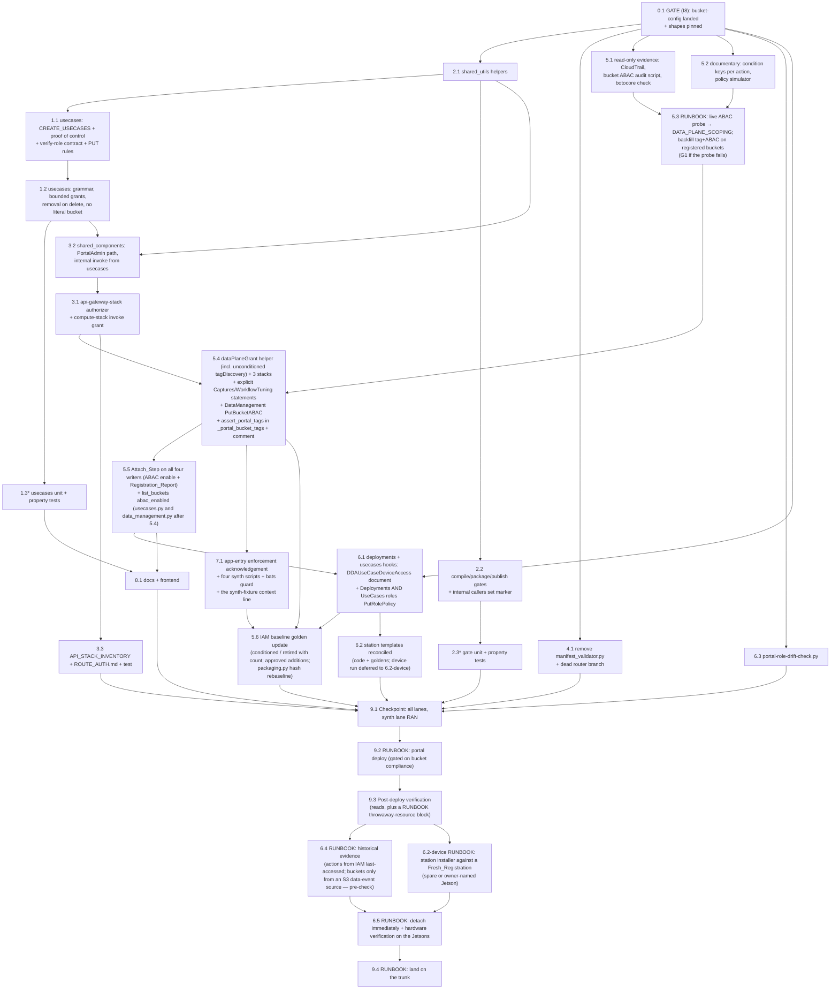

# Implementation Plan: Portal Authorization and IAM Scoping

## Overview

Stacked on `portal-usecase-bucket-config`: **no task below starts until that branch has merged to the trunk** (task 0.1 is the gate (I8) and pins the landed API shapes — by the sibling's requirement/design identifiers, with names re-read from the landed code). Eight items (I1–I8), three classes of work. Portal-only tasks (I1–I5, I7) change backend handlers, the shared layer, three CDK stacks, the deploy scripts and docs, each with unit and hypothesis property tests in the Python 3.11 lane plus infra jest, converging at one checkpoint, one portal deploy and one post-deploy verification (read-only checks plus a throwaway-resource runbook block). I5 is implemented to the owner's choice D5-B (tag condition): a documentary check and a live probe come first, the already-registered buckets are tagged and ABAC-enabled, and only then do the CDK statements change; the D5-A allowlist fallback (design Appendix A) is implemented only if owner gate **G1** is reached. The device-role work (I6) splits into portal code (the per-use-case Device_Access_Document, the Drift_Check), station template reconciliation (verified on a lab device), and the account operations (historical evidence, policy detachment immediately after the deploy, hardware verification). Every owner decision D1–D8 is already taken and recorded in `design.md`; no task carries an option branch.

**Runbook_Tasks.** The owner has approved running **every** task, including the account operations and the deploy, once the design is approved. Tasks marked **RUNBOOK (owner-approved; formerly OWNER)** below (5.3, 6.2's device step, 6.4, 6.5, 9.2, 9.3's throwaway-resource block, 9.4) are therefore executed by the implementation, not handed to the owner — but each is written as an executable runbook: exact commands, pre-checks with their expected output, the write, the verification, the rollback. A pre-check that fails **STOPS the task and asks the owner** (`send_message` warning) instead of guessing; nothing in a runbook is ever substituted for a failed pre-check. **RUNBOOK (owner-approved; formerly OWNER) is the marker earlier revisions of this plan wrote as OWNER:** the same tasks (every account write, the deploy, every device-affecting step), re-marked because the owner's recorded go-ahead approves running them in advance with STOP-on-pre-check as the control; every such header carries the full marker so a reader looking for OWNER tags finds it. The only remaining owner gate is **G1** (task 5.3, only if the live probe fails the decision rule). The D6 detach timing is fixed by the owner: **immediately after the portal deploy and its verification**, on the Historical_Evidence_Window (IAM last-accessed lookback, CloudTrail retention), with on-device verification on the reachable lab Jetsons (JetPack 5, 6 and 7; the lab x86 workstation is powered off for a hardware upgrade and must not be assumed available).

**Where verification is recorded.** Every "record in the Verification_Notes" below means the file `.agents/portal-authz-scoping/verification-notes.md` in the workflow's **uncommitted** state directory. Unlike other specs in this repository, this spec commits **no** `verification-notes.md` in its spec directory: the record names live account resources (policy names, bucket names, CloudTrail excerpts, device identifiers) even in masked form. What is committed goes into `design.md` only — task 5.2's condition-key table, task 5.3's probe tables (allowed/denied, no names), the `DATA_PLANE_SCOPING` value, test names and counts.

Same-file discipline (one writer per file per wave, sequential where two tasks touch one file):

| File | Tasks (in order) |
|---|---|
| `backend/functions/usecases.py` | 1.1 → 1.2 → 3.2 (internal invoke) → 5.4 (`_portal_bucket_tags()` returns through `assert_portal_tags`; `tagged`/`abac_enabled` on `create_s3_bucket`'s response) → 5.5 (the Attach_Step replaces the validator call in `create_usecase`, `update_usecase` and `create_s3_bucket`; `registration` on the responses) → 6.1 (hook `grant_device_access` into `update_usecase`, `revoke_device_access` into `delete_usecase`) |
| `backend/layers/shared/python/shared_utils.py` | 2.1 only (re-export of the marker helpers from `internal_invocation.py`, grammar incl. pinned role names, `account_trusted`, `component_bucket_name` — and the sibling's landed `portal_owned_buckets()` switched to call it —, `COMPONENT_BUCKET_POLICY_MAX_BYTES`, `assert_portal_tags`, `data_plane_scoping()`, the Attach_Step `attach_bucket` + `registration_remedy` + `_is_portal_account_bucket` + `_s3_client_for_bucket_region`, the tag-remedy constant's text). **No vendoring, no pin, no `requirements.txt` edit** — the sibling owns the vendored SDK |
| new `backend/layers/shared/python/internal_invocation.py` (stdlib only) | 2.1 only (`INTERNAL_MARKER_KEY`, `internal_marker`, `is_internal_invocation`) |
| `backend/layers/shared/python/detector_conversion.py` | 2.2 only (marker in `build_finalize_event`, imported from `internal_invocation` — never from `shared_utils`; covered by 2.1's layer version bump) |
| `test/backend-test/security/preservation/test_preservation_secrets_packaging.py` (test-only edit: the three names on `_shared_utils_stub` from the REAL `internal_invocation` module, injected into the `detector_conversion` load; one marker assertion) | 2.2 only |
| `compilation.py`, `packaging.py`, `greengrass_publish.py`, `training_events.py`, `model_import.py`, `compilation_events.py` | 2.2 only |
| `shared_components.py` | 3.2 only (incl. the size check from 1.2's constant and `component_bucket_name()`) |
| `api-gateway-stack.ts` | 3.1 only |
| `compute-stack.ts` | 3.1 (invoke grant, `TRUSTED_USECASE_ACCOUNT_IDS`, retire HTTP-hop support) → 5.4 (helper, `DATA_PLANE_SCOPING` in `lambdaEnvironment`, explicit Portal_Own_Buckets statements for Captures and WorkflowTuning, DataManagement `s3:PutBucketABAC`, comment) → 6.1 (Deployments **and UseCases** roles' `iam:GetRolePolicy`/`PutRolePolicy` on the portal account's device role) |
| `synthetic-data-stack.ts`, `node-designer-stack.ts` | 5.4 only |
| `lib/context-helpers.ts` | 5.4 (`dataPlaneGrant` incl. `tagDiscovery`, `DATA_PLANE_SCOPING`) → 7.1 (`legacyRolesAcknowledged`) |
| `lib/route-auth-inventory.ts`, `scripts/generate-route-auth.ts`, `ROUTE_AUTH.md` | 3.3 only |
| `bin/app.ts`, `deploy-infrastructure.sh`, `deploy-frontend.sh`, `infrastructure/deploy_portal_fixes.sh`, `infrastructure/deploy-auth.sh`, `tests/*.bats` | 7.1 only (incl. the `Data-plane scoping: <value>` log line in the three building scripts, handed over by 5.4 so the deploy scripts have one writer) |
| `deployments.py`, new `device_grants.py` (pure builders plus the IAM-writing pair with the client injected; `deployments.py` and `usecases.py` both `import device_grants` — no handler imports another handler module) | 6.1 only |
| `scripts/portal-role-drift-check.py` | 6.3 only (its constants are compared with `device_grants.py`'s by 6.1's unit test, not edited by 6.1) |
| `scripts/portal-bucket-abac-audit.py` | 5.1 only |
| `data_management.py` | 4.1 (dead branch) → 5.5 (`configure_data_account` validates the data-account triple with 2.1's validators before `update_item`, calls the Attach_Step and returns `registration`; `list_buckets` `abac_enabled` from `AccessDenied` on `GetBucketLocation`) |
| `backend/tests/test_packaging_detector_conversion.py` (test-only edit: the `package()` helper sets the Internal_Marker when `system=True`) | 2.2 only |
| `backend/tests/test_usecase_bucket_config_api.py` (the sibling's landed suite; test-only edits, Requirement 10.4(f)–(g)) | 1.1 (six `create_usecase` creators → `h.portal_admin()`, one added 403 case, twelve-digit fixture accounts in `CROSS_ROLE`/`DATA_ROLE`/`SAGEMAKER_ROLE` and the tests at 926/953, `TRUSTED_USECASE_ACCOUNT_IDS` in `h`) → 5.5 (subset checks on the two exact `bucket` assertions, `ScriptedBucketS3` recorders for `get_bucket_abac`/`head_bucket`/`list_objects_v2`, the `shared.create_boto3_client` patch in `stub_bucket_clients`, the `ops()`-exact assertions set to the exact sequences) |
| `backend/tests/test_property_bucket_attach_eligibility.py` (test-only edit, Requirement 10.4(h)) | 1.1 only |
| `backend/tests/test_tuning_export_configuration.py` (test-only edits, Requirement 10.4(i)) | 1.1 (`UseCaseEnv.create` creator) → 6.1 (`test_a_changed_bucket_rewrites_the_policy` counts only `DDAWorkflowTuningSampleAccess` puts) |
| `test/backend-test/security/preservation/test_preservation_model_converter.py` (test-only edit: the REAL `internal_invocation` injected into its bare `detector_conversion` load) | 2.2 only |
| `infrastructure/test/usecase-bucket-config-iam.test.ts`, `infrastructure/test/synthetic-data-s3-permissions.test.ts` (declared jest amendments) | 5.4 (5.6 inventories any further suite pinning a statement changed by 3.1, 5.4 or 6.1) |
| station scripts, `station_install/README.md`, `dependency_baseline_setup_station.txt`, the two shell-installer IAM goldens | 6.2 only (code and goldens in wave 4; its device step is a RUNBOOK run after 9.3) |
| `test_preservation_iam_cdk_synth.py` | 7.1 (the one-line `FIXTURE_CONTEXT` edit, in the same change as the `bin/app.ts` throw, so the synth lane never silently skips) → 5.6 (the new record tests, the `count`-aware reversal) |
| the IAM baselines and records (`iam_baseline_post_fix_changes.json`, `iam_post_fix_approved_additions.json`, `iam_baseline_EdgeCVPortalComputeStack.template.json`), `iam_out_of_scope_baseline.json` | 5.6 only (sole writer; incl. the `packaging.py` sha256 rebaseline for 2.2's edit) |
| `ADMIN_GUIDE.md` | 7.1 (bare-CLI paragraph 1094–1096, D8 sentence in the role table 841–844) → 8.1 (everything else) |
| frontend | 8.1 only (5.5's `remedy` display is a frontend change and is folded into 8.1's frontend wave — 5.5 hands it over) |

## Task Dependency Graph

```json
{
  "waves": [
    { "id": 0, "description": "Gate (I8): the bucket-config branch has landed; re-read its spec and pin the shapes this spec composes with.", "tasks": ["0.1"] },
    { "id": 1, "description": "Shared-layer helpers every handler change depends on; dead-code removal; I5 read-only evidence and documentary verification; drift-check script.", "tasks": ["2.1", "4.1", "5.1", "5.2", "6.3"] },
    { "id": 2, "description": "Handler changes: use-case creation/proof/grants; source-derived gates and their callers; provision route and internal invoke (same-file order in usecases.py: 1.1 -> 1.2 -> 3.2, enforced by the graph edges T11 -> T12 -> T32). RUNBOOK: live ABAC probe and bucket backfill.", "tasks": ["1.1", "1.2", "1.3", "2.2", "2.3", "3.1", "3.2", "5.3"] },
    { "id": 3, "description": "IAM scoping CDK change (after 5.3 fixed DATA_PLANE_SCOPING); then the Attach_Step and registration reporting on all four writers (same-file order 5.4 → 5.5 in usecases.py); enforcement acknowledgement (incl. the synth-fixture line).", "tasks": ["5.4", "5.5", "7.1"] },
    { "id": 4, "description": "Device-role portal grant on both writer roles (after 5.5 finished with usecases.py and 5.4 with compute-stack.ts); then the baseline golden update (needs every CDK change landed), route inventory, docs and frontend, station templates (code and goldens only — the device run is 6.2's RUNBOOK step in wave 7).", "tasks": ["6.1", "5.6", "3.3", "8.1", "6.2"] },
    { "id": 5, "description": "Checkpoint: full targeted test run across the three test lanes, synth lane running, only the declared goldens changed.", "tasks": ["9.1"] },
    { "id": 6, "description": "RUNBOOK (owner-approved; formerly OWNER): portal deploy (gated on bucket compliance) and post-deploy verification — reads, plus a throwaway-resource block with its own pre-checks and cleanup rollback (with the trusted-account pre-check for the three I1 checks).", "tasks": ["9.2", "9.3"] },
    { "id": 7, "description": "RUNBOOK (owner-approved; formerly OWNER): device-role historical evidence (with the data-event-trail pre-check), the station-installer verification against a Fresh_Registration (6.2's device step), detachment immediately after the deploy, hardware verification on the reachable Jetsons.", "tasks": ["6.4", "6.2-device", "6.5"] },
    { "id": 8, "description": "RUNBOOK (owner-approved; formerly OWNER): land on the trunk.", "tasks": ["9.4"] }
  ]
}
```



## Tasks

- [x] 0. Gate and composition (I8)
  - [x] 0.1 Confirm `portal/usecase-bucket-config` has merged to the trunk and pin its shapes (I8)
    - **Result (implementation start):** the sibling is on `integration/all-specs` at `f191d580` (and on main, merged 2026-10-14) and this worktree is stacked on it; every composition row was re-read in the landed code and the "Landed differences" table in `design.md` is filled (rows C1–C13 and 1–15). No landed difference changes a dependent behaviour (the four Attach writers, the eligibility read path, the `abac` field, the UseCases-role IAM statements), so the gate is satisfied with no owner question. Recorded there: the validator `check_bucket_attachable` (`shared_utils.py:2646`) with result attribute `tags`; no reusable region resolver (the Attach_Step adds `_s3_client_for_bucket_region`); the remedy constants already in the `s3control` form (no 2.1 edit); the eleven lowercase codes (Requirement 10.2's lowercase branch); `botocore` `1.43.101` with `tests/test_shared_layer_sdk_operations.py`; the landed `s3:PutBucketABAC` string and the conditioned `TagResource` statement; the landed line numbers the later tasks cite. The spec-text findings of the tenth review and the planning corrections were folded into the three spec files in the same change
    - `git log --oneline origin/integration/all-specs` (or the trunk branch of record) shows the bucket-config merge; this worktree is rebased onto it. **Do not proceed otherwise.**
    - Re-read `.kiro/specs/portal-usecase-bucket-config/{requirements,design,tasks,verification-notes}.md` **as landed** and the landed code (`usecases.py`, `data_management.py`, `shared_utils.py`, `compute-stack.ts`, `layers/shared/python/`), and re-check every row of `design.md` "Composition contract" **by the sibling's requirement/design identifiers** (R1.2, R5.1–5.3, R9.4–9.5, R9.7, R9.11–9.13, R10.1–10.3, R10.6–10.7, R10.10, R11.3, R12.2–12.5, R12.7–12.8; design §1.2–§1.6, §5.3–§5.6, §6.1–§6.2), recording from the landed code — never assuming — the attach validator's name and signature and the keyword that carries the auto-add `evidence`; the role selector's name; the tag-remedy constants' names and text (the sibling's current text has already corrected them to `aws s3control tag-resource …`; confirm — 2.1 edits only if `s3api tag-resource` is still present); the error-code constants and handler literals (the landed lowercase set — eleven on the branch at authoring, Requirement 10.2); the refusal envelope keys; the audit call shape; the current line numbers, in the landed `test_usecase_bucket_config_api.py` and `test_usecase_bucket_config_units.py`, of the assertions Requirement 10.4(f)–(g) and 3.5 cite by their branch-time lines (re-located by their quoted text, since the merge may shift them); `create_s3_bucket`'s tag-list builder (`_portal_bucket_tags(usecase_id)` on its branch, `usecases.py:1040`) **and its two consumers — the `CreateBucketConfiguration.Tags` build and the fallback `s3control.tag_resource` site** (1159 and 1197 on its branch; 5.4 adds `assert_portal_tags` inside the builder and touches neither consumer), the landed order (create-with-tags → `put_bucket_abac` → read-back → one fallback → 500 `bucket_tagging_failed`), its `abac` values **and the nesting of its 201 body** (the `bucket: {name, region, portal_created, tags, abac, added_to_usecase[, add_error]}` object of its design §5.5 step 7 — this spec's four Registration_Report fields go inside it); the attribute of the validator's result that carries the tags it read (the Attach_Step derives `tagged` from `dda-portal:managed`) and the validator's full keyword list (`evidence`, `retry` on its branch — `attach_bucket` forwards every keyword); that exactly the four writers (`create_usecase`, `update_usecase`, `create_s3_bucket`, `configure_data_account`) call the validator (the sibling's R10.10 guard test passes); the `POST /s3-buckets` gate; the `PUT`/`POST` response keys; `portal_owned_buckets()`'s landed name and its inline component-bucket derivation (`shared_utils.py:2296–2309` on its branch; 2.1 switches it to `component_bucket_name()`); the three UseCases-role IAM statements with the **`TagResource` condition as landed** (the conditioned branch, `StringEquals aws:RequestTag/dda-portal:created-by = portal`, `compute-stack.ts:1071–1078` on its branch — an unconditioned statement is a landed difference) **and the landed ABAC action string `s3:PutBucketABAC`** (`compute-stack.ts:1083` on its branch; this spec spells both actions with that casing — `s3:PutBucketABAC`, `s3:GetBucketABAC` — in the DataManagement statement, `tagDiscovery`, every jest assertion, every record entry and the carve-out allow-list; the sibling grants no `GetBucketABAC`, so record that the `Get` string follows by the same-casing rule: requirements glossary ABAC_Action_Spelling; a landed `Put` string other than `s3:PutBucketABAC` is a landed difference that stops this task); whether the sibling's eligibility probe exposes a reusable bucket-region resolver (the Attach_Step reuses it for its `GetBucketAbac`/`PutBucketAbac` client, else adds one); the vendored `botocore.__version__` read from `layers/shared/python/botocore/__init__.py` and the name of its operation test. Fill the "Landed differences" table in `design.md`; **if a difference changes a behaviour this spec depends on** (the four Attach writers, the eligibility read path, the `abac` field, the IAM statements on the UseCases role) **STOP and ask the owner** before writing code. Never re-pin the SDK: a differing version is recorded, not changed
    - Confirm the Python 3.11 test lane is available (the sibling's recorded baseline notes in the workflow's state directory document the docker-backed interpreter); record the command in the Verification_Notes (uncommitted; see the overview)
    - _Requirements: 10.1, 10.2, 10.3, 7.8_
    - Verification: `design.md` composition table re-checked and the landed-differences table filled; baseline run of `edge-cv-portal/backend/tests` recorded green before any change

- [ ] 1. Use-case creation, proof of control, bounded grants (I1 — D1, D2)
  - [ ] 1.1 Add the creation permission, the proof-of-control helper, the `verify-role` contract and the PUT rules in `edge-cv-portal/backend/functions/usecases.py`
    - `create_usecase`: first statement after the docstring — `rbac_manager.has_permission(user['user_id'], 'global', Permission.CREATE_USECASES, user)` else 403 `{'error': 'Insufficient permissions to create use cases', 'error_code': 'INSUFFICIENT_PERMISSIONS'}` with `log_audit_event(..., 'unauthorized_access', 'api_endpoint', path, 'denied', details={'required_permission': 'create_usecases'}, event=event)`; `except RegistryUnavailable` → 500 `{'error': 'Authorization check failed'}`; rewrite the docstring and the 1103–1104 comment
    - New `verify_account_control(role_arn, external_id, expected_account_id)` wrapping `assume_role` (165): returns `{'ok': True, 'assumed_role_arn'}` or `{'ok': False, 'reason': 'access_denied' | 'no_such_entity' | 'account_mismatch' | 'sts_unavailable', 'detail'}`; fixed session name `dda-portal-verify-control`, 900 s, never logs credentials
    - Multi-account bodies, in order: 1.2's grammar (pinned role names) → `account_trusted(account_id)` (from 2.1; `TRUSTED_USECASE_ACCOUNT_IDS`, set by 3.1) else 400 `ACCOUNT_NOT_TRUSTED` with the remedy "add the account to `trustedUseCaseAccountIds` and redeploy the portal", no STS call → `verify_account_control(cross_account_role_arn, external_id, account_id)` **before** `table.put_item` (1218). Failure → 400 `ACCOUNT_CONTROL_NOT_VERIFIED` (message names the remedy: deploy `DDAPortalUseCaseAccountStack` and supply its external id), audit `create_usecase` failure `reason='account_control_not_verified'` / `'account_not_trusted'`, no write, no grant; `sts_unavailable` → 503 `STS_UNAVAILABLE`, audited `reason='sts_unavailable'`. **No second STS proof for a separate data account** — grammar only on the data-account triple; the sibling's eligibility probe for `data_s3_bucket` assumes `data_account_role_arn` before `put_item` and refuses when it cannot (design.md I1 D2, follow-up F-1)
    - `update_usecase` **order** (design.md I1 "PUT-path order"): `UPDATE_USECASES` gate → tuning-settings and additional-list validation (existing) → record fetch → Account_Field_Change classification and the account rules (grammar, trusted check, proof) → the sibling's attach validation through the Attach_Step (2003/2013) → `update_item` (2044) → grant maintenance (`grants_removed`/`grants_added`) → additional-bucket adds/removes → device-grant hook (6.1) → 200; the account rules therefore run before any eligibility probe
    - `update_usecase`: add `'external_id'` and `'sagemaker_execution_role_arn'` to `updatable_fields` (1958–1968 on the trunk) — `sagemaker_execution_role_arn` is the seventh account field: a move (an Account_Field_Change of `account_id`, single→multi or multi→multi) requires the merged `sagemaker_execution_role_arn` in the new account, else 400 `INVALID_ROLE_ARN` "supply sagemaker_execution_role_arn in account <new>"; the grammar runs on its merged value whenever any account field changes; a change of it alone gets the grammar only, no STS; account moves are API-only (the Edit modal is unchanged — design.md I1); implement the PUT rules of design.md I1 "`update_usecase` rule" **on the set of Account_Field_Changes** (a field whose normalized body value — `None`/`''`/whitespace → absent — differs from the stored value; never key presence: the Edit modal echoes the stored account fields on every save, `UseCases.tsx:208–252`), so a body with no Account_Field_Change is processed exactly as today with no grammar and no STS call for single- and multi-account records alike (`is_single(stored) := not is_cross_account_setup(stored)` — the existing shared-layer predicate, no new regex; the "portal account" is `os.environ['PORTAL_ACCOUNT_ID']` — already in every handler's environment via `compute-stack.ts:730` — never an STS call; skip grammar/trusted check/proof when the merged account is the portal account and `cross_account_role_arn` did not change; a single-account record given a **changed** `cross_account_role_arn` without a move → 400 `INVALID_ROLE_ARN`, **no `sts:AssumeRole` and no `sts:GetCallerIdentity`** (the recording STS fake asserts zero calls); a differing `data_account_id` with no `data_account_role_arn` in the body or the record → 400 `INVALID_ROLE_ARN` ("supply `data_account_role_arn`"); single→multi requires both `account_id` and `cross_account_role_arn` else 400 `INVALID_ROLE_ARN`; multi→single (an Account_Field_Change of `account_id` to the portal account) refused with 400 `INVALID_ACCOUNT_ID`; multi→multi — an Account_Field_Change of `account_id`, `cross_account_role_arn` or `external_id` — runs grammar, trusted check and proof on the merged values (a change confined to the data triple gets its grammar only, no STS) and, when `account_id` changed, **after `update_item`** removes the old account's grants via 1.2's remover (`grants_removed`) **and writes the new account's grants** with `update_component_bucket_policy_for_greengrass(device_account_id=new)` and `configure_eventbridge_permission(new)` — the create-path writers at 1354/1444 — reporting `grants_added`; both best-effort)
    - Router: move the `/verify-role` branch (984–985) above the generic `POST` (977). `verify_role`: **gate** with the same `has_permission(..., 'global', Permission.CREATE_USECASES, ...)` → 403 `{'status': 'failed', 'error', 'error_code': 'INSUFFICIENT_PERMISSIONS'}` + `unauthorized_access` audit (`RegistryUnavailable` → 500 `Authorization check failed`); `role_arn` required (400 `{'error': 'role_arn is required'}` unchanged); grammar check incl. the pinned role name → 400 `{'status': 'failed', 'error', 'error_code': 'INVALID_ROLE_ARN'}`; `expected_account_id = role_arn.split(':')[4]`; optional body `account_id` must match else 400 `{'status': 'failed', 'error', 'error_code': 'INVALID_ACCOUNT_ID'}`; `account_trusted` else 400 `{'status': 'failed', 'error', 'error_code': 'ACCOUNT_NOT_TRUSTED'}`, no STS; success → 200 `{'status': 'success', 'account_id', 'assumed_role'}` byte-identical; `access_denied`/`no_such_entity`/`account_mismatch` → 400 `{'status': 'failed', 'error': '<Code>: <Message>'}` byte-identical to today's `ClientError` branch; `sts_unavailable` → **503** `{'status': 'failed', 'error', 'error_code': 'STS_UNAVAILABLE'}` (a deliberate change from today's generic 500 at 1097–1099). Every non-200 body on this route carries **`error`** (the key the wizard shows from its `catch`, `api.ts:1391–1455` throws on every non-OK) and `status: 'failed'` (additive for API clients)
    - **Test-only edit to the sibling's landed suite** `edge-cv-portal/backend/tests/test_usecase_bucket_config_api.py` (Requirement 10.4(f)): the six `create_usecase` tests whose creator is `h.user("DataScientist")` with no registry row (855, 878, 901, 926, 953, 982 as landed; re-locate by the `creator = h.user("DataScientist")` line) switch to `creator = h.portal_admin()` (harness 296–297) — they exercise the sibling's eligibility refusals and successes, which the D1 gate would otherwise turn into six 403s; add one case in that file asserting a `DataScientist` creator gets 403 `INSUFFICIENT_PERMISSIONS` with no eligibility probe (`stubs.s3.calls == []`) and no `put_item`; **twelve-digit fixture accounts:** `CROSS_ROLE`, `DATA_ROLE`, `SAGEMAKER_ROLE` (64–66) and the bodies of the tests at 926 and 953 use `222222222222` (use-case account) and `333333333333` (data account) instead of `acct-remote`/`acct-data`, which the 1.2 grammar refuses; the `h` fixture sets `TRUSTED_USECASE_ACCOUNT_IDS=222222222222`; proof of control runs on moto's STS (its `AssumeRole` returns the role's account); every assertion unchanged; nothing else in that suite changes here (5.5 makes that file's other declared edit — same-file order 1.1 → 5.5)
    - **Test-only edit** `edge-cv-portal/backend/tests/test_property_bucket_attach_eligibility.py` (Requirement 10.4(h)): `step_create_usecase` (217–228) acts as a non-PortalAdmin, so it expects 403 `INSUFFICIENT_PERMISSIONS` (D1) and asserts no record was written; one docstring sentence says why; nothing else in that file changes
    - **Test-only edit** `edge-cv-portal/backend/tests/test_tuning_export_configuration.py` (Requirement 10.4(i), first half): `UseCaseEnv.create` (288–300; used at 371/384/392) uses a creator holding `CREATE_USECASES` (a global PortalAdmin row); 6.1 makes the second half
    - _Requirements: 1.1, 1.2, 1.3, 1.4, 2.1, 2.2, 2.3, 2.4, 2.5, 2.6, 2.7, 2.8, 10.4_
    - Verification: targeted run of 1.3's unit file, of `test_usecase_bucket_config_api.py`, of `test_property_bucket_attach_eligibility.py` and of `test_tuning_export_configuration.py`
  - [ ] 1.2 Grammar, idempotent and bounded grants, removal on delete, derived component bucket name (`usecases.py`)
    - Validators (from 2.1) before any STS call: `account_id`/`data_account_id` `^\d{12}$`; `cross_account_role_arn == f'arn:aws:iam::{account_id}:role/DDAPortalAccessRole'`; `data_account_role_arn == f'arn:aws:iam::{data_account_id}:role/DDAPortalDataAccessRole'`; `sagemaker_execution_role_arn` matches `^arn:aws:iam::(\d{12}):role/[\w+=,.@/-]+$` with the account segment equal to `account_id` → 400 `INVALID_ACCOUNT_ID` / `INVALID_ROLE_ARN`; never applied to a stored `:root` ARN
    - `update_component_bucket_policy_for_greengrass`: pre-write size check `len(json.dumps(policy).encode()) > COMPONENT_BUCKET_POLICY_MAX_BYTES` (20,000; from 2.1) → `{'status': 'failed', 'error': 'component bucket policy would exceed the size limit'}` + WARNING, no `put_bucket_policy`. The same check in `shared_components.add_usecase_to_component_bucket_policy` is applied by 3.2 (that file's owner)
    - New `remove_account_grants(account_id)` used by `delete_usecase` and by 1.1's PUT path: skipped when the deleted record is a Single_Account_Record (`not is_cross_account_setup(record)`) or its `account_id` equals `PORTAL_ACCOUNT_ID`; otherwise, if no other record shares `account_id`, remove `AllowGreengrassDeviceRead-<acct>`/`AllowGreengrassDeviceList-<acct>`, drop the account's principals from `AllowUseCaseAccountsGreengrassAccess` and `aws:SourceAccount` in `AllowGreengrassServiceAccess`, `events.remove_permission(StatementId=f'AllowUseCaseAccount-{acct}')`; best-effort, returned as `grants_removed`. New `add_account_grants(account_id)` used by 1.1's multi→multi PUT path: the two create-path writers for the new account, best-effort, returned as `grants_added`
    - Replace the literal at 1349 with `component_bucket_name()` from 2.1 (`COMPONENT_BUCKET` when set, else `<COMPONENT_BUCKET_PREFIX>-<AWS_REGION>-<PORTAL_ACCOUNT_ID>` — the UseCases function has no `COMPONENT_BUCKET` variable, `compute-stack.ts:1057–1063`); no 500 path; the literal is deleted
    - _Requirements: 3.1, 3.2, 3.3, 3.4, 3.5, 3.6_
    - Verification: 1.3's tests
  - [ ]* 1.3 Unit and property tests for use-case creation
    - `edge-cv-portal/backend/tests/test_usecases_creation_authz.py` (moto + recording fakes for STS/S3/Events; `TRUSTED_USECASE_ACCOUNT_IDS` set in the fixture): every case enumerated in design.md I1 "Test strategy", in both `PORTAL_REGISTRY_ENFORCED` states — including an untrusted `account_id` → 400 `ACCOUNT_NOT_TRUSTED` and no STS call; a role name other than `DDAPortalAccessRole` → 400 `INVALID_ROLE_ARN` before STS; `RegistryUnavailable` → 500 `Authorization check failed`; the frontend's exact `verify-role` body `{role_arn, external_id}` (no `account_id`) with the 200 shape and the `ClientError` 400 shape compared byte-for-byte to the trunk's; `verify-role` with an STS connection error → 503 `{status: 'failed', error, error_code: 'STS_UNAVAILABLE'}`; `verify-role` without the permission → 403 with `status: 'failed'` and no STS; **`error` present and non-empty, and `status == 'failed'`, asserted on all five `verify-role` non-200 shapes** (403, proof failure, `INVALID_ROLE_ARN`/`INVALID_ACCOUNT_ID`, `ACCOUNT_NOT_TRUSTED`, `STS_UNAVAILABLE`); multi→multi `PUT` changing `account_id` → old account's statements and `put_permission` removed when unreferenced **and** the new account's two statements and `put_permission` written (recording fakes; `grants_removed` + `grants_added`); the single-account PUT rules (no grammar on `:root`; single→multi with and without the role ARN; a **changed** role ARN without a move → 400 `INVALID_ROLE_ARN` and no STS; multi→single); **the Edit modal's full-form body as a fixture** — the `UseCases.tsx` `{...formData}` key set (`name`, `account_id`, `s3_bucket`, `s3_prefix`, `cross_account_role_arn`, `data_account_id`, `data_account_role_arn`, `data_account_external_id`, `data_s3_bucket`, `data_s3_prefix`, `tuning_sample_export`[, `tuning_sample_retention_days`]; pinned with a comment naming that file and `handleEdit`/`handleUpdate`, 208–252), every account field echoed from the stored record, the data triple as `''`, one non-account field changed — on a single-account record (stored `:root` ARN echoed) → 200, no grammar, zero STS calls (recording fake); the same on a multi-account record → 200, zero STS calls; the same with `cross_account_role_arn` changed → the existing refusal; `external_id` persisted after proof; **the seventh account field** — a move whose merged `sagemaker_execution_role_arn` is still in the old account → 400 `INVALID_ROLE_ARN` ("supply sagemaker_execution_role_arn in account <new>"), no `update_item`; a move supplying it in the new account → 200 and stored; a change of it alone → grammar only, zero STS calls (another account → 400); the stored value echoed → no change; **PUT-path order** — a body changing both `account_id` and `s3_bucket` whose proof fails → 400 `ACCOUNT_CONTROL_NOT_VERIFIED`, no eligibility probe (`h.probes` / a recording validator not called) and no `update_item`; `sts_unavailable` → 503; `component_bucket_name()` with `COMPONENT_BUCKET` unset equals `dda-component-<region>-<account>` and `usecases.py`/`shared_components.py` agree; **fixture ids:** new fixtures use only `111111111111` (portal), `222222222222` (trusted use-case account), `333333333333` (data account), `444444444444` (untrusted) and moto's `123456789012`
    - `edge-cv-portal/backend/tests/test_property_usecase_account_grants.py` (hypothesis, ≥100 examples): **Property 1** — for any create/delete/PUT-account-change sequence over generated trusted account ids (single-account creates included), the component bucket policy holds exactly two statements per currently referenced non-portal account **plus the portal account's own pair once any single-account use case has been created (never removed — the trunk's writers run for the portal account on every single-account create, `usecases.py:1346–1358`/`1440–1446`)**, and the EventBridge `StatementId` set is one per referenced non-portal account plus the portal account's once created; **Property 2** — for any non-conforming id/ARN, or any account outside a generated trusted list, the handler refuses before any STS call; **Property 3** — `create_usecase` and `verify_role` accept iff `has_permission(CREATE_USECASES)` for any generated registry state, both enforcement states. Tag `Feature: portal-authorization-and-iam-scoping, Property {n}: {title}`
    - _Requirements: 1.1, 1.2, 1.3, 2.1, 2.2, 2.3, 2.5, 2.6, 2.7, 2.8, 3.1, 3.2, 3.4, 3.5_
    - Verification: `<py311> -m pytest edge-cv-portal/backend/tests/test_usecases_creation_authz.py edge-cv-portal/backend/tests/test_property_usecase_account_grants.py -q -p no:cacheprovider`

- [ ] 2. Source-derived auto-trigger (I2)
  - [x] 2.1 Shared-layer helpers in `edge-cv-portal/backend/layers/shared/python/shared_utils.py` (plus one new stdlib-only module beside it)
    - **New module `edge-cv-portal/backend/layers/shared/python/internal_invocation.py`** (standard library only — no `boto3`, no `shared_utils` import): `INTERNAL_MARKER_KEY = 'dda_internal'`, `internal_marker(source, purpose, user_id='system')`, `is_internal_invocation(event)` exactly as design.md I2 (marker present AND no `requestContext.requestId`/`apiId`). `shared_utils.py` re-exports the three names (`from internal_invocation import INTERNAL_MARKER_KEY, internal_marker, is_internal_invocation`) so handlers import them from `shared_utils` as usual; `detector_conversion.py` (2.2) imports them from `internal_invocation` directly, because the host-lane preservation test loads it bare (design.md I2 "Design")
    - `data_plane_scoping() -> str`: `os.environ.get('DATA_PLANE_SCOPING', 'tag')` — the one accessor every Python reader of the scoping uses (`registration_remedy` here; `list_buckets` in 5.5); the CDK sets the variable (5.4), the default serves tests only
    - `ACCOUNT_ID_RE`, `ROLE_ARN_RE`, `validate_account_id(value)`, `validate_role_arn(value, account_id, role_name=None)` (pure; `role_name` pins `DDAPortalAccessRole` / `DDAPortalDataAccessRole`; used by 1.2); `account_trusted(account_id)` over `TRUSTED_USECASE_ACCOUNT_IDS` (comma-separated; empty/unset → raises, mapped to 500 by the caller); `component_bucket_name()` (`os.environ.get('COMPONENT_BUCKET') or f"{os.environ.get('COMPONENT_BUCKET_PREFIX', 'dda-component')}-{os.environ.get('AWS_REGION', 'us-east-1')}-{os.environ.get('PORTAL_ACCOUNT_ID', '')}"` — the `shared_components.py:50–54` derivation exactly, every read defaulted, never `os.environ[...]`; always returns a string) **and the sibling's landed `portal_owned_buckets()` switched to call it** (`shared_utils.py:2296–2310` on the trunk, confirmed by 0.1) while keeping its own guard — it calls the helper only when `COMPONENT_BUCKET` or `PORTAL_ACCOUNT_ID` is set, else contributes no component bucket — so the sibling's existing `portal_owned_buckets` unit cases pass unchanged (one definition, three consumers: `usecases.py`, `shared_components.py`, `portal_owned_buckets`); `COMPONENT_BUCKET_POLICY_MAX_BYTES = 20_000` with a comment stating it is deliberately under the 20,480-byte limit
    - `assert_portal_tags(tags) -> list`: pure; raises `ValueError` if any `Key` does not start with `dda-portal:`; returns the list unchanged otherwise. Applied by 5.4 **inside** the sibling's tag-list builder `_portal_bucket_tags()` so both of its consumers (the `CreateBucketConfiguration.Tags` build and the fallback `s3control.tag_resource`) receive a validated list; no client-typed helper and no new S3 call (the primary tag write is a parameter of `create_bucket`, which no helper could wrap). The sibling's tag-remedy constants (`REMEDY_TAG`, `shared_utils.py:2146`, and `REMEDY_TAGGING_UNREADABLE`, 2151) already read `aws s3control tag-resource --account-id <account> --resource-arn arn:aws:s3:::<bucket> --tags Key=dda-portal:managed,Value=true` (0.1; `test_usecase_bucket_config_units.py:247` asserts it): **no edit**
    - The **Attach_Step** (design.md I5 "The Attach_Step — one wrapper, four writers", pseudocode and the two paragraphs after it): `attach_bucket(*, target_usecase_id, usecase_like, bucket, user, event, purpose, evidence=None, retry=False, source) -> AttachOutcome` — calls the sibling's validator (landed `check_bucket_attachable(*, target_usecase_id, usecase_like, bucket, user, event, purpose, evidence=None, retry=False)`, `shared_utils.py:2646`) **forwarding every keyword it received, `retry` included** (`create_usecase` passes `retry=retry` per attach check, `usecases.py:1570`; the other writers pass `retry=False`) — a refusal propagates untouched; nothing else runs; `tagged := <validator result>.tags.get('dda-portal:managed') == 'true'` (attribute name from 0.1 — **not** `eligible`, which the sibling also grants for `created-by=portal` alone); `_is_portal_account_bucket(usecase_like, bucket)` := the sibling's selector's `role_arn is not None and role_arn.endswith(':root')` (the `assume_usecase_role` test at `shared_utils.py:1589`); on a Portal_Account_Bucket that is tagged: **one `try/except Exception` around** `_s3_client_for_bucket_region(bucket)` → `get_bucket_abac` → `put_bucket_abac` when not `Enabled`, yielding `abac_action` ∈ `already_enabled | enabled | enable_failed` (+ `reason` on failure), audits `bucket_abac_enabled` (`success`/`failure`, `details={bucket, source[, reason]}`) for every enable attempt; a Portal_Account_Bucket that is **not** tagged → `abac_action: 'tag_missing'`, no ABAC call; any other bucket → `abac_enabled: 'unknown'`, `'not_applicable'`, no ABAC call; then `_probe` (`head_bucket` + `list_objects_v2(MaxKeys=1)` with the selector's role; one bounded retry ≤ 2 s when it has just enabled; **catches every exception and returns `(False, remedy)`**) and returns `tagged`, `abac_enabled` (`True`/`False`/`'unknown'`), `iam_reachable`, `remedy`, `abac_action`. **After the validator has passed, nothing in `attach_bucket` raises** (Requirement 7.6). `_s3_client_for_bucket_region(bucket)`: `head_bucket` with the default-region execution-role client, region from the `x-amz-bucket-region` header of the 200 response or of the `ClientError`'s `response['ResponseMetadata']['HTTPHeaders']` on 301/403; **no `get_bucket_location` fallback** (conditioned → denied on the tagged ABAC-off bucket this exists for); header absent → raise `RegionUnknown` (caught by the guard → `enable_failed`); one client per region per invocation (0.1 found no reusable resolver in the sibling's code). **Client sources (design.md I5):** every client through `create_boto3_client` looked up as a module global — `_execution_role_client(region=None) = create_boto3_client('s3', {'is_default_credentials': True}, region=region)`; `_selector_client(usecase_like, bucket) = create_boto3_client('s3', assume_usecase_role(role_arn, external_id, ATTACH_SESSION_NAME))` with `ATTACH_SESSION_NAME = 'portal-bucket-attach'` (distinct from `ELIGIBILITY_SESSION_NAME`); `_s3_client_for_bucket_region` = `head_bucket` on the execution-role client → header → `_execution_role_client(region)`, cached per region per call; the wizard path's `_probe` uses the handler's own region-bound client. **Bounded wait:** `time.sleep(ATTACH_PROBE_RETRY_DELAY_SECONDS)` on `shared_utils`' module `time`, `ATTACH_PROBE_RETRY_DELAY_SECONDS = 1`, one retry, ≤ 2 s. **`_abac_status`:** `'Enabled'` iff `(resp.get('AbacStatus') or {}).get('Status') == 'Enabled'`, else `'Disabled'`; errors reach the guard; if the implementation run's read-only `get-bucket-abac` on a never-configured lab bucket answers with an error code, map that code only. Pure companion `registration_remedy(tagged, abac_enabled, iam_reachable, account_kind, scoping)` per Requirement 7.11, `scoping` from `data_plane_scoping()`. **No SDK vendoring, no pin, no `requirements.txt` edit, no operation test** — the sibling owns the vendored SDK (its R9.13); 0.1 recorded the landed version
    - SharedLayer version: the layer version is published by its asset hash (covers 2.2's `detector_conversion.py` edit too); **no description edit** (the sibling's precedent)
    - **Python 3.9 compatibility:** `internal_invocation.py` is Python 3.9-compatible (no `X | Y` runtime unions, no `match`), because the host lane and the 5.1 audit script load it on the host's Python 3.9
    - _Requirements: 4.1, 2.1, 3.1, 3.3, 3.5, 7.6, 7.7, 7.11_
    - Verification: 2.3's property on the helper; unit tests that `assert_portal_tags` raises `ValueError` on a key outside `dda-portal:` and returns a conforming list unchanged; `account_trusted`, `component_bucket_name` (incl. the **`AWS_REGION`-unset case** → `dda-component-us-east-1-<account>`, and `portal_owned_buckets()` still omitting the component bucket when both variables are unset and naming the helper's result otherwise — the sibling's existing cases unchanged, `test_portal_owned_buckets_prefix_derivation` with its `delenv("AWS_REGION")` included) and `data_plane_scoping` (set / unset → `'tag'`) unit tests; `attach_bucket` forwards `retry` and every other keyword to the validator (recording fake validator); `attach_bucket` unit tests with a fake validator and fake S3 (Portal_Account_Bucket ABAC-off → `put_bucket_abac` called once, audited, `abac_action: 'enabled'`; ABAC-on → no `put_bucket_abac`, `'already_enabled'`; eligible but tagged only `created-by=portal` → `tagged: False`, `'tag_missing'`, no ABAC call, tag remedy; separate-data-account bucket → `'unknown'`, no ABAC call; `None`-ARN selector result → not a Portal_Account_Bucket; validator raises → no ABAC call, exception propagates; **one failing-call case each** — region resolver `RegionUnknown`, `get_bucket_abac` `ClientError`, `put_bucket_abac` `ClientError` → returns normally with `abac_enabled: False`, `'enable_failed'`, audit `failure` with `reason`, enable remedy; `head_bucket` `EndpointConnectionError`, `list_objects_v2` `ClientError` → returns normally with `iam_reachable: False`; region read from a fake `head_bucket` 200 and from a fake 403 `ClientError`'s headers); **no Attach_Step client escapes the factory** — `shared_utils.boto3.client` replaced by a recorder that must see zero calls while `create_boto3_client` is a recording fake (which sees the execution-role marker and the `ATTACH_SESSION_NAME` credentials); the bounded wait recorded on a stubbed `shared_utils.time.sleep` as `[((ATTACH_PROBE_RETRY_DELAY_SECONDS,), {})]` after a just-enabled bucket and `[]` otherwise; **Property 10** (hypothesis): `put_bucket_abac` is called iff validator passed ∧ Portal_Account_Bucket ∧ tagged ∧ status ≠ `Enabled`, and `attach_bucket` returns normally for any generated exception from any of the five guarded calls
  - [ ] 2.2 Replace body/claim-derived gates with the source-derived gate and mark every internal caller
    - `compilation.py:436` → `internal = is_internal_invocation(event)`; `if not internal and not check_user_access(...)`; **actor rule** at 689: `user_id=event[INTERNAL_MARKER_KEY]['user_id'] if internal else user_id` (never `'system'` by `auto_triggered`); `details['auto_triggered']` kept as the body echo; `details['internal_source']` added **only when `internal`** (a gateway compile's `details` key set stays exactly `{targets, compilation_jobs, auto_triggered}` — `test_onnx_compile_diagnostics_properties.py:1009` pins it)
    - `packaging.py:1152`, `greengrass_publish.py:746` → `if not is_internal_invocation(event) and not check_user_access(...)`, and the same actor rule before every `log_audit_event` in those handlers (`user_id = event[INTERNAL_MARKER_KEY]['user_id'] if internal else user['user_id']`)
    - Callers add `INTERNAL_MARKER_KEY: internal_marker(...)` to the events they build, with the fixed `(source, purpose)` strings of Requirement 4.8: `training_events.py:171–188` → `('training_events', 'auto_compile')`; `model_import.py:1442–1459` → `('model_import', 'auto_compile', <importer user_id>)`; `compilation_events.py:149–165` → `('compilation_events', 'auto_package')`; `packaging._trigger_component_creation` (945–960) → `('packaging', 'publish_chain')`; and `layers/shared/python/detector_conversion.py` `build_finalize_event` (731–741) → `('detector_conversion', 'finalize')` — the one builder reached from both `training_events.py:258–262` and `training.py:1069–1072`, so one edit covers both; **`detector_conversion.py` imports the two names from `internal_invocation`, not from `shared_utils`** (the module stays standard-library-only). Bodies unchanged (pinned by existing suites)
    - **Three existing suites need edits (not assumed to pass):** (1) `edge-cv-portal/backend/tests/test_packaging_detector_conversion.py:184–192` — the `package(env, training_id, body=None, system=True)` helper fabricates `claims.sub = 'system'` with no marker and 10 of its 15 call sites rely on the trunk's carve-out; add `INTERNAL_MARKER_KEY: internal_marker('test', 'finalize')` to the event it builds when `system=True` (test-only; the five `system=False` call sites are unchanged). (2) `test_onnx_compile_diagnostics_properties.py:1005–1009` needs no edit because `internal_source` is conditional and the actor rule names the gateway caller — run it to prove that. (3) **Host lane:** `test/backend-test/security/preservation/test_preservation_secrets_packaging.py` — `_shared_utils_stub` (80–91) exposes exactly the nine names packaging imports today, so the three new names would raise `ImportError` at module load, and `detector_conversion.py` is loaded bare (111–112), so its new `from internal_invocation import ...` would fail. Edit (test-only; declared in Requirement 10.4(e)): add `INTERNAL_INVOCATION_REL = "edge-cv-portal/backend/layers/shared/python/internal_invocation.py"`; in `_make_stubs` load it REAL with `load_module_from_path("internal_invocation_preservation", INTERNAL_INVOCATION_REL)` and pass it as `injected_modules={"internal_invocation": ...}` to the `detector_conversion` load (the `checkpoint_probe` pattern); set the three names on the `shared_utils` stub **from that real module** (`mod.INTERNAL_MARKER_KEY = real.INTERNAL_MARKER_KEY`, etc.) so the captured event carries the real marker; add one assertion in `test_s3_synthetic_identity_construction_preserved_apart_from_email` that `event[INTERNAL_MARKER_KEY] == internal_marker('packaging', 'publish_chain')`; every existing assertion unchanged. (4) **Host lane, second suite:** `test/backend-test/security/preservation/test_preservation_model_converter.py` also loads `detector_conversion.py` bare (123–124; found by 0.1) — the same REAL `internal_invocation` injection (`injected_modules={"internal_invocation": ...}`) and nothing else (Requirement 10.4(e))
    - `packaging.py` is pinned byte-for-byte in `iam_out_of_scope_baseline.json` (`sibling_spec_files`); this edit breaks `test_preservation_iam_out_of_scope_guard.py::test_sibling_spec_files_unchanged` until 5.6 rebaselines the hash — hand 5.6 the reason text ("source-derived gate and actor rule at 1152; internal marker in `_trigger_component_creation`"); do not rebaseline here (5.6 is the sole writer)
    - _Requirements: 4.2, 4.3, 4.4, 4.5, 4.6, 4.7, 4.8, 10.4_
    - Verification: run all five neighbouring suites in the 3.11 lane — `test_training_conversion_lifecycle.py`, `test_vllm_packaging_dispatch.py`, `test_detection_training_compile_package.py`, `test_onnx_compile_diagnostics_properties.py` (unchanged, must pass), `test_packaging_detector_conversion.py` (with the helper edit) — plus 2.3; **and in the host lane** `python3 -m pytest test/backend-test/security/preservation/test_preservation_secrets_packaging.py -p no:cacheprovider --noconftest -v` (three tests pass with the stub edit; the new marker assertion passes) and `test_preservation_model_converter.py` (passes with the injection); `grep -rn "_shared_utils_stub\|DETECTOR_CONVERSION_REL\|detector_conversion" test/backend-test/security` confirms no third preservation suite needs the same edit
  - [ ]* 2.3 Unit and property tests for the gate
    - `test_internal_invocation_gates.py`: gateway + `auto_triggered: true` + non-DataScientist → 403, no SageMaker call; each internal caller's event shape (five fabricators) → proceeds, **in both `PORTAL_REGISTRY_ENFORCED` states** (Property 5 covers the decision function, not the handler paths, so the handler-level cases are run under both states themselves); marker + gateway ids → external; `system` sub without marker → 403; DataScientist via gateway → unchanged, both enforcement states; **gateway DataScientist with `auto_triggered: true` → 200 and the `start_compilation` audit row carries their own `user_id` and no `internal_source` key**; internal model-import event → audit `user_id` is the importer from the marker; internal training-events event → `system`; the same actor assertions for packaging and publish
    - `test_property_internal_invocation.py` (hypothesis): **Property 4** — any event carrying a gateway `requestContext.requestId` is never internal; **Property 5** — the compile/package/publish decision equals `internal or has_role` for all generated pairs
    - _Requirements: 4.1, 4.2, 4.3, 4.5, 4.6_
    - Verification: targeted pytest run

- [ ] 3. Provision route and route inventory (I3 — D3)
  - [ ] 3.1 Infrastructure: authorizer on the method, invoke grant, retire the HTTP-hop support
    - `api-gateway-stack.ts:749` → `{ authorizer, authorizationType: COGNITO }`
    - `compute-stack.ts`: `sharedComponentsHandler.grantInvoke(useCasesHandler)`; `SHARED_COMPONENTS_FUNCTION_NAME` on the UseCases environment; `TRUSTED_USECASE_ACCOUNT_IDS: props.trustedUseCaseAccountIds.join(',')` in `lambdaEnvironment` (read by 1.1's `account_trusted`; a jest assertion checks the UseCases function's environment); delete the `API_GATEWAY_ID` post-deploy patch — the inline `UpdateLambdaEnv` function (3944–3986), its role policy (3989–3996: `lambda:GetFunctionConfiguration`/`lambda:UpdateFunctionConfiguration` on the UseCases handler ARN) and the `LambdaEnvUpdater` custom resource (3999–4011) — and the factory's `execute-api:Invoke` statement (555–562) after `grep -rn "execute-api\|PORTAL_API_URL\|API_GATEWAY_ID" edge-cv-portal/backend edge-cv-portal/infrastructure` shows no remaining consumer; hand **both** removed statements' JSON to 5.6 for the two `retired` records (the factory statement, `count` 41; the `UpdateLambdaEnvServiceRoleDefaultPolicy` statement, `count` 1 — the carrier `UpdateLambdaEnvServiceRoleDefaultPolicyAA319DDF` is in the fixed baseline and `iam_grant_atoms` walks every carrier, so without its record the preservation gate fails on a removal). Landed line numbers (0.1): `api-gateway-stack.ts:748–749`; `UpdateLambdaEnv` 3982–4049 in `compute-stack.ts`
    - **Declared jest amendments:** amend in this task any jest suite whose assertion pins a statement 3.1 removes (grep `edge-cv-portal/infrastructure/test` for `execute-api`, `UpdateLambdaEnv`, `API_GATEWAY_ID`); 5.6 inventories the rest
    - _Requirements: 2.1, 5.1, 5.2_
    - Verification: `npm run build && npx jest` in `edge-cv-portal/infrastructure`; new assertions in 3.3
  - [ ] 3.2 Backend: `shared_components.py` and the UseCases internal invoke
    - `provision_components`: `internal = is_internal_invocation(event)`; acting user from the marker when internal, else from claims with `check_user_access(user_id, usecase_id, 'PortalAdmin', user)` → 403 `INSUFFICIENT_PERMISSIONS`; delete the body-`user_id` branches (762–771, 785–790); size check in `add_usecase_to_component_bucket_policy` using `COMPONENT_BUCKET_POLICY_MAX_BYTES`; replace the module-level `COMPONENT_BUCKET` derivation (53–54) with 2.1's `component_bucket_name()` so both writers resolve one name
    - `usecases.py`: replace `provision_shared_components_via_api` with `provision_shared_components_internal` (`lambda.invoke`, `InvocationType='Event'`, event per design.md I3); creation response reports `{'status': 'accepted'}`; failures → `{'status': 'failed', 'error'}` as today. Keep the invoke **after** `update_component_bucket_policy_for_greengrass` (1354) has returned — both writers get-modify-put the same component bucket policy and this order is the only thing keeping them sequential once the hop is asynchronous; add a comment at both sites (`usecases.py` near 1354/1392, `shared_components.py` near 522) naming the other writer and the ordering
    - Tests: `test_shared_components_provision_authz.py` — 403 without role/marker and no bucket-policy write; 202 with PortalAdmin; 202 internal attributed to the marker user; body `user_id` alone no longer skips; UseCaseAdmin → 403; and in the creation test file, a recording fake asserting `lambda.invoke` is called only after `put_bucket_policy` on the component bucket has returned (call-order assertion)
    - _Requirements: 5.1, 5.2, 5.3_
    - Verification: targeted pytest
  - [ ] 3.3 Route_Auth_Inventory, generator and test over both parent stacks
    - `lib/route-auth-inventory.ts`: `export const API_STACK_INVENTORY` — `EdgeCVPortalComputeStack` (nested: ApiGateway, CameraRegistryApi, UserAdminApi, QuickSetupApi, DdaLabelingApi, WorkflowManagerGapsApi, WorkflowTuningApi), `EdgeCVPortalNodeDesignerStack` (nested: NodeDesignerApi), `EdgeCVPortalBuildFleetStack` and `EdgeCVPortalSyntheticDataStack` (methods registered directly on the imported REST API); the committed `NONE` set (`POST /auth/refresh`, `GET /quick-setup/bootstrap`, `POST /quick-setup/{bundle,credentials,status}`) with justifications; the uninstantiated files list (`api-core-stack.ts`, `api-data-stack.ts`, `api-model-stack.ts`)
    - `scripts/generate-route-auth.ts`: constructs all four stacks directly (as `portal-registry-enforcement-infra.test.ts:181` constructs `NodeDesignerStack`; fixture strings for the imported API id and root resource id the build-fleet and synthetic-data stacks take as props), walks nested stacks, collects every synthesized `AWS::ApiGateway::Method` with `HttpMethod`, `AuthorizationType`, `Integration.Type` and resolved path, **partitions out CORS preflight** (`OPTIONS` + `MOCK`) and counts it per stack, writes `edge-cv-portal/infrastructure/ROUTE_AUTH.md` with the universe statement ("synthesized Method resources, preflight excluded")
    - `test/route-auth-inventory.test.ts`: same collector over `API_STACK_INVENTORY`; asserts every non-preflight method is `COGNITO_USER_POOLS` except the committed `NONE` set; the collected `NONE` set equals the committed set; every excluded preflight method is `MOCK`; the committed `ROUTE_AUTH.md` equals the generator's output; `api-core/data/model-stack.ts` are not instantiated under `bin/` or `lib/`; the set of `lib/*.ts` containing `addMethod(` equals the inventory's files plus those three; a pure predicate exported for fast-check properties (an extra non-preflight `NONE` method anywhere is rejected; the partition excludes exactly the `OPTIONS`+`MOCK` methods)
    - _Requirements: 5.4, 5.5_
    - Verification: `npx jest test/route-auth-inventory.test.ts`

- [x] 4. Dead and dormant code (I4 — D4)
  - [x] 4.1 Remove `manifest_validator.py` and the dead router branch
    - Confirm (and record in the Verification_Notes) `grep -rn "manifest_validator" edge-cv-portal/infrastructure/lib edge-cv-portal/backend --include=*.py --include=*.ts` returns prose mentions only; if a consumer appears, STOP and record it in `design.md` D4 before deleting anything
    - `git rm edge-cv-portal/backend/functions/manifest_validator.py`; reword the comments at `dda_labeling_worker.py:76, 227, 1308, 1380, 1387` and `dda_manifest.py:395`; delete `data_management.py:161–162`
    - `test_data_management_router.py`: `POST .../transform-manifest` → 404; `test_no_dormant_manifest_validator.py`: file absent, no `handler:` names it
    - _Requirements: 6.1, 6.2, 6.3, 6.4_
    - Verification: targeted pytest; `dda_labeling_worker` suites unchanged

- [ ] 5. Portal Lambda role S3 scoping (I5 — D5-B; D5-A only at owner gate G1)
  - [ ] 5.1 Read-only evidence and the bucket compliance audit
    - CloudTrail read of the portal Lambda roles' S3 activity over the retention window, stated for what it is: `lookup-events` returns **management events only** (bucket-level calls such as `GetBucketLocation`, `GetBucketTagging`, `PutBucketPolicy`), so it lists buckets touched per role at the bucket level; object-level reads and writes (the `sagemaker-*` question; the re-confirmation that no handler performs object calls on the component bucket) are visible **only** through an S3 data-event trail — run the same data-event-source check 6.4 runs (`list-trails`, `get-event-selectors`) and query the trail read-only where one exists; where none exists record "object-level evidence: none (no data-event source); the handler code read is the evidence" rather than an empty bucket list. Separates use-case buckets from Portal_Own_Buckets and flags any `sagemaker-*` bucket reached on an execution role; record in the Verification_Notes (masked)
    - `edge-cv-portal/scripts/portal-bucket-abac-audit.py` (read-only mode). **Inputs (the Drift_Check's shape, 6.3):** `--usecases-table` and `--training-jobs-table` (defaults: the `UseCasesTableName`/`TrainingJobsTableName` outputs of `EdgeCVPortalStorageStack` via `cloudformation describe-stacks` — `storage-stack.ts:819/844`, confirmed by 0.1 — with the fixed names `dda-portal-usecases` / `dda-portal-training-jobs` as documented fallbacks; print both in `--help`). **Python 3.9-compatible:** the script loads `internal_invocation.py` and then `shared_utils.py` by file path on the host's boto3 (for `is_cross_account_setup`), never putting the layer directory on `sys.path` (the vendored layer's `urllib3` needs Python 3.10+), `--profile`/`--region` (forwarded to every boto3 session), `--portal-account-id` (default: `sts get-caller-identity` on the developer's credentials, printed masked), `--apply --buckets <names>` (5.3 only) and `--enable-first`; `--apply` builds its `s3control` and `s3` clients **per bucket region** from the `get_bucket_location` the read-only pass recorded (`PutBucketAbac` and `TagResource` are regional). Read-only pass: `dynamodb scan` of the use-cases table projecting `s3_bucket`, `data_s3_bucket`, `additional_s3_buckets`, `inference_uploader_s3_bucket`, `account_id`, `cross_account_role_arn` (the Lifecycle_Set plus the two fields the single-account predicate needs; Portal_Own_Buckets are excluded by name); per portal-account bucket `get_bucket_tagging`, `get_bucket_abac`, `get_bucket_location` → `tagged`, `abac_enabled`, `compliant`; cross-account buckets listed as `not probed`; a Portal_Own_Bucket that a use case lists reported as `listed-portal-own` (informational; excluded from compliance and from `--apply`); a line "use cases with a results-bucket override: N (M outside dda-inference-results-*)"; **a second scan of the training-jobs table** (projection `training_id`, `usecase_id`, `source`, `artifact_s3`, `model_source.s3_model_artifact`) that extracts the bucket of each stored artifact URI, joins the record to its owning use case, and prints a bucket as `legacy-artifact-bucket <name> — <n> record(s), use cases <ids>` **only when the owning use case is a Single_Account_Record (`is_cross_account_setup(record)` false — import the shared layer's predicate by path, one definition) and the bucket is outside the Lifecycle_Set and outside the Portal_Own_Buckets** (the grandfathered stored-artifact class: `model_import.py:1399` stores the import URI verbatim; `compilation.py:498`, `packaging.py:1025–1074` and `greengrass_publish.py:865` read it on `get_usecase_client('s3')`, which is the execution role for a single-account use case and the assumed `DDAPortalAccessRole` — never governed by the Tag_Condition — for a multi-account one; the sibling's R8.1 never re-checks it; the Tag_Condition denies the single-account case at the deploy unless the bucket is tagged and ABAC-enabled); artifacts of multi-account records are printed under an informational line as `not probed (cross-account role)` and never counted; a summary line `legacy-artifact buckets: K`; an informational line printing the ModelConverter function's deployed `TRUSTED_MODEL_BUCKETS`/`TRUSTED_MODEL_ACCOUNTS` values (`lambda get-function-configuration`; expected empty — no CDK stack sets them; any bucket named there would need tagging and ABAC like a Lifecycle_Set member); account ids masked; the script requires a local boto3/botocore whose `s3` model has `GetBucketAbac` (it says so and exits otherwise — a developer-machine check, not a layer change); `--apply --buckets <names>` mode (used only by 5.3) tags with `s3control.tag_resource(AccountId=..., ResourceArn=..., Tags=...)` and enables ABAC with `s3.put_bucket_abac` on exactly the named buckets, in the order 5.2 established (`--enable-first` flag when `TagResource` requires ABAC), refusing any name that is not in the Lifecycle_Set it just scanned or is not a Portal_Account_Bucket (a `legacy-artifact-bucket` is **not** applied by `--apply`: it joins the Lifecycle_Set only through the owner's chosen remedy in 5.3). Unit tests on the classifier, on the artifact-bucket extraction (`s3://b/k.tar.gz` → `b`; a malformed URI → reported as `unparseable`, never crashes), on the `legacy-artifact-bucket` classification (in-set → not reported; Portal_Own → not reported; outside and single-account owner → reported with counts; **outside with a multi-account owner → not reported, listed as `not probed (cross-account role)`**; a record whose `usecase_id` matches no use-case record → reported as `orphan-record`, never crashes), on the per-region client selection in `--apply` (two buckets in two regions → two clients, each call routed to its bucket's region) and on the `--apply` refusal with fixture responses
    - Record (from 0.1) the sibling's landed vendored `botocore.__version__` and the name of its operation test; run that test once in the 3.11 lane and record that it passed. **Do not install or pin anything** — the audit script's own local-boto3 requirement is a developer-machine check, not a layer change
    - Record the open multi-account question for the owner's inventory (design.md I5 "Interaction with the existing customer-side tag conditions")
    - _Requirements: 7.3, 7.8, 7.9, 7.14_
    - Verification: notes recorded; audit script unit tests; one read-only run against the lab account recorded (masked); no write call made
  - [ ] 5.2 Documentary verification and policy-simulator run (no CDK change)
    - From the Service Authorization Reference for Amazon S3, the S3 and S3 Control API references and the S3 user guide (bucket tagging; enabling ABAC), record per action — `s3:GetObject`, `PutObject`, `DeleteObject`, `ListBucket`, `GetBucketLocation`, `GetBucketTagging`, `GetBucketAbac`, `PutBucketAbac`, `TagResource`, `UntagResource`, `ListTagsForResource` — **which service hosts the operation** (`s3` vs `s3control`; the authoring-time answer from the local SDK models is in design.md I5 evidence), which bucket-tag condition key the row lists (`aws:ResourceTag/${TagKey}`, `s3:BucketTag/<key>`, neither) and the per-bucket ABAC prerequisite; URL and date read; fill the table in design.md I5 "Verification before any CDK change" and the Verification_Notes. If any object action lists only `s3:BucketTag/<key>`, note that `PORTAL_MANAGED_TAG_CONDITION` is split per action in 5.4
    - For `s3:TagResource` record whether the row lists `aws:RequestTag/${TagKey}` (the key the sibling's landed statement conditions on; if `POST /s3-buckets` has already created a tagged bucket in the lab account, record that as live proof). No `aws:TagKeys` question remains: this spec adds no tag-write grant (design.md I5 "Control-plane grants")
    - From the S3 user guide record whether `TagResource` is accepted on a bucket whose ABAC is **disabled** (decides whether 8.1 may write the ADMIN_GUIDE's examples as `aws s3control tag-resource` unconditionally)
    - `aws iam simulate-principal-policy` (read-only) for the helper's `'tag'` statement shape and for `DDAPortalAccessRole`'s `S3BucketAccess`/`S3ObjectAccess` statements, with and without `--context-entries` for the tag key; record (masked) with the note that this proves policy logic only
    - _Requirements: 7.5(a), 7.5(b)_
    - Verification: the recorded tables
  - [ ] 5.3 **RUNBOOK (owner-approved; formerly OWNER)** — Live ABAC probe, decision, and bucket backfill (lab account; approved in advance; STOP-and-ask only on a failed pre-check)
    - **Pre-checks:** `aws sts get-caller-identity` answers the lab account (compare with the masked id recorded by the authoring-time live inspection in the workflow's state directory); `aws s3api head-bucket` on `dda-abac-probe-on-<suffix>` and `dda-abac-probe-off-<suffix>` both return 404 and `aws iam get-role --role-name dda-abac-probe-role` returns `NoSuchEntity` (the names are free); no component build is running (`pgrep -af "gdk component build"` empty). Any pre-check failing → STOP and ask
    - **Probe (throwaway resources only):** `aws s3api create-bucket` for both names; tag both with `aws s3control tag-resource --account-id <account> --resource-arn arn:aws:s3:::<bucket> --tags Key=dda-portal:managed,Value=true` (expected: no output, exit 0; `aws s3api get-bucket-tagging` shows the tag); `aws s3api put-bucket-abac --bucket dda-abac-probe-on-<suffix> --abac-status Status=Enabled` on the first only (expected: `aws s3api get-bucket-abac` → `Enabled` on the first, `Disabled` on the second); `aws iam create-role --role-name dda-abac-probe-role` trusting the caller, then `aws iam put-role-policy` with exactly the helper's `'tag'` statement set — the conditioned bucket-level and object-level statements **and** the unconditioned `tagDiscovery` statement (`GetBucketTagging`, `GetBucketAbac` on `arn:aws:s3:::*`); wait for IAM propagation (retry the first call up to 60 s); `aws sts assume-role` into it and run (a) the five conditioned actions `list-objects-v2`, `get-bucket-location`, `get-object`, `put-object`, `delete-object` against both buckets → the 2×5 table, (b) the two discovery actions `get-bucket-tagging`, `get-bucket-abac` against both buckets → expected **allowed on both**, including the ABAC-off bucket (the registration-path check) — **and, as its own row, the verbatim `get-bucket-abac` answer on the `off` bucket** (never touched by `put-bucket-abac`): `AbacStatus.Status = Disabled`, or the error code S3 returns for a bucket with no ABAC configuration; `_abac_status` maps exactly that recorded code, if any, to "not enabled" (design.md I5 "`_abac_status` and the never-configured bucket"; the implementation run records the same answer read-only on a never-configured lab bucket — this row confirms it on the throwaway bucket), and (c) `aws s3api head-bucket --bucket dda-abac-probe-off-<suffix> --debug` from the probe role → expected: a 403 **whose response headers carry `x-amz-bucket-region`** (the Attach_Step's region resolver, design.md I5 "Region"; record present/absent — absent triggers the determined contingency: 5.4 moves `s3:GetBucketLocation` from the conditioned bucket-level statement into `tagDiscovery` and amends the exact-action-set assertions to three actions, and the resolver gains that one fallback — 5.6's carve-out rule is unchanged, since `GetBucketLocation` is already among the removed statement's actions); and (d) **the bucket picker's discovery path** — read-only, from the developer's credentials: `aws resourcegroupstaggingapi get-resources --resource-type-filters s3 --tag-filters Key=dda-portal:managed,Values=true` → expected: **both** probe buckets listed (`data_management.list_buckets` discovers candidates through this API, `data_management.py:218–226`, and after the backfill every registered bucket is ABAC-on; the `on` bucket proves that case). The `on` bucket missing → STOP and ask (the picker would go empty after the backfill); record all four results in the Verification_Notes and design.md (allowed/denied, present/absent, listed/not listed only). **Tag/enable order — this paragraph governs the probe and the backfill only, never the creation path (whose order is the sibling's: tags in the `CreateBucket` request → ABAC → read-back → fallback `TagResource` on an already-enabled bucket):** if 5.2 recorded that `TagResource` requires ABAC to be enabled on the bucket, enable ABAC on the `on` bucket **before** tagging it (and record that the `off` bucket cannot then be tagged — the ADMIN_GUIDE keeps `put-bucket-tagging` for ABAC-off buckets, 8.1); otherwise tag first, enable second, as written above. The backfill's `--apply` below uses the same order (`--enable-first`). **Clean-up (always, also on failure):** `aws s3 rm --recursive` on both buckets, `aws s3api delete-bucket` ×2, `aws iam delete-role-policy` + `aws iam delete-role`; expected: `head-bucket` 404 ×2, `get-role` `NoSuchEntity`
    - Apply the decision rule of Requirement 7.5: all five allowed on the enabled bucket, all five denied on the other, both discovery actions allowed on both → `DATA_PLANE_SCOPING = 'tag'`; object actions allowed but a bucket-level action denied on the enabled bucket (discovery still allowed on both) → `'tag-objects-only'`; any object action denied on the enabled bucket, any conditioned action allowed on the not-enabled bucket, or either discovery action denied on either bucket → **STOP: owner gate G1** — re-check the probe role first (a denied discovery read contradicts the trunk's working unconditioned `GetBucketTagging` grant and most likely means a probe-role mistake), then record, ask the owner (fallback confirmation and the fresh-install `'*'` question of design Appendix A), implement nothing in 5.4 until answered
    - **Backfill:** run `portal-bucket-abac-audit.py` read-only and record the table. **Pre-check (buckets):** every non-compliant bucket it lists is in the Lifecycle_Set it printed **and** is a Portal_Account_Bucket (listed as probed, not `not probed`); any other bucket in the list → STOP and ask (the script would be about to tag something the record does not name). **Pre-check (legacy artifacts):** the `legacy-artifact buckets:` line reads `0` (the line counts single-account records only; the `not probed (cross-account role)` entries for multi-account records are informational and never gate — their artifacts are read through the assumed role, which the Tag_Condition does not govern); otherwise **STOP and ask**, presenting each listed bucket with its record count and use cases and exactly three remedies to choose per bucket — (i) tag the bucket, enable ABAC and attach it to the owning use case as an additional bucket (the allow button, or `PUT /usecases/{id}` with `additional_s3_buckets_add`, which runs the Attach_Step; it then joins the Lifecycle_Set and, after 6.1, devices reach it too — this also restores a legacy LLM import's weights-archive download after the detach); (ii) re-import the model from the use case's own bucket; (iii) accept the loss (compile, package and publish of those records fail with `AccessDenied` after 9.2; recorded as an owner-accepted exception in the Verification_Notes). Remedy (i) is executable **before** 9.2: the sibling's allow button is already deployed (its branch landed before 0.1), so the bucket is tagged by hand (`aws s3control tag-resource …`), ABAC is enabled by hand (`aws s3api put-bucket-abac …`), and the bucket is allowed through the button or `PUT additional_s3_buckets_add` — it then appears in the Lifecycle_Set on the next read-only audit run and is gated like every other bucket; the Attach_Step's own enable matters only for buckets attached after 9.2. Record the remedy chosen per bucket in the Verification_Notes. **Pre-check (existing tag conditions, read-only):** `aws iam get-account-authorization-details --filter Role LocalManagedPolicy` (paginated) scanned for any statement whose `Condition` names `aws:ResourceTag/dda-portal:managed`, another `aws:ResourceTag/dda-portal:*` key or an `s3:BucketTag/` key, plus `aws s3api get-bucket-policy` on each bucket to be enabled; record (masked: policy names and counts only); an `Allow` conditioning on those keys is noted (it starts matching on the enabled buckets, as the account-stack templates intend); **any `Deny` conditioning on them → STOP and ask** (enabling ABAC would make it start matching). This replaces the earlier assertion "safe because the compute stack has no tag conditions", which was true of the repository only. Then `portal-bucket-abac-audit.py --apply --buckets <exactly the printed non-compliant names>` (S3 Control `tag_resource` + `s3.put_bucket_abac`, or `--enable-first` when 5.2 found `TagResource` requires ABAC; expected: one `tagged`/`enabled` line per bucket, exit 0); re-run read-only; expected: every Portal_Account_Bucket in the Lifecycle_Set `compliant` and `legacy-artifact buckets: 0` (or every remaining entry recorded as an owner-accepted exception). Any bucket still non-compliant → STOP and ask (it becomes an owner-accepted exception in the Verification_Notes only on the owner's word; an exception loses access at 9.2). **Rollback:** `aws s3api put-bucket-abac --bucket <b> --abac-status Status=Disabled` per bucket (tags are harmless to leave)
    - **Ordering in this implementation run:** 5.4 is written before this runbook executes, with `DATA_PLANE_SCOPING = 'tag'` (the expected outcome); Requirement 7.5's ordering is carried at the deploy boundary — 9.2's pre-check requires this task's decision rule to have yielded `'tag'` with the `head-bucket` 403 region header present, or the post-probe code delta (the `'tag-objects-only'` change or the `GetBucketLocation` contingency) applied and every lane re-run, before any deploy
    - _Requirements: 7.5(c), 7.9_
    - Verification: probe tables (incl. the `head-bucket` header result and the `get-resources` listing of both buckets), `DATA_PLANE_SCOPING` value, the pre- and post-backfill audits (incl. the legacy-artifact line and the remedy chosen per bucket), and the clean-up confirmations recorded (masked)
  - [ ] 5.4 One helper, three stacks, explicit Portal_Own_Buckets statements, `assert_portal_tags` inside `_portal_bucket_tags()`, corrected comment (one new control-plane grant: DataManagement `s3:PutBucketABAC`)
    - `lib/context-helpers.ts`: `DataPlaneScoping`, `DATA_PLANE_SCOPING` (set to 5.3's value; in this implementation run, which writes 5.4 before the 5.3 runbook executes, set to the expected `'tag'` with the ordering carried at the deploy boundary — 9.2's pre-check), `PORTAL_MANAGED_TAG_CONDITION` (key per 5.2), `dataPlaneGrant(allowlist, scoping)` returning `bucketLevel` (for `ListBucket`/`GetBucketLocation`), `objectLevel`, `objectPrefix(prefix)` and **`tagDiscovery`** (`s3:GetBucketTagging`, `s3:GetBucketABAC` on `arn:aws:s3:::*`, **no condition, identical in every scoping** — the eligibility and ABAC-status reads happen on tagged buckets before ABAC is on; **plus `s3:GetBucketLocation` only if 5.3 recorded the `head-bucket` 403 without `x-amz-bucket-region`**, the determined contingency of design.md I5 "Region") per design.md I5 "Design D5-B"; throws on an empty bucket-level list under `'tag-objects-only'`/`'allowlist'`
    - **Transport of the scoping to the handlers:** add `DATA_PLANE_SCOPING: DATA_PLANE_SCOPING` to `lambdaEnvironment` (`compute-stack.ts:703`, beside `PORTAL_REGISTRY_ENFORCED` at 706) so every handler's environment carries it; jest asserts the UseCases and DataManagement functions' `Environment.Variables.DATA_PLANE_SCOPING` equals the exported constant. Hand 7.1 the deploy-log line (`Data-plane scoping: <value>` from `node -e "console.log(require('./lib/context-helpers').DATA_PLANE_SCOPING)"` after `npm run build`, in `deploy-infrastructure.sh`, `deploy-frontend.sh` and `deploy_portal_fixes.sh` — 7.1 is the deploy scripts' single writer); hand 9.2 the two expected new environment variables (`TRUSTED_USECASE_ACCOUNT_IDS` from 3.1, `DATA_PLANE_SCOPING` from here)
    - `compute-stack.ts:333–341, 647–664` and `3437–3445` (WorkflowTuning via `objectPrefix('workflow-tuning')`), `synthetic-data-stack.ts:363–391`, `node-designer-stack.ts:940–944` (`bucketLevel` for `ListBucket`, `tagDiscovery`, `objectLevel` for `GetObject/PutObject`, `objectPrefix('plugins')` for `DeleteObject`) consume the helper; the trunk's three-action bucket-level statement (647–656) is split into the conditioned `{ListBucket, GetBucketLocation}` and the unconditioned `tagDiscovery`; no unconditioned `arn:aws:s3:::*/*` and no unconditioned `ListBucket`/`GetBucketLocation` on `arn:aws:s3:::*` remains in any of the three
    - Explicit Portal_Own_Buckets statements: **Captures** role `s3:ListBucket` on `arn:aws:s3:::dda-inference-results-${ACCOUNT_ID}` and `s3:GetObject` on `.../*`; **WorkflowTuning** role `s3:ListBucket` on the same bucket and `s3:GetObject`/`PutObject`/`DeleteObject` on `arn:aws:s3:::dda-inference-results-${ACCOUNT_ID}/workflow-tuning/*` (the Sample_Store lives there — `tuning_settings.py:192–206`; the conditioned prefix grant would not match this untagged bucket); component-bucket object readers on the execution role: **none at the trunk** (design.md I5 need table — `shared_components.py` 548/669 and `usecases.py` 646/708 are bucket-policy calls; every `camera_registry.py` object call is under the already-granted `static-image-pins/` prefix; `deployments.py` and `tuning_settings.py` make no S3 object call), so no component-bucket statement is written unless 5.1's CloudTrail list shows an object call this read missed (then one explicit statement for that handler, recorded); `sagemaker-<region>-<account>` statement only if 5.1 found it used. List every added statement in the Verification_Notes
    - Control-plane grants: the sibling's three UseCases-role statements (`s3:CreateBucket`; `s3:TagResource` **with** the landed `StringEquals aws:RequestTag/dda-portal:created-by = portal` condition — 0.1 re-confirmed it on the trunk; `s3:PutBucketABAC`) stay as landed; the data-plane roles' `s3:GetBucketABAC` comes from `tagDiscovery`; **one addition:** `s3:PutBucketABAC` on `arn:aws:s3:::*` for the **DataManagement** role (`configure_data_account` is the fourth Attach writer and runs the Attach_Step on its own execution role; hand the statement to 5.6 as an approved addition); no `TagResource`/`UntagResource`/`ListTagsForResource` statement is written by this spec (design.md I5 "Control-plane grants")
    - Confirm the UseCases and DataManagement functions (the callers of `tag_resource`/`put_bucket_abac`/`get_bucket_abac` after 5.5) have `layers: [sharedLayer, ...]` in `compute-stack.ts` (1063, 1515 at the trunk); record in the Verification_Notes
    - `usecases._portal_bucket_tags()` (the sibling's tag-list builder, name/line from 0.1): return its list through 2.1's `assert_portal_tags(...)` — **one line; neither consumer is touched** (the `CreateBucketConfiguration.Tags` build and the fallback `s3control.tag_resource` both receive the validated list), **nothing is deleted or reordered** (create-with-tags → `put_bucket_abac` → read-back → one fallback → 500 `bucket_tagging_failed` stays the sibling's), and the sibling's key-for-key test keeps passing; the response's `bucket` object (nesting pinned by 0.1) additionally carries `tagged: true` (a 201 implies the tags were confirmed) and a provisional `abac_enabled := (abac == 'enabled')` that 5.5 widens to `abac == 'enabled' or abac_action in ('enabled', 'already_enabled')` once the auto-add's Attach_Step exists (5.5 also adds `iam_reachable`/`remedy` there)
    - Correct the comment at `compute-stack.ts:604–608` (incl. "tag discovery stays unconditioned because it runs before ABAC is on"); keep 623–643 and add the sentence recording the ABAC prerequisite
    - Infra jest: for `'tag'` and `'tag-objects-only'` synths of the three stacks contain no S3 object statement on `arn:aws:s3:::*/*` or `*/<prefix>/*` without the condition and no `ListBucket`/`GetBucketLocation` on `arn:aws:s3:::*` without it; every data-plane role carries the `tagDiscovery` statement with exactly `{s3:GetBucketTagging, s3:GetBucketABAC}`; node-designer `DeleteObject` ends in `/plugins/*`; Captures has the inference-results `ListBucket`/`GetObject` statement; WorkflowTuning has the inference-results `ListBucket` statement and the `/workflow-tuning/*` object statement; the UseCases role carries exactly the sibling's three control-plane statements **with the `TagResource` condition as landed** (assert the `aws:RequestTag/dda-portal:created-by` key and the value `portal`) and no `UntagResource`/`ListTagsForResource`; the DataManagement role carries `s3:PutBucketABAC` and no other control-plane statement; **exactly** UseCases and DataManagement carry `s3:PutBucketABAC`; no other Lambda role carries any of the five. **Declared jest amendments:** `usecase-bucket-config-iam.test.ts`'s "Every other Lambda role: none of the three grants" case (169–190) allows the DataManagement role's `s3:PutBucketABAC` only (`s3:CreateBucket` and `s3:TagResource` stay UseCases-only); `synthetic-data-s3-permissions.test.ts`'s default-allowlist cases (112–160) become the conditioned statements plus `tagDiscovery`; any other suite pinning a statement 5.4 changes is amended here and listed for 5.6. fast-check **Property 7** on `dataPlaneGrant` (no unconditioned object wildcard and no unconditioned list wildcard survives; the only unconditioned `arn:aws:s3:::*` statement is `tagDiscovery` with exactly its two actions; bucket-level ARNs canonical with no `*`; empty list throws)
    - _Requirements: 7.1, 7.2, 7.3, 7.4, 7.6, 7.7, 7.8_
    - Verification: `npm run build && npx jest` (incl. the `DATA_PLANE_SCOPING` environment assertion on the UseCases and DataManagement functions); backend unit for `create_s3_bucket` (moto; stub `s3control.tag_resource`/`s3.put_bucket_abac` with `botocore.stub.Stubber` or a monkeypatched client factory if moto lacks them and record it): `_portal_bucket_tags()` returns through `assert_portal_tags` and both consumers (the `CreateBucketConfiguration.Tags` argument and the fallback `tag_resource`'s `Tags`) receive the sibling's exact list; a source-reading test enumerates the consumers of `_portal_bucket_tags()`'s result as exactly those two and asserts zero `put_bucket_tagging` call sites under `edge-cv-portal/backend`; the sibling's call-order test (`create_bucket` → `put_bucket_abac` → `get_bucket_tagging` [→ `tag_resource` → `get_bucket_tagging`]) and its `abac` values unchanged; `tagged`/`abac_enabled` inside the response's `bucket` object
  - [ ] 5.5 The Attach_Step on all four writers and the Registration_Report (`usecases.py` after 5.4; `data_management.py` after 4.1)
    - Replace each call of the sibling's attach validator (name from 0.1) with 2.1's `attach_bucket(..., source=<writer>)` in the **four** writers: `create_usecase` — `s3_bucket`, `data_s3_bucket` (when set and not a Clear), each `additional_s3_buckets` entry (sibling design §5.4); `update_usecase` — a changed `s3_bucket`/`data_s3_bucket`, each `additional_s3_buckets_add` entry (§5.3; the allow button's path); `data_management.configure_data_account` — a changed non-Clear `data_s3_bucket` (§5.6; runs on the DataManagement role, which 5.4 granted `s3:PutBucketABAC`); `create_s3_bucket` — the auto-add, passing its own `evidence` (§5.5 step 6). The Attach_Step enables ABAC only on a Portal_Account_Bucket (the selector picks a `:root` ARN) that the validator passed — never on an untagged bucket, never on a bucket reached through `DDAPortalAccessRole`/`DDAPortalDataAccessRole` — and audits every enable attempt; a refused Attach performs no ABAC call and returns the sibling's envelope untouched. This is what makes the primary `s3_bucket` of a use case onboarded with an administrator-tagged external bucket reachable under the Tag_Condition with no redeploy
    - Responses gain the Registration_Report: `POST /usecases`, `PUT /usecases/{id}` and `POST /usecases/{id}/data/configure` carry `registration: {<bucket>: {tagged, abac_enabled, iam_reachable, remedy}}` for every bucket Attached in the request (unchanged/Cleared values get no entry), beside their existing success keys (the sibling's `added`, `already_present`, `removed`, `not_present`, `allowed_s3_buckets` on `PUT`; the record on `POST /usecases`; `message`, `usecase_id` on `data/configure`); `POST /s3-buckets` carries `iam_reachable` and `remedy` beside 5.4's `tagged`/`abac_enabled` **inside the sibling's `bucket` object** (nesting from 0.1), and `abac_enabled` becomes `abac == 'enabled' or abac_action in ('enabled', 'already_enabled')` now that the auto-add runs the Attach_Step (a failed creation-time enable that the Attach_Step completes reports `abac: 'failed'`, `abac_enabled: true`). **Without `usecase_id`** (the wizard's `S3BucketPicker` path — no record, so no Attach_Step) the handler fills the same four fields itself: `tagged: true`, `abac_enabled := abac == 'enabled'`, and `iam_reachable`/`remedy` as the tuple of one direct call to 2.1's `_probe(bucket, s3_client=<execution-role client>, tagged=True, abac_enabled=(abac == 'enabled'), account_kind='portal', scoping=data_plane_scoping(), just_enabled=(abac == 'enabled'))` — the one `_probe` signature (`attach_bucket` passes the selector-derived client and `account_kind`; no separate `registration_remedy` call anywhere) — never `null` on either path. The Attach_Step's status read goes through `_abac_status(s3, bucket)`, which maps the "no ABAC configuration" error code recorded read-only at implementation (5.3 re-confirms it — if S3 answers a never-configured bucket that way rather than with `Status: Disabled`) to "not enabled" before the guard, and lets any other error reach the guard. `tagged` is the managed tag read from the validator's result (not eligibility); `abac_enabled` is `true` | `false` | `'unknown'` (not a Portal_Account_Bucket); `iam_reachable` is `head_bucket` + `list_objects_v2(MaxKeys=1)` with the selector's role; `remedy` per Requirement 7.11 (2.1's `registration_remedy`, `scoping` from `data_plane_scoping()`; the tag remedy is the `aws s3control tag-resource --account-id <account> --resource-arn arn:aws:s3:::<bucket> --tags Key=dda-portal:managed,Value=true` command, offered whenever `tagged` is false; the ABAC remedy `aws s3api put-bucket-abac --bucket <bucket> --abac-status Status=Enabled`); under `'tag-objects-only'` the portal-account remedy is the redeploy text
    - One-retry probe (in the Attach_Step): when it has just enabled ABAC on the bucket and the first `iam_reachable` probe is denied, wait with `time.sleep(ATTACH_PROBE_RETRY_DELAY_SECONDS)` on `shared_utils`' module `time` (`= 1`, from 2.1) and probe once more (bounded, ≤ 2 s total) before reporting `iam_reachable: false` with the enable-ABAC remedy (the condition's evaluation after `PutBucketAbac` is not documented as synchronous — UNVERIFIED)
    - `data_management.list_buckets`: `AccessDenied` on `GetBucketLocation` → `abac_enabled: false` for that bucket (region unknown), not an error; its redeploy remedy under `'tag-objects-only'` branches on `data_plane_scoping()` (2.1's accessor), never on a literal
    - `data_management.configure_data_account` (673–735; the third writer of the data-account triple — Requirement 3.1): when the body touches `data_account_id`, `data_account_role_arn` or `data_account_external_id`, validate the triple on the body merged over the stored record **before `update_item` (716)** with 2.1's `validate_account_id(merged.data_account_id)` and `validate_role_arn(merged.data_account_role_arn, merged.data_account_id, role_name='DDAPortalDataAccessRole')` → 400 `INVALID_ACCOUNT_ID` / `INVALID_ROLE_ARN` (Refusal_Envelope); a `data_account_role_arn` or `data_account_external_id` with no `data_account_id` stored or supplied → 400 `INVALID_ACCOUNT_ID` ("supply `data_account_id`"); a body touching only `data_s3_bucket` → no grammar on the triple; no STS call on this route
    - Attach_Step client region: `GetBucketAbac`/`PutBucketAbac` go to a client built for the bucket's region by 2.1's `_s3_client_for_bucket_region` (`head_bucket` → `x-amz-bucket-region` from the 200 or from the 301/403 error response's headers; **no `get_bucket_location` fallback** — conditioned, hence denied on the tagged ABAC-off bucket; header absent → `enable_failed`; 0.1 found no reusable resolver in the sibling's code), one client per region per invocation, every client through `create_boto3_client` (2.1)
    - Frontend: hand to 8.1 — show `remedy` beside the bucket wherever an Attach result is rendered (`DataManagement.tsx`, `UseCases.tsx` allowed-buckets section and Edit modal, `S3BucketPicker.tsx` create result, the onboarding wizard's create result)
    - **Test-only edits to the sibling's landed suite** `edge-cv-portal/backend/tests/test_usecase_bucket_config_api.py` (Requirement 10.4(g); this file's second writer after 1.1): the two exact-equality assertions on the 201 `bucket` object — 1056 (wizard path, no `usecase_id`) and 1248 (auto-add) — become subset checks on the sibling's six keys (`name`, `region`, `portal_created`, `tags`, `abac`, `added_to_usecase`) plus explicit assertions on `tagged`, `abac_enabled`, `iam_reachable`, `remedy`; the suite's scripted fake **`ScriptedBucketS3`** (132–175, whose `__getattr__` raises `AssertionError('unexpected S3 call …')` on any call outside `create_bucket`/`put_bucket_abac`/`get_bucket_tagging`) gains **recorders** `get_bucket_abac` (`{'AbacStatus': {'Status': 'Enabled'}}` iff a `put_bucket_abac` that did not raise was recorded for the bucket, `'Disabled'` otherwise), `head_bucket` (`ResponseMetadata.HTTPHeaders['x-amz-bucket-region']` = the region the bucket was created in, `us-east-1` unless a `LocationConstraint` was sent) and `list_objects_v2` (`{'KeyCount': 0}`); `stub_bucket_clients` (383–407) **also monkeypatches `shared.create_boto3_client`** to return the scripted s3 fake for service `'s3'` while a bucket stub is installed, recorded in a separate `stubs.shared_factory` so the `stubs.factory` indices are unchanged — the Attach_Step lives in `shared_utils` and takes every client from that factory, so without this the auto-add path would reach moto; the `ops()`-exact assertions become the exact sequences — **1125** `[create_bucket, put_bucket_abac, get_bucket_tagging, head_bucket, get_bucket_abac, head_bucket, list_objects_v2]`; **1151** the same with `get_bucket_tagging` ×4; **1236** `[create_bucket, put_bucket_abac, get_bucket_tagging, head_bucket, get_bucket_abac, put_bucket_abac, head_bucket, list_objects_v2]`; **wizard path** `[create_bucket, put_bucket_abac, get_bucket_tagging, head_bucket, list_objects_v2]` on the handler's client. The moto paths (create, update and configure tests) run the real Attach_Step against moto 5.1.22 (`head_bucket` carries the region header; `get_bucket_abac` answers an empty `AbacStatus`; `put_bucket_abac` is accepted) and produce `bucket_abac_enabled` success audit rows and **no sleeps** (the `h` fixture's stubbed `shared.time.sleep` lists stay as asserted). The Attach_Step's single `except Exception` swallows the fake's `AssertionError`, so the "any other call is a test failure" guarantee holds on Attach paths only once these recorders exist. Every other assertion in that file is unchanged
    - Tests (handler level, moto + stubs as in 5.4): **`create_usecase` with a tagged ABAC-off external bucket as `s3_bucket`** against a fake S3 that denies every conditioned bucket-level and object action until ABAC is on but always answers `get_bucket_tagging`/`get_bucket_abac` → 201, ABAC enabled, `bucket_abac_enabled` audited with `source: 'create_usecase'`, `registration[s3_bucket]` shows `abac_enabled: true, iam_reachable: true` (the unit-level regression test for the `tagDiscovery` carve-out **and** the primary-bucket path); the same for `data_s3_bucket` on a single-account record (enabled) and on a separate-data-account record (`'unknown'`, no `put_bucket_abac`); `update_usecase` changing `s3_bucket` to such a bucket → enabled and reported; `update_usecase` with `additional_s3_buckets_add` (the allow button) → enabled and reported per bucket; `configure_data_account` changing `data_s3_bucket` → enabled and reported; `create_s3_bucket` → `abac_action: 'already_enabled'`, no second `put_bucket_abac`; a refused Attach (untagged) → the sibling's `bucket_not_eligible` envelope, no `get_bucket_abac`/`put_bucket_abac` call, no record written; an unchanged `s3_bucket` on `PUT` → no Attach_Step call; a `put_bucket_abac` failure → record written, `abac_enabled: false`, enable remedy, audit `failure`; **handler-level failing-call cases** — `get_bucket_abac` raising, the region resolver raising (`head_bucket` 403 without the header), `head_bucket` raising a connection error, `list_objects_v2` raising → in each case the writer answers its success code with the record written and the report degraded as design.md I5 states (never a 500); an eligible bucket tagged only `created-by=portal` → `tagged: false`, no ABAC call, tag remedy; `POST /s3-buckets` with a failed creation-time enable and a successful Attach_Step enable → `abac: 'failed'`, `abac_enabled: true`, all inside `bucket`; `POST /s3-buckets` **without `usecase_id`** → `iam_reachable` and `remedy` populated from the direct `_probe` (fake allows → `true`/`null`; fake denies twice → `false` with the enable remedy), never `null`; the call-site enumeration test (`put_bucket_abac` appears under `edge-cv-portal/backend` exactly in the Attach_Step and `create_s3_bucket`); unit for each of the four remedy cases; `DATA_PLANE_SCOPING` monkeypatched to `'tag-objects-only'` → the redeploy remedy appears in `registration` and in `list_buckets`, to `'tag'` → it does not; the one-retry probe (fake denies once then allows → `iam_reachable: true`; denies twice → `false` with the remedy); **Property 8** (hypothesis): `remedy is None` iff `iam_reachable`, else names the earliest unmet step; the sibling's R10.10 writer-guard test still passes (the Attach_Step writes no record); **`configure_data_account` grammar cases:** malformed `data_account_id` → 400 `INVALID_ACCOUNT_ID`, no `update_item`; `data_account_role_arn` of another name or another account → 400 `INVALID_ROLE_ARN`; role ARN with no `data_account_id` anywhere → 400 `INVALID_ACCOUNT_ID`; a conforming triple → 200 and the record updated as today; a body with only `data_s3_bucket` → no grammar on the triple; the Attach_Step's region resolution with a fake `head_bucket` answering another region → the ABAC calls go to a client for that region
    - _Requirements: 3.1, 7.2, 7.6, 7.8, 7.11, 10.4_
    - Verification: targeted pytest, including `test_usecase_bucket_config_api.py` with the declared edits
  - [ ] 5.6 IAM baseline golden update (sole writer of the baselines, the records and the new record tests; 7.1 already added the `portalRegistryEnforced=false` fixture line)
    - `test_preservation_iam_cdk_synth.py`: under `'tag-objects-only'` only, `FIXTURE_CONTEXT` additionally gains `"--context", "dataBucketAllowlist=fixture-data-a,fixture-data-b"`; `_reverse_rescopes` learns the two new kinds and honours their `count` (`ms[added] -= count`, `ms[carve_out] -= count`, `ms[removed] += count`); the live-synth removal check excludes recorded `retired` statements only
    - **Re-derive the counts first (read-only):** with `_iam_preservation_support.iam_statements_multiset` over both baselines, confirm the three factory statements have 41 copies in the fixed baseline and **0 in the unfixed one** (they are I1–I4 "added" statements in `iam_baseline_cdk_i_changes.json`), that `UpdateLambdaEnvServiceRoleDefaultPolicy`'s statement has 1 copy in each, and that the fixture synth holds 42 principals for each factory statement (41 `compute-stack.ts` sites + `api-gateway-stack.ts:715`); record the four numbers in the Verification_Notes. Every `count` below is **the copies in the fixed baseline before this task's edit**, not an unfixed-baseline quantity (an earlier revision said "unfixed"; for the factory statements that is 0 and the reversal would leave the conditioned statements in the drift test's `added` set)
    - `iam_baseline_post_fix_changes.json` → `stacks.EdgeCVPortalComputeStack`: **two** `conditioned[]` entries (`{site, finding_ids, carrier: 'createLambdaRole (factory; one copy per role)', count, removed, added, added_condition, carve_out?}`): the object-level statement, and the bucket-level statement carrying the one `carve_out` — the unconditioned `tagDiscovery` statement `{s3:GetBucketTagging, s3:GetBucketABAC}` on `arn:aws:s3:::*` split out of the trunk's three-action statement; **two** `retired[]` entries (`{site, finding_ids, carrier, count, removed, reason}`): (i) the factory's `execute-api:Invoke` from 3.1 (`count` 41; reason: replaced by the UseCases role's `lambda:InvokeFunction` grant), (ii) the `UpdateLambdaEnvServiceRoleDefaultPolicy` statement from 3.1 (`count` 1; reason: the HTTP hop and its environment patch are retired with the direct invoke grant, Requirement 5.2). New tests: `test_post_fix_conditioned_only_narrow` (incl. the `carve_out` rule: `added.Action ∪ carve_out.Action ⊇ removed.Action`, carve-out unconditioned, same resources, `carve_out.Action ∖ removed.Action ⊆ {'s3:GetBucketABAC'}` (the literal; ABAC_Action_Spelling); `removed` absent from the fixed baseline; `added`/`carve_out` present exactly `count` times), `test_post_fix_retired_statements` (iterates the list; `removed` absent from the fixed baseline; reason non-empty and naming a replacement; `count` cross-checked — against the **unfixed** baseline's copies for a statement absent from the I-changes "added" record (entry ii → 1), against the factory carrier count read as the conditioned `added` statement's copies in the fixed baseline for a factory statement (entry i → 41)) and `test_factory_role_count_matches_record` (**no literal**: the fixture synth's number of principals holding the conditioned object statement == its copies in the fixed baseline + its copies in the approved additions; the two `conditioned` entries and the factory `retired` entry carry equal `count`s) per design.md I5 "IAM-baseline golden update"; `_reverse_rescopes` honours `count` for both kinds and the live-synth removal check excludes recorded `retired` statements only
    - `iam_post_fix_approved_additions.json` — **four WorkflowTuning-role entries go stale and are handled in this edit** (verified present once each at authoring by reading the file): **drop** the `execute-api:Invoke` entry (retired statement); **replace** the two factory data-plane entries (`GetObject/PutObject` on `arn:aws:s3:::*/*`; the three-action bucket-level statement on `arn:aws:s3:::*`) with that role's conditioned object statement, conditioned bucket statement and `tagDiscovery` carve-out; **replace** the role's own unconditioned prefix entry `{"Action": ["s3:GetObject", "s3:PutObject", "s3:DeleteObject"], "Resource": "arn:aws:s3:::*/workflow-tuning/*"}` (`compute-stack.ts:3437–3445`, conditioned by 5.4's `objectPrefix('workflow-tuning')`) with its conditioned form — same actions, same resource, `PORTAL_MANAGED_TAG_CONDITION`; **add** the invoke grant (3.1), the explicit Portal_Own_Buckets statements (5.4: Captures and WorkflowTuning on the inference-results bucket; no component-bucket reader statement unless 5.4 found one), the DataManagement `s3:PutBucketABAC` (5.4; the string the sibling landed, 0.1-confirmed), the Deployments **and UseCases** roles' `iam:GetRolePolicy`/`PutRolePolicy` statements on `arn:aws:iam::${Aws.ACCOUNT_ID}:role/GreengrassV2TokenExchangeRole` (6.1; the file already holds one copy for the CameraRegistry handler — two more), the `sagemaker-*` statement if 5.1 found it used; the sibling's three UseCases statements (recorded by the sibling when it landed; 0.1 confirmed them among the file's 67 compute-stack entries) are untouched; no `TagResource`/`UntagResource`/`ListTagsForResource` entry. **New record test `test_approved_additions_object_wildcards_conditioned`:** every compute-stack approved-additions entry whose `Action` includes an S3 object action (`s3:GetObject`, `s3:PutObject`, `s3:DeleteObject`, `s3:GetObjectVersion`, `s3:PutObjectTagging`) and whose `Resource` (any string in it) matches `^arn:aws:s3:::\*/` carries exactly `PORTAL_MANAGED_TAG_CONDITION` as its `Condition` — so the prefix statement's rule is enforced, not remembered. **Every statement this spec adds to a role goes here; none is written into the fixed baseline**
    - **Edit `iam_baseline_EdgeCVPortalComputeStack.template.json` surgically — do NOT regenerate it** (the test's own text forbids it, 314–317; a regeneration would fold every post-baseline feature into the reviewed F'(X) capture and break `fresh == fixed + approved` and the drift test): a scripted JSON edit that, in each of the 41 factory `OverflowPolicy` carriers, replaces the two data-plane statements with the conditioned pair plus the `tagDiscovery` carve-out and deletes the `execute-api:Invoke` statement, asserting exactly 41 replacements and 41 deletions; deletes the `UpdateLambdaEnvServiceRole*`, `UpdateLambdaEnv*` function and `LambdaEnvUpdater` resources; changes nothing else (`git diff --stat` on the template shows only those carriers and those resources). Under `'tag-objects-only'` the written bucket-level statements name the two fixture ARNs. `unfixed` snapshots and the `DDAPortalUseCaseAccountStack` entry untouched
    - `iam_out_of_scope_baseline.json`: rebaseline `sibling_spec_files["edge-cv-portal/backend/functions/packaging.py"]` to the new sha256 (2.2's edit: the source-derived gate at 1152 and the internal marker in `_trigger_component_creation`), appending the reason to the file's `note` in the style of the earlier rebaselines (what changed and why, old → new hash prefix)
    - Inventory **every jest suite pinning a statement changed by 3.1, 5.4 or 6.1** (grep `edge-cv-portal/infrastructure/test` for `arn:aws:s3:::*`, `execute-api`, `GetBucketTagging`, `PutBucketABAC`, `UpdateLambdaEnv`, `API_GATEWAY_ID`, `workflow-tuning/`; known at planning: `usecase-bucket-config-iam.test.ts` 169–190 and `synthetic-data-s3-permissions.test.ts` 112–160, amended by 5.4; candidates `node-designer-stack.test.ts`, `node-designer-private-import.test.ts`, `portal-registry-enforcement-infra.test.ts`, `workflow-tuning-infra.test.ts`) and amend only those assertions; list them in the Verification_Notes
    - _Requirements: 7.10, 9.1, 10.4_
    - Verification: `PYTHONPATH=src/backend:test/backend-test python3 -m pytest test/backend-test/security/preservation/test_preservation_iam_*.py test/backend-test/security/test_iam_bug_condition_exploration.py -q -rs -p no:cacheprovider --noconftest` — the `-rs` output shows the `EdgeCVPortalComputeStack` synth tests **ran** (no skip) with `node_modules/.bin/cdk` present; `test_preservation_iam_out_of_scope_guard.py` green with the rebaselined hash

- [ ] 6. Device token-exchange role (I6 — D6; detach immediately after the deploy, on historical evidence)
  - [ ] 6.1 Portal-written Device_Access_Document (one inline policy, one statement per use case)
    - `edge-cv-portal/backend/functions/device_grants.py` (new module: pure builders plus the thin IAM-writing pair below, which takes its client as an argument and creates none): the device role's name comes from `tuning_settings.DEVICE_ROLE_NAME` (`tuning_settings.py:72–73`, env-overridable via `DEVICE_TOKEN_EXCHANGE_ROLE`) — **no second literal**; `grant_device_access`/`revoke_device_access` pass `RoleName=DEVICE_ROLE_NAME`, and one unit test asserts the CDK grant ARN's literal role name (which stays literal like the CameraRegistry and account-stack statements) equals that setting's default; `DEVICE_ACCESS_POLICY_NAME = 'DDAUseCaseDeviceAccess'`, `DEVICE_ACCESS_POLICY_MAX_BYTES = 6_000`, `TEMPLATE_BUCKET_PATTERNS = ('dda-*', '*-dda-*')`, `TEMPLATE_RESULTS_PATTERN = 'dda-inference-results-*'`, `SID_RE = r'^UseCase[0-9a-f]{32}(Results)?$'`, `READ_ACTIONS`/`RESULTS_ACTIONS`, `usecase_sid(usecase_id)`, **`device_read_buckets(usecase)`** (the out-of-pattern members of `{s3_bucket} ∪ additional_s3_buckets`, de-duplicated and sorted; never `data_s3_bucket` — design.md I6 "Design"), `usecase_statements(usecase)` (empty when `device_read_buckets` is empty and no out-of-pattern override; **one** read statement `GetObject`/`GetObjectVersion`/`GetBucketLocation` whose `Resource` lists the bucket and `/*` ARNs of every bucket in `device_read_buckets`; one `...Results` write statement `PutObject`/`PutObjectTagging`/`GetObject`/`GetBucketLocation` on an out-of-pattern `inference_uploader_s3_bucket`), `merge_document(existing, usecase_id, statements) -> (document, changed)`, `document_size(document)` — per design.md I6 "Design"
    - In `device_grants.py`: `grant_device_access(usecase, *, iam_client, region=None) -> dict` and `revoke_device_access(usecase, *, iam_client) -> dict` — `get_role_policy` (absent → empty), `merge_document`, `put_role_policy` only when changed and within the cap; over the cap or IAM `LimitExceeded` → `{'status': 'failed', 'reason': 'policy_size_limit', 'remedy'}` (remedy: name the bucket within the pattern, remove allowed buckets the use case no longer needs, or consolidate); best-effort like the tuning grant. **Both handlers obtain the client the same way and import the same module:** `import device_grants` plus `iam_client = get_usecase_client('iam', usecase)` (shared layer; the calling handler's execution role for a single-account use case, the assumed `DDAPortalAccessRole` otherwise) — **no handler imports another handler module** (none does at the trunk; `usecases.py` never imports `deployments.py`). `deployments.py`: calls `device_grants.grant_device_access(usecase, iam_client=...)` beside `grant_workflow_tuning_device_access` (3048); status returned as `device_grants.device_access`; called from **both** deployment-create paths — `create_deployment` (1310), beside `deliver_workflow_tuning` (1540) and **before** the Greengrass `create_deployment` call (1728), and `create_workflow_deployment` (4244), beside `deliver_workflow_tuning` (4547) and **before** the Greengrass `create_deployment` call (4624) — so the IAM write precedes the device's first artifact download (the store-remediation helpers at 1866/1909 re-submit already-granted deployments and get no call). **On both deployment-create paths the call sits outside `deliver_workflow_tuning` and the IAM client is requested only when `device_grants.usecase_statements(usecase)` is non-empty** (removal of a stale statement is the `PUT`/`DELETE` hooks' job), so a deployment with sample export disabled and nothing to grant touches no IAM — `test_property_tuning_deployment_config.py` Property 17 and `test_tuning_export_configuration.py` pass unchanged apart from Requirement 10.4(i). Hooks in `usecases.py` (`import device_grants`, client from `get_usecase_client('iam', usecase)`): `update_usecase` → `device_grants.grant_device_access(merged, iam_client=...)` when `device_read_buckets(merged) != device_read_buckets(stored)` — a changed `s3_bucket`, or an `additional_s3_buckets_add`/`additional_s3_buckets_remove` touching an out-of-pattern bucket — **after** 5.5's Attach_Step and the record write (so a refused bucket never reaches the document; the 200 carries `device_grants.device_access`), `delete_usecase` → `device_grants.revoke_device_access(usecase, iam_client=...)` reported in `grants_removed.device_access`. The writers stay exactly two (Deployments, UseCases); the recording-IAM-fake tests below drive `device_grants` directly with the fake passed as `iam_client`
    - Add to **both** the Deployments role and the UseCases role in `compute-stack.ts` the same statement — `iam:GetRolePolicy`/`iam:PutRolePolicy` on **`arn:aws:iam::${Aws.ACCOUNT_ID}:role/GreengrassV2TokenExchangeRole`** (absent on both at the trunk — `PutRolePolicy` exists only at 1023–1033 and 1875–1882; the UseCases role is a factory role, 1056, with only the factory's `iam:PassRole`; never a wildcard account segment — mirror the account-stack statement at `usecase-account-stack.ts:868–875`, Sid `DeviceRoleInlinePolicyGrants`, which already covers the multi-account path through `DDAPortalAccessRole`). The UseCases role needs it because `get_usecase_client('iam', usecase)` is the **calling handler's** execution role for a single-account use case, so the `update_usecase`/`delete_usecase` hooks write IAM on the UseCases role, not the Deployments role. Hand both statements to 5.6 as approved additions; note in the commit that the Deployments grant also lets the existing single-account `DDAWorkflowTuningSampleAccess` write succeed. Runs after 5.5 has finished with `usecases.py` and 5.4 with `compute-stack.ts` (same-file order)
    - Tests: **call-site ordering** — on each of `create_deployment` and `create_workflow_deployment` the recording IAM fake's `put_role_policy` is invoked before the recording Greengrass fake's `create_deployment` (one test per path, with an out-of-pattern `s3_bucket`); `device_read_buckets` cases (in-pattern `s3_bucket`, no additional → empty; out-of-pattern `s3_bucket`; in-pattern `s3_bucket` plus one in- and one out-of-pattern additional bucket → exactly the latter; `data_s3_bucket` never included; duplicates collapsed); `usecase_statements` cases (empty set → none; one bucket → one read statement with two ARNs; three buckets → one statement with six ARNs; out-of-pattern override; both); `merge_document` upsert/remove/unchanged; cap and `LimitExceeded` → `policy_size_limit`; per-bucket cost (adding one 63-character bucket grows the document by < 200 bytes); `TEMPLATE_BUCKET_PATTERNS` match `usecase-account-stack.ts` (string assertion); **the Drift_Check's constants equal `device_grants`'** — load `scripts/portal-role-drift-check.py` and `device_grants.py` by path and assert `DEVICE_ACCESS_POLICY_NAME`, `SID_RE`, `READ_ACTIONS`, `RESULTS_ACTIONS` are equal (6.3 landed in wave 1; this is the guard against two copies drifting); **Property 6** (hypothesis: for any set of use cases with `s3_bucket`/`additional_s3_buckets` in and out of the pattern applied in any order, the document grants exactly the current `device_read_buckets` with exactly their actions, one read statement per use case, nothing on `*`, no `data_s3_bucket`, nothing for revoked use cases; size monotone in the number of out-of-pattern buckets); idempotent write with a fake IAM client; best-effort on failure; **the `usecases.py` hook paths with a recording IAM fake**: `PUT` changing `s3_bucket` from an in-pattern to an out-of-pattern name → one `put_role_policy` whose document gains this use case's read statement and keeps every other Sid; `PUT` changing it back → the statement removed, nothing else touched; `PUT` with `additional_s3_buckets_add: [<out-of-pattern>]` (validator passes) → the read statement gains two ARNs, response carries `device_grants.device_access`; `PUT` with `additional_s3_buckets_add: [<in-pattern>]` → no IAM call; a refused add (`bucket_not_eligible`) → no IAM call; `PUT` with `additional_s3_buckets_remove` of the last out-of-pattern bucket → statement removed; `PUT` touching only `description` → no IAM call; `DELETE` → exactly this use case's Sids removed and `grants_removed.device_access: removed` (`unchanged` when none existed; `failed` with the error on a fake `AccessDenied`); a deployment with export disabled and empty `usecase_statements` → no IAM client requested; infra jest: exactly the Deployments and UseCases roles gain the statement, the CameraRegistry handler's pre-existing statement on the same ARN (`compute-stack.ts:1913–1919`, already one approved-additions copy) is unchanged, and no other role carries it
    - **Test-only edit** `edge-cv-portal/backend/tests/test_tuning_export_configuration.py` (Requirement 10.4(i), second half): `TestDeviceGrant::test_a_changed_bucket_rewrites_the_policy` (637–647) counts only the `DDAWorkflowTuningSampleAccess` puts (the Device_Access_Document adds its own); every other assertion unchanged
    - _Requirements: 8.1, 8.2_
    - Verification: targeted pytest; `npm run build && npx jest`
  - [ ] 6.2 Station templates reconciled (device-affecting; lab device)
    - `station_install/setup_station.sh:1435–1459`, `create-edge-device-iam-role.sh:171–188`, `edge-device-iam-policy.json`: converge on the `DDAPortalComponentAccessPolicy` statement set (component bucket read, `dda-*`/`*-dda-*` pattern read, inference-results upload) **plus** the existing `greengrass-component-artifacts-*` read that `edge-device-iam-policy.json` already carries, and nothing broader; `station_install/README.md` documents the full device S3 need list from design.md I6 (incl. tuning samples in the inference-results bucket, the results-bucket override, and workflow payload references), that out-of-pattern buckets — the use case's `s3_bucket` and its allowed buckets in the same account — are reachable through the portal-written `DDAUseCaseDeviceAccess` policy, and that `data_s3_bucket` and allowed buckets in another account are not readable from devices (Requirement 8.1)
    - **6.2-device — RUNBOOK (owner-approved; formerly OWNER; runs in wave 7, after 9.3 and before 6.5; approved in advance; device-affecting and an account write).** `setup_station.sh` provisions Greengrass at the fixed root `/aws_dda/greengrass/v2` with `--provision true` (1050) and writes `put-role-policy` on the shared `GreengrassV2TokenExchangeRole` (1437–1459), so it is run only against a **Fresh_Registration** (Requirement 8.3): a new thing name on a device that carries **no live core**. **Pre-checks (each STOPs and asks on failure):** (1) the device — a dedicated spare if one exists; otherwise the owner must **name** a lab Jetson to release for re-provisioning (the task asks; it never picks one itself, because the three lab Jetsons carry live deployments the owner said must keep working) and its architecture is recorded; (2) `ssh` reachable; for a released Jetson `sudo systemctl is-active greengrass` → `active`, no in-flight deployment on it in the portal, and `/aws_dda/greengrass/v2/config/effectiveConfig.yaml` plus the thing certificate and private key backed up to the workflow's state directory; (3) the new thing name is free (`aws iot describe-thing --thing-name <new>` → `ResourceNotFoundException`); (4) the current inline document saved: `aws iam get-role-policy --role-name GreengrassV2TokenExchangeRole --policy-name GreengrassComponentS3Access` → Verification_Notes; (5) 9.3 recorded as passed; no component build running. **Run:** the installer with the new thing name (the use case's thing group), expected: `✓ Greengrass Core provisioned successfully`, the role section's `✓ GreengrassV2TokenExchangeRole updated successfully`, and `aws iam get-role-policy … GreengrassComponentS3Access` now equal to the reconciled statement set. **Checks:** a Greengrass deployment of a model component and a workflow component to the new registration; an inference-result upload; a pin fetch; backend healthy for a sustained period; `greengrass.log` shows no S3 `AccessDenied`. **Rollback:** `aws iam put-role-policy` with the saved `GreengrassComponentS3Access` document; `aws iot detach-thing-principal`, `delete-thing` and `update-certificate --new-status INACTIVE` + `delete-certificate` for the new thing; on a released Jetson, restore the backed-up config and credentials and `sudo systemctl restart greengrass`, or re-add the device to its use case's device group under the new thing name — the owner's choice, asked for at pre-check (1). Record device, architecture, thing name (masked), commands and outcomes in the Verification_Notes (uncommitted); pass/fail only in `design.md`
    - Update the goldens the change touches, per `builds.md` "Security preservation gate": the two shell-installer IAM baselines (`iam_baseline_heredoc_create-edge-device-iam-role_INLINE_POLICY.json`, `iam_baseline_edge-device-iam-policy.json`); **regenerate the full-file golden `dependency_baseline_setup_station.txt`** (`test_preservation_dependency_setup_station.py::test_setup_station_full_file_golden` compares every line of `setup_station.sh`), in the style the sibling used for its rebaseline; confirm `test_preservation_dependency_unpinned_py36.py` still passes unchanged (its two `lineno` entries for `setup_station.sh`, 663 and 687, are above the 1435–1459 edit, so no shift is expected — if the edit does shift them, update the two `lineno` values and say so)
    - _Requirements: 8.3, 10.4, 11.4_
    - Verification: wave 4 — `test_preservation_iam_shell_installers.py`, `test_preservation_dependency_setup_station.py` and `test_preservation_dependency_unpinned_py36.py` pass with the updated goldens, and the reconciled statement set in the three files is byte-compared against `DDAPortalComponentAccessPolicy`'s statements in `usecase-account-stack.ts` by a unit test; wave 7 — the 6.2-device runbook recorded as passed (or STOPped at a pre-check with the owner's answer recorded)
  - [ ] 6.3 Read-only Drift_Check
    - `edge-cv-portal/scripts/portal-role-drift-check.py`: `--role-name`, `--profile`, `--region`, optional `--usecases-table`/`--deployments-table`; IAM read calls only (plus DynamoDB `Scan` when the tables are given); classifies each inline/attached policy as `in-template` / `portal-written` (`DDAWorkflowTuningSampleAccess`; `DDAUseCaseDeviceAccess` when every statement's `Sid` has the `UseCase<hex>[Results]` shape and only the permitted actions) / `hand-attached`; prints S3 statements of hand-attached policies; prints the aggregate inline-policy size against 10,240; lists use cases with a deployment whose Sid is missing **or whose read statement does not cover every bucket in the record's out-of-pattern `{s3_bucket} ∪ additional_s3_buckets`** when the tables are given; for portal Lambda roles prints every S3 object statement with its `Condition` or `UNCONDITIONED`; masks account ids; exit 2 when a hand-attached policy carries an S3 action. The script exposes its shape constants at module level (`DEVICE_ACCESS_POLICY_NAME`, `SID_RE`, `READ_ACTIONS`, `RESULTS_ACTIONS`, `TEMPLATE_BUCKET_PATTERNS`) so 6.1's unit test can assert they equal `device_grants.py`'s once that module exists (this task lands first and cannot import it). **Python 3.9-compatible:** it runs on the host's Python and boto3 and never puts the layer directory on `sys.path`; table defaults are the `UseCasesTableName`/`DeploymentsTableName` outputs of `EdgeCVPortalStorageStack` (`storage-stack.ts:819/854`), fixed names `dda-portal-usecases` / `dda-portal-deployments` as documented fallbacks
    - Unit tests on the classifier with fixture policy sets (template, portal-written in the Sid shape, a portal-named policy with a foreign Sid or action → `hand-attached`, the missing-or-stale-statement report — statement absent, and statement omitting a newly allowed out-of-pattern bucket — conditioned/unconditioned); no AWS calls in tests
    - _Requirements: 8.4_
    - Verification: targeted pytest; one read-only run against the lab device role recorded (masked)
  - [ ] 6.4 **RUNBOOK (owner-approved; formerly OWNER)** — Historical evidence for the device role (after 9.3; approved in advance; the only write-ish call is the IAM report generation)
    - **Pre-check:** `aws sts get-caller-identity` answers the lab account; `aws iam get-role --role-name GreengrassV2TokenExchangeRole` succeeds; `aws iam list-attached-role-policies --role-name GreengrassV2TokenExchangeRole` lists the two hand-attached policies by the names the authoring-time live inspection recorded (workflow's state directory, device-role row) — copy those names and their ARNs into the Verification_Notes (uncommitted; never into committed files). If the names are not both present → STOP and ask (the live role has changed since the authoring-time inspection)
    - **Pre-check — an S3 data-event source exists (decides whether the bucket dimension AND the data-action dimension can be evidenced at all):** `aws cloudtrail list-trails`, then for each trail `aws cloudtrail get-event-selectors --trail-name <arn>` and `get-trail-status` (read-only): record whether any trail has S3 data-event selectors (classic `DataResources` of type `AWS::S3::Object`, or advanced event selectors on `AWS::S3::Object`) covering the component bucket, the use-case buckets and the inference-results bucket, with its retention/log destination; alternatively `aws s3api get-bucket-logging` on those buckets for server access logging with a readable target. **If neither exists, the historical evidence is recorded as "indeterminate: no bucket dimension and no data-action dimension — IAM last-accessed reports S3 management actions only; CloudTrail event history reports management events only" and the task STOPs and asks once, with exactly that wording, for both dimensions** (the owner may accept 6.5's hardware verification plus the drift pre-check as the sole evidence); it does not proceed to a bucket or action comparison that would pass vacuously
    - **IAM last-accessed (historical lookback — S3 management actions only):** `aws iam generate-service-last-accessed-details --arn <role ARN> --granularity ACTION_LEVEL` → `JobId`; poll `aws iam get-service-last-accessed-details --job-id <id>` until `JobStatus: COMPLETED`; record (masked) the S3 row's `LastAuthenticated`, `TotalAuthenticatedEntities` and the action-level list (`TrackedActionsLastAccessed`). **What this can show, recorded with the documentary source:** the IAM User Guide page "IAM action last accessed information services and actions" (`docs.aws.amazon.com/IAM/latest/UserGuide/access_policies_last-accessed-action-last-accessed.html`, read 2026-10-13 at authoring; re-read and re-dated by this task) lists for `s3` 113 **management** actions — `GetBucketLocation`, `CreateBucket`, `PutBucketPolicy`, `PutBucketAbac`, `GetBucketAbac`, `ListAllMyBuckets`, … — and **none** of the object-level data actions: `GetObject`, `GetObjectVersion`, `PutObject`, `PutObjectTagging`, `DeleteObject`, `ListBucket`, `GetBucketTagging` are absent. The report therefore names **management actions and times, never data actions or resources**. **Expected:** the S3 row's `LastAuthenticated` present (the role is live on S3); the action-level list empty or `GetBucketLocation` only — any other management action (`PutBucketPolicy`, `CreateBucket`, …) is a finding → STOP and ask. The data-action dimension (`GetObject`/`PutObject` traffic) is **indeterminate from this source** and comes only from the data-event source above. Separately, `generate-service-last-accessed-details` on the **Deployments** role (or `lookup-events` filtered to `EventName=PutRolePolicy`, a management event) records its `iam:PutRolePolicy` row, which settles whether the absent `DDAWorkflowTuningSampleAccess` was a failed write or never attempted
    - **CloudTrail (historical retention):** `aws cloudtrail lookup-events` returns **management events only** — S3 object reads and writes are data events and never appear in it — so `lookup-events --start-time <now − 90 d> --lookup-attributes AttributeKey=EventSource,AttributeValue=s3.amazonaws.com --max-results 50` (paginated with `NextToken`, filtered client-side to `userIdentity.sessionContext.sessionIssuer.userName == GreengrassV2TokenExchangeRole`) yields bucket-level management calls at most and is recorded as such. **Where the data-event pre-check found a source,** query it read-only (Athena over the trail's S3 destination, or the access-log objects) for the role's sessions over the available window; output: the set of (action, bucket) pairs the role's sessions produced — this one source supplies both dimensions
    - **Compare** with the need list (component bucket; each use case's `s3_bucket` and allowed out-of-pattern buckets; the inference-results bucket or override, incl. `workflow-tuning/*`; pin images). **Pre-check for 6.5 (evaluated only when a data-event source produced a record):** every (action, bucket) pair is within the need list. If not → STOP and ask (Requirement 8.6: the admissible remedies are allowing the bucket for the owning use case — the allow button / `additional_s3_buckets_add`, whose 6.1 hook writes the statement — a deployment of that use case, or an owner decision recorded in the notes — never a wildcard; a bucket in another account or `data_s3_bucket` has no portal remedy and goes to the owner). When no record exists, the STOP in the data-event pre-check is the control and this comparison is not evaluated
    - `portal-role-drift-check.py --role-name GreengrassV2TokenExchangeRole --usecases-table <table> --deployments-table <table>`: expected exit 2 (the hand-attached policies still carry S3 actions) **with an empty missing-or-stale-statement section** (every deployed use case's read statement covers its current out-of-pattern `s3_bucket` and allowed buckets). If a use case with a deployment and an out-of-pattern bucket is listed → run one deployment of that use case through the portal **re-using exactly its currently deployed component versions (a no-op redeploy; its only effect is the IAM write — note that a device of that use case that is powered off, such as the x86 workstation, receives the harmless revision when it returns; record the device list the deployment reports)**, re-run; still listed → STOP and ask
    - _Requirements: 8.5, 8.6_
    - Verification: the data-event-source finding, the IAM report's management-action list with the documentary URL and date, the (action, bucket) record (masked) or the "indeterminate: no bucket dimension and no data-action dimension" record, the IAM report summary and the policy names/ARNs recorded in the Verification_Notes; the pre-checks for 6.5 recorded as passed, or the STOP recorded with the owner's answer
  - [ ] 6.5 **RUNBOOK (owner-approved; formerly OWNER)** — Detach the two hand-attached policies immediately after the deploy and verify on hardware (approved in advance; timing fixed by the owner)
    - **Pre-checks:** 6.4's pre-checks passed (or its "indeterminate: no bucket dimension and no data-action dimension" STOP answered by the owner with an explicit acceptance of the hardware verification plus the drift pre-check as the evidence for both dimensions, recorded in the Verification_Notes); 9.3 passed; 6.2-device recorded as passed or STOPped with the owner's answer; at least one reachable lab device per **affected** architecture (an architecture with a deployed use case) — `ssh` reachability and `sudo systemctl is-active greengrass` → `active` on the JetPack 5, JetPack 6 and JetPack 7 lab Jetsons as applicable; the lab x86 workstation is powered off for a hardware upgrade and is **not** assumed available — if an affected architecture has no reachable device → STOP and ask; no component build is running
    - **Record before the write:** `aws iam list-attached-role-policies --role-name GreengrassV2TokenExchangeRole` (the full list, masked) into the Verification_Notes — this is the rollback input
    - **Detach:** `aws iam detach-role-policy --role-name GreengrassV2TokenExchangeRole --policy-arn <policy 1 ARN>` and the same for policy 2 (the all-buckets `s3:GetObject` one and the `s3:*` one). Expected: both exit 0; `list-attached-role-policies` afterwards shows only `DDAPortalComponentAccessPolicy` plus any non-S3 managed policies the template attaches; `portal-role-drift-check.py --role-name GreengrassV2TokenExchangeRole` exits 0. The policies are **not deleted**
    - **Rollback (at any failure below):** `aws iam attach-role-policy --role-name GreengrassV2TokenExchangeRole --policy-arn <ARN>` for each of the two recorded ARNs — restores the pre-change state exactly; then STOP and ask with the failing bucket/device in the notes
    - **Pre-check (Device_Access_Document coverage):** `portal-role-drift-check.py --usecases-table <table>` lists at least one deployed use case whose `device_read_buckets` is non-empty — the document path is the only thing the detach can break, and a lab whose every bucket matches the `dda-*` pattern would otherwise exercise it nowhere. **If none:** either keep one of 9.3's throwaway out-of-pattern use cases alive through this task (9.3's cleanup defers exactly that use case and its bucket here, recorded in the notes) and deploy one model component and one workflow component from it to one reachable Jetson — then run that use case's cleanup (`DELETE /usecases/{id}`, `aws s3 rb s3://<bucket> --force`) as the last step of this task — or record "not executable in this lab — the Device_Access_Document is covered by 6.1's unit cases and Property 6" in the Verification_Notes and `design.md`; never pass this step silently
    - **Verify on hardware**, on at least one reachable lab device per affected architecture: Greengrass deployments of a model and a workflow component from **two** use cases whose buckets are outside the `dda-*` pattern if two exist (else one such plus one with a tagged portal-created bucket; else the kept throwaway use case plus one with a portal-created bucket), both succeeding after both deployments (proves the merged document holds both); **one workflow run whose trigger payload references an image by `s3://` URI in the use case's own `s3_bucket`** (the `payload_fetch`/`python_bridge` device read of Requirement 8.1 — expected: the run completes, no `AccessDenied` in the workflow log) and, where a use case has an allowed out-of-pattern bucket, one whose payload references an object there (expected: completes, proving the allowed-bucket statement); inference-result upload (to the override bucket if a use case sets one); pin fetch; tuning sample export where enabled; backend healthy for a sustained period; device `greengrass.log` shows no S3 `AccessDenied`; `portal-role-drift-check.py` exits 0. Expected failure signature if something was missed: a deployment stuck `IN_PROGRESS` with an artifact-download `AccessDenied` → rollback
    - _Requirements: 8.5, 8.6, 11.4_
    - Verification: devices (by architecture), commands, outcomes and the post-detach `list-attached-role-policies` recorded in the Verification_Notes (uncommitted); pass/fail per step copied into `design.md` (no identifiers)

- [ ] 7. Registry enforcement acknowledgement (I7 — D7; D8 settled, no change)
  - [ ] 7.1 App-entry refusal and deploy-log provenance
    - `lib/context-helpers.ts`: `export const ENFORCEMENT_OFF_VALUES = ['0', 'false', 'no', 'off', 'disabled']` beside the existing on set; `export function enforcementContextKind(enforcedCtx: unknown): 'absent' | 'recognized' | 'unrecognized'` (`absent`: `undefined`, `null`, or a string empty after trimming, so `-c portalRegistryEnforced=` is absent; `recognized`: a boolean, or a string whose trimmed lower-case form is in the on set or the off set; anything else `unrecognized` — `portalRegistryEnforced()` at 44–55 would map it to `'false'`, turning enforcement off with no acknowledgement); `export function legacyRolesAcknowledged(enforcedCtx: unknown, ack: unknown): boolean` := `enforcementContextKind(enforcedCtx) === 'recognized' || <ack truthy per the existing truthy set>`; `bin/app.ts` throws the two-sentence message for `absent` and the same plus a third sentence naming the passed value and the recognized spellings for `unrecognized`; `portalRegistryEnforced()` is unchanged. fast-check **Property 9** (refuses iff enforcement is absent **or unrecognized** and acknowledgement not truthy; generated members of either recognized set with arbitrary case and surrounding whitespace are accepted; `enforcementContextKind` agrees with the predicate on every input) plus explicit jest cases for `'ture'` and `'maybe'` (refuse; message names the value) and `'0'`/`'disabled'` (accept; synthesize with enforcement `'false'`)
    - `bin/app.ts`: throw when not acknowledged — the two-remedy message for an `absent` value, the same plus a third sentence naming the passed value and the recognized spellings for an `unrecognized` one (branching on `enforcementContextKind`, so predicate and message cannot disagree) — before constructing any stack (the CDK CLI synthesizes the whole app even when deploying one named stack, so the refusal reaches every script below)
    - The **four** scripts that synthesize `bin/app.ts`: the three that already source `scripts/portal-registry-enforcement.sh` (`deploy-infrastructure.sh:63`, `deploy-frontend.sh:166`, `infrastructure/deploy_portal_fixes.sh:58`) — when the helper prints nothing (fresh install) pass `-c allowLegacyRoles=true` and log `Portal_Identity enforcement: CDK default (off), acknowledged (fresh install)`; when a value is passed log `requested` vs `kept from deployed` — **and `infrastructure/deploy-auth.sh`**, which today runs `npx cdk deploy EdgeCVPortalAuthStack` (119) with no context and is run by `deploy-portal.sh:1143–1144` as its `auth` step before `deploy-infrastructure.sh`: source `../scripts/portal-registry-enforcement.sh` (the relative form `deploy_portal_fixes.sh:58` uses), call `portal_registry_enforced_for_deploy "$REGION"`, append `-c portalRegistryEnforced=<value>` or `-c allowLegacyRoles=true` to the `cdk deploy` at 119, log the same provenance line, stop on a failed lookup like the others, and add a comment that the Auth stack never reads the flag and the context is passed only so the app synthesizes. `deploy-portal.sh` records the line in its Deployment_Log
    - `edge-cv-portal/tests/cdk_context_guard.bats` (same harness as `registry_enforcement.bats`): (a) for every `*.sh` under `edge-cv-portal/` excluding `node_modules`, **first join backslash-continued lines into one logical command** (`deploy-account-role.sh:651–652` and `841–842` put `-a "npx ts-node bin/<account>-app.ts"` on the line after `npx cdk deploy <stack> \`; a per-line rule would flag them and break the four-script assertion), then every **non-comment** `cdk deploy|synth|diff` / `npx cdk deploy|synth|diff` logical command without an `-a` override anywhere in it must be matched by a non-comment line **of the same script** containing the literal key `portalRegistryEnforced` or `allowLegacyRoles` — **any variable name, continuation lines included** (the four scripts pass it three ways: `deploy-infrastructure.sh` through `$CDK_CONTEXT_ARGS`; `deploy-frontend.sh:170–182` and `deploy_portal_fixes.sh:62–78` through an `ENFORCED_ARGS=(-c "portalRegistryEnforced=…")` array spliced into a multi-line `cdk deploy \` continuation; `deploy-auth.sh` through a literal `-c`) — and the set of such scripts equals exactly `{deploy-infrastructure.sh, deploy-frontend.sh, infrastructure/deploy_portal_fixes.sh, infrastructure/deploy-auth.sh}` (`cdk bootstrap` lines, comment lines such as `deploy-portal.sh:10`, and the `-a`-overridden account-stack deploys in `deploy-account-role.sh:651/841` are excluded by the rule; fixture scripts: one whose only `cdk deploy` is in a comment must not be flagged; one that passes the key through an array on a continuation line must pass; one whose `-a` override sits on a continuation line after `cdk deploy … \` must be excluded, not flagged); (b) `deploy-auth.sh` under the stub harness in the fresh-install, deployed-true and failed-lookup states asserts the `-c` argument and the log line (pattern: `registry_enforcement.bats:145–230`)
    - **In the same change as the `bin/app.ts` throw**, add `"--context", "portalRegistryEnforced=false"` to `FIXTURE_CONTEXT` in `test_preservation_iam_cdk_synth.py` (the one line this task owns in that file; 5.6 owns the rest) — otherwise the fixture synth produces no template from this task onward and the synth test **skips** silently (439) until 5.6; run the synth test with `-rs` here and record that it ran. Confirm no other Python test synthesizes through `bin/app.ts` (`grep -rn "cdk synth\|npx cdk" test/`)
    - **Deploy-log line for the data-plane scoping (handed over by 5.4; this task is the deploy scripts' single writer):** in the three scripts that build the infrastructure before deploying — `deploy-infrastructure.sh` (after its `npm run build`, line 32), `deploy-frontend.sh` (after 101) and `infrastructure/deploy_portal_fixes.sh` (after its build step) — add `echo "Data-plane scoping: $(node -e "console.log(require('./lib/context-helpers').DATA_PLANE_SCOPING)")"` run from `infrastructure/` (the `tsc` build writes `lib/context-helpers.js` beside the `.ts`, so the value is read from the same source the CDK synthesizes from — never a literal in the script); `deploy-portal.sh` records the line in its Deployment_Log beside the enforcement provenance line; `deploy-auth.sh` does not log it (the Auth stack carries no Lambda environment). A bats case under the stub harness asserts the line's presence and shape in each of the three scripts
    - ADMIN_GUIDE 1094–1096 updated for the bare-CLI behaviour (`npm run deploy|synth` now need `-c portalRegistryEnforced=...` or `-c allowLegacyRoles=true`); role table (841–844) gains the D8 sentence (a global role applies to every use case; the UI's list shows assignments, not reach). 8.1 edits the rest of the guide afterwards (same-file order 7.1 → 8.1)
    - _Requirements: 7.1, 9.1, 9.2, 9.3, 9.4_
    - Verification: jest property; `bats edge-cv-portal/tests/cdk_context_guard.bats edge-cv-portal/tests/registry_enforcement.bats` (incl. the `Data-plane scoping:` line case); `npx cdk synth` without the context fails with the message, with `-c portalRegistryEnforced=ture` fails with the message naming `ture`, with `-c portalRegistryEnforced=0` succeeds (enforcement `false`), with `-c allowLegacyRoles=true` succeeds; `PYTHONPATH=src/backend:test/backend-test python3 -m pytest test/backend-test/security/preservation/test_preservation_iam_cdk_synth.py -q -rs -p no:cacheprovider --noconftest` shows the `EdgeCVPortalComputeStack` synth test **ran** (no skip) — the baseline comparison itself may fail here until 5.6 records the I5 changes; what this task asserts is the absence of a skip

- [ ] 8. Documentation and frontend
  - [ ] 8.1 Docs and UI
    - ADMIN_GUIDE: permission-matrix row "Create UseCase" → PortalAdmin only; "Self-Service UseCase Creation" rewritten (D1); "Creating a UseCase" gains the trusted-account step (add the account to `trustedUseCaseAccountIds`, redeploy) and the proof-of-control step, and states that `cross_account_role_arn` must be the account stack's `DDAPortalAccessRole`; **a paragraph on moving a use case to another account :** moves are API-only — `PUT /usecases/{id}` with `account_id`, `cross_account_role_arn`, `external_id` and `sagemaker_execution_role_arn` (in the new account), after the trusted-account and account-stack steps; the Edit modal does not move use cases (it carries neither `external_id` nor `sagemaker_execution_role_arn`) and is unchanged; provision role PortalAdmin (D3); `ROUTE_AUTH.md` linked; multi-account onboarding gains "enable ABAC on each tagged bucket (`aws s3api put-bucket-abac --bucket <bucket> --abac-status Status=Enabled`)" with the reason (7.14); the bucket-tagging examples (the sibling rewrote the trunk's 232–238 and 428–433 to a form naming `aws s3api tag-resource`, which does not exist) read `aws s3control tag-resource --account-id <account> --resource-arn arn:aws:s3:::<bucket> --tags Key=dda-portal:managed,Value=true` if 5.2 confirmed `TagResource` on ABAC-off buckets (else keep `put-bucket-tagging` with a note that it fails after ABAC is enabled); every place the guide tells an administrator to tag a bucket for portal eligibility states that **registering a tagged portal-account bucket makes the portal enable ABAC on it, which changes how every tag-conditioned policy in that account evaluates for that bucket — review existing tag conditions first**; the inference-uploader configuration note states that a results-bucket override in the portal account must be tagged and ABAC-enabled (the audit script lists it); deploy section documents the bucket compliance gate, the audit script (incl. the `legacy-artifact-bucket` line and its three remedies), and (if `'tag-objects-only'`) the redeploy remedy; **under the allow button's documentation (the sibling's section), three sentences on device reads:** devices may read an allowed bucket from workflow and trigger payloads only when the bucket is in the use case's own account (the portal writes the device grant for it on the next deployment or immediately when the bucket is allowed); **the device role is one per account, so a bucket allowed for one use case becomes readable by the devices of every use case in that account — allow a sensitive bucket knowing that reach**; allowed buckets in another account and the training-data bucket (`data_s3_bucket`) are not readable from devices — keep payload references to them out of workflows, or publish the objects from the use case's bucket; the model-import section notes that a model imported from a bucket outside the use case's allowed buckets before this change needs one of the three remedies before the deploy (the audit lists them) **and**, in one sentence, that the ModelConverter function's `TRUSTED_MODEL_BUCKETS`/`TRUSTED_MODEL_ACCOUNTS` variables are empty in every deployment (no stack sets them; a console edit is reverted at the next deploy) and that any bucket ever placed there must be tagged `dda-portal:managed=true` and ABAC-enabled like a registered bucket or the converter's downloads from it are denied; CHANGELOG entries in the neutral register
    - Frontend: hide "Onboard New Use Case" (`UseCases.tsx:356–362`) and "Re-provision Shared Components" (`UseCases.tsx:418`) for users whose role is not PortalAdmin (cosmetic; backend decides); show the Registration_Report's `remedy` beside a bucket in the allow-button / bucket-list UI and the create-bucket result (handed over by 5.5); render `ACCOUNT_NOT_TRUSTED` and `ACCOUNT_CONTROL_NOT_VERIFIED` remedies in the onboarding wizard by `error_code`; vitest for the visibility rules and the remedy rendering
    - _Requirements: 1.5, 1.6, 5.6, 7.11, 7.14, 8.1, 9.4_
    - Verification: `npm run build && npx vitest run` in `edge-cv-portal/frontend`

- [ ] 9. Checkpoint, deploy, verification
  - [ ] 9.1 Checkpoint — all lanes green, synth lane ran
    - Python 3.11 lane: the new files plus the neighbours named in tasks 1–6; the RBAC group (`test_portal_registry_privilege_preservation.py`, `test_property_portal_registry_roles.py`, `test_rbac_global_scope_jwt_role.py`); then the full `edge-cv-portal/backend/tests` (per-file runner; compare with the baseline's 32 known failures/errors) — in which the only pre-existing test files changed are the four declared ones, `test_packaging_detector_conversion.py` (2.2), the sibling's `test_usecase_bucket_config_api.py` (1.1 and 5.5, Requirement 10.4(f)–(g)), `test_property_bucket_attach_eligibility.py` (1.1, 10.4(h)) and `test_tuning_export_configuration.py` (1.1 and 6.1, 10.4(i)); `git diff --stat edge-cv-portal/backend/tests/` lists those four plus this spec's new files, nothing else
    - Host lane: `test/backend-test/security/preservation` and `test/backend-test/security` with `-rs` (with `cdk.out` moved aside per `builds.md`), with **only** the declared golden updates of Requirement 10.4 — the IAM record, approved additions and surgically edited fixed baseline (5.6); the `packaging.py` sha256 in `iam_out_of_scope_baseline.json` (5.6); the two shell-installer IAM goldens and `dependency_baseline_setup_station.txt` (6.2) — `git diff --stat` on `test/backend-test/security/baselines/` lists exactly those files, and the only preservation **test files** changed are `test_preservation_secrets_packaging.py` and `test_preservation_model_converter.py` (2.2, Requirement 10.4(e)) and `test_preservation_iam_cdk_synth.py` (5.6/7.1) — `git diff --stat test/backend-test/security/preservation/*.py` lists those three, nothing else; **record that `test_preservation_iam_cdk_synth.py`'s `EdgeCVPortalComputeStack` synth tests ran, not skipped** (`node_modules/.bin/cdk` present)
    - Infra: `npm run build && npx jest` in `edge-cv-portal/infrastructure` (incl. `route-auth-inventory.test.ts`); frontend build + vitest
    - Shell lane: `bats edge-cv-portal/tests/` (incl. `cdk_context_guard.bats`)
    - _Requirements: 9.1, 9.2, 10.4, 11.1, 11.2, 11.3_
    - Verification: logs under the workflow's state directory; counts and the synth-ran line recorded in the Verification_Notes (uncommitted); test names and counts also copied into `design.md`
  - [ ] 9.2 **RUNBOOK (owner-approved; formerly OWNER)** — Portal deploy (gated on bucket compliance; approved in advance)
    - **Pre-checks (each STOPs and asks on failure):** 9.1 green with only the declared goldens changed; **the live probe has run:** 5.3's decision rule yielded `'tag'` with the `head-bucket` 403 region header present — the value 5.4 was written with in this implementation run — or the post-probe code delta (`'tag-objects-only'`, or the `GetBucketLocation` contingency) has been applied and every lane of 9.1 re-run; 5.3's post-backfill audit (re-run read-only now) shows every Portal_Account_Bucket in the Lifecycle_Set `compliant` **and `legacy-artifact buckets: 0`**, or every remaining entry of either kind listed as an owner-accepted exception in the Verification_Notes (a legacy bucket under remedy (i) counts as compliant once the audit shows it tagged, enabled and in the Lifecycle_Set); not during a component build (`pgrep -af "gdk component build"` prints nothing); `cdk.out` moved aside (`mv edge-cv-portal/infrastructure/cdk.out cdk.out.bak-$(date -u +%Y%m%dT%H%M%SZ)`) per `builds.md`; `scripts/portal-registry-enforcement.sh`'s `portal_registry_enforced_for_deploy` resolves the deployed value (expected `true` in the lab; a failed lookup stops, as the script does); `npx cdk diff EdgeCVPortalComputeStack $CDK_CONTEXT_ARGS` run **with the deploy script's exact context arguments** — assemble `CDK_CONTEXT_ARGS` the way `deploy-infrastructure.sh:40–68` does: `-c cloudFrontDomain=<DistributionDomainName output of EdgeCVPortalFrontendStack>` when that stack exists (omitting it shows a spurious `CLOUDFRONT_DOMAIN` environment removal and trips the STOP rule below), plus `-c portalRegistryEnforced=<the value the helper resolved>`; the trusted list the way `bin/app.ts:94–112` resolves it (the `TRUSTED_USECASE_ACCOUNT_IDS` environment variable or the SSM parameter, exactly as the script's shell state would have it; pass `-c trustedUseCaseAccountIds` only if the script run would) — reviewed and its IAM section recorded (masked) — expected: exactly the statements 5.6 recorded (conditioned data-plane statements incl. the conditioned WorkflowTuning prefix statement, `tagDiscovery`, the Portal_Own_Buckets additions, DataManagement `PutBucketAbac`, the two device-role IAM grants, the invoke grant, the retired `execute-api:Invoke` and the retired environment-patch policy), the method authorizer change, and **exactly two new environment variables on the handlers — `TRUSTED_USECASE_ACCOUNT_IDS` (3.1) and `DATA_PLANE_SCOPING` (5.4)** — plus the removed `API_GATEWAY_ID` patch; anything else → STOP and ask
    - **Deploy:** `./deploy-infrastructure.sh` from `edge-cv-portal/` (the script passes the resolved enforcement context); expected: every stack `UPDATE_COMPLETE`; the deploy log carries the enforcement provenance line and the `Data-plane scoping: <value>` line (7.1; read from the built `context-helpers.js`, expected to equal 5.3's value — and the Resolved_Allowlist under `'tag-objects-only'`); after the deploy `aws lambda get-function-configuration` on the UseCases function shows `DATA_PLANE_SCOPING` equal to the logged value; record (masked) in the Verification_Notes
    - **Rollback:** `git checkout <pre-deploy commit> -- edge-cv-portal/infrastructure edge-cv-portal/backend` and `./deploy-infrastructure.sh` again (the wildcard grants return; ABAC-enabled buckets are unaffected because no portal-account principal conditions on tags at the previous commit)
    - _Requirements: 7.9, 9.2_
    - Verification: deploy log shows the lines; CloudFormation stacks `UPDATE_COMPLETE`; the diff record matches 5.6's record
  - [ ] 9.3 Post-deploy verification (reads, plus throwaway test resources)
    - **Read-only steps (no account write):**
      - IAM: `portal-role-drift-check.py` on the ModelImport, Training, Datasets, PluginComponents, Captures and WorkflowTuning roles — every S3 object statement on `arn:aws:s3:::*/*` conditioned, none `UNCONDITIONED`; the explicit inference-results statements present on Captures and WorkflowTuning; `portal-bucket-abac-audit.py` — every portal-account bucket in the Lifecycle_Set compliant
      - **Pre-check for the three trusted-account checks:** a use-case account that is in the Trusted_Account_List **and** has `DDAPortalUseCaseAccountStack` deployed exists — read `TRUSTED_USECASE_ACCOUNT_IDS` from the deployed UseCases function (`aws lambda get-function-configuration`) and, for each listed account the implementation can read, `aws iam get-role --role-name DDAPortalAccessRole` (read-only); the portal account itself qualifies only if it is in the list **and** the stack is deployed there. UNVERIFIED at authoring (the authoring-time live inspection found no `DDAPortalAccessRole` in the inspected single-account deployment). **If none exists, record the three checks marked † below as "not executable in this lab — covered by 1.3's unit cases"** in the Verification_Notes and `design.md`; do **not** deploy the account stack to make them executable (an account write no runbook here approves — if the owner wants it, it becomes a separate RUNBOOK with pre-checks and a `cdk destroy` rollback, asked for explicitly)
      - Run `infrastructure/deploy-auth.sh` once as a no-op update: it synthesizes (no refusal), deploys nothing new, and its log carries the enforcement provenance line
      - IAM: `portal-role-drift-check.py` additionally lists the `tagDiscovery` statement as the one expected unconditioned bucket-level statement on each data-plane role
      - `AccessDenied` scan over the following day: the portal Lambda log groups (`aws logs filter-log-events --filter-pattern AccessDenied` per data-plane function — every denied S3 call a handler logs is visible there) and, where 6.4's pre-check found an S3 data-event trail, that trail for the portal roles (S3 object-level denials are data events and never appear in `cloudtrail lookup-events`, so the log groups are the signal that always exists)
    - **Throwaway-resource block — RUNBOOK (owner-approved; formerly OWNER).** These steps create S3 buckets, tag them, make the portal enable ABAC on them, create throwaway use cases (each creation writes the component bucket policy and an EventBridge permission for the portal account), run a labeling job, a packaging and a deployment, and delete everything afterwards — account operations by the Runbook_Task definition, so they carry pre-checks, exact commands and a rollback like every other runbook here
      - **Pre-checks (each STOPs and asks on failure):** 9.2 recorded as passed; for each throwaway external bucket name (`portal-verify-<yyyymmdd>-{a,b,c}` in the portal account — deliberately **outside** the `dda-*` pattern, so the allow-button and use-case-create steps below also exercise the Device_Access_Document write and one of them can serve 6.5's coverage pre-check) and for the name the `POST /s3-buckets` step will ask the portal to create (`verify-<yyyymmdd>-portal`, in whatever form the sibling's API takes the name — 0.1 recorded it), `aws s3api head-bucket --bucket <name>` answers 404 (the name is free; a 200 or 403 → STOP: the name exists); `GET /usecases` lists no use case named `verify-<yyyymmdd>-{1,2}`; no component build is running (`pgrep -af "gdk component build"` prints nothing)
      - **Create (exact commands, recorded):** `aws s3api create-bucket --bucket <name> --region <portal region> [--create-bucket-configuration LocationConstraint=<region>]` per throwaway **external** bucket (the portal-created one is created by the `POST /s3-buckets` step itself); tag the external ones with `aws s3control tag-resource --account-id <portal account> --resource-arn arn:aws:s3:::<name> --tags Key=dda-portal:managed,Value=true` (ABAC left **off** — the portal enables it, which is what the step verifies); create the throwaway use cases through `POST /usecases` as PortalAdmin (single-account bodies naming the throwaway buckets) and record each returned `usecase_id`
      - Functional, on a test use case with a portal-created bucket: `POST /usecases` as a non-PortalAdmin → 403; as PortalAdmin naming an account outside the trusted list → 400 `ACCOUNT_NOT_TRUSTED` and no STS call (CloudTrail shows no `AssumeRole`); † as PortalAdmin naming a trusted account with a wrong external id → 400 `ACCOUNT_CONTROL_NOT_VERIFIED` and no new bucket-policy statement; † a multi-account create for a trusted account with the right external id → 201; `POST /usecases/verify-role` from the wizard → † 200 for the trusted account's role and 400 shapes as before, and as a non-PortalAdmin → 403 with `status: 'failed'`; `POST /training/{id}/compile` with `auto_triggered: true` as a Viewer → 403; `POST /shared-components/provision` without a token → 401 from the gateway, as UseCaseAdmin → 403; browse data, import a model from the use-case bucket, validate a manifest, create a labeling job, package a workflow, view captures, and with tuning export enabled browse tuning samples and run one score job → success; **package one model that was imported before this deploy** (a `source: 'imported'` record whose `artifact_s3` is in a Lifecycle_Set bucket — 5.1's audit lists the candidates; this is the grandfathered stored-artifact read on the Packaging role under the condition) → success, or record "no pre-existing imported model in this lab — covered by 5.5's unit cases" rather than skipping silently; `POST /s3-buckets` → 201 with `abac: 'enabled'` (the vendored SDK is in effect); audit rows present
      - Register a new external bucket (tagged with `aws s3control tag-resource`, ABAC off) through the allow button: the eligibility read succeeds (the bucket is offered as eligible — the live check of the `tagDiscovery` carve-out), `registration[bucket]` shows `abac_enabled: true` and `iam_reachable: true` (`'tag'`: browsing works with no redeploy; `'tag-objects-only'`: `remedy` names the redeploy); then **create a use case** (PortalAdmin, single-account) whose `s3_bucket` is a second tagged ABAC-off external bucket: the 201 carries `registration[s3_bucket].abac_enabled: true`, `iam_reachable: true`, a `bucket_abac_enabled` audit row with `source: 'create_usecase'`, and data browsing on the new use case works immediately (the primary-bucket Attach path); `POST /usecases/{id}/data/configure` with a third such bucket as `data_s3_bucket` → `registration[data_s3_bucket].abac_enabled: true` (the DataManagement role's `PutBucketAbac`)
      - **Rollback / cleanup (exact commands, run at the end of the block or at any failure):** `DELETE /usecases/{id}` for each recorded throwaway `usecase_id` (the remover of 1.2 drops nothing for a single-account use case — the portal never removes its own account's statements — and 6.1's `revoke_device_access` removes the use case's device statement), then `aws s3 rb s3://<name> --force` per throwaway bucket (the three external ones and the portal-created one), then `aws s3api head-bucket` → 404 on each and `GET /usecases` no longer listing them; **a cleanup failure → STOP and ask with the remaining resource names in the Verification_Notes** (never leave a throwaway resource unrecorded). **Exception for 6.5:** when 6.5's coverage pre-check will need it (no deployed use case has a non-empty `device_read_buckets` — check with `portal-role-drift-check.py --usecases-table` before cleaning up), keep the out-of-pattern throwaway use case and its bucket alive, record both names in the notes as "deferred to 6.5 cleanup", and 6.5 runs these same two commands for them as its last step
    - _Requirements: 7.12, 9.2, 11.2_
    - Verification: results recorded in the Verification_Notes (uncommitted); pass/fail per step — or "not executable in this lab — covered by 1.3's unit cases" for the † checks — copied into `design.md`; the throwaway block's pre-check outputs, creation commands, cleanup commands and final `head-bucket`/`GET /usecases` confirmations recorded, with any resource deferred to 6.5 named
  - [ ] 9.4 **RUNBOOK (owner-approved; formerly OWNER)** — Land on the trunk (after 6.5; approved in advance)
    - **Pre-checks:** 9.3 and 6.5 recorded as passed; `git status --short` shows only this spec's intended files; **the review-response table in `design.md` ("Responses to the … design review") is collapsed into the revision-history row for its pass and the section is deleted** (a repository reader cannot resolve a review pass; `grep -c "Responses to the" design.md` → 0 — already satisfied at implementation start, where the ninth review's table became revision-history row 9); the "Landed differences" table in `design.md` is filled (0.1 — done); a grep over the **added lines** of the change (`git diff -U0 <trunk>... | grep '^+'`) for the non-neutral terms, 12-digit numbers, ARNs with account ids, hostnames, thing names and the two live policy names finds nothing — the identifier grep allows exactly the fixture ids `111111111111`, `222222222222`, `333333333333`, `444444444444` and moto's `123456789012`; `git fetch origin` and `git rebase origin/<trunk branch of record>` apply cleanly (a conflict → STOP and ask); the full 9.1 lanes re-run green on the rebased tree (synth lane ran); `cdk.out` is not in the change
    - **Land:** commit in the neutral register (one commit per task group is acceptable; suggested subject: `feat(portal): authorization consistency, IAM scoping and deploy safety`), `git push -u origin portal/authorization-and-iam-scoping`, then merge to the trunk branch of record the way the bucket-config branch was merged (the same mechanism, recorded in `.agents/portal-usecase-bucket-config/`); if that record names a pull request, open one with a summary, the test counts and the deploy/verification outcomes (no identifiers) and merge it; if it names a direct merge, do the same
    - **Rollback:** `git revert` of the merge commit on the trunk, followed by 9.2's rollback deploy if the portal must return to the previous shape
    - _Requirements: 10.1, 11.1_
    - Verification: the trunk's head contains the change; `git log --oneline -1 origin/<trunk>` recorded in the Verification_Notes

## Notes

- Tasks marked `*` are test-writing tasks; tasks marked **RUNBOOK (owner-approved; formerly OWNER)** perform account writes, deploys or device-affecting steps (they are the tasks earlier revisions marked OWNER). The owner approved running every task, including these, once the design is approved; each RUNBOOK task is executed by the implementation only after **all** its pre-checks pass, and a failed pre-check stops the task and asks the owner (`send_message` warning) instead of guessing.
- The one remaining owner gate is **G1** (task 5.3 — only if the live probe fails the decision rule; the fallback of design Appendix A and the fresh-install `'*'` question are asked then). The former gate G2 is closed by the owner's timing decision (detach immediately after the deploy, on historical evidence). All other decisions (D1–D8) are taken and recorded in `design.md`.
- Devices: on-device verification runs on the reachable lab Jetsons (JetPack 5, JetPack 6, JetPack 7). The lab x86 workstation is powered off for a hardware upgrade and is never assumed available; a task that needs an architecture with no reachable device stops and asks.
- Every committed file keeps the neutral register: authorization consistency, IAM scoping, dead-code removal, deploy safety.
- No account ids, ARNs with account ids, hostnames, thing names, policy names from live accounts or real bucket names are written to committed files. The Verification_Notes (`.agents/portal-authz-scoping/verification-notes.md`, in the uncommitted state directory) records masked values; this spec's committed directory carries no `verification-notes.md`. Counts, test names, the condition-key table, the probe tables (allowed/denied only) and `DATA_PLANE_SCOPING` go into `design.md`.
