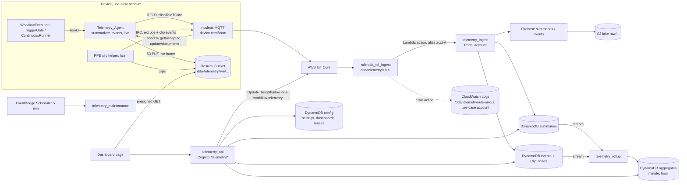

# Design Document: Workflow telemetry dashboards (Portal-native, fed by edge summaries)

*Design revision 8 (2026-10-17). Responses to the revision-7 review are in §30; the revision-6 responses stay in §29.*

## Overview

This design replaces the Quick Sight design of revision 2 with the owner's redirect of 2026-10-15: dashboards are rendered by the Portal itself with the Cloudscape chart components it already depends on, and they are fed by **periodic summaries that the device computes** plus **discrete events published the moment they happen**, not by per-frame messages. A new LocalServer service, the Telemetry_Agent, observes every run of every deployed workflow inside the workflow engine, folds the runs of each 10-second interval into one `dda.summary.v1` message per (device, workflow), publishes `dda.event.v1` messages immediately for confirmed violations, ready clips and run errors, and publishes everything through the process-wide Greengrass IPC client under the component access control all seven LocalServer recipes carry (the `amd64Nvidia` recipe gained the publish statement on the trunk before this feature's integration, §5.3). One IoT rule per account, scoped to the exact filter `dda/telemetry/+/+/+`, invokes a Portal-account Lambda function through a per-account alias; that function validates every message against a committed schema registry, attributes it to a device by the publishing certificate and to a use case by the device's record, writes the latest values to DynamoDB and the record to a Firehose-fed S3 lake. A DynamoDB-stream roll-up keeps minute and hour aggregates. The Portal serves Now, Health, chart, clip-gallery and live tiles from those tables through Cognito-authorized routes that use the Portal's existing use-case RBAC. The device is switched on, tuned and leased through a named shadow the agent reads over MQTT, so nothing after the one LocalServer release that carries the agent needs a Greengrass deployment.

What stayed from the Quick Sight design, re-verified against the worktree: the topic convention and schema registry (§3, §4), use-case attribution by certificate (§6), the topology predicate and the Lambda environment (§2.3, §2.4), the Now, Health, Clip gallery and lease-based Live tiles (§9), the caps (§15), the media-retention rules (§12) and the PPE onboarding facts (§13). What is gone: Quick Sight, SPICE, direct query, embedding, the identity region, the Glue tables and the Athena workgroup; they survive only as the documented add-on of §16. What is new: the summary and event contracts (§4), the device-side producer (§5), the Lambda rule action in place of the SQS hop (§6), the DynamoDB aggregate store in place of Athena (§7), the measure catalog and templates (§8), and the control shadow (§5.4, §10).

**Technology stack (locked once approved).** Device: Python 3 in the LocalServer backend container, `awsiotsdk==1.31.0` through `utils/ipc_client.py`, Pillow 12.3.0 for downscaling, boto3 (present in the image) for S3 PUTs. Portal: TypeScript CDK (`aws-cdk-lib` 2.270.0) for a new `EdgeCVPortalTelemetryStack`; Python 3.12 Lambda functions on the Portal's shared and JWT layers plus the `workflow_core` layer for `workflow_core.stream_url` only (§2.4); DynamoDB on-demand tables with TTL and streams; Amazon Data Firehose and S3 for the lake; EventBridge Scheduler for maintenance; React 18 with `@cloudscape-design/components` ^3.0.0 (3.0.1143 installed) and `@tanstack/react-query`. No new runtime dependency on either side.

## 1. Platform decision (R1)

**Cloudscape is sufficient.** The installed package ships `line-chart`, `bar-chart`, `area-chart`, `pie-chart`, `mixed-line-bar-chart`, `date-range-picker`, `key-value-pairs` and `status-indicator`. The templates of §8 use only these: time series of at most 1,440 points per device per panel (minute items for ranges up to 6 hours, hour items up to 60 days, day items beyond, the rule of §8.3) are within what the line and area charts render; stacked bars show per-class and per-reason counts; a pie shows outcome shares; the model-state panel is a stacked `BarChart` with one series per state over the range's buckets (each bucket's `model_state_worst` contributes 1 to its state's series); `KeyValuePairs` and `StatusIndicator` carry the Now and Health panels; the live tile and the clip player are a plain `` and `<video>`. Nothing needs a heat map, a gauge or a geographic view, so no charting dependency is added (R1.1). If a later template needs one, it is pinned to an exact version in that template's change.

**Why not Quick Sight now.** The owner's decision, after the cost comparison: the Quick Sight design cost about $30 a month at demo scale plus a $60–75 subscription change that cannot be reversed, and $1,225–1,560 a month at fleet scale, dominated by per-message DynamoDB writes ($624), SQS ($230) and IoT rule actions ($143) on 475 M per-frame messages a month. Summaries cut the message count by about 90 % and the Portal renders charts for the cost of DynamoDB reads (§15). The Standard-edition account keeps its five admins as they are.

**Alternatives considered (one paragraph each, R1.5).** *Quick Sight*: the owner's first answer; set aside for cost and the irreversible edition change; documented as the add-on of §16 over the same lake. *IoT SiteWise Monitor*: not available to new customers; AWS names Managed Grafana as the migration path [C35]. *Amazon Managed Grafana*: a second sign-in (SAML or IAM Identity Center) outside the Portal's Cognito pool and $5–9 per user per month [C36]; it would also need a Timestream or CloudWatch data source rather than the DynamoDB tables the tiles need. *CloudWatch dashboards fed by the IoT CloudWatch metric action*: cheap for a few metrics but no per-use-case access control, no clip or live tile, and a metric per (device, workflow, class) explodes at fleet scale ($0.30 per metric-month [C37]). *The device-local `hmi/` app*: one device at a time, reachable only on the device's network, no fleet view and no RBAC.

## 2. Architecture

### 2.1 Data flow



### 2.2 Components

| Component | Where | Purpose |
|---|---|---|
| `EdgeCVPortalTelemetryStack` | `edge-cv-portal/infrastructure/lib/telemetry-stack.ts`, instantiated in `bin/app.ts` after the ComputeStack | Owns every telemetry resource in the Portal account. It registers `/telemetry/*` on the imported REST API with CORS preflight and a route-salted `CfnDeployment` with `RemovalPolicy.RETAIN`, as `synthetic-data-stack.ts` does, taking `restApiId` and `restApiRootResourceId` from the ComputeStack like the NodeDesigner, BuildFleet and SyntheticData stacks. Unlike those stacks it creates **no Cognito authorizer of its own**: every method attaches to the portal API's existing authorizer (the ApiGatewayStack's `EdgeCVPortalAuthorizer`, the same user pool and `Authorization` header, so the handlers read the same claims), whose id arrives as the CDK context value `sharedAuthorizerId` (`lib/context-helpers.ts`; the synth refuses to run without it). API Gateway allows 10 authorizers per REST API, a quota raised only through AWS Support, and the portal API already carries one per route-registering stack; the first deploy attempt on 2026-10-18 rolled back on that limit (§21 RB-1). A separate stack because the ComputeStack is near the template size limit (`bin/app.ts`, `suppressTemplateIndentation`). It joins the IAM synth gate (§14.3). |
| Portal-topology rule | TelemetryStack | `dda_tel_ingest_portal` and a CDK-named **error-action role** (the Lambda rule action itself has no role: it carries only `functionArn` and is authorized by the alias's resource-based policy [C75]), for use cases whose topology is `portal` (§2.3), like `dda_camera_registry_shadow_documents_portal` (`compute-stack.ts` ~1805–1838). |
| Cross-topology rule | `usecase-account-stack.ts` | `dda_tel_ingest`, `DDATelemetryRuleErrorRole` and the log group `/dda/telemetry/rule-errors`, gated by `TelemetryCrossAccountCondition` (portal account ≠ this account) exactly like `CameraShadowCrossAccountCondition` (~886–949). No rule role: see above. |
| Ingest function and aliases | TelemetryStack | `dda-portal-telemetry-ingest` with one alias `acct-<account id>` per account in `trustedUseCaseAccountIds ∪ {Portal account}`, each with a resource-based policy for `iot.amazonaws.com` conditioned on that account (§6.2). **The asynchronous-invocation settings are configured on each alias**, `alias.configureAsyncInvoke({retryAttempts: 2, maxEventAge: Duration.hours(1), onFailure: new destinations.SqsDestination(failureQueue)})`, because Lambda stores that configuration per qualifier and the rules invoke the aliases, so a configuration on the unqualified function would apply to `$LATEST` only and the queue would never receive anything (§6.2) [C89]. The on-failure SQS queue is `dda-portal-telemetry-ingest-failures` (14 days). The function carries the shared, JWT and `workflow_core` layers (§2.4). |
| Roll-up function | TelemetryStack | `dda-portal-telemetry-rollup`, fed by the DynamoDB streams of the summaries and events tables (batch 100, window 60 s, `ReportBatchItemFailures`, `bisectBatchOnError`, retries 3, on-failure destination the same SQS queue). |
| API function | TelemetryStack | `dda-portal-telemetry-api`, every `/telemetry/*` route. |
| Maintenance function | TelemetryStack | `dda-portal-telemetry-maintenance`, EventBridge Scheduler every 5 minutes (no retry, max event age 60 s), `TelemetryScheduleRole` may invoke only it. **One schedule, three cadences**, kept by marker items in the config table: every run performs lease expiry and the tidy-up of lapsed `live` entries (§9.3) and the use-case deletion cascade (§10.3); when `UC#<uc>/RESYNC` is older than 15 minutes it performs that use case's Control_Shadow re-sync (§10.3, R6.3) and rewrites the marker; when `MAINT/SWEEP` is older than 60 minutes it performs the live-frame sweep (§12.4) and rewrites the marker. The `GG#` status cache is refreshed on read by the API, not here. |
| Pure logic | `backend/functions/telemetry/` | `registry.json`, `measure_catalog.json`, `templates/*.json`, `schemas.py`, `topics.py`, `attribution.py`, `fold.py` (including `count_gaps`, §7.3), `records.py`, `leases.py`, `media.py`, `retention.py`, `series.py` (`resolution_for`, §8.3), `health.py` (`variant_hint`, §9.1), `constants.py` (`PERSON_CLASSES`, §5.4), **`redaction.py`** (one line, `from workflow_core.stream_url import redact`; the ingest imports `redact` from this module and from nowhere else, so that the import-boundary test of §2.4 has a module that isolates the layer dependency: `telemetry_ingest.py` itself also imports boto3 and `shared_utils`, so importing it in a subprocess without the layer would fail for other reasons), `session_policies.py`, `configdb.py`. Shared with the debug spec and defined here: `backend/functions/edge_telemetry_common/{topics,identity,topology,devices,credentials,session_policies,shadow_pool}.py` (`devices.usecase_devices(usecase)`, §10.2; `credentials.client(service, usecase, purpose, region=None)`, §2.3). Both specs land in one worktree, so there is **one live copy** of this package: whichever spec lands first creates it, the second imports it and adds only its own `session_policies` purposes; there are no fixture copies and no byte-identity test for it (a fixture copy would be a third copy of each file with no owner). The genuinely two-copy files, `topics.py` (device and Portal) and the debug mode's `redact.py` (device and Portal), keep their two-copy identity tests (§3, debug §5.5). |
| Stores | TelemetryStack | DynamoDB `dda-portal-telemetry-summaries`, `-aggregates`, `-events`, `-config` (§7); S3 `edgecv-portal-telemetry-<account>-<region>` (the lake); Firehose `dda-portal-telemetry-summaries` and `dda-portal-telemetry-events`. |
| Shared layer | `shared_utils.py` | `Permission.DASHBOARDS_READ`, `DASHBOARDS_MANAGE`, `TELEMETRY_MANAGE` with the role matrix (§11.1); `portal_owned_buckets()` derives the lake bucket; `assume_usecase_role` and `get_s3_client_for_bucket` gain an optional `session_policy` (§14.4). |
| Layers built by the stack | TelemetryStack | `TelemetrySharedLayer` (`backend/layers/shared`), `TelemetryJwtLayer` (`backend/layers/jwt`) on every function, and `TelemetryWorkflowCoreLayer` (`backend/layers/workflow_core`, the ComputeStack's exclude list, runtimes 3.11 and 3.12) on the ingest function for `workflow_core.stream_url` only (§2.4). |
| Telemetry_Agent | `src/backend/workflow_engine/telemetry/` (§5) | The device-side producer and the Control_Shadow reader. Shared with the debug spec: `hooks.py`, `publisher.py`, `control_shadow.py`, `registry_view.py` (one live copy each, §5.2). |
| Frontend | `frontend/src/pages/telemetry/`, `frontend/src/components/telemetry/` | List page, create wizard, dashboard view with its panels and tiles, telemetry settings page, navigation entry. |

### 2.3 Topology: one predicate (carried from revision 2, F4)

The trunk has two disagreeing predicates: `assume_usecase_role` returns the function's own credentials only for a `:root` role ARN (`shared_utils.py` ~1587), while `is_cross_account_setup` calls any `:role/` ARN multi-account (~1506). A use case in the Portal account can carry a `:role/DDAPortalAccessRole` ARN, and the use-case template can be deployed into the Portal account, where `TelemetryCrossAccountCondition` creates no rule role. This feature therefore uses one predicate everywhere, in `edge_telemetry_common/topology.py`:

```python
def telemetry_topology(usecase: dict) -> str:
    """'portal' when the use case's devices are in the Portal account, else 'cross'."""
    return "portal" if usecase.get("account_id") == os.environ["PORTAL_ACCOUNT_ID"] else "cross"
```

| | `portal` | `cross` |
|---|---|---|
| Credentials for calls into the use case's account (identity lookup, shadow writes, `GetCoreDevice`, core-device listing, media reads, live-frame sweep) | The function's own role, whatever the form of the role ARN; no `AssumeRole`. | `assume_usecase_role(cross_account_role_arn, external_id, session_name, session_policy=…)` through `DDAPortalAccessRole`, always with the purpose's session policy (§14.4). |
| Rule that ingests | `dda_tel_ingest_portal` (TelemetryStack), invoking alias `acct-<Portal account>` | `dda_tel_ingest` (template), invoking alias `acct-<this account>` |
| Grants that apply | The TelemetryStack's by-ARN statements (§14.1) and, once wired, the `dataPlaneGrant` statements (§12.3). | `DDAPortalAccessRole`'s statements (§14.2), narrowed by session policies. |

**One credential chooser.** Every boto3 client that touches a use case's account is built by `edge_telemetry_common/credentials.py`, and by nothing else:

```python
def client(service: str, usecase: dict, purpose: str, region: Optional[str] = None):
    """The only way telemetry and debug code reach a use case's account."""
    region = region or usecase.get("region") or os.environ["AWS_REGION"]
    if telemetry_topology(usecase) == "portal":
        return boto3.client(service, region_name=region)
    role_arn = usecase["cross_account_role_arn"]           # validated as ^arn:aws:iam::<account_id>:role/ by the API
    policy = session_policies.build(purpose, usecase=usecase)   # §14.4; raises on an unknown purpose
    creds = _session_cache.get(role_arn, purpose, policy, lambda: shared_utils.assume_usecase_role(
        role_arn, usecase.get("external_id"), f"dda-telemetry-{purpose}", session_policy=policy))
    return shared_utils.create_boto3_client(service, creds, region)
```

`shared_utils.get_usecase_client` is **not** used: it has no session-policy parameter and branches on `is_cross_account_setup` (`':role/' in cross_account_role_arn`, `shared_utils.py` ~1506), the second predicate this section rules out, so a Portal-account use case registered with a `:role/` ARN would be sent through `AssumeRole`. The AST test of §14.4 fails on any call to `get_usecase_client`, `is_cross_account_setup`, `assume_cross_account_role`, or `assume_usecase_role`/`get_s3_client_for_bucket` without a `session_policy`, anywhere under `backend/functions/telemetry*`, `backend/functions/workflow_debug*` and `backend/functions/edge_telemetry_common/`. The session cache keeps one set of credentials per (role ARN, purpose, policy text) per container and refreshes when fewer than 20 minutes of the 60-minute session remain.

A `cross` use case whose role ARN does not match `^arn:aws:iam::<account_id>:role/` is refused `enabled: true` with 400 `usecase_role_invalid`; the checklist names the fix. RB-1 records each enabled use case's topology and the form of its role ARN, never the ARN.

### 2.4 The Lambda environment and layers (F8)

The shared layer reads its inputs from the environment: `registry_enforcement_enabled()` reads `PORTAL_REGISTRY_ENFORCED`; `portal_owned_buckets()` reads `PORTAL_ARTIFACTS_BUCKET`, `COMPONENT_BUCKET_PREFIX` and `PORTAL_ACCOUNT_ID`; `get_usecase`, `has_permission` and `log_audit_event` read the table names. `telemetry-stack.ts` builds one `telemetryLambdaEnvironment` and sets it on all four functions, with the ComputeStack's key names (`compute-stack.ts` `lambdaEnvironment`, ~703–760) and `PORTAL_REGISTRY_ENFORCED: portalRegistryEnforced(this.node.tryGetContext('portalRegistryEnforced'))` as `synthetic-data-stack.ts` does (~403–425):

```ts
const telemetryLambdaEnvironment: { [key: string]: string } = {
  USECASES_TABLE: props.useCasesTable.tableName,
  USER_ROLES_TABLE: props.userRolesTable.tableName,
  DEVICES_TABLE: props.devicesTable.tableName,
  AUDIT_LOG_TABLE: props.auditLogTable.tableName,
  SETTINGS_TABLE: props.settingsTable.tableName,
  WORKFLOWS_TABLE: props.workflowsTable.tableName,
  WORKFLOW_VERSIONS_TABLE: props.workflowVersionsTable.tableName,
  PORTAL_ARTIFACTS_BUCKET: props.portalArtifactsBucket.bucketName,
  PORTAL_ACCOUNT_ID: cdk.Aws.ACCOUNT_ID,
  USER_POOL_ID: props.userPool.userPoolId,
  COMPONENT_BUCKET_PREFIX: 'dda-component',          // the ComputeStack's value; jest compares them
  PORTAL_REGISTRY_ENFORCED: portalRegistryEnforced(this.node.tryGetContext('portalRegistryEnforced')),
  TELEMETRY_SUMMARIES_TABLE: summariesTable.tableName,
  TELEMETRY_AGGREGATES_TABLE: aggregatesTable.tableName,
  TELEMETRY_EVENTS_TABLE: eventsTable.tableName,
  TELEMETRY_CONFIG_TABLE: configTable.tableName,
  TELEMETRY_LAKE_BUCKET: lakeBucket.bucketName,
  TELEMETRY_FIREHOSE_SUMMARIES: 'dda-portal-telemetry-summaries',
  TELEMETRY_FIREHOSE_EVENTS: 'dda-portal-telemetry-events',
  TELEMETRY_DATA_PLANE_GRANT: dataPlaneGrantWired ? 'tag' : 'absent',
  TELEMETRY_PORTAL_RULE_NAME: 'dda_tel_ingest_portal',
  // plus the caps and retention values of §15.2, as strings
};
```

Function names are fixed literals (`dda-portal-telemetry-<name>`), so no function's environment refers to another's ARN. The stack builds `TelemetrySharedLayer` and `TelemetryJwtLayer` from `backend/layers/shared` and `backend/layers/jwt`, compatible with Python 3.11 and 3.12, as `synthetic-data-stack.ts` does (~176–186); the code asset is `backend/functions`.

**The `workflow_core` layer, for `stream_url` only.** The ingest's second redaction pass (§4.2, §6.4 step 7) calls `workflow_core.stream_url.redact`, and on the Portal that module exists **only** in the `workflow_core` layer (`backend/layers/workflow_core/python/workflow_core/stream_url.py`; the shared layer's only `redact` is `git_connections.redact`, a git-URL helper). Today the layer is attached by the ComputeStack (`compute-stack.ts` 182–207, built for the 3.12 `CameraRegistryHandler` precisely for this stdlib-only module), the NodeDesigner and the TestRunner stacks, none of which this stack shares a function with. The unit tests would not catch the omission: `backend/tests/conftest.py` 29 and 109 put the functions directory **and** `backend/layers/workflow_core/python` on `sys.path`, so every test of the redaction module imports it, and the `ImportError` would appear only in the deployed function, where it never initialises and every message lands in the on-failure queue. The stack therefore builds its own copy:

```ts
const workflowCoreLayer = new lambda.LayerVersion(this, 'TelemetryWorkflowCoreLayer', {
  code: lambda.Code.fromAsset(path.join(__dirname, '../../backend/layers/workflow_core'), {
    exclude: ['tests', 'tests/**', '.hypothesis', '.hypothesis/**', '.pytest_cache', '.pytest_cache/**',
              '**/__pycache__', '**/__pycache__/**', 'build.sh', 'pyproject.toml', 'requirements.txt', 'README.md'],
  }),   // the same exclude list as compute-stack.ts:184-197
  compatibleRuntimes: [lambda.Runtime.PYTHON_3_11, lambda.Runtime.PYTHON_3_12],
  description: 'workflow_core.stream_url for the ingest redaction pass (stdlib-only module; nothing else may be imported on 3.12)',
});
ingestFn.addLayers(workflowCoreLayer);   // every function that imports the redaction module; today the ingest only
```

**Rule:** a Python 3.12 function may import **only `workflow_core.stream_url`** from that layer, because the layer's jsonschema dependency carries a cp311-only native `rpds` module (`compute-stack.ts` 198–205); `workflow_core.serializer`, `catalog`, `validator` and `compiler` are off limits. Enforcement: `test_telemetry_credentials_ast.py` (§14.4) gains a second check that fails on any `workflow_core.<x>` import with `x != stream_url` under `backend/functions/telemetry*`, `workflow_debug*` and `edge_telemetry_common/`; and an **import-boundary test**, `test_telemetry_redaction_import_boundary.py`, runs a subprocess whose `sys.path` holds the functions directory and the shared layer but **not** `backend/layers/workflow_core/python` and asserts that importing the ingest's redaction module, `backend/functions/telemetry/redaction.py` (§2.2), fails with `ImportError`, then runs it again with the layer path and asserts success, so that the dependency on the layer is pinned rather than masked by `conftest.py`. Vendoring a copy of `stream_url.redact` into the functions directory was not taken: it would duplicate the rules and, for the debug mode, break the byte-identity of its environment-neutral `redact.py` with the device copy.

jest asserts that every function in the stack carries `PORTAL_REGISTRY_ENFORCED` equal to `portalRegistryEnforced(context)` under both context values, the table and bucket keys above, and `COMPONENT_BUCKET_PREFIX` equal to the ComputeStack's value; that the ingest function's `Layers` include the shared, JWT and `workflow_core` layers; and that the `workflow_core` layer's `CompatibleRuntimes` are `python3.11` and `python3.12`. A unit test sets this environment and asserts that `portal_owned_buckets()` holds the artifacts bucket, the derived component bucket and the derived lake bucket.

### 2.5 Accounts and regions

Telemetry is stored and processed in the Portal account and region for every use case. A use case's account keeps only its rule, its error-action role (the one role per rule of §6.1 and §14.2), its error log group and its media. A use case whose region differs from the Portal's is not supported: the Lambda rule action can only invoke a function in the rule's region [C74], so enabling it is refused with 400 `region_not_supported` (R6.5).

## 3. Topic convention (R4)

```
dda/telemetry/{usecase_id}/{workflow_id}/{kind}        kind ∈ {summary, event, live}
```

- **Root.** Two literal levels. Re-confirmed in the worktree on 2026-10-15: no topic, rule, fixture or test under `dda/telemetry`; the repository does use `dda/…` for triggers and outputs (`dda/bedrock-test-trigger`, `dda/results`, `dda/out`, `dda/trigger/start`), which is why `dda/` alone is not the root.
- **Ids** are the Portal UUIDs (`usecases.py`, `workflows.py`); a topic is about 95 bytes with four slashes, within IoT's seven [C27].
- **No device level.** The device comes from the publishing certificate (§6.3); the payload's `deviceId` is a cross-check (R4.2).
- **The use case id comes from the Control_Shadow** (`desired.usecaseId`, §5.4), never from `manifest.json`, which carries `workflowId`, `workflowName`, `workflowVersion` and `targetArch` only (`workflow_packaging.py` ~2185–2220). Without it the agent publishes nothing (R4.3).
- **The rule filter is `dda/telemetry/+/+/+`.** It matches exactly five-level topics; a sixth level or a different root is not matched; no rule of this feature uses `#`. `ppe-demo/mic730/invoke` and every other trigger topic are outside the root (R4.4).
- **`mqtt_publish` is untouched** (R4.5): its topics and payloads are not ingested, the node needs no change, and a workflow needs no `mqtt_publish` node to appear on dashboards. The "Dashboard telemetry" builder action of the prior design is dropped: there is nothing for a node to point at.
- **Duplicated workflows** (R4.6): `duplicate_workflow` copies the definition verbatim (`workflows.py` ~706); since the agent takes `workflow_id` from the registration (`WorkflowRegistration.workflow_id`), a copy's summaries land on the copy's own dashboards. No rewrite is needed (Q6 of the requirements is answered: none).

Pure helpers `topics.convention_topic(usecase_id, workflow_id, kind)` and `topics.parse_convention_topic(topic)` (returns the three parts or raises `TopicError(reason)`), unit-tested, shared with the device through a byte-identical copy in `workflow_engine/telemetry/topics.py` (a unit test compares the two files).

## 4. Contracts and the schema registry (R2, R3, R10.2)

### 4.1 `dda.summary.v1`

One per Pair per Interval, QoS 0, at most 16 KB. Field rules; "engine" marks blocks that only the `engine` producer may fill (R2.6):

| Field | Required | Type and limits |
|---|---|---|
| `schema` | yes | `"dda.summary.v1"` |
| `intervalStart`, `intervalEnd` | yes | integers, epoch ms; `1000 ≤ intervalEnd − intervalStart ≤ intervalS × 1000 + 1000` (a producer that starts mid-interval emits a short first interval, which this range accepts; a longer interval than declared is rejected); `intervalEnd mod (intervalS × 1000) = 0` is advisory. The fold never weights by interval length (sums and maxima are unaffected), so a short interval needs no special handling downstream. **The window a message declares depends on its kind:** a Summary declares `intervalS = summaryIntervalS`; a Heartbeat declares `intervalS = idleHeartbeatS`, `intervalEnd` aligned to a multiple of `idleHeartbeatS` and `intervalStart = intervalEnd − idleHeartbeatS × 1000` (short first window allowed), so the length rule accepts it (R2.9). A first window shorter than 1 s is never emitted: the summarizer folds it into the next boundary (R2.1). The schema tests include a 3 s first interval of a 10 s producer (accepted), a 12 s interval declared as 10 s (rejected), a 60 s Heartbeat declaring `intervalS: 60` from a 10 s producer (accepted) and a 60 s Heartbeat declaring `intervalS: 10` (rejected). |
| `emittedAt` | yes | integer, epoch ms, ≥ `intervalEnd` |
| `deviceId` | yes | string 1–128, `[A-Za-z0-9:_-]+` (thing-name grammar) |
| `workflowId` | yes | UUID string |
| `workflowVersion` | yes | string ≤ 64; an integer is accepted and normalized to a string |
| `producer` | yes | `{name: [a-z0-9-]{1,32}, version: string ≤ 32, instance: UUID}` |
| `seq` | yes | integer ≥ 1, +1 per Summary **or Heartbeat** of this `instance` (one counter) |
| `intervalS` | yes | integer, **validated by kind**: 5–60 when `idle` is false (a Summary declares `summaryIntervalS`), 30–300 when `idle` is true (a Heartbeat declares `idleHeartbeatS`); a Summary declaring `intervalS: 120` is `schema_invalid` (a schema test), as is a Heartbeat declaring 10 |
| `idle` | yes | boolean; a Heartbeat has `idle: true` and no `runs`, `latency`, `detections`, `outcomes`, `people`, `continuous` or `ext` |
| `runs` (engine) | when `idle` is false and `producer.name` is `engine` | `{completed, failed, dropped}`, integers 0–10,000,000 |
| `latency` (engine) | no | `{p50Ms, p95Ms, maxMs, n}`, integers ≥ 0; absent when `n = 0`. **Pipeline time** (A9, R2.2): `finished_ms − run_started_ms`, where `run_started_ms` is stamped at the executor's RUNNING transition, after preflight, document load, frame-source staging and the Triton readiness gate (which waits up to 600 s for a loading model); the gate's wait is in `model.waitedMs`, not here. A run refused before that transition counts in `runs.failed` with no sample, so `n ≤ completed + failed`. |
| `detections` (engine) | no | `{runsWithDetections, total, perClass: {<label ≤ 64 chars>: {total, max}}, truncated}`; at most 64 labels; `total` is summed from each run's uncapped `detection_count` (§5.2), `perClass` from the capped 1,000-item lists; `truncated` true when labels were folded into `__other__` **or** when any run of the Interval carried more detections than its capped list (`detection_count > len(detections)`), so that `total` and the sum of `perClass.*.total` may differ only when `truncated` is true |
| `outcomes` (engine) | no | `{anomalous, normal}` |
| `people` (engine) | no | `{seen}`: the per-run maximum of detections whose label is in `desired.personClasses` (default `person`, `human`) |
| `model` (engine) | yes for engine when `idle` is false | `{state, models: {<name ≤ 64>: <state>} (≤ 16), waits ≥ 0, waitedMs ≥ 0}`; every state ∈ {`NONE`, `READY`, `LOADING`, `UNLOADING`, `UNAVAILABLE`, `UNKNOWN`, `NOT_DEPLOYED`, `INCOMPLETE`} (the seven states of `model_gate.py` ~63–70 and `dda_triton.model_readiness`, plus `NONE`); `state` is the worst state seen in the Interval under `NONE < READY < UNLOADING < LOADING < INCOMPLETE < NOT_DEPLOYED < UNKNOWN < UNAVAILABLE`; `waits` counts the per-run gate outcomes that were not immediately ready plus the continuous waits that **began** in the Interval, each wait once (§5.2 `summarizer.py`); `waitedMs` is the sum of the per-run gate's `waited_seconds` × 1000 in the Interval, the time the readiness gate held runs (excluded from `latency`); a Pair whose document has no `emltriton` element sends `{state: "NONE", models: {}, waits: 0, waitedMs: 0}`. **Source (§5.2):** the per-run gate's `ReadinessOutcome` per model (`notify_model_readiness`) and the continuous runner's `ModelWait` (`notify_model_wait`). The device maps any string outside the eight to `UNKNOWN`; the ingest never rejects a Summary for a state value (an out-of-set string there is coerced to `UNKNOWN` and counted `FieldDropped`). |
| `continuous` (engine) | no | `{skippedNoNewFrame, paused (boolean), effectiveFps (number ≥ 0)}` |
| `ext` | no | object of at most 8 extensions, keys `[a-z0-9-]{1,32}`, at most 8 KB serialized; `ppe` is defined below; unknown extensions are kept in the lake record and ignored by the fold |
| `ext.ppe` (producer `ppe-clipper`, or `engine` once the engine learns PPE rules) | no | `{people: {seen, compliant, violating}, violations: {frames, byReason: {<reason ≤ 64>: {frames, objects}}} (≤ 16 reasons), clipsOpened, frames}`, with `compliant + violating ≤ seen` |
| `telemetry` | yes | `{queueDrops, publishFailures, eventsDropped}`, counters since the previous Summary of this `instance` |

**Ownership of blocks (R2.6).** `registry.json` maps each top-level block to its owner: `runs`, `latency`, `detections`, `outcomes`, `people`, `model`, `continuous` → `engine`; `ext.<name>` → the producer named in `registry.json["extensions"][name]["owner"]` (`ppe` → `ppe-clipper`; a second entry allows `engine`). A block from a producer that does not own it is dropped from the typed fields, kept in the lake record and counted `block_not_owned` (metric dimension `Block`). This is what lets the LocalServer agent and the demo helper publish for the same Pair without double counting (§13).

**Measures emitted** (the fold of §7.3 reads them from the Measure_Catalog): `runs_completed`, `runs_failed`, `runs_dropped` (sum); `latency_p50_ms` (n-weighted mean of the Summaries' p50, labelled approximate), `latency_p95_ms` (max of p95), `latency_max_ms` (max); `detections_total`, `runs_with_detections` (sum); `detections_class_total.<label>` (sum), `detections_class_max.<label>` (max); `anomalous`, `normal` (sum); `people_seen_max` (max); `model_state_worst` (worst of the ordering `NONE < READY < UNLOADING < LOADING < INCOMPLETE < NOT_DEPLOYED < UNKNOWN < UNAVAILABLE`), `model_waits` (sum), `model_wait_ms` (sum); `continuous_skipped_no_new_frame` (sum), `continuous_paused` (last), `continuous_fps` (mean); `ppe_people_seen_max`, `ppe_people_violating_max` (max), `ppe_people_compliant_max` (max), `ppe_violation_frames` (sum), `ppe_reason_frames.<reason>`, `ppe_reason_objects.<reason>` (sum), `ppe_clips_opened`, `ppe_frames` (sum); `telemetry_queue_drops`, `telemetry_publish_failures`, `telemetry_events_dropped` (sum); `summaries` (count); `gaps` (sum).

### 4.2 `dda.event.v1`

Published immediately, QoS 1, at most 16 KB.

| Field | Required | Type and limits |
|---|---|---|
| `schema` | yes | `"dda.event.v1"` |
| `type` | yes | `violation_confirmed`, `clip_ready`, `run_error` |
| `eventId` | yes | UUID; the dedup key for 24 h |
| `ts` | yes | integer, epoch ms |
| `deviceId`, `workflowId`, `workflowVersion`, `producer` | yes | as in the Summary |
| `executionId` | no | string ≤ 128 |
| `severity` | no | `info` (default for `clip_ready`), `warning` (default for `violation_confirmed`), `error` (`run_error`) |
| `data` for `run_error` | yes | `{error ≤ 1,024 chars (redacted on the device with `stream_url.redact(text, credential_store_secrets())`, §5.2 `events.py`, and again at ingest with `workflow_core.stream_url.redact(text, ())` from the `workflow_core` layer the stack attaches, §2.4), failingNodeId ≤ 128, count ≥ 1, firstTs, lastTs}` |
| `data` for `clip_ready` | yes | `{clipId ≤ 128 [A-Za-z0-9._:-], revision ≥ 1, startTs, endTs (≥ startTs, ≤ 3,600 s apart), durationS, reasons: {<reason>: {frames, objects}}, totals: {perClass, violationFrames, violationObjects}, file: {name ≤ 255, bytes ≥ 0, sha256 (64 hex), width ≤ 7680, height ≤ 4320, codec ≤ 32}, s3: {bucket ≤ 63, key ≤ 1024, sidecarKey ≤ 1024} or null, s3Error ≤ 200 or null}`; `s3Error` is rendered in the gallery, so the Producer redacts it before publishing and the ingest redacts it again with the same callable before storing it (R3.4). **Revision rule:** a `clip_ready` with a higher `revision` for the same clip carries the identical `clipId`, `startTs` and `deviceId` as the first publish; the Clip_Index entry is keyed on them (§7.2), so a follow-up whose `startTs` differs is a new clip, not a revision (R3.4, §13) |
| `data` for `violation_confirmed` | yes | `{reasons: {<reason>: objects}, people, violatingPeople, clipId or null}` |

The `engine` producer emits `run_error` only, coalesced per (Workflow, `failingNodeId`, first 64 characters of the error): at most one Event every 10 s per key with `count` (R3.3). **Redaction strength, recorded as accepted (R3.3):** `run_error.error` and `clip_ready.s3Error` pass through `stream_url.redact` (URL user information, secret query parameters, Credential_Store values) and not through the debug mode's wider `redact_structure` (which adds `Authorization`/`Cookie` header values, connection-string keys and AWS key patterns), because the Event texts are engine exception messages from the pipeline and the bindings, not log lines, request dumps or tracebacks: the secrets such a message can quote are a URL's user information, a presigned URL's query parameters or a Credential_Store value, all of which the base rules mask; a dependency on the debug mode's module "when present" would make this feature's redaction depend on which specification landed first. If a future binding error ever embeds a header or an access key id, widening is a one-line change to `events.py` and a schema test. `clip_ready` and `violation_confirmed` come from a Helper (the PPE clipper) until the engine learns PPE rules. The agent caps Events at 60 per minute per Device; the excess is dropped and counted in `telemetry.eventsDropped` (R3.2).

### 4.3 `dda.live.v1`

Sent only under a lease (§9.3), QoS 0, about 1 KB: `schema`, `ts`, **`instance`** (required; the agent's UUID, the same value the Summaries carry as `producer.instance`, chosen at each agent start), `seq` (≥ 0, +1 per frame of the Pair **within this `instance`**; it restarts at 0 with the agent, so it orders frames only within an instance and is never compared across instances), `deviceId`, `workflowId`, `frame: {bucket ≤ 63, key, width ≤ 1280, height ≤ 720, bytes ≤ 307200}`, optional `workflowVersion`, `perClass`, `people`, `violation`, `reasons`. `key` must be `dda-telemetry/live/<usecase_id>/<deviceId>/<workflowId>/<slot>.jpg` with `slot = seq mod 16` written without leading zeros; a key whose slot differs is `schema_invalid`. `seq` keeps two jobs, the slot arithmetic and the `x-amz-meta-seq` HEAD check of §9.3; **arrival order, not `seq`, moves the `LIVE` pointer** (§7.1), which is what lets the tile recover from an agent restart (finding 4 of §30). The client's "have" token is `frame_token = "<instance>:<seq>"`, so a restart (new `instance`, `seq` back at 0) always reads as a new frame.

### 4.4 The registry, validation and event time

`backend/functions/telemetry/registry.json` is committed JSON with `version`, `kinds` (`summary → dda.summary.v1`, `event → dda.event.v1`, `live → dda.live.v1`), the field declarations above, the block owners and the extensions. `schemas.py` has one adapter per schema; a unit test asserts that the adapters equal the schemas, that every measure an adapter emits is in `measure_catalog.json`, and that each template's measures exist (R9.2).

Validation (R2.10, R3.6): the payload must be a JSON object of at most 128 KB (IoT's limit [C27]) and, for Summaries and Events, at most 16 KB (`too_large`). Only declared fields are validated: strings at most 256 characters unless a tighter limit is given; count maps at most 64 entries with non-negative integer values; timestamps finite; nesting at most 8 levels. A declared field of the wrong type is coerced by the rule of `output_bindings._coerce` (numeric strings to numbers, `"true"`/`"false"` to booleans) and checked again; an optional field that still fails is dropped and counted `FieldDropped` (dimension `Schema`, the field name in the log line, never its value); a required field that still fails, or is missing, makes the message `schema_invalid`. Undeclared fields are kept verbatim in the lake record and never validated.

Event time: `eventMs` is `intervalEnd` (Summary), `ts` (Event, Live_Frame), **with a tolerance that depends on the kind** (R8.1); the aggregates bucket a Summary by the minute of `eventMs − 1` and an Event by the minute of `eventMs` (§7.3, R8.4), so that a Summary whose `intervalEnd` sits exactly on a minute boundary is folded into the minute it covers. For a **Summary**, `intervalEnd` is used when it lies within 5 minutes before and 5 minutes after the receive time `r`; otherwise `r` is used and the record is flagged `tsSource: received`. The 5-minute bound is the roll-up's query window (§7.3): the Summary_Store is keyed by receive time and the roll-up looks for a minute's Summaries among the receive-time keys within ±5 minutes of that minute, so a wider tolerance (the 24 hours of revision 4) would accept a device 6 minutes to 24 hours behind and then never find its Summaries when computing their minute. A device more than 5 minutes off therefore charts at receive time with `tsSource: received` shown beside it, which is the honest answer for a clock that far out. A property test asserts that for every accepted Summary the receive-time key lies inside the roll-up's query window for its `eventMs` minute. For an **Event**, `ts` is used when within 24 hours before and 5 minutes after `r` (the nucleus spools QoS 1 Events while a device is offline, **up to its 2.5 MB in-memory spooler** (`mqtt.spooler.maxSizeInBytes`, default; about 160 Events of 16 KB, lost on a nucleus restart since the default `storageType` is `Memory`) [C91], so an Event may legitimately arrive hours late and must chart at its real time; the 24 h rule is right, and the spooler bound is why it is a tolerance rather than a delivery guarantee); the Event_Store keys Events by `eventMs` (§7.2), so the roll-up's minute query over `E#` keys needs no window at all. A Live_Frame's `ts` is informational (the `LIVE` pointer orders by arrival, `receivedMs`, §7.1). The Summary_Store keys on the receive time and the aggregates bucket on `eventMs` (§7, F3).

Rejection reasons, counted per use case (or per account before a use case is known): `invalid_json`, `too_large`, `schema_invalid`, `schema_unknown`, `usecase_disabled`, `unattributed`, `identity_unavailable`, `attribution_mismatch`, `workflow_not_in_usecase`, `rate_exceeded` (Events only, §6.4 step 7b), `duplicate` (diagnostic), `block_not_owned` (diagnostic; the message is still accepted).

## 5. The device-side producer: the Telemetry_Agent (R5)

### 5.1 Why an executor-level emitter

| Option | Verdict |
|---|---|
| A summary mode on `mqtt_publish` | Rejected. A node runs inside a run; it sees neither failed runs, nor discarded trigger firings, nor the runs of other workflows, nor anything between runs, so it cannot report `runs.failed`, `runs.dropped`, latency percentiles or a Heartbeat. Every workflow would need the node added and a new version packaged and deployed, which the owner wants to avoid while deployments can wedge Triton. |
| A new telemetry output node | Rejected for the same reasons, plus a catalog change mirrored to the device (`test_vendored_catalog_mirror.py`) and a re-package of every workflow. |
| **An emitter at the executor level (chosen)** | It observes every run of every registration, including failures the pipeline never reaches and firings the gate discards; it keeps state across runs (the Interval accumulator, the lease, the `seq`); it ships in one LocalServer release and is then switched by the Control_Shadow without any deployment; and no workflow changes. |

### 5.2 Module layout and the run hook

`src/backend/workflow_engine/telemetry/` (shared with `workflow-debug-mode`: **this section is the single definition** of `hooks.py`, `publisher.py`, `control_shadow.py` and `registry_view.py`; the debug design references it and adds nothing to these four files; whichever spec lands first creates them. Both specs land in the same worktree, so each file exists **once**; there are no fixture copies. The rule "the debug spec adds nothing to these files" is enforced by review and by one small test, `test_telemetry_shared_modules_surface.py`, which imports the four modules and asserts their public symbol set (including `publish_via_ipc`'s `retain` keyword, read through `inspect.signature`) equals the list this section defines, so that an addition made for the debug mode is visible as a failing assertion in this spec's tests. The only files that genuinely exist twice are `topics.py` (device and Portal, §3) and the debug mode's `redact.py` (device and Portal, debug §5.5), each with its two-copy identity test):

| Module | Contents |
|---|---|
| `hooks.py` | **`RunRecord`** (frozen dataclass, built by the executor in its `finally` block): `registration_id: str`, `workflow_id: str`, `workflow_version: str`, `execution_id: str`, `status: str` (`completed`/`failed`), `error: Optional[str]`, `failing_node_id: Optional[str]`, `traceback: Optional[str]` (the `traceback.format_exc()` text the executor captured in the `except` block that led to the failure, cut to its last 8 KB; `None` for refusals that raised nothing, such as a validation or preflight failure), `capture_id: Optional[str]`, `output_dir: Optional[str]`, `log_path: Optional[str]`, **the timing stamps** (R2.2): `enqueued_at_s: int` (the row's `started_at` as it was right after the pending check, i.e. the enqueue time in seconds, captured before the RUNNING transition overwrites the column), `accepted_ms: int` (stamped right after the pending check, when the executor picked the run up), `run_started_ms: Optional[int]` (stamped at the RUNNING transition, `pipeline_executor.py` ~1947, after preflight, document load, frame-source staging and the readiness gate; `None` when the run was refused before it), `finished_ms: int` (stamped in the `finally`), `queued_ms: int` (`max(0, accepted_ms − enqueued_at_s × 1000)`; accurate to the enqueue column's one-second resolution), `setup_ms: Optional[int]` (`run_started_ms − accepted_ms`, includes the readiness wait; `None` with `run_started_ms`), `readiness_wait_ms: int` (the sum of `ReadinessOutcome.waited_seconds × 1000` the `on_outcome` callback reported for this execution; 0 without a Triton model); `trigger_context: dict` (the loaded Trigger_Context, `{}` for manual runs), `node_status: Optional[dict]` (the collector's document), `tag_values: Optional[dict]` (the final metadata), `detections: Optional[list]` (at most 1,000 `{id, label, confidence, x_min, …}` items), **`detection_count: int`** (the uncapped length of the run's detection list, 0 when there is none, so that a run with more than 1,000 detections is counted in full even though only 1,000 items travel), `continuous: bool`. The Summary's latency sample is `finished_ms − run_started_ms` when `run_started_ms` is not `None`. **Observers:** `register_run_observer(cb)`, `notify_run_finished(record)`; `register_drop_observer(cb)`, `notify_trigger_dropped(registration_id, node_id, reason)`; `register_continuous_observer(cb)`, `notify_continuous_tick(registration_id, key, amount)`; `register_model_observer(cb)`, `notify_model_readiness(registration_id, execution_id, model, state, waited_ms, ready)` (one call per model from the per-run gate) and `notify_model_wait(registration_id, wait_document_or_None)` (from the continuous runner when a wait begins and when it ends). **Context:** `CURRENT_EXECUTION: ContextVar[Optional[tuple[str, str, str]]]` = `(registration_id, workflow_id, execution_id)`, set by the executor around `execute()` and reset in its `finally`, read by the debug log tap. Every `notify_*` catches and logs every exception at WARNING once per minute per observer; it never raises into the caller and never blocks: each observer must enqueue and return. |
| `publisher.py` | `IpcPublisher(name, maxlen=1000)`: a `collections.deque(maxlen)` of `(topic, payload: bytes, qos)` guarded by a `Condition`; one daemon thread per instance (`<name>-publisher`); `publish(topic, payload: bytes, qos)` appends and, when the deque was full, increments `queue_drops` (the oldest entry was evicted by `maxlen`); `publish_message(topic, payload: str)` is the QoS 0 `str` convenience the `mqtt.SubscriptionHandler` calls on its `publish_handler` for the shadow `get` (`SubscriptionHandler.py` ~310: `publish_handler.publish_message(topic_prefix + "get", "")`), so an `IpcPublisher` can be handed to it directly; the thread calls **`publish_via_ipc(topic: str, payload: bytes, qos: int, *, retain: bool = False) -> None`**, the new function factored out of `output_bindings._default_greengrass_publisher(topic: str, payload: str, qos: int, *, retain: bool = False)` (~698). **The factored function carries the whole body, including the live `retain` path:** the QoS mapping, the optional `request.retain = True` assignment behind the `hasattr(request, "retain")` check that raises the `RuntimeError` naming awsiotsdk ≥ 1.13 and nucleus ≥ 2.10 (`output_bindings.py` 757–764), `call_with_ipc_retry`, and the `UnauthorizedError` → `RuntimeError` diagnosis **with its `iot:RetainPublish` sentence when `retain` is true** (771–790). `_default_greengrass_publisher` keeps its signature and becomes the one-line `publish_via_ipc(topic, payload.encode("utf-8"), qos, retain=retain)`, so the `mqtt_publish` node's retained publishes and its denial diagnosis are unchanged, and `test/backend-test/workflow_engine/test_mqtt_publish_retain.py` (which asserts that `retain=True` reaches the publisher as a keyword, that the IPC request carries `retain` only when requested, that an SDK without the field fails before any IPC call, and that the denial names `iot:RetainPublish` only for a retained publish) **must stay green unchanged**: it is the pin for the retained path. A signature without `retain` would have forced a coder either to drop the flag (breaking that test), to deviate from the stated signature, or to keep a second copy of the IPC call and the diagnosis for the retained case. The agents (this one and the debug mode's) always call `publish_via_ipc` with the default `retain=False`; the surface test below lists the keyword in the module's public signature; a failed publish increments `publish_failures` and is logged at WARNING at most once per minute per topic; the thread never dies (every exception is caught). **The denial line (R5.4).** `publish_via_ipc` keeps re-raising a nucleus denial as `_default_greengrass_publisher` does today: a `RuntimeError` whose `__cause__` is `awsiot.greengrasscoreipc.model.UnauthorizedError` and whose message (`output_bindings.py` 771–783) names `recipe-arm64-jp6.yaml / recipe-arm64-jp5.yaml / recipe-arm64.yaml / recipe-amd64.yaml` generically and **never** `mqttproxy:2`, `recipe-amd64-nvidia.yaml` or `recipe-arm64-jp7.yaml`; the device has no way to know which variant it runs. So the publisher thread recognises that shape (`isinstance(err, RuntimeError) and isinstance(err.__cause__, UnauthorizedError)`), counts it as `publish_failures` with `reason: denied`, and logs **its own fixed line** at ERROR, once per minute per topic: `publish to <topic> denied by Greengrass IPC: this LocalServer's deployed recipe lacks mqttproxy:2 (aws.greengrass#PublishToIoTCore on *). Original diagnosis: <message>`. The line names the missing statement without claiming to have detected the variant; it names no recipe since A10/Q8 were resolved (every current recipe carries the statement, so a denial points at the deployed component's recipe). A unit test stubs `publish_via_ipc` to raise the `RuntimeError`-from-`UnauthorizedError`, publishes three messages within a minute and asserts one ERROR line with that text, `publish_failures == 3` and a second line only after the fake clock passes 60 s. **Each agent owns its own instance**: the Telemetry_Agent builds `IpcPublisher("telemetry")` and the debug mode's agent builds `IpcPublisher("workflow-debug")`, each with its own thread and deque, because an IPC publish can block for up to 10 s on a stalled connection (`call_with_ipc_retry`) and the debug mode's traffic must never evict Summaries from the telemetry queue or delay them behind debug batches. **That isolation reaches only the agents' own queues, not the nucleus** (finding 5 of §30): every component's `PublishToIoTCore` lands in the nucleus's one MQTT spooler, an in-memory cache of `mqtt.spooler.maxSizeInBytes` = 2,621,440 bytes (2.5 MB) by default that **rejects new messages when full** and spools QoS 1 messages "unless the spool is full" (`keepQos0WhenOffline` defaults to false; `storageType` defaults to `Memory`) [C91]. The publisher thread therefore also recognises the spool-full shape, an `awsiot.greengrasscoreipc.model.ServiceError` from the publish operation, counts it as `publish_failures` with `reason: spool_full` (exposed as `failures_by_reason`, which the debug mode's batcher reads for its back-off, debug §5.1), re-queues nothing, and logs one WARNING per minute per topic naming the shared spooler and its two expected causes: a debug session whose byte cap exceeds the uplink, or an offline device. The byte cap that keeps the debug mode from filling the spooler is the debug design's (`maxBytesPerSecond`, default 256 KB/s, debug §10); this agent's own traffic is a few KB per second and needs none. |
| `control_shadow.py` | `ShadowControlAgent(thing_name, shadow_name, on_desired, publisher)` (`thing_name` from `AWS_IOT_THING_NAME`, as `camera_sync/agent.py` ~736 and `model_status_shadow.py` ~98 read it): a `SubscriptionHandler` on the prefix `$aws/things/{thing}/shadow/name/{shadow}/` (it subscribes to `<prefix>#`, so it receives `get/accepted`, `get/rejected`, `update/accepted`, `update/rejected`, `update/delta` and `update/documents` **and the agent's own request publishes on `.../get` and `.../update`**); `on_active` publishes an empty payload to `.../get`. **Ignored topics:** `.../get` (the agent's own empty request echoed back), `.../update` (its own `reported` write echoed back), `.../update/accepted`, `.../update/rejected` and `.../get/rejected` are each logged at DEBUG and change nothing; a unit test feeds an empty `.../get` echo and an `.../update` echo and asserts no `on_desired` call. **Which documents are applied, and how.** Only documents that carry the *complete* desired state are applied: `get/accepted` (`state.desired`, `version`) and `update/documents` (`current.state.desired`, `current.version` [C50][C86]). The agent compares the document's version with the last applied version (lower or equal is ignored) and calls `on_desired(desired, version)` with the **complete** `desired` map; **an entry absent from that map is removed**, which is how a key the Portal deleted by writing `null` reaches the device, because a removed key never appears in `update/delta` (the delta lists only desired fields that differ from reported). `update/delta` is therefore never applied as state: it only triggers a fresh empty `.../get` (coalesced to one in flight), which returns the complete document. `update/accepted` and `update/rejected` are ignored except for a DEBUG line. The agent's own `reported` writes also produce `update/documents` messages; they carry an unchanged `desired` and a higher version, and `on_desired` is idempotent, so applying them is a no-op. `report(state_dict)` publishes `{"state": {"reported": ...}}` to `.../update`, at most 4 KB, when the agent's non-counter reported fields changed since the last write and otherwise at most once per 5 minutes (counters and `lastPublishAt` ride along). Unit tests: a `get/accepted` with `live.{A, B}` followed by an `update/documents` whose `current.state.desired.live` holds only `B` ends lease A within one tick; a delta carrying only `B` does not end A and triggers exactly one `get`; a lower version is ignored; a `documents` message caused by the agent's own `reported` write changes nothing. It does not depend on ShadowManager and its `synchronize` list (`deployments.py` `portal_shadow_sync_config`), which names other shadows and would need a deployment to extend. **This is new code, not a proven pattern:** the two existing agents take deltas over MQTT but read the current document through ShadowManager IPC (`IoTShadowAccessor.get_thing_shadow_state_request`, `camera_sync/agent.py` ~1065; `dao/iotshadow/IoTShadowAccessor.py` ~81), and nothing live in the codebase consumes a `get/accepted` message (the `SubscriptionHandler` publishes the `get`; only the unused `CloudIoTShadowAccessor` ever read the answer). The `get/accepted` → `on_desired` round trip is therefore unit-tested against the documented message shapes [C86] and verified on the MIC-730 in RB-7 before the edge code is committed. |
| `registry_view.py` | **`RegistrationView(session_factory, watcher_provider, document_reader)`: the one registration source for both agents** (the Telemetry_Agent's Pair set and the debug mode's `pending → active | no_registration` decision, debug §5.1 `sessions.py`). It subscribes to `watcher.registrations_listeners` through `runtime.get_watcher()` (`runtime.py` ~497), exactly as the trigger runtime and the continuous manager do (`runtime.py` 216, 242, 266: `watcher.registrations_listeners.append(cb)` followed by one immediate call to cover registrations the startup scan already reconciled; `watcher.py` 135 defines the list and 273–282 `_notify_registrations_listeners` calls each listener, contained, after every `sync_once`, which includes the `removed`/`superseded` marking). On each notification and once at start it reads, through the engine's session factory (`SessionLocal`, the default `watcher.py` 97–103 uses), the `WorkflowRegistration` rows with `status == discovery.STATUS_REGISTERED` (`models.py` 31–47: `id`, `workflow_id`, `version`, `arch`, `artifact_path`, `status`; the lifecycle `registered` / `invalid` / `superseded` / `removed` of `discovery.py` 63–78) into an immutable snapshot `{registration_id: RegistrationInfo(workflow_id, version, models: tuple[str, ...], has_triton: bool)}`, where `models` is `continuous_runner.document_model_names(document)` (~110: the distinct `args["model"]` of the document's `emltriton` elements) over the compiled document read **once per registration id** with `stream_leases._read_document(artifact_path)` (~68; the same reader `ContinuousManager._desired` uses, ~697–745) and cached until the id leaves the snapshot, and `has_triton = bool(models)`; an unreadable document yields `models = ()` and `has_triton = False` with one WARNING per registration id. `snapshot()` returns the current map; `add_listener(cb)` notifies the agents' threads (enqueue-and-return, like the hooks) after each snapshot change with the sets of added and removed registration ids. **Public surface:** `RegistrationInfo`, `RegistrationView` (`snapshot`, `add_listener`, `refresh`), and the module-level `get_or_create()`, which builds the one process-wide instance with the defaults (`SessionLocal`, `runtime.get_watcher`, `stream_leases._read_document`) on first call and returns it afterwards, so both agents share one subscription and one snapshot. When `get_watcher()` returns `None` (the trigger subsystem could not start) the view falls back to re-reading the rows every 30 s, logged once. The view holds no engine state of its own and never writes. Unit tests build it with a fake session factory, a fake watcher and an in-memory document reader. |
| `summarizer.py` | `IntervalSummarizer(settings, clock, registry_view)`: **the Pair set is every active registration** (finding 2 of §30): accumulators are keyed by `registration_id`, created when a registration id appears in the `RegistrationView` snapshot (so a deployed-but-never-triggered workflow Heartbeats from the first `idleHeartbeatS` boundary after enable, without a run, and reads `idle` rather than `silent`), and dropped — after a final Summary or Heartbeat for the window in progress — when the id leaves the snapshot (`superseded` or `removed`), so a workflow that no longer exists on the device stops heartbeating within one window instead of at the next LocalServer restart. Each accumulator emits with its registration's `version` as `workflowVersion`; a version change inside an Interval therefore yields two Summaries for the Pair in that Interval, one per version, which the ingest already accepts (the Pair key is (uc, device, wf) and `seq` is per `instance`, so neither the dedup nor the gap estimate is disturbed, and the fold sums them). An observation for a registration id that is not in the snapshot (a run finishing just after its registration was superseded) is folded into a transient accumulator that emits once and is then dropped. The `model` block's `NONE` default reads `has_triton` from the snapshot (below). Per-Pair accumulators (`PairAccumulator`: run counts, a bounded latency sample of at most 2,000 `finished_ms − run_started_ms` values per Interval taken only from records whose `run_started_ms` is not `None`, per-class totals and maxima with the 64-label cap and `__other__` folding, person-class maxima, outcomes, model states, waits and `waitedMs`, continuous counters, telemetry counters); a ticker thread aligned to wall-clock multiples of `intervalS` that, at each boundary plus up to 1 s, emits, **for every registration id in the `RegistrationView` snapshot**, one `dda.summary.v1` when that Pair had a run in the last 5 minutes and otherwise a Heartbeat every `idleHeartbeatS` (so the Pair set never depends on a first observation); `seq` per `instance` (a UUID chosen at start), one counter shared by Summaries and Heartbeats. The first Summary after start covers a short interval (`intervalStart` = agent start, `intervalEnd` = the next boundary), which §4.1 accepts; **when the agent starts less than 1 s before a boundary, that partial window is skipped and folded into the next one** (a test starts the clock 400 ms before a boundary and asserts the first Summary spans 10.4 s declared as `intervalS: 10`, accepted by the `+ 1000` allowance). **A Heartbeat's window** is `intervalS = idleHeartbeatS`, `intervalEnd` the boundary of the `idleHeartbeatS` grid at which it is emitted, `intervalStart = intervalEnd − idleHeartbeatS × 1000` (the first one after going idle may be shorter), `idle: true` (R2.9). **The `model` block** is folded from `notify_model_readiness` (each call sets `models[model] = state`, adds `waited_ms` to `waitedMs`, and counts a wait when `ready` is false or `waited_ms > 0`) and from `notify_model_wait` (a non-None document sets `models[wait.model] = wait.state` and counts a wait **when the previous document was None**; None clears nothing, the state stays until the next observation). **A continuous wait is counted from `notify_model_wait` only:** the `modelUnavailable` key that `notify_continuous_tick` also delivers is ignored by the summarizer, because `ContinuousRunner._note_model_wait` (~401–409) increments that counter on exactly the same None → non-None transition and counting both would double every wait (a test: one wait observed through three `MODEL_POLL_S` polls, then cleared, yields `waits == 1`). A Pair with no observation in the Interval whose `RegistrationInfo.has_triton` is false (no `emltriton` element in the registration's compiled document, as `document_model_names` reports it) sends `{state: "NONE", models: {}, waits: 0, waitedMs: 0}`; a Pair with no observation but `has_triton` true repeats the last known states with `waits: 0, waitedMs: 0` (a non-idle Summary is only ever emitted within 5 minutes of a run, and the per-run gate reports every model of a Triton document on every run, so a last known state always exists; a never-triggered Triton Pair emits Heartbeats, which carry no `model` block). |
| `events.py` | `RunErrorCoalescer`: keyed by (workflow, failing node, error prefix), emits at most one `run_error` Event per key per 10 s with `count`; `EventRateLimiter`: 60 per minute per Device, drops counted. Error texts are redacted before they leave the device with the string function `workflow_engine.vendor.workflow_core.stream_url.redact(text, secrets)` and `secrets = dda_logging.redaction.credential_store_secrets()` (the same rules the `RedactingFilter` applies to log records; the filter itself is a `logging.Filter`, not a string API). |
| `live_frames.py` | `LiveFrameSender`: holds the leases from `desired.live.<workflowId>`; after each completed run of a leased Pair, if `now < expiresAt` and the per-Pair rate allows (`maxFps`), reads the run's overlay JPEG (`run_artifacts.overlay_image_path`) or the base image, downscales with Pillow to within `maxWidth × maxHeight`, re-encodes at quality 80 (then 60 if above `maxBytes`; **a frame still above `maxBytes` after the second re-encode is skipped and counted `framesTooLarge`**, since the API's HEAD check would refuse it anyway, §9.3; the counter rides in `reported.live.<wf>` and the agent's `status()`), PUTs to `s3://<bucket>/<prefix><seq mod 16>.jpg` with `Content-Type: image/jpeg` and `Metadata={"seq": str(seq)}` using boto3 with the container's default credential chain (the token-exchange role) and the lease entry's `region` (`boto3.client("s3", region_name=lease.region)`; no `GetBucketLocation` call), and only then publishes `dda.live.v1` QoS 0 carrying the agent's `instance` UUID (the same value as the Summaries' `producer.instance`) and the per-instance `seq`, which starts at 0 at every agent start (§4.3; the `LIVE` pointer orders by arrival, so the restart needs no `seq` persistence). The S3 client is created once per (bucket, region); a PUT runs on the sender's own thread with a 5 s timeout; a failed PUT publishes nothing and is counted. Stops within 10 s of the lease lapsing: `expiresAt` passed, or the entry is absent from the complete `desired` document the shadow agent delivered. |
| `agent.py` | `TelemetryAgent.start()`: builds **its own** `IpcPublisher("telemetry")`, the shadow agent on `dda-workflow-telemetry` (handed that publisher for the `get` and the `reported` writes), **the process-wide `RegistrationView`** (obtained from `registry_view.get_or_create()`, so that the two agents share one subscription and one snapshot; whichever agent starts first creates it), the summarizer (handed the view), the coalescer, the sender; registers the observers; exposes `status()` for diagnostics (including the registration ids the summarizer currently tracks). |
| `topics.py` | The byte-identical copy of the Portal's topic helpers (§3). |

**Hook points, all additive and contained:**
- `pipeline_executor.WorkflowExecutor.execute` (`pipeline_executor.py` ~1525–2392). Today `execution`, `registration`, `tag_values` and `trigger_context` are first assigned inside the `try`; the row's `started_at` is set at enqueue (`api.py` ~288, `trigger_runtime.py` ~543, `continuous_runner.py` ~167) and **overwritten with the RUNNING time** at ~1947–1948 (`execution.status = EXECUTION_STATUS_RUNNING; execution.started_at = int(time.time())`), after the pending check (~1547), preflight, `_load_compiled_document`, frame-source staging and `_await_model_readiness` (~1843); and `started_at`/`finished_at` are integer seconds (`models.py` ~73–74). So the `finally` cannot build a record on the early-exit paths, cannot measure a 300 ms run, and cannot recover the enqueue time once line 1948 has run. The change: **before the `try`**, `execution = registration = tag_values = None`, `trigger_context = {}`, `enqueued_at_s = None`, `accepted_ms = None`, `run_started_ms = None`, `readiness_wait_ms = 0`, `failure_traceback = None`, `ctx_token = None`; **right after the pending check** (~1547), `enqueued_at_s = execution.started_at` (the enqueue time, still intact) and `accepted_ms = int(time.time() * 1000)`, and, once `registration` is loaded, `ctx_token = telemetry_hooks.CURRENT_EXECUTION.set((registration.id, registration.workflow_id, execution_id))`; **at the RUNNING transition** (~1947, immediately before `execution.started_at` is overwritten), `run_started_ms = int(time.time() * 1000)`; **in each `except` block** that goes on to call `_finish_failed` or `_mark_failed_best_effort` for a caught exception (the pipeline, binding and unexpected-failure handlers), `failure_traceback = traceback.format_exc()[-8192:]` (refusals that raise nothing leave it `None`); **in the `finally`**, after `_emit_timing_logs` and before `log_capture.stop()`: `if registration is not None: telemetry_hooks.notify_run_finished(RunRecord.from_execution(terminal_row, registration, collector, tag_values, trigger_context, enqueued_at_s, accepted_ms, run_started_ms, int(time.time() * 1000), readiness_wait_ms, failure_traceback))`, then `CURRENT_EXECUTION.reset(ctx_token)` when set. **`terminal_row`** is read through a **fresh session** (`with self._session_factory() as s: s.get(WorkflowExecution, execution_id)`) inside `try/except Exception`, falling back to the in-memory `execution` object: on the unexpected-failure path the run's own session may be the thing that broke, which is why `_mark_failed_best_effort` (~3859–3877) already uses a fresh one; the hook therefore never raises and sees the terminal `status`, `error`, `failing_node_id`, `capture_id`, `output_dir`, `log_path`. `from_execution` computes `queued_ms = max(0, accepted_ms − enqueued_at_s × 1000)`, `setup_ms = run_started_ms − accepted_ms` (or `None`), `node_status = collector.to_map()` when the collector exists (`node_status.py` ~404; the same map `_persist_node_status` serializes), and, when `tag_values.get("detections")` is a list (the Run_Metadata list of `detections.build_detection_list`, `{id, label, confidence, x_min, …}`), `detection_count = len(that list)` and `detections = that list[:1000]` (otherwise `detection_count = 0`, `detections = None`). The summarizer takes `detections.total` from `detection_count` and folds `perClass` from the capped list, setting the Summary's `detections.truncated` when `detection_count > len(detections)` (so a 1,200-detection run adds 1,200 to `total` and at most 1,000 to the per-class counts, and says so), as well as when labels were folded into `__other__` (§4.1). Tests: a row enqueued 3 s before `execute()` yields `queued_ms ≈ 3000`; a stubbed readiness gate that holds 2 s yields `readiness_wait_ms ≈ 2000` and a `finished_ms − run_started_ms` that excludes it; a preflight refusal yields `run_started_ms is None`, `status == "failed"` and no latency sample.
- `pipeline_executor.WorkflowExecutor._await_model_readiness(document)` (~1469–1518) today returns only `outcome.message` and discards `outcome.state` and `outcome.waited_seconds`. It gains an optional keyword `on_outcome: Optional[Callable] = None`; the call site (~1843) passes a closure that **both** calls `telemetry_hooks.notify_model_readiness(registration.id, execution_id, model, outcome.state, int(outcome.waited_seconds * 1000), outcome.ready)` **and** adds `int(outcome.waited_seconds * 1000)` to the local `readiness_wait_ms` (so the `RunRecord` carries the per-run total); the method calls it for every model after `ensure_model_ready` (inside the existing `try`, so a hook failure is swallowed like a gate failure). Its return value and every existing caller are unchanged. A document with no `emltriton` element calls nothing; the summarizer then reports `NONE` (§5.2 `summarizer.py`).
- `trigger_runtime.TriggerGate` (~294–347): `__init__` gains `registration_id: Optional[str] = None` (stored as `self._registration_id`; `TriggerPolicy` is a frozen dataclass without it and is not changed); `WorkflowActivationCore.add_trigger` (~632–643), the gate's one construction site, passes `registration_id=self.registration_id`. At the two `return False` discard points in `fire` (the `drop` policy and the full queue), `telemetry_hooks.notify_trigger_dropped(self._registration_id, node_id, "drop_policy" | "queue_full")`.
- `continuous_runner.ContinuousRunner._count(key, amount)` (~311): `telemetry_hooks.notify_continuous_tick(self.registration_id, key, amount)` for every counter key (`skippedBusy` is folded into `runs.dropped`, `skippedNoNewFrame` into `continuous.skippedNoNewFrame`; **`modelUnavailable` is ignored by the summarizer**, because `notify_model_wait` already counts that wait, see below; the others are ignored too). `_note_model_wait(wait, now)` (~401–409): after the swap under the lock, `telemetry_hooks.notify_model_wait(self.registration_id, wait.as_document() if wait is not None else None)`; this hook fires on every `MODEL_POLL_S` (3 s) poll while waiting, and the summarizer counts a wait only on the None → non-None transition, the same transition on which `_note_model_wait` calls `self._count("modelUnavailable")`, which is why the summarizer must take one source and not both. `effective_fps()` and `paused()` are sampled at each Interval end by the summarizer through a registered status provider. (The public attribute is `registration_id`, `continuous_runner.py` ~207.)
- `utils/server_setup.py`: `_start_workflow_telemetry_isolated()` on a daemon thread with the same exception guards as `_start_camera_registry_sync_isolated` (R5.8).

**Overhead (R5.2).** `notify_run_finished` builds the record and appends it to the summarizer's inbox deque; folding happens on the summarizer thread. A unit benchmark asserts the hook returns within 2 ms at p95 for a record with 1,000 detections (`test_telemetry_hooks_benchmark.py`, 200 iterations, skipped on CI hosts slower than a threshold). The runbook (RB-7) measures the p50 run latency of the PPE workflow on the MIC-730 with telemetry disabled and enabled and records the difference, which must stay under 2 %.

### 5.3 Access control and credentials (R5.4, R5.5)

| Path | Authorizing statement | Where it is present today | Deployment needed |
|---|---|---|---|
| `PublishToIoTCore` on `dda/telemetry/<uc>/<wf>/{summary,event,live}` | `aws.edgeml.dda.LocalServer.<arch>:mqttproxy:2`: `aws.greengrass#PublishToIoTCore` on `*` (`recipe-arm64-jp5.yaml:50–55`), plus the core device's IoT policy `GreengrassV2IoTThingPolicy` (`setup_station.sh` ~1050 provisions with that name; it is the installer's default `iot:Connect/Publish/Subscribe/Receive` on `*` **only when the installer created it**, `station_install/README.md` ~445; an account that pre-created a narrower policy under that name would deny the publish, and under MQTT 3.1.1 the broker signals that by disconnecting the nucleus [C88], so RB-1 reads the policy before any deploy, §21) [C8] | `recipe.yaml`, `recipe-amd64.yaml`, `recipe-arm64.yaml`, `recipe-arm64-jp5.yaml`, `recipe-arm64-jp6.yaml`, `recipe-arm64-jp7.yaml` and, since the trunk integration, `recipe-amd64-nvidia.yaml` (it carried `mqttproxy:1` only before; A10/Q8 resolved). | None on the seven variants |
| `SubscribeToIoTCore` and `PublishToIoTCore` on `$aws/things/<thing>/shadow/name/dda-workflow-telemetry/#` | `mqttproxy:1`: both operations on `$aws/things/*/shadow/name/*` (`recipe-arm64-jp5.yaml:43–49`); the IoT policy's `iot:Subscribe`, `iot:Receive`, `iot:Publish` on `*` | all seven recipes | None |
| S3 `PutObject` of live frames under `dda-telemetry/live/` in the Results_Bucket | The Device_Role's `AllowInferenceResultsUpload` (`usecase-account-stack.ts:149–162`, `s3:PutObject` on `dda-inference-results-*/*`), kept by `portal-authorization-and-iam-scoping` R8.1; an override bucket's `UseCase<id>Results` statement (R8.2) | the account template | None |
| The hand-attached token-exchange policy (`s3:*`, `iot:Publish` on `*`) | **Not used.** Task 6.5 of that spec detaches it; nothing here depends on it. | — | — |

**The `amd64Nvidia` exception (A10, Q8) — resolved: the `amd64Nvidia` recipe carries `mqttproxy:2` since the trunk integration (device verification pending with the first `amd64Nvidia` build).** `recipe-amd64-nvidia.yaml` is a live Build Fleet target (`build_domain.py` ~74–75, component `aws.edgeml.dda.LocalServer.amd64Nvidia`); at the time of this design its access control carried only `mqttproxy:1`, so on that variant every `PublishToIoTCore` outside the shadow topics was denied, including the `mqtt_publish` output node's (pre-existing, not caused by this feature); the trunk added the statement before this feature was integrated, and the recipe test's exception list is empty. A device still running a LocalServer built before that fix behaves as §5.5 describes: the denial is counted `publishFailures`, and each agent's publisher thread logs its own fixed line once per minute per topic naming the missing `mqttproxy:2` statement (no recipe is named), followed by `_default_greengrass_publisher`'s original diagnosis (§5.2 `publisher.py`; the original names neither, and the device does not detect its variant); the shadow read and the `reported` write still work (`mqttproxy:1`), so the Portal's Device shadows item shows the device as reachable while its Health_Panel reads `silent` with `publishFailures` climbing, which the checklist text explains. **Vocabulary, stated once for both specs:** `amd64Nvidia` is the LocalServer component suffix and Build Fleet target (`build_domain.py` 73–76, `aws.edgeml.dda.LocalServer.amd64Nvidia`, `recipe-amd64-nvidia.yaml`); the Devices table records that hardware as `target_architecture = "x86_64_nvidia"` (`devices.py` 37–38 `TARGET_ARCHITECTURES`, mirrored in `quick_setup.py` 81; `update_device_flags` rejects any other value with 400), so **Device_Record `target_architecture == "x86_64_nvidia"` ⇔ LocalServer variant `amd64Nvidia`**, and every Portal-side hint for this variant (the Health_Panel's, §9.1; the debug viewer's, debug §5.6) compares against `x86_64_nvidia`. The feature does **not** change that recipe (R18.4, R20.3): the statement was added on the trunk before this feature's integration (Q8, closed), so the variant is supported for telemetry and debug, its device verification pending with the first `amd64Nvidia` build. **A recipe test** (`test/backend-test/workflow_engine/test_recipe_ipc_authorization.py`) loads every `recipe*.yaml` at the repository root and asserts that each carries `mqttproxy:1` on `$aws/things/*/shadow/name/*` and, except for a named exception list (empty since the trunk integration), `mqttproxy:2` with `aws.greengrass#PublishToIoTCore` on `*`, and that the seven publishing variants are the documented ones; the test fails if a recipe lacks the statement (so a new exception, and A10, must be recorded deliberately).

If a later recipe narrows `mqttproxy:2` from `*` to prefixes, it must keep `dda/telemetry/*` and `dda/debug/*` (the debug spec's root); the recipe test pins the two prefixes once a narrowing lands.

### 5.4 The Control_Shadow `dda-workflow-telemetry`

Written by the Portal (`UpdateThingShadow` through `iot-data`, §10), read by the agent over MQTT. At most about 3 KB, within the 8 KB shadow document limit [C50].

```json
{"state": {"desired": {
  "v": 1, "usecaseId": "<uuid>", "enabled": true,
  "summaryIntervalS": 10, "idleHeartbeatS": 60, "personClasses": ["person", "human"],
  "live": {"<workflowId>": {"expiresAt": 1792075122000, "maxFps": 1, "maxWidth": 1280, "maxHeight": 720,
                            "maxBytes": 307200, "bucket": "<results bucket>", "region": "<bucket region>",
                            "prefix": "dda-telemetry/live/<uc>/<device>/<wf>/"}},
  "updatedAt": 1792075062000}}}
```

The agent applies a `desired` document only when its `v` is 1 and `usecaseId` is a UUID; `enabled` defaults to false; the intervals are clamped to their ranges (5–60, 30–300) with a WARNING naming the clamped value; `personClasses` is at most 16 labels of at most 64 characters, defaulting to `["person", "human"]` when absent or invalid (**on the Portal side it is not a setting in this phase**: `shadow.write_desired` writes the constant `telemetry/constants.py: PERSON_CLASSES = ["person", "human"]` into every document, `PUT …/settings` refuses a `personClasses` key with 400 `invalid_settings`, and the agent's validation above is what a later configurable value would already satisfy, R2.5, R6.1); a `live` entry is applied only when `expiresAt` is in the future, `maxFps ≤ 2`, the sizes are within the caps, `region` is a region name (`^[a-z]{2}(-gov)?-[a-z]+-\d$`) and `prefix` equals `dda-telemetry/live/<usecaseId>/<thing name>/<workflowId>/` exactly, otherwise it is ignored with a WARNING. The `live` map the agent holds is **replaced** by the `live` map of each complete `desired` document (§5.2 `control_shadow.py`): a lease the Portal removed by writing `null` is simply absent and the sender stops within 10 s. Nothing in the shadow is a credential or a command: it only tunes what the agent publishes and where it may PUT frames, and the Portal validates `bucket` as the Results_Bucket and fills `region` from `media_location.region` (the bucket's region as the `x-amz-bucket-region` header reported it, §9.3, §10.1) before writing it.

**`reported` and its cadence (R5.6).** The agent writes `reported`: `{v, agentVersion, usecaseId, enabled, summaryIntervalS, idleHeartbeatS, personClasses, appliedVersion, lastPublishAt, counters: {published, queueDrops, publishFailures}, live: {<wf>: {activeUntil, lastSeq}}}`. A write is made **when a non-counter field changes** (`enabled`, `usecaseId`, an interval, `personClasses`, `appliedVersion`, a `live` entry becoming active or ending) and **otherwise at most once per 5 minutes**, carrying the current counters and `lastPublishAt`; counters and `lastPublishAt` alone never trigger a write. This is a deliberate cost choice: `lastPublishAt` changes every Interval, and a write per Interval would be about 7.9 M shadow operations a month at Fleet_Scale (about $10) for no information the Summaries do not already carry; the 5-minute cadence is about 0.6 M (about $1, §15.1), and the Health_Panel's `flow` comes from the Summaries, not from `reported`. The device run API's diagnostics (`TelemetryAgent.status()`) show the live counters without a shadow write. On reconnect the `get` re-reads the document, so a change made while the device was offline applies within seconds of the connection returning (R5.7). **Enable and disable transitions (R5.7):** the hooks always fire, but while `enabled` is false the summarizer discards what they deliver; when `desired.enabled` flips to true, every accumulator is reset and the first Interval starts at the enable time (a short first interval, §4.1), so runs observed while disabled are **not** folded into the first Summary; when it flips to false, the Interval in progress is discarded (no partial Summary is published) and the `seq` counter continues from where it was at the next enable, so the ingest sees a gap-free sequence per `instance`. A unit test runs three records while disabled, enables, runs one record and asserts the first Summary carries `runs.completed == 1`.

### 5.5 Failure handling on the device

| Failure | Behaviour | Logged |
|---|---|---|
| IPC publish denied (a `RuntimeError` whose `__cause__` is `UnauthorizedError`, as `publish_via_ipc` re-raises it) | Counted `publishFailures` (`reason: denied`); the publisher thread logs its own fixed line once per minute per topic naming the missing `mqttproxy:2` statement (no recipe named), with the original diagnosis appended (§5.2 `publisher.py`); the agent keeps running. Every current recipe carries the statement (A10/Q8 resolved), so expected only on a device whose deployed LocalServer predates the `amd64Nvidia` recipe fix (§5.3), where redeploying a current build is the remedy. | ERROR, rate-limited |
| IPC connection lost | `call_with_ipc_retry` retries once after the shared reconnect; a failed publish is counted; nothing is re-queued (Summaries are superseded by the next one; Events are QoS 1 only once the nucleus has them). | WARNING |
| **Nucleus MQTT spooler full** (shared with every component on the device: one in-memory cache of 2.5 MB by default, `mqtt.spooler.maxSizeInBytes`, which rejects new messages when full [C91]) | The publish is rejected by the nucleus with a `ServiceError`; counted `publishFailures` (`reason: spool_full`); nothing is re-queued (the next Summary supersedes; an Event lost here is gone, which the 24 h Event window of §4.4 already tolerates for an *accepted* QoS 1 Event only). **Expected causes:** a debug session whose `maxBytesPerSecond` exceeds the device's uplink, or an offline device whose spooled QoS 1 messages have filled the cache; the debug mode's byte cap and back-off (debug §5.1 `batcher.py`, §10) exist so that a debug session cannot produce this on its own, and the Health_Panel shows `publishFailures` climbing with `flow: silent` or `idle` while it lasts. RB-7 records the device's measured uplink and the nucleus's configured `mqtt.spooler.maxSizeInBytes` (and `storageType`) before any debug session is started on it. | WARNING once per minute per topic, naming the shared spooler |
| Queue full | The oldest message is dropped and counted in the next Summary's `telemetry.queueDrops`. | DEBUG per drop, INFO per minute with the count |
| Shadow unreadable or malformed | The agent keeps the last applied `desired`; with none ever applied it stays disabled. | WARNING once per document version |
| S3 PUT of a live frame fails or exceeds 5 s | No `live` message; counted; the tile shows stale. | WARNING, rate-limited |
| The overlay JPEG is missing | The base capture is used; with neither, no frame is sent for that run. | DEBUG |
| An observer raises | Caught in `notify_*`; the run is unaffected. | WARNING, once per minute per observer |
| Agent start fails | Logged; LocalServer starts without telemetry. | ERROR once |

### 5.6 Testing on the device side

Unit tests without Greengrass: the `RegistrationView` against a fake session factory, a fake watcher and an in-memory document reader (the snapshot after start holds only `registered` rows; a listener notification after a row flips to `superseded` removes it; `has_triton` is true for a document with an `emltriton` element and false for one without or for an unreadable file; the document is read once per registration id; the 30 s fallback when the watcher is `None`); the summarizer's Pair set (a registration added with no run yields a Heartbeat at the next `idleHeartbeatS` boundary and `flow: idle` on a replayed Now_Panel; a registration moved to `superseded` yields its final window and then no further Summary or Heartbeat; a version change inside an Interval yields two Summaries, one per `workflowVersion`, with consecutive `seq`; a run observed for an id no longer in the snapshot is emitted once); the summarizer with a fake clock (interval alignment, the sub-second first window folded into the next boundary, the Heartbeat window of §4.1, the 64-label cap, `__other__`, maxima, Heartbeat after 5 idle minutes, `seq` continuity across Summaries and Heartbeats, size cap, `model.waits == 1` for one continuous wait polled three times, `waitedMs` summed from the gate outcomes, no latency sample for a run with `run_started_ms is None`); the coalescer and rate limiter; the publisher queue (drop-oldest, counters, the thread surviving exceptions, a fake `publish_via_ipc` receiving `bytes` and `retain=False`, `publish_message` encoding `str`, two instances with independent queues, the denial line and its once-per-minute cadence on a stubbed `RuntimeError`-from-`UnauthorizedError`); the `publish_via_ipc` factoring itself (`_default_greengrass_publisher` delegates with `retain=retain`; the existing `test_mqtt_publish_retain.py` runs unchanged and stays green, which pins the retained path and the `iot:RetainPublish` denial sentence; a new test calls `publish_via_ipc(..., retain=True)` directly and asserts the request carries `retain` and that the SDK-field check still raises before any IPC call); the spooler-full classification of §5.5 (a stubbed `awsiot.greengrasscoreipc.model.ServiceError` on three consecutive publishes yields `publish_failures == 3` with `failures_by_reason["spool_full"] == 3`, nothing re-queued, and one WARNING line in the minute; the debug batcher's back-off on that counter is the debug design's §5.8 test); the shadow agent against a fake `SubscriptionHandler` (version ordering, clamping, lease validation, reported debounce, the ignored echo topics); the live sender against a fake S3 client and sample JPEGs (slot arithmetic, downscale limits, the quality-80-then-60 re-encode, a frame still too large after both skipped and counted `framesTooLarge`, upload-then-publish ordering, lease lapse); the hooks' containment (an observer that raises never propagates); the executor hook (a run with 1,000 detections produces the expected `RunRecord`; `queued_ms ≈ 3000` for a row enqueued 3 s earlier; `readiness_wait_ms` and the latency sample with a stubbed gate; the fresh-session re-read falling back to the in-memory row when the session factory raises); the recipe test of §5.3; and the benchmark. Greengrass IPC, the real nucleus and JetPack behaviour are verified only in the owner-gated phase on the MIC-730 (RB-7), as `builds.md` requires; the edge changes stay uncommitted until then.

## 6. Ingestion and attribution (R7)

### 6.1 The rules

| Rule | Account | Filter | SQL (`2016-03-23`) | Action | Error action |
|---|---|---|---|---|---|
| `dda_tel_ingest` | each `cross` use-case account (template, `TelemetryCrossAccountCondition`) | `dda/telemetry/+/+/+` | `SELECT encode(*, 'base64') AS p, topic() AS t, principal() AS pr, clientid() AS c, timestamp() AS r, newuuid() AS m FROM 'dda/telemetry/+/+/+'` | Lambda: `arn:aws:lambda:<region>:<portal>:function:dda-portal-telemetry-ingest:acct-<this account>` | CloudWatch Logs: log group `/dda/telemetry/rule-errors` in this account (14 days), through `DDATelemetryRuleErrorRole` |
| `dda_tel_ingest_portal` | the Portal account (TelemetryStack) | the same | the same | Lambda: the alias `acct-<Portal account>` | the TelemetryStack's log group of the same name, through its CDK-named error role |

`encode(*, 'base64')` encodes the whole payload whatever its format, so payload fields cannot collide with the metadata beside them [C23]; `principal()` is the certificate thumbprint for a certificate-authenticated connection, `clientid()` the MQTT client id, `timestamp()` the receive time, `newuuid()` a per-evaluation message id [C23]. The Lambda action is `{lambda: {functionArn: <alias ARN>}}` and nothing else: the action has no `roleArn`, and the invocation is authorized by the alias's resource-based policy (§6.2) [C75]. The only IAM role beside each rule is its **error-action role** (`logs:CreateLogStream`, `logs:DescribeLogStreams`, `logs:PutLogEvents` on the rule-errors log group [C81]). A jest test pins the filter, the SQL, the role-less Lambda action and the error role for the Portal copy and the template copy; neither carries `#`.

### 6.2 Why a Lambda action, and the per-account aliases (R7.2, R7.3)

A direct DynamoDB or Firehose action cannot validate, attribute or de-duplicate, and it cannot cross accounts (the cross-account-capable destinations are SQS, SNS, S3 and Lambda [C74]). The SQS hop of the prior design cost $230 a month at fleet scale for a queue whose only job was to carry messages to a function. The Lambda action invokes the function asynchronously [C75]; Lambda queues the event and, on a function error, retries twice, and on throttling or a 5xx keeps retrying for up to the configured maximum age [C76]; failed events go to the on-failure destination [C77]. That gives the same durability the queue gave at no per-message queue cost.

**How the receiving function knows which account sent a message.** The event an IoT Lambda action delivers carries only the SQL result; nothing in it identifies the invoker, and `accountid()` in the SQL would be under the control of whoever can edit the rule in that account. The function is therefore published behind **one alias per account**, `acct-<account id>`, each pointing at `fn.currentVersion`, and each with exactly one resource-based policy statement:

```ts
alias.addPermission(`IotInvoke${accountId}`, {
  principal: new iam.ServicePrincipal('iot.amazonaws.com'),
  action: 'lambda:InvokeFunction',
  sourceAccount: accountId,
  sourceArn: `arn:aws:iot:${region}:${accountId}:rule/dda_tel_*`,
});
```

The function reads the sending account from `context.invoked_function_arn` (`…:function:dda-portal-telemetry-ingest:acct-<account>`), which IoT cannot influence, because the alias `acct-A` can only be invoked by rules in account A [C74]. A rule in account A that names alias `acct-B` is refused by Lambda. The Portal account's own copy uses alias `acct-<Portal account>`. A new use-case account already needs a Portal redeploy to enter `trustedUseCaseAccountIds`; that redeploy creates its alias and policy.

**The asynchronous-invocation settings live on the aliases, not on the function.** Lambda stores the retry and destination configuration per qualifier: `PutFunctionEventInvokeConfig` "configures options for asynchronous invocation on a function, version, or alias" and takes a `Qualifier` [C89]; an unqualified configuration applies to `$LATEST`, and an invocation of `function:acct-<account>` uses that alias's own configuration or, with none, Lambda's defaults (two retries, a 6-hour maximum age and **no destination**) [C77]. Since every rule invokes an alias, `fn.configureAsyncInvoke(...)` alone would leave the on-failure queue empty forever and its alarm silent. The stack therefore configures each alias in the loop that creates it:

```ts
for (const accountId of accounts) {
  const alias = new lambda.Alias(this, `IngestAlias${accountId}`, { aliasName: `acct-${accountId}`, version: ingestFn.currentVersion });
  alias.addPermission(`IotInvoke${accountId}`, { /* §6.2 above */ });
  alias.configureAsyncInvoke({ retryAttempts: 2, maxEventAge: cdk.Duration.hours(1),
                               onFailure: new destinations.SqsDestination(failureQueue) });
}
```

`Alias.configureAsyncInvoke` emits one `AWS::Lambda::EventInvokeConfig` with `Qualifier` set to the alias name and grants the function's execution role `sqs:SendMessage` on the queue (recorded in §14.1). jest asserts one alias per account, the exact statement per alias, no unqualified-function permission, and **one `AWS::Lambda::EventInvokeConfig` per alias** whose `Qualifier` equals that alias's `Name`, with `MaximumRetryAttempts: 2`, `MaximumEventAgeInSeconds: 3600` and the queue ARN as `DestinationConfig.OnFailure.Destination`, and **none** whose `Qualifier` is `$LATEST` or absent. The roll-up function's on-failure destination is on its event source mappings (`onFailure` of the DynamoDB event source), not an alias, and needs no such care.

### 6.3 Publisher identity by publish path (R7.4)

| Publish path | `principal()` | `clientid()` | Resolves to |
|---|---|---|---|
| Greengrass IPC through the nucleus (the Telemetry_Agent, the helper once moved) | the core device certificate's thumbprint | the core device's thing name, or `<thing>#<n>` after each 50 subscriptions [C8] | `ListPrincipalThings(arn:aws:iot:<region>:<account>:cert/<pr>)` must return exactly one thing, and that thing must equal `c` with a trailing `#<n>` removed |
| An `aws_iot` mutual-TLS connection of a workflow node | the node's certificate thumbprint | the node's client id | out of scope: no Convention_Topic is published that way |
| HTTPS publish with IAM credentials (the demo helper today, the console test client) | `userid` or `<role id>:<session>` | none | **unresolved**: `unattributed` |

The assumption that `principal()`'s thumbprint equals the certificate id in `cert/<id>` ARNs is carried from revision 2: AWS documents the id as the last part of the ARN and `principal()` as the thumbprint [C23] but not their equality. RB-1 checks it read-only for the demo device (the certificate id equals the SHA-256 of the DER of the PEM `describe-certificate` returns); RB-8 stops if the first Summaries from the demo device are `unattributed`.

### 6.4 The attribution algorithm

For each message, after decoding, in `attribution.decide(message, lookups)` (pure, with injected lookups):

1. **Account.** A is the account of the alias in `invoked_function_arn`. R is the Portal's region.
2. **Topic.** `t` must parse as `dda/telemetry/<usecase UUID>/<workflow UUID>/<kind>`; a malformed id is `attribution_mismatch`, an unknown kind `schema_unknown`.
3. **Use case.** U = `get_usecase(topic usecase)` (cached 60 s). U must exist, `U.account_id` must equal A, and U's region must be R; otherwise `attribution_mismatch`. Telemetry must be enabled for U, otherwise `usecase_disabled` (counted, not stored).
4. **Identity.** `pr` must be 64 hex characters (else `unattributed`). `credentials.client('iot', U, 'ingest')` (§2.3) chooses the credentials: the function's own role in the `portal` topology, else `DDAPortalAccessRole` of U with the `ingest` session policy. `ListPrincipalThings(principal=arn:aws:iot:<R>:<A>:cert/<pr>)` in A resolves the thumbprint to a thing name D (cached 1 h; a negative result 5 min). `c` with a trailing `#<digits>` removed must equal D (else `attribution_mismatch`).
   - Throttling, 5xx and timeouts raise `LookupRetryable`: the function raises, Lambda retries the event (§6.2). AccessDenied raises `LookupDenied`: terminal, `identity_unavailable`, counted per account, cached 5 minutes so the retries of other messages do not hammer STS or IoT, and the `IdentityUnavailable` alarm fires. Not found leaves D unresolved: `unattributed`.
5. **Device record (fail-closed on purpose).** The Devices table item `device_id = D` must exist with `usecase_id = U.id` (`GetItem`, cached 5 min); otherwise `attribution_mismatch`. The Device_Record is the only thing that binds a thing to exactly one use case: the Portal's device listing is "managed core devices in the account", so in a shared account two use cases list the same thing, and the topic alone is under the device's control. The row exists only for devices that completed quick setup or were given attributes through `PUT /devices/{id}` (`quick_setup.py` ~710, `devices.update_device_flags` ~123–215); a device without one is therefore rejected here **and** surfaced by the "Device records" readiness item (§10.1) with the Device_Record_Remedy, and its Control_Shadow is never written (§10.2), so in practice it publishes nothing to reject. **Residual (R14.6, Q9):** `update_device_flags` checks the caller's `node_designer:manage` on the `usecase_id` **in the body** and writes `SET usecase_id = :uid` unconditionally, so a UseCaseAdmin of use case B can re-record a thing that belongs to use case A under B; on the next settings write or 15-minute re-sync the device's Control_Shadow `usecaseId` follows the record, the device starts publishing on B's topics, and this step then accepts the device for B while step 6 rejects A's workflows as `workflow_not_in_usecase`. The damage is bounded to a loss of A's telemetry for that device (and a `silent` Health_Panel line that names the record's current use case); nothing is ever written into a use case whose Device_Record does not name the device. Tightening that route is the authorization specification's business, not this one's.
6. **Workflow.** The Workflows table item for the topic's workflow must have `usecase_id = U.id` (cached 10 min); otherwise `workflow_not_in_usecase`.
7. **Schema.** Validation per §4.4. The payload's `deviceId` must equal D and its `workflowId` the topic's (else `attribution_mismatch`).
   7b. **Event rate (Events only).** A per-container sliding one-minute counter per Pair; an Event that would be the 121st accepted Event of the Pair in the current minute (twice the agent's 60-per-minute cap, R3.2) is `rate_exceeded`: counted, not stored. The check is per container, so the effective fleet-wide bound is `120 × containers`; it is a flood guard for Helpers outside the agent's cap, not an exact quota, and the design says so on the Health_Panel's rejection list.
8. **Result.** An accepted record `{usecase_id, device_id, workflow_id, workflow_version, kind, schema, producer, instance, seq, event_ms, received_ms, ts_source, message_id, typed fields, measures, raw}`.

Property tests: a message is attributed only when the certificate resolves and the Device record names the topic's use case; a retryable lookup error never yields a record or a rejection; a denied lookup never yields a record; a message whose `c` does not match D is rejected whatever the payload says; the 121st Event of a Pair in a minute is `rate_exceeded` and the 120th is accepted.

### 6.5 De-duplication, gaps, writes and metrics (R7.5, R7.8, R7.9)

- **Idempotent writes.** A Summary is `PutItem` with sort key `S#<received_ms 13 digits>#<message_id first 8 hex>`; a Lambda retry of the same event has the same `r` and `m`, so it overwrites itself. An Event is `PutItem` with sort key `E#<event_ms 13 digits>#<eventId>` (`event_ms` per §4.4: the Event's `ts` within its 24 h / 5 min window, else `r`), so a QoS 1 redelivery (a new `m`, the same `eventId` and `ts`) overwrites itself too. A device retransmission of a Summary (same `instance` and `seq`, new `m`; only an IoT double delivery of a QoS 0 publish produces one) is **stored twice and folded once**: the roll-up de-duplicates in memory on (producer, instance, seq) (§7.3). **The ingest never rejects a Summary as a duplicate** (R7.5): it counts `duplicate` as a diagnostic reason, from the pointer comparison the gap estimate below already performs, when the message's `seq` is not above the higher `seq` of the `LAST#`/`LASTHB#` pointers for the same `instance`, and still writes the item (so the Summary_Store and the lake carry both copies, and the lake record's `instance` and `seq` are the add-on's de-duplication key, §7.5). This is deliberate: an asynchronous retry processed after its successor also arrives with a `seq` at or below the pointer and must not be refused, and the roll-up's in-memory de-duplication makes the extra copy harmless to every chart. **Two pointers per producer:** a non-Heartbeat Summary updates `LAST#<producer>` (values, `receivedMs`, `eventMs`, `instance`, `seq`, and `lastRunMs` = this Summary's `receivedMs` only when its `runs.completed + runs.failed > 0`, otherwise unchanged, R8.1, §9.1) and a Heartbeat updates only `LASTHB#<producer>` (`receivedMs`, `instance`, `seq`), each with a conditional `UpdateItem` (`attribute_not_exists(receivedMs) OR receivedMs < :r`), so that an idle line keeps its last values on the Now_Panel (R11.1). **Write units:** a Heartbeat is 1 WRU for its small item plus 1 for `LASTHB#`; a Summary of about 2 KB is **2 WRU for its item plus 2 for `LAST#`**, because the pointer carries the whole `summary` map (an `UpdateItem` is billed on the larger of the item's sizes before and after), so the cost model assumes **4 WRU per Summary and 2 per Heartbeat** (§15.1).
- **Gaps: a per-message estimate here, the authoritative count in the roll-up (R7.5).** Each pointer carries the last `(instance, seq)` of its kind; `seq` is shared across Summaries and Heartbeats of an `instance`, so the gap check reads both pointers and takes the higher `seq` for the same `instance`: when a message's `seq` exceeds that by more than one, `gap = seq − last − 1` is stored on the item and the `Gaps` metric is emitted; a new `instance` (producer restart) is not a gap. **This per-message value is an estimate**, because asynchronous Lambda invocations do not preserve order: a delayed retry processed after its successor yields one false gap on the successor and one lower-`seq` message that is stored without correction (its `seq` is below the pointer's, so it writes no gap and does not move the pointer). The estimate is good enough for the `Gaps` metric's alarm-free trend line; the **authoritative** `gaps` of each minute item is computed by the roll-up from the stored `(producer, instance, seq)` values of its ±5-minute query window, which sees the whole set (§7.3), and that is what the Health_Panel shows (§9.1). The per-message `gap` attribute is kept on the item for diagnosis only.
- **Lake.** Accepted Summaries that are not Heartbeats, and accepted Events, are written as one JSON line each with `PutRecordBatch` to the `summaries` or `events` stream, in as many calls as the 500-record and 4 MiB limits need [C29]; a Firehose failure after two in-invocation retries is logged and does not fail the message (the DynamoDB writes stand; the lake is best-effort and reconcilable from DynamoDB within 48 h).
- **Clip_Index.** `clip_ready` also does a conditional `UpdateItem` on the clip entry `C#<uc>#<wf>` / `<startTs13>#<device>#<clipId>` (`attribute_not_exists(revision) OR revision < :rev`). The key is stable across revisions only because the helper contract (§13) and R3.4 require a revision to carry the identical `clipId`, `startTs` and `deviceId` as the first publish; a follow-up with a different `startTs` lands on a different key and is, by definition, a new clip. A unit test feeds revision 1 and revision 2 with the same `startTs` and asserts one entry with the newer media fields, then revision 2 with a shifted `startTs` and asserts two entries.
- **Rejections.** Counted in memory per invocation and written with one `UpdateItem … ADD` per key (`UC#<uc>` / `REJ#<minute>`, or `X#<account>` / `REJ#<minute>`); one 1 KB sample per (scope, reason, minute) by a conditional put, TTL 14 days. Logs carry ids, counts and reasons, never a payload.
- **Metrics** in embedded metric format [C57], namespace `DDA/Telemetry`: per account `Received`, `Accepted`, `Rejected` (dimension `Reason`); per use case `Accepted`, `Rejected`, `Gaps`; per schema `FieldDropped`; per block `BlockNotOwned`. Alarms: `IdentityUnavailable`, the on-failure queue depth, roll-up iterator age.
- **Function sizing.** 256 MB, 20 s timeout, reserved concurrency 50 (`telemetryIngestConcurrency`); one message per invocation, about 120 ms (§15).

## 7. Storage, aggregation and retention (R8)

### 7.1 The Summary_Store, `dda-portal-telemetry-summaries`

On-demand, TTL on `expires_at`, DynamoDB stream `NEW_IMAGE`. Every read filters `expires_at > :now`, because TTL deletes "within a few days" [C52].

| `pk` | `sk` | Contents | TTL |
|---|---|---|---|
| `P#<uc>#<device>#<wf>` | `S#<receivedMs13>#<m8>` | the validated Summary (`summary` map), `receivedMs`, `eventMs`, `tsSource`, `producer`, `instance`, `seq`, `gap`, `idle`, `messageId` | 48 h |
| same | `LAST#<producer>` | written only by **non-Heartbeat** Summaries: `receivedMs`, `eventMs`, `instance`, `seq`, the `summary` map of the newest such message (≤ 16 KB), and `lastRunMs` (the `receivedMs` of the newest Summary whose `runs.completed + runs.failed > 0`; set in the same `UpdateItem` only when this Summary qualifies, so a Summary with zero runs leaves it untouched; §9.1 "last run <age>") | 48 h |
| same | `LASTHB#<producer>` | written only by **Heartbeats**: `receivedMs`, `eventMs`, `instance`, `seq` | 48 h |
| same | `LIVE` | the newest `dda.live.v1` **by arrival**: `instance`, `seq`, `frameToken` (`"<instance>:<seq>"`), `ts`, `receivedMs` (the rule's `timestamp()`, `r`), `bucket`, `key`, `width`, `height`, `bytes`, `perClass`, `people`, `violation`, `reasons`. **`UpdateItem` with condition `attribute_not_exists(receivedMs) OR receivedMs < :r`**, the same arrival-order rule `LAST#` uses (§6.5), never a `seq` comparison: the live `seq` restarts at 0 with every agent instance and nothing persists it across starts, so a `seq < :seq` condition would freeze the pointer at the previous instance's last value for up to its 24 h TTL after a LocalServer restart (at 1 fps, an hour of catching up per hour of previous viewing) while `/live` kept answering the stale frame. `r` is IoT's receive time on the nucleus's single connection, so it is monotonic per device even though the asynchronous Lambda invocations are not ordered; a frame processed out of order (an older `r`) fails the condition and leaves the newer pointer in place. | 24 h |

Keyed on **receive time** (F3): `flow` and age come from `receivedMs`, so a producer clock 90 s behind still reads `flowing`; a unit test asserts it. The event time is shown beside it. Because `eventMs` is within ±5 minutes of `receivedMs` for every stored Summary (§4.4), the roll-up's receive-time query of §7.3 always finds the Summaries of a minute; a device further off is stored and charted at receive time with `tsSource: received`.

### 7.2 The Event_Store, `dda-portal-telemetry-events`

On-demand, TTL, stream `NEW_IMAGE`.

| `pk` | `sk` | Contents | Index | TTL |
|---|---|---|---|---|
| `P#<uc>#<device>#<wf>` | `E#<eventMs13>#<eventId>` (`eventMs` per §4.4) | the validated Event, `receivedMs`, `eventMs`, `tsSource`, `messageId` | GSI `by-workflow`: `gsi1pk = W#<uc>#<wf>`, `gsi1sk = <eventMs13>#<device>#<eventId>`, projection ALL (the `events` route of §8.4 reads it) | 30 days |
| `C#<uc>#<wf>` | `<startTs13>#<device>#<clipId>` | the Clip_Index entry: listing fields, `media: {bucket, key, sidecarKey, state, reason}`, `revision`, `s3Error` ≤ 200 chars | — (the gallery filters the Dashboard's ≤ 20 devices in the query) | `telemetryClipRetentionDays` |

### 7.3 The Aggregate_Store, `dda-portal-telemetry-aggregates`, and the roll-up

| `pk` | `sk` | Contents | TTL |
|---|---|---|---|
| `P#<uc>#<device>#<wf>` | `M#<yyyyMMddHHmm>` | `measures` (map, keys from the Measure_Catalog), `events: {<type>: count}`, `summariesFolded`, `gaps`, `computedAt` | 7 days |
| same | `H#<yyyyMMddHH>` | the same, folded from the minute items | 400 days |
| same | `D#<yyyyMMdd>` (UTC day) | the same, folded from the hour items by the same rule; the resolution the series API uses for ranges over 60 days (§8.3), so that 400 days are 400 points per Device | 400 days |

**Why three resolutions (R1.4, R9.4).** With minute and hour items only, the series API's 1,440-points-per-Device cap would allow at most 60 days (1,440 hours), while R1.4 promises absolute ranges up to 400 days (9,600 hours). Three options were weighed: (a) a day item folded from the hour items, 400-day TTL, used above 60 days; (b) folding hour items into `k`-hour buckets at query time with `k = ceil(hours / 1440)`, which needs no new store but reads up to 9,600 hour items per Device per request (192,000 for a 20-Device Dashboard) on every 60-second refresh; (c) cutting the promise to 60 days. **(a) is taken**: one extra `PutItem` per affected hour in the roll-up (the day's recompute reads at most 24 hour items), 400 cheap points at query time, and the 400-day promise kept. Hour items are still kept 400 days: they serve the 6-hour-to-60-day charts and are the reconciliation source for the lake add-on (§16). Day boundaries are UTC; the frontend labels day points by their UTC date.

The roll-up function receives stream batches from both tables (batch 100, window 60 s [C78], `ReportBatchItemFailures`). **It folds only run records:** a stream record is considered only when its `pk` begins with `P#` and its `sk` begins with `S#` (a Summary) or `E#` (an Event); the pointer items (`LAST#`, `LASTHB#`, `LIVE`), the Clip_Index items (`pk` `C#…`) and `REMOVE` events (TTL deletions) are skipped without a read, and a unit test feeds one record of each kind and asserts that only the `S#` and `E#` records produce work. For each batch it collects the affected `(pk, minute)` set, where **a Summary's minute is the minute of `eventMs − 1`** and an Event's is the minute of its `eventMs` (R8.4; `fold.bucket_minute(kind, event_ms)`): a Summary's `eventMs` is its `intervalEnd`, and with wall-clock-aligned 10 s Intervals the Summary covering :50–:00 has `intervalEnd` exactly on the minute, so bucketing by `eventMs` itself would file one Interval of every minute into the following minute; `eventMs` stays as stored and only the bucket rule subtracts one millisecond. Then for each: `Query` the Summary_Store for that Pair with `sk BETWEEN 'S#<minute start − 5 min>' AND 'S#<minute end + 5 min>'`, keep the items whose `eventMs − 1` falls in the minute (**this ±5-minute window is exactly the tolerance §4.4 allows between a Summary's `intervalEnd` and its receive time**, so every stored Summary of the minute lies inside the query; the property test of §4.4 pins the two constants to one shared value `SUMMARY_EVENT_TIME_TOLERANCE_MS = 300_000` in `fold.py`), de-duplicate on (producer, instance, seq), fold them with `fold.fold_minute(summaries, events)` (sums, maxima, the n-weighted p50 mean, the p95 maximum, the worst model state, the owner-filtered `ext.ppe` measures), **compute the minute's `gaps`** from the same window (`fold.count_gaps(window_items, minute)`: for each `(producer, instance)` sort the stored `seq` values of the whole ±5-minute window, and for each consecutive pair whose later member's `eventMs` falls in the minute add `later.seq − earlier.seq − 1`; this sees messages that arrived out of order, which the ingest's per-message estimate of §6.5 cannot, and is the authoritative `gaps` of R7.5), `Query` the Event_Store for the Pair over `sk BETWEEN 'E#<minute start>' AND 'E#<minute end>'` (the `E#` key is `eventMs`, so no window is needed) and count by type, and `PutItem` the minute item. It then recomputes each affected hour from its minute items (`Query sk BETWEEN 'M#<hour>00' AND 'M#<hour>59'`) and `PutItem`s the hour item, and **then each affected UTC day from its hour items** (`Query sk BETWEEN 'H#<yyyyMMdd>00' AND 'H#<yyyyMMdd>23'`, at most 24 items) with the same `fold.fold_items` rule and `PutItem`s the `D#<yyyyMMdd>` item; `gaps` folds by sum at every level. Recompute-and-overwrite makes a retried or bisected batch idempotent at all three levels. A minute item is final within 2 minutes of its minute closing at p95 (60 s window plus a few seconds). Late Summaries (a device that reconnects and publishes nothing old: Summaries are not spooled, only Events are) are rare; a Summary whose `eventMs` fell back to the receive time is folded into the receive minute. The fold is a pure function with property tests: folding is order-independent and duplicate-insensitive; the reference fold over the raw Summaries equals the hour fold over the minute items and the day fold over the hour items for the sum and max measures; `count_gaps` on a window where messages `seq` 5, 7, 6 arrived in that order yields 0 gaps (the ingest's per-message estimate had recorded 1 on `seq` 7's item with nothing to undo it), and on `seq` 5, 8 yields 2 gaps attributed to the minute of `seq` 8.

### 7.4 The configuration table, `dda-portal-telemetry-config`

On-demand, PITR, TTL on `expires_at`, GSI `by-usecase` (`gsi1pk`, `gsi1sk`, ALL) and `by-type` (`gsi2pk`, `gsi2sk`, INCLUDE `enabled`, `account_id`, `region`).

| Item | `pk` | `sk` | Indexes |
|---|---|---|---|
| Telemetry_Settings | `UC#<uc>` | `SETTINGS` | `by-type`: `USECASE` / `UC#<uc>` |
| Dashboard counter, name marker | `UC#<uc>` | `DASHCOUNT`, `DASHNAME#<NFKC case-folded name>` | |
| Dashboard | `DASH#<id>` | `META` (`usecase_id`, `workflow_id`, `device_ids`, `template_id`, `template_version`, `name`, timestamps, actor) | `by-usecase`: `UC#<uc>` / `DASH#<created13>#<id>` |
| Live-lease slots and holders | `LEASE#<uc>` | `SLOT#0`…`SLOT#<telemetryLiveMaxLeases − 1>` (the count read from the environment, default 5, range 1–20); `HOLDER#<dashboard_id>#<user sub>` | TTL expiry + 1 h |
| Maintenance cadence markers (§2.2) | `UC#<uc>`; `MAINT` | `RESYNC` (last re-sync time); `SWEEP` (last live-frame sweep time) | |
| Control_Shadow write state per device | `UC#<uc>` | `DEVSHADOW#<device>` (`desiredHash`, `writtenAt`, `result`, `error ≤ 200`) | |
| Rejection counters and samples | `UC#<uc>` or `X#<account>` | `REJ#<minute>`; `SAMPLE#<receivedMs>#<m>` | TTL 24 h; 14 days |
| Readiness marker | `UC#<uc>` | `SEEN` (a Summary, **including a Heartbeat**, was accepted in the last 24 h; since the agent Heartbeats for every active registration from the moment telemetry is enabled, §5.2, the "A telemetry source" item is met within about a minute of enabling without a run) | TTL 24 h |
| Core-device status cache | `GG#<uc>#<device>` | `STATUS` | TTL 2 min |

### 7.5 The lake (R8.6, R16)

Bucket `edgecv-portal-telemetry-<account>-<region>`: not under `dda-`, which the devices' token-exchange policy can read (`AllowDDABucketPatternAccess`, `usecase-account-stack.ts:136–141`), and not matching `*-dda-*`; a Portal_Owned_Bucket derived by `portal_owned_buckets()`; not tagged `dda-portal:managed`; SSE-S3, Block Public Access, `enforceSSL`, object ownership enforced, no versioning, `RemovalPolicy.RETAIN`; lifecycle `telemetryLakeRetentionDays` (400) on `raw/`. The bucket policy carries only the `enforceSSL` deny (`aws:SecureTransport = false`); there is **no** deny-all-but-Firehose statement, because IAM grants nothing by default (only the two Firehose roles are given `s3:PutObject` on it, §14.1) and an explicit deny would lock out the deploying operator and the future add-on's query role until the root user edited the policy. jest asserts the policy has exactly that one statement. Two Direct PUT Firehose streams, GZIP, buffering 300 s or 64 MB [C29], prefixes `raw/summaries/dt=!{timestamp:yyyy-MM-dd}/` and `raw/events/dt=!{timestamp:yyyy-MM-dd}/`, error prefix `errors/`. Record layout (R16.2): `{"v": 1, "message_id", "usecase_id", "device_id", "workflow_id", "workflow_version", "kind", "schema", "producer", "instance", "seq", "received_ms", "event_ms", "ts_source", <validated top-level fields flattened one level: runs_completed, runs_failed, …, per_class (map), ext (map)>, "raw": <payload text>}`. Heartbeats are not written to the lake. **The lake is at-least-once:** a device-side retransmission is stored twice in the Summary_Store and written twice to the lake (§6.5), so a lake record's `(producer, instance, seq)` is the add-on's de-duplication key (a `ROW_NUMBER() OVER (PARTITION BY producer, instance, seq ORDER BY received_ms)` in the add-on's views, §16); `message_id` alone is not, because a retransmission carries a new one. Firehose costs are billed in 5 KB increments [C30].

### 7.6 Retention summary (R8.8)

| Data | Store | Default | Mechanism |
|---|---|---|---|
| Summaries, Heartbeats, `LAST` pointers | summaries table | 48 h | read filter and TTL |
| Live-frame pointer | summaries table | 24 h | read filter and TTL |
| Minute aggregates | aggregates table | 7 days | read filter and TTL |
| Hour aggregates | aggregates table | 400 days | read filter and TTL |
| Day aggregates (UTC) | aggregates table | 400 days | read filter and TTL |
| Events | events table | 30 days | read filter and TTL |
| Clip_Index entries | events table | `telemetryClipRetentionDays` (90, 7–365) | read filter and TTL |
| Lake records | S3 `raw/` | `telemetryLakeRetentionDays` (400) | lifecycle |
| Rejection samples | config table | 14 days | read filter and TTL |
| Clips in the Results_Bucket | `dda-telemetry/clips/` | `telemetryClipRetentionDays` | the `DDATelemetryClips` rule (§12.4) |
| Live frames in the Results_Bucket | `dda-telemetry/live/` | under 24 h | 16-slot ring, hourly sweep, the `DDATelemetryLive` rule (§12.4) |
| Failed ingest events | SQS on-failure destination | 14 days | queue retention |

## 8. Templates, the measure catalog and the series API (R9, R1)

### 8.1 `measure_catalog.json`

Committed in `backend/functions/telemetry/`, served by `GET /telemetry/schemas` with the templates, consumed by `fold.py` and the frontend renderer. Each entry: `{id, source: "summary" | "event", path, fold: "sum" | "max" | "mean" | "p50mean" | "p95max" | "worst" | "last" | "count", unit, label, perKey: bool}`. `perKey` measures (`detections_class_total`, `ppe_reason_frames`, …) fold per map key. The catalog has a `version`; a unit test fails when its content changes without a version bump.

### 8.2 Templates (`templates/*.json`)

| Template | Panels (chart type ← measures) | Tiles | Needs |
|---|---|---|---|
| `generic-detector` v1 | Runs per minute (area ← `runs_completed`, `runs_failed`, `runs_dropped`); Latency (line ← `latency_p50_ms`, `latency_p95_ms`); Detections per class (stacked bar ← `detections_class_total.*`); People seen (line ← `people_seen_max`); Model state (stacked `BarChart`, one series per state, each bucket contributing 1 to the series of its `model_state_worst`, so a healthy hour is a flat `READY` band and a `LOADING`/`UNKNOWN` episode is visible as a colour change; `NONE` is not drawn); Model waits (mixed line-bar ← `model_waits` as bars, `model_wait_ms` as a line: the readiness-gate time the Latency panel excludes, so a cold-model episode shows here rather than as a latency spike, A9) | Now, Health, Live | `runs`, `detections` |
| `anomaly` v1 | Runs per minute; Anomalous share (pie and line ← `anomalous`, `normal`); Latency; Model state | Now, Health, Live | `runs`, `outcomes` |
| `ppe-compliance` v1 | the `generic-detector` panels; Violations by reason (stacked bar ← `ppe_reason_frames.*`); People compliant and violating (line ← `ppe_people_compliant_max`, `ppe_people_violating_max`); Clips per hour (bar ← `events.clip_ready`); Violation events (bar ← `events.violation_confirmed`) | Now, Health, Clip gallery, Live | `runs`, `detections`, `ext.ppe` |

Each template carries `version`, `requires: {blocks, extensions}` and its panel layout; the frontend `TemplateRenderer` is generic over the layout, so a new template is a JSON file plus a test. Availability (R9.3): `GET …/templates?workflow_id=&device_ids=` reads each Device's `LAST#engine` and `LAST#ppe-clipper` pointers and reports per template `available`, `partial` (some panels not reported) or `unavailable`; a panel whose measures no Summary of the last 24 h reported renders "not reported by this workflow".

### 8.3 `GET /telemetry/dashboards/{id}/series?from=&to=[&device_id=][&measures=]`

**Parameters (finding 3 of §30).** `from` and `to` are required epoch milliseconds (`to > from`, `to − from ≤ 400 days`). `device_id` is optional: when given it must be one Device of the Dashboard (else 400 `invalid_device`) and the answer holds that Device only; when absent the answer holds every Device of the Dashboard. `measures` is optional: a comma-separated list of 1–64 Measure_Catalog ids, each of which must be in the Dashboard's template (else 400 `invalid_measure` naming the first offender); when absent the API returns every measure of the Dashboard's template, which is the normal call. **The frontend makes exactly one `series` request per Dashboard per refresh, with neither `device_id` nor `measures`, and every chart panel renders from that one answer**; `device_id` and `measures` exist for the per-Device drill-down and for tests, never for a per-panel fetch (the `ppe-compliance` template has 12 panels, and a request per panel would multiply the DynamoDB reads by twelve for identical items). A frontend test asserts one request per refresh for each of the three templates.

**Resolution from the range (R1.4, R9.4):** `to − from ≤ 6 h` → minute items (at most 360 points per Device); `≤ 60 days` → hour items (at most 1,440); `≤ 400 days` → day items (at most 400); over 400 days → 400 `range_too_long` naming the 400-day maximum. The rule is the pure function `series.resolution_for(from_ms, to_ms)` with a table test at each boundary (6 h, 6 h + 1 min, 60 d, 60 d + 1 h, 400 d, 400 d + 1 d), so the 1,440-points-per-Device cap is a consequence of the rule rather than a separate check that could refuse a promised range. One eventually consistent `Query` per Device over `sk BETWEEN` for the chosen prefix (`M#`, `H#` or `D#`), with a `ProjectionExpression` of the requested measures to keep the answer small. **The projection does not reduce the read cost:** DynamoDB bills a `Query` on the size of the items it reads, not on the attributes it returns, so the per-request read cost per Device is set by the item count and size at the chosen resolution, about 1.5 KB per item: the default 15-minute range reads 15 minute items (about 4 RRU per Device), a 6-hour range reads 360 minute items (about 68 RRU), a 60-day range reads 1,440 hour items (about 270 RRU) and a 400-day range reads 400 day items (about 75 RRU). The answer is `{resolution: "minute" | "hour" | "day", devices: {<device>: {points: [{t, measures: {...}, events: {...}}]}}, updatedAt}`; `t` is the bucket's start in epoch milliseconds (UTC day starts for `day`). **Refresh cadence by resolution (R9.4):** the frontend refreshes the one series request every **60 s at `minute` resolution, 300 s at `hour` and 900 s at `day`** while the page is visible, because only the current bucket changes between refreshes and an hour item changes at most once a minute while a day item changes at most once an hour; the panel header shows the resolution and "updated <age>" from `updatedAt`, and a manual refresh button re-requests at once (rate-limited to one per 10 s). It uses the `DateRangePicker`'s relative presets (15 min, 1 h, 6 h, 24 h, 7 d, 30 d) and absolute ranges up to 400 days. **Cost consequence (§15.1):** with one request per Dashboard and the per-resolution cadence, a 20-Device Dashboard costs about 80 RRU per minute at the default range (the figure the cost model uses), about 1,360 RRU per minute at a 6-hour range (about $0.010 per viewer-hour), about 1,080 RRU per minute at a 60-day range (5,400 RRU per 300 s, about $0.008 per viewer-hour) and about 100 RRU per minute at 400 days; without the per-Dashboard rule and the per-resolution cadence the 60-day case would be twelve panels × 20 Devices × 270 RRU every 60 s, about $0.49 per viewer-hour, roughly 800× the modelled 80 RRU per minute.

### 8.4 `GET /telemetry/dashboards/{id}/events?device_id=&type=&from=&to=&cursor=`

The Dashboard's Events newest first, for the "Events" list below the charts and the violation panels' drill-down (R17.3). One `Query` on the Event_Store's `by-workflow` index: `gsi1pk = W#<uc>#<wf>`, `gsi1sk BETWEEN '<from13>' AND '<to13>~'`, `ScanIndexForward: false`, a `FilterExpression` on the Dashboard's device ids (and on `deviceId = :d` when `device_id` is given, on `type = :t` when `type` is given), reading at most 200 items per request and returning 50; `cursor` is the base64url `LastEvaluatedKey`, checked to belong to the partition. `from`/`to` are epoch milliseconds on `eventMs` (§4.4), default the last 24 hours, `to − from ≤ 30 days`; `type` is one of the three Event types. The answer is `{events: [{eventId, type, ts, eventMs, receivedMs, tsSource, deviceId, workflowVersion, severity, executionId?, data}], cursor}`; `data` is the validated, redacted Event data (§4.2). Refusals: 400 `invalid_range` (`to < from`, a range over 30 days, or a non-integer), 400 `invalid_cursor`, 400 `invalid_device` (a device not on the Dashboard), 400 `invalid_type`. Not audited (a read, R17.4). The frontend refreshes the list every 15 s while visible, with the Clip_Gallery.

## 9. The tiles

### 9.1 Now_Panel and Health_Panel (R11)

`GET /telemetry/dashboards/{id}/now` reads, per Device: the `LAST#*` and `LASTHB#*` pointers (one `Query` on `sk BEGINS_WITH 'LAST'`, which matches both prefixes), the 20 newest Events of the last 15 minutes (`Query` on `P#…`, `sk BETWEEN 'E#<now − 15 min>' AND 'E#~'`, `ScanIndexForward: false`, `Limit: 20`), the `LIVE` pointer's age, and, for holders of `telemetry:manage`, **the use case's `REJ#` counters of the last hour only**; the account-wide `X#<account>` counters (rejections before a use case is known: `unattributed`, `identity_unavailable`, `attribution_mismatch`) are served by `GET /telemetry/rejections?account_id=` to PortalAdmins alone (§11.2, R17.3), because in a shared account they would show one use case's admin another use case's unattributed counts. The panel's **values** always come from `LAST#<producer>` (the newest non-Heartbeat Summary), shown with **"last summary <age of LAST#.receivedMs>"** and, separately, **"last run <age of LAST#.lastRunMs>"**: Summaries continue for 5 minutes after the last run before Heartbeats begin (R2.8–2.9), so the newest Summary may carry `runs.completed = 0` and its age is not the age of the last run; `lastRunMs` is updated only by a Summary with `runs.completed + runs.failed > 0` (§6.5, §7.1) and is the honest "last run" (shown as "no run in 48 h" when absent). A Heartbeat never blanks them. `flow` is computed on the server's clock: `flowing` when `LAST#engine.receivedMs` is within `2 × summaryIntervalS + 5 s`, `idle` when `LASTHB#engine.receivedMs` is within `2 × idleHeartbeatS`, else `silent`. A unit test feeds a Summary followed by three Heartbeats and asserts the values are unchanged and `flow` is `idle`. The Health_Panel adds the roll-up's `gaps` (the minute items' authoritative count, §7.3, never the ingest's per-message estimate) and the device-side `telemetry.*` counters summed over the last hour's minute items (with the variant hint of R11.2 when `publishFailures` climbs while `flow` is `silent` **and the Device_Record's `target_architecture` is `x86_64_nvidia`**, the Devices-table value for the `amd64Nvidia` LocalServer variant, §5.3 — kept after A10/Q8 were resolved, so it now describes a device still running a LocalServer built before the recipe fix; `health.variant_hint(flow, publish_failures, target_architecture)` is a pure function with a test that it fires for `x86_64_nvidia` and not for `x86_64`, `arm64_jp5` or a missing record), failed and dropped runs over the last hour, the model state with `model_waits` and `model_wait_ms` over the last hour (the readiness-gate time that `latency` excludes, A9), and the Greengrass core-device status (`greengrass:GetCoreDevice`, cached 30 s in `GG#`). The panels poll every `telemetryNowPollSeconds` (5) while visible and stop when hidden. Freshness: a value is at most one Interval (10 s) plus about 1.5 s of transit plus one poll (5 s) old, about 17 s at p95 and about 10 s typically (R11.3).

### 9.2 Clip_Gallery (R12)

`GET …/clips` queries `C#<uc>#<wf>` over `sk` in [from, to] newest first with a `FilterExpression` on the Dashboard's device ids and, when given, the reason, reading at most 200 items per request and returning 25; `cursor` is the `LastEvaluatedKey`, checked against the partition. States: `playable` (reference bound and `HeadObject` found the object; at most 8 HEADs in parallel within a 2 s budget, an unchecked entry shows as playable and resolves on play), `upload failed on the device` (`s3` null; `s3Error` as plain text), `expired or missing` (404, or 403 with an exact-key `ListObjectsV2` finding nothing), `not allowed` (the reference failed binding: `invalid_s3_uri`, `bucket_not_allowed`, `key_outside_prefix`; no STS or S3 call made), `unavailable` (403 with the key present, or a read failure; the limit of §12.3 is named). `GET …/clips/{clip_ref}/media` binds first (§12.2), then presigns `video_url` (`ResponseContentType=video/mp4`), `download_url` (`attachment; filename="<clipId>.mp4"`, the file name checked against the `clipId` grammar) and `sidecar_url`, each valid 15 minutes; a URL signed with role credentials expires with the session [C47], so cross-topology sessions are refreshed when fewer than 20 minutes remain, and the player asks for a fresh URL once on an error before expiry. Refresh every 15 s while visible; a clip is listed within 30 s (R12.3).

### 9.3 Live_Tile and Live_Lease (R10)

**Lease** (`POST …/live-lease {device_id}`): the Device must be one of the Dashboard's; telemetry must be enabled (else 409 `telemetry_disabled`); the media-retention readiness item must be ready and the Media_Location's versioning not `Enabled` (else 409 `live_unavailable`, reason `media_retention_unset` or `media_versioned`, §12.4); the registry-enforcement guard applies (§11.3). Slots (N6 fixed): `BatchGetItem` the `N = telemetryLiveMaxLeases` `SLOT#` items (`SLOT#0` … `SLOT#<N − 1>`, `N` from the environment, default 5, range 1–20; never a hard-coded five) and the caller's `HOLDER#` item; if the holder has an unexpired slot, renew it with condition `holder = :me` (keeping `started_at`); otherwise take the first free slot (`attribute_not_exists(holder) OR expires_at < :now`) and write the holder item in the same `TransactWriteItems`; when none is free, 429 `live_capacity_reached`; after 30 continuous minutes, 409 `live_viewing_limit` and the tile pauses. A lease lasts 60 s and is renewed every 20 s while the tile is visible and unpaused. **Delivery:** the API reads the `N` slots fresh, computes `expiresAt` as the latest expiry among the slots for that Pair, and writes `desired.live.<workflowId> = {expiresAt, maxFps: 1, maxWidth: 1280, maxHeight: 720, maxBytes: 307200, bucket: <Results_Bucket>, region: <media_location.region>, prefix}` to the Device's `dda-workflow-telemetry` shadow, where **`media_location.region` is the bucket's region as S3 reports it, for every Results_Bucket, and never a guess from the use case's region**. Revision 6 assumed that the default bucket's region equals the use case's because "the use-case account template creates it in the region it is deployed to"; that is false. Re-read on 2026-10-16: `usecase-account-stack.ts` imports only `aws-cdk-lib`, `aws-iam`, `aws-events`, `aws-events-targets` and `aws-iot` and defines no `s3.Bucket` or `CfnBucket`; `dda-inference-results-*` appears in it only inside IAM resource ARNs (158–159, 580–581); `deploy-account-role.sh` 584 and 745 *say* the stack creates the bucket, but nothing in the script does; `deployments.py` 1501 only writes the name into the InferenceUploader configuration; `com.dda.InferenceUploader/` and `inference-uploader/` contain no `create_bucket`; the only `create_bucket` in the Portal (`usecases.py` 1164) is the additional-buckets route. The default Results_Bucket is therefore **hand-created by an operator (RB-3) and can be in any region**, exactly like an override. So the Portal takes the region from the `x-amz-bucket-region` response header S3 returns on bucket requests ([C90] documents it for `HeadBucket`; the "Media location" readiness probe reads it from its `ListObjectsV2` response's `ResponseMetadata.HTTPHeaders`, §10.1) for **both** the default and an override bucket, stores it on the Telemetry_Settings as `media_location.region` with `media_location.region_source: "header"`, and only when the header is absent falls back to the use case's region with `region_source: "usecase"`. The readiness item warns when the header's region differs from the use case's region (§10.1). Without the header a mis-regioned bucket would make the device's PUT fail with `PermanentRedirect` while the Portal-side probe still reported ready, because boto3's own redirector follows the 301 for the Portal's `ListObjectsV2` but the agent builds its S3 client from the lease's `region` and makes no `GetBucketLocation` call (§5.2 `live_frames.py`). The stale banner in `deploy-account-role.sh` is outside both specifications and is noted in the report. **Per-Device cap (R10.3, R15.3):** before writing the lease, the API counts the Device's `desired.live` entries held by *other* Workflows (from the `LEASE#<uc>` slot items, which carry `(device, workflow)`); when 8 are already leased the request is refused with 429 `live_capacity_reached {reason: "device_live_limit"}`, so that the agent's 8-entry cap (§15.4) is never exercised by a Portal write; the use-case slot refusal carries `reason: "usecase_slots"`. The debug spec's session entry takes its `region` from the same field (debug §3, §7.3) through `credentials.client('iot-data', U, 'api-control')`; a concurrent grant can still write a smaller `expiresAt` last, which is accepted because renewals arrive every 20 s. A failed shadow write releases the slot and answers 502 `live_lease_failed` with the remedy "check that the device is online and the use case's role is in place". **Release:** the device stops on its own when `expiresAt` passes; when the maintenance function finds a Pair whose slots have all expired, it also writes `desired.live.<workflowId>: null` to tidy the document, and that removal reaches the device through `update/documents` (§5.2 `control_shadow.py`), not through a delta.

**Frames** (`GET …/live?device_id=&have=`, N7 fixed, finding 4 of §30): `have` is the **opaque `frame_token` the previous answer returned** (`"<instance>:<seq>"`, ≤ 80 characters, `[0-9a-fA-F-]{36}:\d+`; absent on the first poll). The API reads the `LIVE` pointer; when the pointer's `frameToken` equals `have`, it answers `{frame: null, frame_token, age_s}`; otherwise it binds the key (§12.2), `HeadObject`s it, and presigns a 120 s GET (`ResponseContentType=image/jpeg`, `ResponseCacheControl=no-store`) only when `x-amz-meta-seq` equals the pointer's `seq`, `ContentLength ≤ 307200` and `ContentType` is `image/jpeg`, answering `{frame: {url, width, height, ts, age_s, perClass, people, violation, reasons}, frame_token}`; a size or type failure answers `unavailable: frame_too_large`; a `seq` mismatch on the HEAD (the slot was already rewritten, or an upload is in progress) answers `frame: null` with the pointer's `frame_token` **withheld** (the previous token is echoed back) so that the browser keeps its image and asks again on the next poll. Comparing tokens rather than bare `seq` values is what makes a restart visible: after LocalServer restarts, the new instance's first frame has `seq` 0 and a new `instance`, its token differs from anything the client holds, the pointer has moved by arrival (§7.1), and the tile shows the new frame on the next poll. No URL is stored server-side. States: no live source (no `LIVE` pointer in 24 h), starting (lease granted, no frame newer than its start; "the device is not sending" after 15 s), live (≤ 10 s old), stale, paused, unavailable (reason). Freshness: capture → PUT (~0.3 s) → IPC publish (~0.1 s) → rule → Lambda → `LIVE` (~0.5–1 s) → a poll of at most 2 s → HEAD and presign (~0.1 s) → GET (~0.3 s): about 3.5 s, within the 5 s target. The 16-slot ring gives a frame at least 12.5 s before its slot is rewritten at 1 fps, longer than the fetch path.

## 10. Settings, enablement and the Control_Shadow writes (R6)

### 10.1 Settings and the checklist

`GET …/settings` returns the `SETTINGS` item and the readiness checklist, each item cached 60 s:

| Item | Ready when | Remedy shown |
|---|---|---|
| Ingestion resources | `portal`: always. `cross`: `iot:GetTopicRule dda_tel_ingest` succeeds through `DDAPortalAccessRole` (`api-control`) and the rule's Lambda action names the alias `acct-<this account>`. | "Update the use-case account template (`DDAPortalUseCaseAccountStack`) in the use case's account to the version with telemetry." |
| Region | the use case's region is the Portal's | "Telemetry is not supported for use cases outside the Portal's region." |
| Role form (`cross`) | the role ARN matches `^arn:aws:iam::<account_id>:role/` | "Register the use case with its account's `DDAPortalAccessRole` ARN." |
| Device records | every managed core device the Portal lists for the use case (`greengrassv2:ListCoreDevices` plus `ListTagsForResource` with `dda-portal:managed=true`, the same two calls `devices.list_devices` makes, through `credentials.client('greengrassv2', U, 'api-control')`, cached 60 s) has a Device_Record with `usecase_id = U.id` (`usecase_devices(U)`, §10.2). The item lists the devices that do not, and for a device whose record names **another** use case says so. | The Device_Record_Remedy (requirements Glossary): "A UseCaseAdmin or PortalAdmin sets the device's **Target architecture** on its device page (Devices → <device>), which calls `PUT /devices/{id}` with `{"usecase_id": "<this use case>", "target_architecture": "<arch>"}`; `{"usecase_id": …, "test_device": false}` also works; or re-run quick setup on the device. The route needs `node_designer:manage`, which Operators do not hold. Until then the device publishes nothing and cannot be added to a dashboard." (`devices.update_device_flags` ~123–215 answers 400 to a body with `usecase_id` alone and 403 to an Operator; the UI control is `DeviceDetail.tsx` ~297–325.) |
| A telemetry source | `UC#<uc>` / `SEEN` exists | "Deploy the LocalServer release that carries the Telemetry_Agent to a device of this use case; summaries appear within a minute of enabling." |
| Media location | `ListObjectsV2(Prefix='dda-telemetry/', MaxKeys=1)` through the media credential path succeeds (F9: `NoSuchBucket` → "Create the use case's inference-results bucket, or set its override" — nothing in the repository creates the default bucket, §9.3; `AccessDenied` → the limit of §12.3). On success the probe records the bucket's region from the response's `x-amz-bucket-region` header into `media_location.region` with `region_source: "header"`, for the default bucket as much as for an override; only when the header is absent does it write the use case's region with `region_source: "usecase"`. The lease and debug-session shadow entries carry that `region` (§9.3). **Warning state:** ready, but with the text "the bucket is in `<region>` while the use case is registered in `<use case region>`: devices PUT across regions (transfer cost and latency)" when the two differ, and "region taken from the use case (header absent); verify the bucket's region" when `region_source` is `usecase`. | as stated |
| Media retention | `GetBucketLifecycleConfiguration` holds `DDATelemetryClips` and `DDATelemetryLive`, and `GetBucketVersioning` is not `Enabled` or the noncurrent rules exist | "Run `scripts/telemetry_lifecycle.py --bucket <name> --clip-days <n> --apply` with operator credentials." |
| Registry enforcement (warning) | `registry_enforcement_enabled()` | "Registry enforcement is off: every signed-in user holds `dashboards:read` on this use case, so clip playback and live frames are refused until it is on (Q3)." |
| Device shadows | every `DEVSHADOW#<device>` of the use case has `result: ok` for the current settings hash | "The listed devices did not accept the telemetry shadow: check that they are online." |

`PUT …/settings {enabled, summaryIntervalS, idleHeartbeatS}` validates (§18), refuses `enabled: true` for a region mismatch (400 `region_not_supported`) or an invalid `cross` role ARN (400 `usecase_role_invalid`), writes the item, then writes the Control_Shadow of every Device_Record of the use case (§10.2) and answers `{settings, devices: [{device_id, shadow: "ok" | "failed", error?}], unrecorded_devices: [<thing names listed by Greengrass without a Device_Record>]}`. Audits `telemetry_enabled`, `telemetry_disabled` or `telemetry_settings_changed`.

### 10.2 Writing the Control_Shadow

**Which devices.** `edge_telemetry_common/devices.py`:

```python
def usecase_devices(usecase: dict) -> list[str]:
    """Thing names with a Device_Record naming this use case. A filtered Scan: the
    Devices table is small (one row per enrolled device) and its usecase-devices-index
    is sparse and empty (its sort key last_heartbeat is never written)."""
    table = dynamodb.Table(os.environ["DEVICES_TABLE"])
    kwargs = {"FilterExpression": Attr("usecase_id").eq(usecase["usecase_id"]),
              "ProjectionExpression": "device_id"}
    ... paginate scan(**kwargs), return sorted device_id values
```

The result is cached 60 s per use case in the API and maintenance containers. The grant is `dynamodb:Scan` and `GetItem` on the Devices table (§14.1); nothing queries `usecase-devices-index`. A Device named in a request (`POST /telemetry/dashboards`, `PATCH`, `/live-lease`, `/live`) must be in `usecase_devices(U)`, else 400 `device_not_recorded` with the Device_Record_Remedy of §10.1 as `remedy` (R1.2).

**The write.** `shadow.write_desired(U, device_id, desired)` builds the document of §5.4 (without `live`, which the lease path merges separately with its own `UpdateThingShadow` carrying only `desired.live.<wf>`; shadow updates merge nested maps; a lease is removed by writing `null`, which deletes the key from `desired`, and the device learns of the deletion from the next `update/documents` message, §5.2), calls `iot-data:UpdateThingShadow(thingName=device_id, shadowName='dda-workflow-telemetry')` through `credentials.client('iot-data', U, 'api-control')` (§2.3), and records `DEVSHADOW#<device>` with the hash of `desired`, the result and the error text (≤ 200 characters). A `ResourceNotFoundException` for the thing is `failed: thing_not_found`. **Budget (shared with the debug spec, `edge_telemetry_common/shadow_pool.py`):** the writes run on a pool of 8 threads with a 2 s per-write ceiling (one `UpdateThingShadow` is ~0.2–0.5 s; a throttled call retries once within the ceiling); 20 s of the API's 29 s budget is reserved for the writes, so the pool completes at least `8 × 20 / 2 = 80` writes in the worst case; the synchronous threshold is set at **half of that, 40 Devices**, to leave headroom for the STS call and the DynamoDB writes around it. For more than 40 Devices the API answers 202 and the maintenance function finishes the writes within 5 minutes (R6.2). The same constant `SHADOW_WRITE_SYNC_LIMIT = 40` is what the debug spec's session creation uses; its device cap (32) is below it, so its creation always completes synchronously.

### 10.3 Keeping devices in step (R6.3, R6.7)

The maintenance function runs every 5 minutes (§2.2) and performs the re-sync for a use case when that use case's `RESYNC` marker is older than 15 minutes, so the effective cadence R6.3 states is 15 minutes: for every enabled use case (`by-type`), it computes `usecase_devices(U)` and writes the shadow of every Device whose `DEVSHADOW#` item is missing, failed, or carries a different settings hash; a Device recorded after the settings were written therefore publishes within 15 minutes, and `POST /telemetry/dashboards` and `PATCH /telemetry/dashboards/{id}` (for the Devices they add) write the shadows of those Devices at once (R6.3). The Portal's device listing (`devices.list_devices`) has no hook and is not changed (R20.1); the "Device records" readiness item is how an unrecorded device becomes visible. When a use case is deleted (`delete_usecase` removes only the record), the maintenance function finds the orphaned `SETTINGS` item, writes `desired.enabled: false` to each Device on a best-effort basis (the role may already be gone), deletes the Dashboards, leases, markers and settings, and the ingest's 60 s cache stops attributing within a minute (R6.7).

## 11. Permissions and the API (R17)

### 11.1 Permissions and roles

`shared_utils.Permission` gains `DASHBOARDS_READ = "dashboards:read"`, `DASHBOARDS_MANAGE = "dashboards:manage"`, `TELEMETRY_MANAGE = "telemetry:manage"`.

| Role | `dashboards:read` | `dashboards:manage` | `telemetry:manage` |
|---|---|---|---|
| Viewer | ✓ | | |
| Operator | ✓ | ✓ | |
| DataScientist | ✓ | ✓ | |
| UseCaseAdmin | ✓ | ✓ | ✓ |
| PortalAdmin | ✓ (every `Permission`) | ✓ | ✓ |
| DataLabeler | | | |

Under registry enforcement, the effective role is the principal's enabled registry row for the use case or **any** enabled global row (N10: a global Viewer row grants `dashboards:read` on every use case, as authz R9.4 keeps); a principal with no row gets 403. With enforcement off (the trunk default), `_legacy_role` falls through to the token's `custom:role` and then Viewer, so every signed-in user holds at least `dashboards:read` everywhere; hence the guard of §11.3.

### 11.2 Routes

Every method carries the Cognito authorizer; the stack adds CORS preflight (`OPTIONS`, MOCK, no authorizer: the documented exception, N4; jest asserts every non-`OPTIONS` method is `COGNITO_USER_POOLS` and every `OPTIONS` method is MOCK). The routes join `API_STACK_INVENTORY` and `ROUTE_AUTH.md` where the Route_Auth_Inventory exists on the trunk.

| Method | Path | Permission | Use case from |
|---|---|---|---|
| GET | `/telemetry/schemas` | any authenticated user (the catalog and templates; no tenant data; the documented R17.2 exception, N5) | — |
| GET, PUT | `/telemetry/usecases/{usecase_id}/settings` | `telemetry:manage` | path |
| GET | `/telemetry/usecases/{usecase_id}/templates?workflow_id=&device_ids=` | `dashboards:manage` | path |
| GET | `/telemetry/usecases/{usecase_id}/rejections` | `telemetry:manage` | path |
| GET | `/telemetry/rejections?account_id=` | PortalAdmin (`caller_is_portal_admin`) | — |
| GET | `/telemetry/dashboards?usecase_id=` | `dashboards:read` | query |
| POST | `/telemetry/dashboards` | `dashboards:manage` | body |
| GET, PATCH, DELETE | `/telemetry/dashboards/{dashboard_id}` | `dashboards:read`, `dashboards:manage`, `dashboards:manage` | the stored record |
| GET | `…/{dashboard_id}/now`, `…/series` (§8.3), `…/events` (§8.4), `…/clips` (§9.2) | `dashboards:read` | the stored record |
| GET | `…/{dashboard_id}/clips/{clip_ref}/media` | `dashboards:read` **and the guard** | the stored record |
| POST | `…/{dashboard_id}/live-lease` | `dashboards:read`, within the caps, **and the guard** | the stored record |
| GET | `…/{dashboard_id}/live?device_id=&have=` (`have` = the previous answer's `frame_token`, §9.3) | `dashboards:read` **and the guard** | the stored record |

Every handler: (1) parse; (2) resolve the use case from the path, query, body or the stored record (R17.2); (3) `rbac_manager.has_permission(user_id, usecase_id, permission, user)`; a refusal answers 403 `{error, error_code: "INSUFFICIENT_PERMISSIONS"}` with an `unauthorized_access` audit row, `RegistryUnavailable` answers 500 `registry_unavailable`; (4) for the three guarded routes, the registry-enforcement guard; (5) only then any read, STS call or write. A Device named in a request must be a Device of the use case and, for `/live`, `/live-lease`, the clip filter and the events filter, one of the Dashboard's. Refusals use `{error, error_code, remedy?}` with lowercase codes, except the Portal-wide `INSUFFICIENT_PERMISSIONS` on 403, which every existing route answers in upper case and which the frontend's shared error handling already recognizes (R19.3). Audits (R17.4): `dashboard_created`, `dashboard_updated`, `dashboard_deleted`, `telemetry_enabled`, `telemetry_disabled`, `telemetry_settings_changed` and `live_lease_granted` (on the first grant of a holder's slot, not on renewals), each with the actor and the use case; the only audited read is `clip_media_minted`, once per (user, clip) per hour. The routes add 18 resources to the REST API, and the debug mode's routes (debug §7.2: `/debug`, `/debug/usecases/{usecase_id}`, `.../sessions`, `.../log`, `/debug/sessions/{session_id}`, `.../images/{execution_id}`, `.../console-link` and their parents) about 10 more; the API holds about 230 `addResource` calls today across its stacks against a default of 300 [C55], so about 258 after **both** stacks. RB-1 counts the live API's resources once for both features and stops below 25 left.

### 11.3 The registry-enforcement guard and the two-switch matrix (R17.5, F10)

While `registry_enforcement_enabled()` is false, `…/clips/{clip_ref}/media`, `…/live-lease` and `…/live` answer 409 `registry_enforcement_required` with the remedy "Turn on registry enforcement (`PORTAL_REGISTRY_ENFORCED`) once the registry backfill is complete". What each panel shows:

| Panel | Enforcement on | Enforcement off (trunk default) |
|---|---|---|
| Charts (runs, latency, detections, violations, people) | Yes | Yes |
| Now and Health | Yes | Yes |
| Latest events list | Yes | Yes |
| Clip gallery | Listing and playback | Listing only |
| Live tile | Yes | No (`registry_enforcement_required`) |

The gate summary quotes this matrix and RB-1's recorded enforcement state (Q3).

### 11.4 Frontend gating

`frontend/src/utils/telemetryPermissions.ts` maps the `user_role` that `GET /users/me/usecases` returns to the three permissions; a shared fixture tests it against the backend matrix. The navigation entry "Workflow dashboards" (`/workflow-dashboards`, `Layout.tsx` after "Deployments") appears for every resolved role except DataLabeler. Actions the role does not allow are hidden; the server decides. `registry_enforcement_required` renders as a notice in place of the tile it concerns.

## 12. Media locations and privacy (R14)

### 12.1 Layout

```
dda-telemetry/clips/<usecase_id>/<device>/<workflow_id>/<yyyy-mm-dd>/<clipId>.mp4   (+ .json)
dda-telemetry/live/<usecase_id>/<device>/<workflow_id>/<slot>.jpg                   (slot 0–15)
```

in the use case's Results_Bucket (`inference_uploader_s3_bucket` override, else `dda-inference-results-<account>`, as `captures.py` ~73–98 resolves it). Settings report it read-only as `media_location: {bucket, prefix, source}`; a `PUT` naming another bucket is refused per R14.1. A Results_Bucket that is also in the Allowed_Bucket_Set uses the Results_Bucket path and skips `assert_bucket_allowed` (N14).

### 12.2 Binding before any credential

`media.bind(usecase, record, uri, *, audit)`: `parse_s3_uri` (else `invalid_s3_uri`); the bucket must be the Results_Bucket (else `bucket_not_allowed`; a Portal_Owned_Bucket gives reason `portal_bucket`); the key must lie under the record's Pair prefix (else `key_outside_prefix`); only then credentials. At ingestion `audit=False` (a membership test, no audit row: a refused reference could arrive every second and the ingest role has no audit grant; the refusal is counted and stored on the entry as `not_allowed`); in the API `audit=True` through `assert_bucket_allowed` where an Allowed_Bucket_Set bucket is involved. No handler builds an S3 client from a value in a request or a message.

### 12.3 Read paths by topology and bucket

| Bucket | `cross` | `portal` |
|---|---|---|
| Default Results_Bucket | `DDAPortalAccessRole`'s `InferenceResultsAccess` (`usecase-account-stack.ts:572–585`), with the `media-read` session policy. Full support. | The TelemetryApi and maintenance roles' by-ARN statements on `arn:aws:s3:::dda-inference-results-<account>` (§14.1). Full support. |
| Override Results_Bucket | The tag-conditioned `S3BucketAccess` and `S3ObjectAccess` (474–512): supported only when the bucket is tagged `dda-portal:managed=true` and ABAC-enabled, which authz R7's lifecycle does for overrides. | Only once the TelemetryStack carries the `dataPlaneGrant` statements: `telemetry-stack.test.ts` loads `lib/context-helpers` and, when it exports `dataPlaneGrant`, asserts the statements (`s3:GetObject` on `objectLevel`, `s3:ListBucket` on `bucketLevel`, `s3:DeleteObject` on `objectPrefix('dda-telemetry/live')`) and `TELEMETRY_DATA_PLANE_GRANT=tag`; otherwise `absent` and no use-case-bucket statement beyond the by-ARN ones. The stack passes the same `dataBucketAllowlist` prop as `SyntheticDataStack` (N15). Until wired: no playback and no live tile for overrides; the checklist says so. |

### 12.4 Media retention (F5)

`deployments.py` already merges the `DDAWorkflowTuning*` lifecycle rules into the Results_Bucket (`apply_workflow_tuning_lifecycle`, ~3098–3152), each with `NoncurrentVersionExpiration`. The runbook script `edge-cv-portal/scripts/telemetry_lifecycle.py --bucket <name> --clip-days <n> [--debug-days <n>] [--apply]` owns **three** ids under `dda-telemetry/`, applied with the operator's credentials (dry run by default; `telemetry/retention.merge_telemetry_rules` replaces the three ids in place, appends those absent and keeps every other rule verbatim, as `tuning_settings.merge_lifecycle_rules` does), so the Portal gains no `s3:PutLifecycleConfiguration` grant. The third id, `DDATelemetryDebugImages`, is the debug mode's (debug §1.3, R11.5 there); it is part of this script's specification so that, whichever specification lands first, the one script applies all three and the merge test never treats a telemetry rule as a foreign one. Whichever specification lands first creates the script with all three ids and the merge test; the second finds them present:

```json
[{"ID": "DDATelemetryClips", "Filter": {"Prefix": "dda-telemetry/clips/"}, "Status": "Enabled",
  "Expiration": {"Days": 90}, "NoncurrentVersionExpiration": {"NoncurrentDays": 1}},
 {"ID": "DDATelemetryLive", "Filter": {"Prefix": "dda-telemetry/live/"}, "Status": "Enabled",
  "Expiration": {"Days": 1}, "NoncurrentVersionExpiration": {"NoncurrentDays": 1}},
 {"ID": "DDATelemetryDebugImages", "Filter": {"Prefix": "dda-telemetry/debug/"}, "Status": "Enabled",
  "Expiration": {"Days": 7}, "NoncurrentVersionExpiration": {"NoncurrentDays": 1}}]
```

`Days: 90` is `telemetryClipRetentionDays`, the Clip_Index TTL; `Days: 7` is `--debug-days` (default 7, range 1–30). S3 expires at the next midnight UTC and may lag [C69][C70], so the hourly sweep (maintenance: `ListObjectsV2` under `dda-telemetry/live/<uc>/`, `DeleteObjects` of objects older than 23 h, through `live-expiry` credentials) is what keeps frames under 24 h; on a versioning-enabled bucket the sweep leaves noncurrent versions, so leases are refused (`media_versioned`) until versioning is suspended. Read-only grants for the check: `s3:GetLifecycleConfiguration` and `s3:GetBucketVersioning` on the default bucket (TelemetryApi role in `portal`; a `TelemetryMediaRetentionRead` Sid on `DDAPortalAccessRole` in `cross`), recorded in the baselines. Tests: the merge (foreign rules kept verbatim, the three telemetry ids replaced in place, absent ones appended, idempotent; a bucket that already carries `DDATelemetryDebugImages` from the debug spec landing first is replaced, not duplicated), the readiness evaluation (missing rules, `Enabled`/`Suspended`/never-enabled versioning, a clip-days mismatch; the dashboards' "Media retention" item requires the first two ids and ignores the third, which the debug mode's own readiness check requires), the script's dry run against a stubbed client.

### 12.5 Privacy and the shared-account residual (R14.6, R14.7)

No public URL or object; Block Public Access untouched; URLs minted per request for 15 minutes (clips) or 120 s (frames) after the permission check and the guard. **Two shared-account residuals (R14.6).** (1) Every device of an account runs under one Device_Role whose `AllowInferenceResultsUpload` grants `s3:GetObject` and `s3:PutObject` on `dda-inference-results-*/*`, so a device of use case A can read and replace use case B's clips and live slots in a shared account; the `x-amz-meta-seq` and `sha256` checks catch accidents, not intent; the only isolation is a separate account per use case (Q4). (2) A Device_Record can be rewritten by any UseCaseAdmin through `PUT /devices/{id}`, whose permission check is on the body's `usecase_id` (`devices.update_device_flags` ~141–151) and whose `SET usecase_id = :uid` is unconditional; the Control_Shadow follows the record on the next settings write or re-sync, and attribution step 5/6 then bounds the damage to a loss of telemetry for the original use case (§6.4; Q9). Logs and audits never contain presigned URLs, tokens, credentials or payload bodies; a unit test captures each handler's logs and fails on `X-Amz-Signature`, `X-Amz-Security-Token` or any payload-derived string over 256 characters.

## 13. PPE demo onboarding (R13)

**Mapping onto the contracts.** Two producers share the demo Pair:

| Producer | Publishes | Through | Fills |
|---|---|---|---|
| LocalServer Telemetry_Agent (`engine`) | `dda.summary.v1` every 10 s, `run_error` Events, `dda.live.v1` under a lease | IPC `mqttproxy:2` | `runs`, `latency`, `detections` (`helmet`, `human`, `no-helmet`, `vest`), `people.seen` (person class `human`), `model`, `telemetry` |
| The clip helper (`ppe-clipper`), after it adopts the contracts | `dda.summary.v1` carrying only `ext.ppe` per 10 s Interval (its `--status-interval` aggregation already folds frames); `dda.event.v1` `clip_ready` (with `revision`) and `violation_confirmed` | IPC from inside the LocalServer backend container, the same `mqttproxy:2` | `ext.ppe` (`people.seen/compliant/violating`, `violations.frames`, `byReason` for `no-helmet` and the heuristic `no-vest`, `clipsOpened`, `frames`) |

The owner-filtered fold (§4.1) means neither producer's blocks are counted twice. The helper's clips go to `dda-telemetry/clips/<uc>/<device>/<wf>/<date>/<clipId>.mp4` in the Results_Bucket with `sha256` user metadata, written with the Device_Role's `AllowInferenceResultsUpload` statement, so they survive the detach of the hand-attached policy.

**The helper contract, field by field** (a demo-tooling task outside this repository, R13.3): a `dda.summary.v1` with `producer: {name: "ppe-clipper", version, instance}`, `seq`, `intervalS: 10`, aligned `intervalStart`/`intervalEnd`, `idle: false`, `telemetry: {queueDrops, publishFailures, eventsDropped}` and `ext.ppe` as §4.1 defines it, and no `runs`, `latency`, `detections`, `model` or `people` block (they would be dropped as `block_not_owned`); a `clip_ready` Event per clip whose `data` is the §4.2 shape derived from today's `ppe-demo.clip.v1` fields (`clipId`, `revision` (1 on the first publish, +1 per retried-upload follow-up, highest wins; **a follow-up carries the identical `clipId`, `startTs` and `deviceId` as the first publish**, because the Clip_Index entry is keyed on them, §7.2, and a changed `startTs` would create a second entry), `startTs`/`endTs` in ms, `durationS`, `reasons` from `totals.violationReasons`, `totals`, `file`, `s3: {bucket, key, sidecarKey}` from the new layout or null with `s3Error`), QoS 1; a `violation_confirmed` Event when a violation is confirmed (debounced as today), carrying `reasons`, `people`, `violatingPeople` and the open `clipId`; use-case id and workflow id read from the device's `dda-workflow-telemetry` shadow or passed on its command line (kept in $D).

**What is not touched (R13.2).** No rule of this feature matches `ppe-demo/mic730/result`, `.../status`, `.../clip` or `.../invoke`; the three topics keep serving the sample consumer. The workflow's `mqtt_publish` node and its `{"detection_count": "N"}` payload are unchanged.

**What the PPE dashboard shows at each step (R13.4):**

| Step | Shows |
|---|---|
| Portal deployed; telemetry enabled for the demo use case; no device release yet | "Telemetry source missing" on the checklist; empty panels. |
| The LocalServer release with the agent deployed to the MIC-730 (owner-gated, one deployment) | Runs per minute, failed and dropped runs, latency, detections per class, people seen, model state, Now and Health, the Live tile under a lease (enforcement on). |
| The helper adopts the contracts (demo tooling) | Violations by reason, compliant and violating people, clips per hour, the Clip gallery with playback, violation events. |

Deploy order with `portal-authorization-and-iam-scoping` (N20): nothing here depends on the hand-attached policy, so the order no longer decides what works; it still decides when `dataPlaneGrant` exists for override buckets (Q4). RB-8 verifies clip playback with a throwaway test clip under the layout before the helper publishes real ones (recorded as a R13.4 amendment).

## 14. Security and least privilege (R18)

### 14.1 IAM in the Portal account (TelemetryStack)

| Role | Statements |
|---|---|
| **TelemetryIngest** | DynamoDB: `PutItem`, `UpdateItem` on summaries and events; `UpdateItem`, `PutItem`, `GetItem` on config; `GetItem` on UseCases, Devices, Workflows. `firehose:PutRecordBatch` on the two streams. `iot:ListPrincipalThings` on `arn:aws:iot:<region>:<portal>:cert/*`. `sts:AssumeRole` on each trusted account's `DDAPortalAccessRole`, always with a session policy. `sqs:SendMessage` on the on-failure queue (the grant `Alias.configureAsyncInvoke` emits for the destination, §6.2). Layers: shared, JWT, `workflow_core` (§2.4). |
| **TelemetryRollup** | DynamoDB: stream read (`DescribeStream`, `GetRecords`, `GetShardIterator`, `ListStreams`) on the two streams; `Query` on summaries and events; `PutItem`, `Query` on aggregates. `sqs:SendMessage` on the on-failure queue. |
| **TelemetryApi** | DynamoDB: `GetItem`, `PutItem`, `UpdateItem`, `DeleteItem`, `ConditionCheckItem`, `BatchGetItem` on config and `Query` on its indexes; `Query`, `GetItem` on summaries, aggregates and events (and `events/index/by-workflow`); `GetItem` on UseCases and UserRoles; `GetItem` and `Scan` on Devices (no index grant: `usecase-devices-index` is sparse and unused); `GetItem`, `Query` (`usecase-workflows-index`) on Workflows; `PutItem` on AuditLog. `sts:AssumeRole` as above. `portal` topology: `iot:UpdateThingShadow`, `iot:GetThingShadow` on `arn:aws:iot:<region>:<portal>:thing/*`; `iot:GetTopicRule` on `rule/dda_tel_ingest_portal`; `greengrass:GetCoreDevice`, `greengrass:ListCoreDevices`, `greengrass:ListTagsForResource` on `*` (the same resource-less actions the ComputeStack already grants at `compute-stack.ts` ~463–467; needed for the "Device records" readiness item); `s3:GetObject` on `arn:aws:s3:::dda-inference-results-<portal>/dda-telemetry/*`; `s3:ListBucket` on that bucket with `s3:prefix` like `dda-telemetry/*`; `s3:GetLifecycleConfiguration`, `s3:GetBucketVersioning` on it; plus the `dataPlaneGrant` statements once wired. |
| **TelemetryMaintenance** | DynamoDB: `Query` on config indexes; `GetItem`, `PutItem`, `UpdateItem`, `DeleteItem` on config; `Query`, `DeleteItem` on the Dashboard items; `GetItem` on UseCases; `GetItem` and `Scan` on Devices. `sts:AssumeRole` as above. `portal`: `iot:UpdateThingShadow` on `thing/*`; `greengrass:GetCoreDevice`; `s3:ListBucket` (prefix `dda-telemetry/live/*`) and `s3:DeleteObject` on `…/dda-telemetry/live/*` of the default bucket; plus `dataPlaneGrant` once wired. |
| **Portal rule error role** (`iot.amazonaws.com`, `aws:SourceAccount` = Portal, `aws:SourceArn` like `…:rule/dda_tel_*`) | `logs:CreateLogStream`, `logs:DescribeLogStreams`, `logs:PutLogEvents` on the error log group only. There is no rule role for the Lambda action: the action carries no `roleArn` and is authorized by the alias's resource-based policy (§6.2); jest asserts no role in the stack holds `lambda:InvokeFunction` on the ingest function or its aliases. |
| **Firehose roles** (`firehose.amazonaws.com`, `aws:SourceAccount`) | `s3:PutObject`, `AbortMultipartUpload`, `GetBucketLocation`, `ListBucket`, `ListBucketMultipartUploads` on the lake's `raw/*` and `errors/*`; `logs:PutLogEvents` on their log groups. |
| **TelemetryScheduleRole** | `lambda:InvokeFunction` on the maintenance function only. |

No `quicksight:*`, no `athena:*`, no `glue:*`. No statement grants an S3 object action on `arn:aws:s3:::*/*` or a bucket action on `arn:aws:s3:::*` without the tag condition.

### 14.2 The use-case account template (`usecase-account-stack.ts`)

Gated by `TelemetryCrossAccountCondition`: `DDATelemetryRuleErrorRole` (`logs:CreateLogStream`, `DescribeLogStreams`, `PutLogEvents` on `arn:aws:logs:<region>:<this account>:log-group:/dda/telemetry/rule-errors:*`, trusting `iot.amazonaws.com` with `aws:SourceAccount` and `aws:SourceArn` like `…:rule/dda_tel_*`), the log group (14 days), and the rule `dda_tel_ingest` whose Lambda action names the alias ARN and no role (there is no `DDATelemetryRuleRole`). Unconditional additions on `DDAPortalAccessRole`: `TelemetryConventionRuleRead` (`iot:GetTopicRule` on `rule/dda_tel_ingest` and `rule/dda_dbg_ingest`), `TelemetryMediaRetentionRead` (`s3:GetLifecycleConfiguration`, `s3:GetBucketVersioning` on `arn:aws:s3:::dda-inference-results-<account>`), `TelemetryLiveFrameExpiry` (`s3:DeleteObject` on `…/dda-telemetry/live/*`). **Shared with the debug spec:** `TelemetryConventionRuleRead` and `TelemetryMediaRetentionRead` are written identically in both specs (same Sid, same actions, same resources, inserted by a shared helper `addTelemetrySharedStatements(role, account)` in `usecase-account-stack.ts` that is idempotent: whichever spec lands first adds the helper and the two statements, the second finds them present and adds nothing), so the debug mode's image readiness check works in a `cross` account whichever spec ships first. Reused unchanged: `IoTShadows` (shadow writes), `IoTThingRemoval` (`iot:ListPrincipalThings`), `GreengrassCoreDevices` (`ListCoreDevices`, `GetCoreDevice`, `ListTagsForResource`; it already covers the "Device records" readiness item in the `cross` topology), `InferenceResultsAccess` (media reads), the tag-conditioned `S3BucketAccess`/`S3ObjectAccess`. Each addition is recorded under `DDAPortalUseCaseAccountStack` in `iam_post_fix_approved_additions.json`, once, under the attribution of whichever spec lands first.

### 14.3 The IAM synth gate

`test_preservation_iam_cdk_synth.py` gains `SYNTH_STACKS["EdgeCVPortalTelemetryStack"] = ("iam_baseline_EdgeCVPortalTelemetryStack.template.json", "iam_baseline_EdgeCVPortalTelemetryStack.unfixed.template.json", None)` with both baselines the empty template `{"Resources": {}}`; `iam_baseline_cdk_i_changes.json` gains an empty entry; `iam_baseline_post_fix_changes.json` gains the stack with the empty unfixed snapshot's sha256; `iam_post_fix_approved_additions.json` gains the stack's canonical statements with `approval.attribution: workflow-telemetry-dashboards`. jest asserts every statement's exact shape in `telemetry-stack.test.ts`.

### 14.4 Session policies for cross-topology calls

`assume_usecase_role(role_arn, external_id, session_name, session_policy: Optional[dict] = None)` and `get_s3_client_for_bucket(…, session_policy=None)` gain an optional argument; without it the calls are byte-identical to today's (a unit test asserts no `Policy` key is sent). Purposes in `edge_telemetry_common/session_policies.py` (shared with the debug spec, which adds its own purposes to the same module): `ingest` (`iot:ListPrincipalThings` on `arn:aws:iot:*:*:cert/*`); `api-control` (`iot:UpdateThingShadow`, `iot:GetThingShadow` on `thing/*`; `greengrass:GetCoreDevice`, `greengrass:ListCoreDevices`, `greengrass:ListTagsForResource` on `*`; `iot:GetTopicRule` on `rule/dda_tel_ingest` and `rule/dda_dbg_ingest`); `media-read(bucket, usecase)` (`s3:GetObject` on `arn:aws:s3:::<bucket>/dda-telemetry/*/<usecase>/*`, `s3:ListBucket` with `s3:prefix` like `dda-telemetry/*/<usecase>/*`); `live-expiry(bucket, usecase)`; `media-retention-read(bucket)` (`s3:GetLifecycleConfiguration`, `s3:GetBucketVersioning` on `arn:aws:s3:::<bucket>`). One session per distinct (role, purpose, policy text) per container, refreshed when fewer than 20 minutes of 60 remain; `media-read` is per (bucket, use case), not per prefix (N8), so a container holds at most a handful of sessions. Each policy is under 1,000 characters, within the 2,048 limit [C58]; a unit test serializes each with the longest arguments. **The AST test** (`test_telemetry_credentials_ast.py`) walks every module under `backend/functions/telemetry*`, `backend/functions/workflow_debug*` and `backend/functions/edge_telemetry_common/` and fails on: any call to `get_usecase_client`, `is_cross_account_setup` or `assume_cross_account_role`; any `assume_usecase_role` or `get_s3_client_for_bucket` call without a `session_policy` keyword; and any `boto3.client(...)` outside `edge_telemetry_common/credentials.py` whose service is one of `iot`, `iot-data`, `greengrassv2`, `s3`, `sts` (the Portal-account DynamoDB, Firehose, Logs and Lambda clients are exempt because they never touch a use case's account).

## 15. Cost and capacity (R15)

### 15.1 Monthly estimate

Prices for us-east-1, read on 2026-10-15 from the public Price List files [C38] and the pricing pages [C28][C30][C37][C39]: IoT messaging $1.00 per million (5 KB units), rules and actions $0.15 per million each, shadow operations $1.25 per million; Lambda $0.20 per million requests and $0.0000166667 per GB-s (x86_64); DynamoDB on-demand $0.625 per million WRU and $0.125 per million RRU; Firehose $0.029 per GB in 5 KB units; S3 $0.023 per GB-month, $0.005 per 1,000 PUTs, $0.0004 per 1,000 GETs, egress $0.09 per GB beyond 100 GB; API Gateway $3.50 per million; CloudWatch $0.30 per metric-month, $0.10 per alarm, $0.50 per GB of logs. Model: `tools/cost_model_r5.py` in the evidence folder (revision 5 corrects two DynamoDB assumptions of revision 4 that the revision-6 review found low, §29 F6).

Assumptions: Demo_Scale one Pair, 10 s Summaries 8 h a day on 22 days, Heartbeats the other 16 h, 100 Events an hour, 130 tile viewer-hours, 44 live viewer-hours at 1 fps with a 2 s poll, 5 s Now polls; Fleet_Scale 300 Pairs over 10 h on 22 days, 2,100 Events an hour, 2,200 tile viewer-hours with 20 Devices per Dashboard, 2,200 live viewer-hours, 160 GB of clip playback; a Summary of 2 KB (one IoT unit), an ingest invocation of 120 ms at 256 MB; **4 WRU per Summary** (2 for the 2 KB item and 2 for the `LAST#` pointer, which carries the whole `summary` map, §6.5), 2 per Heartbeat (the small item and `LASTHB#`) and 4 per Event (the event and its clip entry); **about 68 RRU and 12 WRU per (Pair, minute) for the roll-up**: each recompute of a (Pair, minute) reads the ±5-minute Summary window (about 66 items of 2.1 KB, 17.5 RRU eventually consistent), the minute's Events (0.5 RRU), **the hour recompute's up to 60 minute items** of 1.5 KB (11.5 RRU) and **the day recompute's 24 hour items** (4.5 RRU), and writes the minute, hour and day items (2 WRU each), and a (Pair, minute) is recomputed about twice because a 60 s stream batch is not minute-aligned and straddles two minutes (so 34 RRU and 6 WRU per recompute, ×2); the agent's `reported` shadow write at most once per 5 minutes per enabled device around the clock (§5.4), about 2 KB (two 1 KB shadow units), plus one `desired` write per live-lease renewal (180 per live viewer-hour).

| Item | Demo | Fleet | Basis |
|---|---|---|---|
| IoT messaging | $0.26 | $38 | 0.26 M and 37.7 M messages (Summaries 0.06 M / 23.8 M, Heartbeats, Events, live frames 0.16 M / 7.9 M) |
| IoT rules and actions | $0.08 | $11 | one rule and one action per message |
| IoT shadow operations | $0.03 | $2 | `reported` at the 5-minute cadence: 6.3 K / 634 K writes × 2 units; lease renewals 7.9 K / 396 K; settings and re-sync writes negligible. (A `reported` write per Interval would have been 7.9 M operations, about $10, which is why §5.4 fixes the cadence.) |
| Lambda ingest | $0.18 | $26 | one invocation per message |
| DynamoDB writes | $0.33 | $72 | Summaries at 4 WRU (item plus the full-map `LAST#` pointer), Heartbeats at 2, Events and clip entries at 4, live pointers at 1 |
| Roll-up (reads, writes, Lambda) | $0.35 | $64 | about 68 RRU and 12 WRU per (Pair, active minute), including the hour recompute over up to 60 minute items and the day recompute over 24 hour items, about two recomputes per (Pair, minute); 3.96 M pair-minutes at Fleet_Scale |
| DynamoDB reads (tiles) | $0.04 | $10 | Now 5 s (2 RRU per Device), gallery 15 s (2 RRU), **series: one request per Dashboard per refresh at the default 15-minute range, 4 RRU per Device every 60 s** (the per-request cost at the other resolutions and their 300 s / 900 s cadences is in §8.3: at most about $0.010 per viewer-hour at a 6-hour range, so if every one of the 2,200 Fleet_Scale viewer-hours watched a 6-hour range this line would rise by about $21, to about $31; the series part of the $10 is about $1.30 at the default range), live 2 s (1 RRU) |
| API Gateway | $0.74 | $22 | the same polls |
| Lambda API | $0.22 | $6 | |
| Firehose (lake) | $0.01 | $3 | 5 KB units |
| S3 lake storage, steady state over 400 days | $0.00 | $1 | GZIP 10:1 |
| Live tiles (S3 PUT, HEAD, GET, egress) | $0.86 | $51 | §15.3 |
| Clip playback egress | $0 | $14 | beyond the free 100 GB |
| CloudWatch metrics and alarms | $2.80 | $10 | 8 / 30 metrics, 4 / 6 alarms |
| CloudWatch Logs | $0.01 | $2 | about 100 B per invocation |
| **Total, including IoT messaging** | **about $6** | **about $333** | |
| Total, excluding IoT messaging | about $5.70 | about $296 | |
| Prior Quick Sight design, for comparison | about $30 + $60–75 subscription change | $1,225–1,560 + $60–75, plus $475 of IoT messaging | revision 2 §17.1 |

Revision 6 of this table said about $257 at Fleet_Scale; the two DynamoDB lines were about 2× low (the `LAST#` pointer's size and the hour and day recomputes were not counted, §29 F6), and the corrected total is about $333 including IoT messaging (about $296 excluding it). The orchestrator's estimate for this direction (demo $10–15, fleet $300–370) brackets the corrected fleet figure. The comparison with the Quick Sight baseline is unchanged in kind: the per-message DynamoDB writes of the prior design are gone (300 Pairs publish 30 Summaries a second, not 600 frames), CloudWatch metrics are kept few, and the two DynamoDB lines together ($136) are still well under the prior design's $624 for Hot_Store writes alone. The figures move with the summary interval (5 s doubles the message, write and roll-up lines) and with live viewing, which is the largest single fleet line and is capped by the leases. If the roll-up line ever matters, the cheapest lever is to recompute the hour and day items once per closed hour from a scheduled pass instead of on every minute recompute (about −$40 at Fleet_Scale); it is not taken now because it adds a second code path for the same fold.

### 15.2 Deployment values and caps

| Value | Default | Range | Enforced by |
|---|---|---|---|
| `summaryIntervalS` (per use case) | 10 | 5–60 | settings validation; the agent clamps |
| `idleHeartbeatS` (per use case) | 60 | 30–300 | the same |
| `telemetryNowPollSeconds` | 5 | 5–30 | the frontend reads it from `/telemetry/schemas` |
| `telemetryLiveMaxLeases` (per use case) | 5 | 1–20 | slot items; 429 |
| `telemetryLiveMaxViewMinutes` | 30 | 5–240 | `started_at`; 409 |
| `telemetryClipRetentionDays` | 90 | 7–365 | TTL and the lifecycle rule |
| `telemetryLakeRetentionDays` | 400 | 30–3650 | lifecycle |
| `telemetryIngestConcurrency` | 50 | 10–500 | reserved concurrency |
| Devices per Dashboard | 20 | — | validation |
| Dashboards per use case | 100 | — | `DASHCOUNT` |
| Summary and Event size | 16 KB | — | the agent and the schema |
| Events per minute per Device | 60 (agent); 120 per Pair (ingest) | — | the agent's `EventRateLimiter`; the ingest's step 7b (§6.4) rejects the excess as `rate_exceeded` |
| `SHADOW_WRITE_SYNC_LIMIT` (Devices written synchronously by one request) | 40 | — | §10.2; above it the API answers 202 |
| `perClass` labels | 64 | — | the agent folds to `__other__`; the schema rejects more |
| Live frame | 1280 × 720, 300 KB, 2 fps | — | the lease and the HEAD check |
| `series` refresh by resolution | 60 s (`minute`), 300 s (`hour`), 900 s (`day`); one request per Dashboard per refresh | — | the frontend (§8.3); a frontend test per template |

The CDK helpers check every range at synth.

### 15.3 The live tile per viewer-hour

About $0.05 at 1 fps and a 2 s poll: 3,600 PUTs $0.018; 1,800 HEADs and GETs $0.0014; egress of about 180 MB beyond the free tier $0.016; 3,600 `live` messages through IoT, the rule and the ingest $0.010; 1,800 API polls $0.007; 180 shadow renewals $0.0002 (carried in the "IoT shadow operations" line of §15.1). The lease caps (5 per use case, 30 minutes continuous) bound it.

### 15.4 Quotas at fleet scale

| Quota | Default | Fleet need | Action |
|---|---|---|---|
| IoT rule evaluations per second per account | 20,000 (2,000 in some regions) [C27] | about 40 per second across accounts | none |
| IoT payload | 128 KB [C27] | ≤ 16 KB | none |
| Lambda asynchronous invocations | the account's concurrency; the ingest reserves 50 | about 40 per second × 0.12 s ≈ 5 concurrent | RB-1 records the account limit |
| DynamoDB on-demand | scales | about 100 WRU per second at peak | none |
| Firehose Direct PUT | 500,000 records/s, 2,000 requests/s, 5 MiB/s in us-east-1 [C29] | about 30 records per second | none |
| API Gateway resources per REST API | 300, adjustable [C55] | about 248 after this feature; about 258 after this feature **and** the debug mode's stack (§11.2) | RB-1 counts once for both stacks; stop below 25 left |
| API Gateway authorizers per REST API | 10, raised only through AWS Support | 10 today (one per route-registering stack); this feature and the debug mode add **0**, attaching to the existing `EdgeCVPortalAuthorizer` (§2.2) | RB-1 counts the live API's authorizers (`aws apigateway get-authorizers`) and stops unless existing + new ≤ 10; the jest app-level test counts the synthesized total |
| STS session policy | 2,048 characters [C58] | under 1,000 | unit test |
| IoT shadow document | 8 KB [C50] | about 3 KB with 8 `live` entries of about 300 B | **Two caps that agree (R10.3, R15.3).** The Portal refuses a lease that would make a ninth concurrently leased Workflow on one Device with 429 `live_capacity_reached {reason: "device_live_limit"}` (§9.3), so the agent's cap below is a defence, not a path the Portal exercises. The agent, when a complete `desired` document nevertheless carries more than 8 valid `live` entries (a hand-edited shadow, or two Portal versions racing), **keeps the 8 with the latest `expiresAt`** (ties broken by workflow id, so the choice is deterministic), ignores the rest, logs one WARNING per applied document version that names the dropped workflow ids, and reports `live.dropped: [<workflow ids>]` in `reported`; a unit test feeds 9 entries and asserts which 8 survive and the WARNING text. |

## 16. Future Quick Sight add-on (R16, documented only)

Nothing below is built, and no cost of it is incurred. The lake's layout (§7.5) is the contract it would read.

- **Glue and Athena.** A database `dda_portal_telemetry` with external tables `summaries` and `events` over `s3://<lake>/raw/summaries/` and `raw/events/`, JSON SerDe, columns derived from `measure_catalog.json` (a generator in the add-on would emit the DDL from the catalog), plus two views `summaries_dedup` and `events_dedup` that keep one row per `(producer, instance, seq)` and per `event_id` respectively (`ROW_NUMBER() OVER (PARTITION BY … ORDER BY received_ms) = 1`), because the lake is at-least-once (§7.5, R16.2) and every analysis reads the views; partitioned by `dt` with partition projection (`projection.dt.type=date`, `projection.dt.range=2026-01-01,NOW`, `projection.dt.format=yyyy-MM-dd`, `storage.location.template=s3://<lake>/raw/summaries/dt=${dt}/`) so that no crawler runs [C31]; an Athena workgroup `dda-portal-telemetry` with `BytesScannedCutoffPerQuery` 1 GB [C32], engine version left to `AUTO` (no version pinned; the engine-versions page lists the current versions [C79]), results under `s3://<lake>/athena-results/`. Athena bills $5 per TB scanned with a 10 MB minimum per query [C33].
- **Standard edition, for the account's existing admins.** The five ADMIN users of the Standard-edition subscription can create an Athena data source in the Quick Sight console with a run-as role scoped to the workgroup, the database and the two tables (derived from the actions of the managed policy `AWSQuicksightAthenaAccess` [C80], without its Glue writes and its `aws-athena-query-results-*` statements), and build analyses over the lake. Those analyses are not visible in the Portal and carry no per-use-case isolation; they are a console-side exploration tool at the Standard edition's author price.
- **Enterprise edition, for Portal embedding.** Embedding for registered users, row-level security and namespaces are Enterprise-edition capabilities [C6][C9][C10]; the edition change costs the existing admins about $60–75 a month more and cannot be reversed [C1][C2]; readers are $3 per user per month. Revision 2 of this design (kept with the delivery workflow's evidence in $D, never committed) holds the complete embedded design: datasets per use case, templates, the reader anchor role, the embed request and its domain conditions. It would sit beside, not replace, the Portal-native tiles.

## 17. Error handling (R19.1)

| Operation | Failure | Recoverable | Caller or user sees | Log |
|---|---|---|---|---|
| Device: IPC publish | denied; connection lost; timeout | denied: no (recipe); lost: retried once; timeout: dropped | nothing on the device UI; Health_Panel `publishFailures` and `silent` | ERROR (denied, rate-limited), WARNING |
| Device: shadow read | malformed, old version, unreadable | keeps the last applied state | Health_Panel shows the last `reported` | WARNING once per version |
| Device: live PUT | denied, timeout, missing image | frame skipped | tile `stale` | WARNING rate-limited |
| IoT rule action | throttled, alias policy denies | IoT retries, then the error action | `/dda/telemetry/rule-errors` in the rule's account; RB-8 checks it | IoT's own metrics |
| Ingest: decode or schema | invalid | terminal rejection | Health_Panel rejection counts; samples for managers | INFO count, no payload |
| Ingest: identity lookup | throttle, 5xx, timeout | Lambda retries (2 retries, then up to 1 h for throttles) | a delay | WARNING |
| Ingest: identity lookup | AccessDenied | terminal, cached 5 min | `identity_unavailable` count; alarm | ERROR once per account per 5 min |
| Ingest: DynamoDB write | throttled, 5xx | the function raises; Lambda retries; the on-failure queue after that | a gap; alarm on the queue | ERROR |
| Ingest: Firehose | failure after 2 retries | message still accepted | nothing; lake missing the record | WARNING with the count |
| Roll-up | throttle, bad item | retry and bisect; the on-failure queue | charts lag; alarm on iterator age | ERROR |
| API: permission | no row, legacy refusal | no | 403 `INSUFFICIENT_PERMISSIONS` | audit row |
| API: registry | `RegistryUnavailable` | retry later | 500 `registry_unavailable` | ERROR |
| API: guard | enforcement off | no | 409 `registry_enforcement_required` | none |
| API: STS AssumeRole | denied, throttled | denied no; throttled retried once | 502 `usecase_role_unavailable` with remedy | ERROR / WARNING |
| API: shadow write | thing missing, denied | no | `shadow: failed` per device; 502 `live_lease_failed` for leases | WARNING |
| API: media HEAD / presign | 403, 404, failure | no | gallery state per entry; `frame: null` or `unavailable` | WARNING on failures |
| Maintenance | any step fails | next run | nothing | ERROR per step |

## 18. Validation of external inputs (R19.2)

| Input | Required | Type and limits | On failure |
|---|---|---|---|
| Summary, Event, Live_Frame fields | per §4 | per §4 | `schema_invalid` or `FieldDropped` |
| Topic | yes | `dda/telemetry/<UUID>/<UUID>/<kind>` | `attribution_mismatch` / `schema_unknown` |
| `pr`, `c`, `r`, `m` | yes | 64 hex; thing-name grammar with optional `#digits`; integer ms; UUID | `unattributed` / `attribution_mismatch` / `invalid_json` |
| Control_Shadow `desired` (device side) | `v`, `usecaseId`, `enabled` | §5.4 | ignored with a WARNING; last state kept |
| `PUT …/settings` body | `enabled` | boolean; `summaryIntervalS` 5–60; `idleHeartbeatS` 30–300 | 400 `invalid_settings` naming the field |
| `POST /telemetry/dashboards` body | all | `usecase_id` UUID; `workflow_id` UUID of the use case; `device_ids` 1–20 distinct thing names, each in `usecase_devices(U)` (a Device_Record naming the use case); `template_id` a committed template; `name` 1–100 chars after NFKC, unique | 400 `invalid_dashboard` / 400 `device_not_recorded` (with the remedy of §10.1) / 409 `dashboard_name_taken` / 409 `dashboard_limit_reached` |
| `PATCH` body | any of `name`, `device_ids` | as above | as above |
| `series` query | `from`, `to` | epoch ms, `to > from`, `to − from` ≤ 400 days, resolution rule of §8.3; `device_id` optional, a Device of the Dashboard; `measures` optional, 1–64 comma-separated Measure_Catalog ids all in the Dashboard's template | 400 `invalid_range` / `range_too_long` / `invalid_device` / `invalid_measure` |
| `clips` query | none | `device_id` of the Dashboard; `reason` ≤ 64; `cursor` base64url of a key in the partition | 400 `invalid_cursor` |
| `events` query (§8.4) | none | `device_id` of the Dashboard; `type` one of three; `from`/`to` epoch ms, `to − from` ≤ 30 days (default last 24 h); `cursor` base64url of a key in the partition | 400 `invalid_range` / `invalid_cursor` / `invalid_device` / `invalid_type` |
| `clip_ref` | yes | base64url `sk` in the Dashboard's partition | 404 `clip_not_found` |
| `live` query | `device_id` | a Device of the Dashboard; `have` an opaque `frame_token` `<instance UUID>:<seq>` (≤ 80 characters) or absent | 400 `invalid_device` / 400 `invalid_token` |
| Deployment values | — | the ranges of §15.2 | synth error |

## 19. Invariants and who enforces them

| Invariant | Owner |
|---|---|
| A message is stored only under the use case whose Device published it | the ingest's attribution (§6.4): the certificate, the Devices table and the topic must agree |
| The sending account cannot be spoofed | the per-account alias policies (§6.2) |
| No rule matches a trigger or legacy topic | the exact five-level filter; jest pins it |
| Nothing is published until a use case enables telemetry | the agent's `enabled` gate from the shadow; the ingest's `usecase_disabled` as the second gate |
| The device never depends on the hand-attached policy | §5.3; the agent makes no IAM-authenticated call except the live-frame PUT under `AllowInferenceResultsUpload`; its IPC publishes rely on `mqttproxy:2`, present on all seven variants and pinned by the recipe test (its exception list is empty; A10 resolved) |
| A Summary's `eventMs` is always inside the roll-up's query window | the shared ±5-minute constant in `fold.py` used by both the ingest's `eventMs` rule and the roll-up's query, and its property test (§4.4, §7.3) |
| Each continuous model wait is counted once | the summarizer takes `notify_model_wait`'s None → non-None transition as the only source and ignores `modelUnavailable` (§5.2) |
| Latency measures pipeline time only; the readiness wait is reported separately | `run_started_ms` at the RUNNING transition and `readiness_wait_ms` from the gate callback (§5.2); `model.waitedMs` (§4.1) |
| A Device_Record re-pointed to another use case can silence a device but never write into another use case's stores | attribution steps 5 and 6 (§6.4); the residual is recorded (§12.5, Q9) |
| A block is folded only from its owner | the registry's owner map and `fold.py` |
| Aggregates are idempotent under retries and duplicates, at all three resolutions | recompute-and-overwrite with in-memory de-duplication (§7.3) |
| Every promised chart range is servable under the 1,440-point cap | the three-resolution rule `series.resolution_for` and its boundary table test (§8.3); the day items (§7.3) |
| The `gaps` a user sees never counts an out-of-order arrival | the roll-up's `count_gaps` over the whole window is the only source the Health_Panel reads; the ingest's per-message value is a diagnostic estimate (§6.5, §7.3, §9.1) |
| A failed asynchronous invocation always reaches the on-failure queue | the `EventInvokeConfig` on every alias the rules invoke, pinned by jest; none on `$LATEST` (§6.2) |
| The deployed ingest can import its redaction function | the stack's own `workflow_core` layer on the ingest function (jest) and the import-boundary test that fails without the layer on `sys.path` (§2.4) |
| Flow state follows arrival, aggregates follow event time | the receive-time keys and the `eventMs − 1` (Summary) / `eventMs` (Event) buckets (§4.4, §7.3) |
| A Summary is never refused as a duplicate, and a retransmission never counts twice on a chart | the ingest stores every attributed, valid Summary and counts `duplicate` as a diagnostic only (§6.5); the roll-up's in-memory de-duplication on (producer, instance, seq) (§7.3); the lake's `*_dedup` views (§16) |
| The device PUTs live frames into the bucket's own region, whatever region the operator created it in | `media_location.region` from the `x-amz-bucket-region` header for every Results_Bucket, with `region_source` recorded and the fallback warned about (§9.3, §10.1) |
| An idle line keeps its last values on the Now_Panel | the two pointers per producer: Heartbeats touch only `LASTHB#` (§6.5, §7.1, §9.1) |
| The Pair set the device reports is exactly its `registered` registrations: a never-triggered workflow Heartbeats, a superseded or removed one stops | the `RegistrationView` over `watcher.registrations_listeners` as the one registration source, the summarizer's accumulators keyed by registration id and created and dropped with the snapshot (§5.2); the same view answers the debug mode's `no_registration` |
| The Live tile recovers from an agent restart on the next poll | the `LIVE` pointer is ordered by arrival (`receivedMs`), not by the restarting `seq`, and the client's `have` token carries the `instance` (§4.3, §7.1, §9.3) |
| A debug session cannot silence the Summaries of the device being debugged through the nucleus's shared spooler | the debug mode's byte cap (256 KB/s default) and spool-full back-off (debug §5.1, §10); the Telemetry_Agent counts the rejection as `publishFailures{reason: spool_full}` so the Health_Panel names the cause (§5.5) |
| A removed `desired` key reaches the device | the agent applies only complete documents (`get/accepted`, `update/documents`) and treats a delta as a trigger to re-`get` (§5.2) |
| Every call into a use case's account goes through one credential chooser with a session policy in the `cross` topology | `credentials.client` and the AST test (§2.3, §14.4) |
| Only devices with a Device_Record are controlled, attributed or charted | `usecase_devices` for shadow writes and request validation; attribution step 5; the "Device records" readiness item (§6.4, §10) |
| No presigned URL is minted before the permission check and the guard, and none is stored | the handler order (§11.2) and the `have` frame token (§9.3) |
| No frame outlives 24 h; clips expire with `telemetryClipRetentionDays` | the ring, the sweep and the two lifecycle rules (§12.4); leases refused until they exist |
| The new stack adds no un-reviewed IAM statement | the synth gate (§14.3) and jest |

## 20. Testability (R19.4, R19.5)

**Unit (no AWS):** `schemas.py` adapters and the registry consistency, including the short-first-interval acceptance, the Heartbeat window (a 60 s Heartbeat declaring `intervalS: 60` accepted; one declaring `intervalS: 10` rejected) and the eight model states; the `eventMs` rule and its property test against the roll-up window (one shared constant); the ingest's Event rate check (120th accepted, 121st `rate_exceeded`); `topics.py` (device and Portal copies identical); the shared-module surface test over `hooks.py`, `publisher.py`, `control_shadow.py` and `registry_view.py` (§5.2; no fixture copies; it also pins `publish_via_ipc`'s `retain` keyword); the import-boundary test of the ingest's redaction module without the `workflow_core` layer on `sys.path` and the AST check that only `workflow_core.stream_url` is imported (§2.4); `attribution.decide` with injected lookups and the property tests of §6.4, including a Device without a Device_Record; `devices.usecase_devices` against a stubbed Scan (pagination, projection, the 60 s cache); `fold.py` properties (§7.3) at minute, hour and day level, `fold.bucket_minute` (a Summary with `intervalEnd` exactly on a minute boundary buckets into the preceding minute; an Event on the boundary buckets into the following one), `count_gaps` on out-of-order and genuinely gapped windows, the ingest's `duplicate` count from the pointer comparison with the item still written (a retransmission yields one `duplicate`, two stored items and one folded Summary), the `LAST#` update that sets `lastRunMs` only for a Summary with runs, the `LIVE` pointer's arrival-order update (two agent instances in sequence, `seq` 4000 then `seq` 0 with a later `receivedMs`, move the pointer to the second; a frame with an older `receivedMs` processed later leaves it; the `/live` handler answers a new `frame_token` and a URL for the new instance's first frame on the next poll, and `frame: null` with the echoed token when `have` equals the pointer's token), and the roll-up's skip rule for pointer, Clip_Index and `REMOVE` records; `leases.py`'s per-Device count (a ninth Workflow on one Device is `device_live_limit`; the use-case slots are `usecase_slots`); the readiness probe's `region_source` and the cross-region warning against stubbed `ListObjectsV2` responses with and without the `x-amz-bucket-region` header; the Clip_Index key stability across revisions (§6.5); `series.resolution_for` at each boundary and the `series` route's parameter validation (`device_id` not on the Dashboard → `invalid_device`; a `measures` id outside the template → `invalid_measure`; no `measures` → every template measure) (§8.3); the frontend's one `series` request per Dashboard per refresh for each template and the 60 / 300 / 900 s cadence by resolution (§8.3); `health.variant_hint` for `x86_64_nvidia` versus `x86_64` (§9.1); the Now_Panel's two-pointer `flow` (a Summary then three Heartbeats keeps the values and reads `idle`); `leases.py` slot algorithm under concurrent interleavings and with `telemetryLiveMaxLeases` of 1, 5 and 20; the `events` route's query building and cursor checks (§8.4); the maintenance cadence markers (a run 4 minutes after the last re-sync does nothing; one 16 minutes after re-syncs); `media.bind` (every refusal reason, the Results_Bucket precedence); `retention.py` (merge, readiness); `session_policies.py` sizes; `credentials.client` (topology branch, cache keys, refresh, the AST ban list); the device-side modules of §5.6, including the `control_shadow.py` removal-through-`documents` tests and the `reported` cadence (counter-only changes never write; a non-counter change writes at once; otherwise one write per 5 minutes); the frontend `TemplateRenderer` against the three templates, `telemetryPermissions`, the Now/Health/Clip/Live components with mocked API answers (states, polling start/stop on visibility; the Live tile passes the previous answer's `frame_token` as `have`, keeps its image on `frame: null`, and shows the new frame when a mocked restart answers a token with a new `instance` and `seq` 0).

**Against stubs:** DynamoDB paths (`moto` or a stubber: conditional writes, TTL filters, cursors), S3 (HEAD outcomes, presign parameters), STS (`Policy` passed or not), `iot-data` (`UpdateThingShadow` payloads), Firehose batching limits, Lambda context parsing of `invoked_function_arn`.

**CDK (jest):** the rule filters and SQL; the role-less Lambda action and the error-action role (no role in either stack holds `lambda:InvokeFunction` on the ingest function or aliases); one alias and one policy statement per account with `sourceAccount` and `sourceArn`; **one `AWS::Lambda::EventInvokeConfig` per alias with `Qualifier` equal to the alias name** carrying `MaximumRetryAttempts: 2`, `MaximumEventAgeInSeconds: 3600` and the on-failure queue, and none on the unqualified function (§6.2); the ingest function's `Layers` include the shared, JWT and `workflow_core` layers, the last with runtimes 3.11 and 3.12 (§2.4); the ingest role's `sqs:SendMessage` on the on-failure queue only; the Devices-table grants are `GetItem` and `Scan` only; the lake bucket policy has exactly the `enforceSSL` statement; the stream mappings (batch, window ≥ 1 s for any batch > 10, `ReportBatchItemFailures`); table keys, TTL attributes, streams and GSIs; the Firehose streams' buffering, prefixes and GZIP; the lake bucket's settings and policy; every IAM statement exactly; the environment of §2.4; the authorizer partition (N4); `RemovalPolicy.RETAIN` on the `CfnDeployment` (N9); the template's condition-gated resources.

**Cannot be verified before the owner-gated phase (R19.5):** that `principal()` equals the certificate id (RB-1 check, RB-8 stop rule); alias invocation from a use-case account's rule (RB-8); the Telemetry_Agent on JetPack 5 with the real nucleus, including the overhead measurement and the MQTT `get` → `get/accepted` shadow round trip, which is new code (RB-7); the live-frame path end to end (RB-8); the lifecycle rules on the lab bucket (RB-3/RB-6); the two device-side prerequisites §5.3 states as facts, the IoT policy's `iot:Publish` scope and the attachment of `DDAPortalComponentAccessPolicy` to the token-exchange role (RB-1, §21); and the `x-amz-bucket-region` header on the lab bucket's `ListObjectsV2` response (RB-1).

## 21. Delivery boundary, deployment values and runbook outline

**Boundary.** This phase implements and tests the Portal changes (CDK with `cdk synth` in the worktree, `cdk.out` moved aside afterwards; Lambda handlers; the shared layer; the frontend; docs), and implements and unit-tests the edge changes, which stay uncommitted (or on a local WIP branch) until RB-7 verifies them on the MIC-730. No AWS write, no deploy, no device change, no commit of edge code.

**Runbook (owner-gated):** RB-1 read-only pre-checks (the demo device's certificate id check, the lab use cases' topology and role-ARN form, the enforcement state, the API resource count for both new stacks, **the authorizer count of the portal REST API: `aws apigateway get-authorizers --rest-api-id <id>` existing + new ≤ 10, the per-REST-API quota that only AWS Support raises** (the first deploy attempt on 2026-10-18 rolled back at the debug stack's own `AWS::ApiGateway::Authorizer` because the API already carried 10, one per route-registering stack; both new stacks therefore attach to the existing `EdgeCVPortalAuthorizer`, add 0, and need its id as CDK context `sharedAuthorizerId`, which `deploy-infrastructure.sh` resolves from the Compute stack's `ApiId` output and the authorizer name; RB-1 records the count and the resolved id), the account quotas, the Results_Bucket's existence and versioning, the `x-amz-bucket-region` header on its `ListObjectsV2` response, **and the two device-side prerequisites §5.3 states as facts**: (i) `aws iot get-policy-version` of the account's `GreengrassV2IoTThingPolicy` (the policy `setup_station.sh` ~1050 provisions with, which is the installer's default `iot:Connect/Publish/Subscribe/Receive` on `*` only when the installer created it) allows `iot:Publish` on a resource covering `topic/dda/telemetry/*` and `topic/dda/debug/*` and `iot:Connect` on `client/<thing>*`; (ii) the managed policy `DDAPortalComponentAccessPolicy`, which carries `AllowInferenceResultsUpload` and which the template says "should be attached to `GreengrassV2TokenExchangeRole` during device provisioning" (`usecase-account-stack.ts` 117–120), is in `aws iam list-attached-role-policies` of the device's token-exchange role. **Failure mode of (i), recorded for the gate:** the nucleus speaks MQTT 3.1.1 by default, whose PUBLISH has no reason code, so AWS IoT Core signals an unauthorized publish by closing the connection (MQTT 5 would answer `PUBACK 0x87 Not authorized` instead [C88]); the nucleus's one connection carries every component's traffic and the shadows, so an IoT-policy gap would disconnect the whole core device on the agent's first publish rather than drop one message. RB-1 stops on either check failing; the remedy is an account-side policy fix, never a recipe change); RB-2 Portal deploy (`deploy-infrastructure.sh`, which passes `-c sharedAuthorizerId=<id>`; a deploy of the two new stacks alone is `cdk deploy EdgeCVPortalWorkflowDebugStack EdgeCVPortalTelemetryStack --exclusively` with the same context values, and the synth stops with an instruction when the id is missing; then the frontend), never during a component build (`builds.md`); RB-3 create or confirm the lab Results_Bucket and apply the lifecycle rules with the script; RB-4 rollback: `cdk destroy EdgeCVPortalTelemetryStack` then `aws apigateway create-deployment --rest-api-id <id> --stage-name <stage>` (the retained deployment keeps the stage valid, N9); RB-5 use-case template update in any `cross` account; RB-6 enable telemetry for the demo use case and confirm the checklist; RB-7 build the JP5 LocalServer with the agent (one build at a time, the preservation gate green first), deploy to the MIC-730 when the Triton fix has shipped or the owner accepts the wedge risk, verify Summaries arrive (including a Heartbeat for a deployed workflow that has not been triggered, and no Summary after a registration is superseded, §5.2), measure overhead, record the device's measured uplink and the nucleus's effective `mqtt.spooler.maxSizeInBytes` and `storageType` (from the nucleus's effective configuration; the defaults are 2.5 MB and `Memory` [C91]) so that the debug mode's byte cap is chosen against them (debug §10, §16), then commit the edge code with the verification recorded; RB-8 end-to-end verification (attribution basis, Now/Health, charts after 2 minutes, a lease and a live frame, a throwaway test clip plays, the error log group is empty, CloudTrail shows no AccessDenied for the new roles); RB-9 the helper's adoption (demo tooling, outside the repository).

## 22. Files

**Infrastructure:** `infrastructure/lib/telemetry-stack.ts` (new; builds the shared, JWT and `workflow_core` layers, the per-alias `configureAsyncInvoke`), `bin/app.ts` (instantiate), `lib/usecase-account-stack.ts` (§14.2, including the shared `addTelemetrySharedStatements` helper), `test/telemetry-stack.test.ts`, `test/usecase-account-telemetry.test.ts`. **Backend:** `backend/functions/telemetry_ingest.py`, `telemetry_rollup.py`, `telemetry_api.py`, `telemetry_maintenance.py`, `backend/functions/telemetry/` (§2.2, plus `constants.py` with `PERSON_CLASSES`, `series.py` with `resolution_for`, `health.py` with `variant_hint`, `redaction.py` (the one-line `stream_url.redact` import the import-boundary test targets), and `fold.count_gaps`), `backend/functions/edge_telemetry_common/{topics,identity,topology,devices,credentials,session_policies,shadow_pool}.py` (one live copy, §2.2), `backend/layers/shared/python/shared_utils.py` (permissions, `session_policy`, `portal_owned_buckets`), `scripts/telemetry_lifecycle.py`, tests under `backend/tests/test_telemetry_*.py` (including `test_telemetry_credentials_ast.py`, `test_telemetry_redaction_import_boundary.py` and `test_telemetry_topics_two_copies.py`), the IAM baselines of §14.3. **Frontend:** `src/pages/telemetry/{WorkflowDashboards,CreateDashboard,DashboardView,TelemetrySettings}.tsx`, `src/components/telemetry/{NowPanel,HealthPanel,ClipGallery,LiveTile,SeriesPanel,TemplateRenderer}.tsx`, `src/utils/telemetryPermissions.ts`, `src/services/api.ts`, `App.tsx`, `components/Layout.tsx`, tests beside them. **Edge:** `src/backend/workflow_engine/telemetry/` (§5.2), hooks in `pipeline_executor.py` (the pre-`try` bindings, `enqueued_at_s` and `accepted_ms` after the pending check, `run_started_ms` at the RUNNING transition, `readiness_wait_ms`, `failure_traceback`, `CURRENT_EXECUTION`, the fresh-session terminal read and the `finally` call, the `_await_model_readiness` `on_outcome` keyword), `trigger_runtime.py` (`TriggerGate.__init__` `registration_id`, `WorkflowActivationCore.add_trigger`, the two discard points), `continuous_runner.py` (`_count`, `_note_model_wait`), the `publish_via_ipc(topic, payload: bytes, qos, *, retain=False)` factoring in `output_bindings.py` (the whole IPC body including the `retain` path moves into it; `_default_greengrass_publisher` becomes a one-line delegate; `test_mqtt_publish_retain.py` unchanged and green, §5.2), the shared `telemetry/registry_view.py` (§5.2, finding 2 of §30), `utils/server_setup.py`, tests under `test/backend-test/workflow_engine/test_telemetry_*.py` (including `test_telemetry_shared_modules_surface.py`, §5.2) and the recipe test `test/backend-test/workflow_engine/test_recipe_ipc_authorization.py` (§5.3). **Shared Portal helper added in revision 5:** `backend/functions/edge_telemetry_common/shadow_pool.py` (`SHADOW_WRITE_SYNC_LIMIT = 40`, the 8-thread pool with the 2 s per-write ceiling, §10.2). **Docs:** `docs/workflow-dashboards.md`.

## 23. Open questions for the owner gate

Q1 the summary semantics, the person-class default and the latency definition (pipeline time, with the readiness wait in `model.waits`/`model.waitedMs`, A9); Q2 enablement per use case from the Portal (nothing flows by default); Q3 registry enforcement (the §11.3 matrix; the debug spec's matrix is in its §7.2); Q4 the deploy order with the authorization spec and a separate account for the demo use case; Q5 the defaults of §15.2 and the role matrix; Q6 answered (no duplicate rewrite needed); Q7 whether the LocalServer release that carries the agent waits for the Triton fix; Q8 the `amd64Nvidia` recipe's missing `mqttproxy:2` (closed: the recipe carries the statement since the trunk integration, device verification pending with the first `amd64Nvidia` build, §5.3); Q9 the `PUT /devices/{id}` re-pointing residual (§6.4 step 5, §12.5), for the authorization specification.

## 24. Citations

All read on 2026-10-15; cached copies are in the evidence folder's `docs/index.tsv`.

| Ref | Source |
|---|---|
| C1 | Amazon Quick Sight pricing — https://aws.amazon.com/quick/quicksight/pricing/ |
| C2 | Amazon Quick Sight FAQs (no downgrade; Enterprise rates after an upgrade) — https://aws.amazon.com/quick/quicksight/faqs/ |
| C6 | Embedding dashboards for registered users ("Applies to: Enterprise Edition") — https://docs.aws.amazon.com/quick/latest/userguide/embedded-analytics-dashboards-for-authenticated-users.html |
| C8 | Greengrass IPC: publish/subscribe AWS IoT Core MQTT messages (`aws.greengrass.ipc.mqttproxy` authorization) — https://docs.aws.amazon.com/greengrass/v2/developerguide/ipc-iot-core-mqtt.html ; device authentication (the core device's IoT policy; client ids `thing-name` and `thing-name#n`) — https://docs.aws.amazon.com/greengrass/v2/developerguide/device-auth.html |
| C9 | Row-level security (Enterprise) — https://docs.aws.amazon.com/quick/latest/userguide/restrict-access-to-a-data-set-using-row-level-security.html |
| C10 | Namespaces (Enterprise) — https://docs.aws.amazon.com/quick/latest/userguide/namespaces.html |
| C23 | AWS IoT SQL functions (`encode`, `principal`, `clientid`, `timestamp`, `newuuid`) — https://docs.aws.amazon.com/iot/latest/developerguide/iot-sql-functions.html |
| C27 | AWS IoT Core endpoints and quotas (7 slashes, 128 KB, rule evaluations) — https://docs.aws.amazon.com/general/latest/gr/iot-core.html |
| C28 | AWS IoT Core pricing, and the us-east-1 Price List file published 2026-10-03 — https://aws.amazon.com/iot-core/pricing/ |
| C29 | Firehose buffering, quotas and `PutRecordBatch` limits — https://docs.aws.amazon.com/firehose/latest/dev/buffering.html ; https://docs.aws.amazon.com/firehose/latest/dev/limits.html |
| C30 | Amazon Data Firehose pricing (5 KB increments) — https://aws.amazon.com/firehose/pricing/ |
| C31 | Athena partition projection — https://docs.aws.amazon.com/athena/latest/ug/partition-projection.html ; supported types — https://docs.aws.amazon.com/athena/latest/ug/partition-projection-supported-types.html |
| C32 | Athena data usage controls — https://docs.aws.amazon.com/athena/latest/ug/workgroups-setting-control-limits-cloudwatch.html |
| C33 | Amazon Athena pricing — https://aws.amazon.com/athena/pricing/ |
| C35 | IoT SiteWise Monitor availability change (not available to new customers; Managed Grafana as the migration path) — https://docs.aws.amazon.com/iot-sitewise/latest/appguide/iotsitewise-monitor-availability-change.html |
| C36 | Amazon Managed Grafana authentication (SAML or IAM Identity Center); the Price List file for Grafana — https://docs.aws.amazon.com/grafana/latest/userguide/authentication-in-AMG.html |
| C37 | Amazon CloudWatch pricing — https://aws.amazon.com/cloudwatch/pricing/ |
| C38 | AWS Price List files for us-east-1 (DynamoDB 2026-09-11, Lambda 2026-10-14, API Gateway 2026-10-13, S3, Data Transfer, CloudWatch 2026-10-07, Firehose 2026-09-11, IoT 2026-10-03) — https://pricing.us-east-1.amazonaws.com/offers/v1.0/aws/index.json |
| C39 | Amazon S3 pricing (the free 100 GB of egress) — https://aws.amazon.com/s3/pricing/ |
| C47 | S3 presigned URLs (lifetime bounded by the signing credentials) — https://docs.aws.amazon.com/AmazonS3/latest/userguide/using-presigned-url.html |
| C50 | AWS IoT Device Shadow service (named shadows; the document size limit) — https://docs.aws.amazon.com/iot/latest/developerguide/iot-device-shadows.html |
| C52 | DynamoDB TTL (deletion within a few days; filter expired items) — https://docs.aws.amazon.com/amazondynamodb/latest/developerguide/TTL.html |
| C55 | API Gateway REST API quotas (300 resources, adjustable) — https://docs.aws.amazon.com/apigateway/latest/developerguide/api-gateway-execution-service-limits-table.html |
| C57 | CloudWatch embedded metric format — https://docs.aws.amazon.com/AmazonCloudWatch/latest/monitoring/CloudWatch_Embedded_Metric_Format.html |
| C58 | STS `AssumeRole` (session policies intersect; 2,048 characters) — https://docs.aws.amazon.com/STS/latest/APIReference/API_AssumeRole.html |
| C69 | S3 lifecycle expiration considerations (midnight UTC rounding; delay) — https://docs.aws.amazon.com/AmazonS3/latest/userguide/lifecycle-expire-general-considerations.html |
| C70 | S3 lifecycle rules — https://docs.aws.amazon.com/AmazonS3/latest/userguide/intro-lifecycle-rules.html |
| C74 | Accessing cross-account resources using AWS IoT rules (SQS, SNS, S3 and Lambda; same region except SQS; the Lambda `add-permission` with `--source-arn` and `--source-account`) — https://docs.aws.amazon.com/iot/latest/developerguide/accessing-cross-account-resources-using-rules.html |
| C75 | AWS IoT Lambda rule action (asynchronous invocation; resource-based policy; same region; a version or alias in `functionArn`) — https://docs.aws.amazon.com/iot/latest/developerguide/lambda-rule-action.html |
| C76 | Lambda asynchronous error handling (two more attempts; throttling and 5xx retried for up to 6 hours by default) — https://docs.aws.amazon.com/lambda/latest/dg/invocation-async-error-handling.html |
| C77 | Lambda asynchronous invocation records: destinations and dead-letter queues — https://docs.aws.amazon.com/lambda/latest/dg/invocation-async-retain-records.html |
| C78 | Lambda with DynamoDB Streams (batching window) — https://docs.aws.amazon.com/lambda/latest/dg/with-ddb.html |
| C79 | Athena engine versions — https://docs.aws.amazon.com/athena/latest/ug/engine-versions.html |
| C80 | AWS managed policy `AWSQuicksightAthenaAccess` — https://docs.aws.amazon.com/aws-managed-policy/latest/reference/AWSQuicksightAthenaAccess.html |
| C81 | IoT CloudWatch Logs rule action (`logs:CreateLogStream`, `DescribeLogStreams`, `PutLogEvents`; `batchMode`) — https://docs.aws.amazon.com/iot/latest/developerguide/cloudwatch-logs-rule-action.html |
| C86 | AWS IoT Device Shadow MQTT topics (`update/documents` carries `previous` and `current` full state documents with `version`; `update/delta` carries only the desired fields that differ from reported) — https://docs.aws.amazon.com/iot/latest/developerguide/device-shadow-mqtt.html ; shadow document examples (the delta omits fields present in reported and absent from desired) — https://docs.aws.amazon.com/iot/latest/developerguide/device-shadow-document.html |
| C88 | AWS IoT Core MQTT (MQTT 5 reason codes: `PUBACK 0x87 Not authorized`, "The PUBLISH is not authorized"; MQTT 3.1.1 has no PUBACK reason code, so the broker signals the denial by disconnecting) — https://docs.aws.amazon.com/iot/latest/developerguide/mqtt.html (read 2026-10-16) |
| C89 | Lambda `PutFunctionEventInvokeConfig` ("Configures options for asynchronous invocation on a function, version, or alias"; `Qualifier` = a version number or alias name) — https://docs.aws.amazon.com/lambda/latest/api/API_PutFunctionEventInvokeConfig.html (read 2026-10-16) |
| C90 | S3 `HeadBucket` response headers (`x-amz-bucket-region`: "The Region that the bucket is located"; a wrong-region request answers `301 Moved Permanently`) — https://docs.aws.amazon.com/AmazonS3/latest/API/API_HeadBucket.html (read 2026-10-16) |
| C91 | Greengrass nucleus component configuration, `mqtt.spooler` (`maxSizeInBytes`: "The maximum size of the cache where the core device stores unprocessed MQTT messages in memory. If the cache is full, new messages are rejected. Default: 2621440 (2.5 MB)"; `keepQos0WhenOffline` default false, "The core device always spools QoS 1 messages unless the spool is full"; `storageType` `Memory` or `Disk`, `Disk` from nucleus 2.11.0) — https://docs.aws.amazon.com/greengrass/v2/developerguide/greengrass-nucleus-component.html (read 2026-10-17; cached) |

**Read-only checks in the worktree (2026-10-17, revision 8):** `output_bindings.py` 696–700 (`_default_greengrass_publisher(topic, payload: str, qos, *, retain=False)`), 757–764 (`request.retain = True` behind the `hasattr` check and its `RuntimeError`), 768 (`call_with_ipc_retry`), 771–790 (the `UnauthorizedError` diagnosis and its `iot:RetainPublish` sentence); `test/backend-test/workflow_engine/test_mqtt_publish_retain.py` 1–28 (the docstring's P1/P2 properties: `retain=True` reaches the publisher as a keyword, the IPC request carries `retain` only when requested, the denial names `iot:RetainPublish` only for a retained publish); `watcher.py` 97–103 (`SessionLocal` as the default session factory), 135 (`registrations_listeners: List[Callable[[], None]]`), 270 and 273–282 (`_notify_registrations_listeners`, contained); `runtime.py` 216–219, 242, 266 (`watcher.registrations_listeners.append(cb)` followed by an immediate call), 497 (`get_watcher()`); `models.py` 31–47 (`WorkflowRegistration`: `id`, `workflow_id`, `version`, `arch`, `artifact_path`, `status`); `discovery.py` 63–78 (`registered`, `invalid`, `removed`, `superseded`, `ACTIVE_STATUSES`); `continuous_runner.py` 110–131 (`document_model_names`: the `args["model"]` of every `emltriton` element), 697–745 (`ContinuousManager._desired`: `WorkflowRegistration.status == STATUS_REGISTERED` through `self._session_factory()`, the document from `stream_leases._read_document(row.artifact_path)`); `stream_leases.py` 68–76 (`_read_document`); `pipeline_executor.py` 3827–3841 (`_load_compiled_document`); the evidence folder's `tools/cost_model_r5.py` 94–100 (`series_polls * 4 * devices_per_dash`: one series read of 4 RRU per Device per 60 s, whatever the range and the panel count).

**Read-only checks in the worktree (2026-10-16, revision 6):** `compute-stack.ts` 182–207 (`WorkflowCoreLayer`: the exclude list, `compatibleRuntimes` 3.11 and 3.12, the cp311-only `rpds` comment); `backend/layers/workflow_core/python/workflow_core/stream_url.py` 78 (`SECRET_QUERY_PARAMETERS`), 458 (`def redact(text, secrets=())`); `backend/tests/conftest.py` 25–32 and 105–112 (`_WORKFLOW_CORE_LAYER` appended to `sys.path`); `devices.py` 37–38 (`TARGET_ARCHITECTURES`); `quick_setup.py` 81; `build_domain.py` 44, 73–76 (`TARGET_AMD64_NVIDIA` → `aws.edgeml.dda.LocalServer.amd64Nvidia`, `recipe-amd64-nvidia.yaml`); `recipe-amd64-nvidia.yaml` 3, 45–46; `output_bindings.py` 696–792 (`_default_greengrass_publisher`: the `UnauthorizedError` handler's message naming four recipes generically, `raise RuntimeError(message) from error`); `build_jobs.py` 742–744 (the same-token-at-end comment); `trigger_runtime.py` 1831–1852 and 2140–2153 (the MQTT Trigger_Context `{topic, payload, qos, timestamp}`), 2840–2850 (the OPC UA Trigger_Context `{endpoint, node_id, value, source_timestamp}`); `continuous_runner.py` 428–430 (`{source, frameSeq, frameAcquiredAtMs, tickAtMs}`); `pipeline_executor.py` 530–555 (`load_trigger_context` adds `payload_json`).

**Read-only checks in the worktree (2026-10-16, revision 5):** `pipeline_executor.py` 644–645 (`EXECUTION_STATUS_PENDING`/`RUNNING`), 1525 (`execute`), 1547 (the pending check), 1843 (`_await_model_readiness` call), 1947–1948 (`execution.status = EXECUTION_STATUS_RUNNING; execution.started_at = int(time.time())`), 3859–3866 (`_mark_failed_best_effort` with a fresh session); `api.py` 288, `trigger_runtime.py` 543, `continuous_runner.py` 167 (`started_at=int(time.time())` at enqueue); `dda_triton/model_readiness.py` 91 (`READY_TIMEOUT_S = 600.0`), 202, 225, 235 (INFO/WARNING lines); `continuous_runner.py` 97 (`MODEL_POLL_S = 3.0`), 401–409 (`_note_model_wait`: `self._count("modelUnavailable")` when `previous is None`); `run_log.py` 56 (`CAPTURED_LOGGERS = ("workflow_engine", "gstreamer")`); the seven root recipes (`mqttproxy:2` in six; `recipe-amd64-nvidia.yaml` 45–52 with `mqttproxy:1` only); `build_domain.py` 74–75 (`amd64Nvidia`, `recipe-amd64-nvidia.yaml`); `devices.py` 123–163 (`update_device_flags`: the body's `usecase_id`, `NODE_DESIGNER_MANAGE`, the `test_device or target_architecture required` 400); `DeviceDetail.tsx` 297–325 (`updateDeviceFlags(deviceId, usecaseId, {target_architecture})`); `workflow_tuning.py` 103–136 (module-level `workflow_core` imports), 151 (`DEPLOYMENTS_TABLE`), 293 (`ACTIVE_DEPLOYMENT_STATUSES`), 2429–2472 (`registered_devices`); `compute-stack.ts` 715 (`DEPLOYMENTS_TABLE`); `shared_utils.py` 596 (`VIEW_DEVICE_LOGS`), 694, 1093 (`_legacy_role`); `output_bindings.py` 277 (`_coerce`), 698–700 (`_default_greengrass_publisher(topic: str, payload: str, qos: int, *, retain: bool = False)`); `mqtt/SubscriptionHandler.py` 141 (`topic_prefix + TOPIC_WILDCARD`), 310 (`publish_handler.publish_message(self.topic_prefix + "get", "")`); `camera_sync/agent.py` 736 (`AWS_IOT_THING_NAME`), 1065 (`get_thing_shadow_state_request`); `continuous_runner.py` 429–430 (`trigger_context` keys `source`, `frameSeq`, `frameAcquiredAtMs`, `tickAtMs`); `pipeline_executor.py` 3565 (`_seed_stream_metadata` writing `tag_values["stream"]` and `tag_values["frame"] = {width, height, …}`); `backend/tests/conftest.py` 29, 109 (the functions directory and the `workflow_core` layer on `sys.path`, so a unit test can import `workflow_tuning`).

**Read-only checks in the worktree (2026-10-16, revision 4):** `storage-stack.ts` ~92–115 (`usecase-devices-index` with sort key `last_heartbeat`; no writer of `last_heartbeat` in `edge-cv-portal/backend` outside the Build Fleet's own records; no reader of the index); `devices.py` ~49–60 (`get_device_record`), ~123–215 (`update_device_flags`, the only API writer of a Device_Record), ~220–300 (`list_devices` by `ListCoreDevices` + `ListTagsForResource`); `quick_setup.py` ~692–720; `workflow_tuning.py` ~2429 (`registered_devices`); `mqtt/SubscriptionHandler.py` ~124–180 (`<prefix>#`); `pipeline_executor.py` ~1469–1518 (`_await_model_readiness` returns `Optional[str]`), ~1525–1560 (locals first bound inside the `try`), ~2350–2395 (the `finally`), ~3844–3875 (`_finish_failed`, `_mark_failed_best_effort`); `dda_triton/model_readiness.py` ~95–105 (`ReadinessOutcome.state`, `waited_seconds`, `ready`); `model_gate.py` ~55–135 (seven states; `ModelWait.as_document`); `continuous_runner.py` ~191–207 (`registration_id`), ~400–425 (`_note_model_wait`); `trigger_runtime.py` ~294–347 (`TriggerGate.__init__`, `fire`), ~593–650 (`WorkflowActivationCore.add_trigger`); `node_status.py` ~404 (`to_map`); `run_log.py` ~100–145; `models.py` ~60–95 (integer-second timestamps); `shared_utils.py` ~1506–1575 (`is_cross_account_setup`, `get_usecase_client` without a policy argument); `usecase-account-stack.ts` ~472–495, ~570–585, ~636–655, ~698–711; `compute-stack.ts` ~463–467 (Greengrass list grants); `recipe-arm64-jp5.yaml` ~40–58.

**Read-only checks in the worktree (2026-10-15):** the recipe statements (`recipe-arm64-jp5.yaml:26–75`); `utils/ipc_client.py` and `output_bindings._default_greengrass_publisher`; `camera_sync/agent.py` and `user_accounts_sync/agent.py` with `SubscriptionHandler`; `pipeline_executor.execute`'s `finally`, `_begin_log_capture`, `_persist_run_metadata`; `trigger_runtime.TriggerGate.fire`; `continuous_runner.COUNTER_KEYS`; `model_gate.py` states; `workflow_packaging.py` manifest keys; `deployments.py` `portal_shadow_sync_config` and `apply_workflow_tuning_lifecycle`; `devices.py` `device_id = thing name`; `storage-stack.ts` Devices table and GSIs; `shared_utils.py` `Permission`, the role matrix, `registry_enforcement_enabled`, `assume_usecase_role`, `get_usecase_client`, `portal_owned_buckets`; `compute-stack.ts` camera-shadow rule, queue policy and Lambda environment; `synthetic-data-stack.ts` layers and environment; `bin/app.ts` wiring; `frontend/package.json` and the installed Cloudscape 3.0.1143 with its chart components; `Dashboard.tsx:127`; the station installer's `GreengrassV2IoTThingPolicy`; the hit-clips report §5 and the cleanup report C4; the authz task 6.5 note; `src/backend/requirements.txt` (Pillow 12.3.0, awsiotsdk 1.31.0; boto3 from the edgemlsdk image).

## 25. Responses to the design review of revision 2

The review (`design-review.json`, 0 HIGH, 10 MEDIUM, 21 NIT) was written against the Quick Sight design. Every MEDIUM finding is either addressed in this design or no longer applies because the component it concerned was removed by the owner's redirect; each is listed.

| Finding | Response |
|---|---|
| F1 SQS mapping (batch 100, window 0) | **No longer applies:** the SQS hop is gone (§6.2). The remaining event source mappings (DynamoDB streams) use batch 100 with a 60 s window; jest asserts a window ≥ 1 s on any mapping with a batch over 10 (§20). |
| F2 four unsupported claims | **Addressed.** Athena engine v3: the add-on leaves the engine at `AUTO` and cites the engine-versions page [C79] (§16). SQS cross-account: no SQS; the cross-account Lambda action is cited to the cross-account rules page [C74] (§6.2). KVS HLS latency: the figure is dropped; KVS is not considered. "Both editions": the Quick Sight capability table is gone; §16 cites the Enterprise-only pages [C6][C9][C10]. |
| F3 event-time keys vs receive-time freshness | **Addressed:** the Summary_Store is keyed by `receivedMs`, `flow` and age come from it, aggregates bucket on `eventMs`, and a unit test runs a producer clock 90 s behind (§7.1, §9.1). |
| F4 "single-account" undefined; lookup credentials; DLQ loops | **Addressed:** one predicate `telemetry_topology` (§2.3) used everywhere; the identity lookup uses the topic's use case's role (the use case is known from the topic before the lookup), not a candidate set (§6.4); lookup errors are classified: AccessDenied terminal `identity_unavailable`, cached and alarmed; throttling and 5xx retried by Lambda (§6.4, §17); RB-1 records topology and role-ARN form. |
| F5 media retention unspecified; wrong lifecycle claim | **Addressed:** §12.4 records the existing `DDAWorkflowTuning*` rules, adds the two telemetry rule ids applied by the runbook script, the "Media retention" readiness item, the lease refusal (`media_retention_unset`, `media_versioned`) and the hourly sweep. |
| F6 datasets and dashboards never updated | **No longer applies:** no Quick Sight datasets or dashboards exist; templates render live from committed code, and the Dashboard record stores `template_id` and `template_version` only for display. |
| F7 run-as role action list has no source | **No longer applies** to this phase; §16 notes that the add-on's role would be derived from `AWSQuicksightAthenaAccess` [C80]. |
| F8 Lambda environment unspecified | **Addressed:** §2.4 defines `telemetryLambdaEnvironment` for all four functions with jest and a `portal_owned_buckets()` unit test. |
| F9 HeadBucket readiness item denied | **Addressed:** the "Media location" item uses `ListObjectsV2(Prefix='dda-telemetry/', MaxKeys=1)` and reads `NoSuchBucket` / `AccessDenied` / success (§10.1). |
| F10 "both readings" table vs the guard | **Addressed:** §11.3 is a two-switch matrix on enforcement alone (no Quick Sight columns), and the gate summary quotes it with RB-1's recorded state. |
| N1 queue-policy principal | No longer applies (no queue); the alias policy form is pinned exactly (§6.2). |
| N2 origin normalization, N3 `DescribeAccountSubscription`, N13 E1 deviation | No longer apply (no embedding, no Quick Sight). |
| N4 CORS preflight exception | Addressed in §11.2 with the jest partition. |
| N5 `GET /telemetry/schemas` | Recorded as the R17.2 exception (requirements and §11.2). |
| N6 lease slots | Addressed: `BatchGetItem`, renew-own-slot-first, the accepted `expiresAt` race (§9.3). |
| N7 `/live` previous-frame state | Addressed with `have_seq` and no stored URL (§9.3). |
| N8 one `AssumeRole` per purpose | Addressed: `media-read` is per (bucket, use case); the sentence is corrected (§14.4). |
| N9 RB-4 rollback | Addressed: `RemovalPolicy.RETAIN` on the `CfnDeployment` and the `create-deployment` step (§2.2, §21). |
| N10 global rows | Addressed in §11.1. |
| N11 R23.4 test clip | Recorded as the R13.4 amendment (§13). |
| N12 error queue | No longer applies; the error action is CloudWatch Logs with 14-day retention and nothing reads the payload (§6.1). |
| N14 Results_Bucket in the Allowed_Bucket_Set | Addressed (§12.1). |
| N15 `dataBucketAllowlist` prop | Addressed (§12.3). |
| N16 binding filter squatting | No longer applies: Topic_Bindings are out of scope. |
| N17 Glue projection ranges | Given in the add-on note (§16). |
| N18 `detections` items | No longer applies to summaries (counts only); the debug spec's run records state that extra item keys are allowed and an out-of-range confidence drops the item. |
| N19 `PutRecordBatch` limits | Addressed (§6.5). |
| N20 phase-0 sequencing | Addressed: nothing depends on the hand-attached policy; the remaining order question is Q4 (§13). |
| N21 requirements wording | The requirements name "the PPE video-loop demo workflow". |

## 26. Responses to the design review of revision 3

The review of 2026-10-15 (`design-review.json`: 2 HIGH, 14 MEDIUM, 13 NIT across both specs; verdict CHANGES_REQUESTED) was written against revision 3 of this design and revision 1 of the debug design. Every finding that names this specification is answered below; the debug design answers the rest in its own §21. Every repository claim behind a fix was re-read in the worktree on 2026-10-16 (`storage-stack.ts` ~92–115, `devices.py` ~49–300, `quick_setup.py` ~692–720, `workflow_tuning.py` ~2429, `SubscriptionHandler.py` ~124–180, `pipeline_executor.py` ~1469–1560 and ~2350–2395 and ~3844–3875, `model_gate.py` ~55–135, `model_readiness.py` ~95–105, `continuous_runner.py` ~191–207 and ~400–425, `trigger_runtime.py` ~294–347 and ~593–650, `node_status.py` ~404, `run_log.py` ~100–145, `models.py` ~60–95, `shared_utils.py` ~1506–1575, `usecase-account-stack.ts` ~472–495, ~570–585 and ~636–711, `recipe-arm64-jp5.yaml` ~40–58).

| Finding | Response |
|---|---|
| **1 HIGH** device enumeration through the empty `usecase-devices-index`; attribution needs a row most devices lack | **Addressed.** Confirmed: the GSI's sort key `last_heartbeat` is written nowhere in `edge-cv-portal/backend` (the only hits are the Build Fleet's own records), nothing queries the index, and rows come only from `quick_setup.py` ~710 and `devices.py` ~192. (a) One membership source, `edge_telemetry_common/devices.py: usecase_devices(U)`, a filtered `Scan` with projection `device_id` and a 60 s cache (§10.2); the IAM grants are `GetItem` and `Scan` on the Devices table, with no index grant (§14.1, R18.1). (b) Attribution step 5 stays fail-closed, with the reason written down (§6.4), and a new readiness item "Device records" lists the managed core devices the Portal would show for the use case that have no Device_Record, with the `PUT /devices/{id}` remedy; it uses the same `ListCoreDevices` + `ListTagsForResource` calls as `devices.list_devices`, through `credentials.client('greengrassv2', U, 'api-control')`, with the two actions added to the `api-control` session policy and the TelemetryApi role (`DDAPortalAccessRole`'s `GreengrassCoreDevices` already holds them) (§10.1, §14.1, §14.4, R6.4). (c) `POST /telemetry/dashboards` (and `PATCH`, `/live-lease`, `/live`) refuse a device without a row: 400 `device_not_recorded` (§10.2, §18, R1.2). (d) The debug design's `all_devices` targets `workflow_tuning.registered_devices(usecase_id, workflow_id) ∩ usecase_devices(U)` (its §7.2). (e) R6.3's "listed by the Portal for the first time" trigger is dropped in favour of the dashboard-creation write plus the 15-minute re-sync (§10.3, R6.3). The Glossary gains Device_Record and the Introduction states the facts. |
| **2 HIGH** a `null` removal never appears in `update/delta`; a delta applied as the full desired state | **Addressed.** `control_shadow.py` applies only complete documents: `get/accepted` (`state.desired`, `version`) and `update/documents` (`current.state.desired`, `current.version`); `update/delta` only triggers a fresh `get`; `on_desired` always receives the complete `desired` map and an absent entry means removed; the agent's own `reported` writes produce `documents` messages that are idempotent no-ops (§5.2). The `live` map is replaced wholesale on every applied document (§5.4); the maintenance function's lease tidy-up by `null` is described with its delivery path (§9.3, §10.2); R5.6 states the protocol; the two-lease removal test and the delta-does-not-remove test are named (§5.2, §20). The alternative (writing a shortened `expiresAt` instead of `null`) was not taken: the complete-document protocol is needed anyway so that a partial delta is never misread, and once it is in place `null` works. |
| **3 MEDIUM** the `model` block has no source; five of seven states | **Addressed.** `_await_model_readiness` gains an optional `on_outcome` callback (return value and callers unchanged) through which the executor reports each model's `ReadinessOutcome` (`state`, `waited_seconds`, `ready`) as `notify_model_readiness(registration_id, execution_id, model, state, waited_ms, ready)`; `ContinuousRunner._note_model_wait` reports `notify_model_wait(registration_id, wait.as_document() or None)` and `_count` now notifies every key including `modelUnavailable` (§5.2). The schema accepts the eight states `NONE, READY, LOADING, UNLOADING, UNAVAILABLE, UNKNOWN, NOT_DEPLOYED, INCOMPLETE` with the worst-first ordering `NONE < READY < UNLOADING < LOADING < INCOMPLETE < NOT_DEPLOYED < UNKNOWN < UNAVAILABLE`; the device maps unknown strings to `UNKNOWN`; the ingest coerces rather than rejects; a Pair without `emltriton` sends `{state: NONE, models: {}, waits: 0}` (§4.1, §5.2 `summarizer.py`, R2.5). The debug design's `run.model` uses the same source. |
| **4 MEDIUM** millisecond run start/finish has no source; `finally` references unbound names | **Addressed.** The executor binds `execution = registration = tag_values = None`, `trigger_context = {}`, `run_started_ms = None`, `failure_traceback = None` before the `try`, stamps `run_started_ms` right after the pending check and `finished_ms` in the `finally`, and calls the hook only when `registration is not None`; latency is `finished_ms − run_started_ms` ("run time", queue wait excluded) and `queued_ms` is a separate `RunRecord` field (§5.2, R2.2, R5.2). |
| **5 MEDIUM** `hooks.py`/`RunRecord` defined differently in the two designs; missing fields | **Addressed.** §5.2 is now the single definition: `RunRecord` with `capture_id`, `output_dir`, `log_path`, `run_started_ms`, `finished_ms`, `queued_ms`, `trigger_context` (dict), `traceback` (captured by the executor in its `except` blocks, last 8 KB, `None` for refusals that raised nothing), `node_status` (`collector.to_map()`), `tag_values`, `detections`, `continuous`; the `CURRENT_EXECUTION` `ContextVar`; `notify_model_readiness` and `notify_model_wait`. The debug design references it and defines nothing of its own in these files. The byte-identity test covers `hooks.py`, `publisher.py`, `control_shadow.py`, `topics.py` and `edge_telemetry_common/*` (§2.2, §5.2, §20). |
| **6 MEDIUM** `get_usecase_client` has no session-policy parameter and uses the banned predicate | **Addressed.** `edge_telemetry_common/credentials.py: client(service, usecase, purpose, region=None)` is defined in §2.3 as the only chooser (portal → `boto3.client`; cross → `assume_usecase_role(..., session_policy=session_policies.build(purpose, ...))` + `create_boto3_client`); every `credentials.for_usecase` and `get_usecase_client` mention is replaced (§6.4, §9.3, §10.1, §10.2); the AST test bans `get_usecase_client`, `is_cross_account_setup`, `assume_cross_account_role`, policy-less `assume_usecase_role`/`get_s3_client_for_bucket` and stray `boto3.client` calls for use-case services across `telemetry*`, `workflow_debug*` and `edge_telemetry_common/` (§14.4, R7.6). |
| **13 MEDIUM** the interval-length rule rejects the short first interval it permits | **Addressed.** `1000 ≤ intervalEnd − intervalStart ≤ intervalS × 1000 + 1000`; the fold weights nothing by interval length; the schema tests include a 3 s first interval (accepted) and a 12 s interval (rejected) (§4.1, R2.1). |
| **14 MEDIUM** p50 fold "max" in the requirements, "n-weighted mean" in the design | **Addressed.** The design's rule is kept and R8.2 is rewritten to match: p50 as the run-count-weighted mean (approximate), p95 as the maximum of p95, and the exact maximum; the same rule from Summaries to minutes and minutes to hours. |
| **15 MEDIUM** the Now panel loses its values after a Heartbeat | **Addressed.** Two pointers per producer: `LAST#<producer>` written only by non-Heartbeat Summaries (values), `LASTHB#<producer>` only by Heartbeats (`receivedMs`); `flow` reads `flowing` from `LAST#`, `idle` from `LASTHB#`, else `silent`; the panel shows `LAST#` values with "last run <age>"; the gap check reads both pointers; the WRU assumption is restated (2 per Summary or Heartbeat) (§6.5, §7.1, §9.1, §15.1, R8.1, R11.1). |
| **16 MEDIUM** `reported` shadow writes missing from the cost model; cadence not deliberate | **Addressed.** `reported` is written when a non-counter field changes and otherwise at most once per 5 minutes; counters and `lastPublishAt` alone never trigger a write; the reason is stated (§5.4, R5.6). §15.1 gains an "IoT shadow operations" line (demo $0.03, fleet about $2, including lease renewals) and the totals move to about $6 and $257; the debug design's per-hour table gains the same line. |
| 17 NIT `self.policy.registration_id` | **Addressed.** `TriggerGate.__init__` gains `registration_id: Optional[str] = None`, passed by `WorkflowActivationCore.add_trigger`; `fire` calls `notify_trigger_dropped(self._registration_id, …)` (§5.2). |
| 19 NIT `_registration_id` | **Addressed.** `self.registration_id` (§5.2). |
| 20 NIT the rule roles' `lambda:InvokeFunction` is unused | **Addressed.** The Lambda action is role-less; only the error-action roles remain, in the stack and the template; `DDATelemetryRuleRole` is gone; jest asserts no role holds `lambda:InvokeFunction` on the function or aliases (§2.2, §6.1, §14.1, §14.2, §20, R18.2). |
| 21 NIT "status timeline" is not a Cloudscape chart | **Addressed.** A stacked `BarChart` with one series per state, each bucket contributing 1 to its `model_state_worst` series; named in §1 and §8.2. |
| 22 NIT no bucket region for the device-side S3 client | **Addressed.** The lease entry carries `region`, filled by the Portal from the use case and validated by the agent; `boto3.client("s3", region_name=lease.region)` (§5.4, §5.2 `live_frames.py`, §9.3, R10.2). The debug design does the same for its session entry. |
| 23 NIT the roll-up must skip non-`P#`/`S#`/`E#` records | **Addressed.** The skip rule (`pk` `P#` and `sk` `S#`/`E#` only; pointers, `C#` items and `REMOVE` events skipped) and its unit test (§7.3, §20). |
| 24 NIT minute-versus-hour resolution stated two ways | **Addressed.** §1 now states the §8.3 rule (minute items up to 6 hours, hour items beyond). |
| 25 NIT stale "Requirement 10.5" references | **Addressed.** R6.4, R12.2 and Q3 cite Requirement 17.5. |
| 28 NIT the deny-all-but-Firehose bucket policy locks out the operator | **Addressed.** The lake bucket policy carries only the `enforceSSL` deny; IAM grants nothing by default; jest asserts the single statement (§7.5). |
| 29 NIT the gate is built in `WorkflowActivationCore` | **Addressed.** §5.2 names `WorkflowActivationCore.add_trigger` (~632–643) as the construction site. |

Findings 7–12, 18, 26 and 27 name only the debug specification and are answered there (`workflow-debug-mode/design.md` §21).

## 27. Responses to the design review of revision 4

The review of 2026-10-16 (`design-review.json`: 0 HIGH, 13 MEDIUM, 16 NIT across both specs; verdict CHANGES_REQUESTED) was written against revision 4 of this design and revision 2 of the debug design. Every finding that names this specification or a shared module is answered below; the debug design answers its own in its §22. Each repository claim behind a fix was re-read in the worktree on 2026-10-16 (the revision-5 list in §24). The architecture is unchanged; the fixes are correctness gaps in the timing stamps, the model-wait count, the Heartbeat and event-time rules, one recipe claim, the Device_Record remedy, and wording.

| Finding | Response |
|---|---|
| **1 MEDIUM** `queued_ms` is computed against a `started_at` the executor has already overwritten | **Addressed.** Confirmed at `pipeline_executor.py` 1947–1948: `execution.started_at = int(time.time())` at the RUNNING transition, after the pending check at 1547. The executor now captures `enqueued_at_s = execution.started_at` and `accepted_ms` right after the pending check, before that line can run; `RunRecord` carries both and `queued_ms = max(0, accepted_ms − enqueued_at_s × 1000)` (accurate to the enqueue column's one-second resolution); the requirements' Introduction states the overwrite; a unit test enqueues a row 3 s before `execute()` and asserts `queued_ms ≈ 3000` (§5.2 `hooks.py` and the hook points, R2.2, R5.2). |
| **2 MEDIUM** "run time" latency includes the Triton readiness gate (up to 600 s) and frame-source staging | **Addressed, option (a).** `run_started_ms` is stamped at the RUNNING transition (~1947), after preflight, `_load_compiled_document`, frame staging and `_await_model_readiness` (~1843; `READY_TIMEOUT_S = 600.0` confirmed at `model_readiness.py` 91), so `latency` is pipeline time; `RunRecord` gains `readiness_wait_ms` (the sum of `ReadinessOutcome.waited_seconds × 1000` reported through the `on_outcome` callback) and `setup_ms`; the Summary's `model` block gains `waitedMs` and the catalog `model_wait_ms`, so the UNKNOWN/LOADING episodes the owner is troubleshooting show in the model panel and not as a 600 s latency spike; a run refused before the transition counts in `runs.failed` with no latency sample (`n ≤ completed + failed`). `queued_ms` is measured from `accepted_ms`, the same stamp family (§4.1, §5.2, R2.2, R2.5, A9; Q1 for the owner gate). |
| **3 MEDIUM** `model.waits` counts every continuous-runner wait twice | **Addressed.** Confirmed at `continuous_runner.py` 401–409: `_note_model_wait` calls `self._count("modelUnavailable")` exactly on the None → non-None transition, the transition the summarizer also counts from `notify_model_wait`. The summarizer now ignores the `modelUnavailable` key from `notify_continuous_tick` and counts continuous waits only from `notify_model_wait`; the `_count` bullet says so; a unit test polls one wait three times (`MODEL_POLL_S` confirmed 3.0 at line 97) and asserts `waits == 1` (§5.2, §5.6, R2.5). |
| **4 MEDIUM** a Heartbeat's window is undefined and the natural reading is rejected | **Addressed.** A Heartbeat declares `intervalS = idleHeartbeatS`, `intervalEnd` aligned to a multiple of `idleHeartbeatS`, `intervalStart = intervalEnd − idleHeartbeatS × 1000` (short first window allowed) and `idle: true`; the `intervalS` row and the `seq` row state the two kinds share one counter; the schema tests include a 60 s Heartbeat declaring 60 (accepted) and one declaring 10 (rejected) (§4.1, §5.2 `summarizer.py`, R2.1, R2.9). |
| **5 MEDIUM** the `eventMs` acceptance window (24 h) is wider than the roll-up's ±5-minute receive-time query | **Addressed.** For Summaries, `eventMs` is `intervalEnd` only when within 5 minutes before and 5 minutes after `r`, else the receive time flagged `tsSource: received`; both the ingest rule and the roll-up query read one shared constant (`fold.SUMMARY_EVENT_TIME_TOLERANCE_MS`), and a property test asserts every accepted Summary's receive-time key lies inside the roll-up window for its `eventMs` minute. Events keep the 24 h rule because the Event_Store is keyed by `eventMs` (`E#<eventMs13>#<eventId>`, now explicit) and spooled Events must chart at their real time; the roll-up's Event query needs no window (§4.4, §6.5, §7.1–7.3, §19, R8.1, R8.3). |
| **6 MEDIUM** "`mqttproxy:2` present in every LocalServer recipe" is false for `recipe-amd64-nvidia.yaml` | **Addressed, option (a).** Confirmed: six root recipes carry `mqttproxy:2`; `recipe-amd64-nvidia.yaml` 45–52 carries `mqttproxy:1` only and is a live Build Fleet target (`build_domain.py` 74–75). The `amd64Nvidia` variant is recorded as unsupported for telemetry and debug until its recipe gains the statement (A10, Q8); the denial diagnosis names the recipe and the missing statement; R5.4, R18.4 and R20.3 now say "the six variants that already carry `mqttproxy:2`" and record the recipe addition as a separate, owner-gated change this feature does not make; a recipe test asserts `mqttproxy:1` in every root recipe and `mqttproxy:2` in every root recipe except the named exception list, and fails if the exception recipe gains it (so A10 must be updated deliberately) (§5.3, §5.5, §19, §22, requirements Introduction). |
| **7 MEDIUM** the `device_not_recorded` remedy cannot be executed as written; the Device_Record can be re-pointed by any UseCaseAdmin | **Addressed.** Confirmed at `devices.py` 123–163 (`NODE_DESIGNER_MANAGE` on the body's `usecase_id`; `test_device or target_architecture required`) and `DeviceDetail.tsx` 297–325. The requirements define the Device_Record_Remedy once (a UseCaseAdmin sets the Target architecture on the device page, which calls `PUT /devices/{id}` with `{usecase_id, target_architecture}`; `{usecase_id, test_device: false}` also works; or re-run quick setup; Operators cannot) and R1.2, R6.4, §10.1 and §10.2 use it; the re-pointing residual is recorded in §6.4 step 5, §12.5, §19 and R14.6, with the damage bounded to a loss of the original use case's telemetry and the route's tightening left to the authorization specification (Q9). The debug spec reuses the same remedy text and names a UseCaseAdmin because its session starters hold only `MANAGE_DEVICES`. |
| NIT 1 "its two rule roles" | **Addressed** (§2.5). |
| NIT 2 three maintenance cadences | **Addressed.** One 5-minute schedule; lease expiry every run; the re-sync when `UC#<uc>/RESYNC` is older than 15 minutes; the sweep when `MAINT/SWEEP` is older than 60 minutes; markers in the config table; a cadence unit test (§2.2, §7.4, §10.3, §20). |
| NIT 3 `SLOT#0`…`SLOT#4` hard-coded | **Addressed.** `SLOT#0 … SLOT#<telemetryLiveMaxLeases − 1>` read from the environment, in §7.4, §9.3, R10.3; the slot tests run with 1, 5 and 20. |
| NIT 4 the `events` route undefined | **Addressed.** §8.4 defines the query, the `by-workflow` read, 50 per page newest first, the 30-day range, the response and the refusals; §11.2, §18, R17.3 reference it. |
| NIT 5 an ingest-side Event rate check implied but undefined | **Addressed.** Step 7b in §6.4 (`rate_exceeded` at the 121st Event of a Pair in a minute, per container), the reason in §4.4, the cap row in §15.2, the property test, R7.4. |
| NIT 6 `IpcPublisher` sharing and the publisher signatures | **Addressed.** Each agent owns its own `IpcPublisher(name)` (thread and deque), stated with the reason (a 10 s IPC stall must not evict Summaries); `publish_via_ipc(topic, payload: bytes, qos)`; `_default_greengrass_publisher(topic, payload: str, qos, *, retain)` keeps its signature and encodes before delegating; `publish_message(topic, payload: str)` (QoS 0) for `SubscriptionHandler` (line 310 confirmed) (§5.2 `publisher.py`, `agent.py`, R5.3). |
| NIT 7 the `#` subscription delivers the agent's own request publishes | **Addressed.** `get`, `update`, `update/accepted`, `update/rejected`, `get/rejected` are listed as ignored (DEBUG) with a unit test that an empty `.../get` echo and an `.../update` echo change nothing (§5.2 `control_shadow.py`, R5.6). |
| NIT 8 the row re-read after a broken session | **Addressed.** The `finally` reads the terminal row through a fresh `self._session_factory()` inside `try/except`, falling back to the in-memory row, as `_mark_failed_best_effort` (3859–3866 confirmed) already does; a test makes the factory raise (§5.2, R5.2). |
| NIT 9 a first interval shorter than 1 s is rejected with a `seq` gap | **Addressed.** The summarizer skips a partial first window shorter than 1 s and folds it into the next boundary; a test starts 400 ms before a boundary (§4.1, §5.2 `summarizer.py`, R2.1). |
| NIT 10 lowercase codes versus `INSUFFICIENT_PERMISSIONS` | **Addressed.** R19.3 and §11.2 state the one upper-case exception. |
| NIT 11 the redaction callable; `s3Error`; the byte-identical `redact.py` | **Addressed here for the dashboards' part.** The callable is named (`workflow_engine.vendor.workflow_core.stream_url.redact(text, secrets)` with `dda_logging.redaction.credential_store_secrets()`; `RedactingFilter` is a `logging.Filter`) in §4.2, §5.2 `events.py`, R3.3; `clip_ready.data.s3Error` is redacted by the Producer and again at ingest (§4.2, R3.4, §13's helper contract inherits it). The environment-neutral `redact.py` is the debug design's (its §5.5). |
| NIT 15 the "two agents already apply shadow state" precedent overstates what exists | **Addressed.** Confirmed at `camera_sync/agent.py` 1065 (`get_thing_shadow_state_request` through ShadowManager IPC). The requirements' Introduction, §5.2 `control_shadow.py` and §20 now say the MQTT `get` → `get/accepted` read is new code (only the unused `CloudIoTShadowAccessor` ever consumed that answer), unit-tested against [C86] and verified in RB-7. The choice stands (the `synchronize` list needs a deployment to extend). |
| NIT 16 the 202 thresholds differ (40 versus 16) | **Addressed.** One derivation in §10.2 (8 threads, a 2 s per-write ceiling, 20 s of the 29 s budget → 80 writes; threshold at half, 40) as a shared constant `SHADOW_WRITE_SYNC_LIMIT = 40` in `edge_telemetry_common/shadow_pool.py`; the debug spec uses the same constant and, since its device cap is 32, never takes the 202 path. |
| Unverified: `AWS_IOT_THING_NAME` as the thing-name source | **Addressed.** Stated in §5.2 `control_shadow.py` and R5.6 with the existing readers (`camera_sync/agent.py` 736, `model_status_shadow.py` 98). |

Findings 8–13 and NITs 12–14 name only the debug specification and are answered there (`workflow-debug-mode/design.md` §22).

## 28. Responses to the design review of revision 5

The review of 2026-10-16 (`design-review.json`: 1 HIGH, 6 MEDIUM, 13 NIT across both specs; verdict CHANGES_REQUESTED) was written against revision 5 of this design and revision 3 of the debug design. Every finding that names this specification or a shared module is answered below; the debug design answers its own in its §23. Each repository and AWS-documentation claim behind a fix was re-read on 2026-10-16 (the revision-6 list in §24; the three new citations C88–C90 were fetched and cached in the evidence folder). The architecture is unchanged; the fixes are one deployment gap (the layer), one configuration gap (the alias event-invoke config), one promise the store could not keep (400-day ranges), one vocabulary error (`x86_64_nvidia`), one unkeepable wording (the denial diagnosis), and wording.

| Finding | Response |
|---|---|
| **1 HIGH** both ingests import `workflow_core.stream_url.redact` but neither stack attaches the `workflow_core` layer; unit tests pass because `conftest.py` puts the layer on `sys.path` | **Addressed.** Confirmed: `stream_url.py` exists on the Portal only under `backend/layers/workflow_core/python/workflow_core/`; `compute-stack.ts` 182–207 builds the layer for the 3.12 `CameraRegistryHandler` for exactly this module; `conftest.py` 109 appends the layer to `sys.path`. The stack now builds `TelemetryWorkflowCoreLayer` from `backend/layers/workflow_core` with the ComputeStack's exclude list and runtimes 3.11/3.12 and attaches it to the ingest function (§2.2, §2.4, §14.1, §22, R17.6); the rule "only `workflow_core.stream_url` may be imported on 3.12" is stated with the cp311-only `rpds` reason and enforced by a new check in the AST test (§2.4); jest asserts the layer on the ingest function's `Layers`; a new import-boundary test imports the redaction module in a subprocess without the layer path and asserts `ImportError`, then with it and asserts success (§2.4, §20, R3.3, R19.4). Vendoring `stream_url.redact` was considered and rejected (it would duplicate the rules and break the debug `redact.py` byte-identity). The debug design makes the same change for its stack (debug §2, §23). |
| **2 MEDIUM** the Health_Panel hint compares `target_architecture` against `amd64Nvidia`, a value the Devices table never holds | **Addressed.** Confirmed: `devices.py` 37–38 and `quick_setup.py` 81 define `('x86_64', 'x86_64_nvidia', 'arm64_cpu', 'arm64_jp5', 'arm64_jp6', 'arm64_jp7')`; `amd64Nvidia` is the component suffix of `build_domain.py` 73–76. The mapping "Device_Record `target_architecture == 'x86_64_nvidia'` ⇔ LocalServer variant `amd64Nvidia` (`recipe-amd64-nvidia.yaml`)" is stated once in §5.3 and in A10; the hint compares against `x86_64_nvidia` (§9.1, R11.2) as a pure function `health.variant_hint` with a test that it fires for `x86_64_nvidia` and not `x86_64` (§20). The debug design's empty-stream notice and RB-1 use the same value (debug §5.6, §16). |
| **3 MEDIUM** the asynchronous-invocation settings are described on the function while IoT invokes the aliases, and event-invoke configuration is per qualifier | **Addressed.** Confirmed against `PutFunctionEventInvokeConfig` ("on a function, version, or alias"; `Qualifier`) [C89] and the invocation-records page [C77]. Each `acct-<account>` alias gets `alias.configureAsyncInvoke({retryAttempts: 2, maxEventAge: 1 h, onFailure: SqsDestination(queue)})` in the loop that creates it (§2.2, §6.2); jest asserts one `AWS::Lambda::EventInvokeConfig` per alias with `Qualifier` = the alias name and none on the unqualified function (§6.2, §20); `sqs:SendMessage` on the on-failure queue is added to the TelemetryIngest role table (§14.1) and to R18.1; R7.9 states the rule and the reason. The roll-up's destination is on its event source mappings and is unaffected. |
| **4 MEDIUM** R1.4 promises 400-day absolute ranges but two resolutions and the 1,440-point cap serve at most 60 days | **Addressed, option (a).** A third resolution, the `D#<yyyyMMdd>` item per (Pair, UTC day), folded from the hour items by the same rule, 400-day TTL, recomputed by the roll-up after each affected hour (§7.3, §7.6, R8.2, R8.3); the series API chooses the resolution from the range by `series.resolution_for` (minute ≤ 6 h, hour ≤ 60 d, day ≤ 400 d, else `range_too_long`) with a boundary table test, so the 1,440-point cap follows from the rule instead of refusing a promised range (§8.3, §1, R1.4, R9.4). Options (b) (query-time folding, up to 192,000 hour items per 20-Device request) and (c) (cutting the promise) are recorded with the reasons against them (§7.3). Hour items keep their 400-day TTL for the 60-day charts and the lake reconciliation. The cost impact is one `PutItem` and ≤ 24 RRU per affected hour (§15.1). |
| **7 MEDIUM** R5.4 requires the denial diagnosis to name the recipe and the missing statement, but the design keeps `_default_greengrass_publisher`'s message unchanged and that message names neither | **Addressed.** Confirmed at `output_bindings.py` 771–792: the message names `recipe-arm64-jp6 / jp5 / arm64 / amd64` generically, never `mqttproxy:2`, `recipe-amd64-nvidia.yaml` or `recipe-arm64-jp7.yaml`, and is re-raised as `RuntimeError(message) from error`. `publish_via_ipc` and that diagnosis stay unchanged (the existing tests pin them); the agent's publisher thread recognises the `RuntimeError`-from-`UnauthorizedError` shape and logs its own fixed line once per minute per topic — `publish to <topic> denied by Greengrass IPC: this LocalServer variant's recipe lacks mqttproxy:2 (aws.greengrass#PublishToIoTCore on *); known for recipe-amd64-nvidia.yaml (A10/Q8). Original diagnosis: <message>` — which names the statement and the known recipe without claiming to detect the variant (§5.2 `publisher.py`, §5.3, §5.5); R5.4 is reworded accordingly; a unit test on a stubbed denial pins the line, the cadence and the count (§5.6, §20, R19.4). The debug design inherits the line through the shared `publisher.py` (debug §5.6, §5.7, R11.4). |
| 8 NIT the byte-identical shared-module test against fixture copies means three copies of each file | **Addressed.** The fixture copies are dropped: `hooks.py`, `publisher.py`, `control_shadow.py` and `edge_telemetry_common/` exist once in the worktree; "the debug spec adds nothing to these files" is enforced by review and by `test_telemetry_shared_modules_surface.py`, which asserts the three modules' public symbol set equals the list §5.2 defines; the genuine two-copy tests remain for `topics.py` and the debug `redact.py` (§2.2, §5.2, §20, §22, R19.4). The debug design's D-F and §15 say the same. |
| 10 NIT per-message gap detection can record spurious gaps under out-of-order asynchronous invocations | **Addressed, both halves.** The per-message `gap` and the `Gaps` metric are declared an estimate with the failure case written down (a delayed retry behind its successor: one false gap, one lower-`seq` message stored without correction); the authoritative `gaps` of each minute item is computed by the roll-up's `fold.count_gaps` from the stored `(producer, instance, seq)` values of its ±5-minute window, attributed to the minute of the later member of each hole; the Health_Panel reads only the roll-up's value (§6.5, §7.3, §9.1, §19, R7.5, R8.2, R8.3); a test covers an out-of-order window (0 gaps) and a genuine hole (2 gaps). |
| 11 NIT a `clip_ready` revision with a different `startTs` would create a second Clip_Index entry | **Addressed.** The helper contract and R3.4 require a revision to carry the identical `clipId`, `startTs` and `deviceId`; the key `<startTs13>#<device>#<clipId>` is stable only under that rule, and a changed `startTs` is by definition a new clip (§4.2, §6.5, §13, R3.4, R13.3); a unit test covers both cases. |
| 12 NIT `personClasses` is in the shadow but has no setting, route or default statement | **Addressed.** It is a fixed Portal constant in this phase: `telemetry/constants.py: PERSON_CLASSES = ["person", "human"]`, written as-is by `shadow.write_desired`; `PUT …/settings` refuses a `personClasses` key with 400 `invalid_settings`; the agent defaults to the same list when the key is absent or invalid, so making it configurable later is additive (§5.4, §22, R2.5, R6.1). |
| 13 NIT the lease's `region` is "the use case's region", which equals the bucket's region only for the default Results_Bucket | **Addressed.** The lease (and the debug session entry) carry `media_location.region`: the use case's region for the default bucket, with the assumption stated; for an override bucket the `x-amz-bucket-region` response header read by the "Media location" readiness probe's `ListObjectsV2` call ([C90] documents the header for `HeadBucket`; no `GetBucketLocation` grant is needed), stored on the Telemetry_Settings, with the use case's region as the fallback when the header is absent; RB-1 confirms the header on the lab bucket (§9.3, §10.1, §20, R6.1, R10.2). |
| 14 NIT no rule for a live frame still above `maxBytes` after the second re-encode | **Addressed.** The frame is skipped and counted `framesTooLarge` (reported in `reported.live.<wf>` and `status()`), since the API's HEAD check would refuse it anyway (§5.2 `live_frames.py`, §5.6, R10.2). |
| 16 NIT the API Gateway resource count covers the dashboards' 18 resources only | **Addressed.** About 258 after both stacks (18 here, about 10 for the debug mode's routes); RB-1 counts once for both; the "stop below 25 left" rule stands (§11.2, §15.4, §21, R15.3). |
| 17 NIT RB-1 should confirm the two device-side prerequisites stated as facts | **Addressed.** RB-1 gains two read-only checks: `get-policy-version` of `GreengrassV2IoTThingPolicy` allows `iot:Publish` on a resource covering `topic/dda/telemetry/*` and `topic/dda/debug/*` and `iot:Connect` on `client/<thing>*`; `DDAPortalComponentAccessPolicy` is attached to the device's `GreengrassV2TokenExchangeRole` (`setup_station.sh` ~1050 and `usecase-account-stack.ts` 117–120 confirmed as the review states). The failure mode is recorded: under MQTT 3.1.1, which has no PUBACK reason code, AWS IoT Core signals an unauthorized publish by closing the connection (MQTT 5 answers `PUBACK 0x87` [C88]), so a policy gap would disconnect the whole core device, not drop one message (§21, §20, R19.5). |
| 19 NIT `sqs:SendMessage` missing from the ingest role table | **Addressed** with finding 3 (§14.1, R18.1). The debug API's `logs:DescribeLogStreams` is the debug design's (its §23). |
| 20 NIT R2.1 says `intervalEnd` "SHALL" be aligned while the schema table calls alignment advisory | **Addressed.** R2.1 now says alignment is the Producer's obligation and is not validated by the ingestion (only the length rule is), so a Helper with a drifting clock charts at its receive time rather than being rejected, which is what §4.1 does. |

Findings 5, 6, 9, 15 and 18 name only the debug specification and are answered there (`workflow-debug-mode/design.md` §23).

## 29. Responses to the design review of revision 6

The review of 2026-10-16 (`design-review.json`: 0 HIGH, 5 MEDIUM, 12 NIT across both specs; verdict CHANGES_REQUESTED) was written against revision 6 of this design and revision 4 of the debug design. Every finding that names this specification or a shared module is answered below; the debug design answers its own in its §24. Each repository claim behind a fix was re-read in the worktree on 2026-10-16: `usecase-account-stack.ts` 1–6 (imports: `aws-cdk-lib`, `aws-iam`, `aws-events`, `aws-events-targets`, `aws-iot`, `constructs`; no `aws-s3`), 158–159 and 580–581 (the only `dda-inference-results-*` strings, inside IAM ARNs), and a search for `s3.Bucket`/`CfnBucket`/`new s3.` with no hit; `deploy-account-role.sh` 584 ("Greengrass device policy, and inference results S3 bucket") and 745; `deployments.py` 1501; `usecases.py` 1150–1170 (the additional-buckets `create_bucket`); `captures.py` 86–98 (the bucket-name resolution; no region logic). The architecture is unchanged; the fixes are one false fact about the default bucket (F2), one requirement/design contradiction about duplicates (F5), two low cost assumptions (F6) and wording.

| Finding | Response |
|---|---|
| **2 MEDIUM** (shared) "the use-case account template creates `dda-inference-results-<account>` in the region it is deployed to" is false; the default Results_Bucket's region was a guess | **Addressed, all four parts.** (a) The claim is withdrawn in R10.2, §9.3 and §10.1 (and in the debug design's §3 and R5.1) and replaced with the verified facts: the template defines no bucket, nothing in the repository creates it, the operator creates it (RB-3) in any region; the stale banner in `deploy-account-role.sh` is noted for the report, not fixed here. (b) `media_location.region` is taken from the `x-amz-bucket-region` header of the readiness probe's `ListObjectsV2` response for **every** Results_Bucket, default or override, with the use case's region only as the fallback when the header is absent, and `media_location.region_source: "header" \| "usecase"` is stored on the Telemetry_Settings (R6.1, R10.2, §9.3, §10.1); the debug API's own probe follows the same rule (debug §3, R5.1). (c) The "Media location" readiness item warns when the header's region differs from the use case's region ("devices PUT across regions: transfer cost and latency") and when the source was the fallback (§10.1). (d) RB-1's header check stays (§20, §21). The `PermanentRedirect` failure mode and why the Portal-side probe would not have caught it (boto3 follows the 301) are written down in §9.3. §5.4 and the debug §7.3 no longer say the region is "filled from the use case". |
| **5 MEDIUM** R7.5 de-duplicates Summaries at ingest while §6.5 stores a retransmission twice and folds once; `duplicate` had no rule for Summaries | **Addressed, to the design's behaviour.** R7.5 now says a Summary is stored idempotently under (`receivedMs`, `messageId`) so a Lambda retry overwrites itself; a device-side retransmission (same `instance` and `seq`, new `messageId`) is stored, counted `duplicate` (diagnostic; accepted) when its `seq` is not above the `LAST#`/`LASTHB#` pointer's `seq` for the same `instance`, and folded once by the roll-up; Events are stored under `eventId` so a redelivery overwrites itself. §6.5 says `duplicate` comes from the pointer comparison the gap estimate already performs and that the ingest never rejects a Summary as a duplicate (an out-of-order retry also arrives at or below the pointer and must not be refused); §7.5 and R16.2 say the lake is at-least-once and `(producer, instance, seq)` is the add-on's de-duplication key, with the `*_dedup` views named in §16; a unit test (§20) feeds a retransmission and asserts one `duplicate`, two stored items and one folded Summary. |
| 6 NIT the cost model's two DynamoDB assumptions are low | **Addressed.** `tools/cost_model_r5.py` replaces revision 4: 4 WRU per 2 KB Summary (item plus the full-map `LAST#` pointer) and 2 per Heartbeat; about 68 RRU and 12 WRU per (Pair, minute) including the hour recompute (≤ 60 minute items) and the day recompute (24 hour items) at about two recomputes per (Pair, minute). The "DynamoDB writes" line moves from $39 to $72 and the roll-up line from $19 to $64 at Fleet_Scale; the total from about $257 to **about $333** including IoT messaging (about $296 excluding it), which the orchestrator's $300–370 brackets; the comparison with the Quick Sight baseline is unchanged in kind, and the cheapest lever if the roll-up line ever matters is recorded (§6.5, §15.1). The reviewer's "roughly $280–300" corresponds to one and a half recomputes per (Pair, minute); the model takes two, which is the honest reading of a 60 s window that is not minute-aligned. |
| 10 NIT (shared) `DDATelemetryDebugImages` is not part of the lifecycle script's specification | **Addressed.** §12.4 and `retention.merge_telemetry_rules` own three ids (`DDATelemetryClips`, `DDATelemetryLive`, `DDATelemetryDebugImages` with `--debug-days`, default 7, range 1–30); the merge test covers a bucket that already carries the third id from the debug spec landing first; the "Media retention" readiness item requires the first two and ignores the third; R14.5 lists the three. The debug design says it adds the third id and its test when it lands first (debug §1.3, R11.5, §24). |
| 12 NIT three requirement/design wording mismatches | **Addressed.** R8.5 now describes the `by-workflow` index and the `FilterExpression` on `type`/`deviceId` (no type index); R9.2 lists the eight folds (`sum`, `max`, `mean`, `p50mean`, `p95max`, `worst`, `last`, `count`); `intervalS` is validated by kind in R2.1 and §4.1 (5–60 when `idle` is false, 30–300 when `idle` is true), with the `intervalS: 120` Summary as a `schema_invalid` schema test. |
| 13 NIT bucketing a Summary by `eventMs = intervalEnd` puts a boundary Summary into the next minute | **Addressed.** A Summary buckets by the minute of `eventMs − 1` and an Event by the minute of `eventMs` (`fold.bucket_minute`), with `eventMs` kept as stored; stated in §4.4, §7.3 and R8.4, with a unit test for the boundary case (§20). |
| 14 NIT "last run <age>" is the age of the newest non-Heartbeat Summary, which may carry `runs.completed = 0` | **Addressed.** The Now_Panel labels it "last summary <age>" and shows a separate "last run <age>" from `LAST#.lastRunMs`, which the ingest sets only for a Summary with `runs.completed + runs.failed > 0` (§6.5, §7.1, §9.1, R8.1, R11.1); a unit test asserts a zero-run Summary leaves `lastRunMs` untouched (§20). |
| 15 NIT the agent's 8-entry `live` cap has no survivor rule and no Portal-side cap | **Addressed.** The agent keeps the 8 entries with the latest `expiresAt` (ties by workflow id), logs one WARNING per applied document version naming the dropped workflow ids and reports `live.dropped`; the Portal refuses a lease that would be a Device's ninth concurrently leased Workflow with 429 `live_capacity_reached {reason: "device_live_limit"}` (the use-case slot refusal carries `reason: "usecase_slots"`), so the agent's cap is a defence the Portal never exercises (§9.3, §15.4, R10.3, R15.3; tests in §20). |

Findings 1, 3, 4, 7, 8, 9, 11, 16 and 17 name only the debug specification and are answered there (`workflow-debug-mode/design.md` §24).

## 30. Responses to the design review of revision 7

The review of 2026-10-16 (`design-review.json`: 0 HIGH, 5 MEDIUM, 13 NIT across both specs; verdict CHANGES_REQUESTED) was written against revision 7 of this design and revision 5 of the debug design. The owner's instruction was to revise the five MEDIUMs first and then present the gate summary. Every finding that names this specification or a shared module is answered below; the debug design answers its own in its §25. Each repository and documentation claim behind a fix was re-read on 2026-10-17 (the revision-8 list in §24; the nucleus page was fetched and cached as C91). The architecture is unchanged; the fixes are one factoring that could not carry a live flag (F1), one undefined set (F2), one under-specified route with an uncosted assumption (F3), one pointer rule that froze after a restart (F4), one missing byte cap at a shared resource (F5), and precision.

| Finding | Response |
|---|---|
| **1 MEDIUM** `publish_via_ipc(topic, payload: bytes, qos)` cannot carry `retain`, so the factoring of `_default_greengrass_publisher` either breaks the retained-publish feature or forces a second code path | **Addressed.** Confirmed at `output_bindings.py` 757–764 (`request.retain = True` behind the `hasattr` check and its SDK-version `RuntimeError`) and 786–790 (the `iot:RetainPublish` sentence in the denial), and in `test_mqtt_publish_retain.py` 1–28 (P1/P2 pin both). The factored function is now `publish_via_ipc(topic: str, payload: bytes, qos: int, *, retain: bool = False) -> None` and carries the **whole** body (QoS mapping, the `retain` assignment with its SDK-field check, `call_with_ipc_retry`, the denial diagnosis with its retain sentence); `_default_greengrass_publisher` keeps its signature and delegates with `payload.encode("utf-8")` and `retain=retain`; the agents call it with the default; `test_mqtt_publish_retain.py` must stay green **unchanged** as the pin for the retained path, and a new test calls `publish_via_ipc(..., retain=True)` directly (§5.2 `publisher.py`, §5.6, §22, R5.3). The surface test reads the signature through `inspect.signature` so the keyword is pinned (§5.2, §20). The debug design inherits the signature (debug §5.6, §5.7). |
| **2 MEDIUM** the set of Pairs the Telemetry_Agent summarises and heartbeats for is undefined: accumulators exist only after a first observation, so a never-triggered workflow reads `silent` and a removed one heartbeats forever; `registrations_listeners` is unused | **Addressed, with the reviewer's structure.** Confirmed `watcher.py` 135 and 273–282, `runtime.py` 216/242/266 and 497 (`get_watcher`), `models.py` 31–47, `discovery.py` 63–78, and the two existing helpers the view reuses: `continuous_runner.document_model_names` (110–131) and `stream_leases._read_document` (68–76), both used by `ContinuousManager._desired` (697–745), which is the established "which registrations are live" reader. A fourth shared device module, `telemetry/registry_view.py`, defines `RegistrationView`: it subscribes to `watcher.registrations_listeners` through `runtime.get_watcher()` (with the same append-then-call-once pattern the trigger runtime uses), reads the `registered` rows through the engine's session factory into an immutable snapshot `{registration_id: RegistrationInfo(workflow_id, version, models, has_triton)}` with the compiled document read once per id, exposes `snapshot()`, `add_listener()` and the process-wide `get_or_create()`, and falls back to a 30 s re-read when the watcher is absent. The summarizer's Pair set at each boundary is **every registration id in the snapshot**: an accumulator is created when an id appears (Heartbeats begin at the first `idleHeartbeatS` boundary after enable, without a run, so the line reads `idle`, not `silent`) and dropped after a final window when the id leaves `registered`; accumulators are keyed by registration id and emit that registration's `version` as `workflowVersion`, so a version change inside an Interval yields two Summaries the ingest already accepts; the `model: NONE` default reads `has_triton` from the snapshot (§5.2 `registry_view.py`, `summarizer.py`, `agent.py`; §2.2; §5.6 tests for the three cases; §19 invariant; §22; R2.5, R2.8, R2.9, R5.2, R5.3). The debug design's `sessions.py` resolves `pending → active | no_registration` from the same view and re-evaluates on each notification (debug §5.1, §5.3, §25). |
| **3 MEDIUM** the `series` route is under-specified (`measures`, `device_id`, requests per refresh) and the 60 s refresh at hour and day resolution is costed only for the 15-minute default | **Addressed.** Confirmed the model's assumption at `tools/cost_model_r5.py` 94–100 (4 RRU per Device per 60 s poll, whatever the range or the panel count). §8.3 now defines `GET …/series?from=&to=[&device_id=][&measures=]`: `device_id` optional (one Device of the Dashboard, else `invalid_device`), `measures` optional (1–64 catalog ids within the template, else `invalid_measure`; absent means every template measure); **the frontend makes exactly one `series` request per Dashboard per refresh and every panel renders from it** (a frontend test per template); the refresh cadence is **60 s at `minute`, 300 s at `hour`, 900 s at `day`** with "updated <age>" in the header; and the per-request read cost per Device is stated for each resolution (about 4, 68, 270 and 75 RRU for 15 min, 6 h, 60 d and 400 d, since a `Query` is billed on the items read, not on the projection), with the per-viewer-hour consequence (about $0.010 at 6 h, $0.008 at 60 d; about $0.49 without the two rules). §15.1's tiles line states its assumption (default range, one request per Dashboard) and the bound if every viewer-hour watched a 6-hour range (about +$21 at Fleet_Scale). §18 and §20 carry the validation and the tests; R9.4 and R17.3 state the parameters and the cadence; A2 is updated. |
| **4 MEDIUM** the `LIVE` pointer's `seq < :seq` condition freezes the Live tile after any LocalServer or agent restart | **Addressed, with the reviewer's fix.** Nothing persisted the live `seq` across agent starts (§5.2 `live_frames.py` publishes a per-instance `seq` from 0; `reported.live.<wf>.lastSeq` is written at most every 5 minutes and never read back), so the old pointer value would have blocked every new frame for up to 24 h. `dda.live.v1` gains the required `instance` (the agent's UUID, equal to the Summaries' `producer.instance`); `seq` stays for the slot arithmetic and the `x-amz-meta-seq` HEAD check; the `LIVE` pointer is updated with `attribute_not_exists(receivedMs) OR receivedMs < :r`, the arrival-order rule `LAST#` already uses (IoT's receive time is monotonic on the nucleus's single connection even though the Lambda invocations are unordered), and carries `instance`, `seq`, `frameToken`; `GET …/live?device_id=&have=` takes the opaque `frame_token = "<instance>:<seq>"` the previous answer returned and mints a URL when the pointer's token differs and the HEAD agrees (§4.3, §4.4, §5.2, §7.1, §9.3, §11.2, §18, §19; R10.2, R10.4); a unit test runs two instances in sequence (`seq` 4000 then 0) and a frontend test shows the new frame after a mocked restart (§20). |
| **5 MEDIUM** (shared) the debug cap is messages-only; at the cap the nucleus's shared 2.5 MB spooler fills within seconds and rejects **every** component's publishes, silencing the Summaries of the device being debugged | **Addressed, both sides.** The nucleus page was fetched and cached (C91: `maxSizeInBytes` default 2,621,440, "If the cache is full, new messages are rejected", QoS 1 spooled "unless the spool is full", `storageType` `Memory` by default). On this side: §5.2 `publisher.py` states that the per-agent isolation reaches only the agents' own queues and not the nucleus, recognises the spool-full `ServiceError`, counts `publish_failures{reason: spool_full}` (exposed as `failures_by_reason` for the debug batcher's back-off) and logs the shared-spooler WARNING; §5.5 gains the "nucleus MQTT spooler full" row with its two expected causes; §4.4 rewords the Event rationale to "up to the 2.5 MB in-memory spooler" (R8.1 likewise); §19 gains the invariant; RB-7 records the device's uplink and the nucleus's `mqtt.spooler.maxSizeInBytes`/`storageType` before any debug session (§21); §5.6 tests the classification. The byte cap itself (`maxBytesPerSecond`, default 256 KB/s), the batcher's back-off and the caps-table rows are the debug design's (debug §3, §5.1, §5.7, §10, §11, §13, §25; R7.1 there). |
| 9 NIT `detections.total` and `perClass` are counted from the 1,000-item capped list, so a run with more detections undercounts silently | **Addressed.** `RunRecord` gains `detection_count` (the uncapped length); the summarizer takes `detections.total` from it, folds `perClass` from the capped list and sets `detections.truncated` when `detection_count > len(detections)` as well as on `__other__` folding (§4.1, §5.2 `hooks.py` and the hook point; R2.3, R5.2). |
| 11 NIT R6.2 omits the 202 answer above 40 Devices and `unrecorded_devices`; §10.3 names `POST` but not `PATCH` | **Addressed.** R6.2 now lists `unrecorded_devices` and the `SHADOW_WRITE_SYNC_LIMIT` (40) 202 path with the 5-minute maintenance finish; §10.3 says `POST` and `PATCH` (for the Devices they add) write the shadows at once. |
| 12 NIT the import-boundary test targets "the ingest's redaction module", which §22 never names, and `telemetry_ingest.py` imports boto3 and `shared_utils` too | **Addressed.** `backend/functions/telemetry/redaction.py`, the one-line `from workflow_core.stream_url import redact`, is added to §2.2 and §22; the ingest imports `redact` from it and from nowhere else; the import-boundary test of §2.4 imports that module (R3.3 names it). |
| 16 NIT the Event texts' redaction (`stream_url.redact`) is weaker than the debug mode's `redact_structure` for the same class of text | **Recorded as accepted** (the reviewer's first option), with the reason in §4.2 and R3.3: the Event texts are engine exception messages, whose possible secrets (URL user information, presigned query parameters, Credential_Store values) the base rules mask; a dependency on the debug module "when present" would tie this feature's redaction to landing order; widening later is a one-line change plus a schema test. |
| 17 NIT whether runs observed while disabled are folded into the first Summary after `desired.enabled` flips to true | **Addressed.** Enabling resets every accumulator and the first Interval starts at the enable time; disabling discards the Interval in progress; `seq` continues per `instance`; one unit test (§5.4, R5.7). |
| 18 NIT `GET …/now` returned the account-wide `X#` counters to any `telemetry:manage` holder | **Addressed.** `/now` and the Health_Panel show the use case's `REJ#` counters only; the account's `X#` counters stay on `GET /telemetry/rejections?account_id=` for PortalAdmins (§9.1, R11.2). |

Findings 6, 7, 8, 10, 13, 14 and 15 name only the debug specification and are answered there (`workflow-debug-mode/design.md` §25). No finding is carried to `tasks.md` from this round: every NIT that named this specification was a bounded edit and is applied above.

## Revision history

**Revision 3 (2026-10-15).** The rewrite for the owner's redirect: Portal-native dashboards on Cloudscape over edge summaries and events; Quick Sight removed to a documented add-on; the Telemetry_Agent, the Control_Shadow, the Lambda rule action with per-account aliases, the DynamoDB aggregate store and the measure catalog added; the carried parts re-verified in the worktree; the revision-2 review findings answered in §25.

**Revision 4 (2026-10-16).** The revision-3 review findings answered in §26: device membership through `usecase_devices` (a Devices-table Scan) with the "Device records" readiness item and `device_not_recorded`; the Control_Shadow protocol applies only complete documents (`get/accepted`, `update/documents`) so removals reach the device; the `model` block's two sources and eight states; millisecond run timing stamped by the executor with pre-`try` bindings; the single `hooks.py`/`RunRecord` definition with `CURRENT_EXECUTION`, `capture_id`, `trigger_context`, `traceback` and `queued_ms`; the single credential chooser `credentials.client` and the AST ban list; the interval-length rule; the p50 fold made consistent; the `LAST#`/`LASTHB#` pointers; the `reported` cadence and the shadow-operations cost line; the role-less Lambda action; the model-state bar chart; `region` in the lease; the roll-up skip rule; the lake bucket policy; the corrected names and cross-references.

**Revision 5 (2026-10-16).** The revision-4 review findings answered in §27: the timing stamps (`enqueued_at_s` and `accepted_ms` captured before the RUNNING transition overwrites `started_at`; `run_started_ms` at the RUNNING transition so latency is pipeline time; `readiness_wait_ms`, `setup_ms`, `model.waitedMs`, `model_wait_ms`); the single-source `model.waits`; the Heartbeat window; the ±5-minute `eventMs` rule shared with the roll-up window and the `eventMs`-keyed Event_Store; the `amd64Nvidia` recipe exception (A10, Q8) with the recipe test; the Device_Record_Remedy and the re-pointing residual (Q9); the maintenance cadence markers; configurable lease slots; the `events` route (§8.4); the ingest's Event rate check; one `IpcPublisher` per agent and the publisher signatures; the ignored shadow echo topics; the fresh-session terminal read; the sub-second first window; the `INSUFFICIENT_PERMISSIONS` exception; the redaction callable and `s3Error`; the "new code" statement for the MQTT shadow read; the shared `SHADOW_WRITE_SYNC_LIMIT`.

**Revision 6 (2026-10-16).** The revision-5 review findings answered in §28: the stack's own `workflow_core` layer on the ingest function with the `stream_url`-only rule and the import-boundary test; the per-alias `configureAsyncInvoke` with its jest assertion and the `sqs:SendMessage` grant; the `D#` day items and the three-resolution series rule so 400-day ranges are servable; `x86_64_nvidia` as the Devices-table value for the `amd64Nvidia` variant; the publisher thread's own denial line naming `mqttproxy:2` and `recipe-amd64-nvidia.yaml`; no fixture copies of the shared modules; the roll-up's authoritative `gaps`; the Clip_Index revision rule; `personClasses` as a fixed constant; `media_location.region` from the `x-amz-bucket-region` header; `framesTooLarge`; the API Gateway count for both stacks; the two RB-1 device-side checks with the MQTT 3.1.1 disconnect failure mode; the alignment wording in R2.1.

**Revision 7 (2026-10-16).** The revision-6 review findings answered in §29: the default Results_Bucket is operator-created in any region (nothing in the repository creates it), so `media_location.region` comes from the `x-amz-bucket-region` header for every bucket with `region_source` recorded and a cross-region warning; a retransmitted Summary is stored, counted `duplicate` from the pointer comparison and folded once, with `(producer, instance, seq)` as the lake's de-duplication key; the cost model's 4 WRU per Summary and about 68 RRU per (Pair, minute) with the corrected totals (about $333 at Fleet_Scale); the lifecycle script's three rule ids; the eight folds, the `FilterExpression` wording and `intervalS` validated by kind; Summaries bucketed by `eventMs − 1`; "last summary" versus "last run" with `lastRunMs`; the agent's deterministic 8-entry `live` survivor rule and the Portal's per-Device lease cap.

**Revision 8 (2026-10-17).** The revision-7 review findings answered in §30: `publish_via_ipc` carries the `retain` keyword and the whole IPC body, so `_default_greengrass_publisher` is a one-line delegate and `test_mqtt_publish_retain.py` stays green unchanged; the shared `registry_view.py` (`RegistrationView` over `watcher.registrations_listeners`) as the one registration source, with the summarizer's Pair set equal to the active registrations (Heartbeats without a run, a final window on supersession, two Summaries on a mid-Interval version change); the `series` route's `device_id` and `measures` parameters, one request per Dashboard per refresh, the 60 / 300 / 900 s cadence by resolution and the per-resolution read cost; the `LIVE` pointer ordered by arrival with `instance` in `dda.live.v1` and the opaque `have` frame token; the nucleus's shared 2.5 MB MQTT spooler (C91) recognised as `publish_failures{reason: spool_full}` with the Event-window rationale reworded and RB-7 recording the device's uplink and spooler size; `detection_count` on `RunRecord`; `redaction.py` as the import-boundary target; the use-case-only rejection counters on `/now`; the enable/disable accumulator rule; the accepted Event-redaction difference; R6.2's `unrecorded_devices` and 202 path.

**Revision 9 (2026-10-18).** A10 and Q8 closed after the trunk integration: `recipe-amd64-nvidia.yaml` carries `mqttproxy:2` since the trunk integration (device verification pending with the first `amd64Nvidia` build), so all seven LocalServer variants are supported; the recipe test's exception list is empty and it asserts the seven publishing variants; the publisher's fixed denial line names the missing statement without naming a recipe (§5.2, §5.3, §5.5). The `x86_64_nvidia` Health_Panel hint is kept and now describes a device still running a LocalServer built before the recipe fix. Mechanical edit, no re-review.
