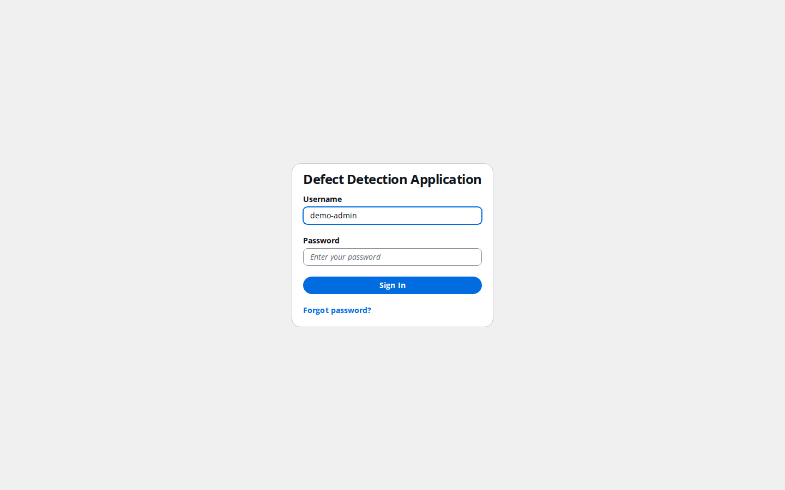
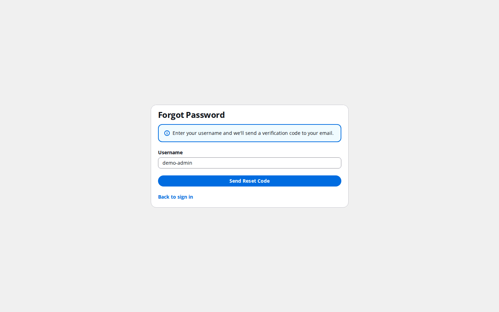
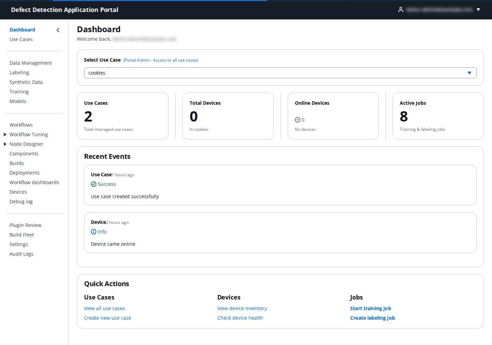
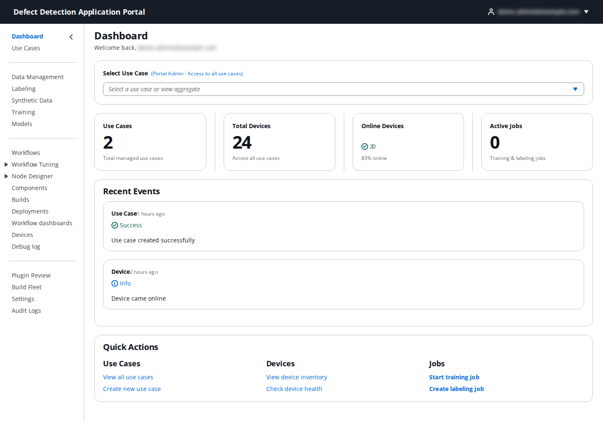
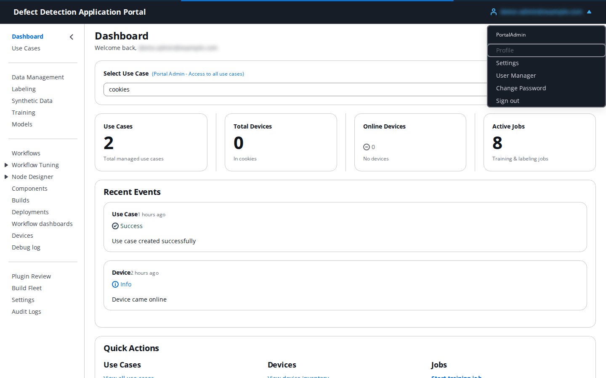
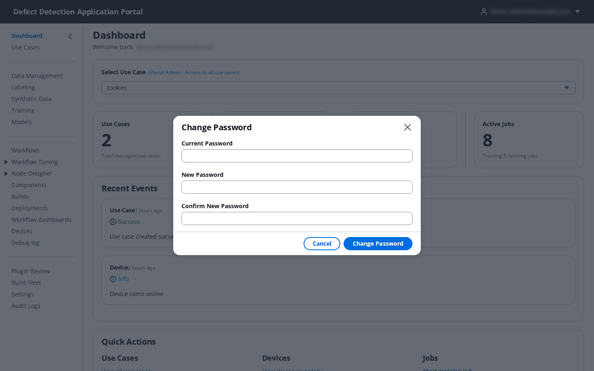

# 1. Getting started: signing in and finding your way around

**Who:** every Portal user. **Video:** [Overview](https://youtu.be/lTLSIMHLy7Y).

The Portal is a web application served from the CloudFront URL printed at the end of the Portal deployment (the `FrontendUrl` output). This section covers signing in, the dashboard, the side navigation, the use case selector, and the user menu.

## 1.1 Sign in

Open the Portal URL. Unauthenticated visitors are sent to the sign-in page.

| Field | What to enter |
|-------|---------------|
| **Username** | The account name your administrator created in the User Manager (not the email address). The first admin account created at deployment is `admin`. |
| **Password** | Your password. Passwords are at least 12 characters with upper and lower case letters, a digit and a symbol. |

Click **Sign In** or press Enter.

- **First sign-in.** An account created by an administrator starts with a temporary password. The page then shows **Your Name**, **New Password** and **Confirm New Password** with the message "You must set a new password before continuing." Pick a permanent password that meets the policy above.
- **Forgotten password.** Click the forgot-password link under the form. Enter your **Username** and click **Send Reset Code**: a verification code is emailed to the address on the account. Enter the **Verification Code** and a new password. Password recovery is email-only, so make sure your account has a mailbox you can read.

Self sign-up is disabled. If you have no account, ask a PortalAdmin to create one (see [20. User Manager](20-user-manager.md)).

## 1.2 The dashboard

After signing in you land on the **Dashboard**.

- **Select Use Case.** A PortalAdmin sees every use case and can pick one, or leave the selector on **All Use Cases (Aggregate)** to see totals across all of them. Other roles are limited to their assigned use cases, and the first one is selected automatically.
- **Use Cases**, **Total Devices**, **Online Devices** and **Active Jobs** summarize the selected use case (or all of them). Active jobs are training and labeling jobs that are still running.
- **Recent Events** lists recent use case and device events.
- **Quick Actions** are shortcuts to the common starting points: view or create a use case, open the device inventory or check device health, start a training job or create a labeling job.

The aggregate view looks like this before a use case is chosen:

## 1.3 Side navigation

The navigation on the left is grouped by stage of the work, top to bottom:

| Group | Pages | Section |
|-------|-------|---------|
| Overview | **Dashboard**, **Use Cases** | [2](02-use-cases.md) |
| Data and models | **Data Management**, **Labeling**, **Synthetic Data**, **Training**, **Models** | [3](03-data-management.md)–[7](07-models.md) |
| Edge pipeline | **Workflows**, **Workflow Tuning**, **Node Designer** (with **Git connections**), **Components**, **Builds**, **Deployments**, **Workflow dashboards**, **Devices**, **Debug log** | [8](08-workflows.md)–[16](16-debug-log.md) |
| Administration | **Plugin Review**, **Build Fleet**, **Settings**, **Audit Logs** | [17](17-plugin-review.md)–[21](21-audit-logs.md) |

Pages you are not entitled to are hidden rather than greyed out, so the list is shorter for most roles. In particular **Synthetic Data**, **Workflow Tuning** and **Builds** appear only for DataScientist, UseCaseAdmin and PortalAdmin; **Plugin Review**, **Build Fleet** and **Settings** only for PortalAdmin; **Audit Logs** for PortalAdmin and UseCaseAdmin; and a **DataLabeler** sees only **My Labeling Tasks**. The arrow at the top of the navigation collapses it; on the **Workflows** page it starts collapsed to give the canvas room.

## 1.4 The use case selector

Almost every page starts with a **Use Case** dropdown. Everything on the page (jobs, models, devices, workflows) belongs to the selected use case, and the choice is kept in the browser so you do not have to pick it again on the next page. If a page looks empty, check the selector first.

## 1.5 User menu

Your email address at the top right opens the user menu.

| Entry | What it does |
|-------|--------------|
| (role) | The first line shows your resolved role, for example `PortalAdmin`. |
| **Settings** | Opens the Portal **Settings** page (see [19. Settings](19-settings.md)). Shown only to PortalAdmins. |
| **User Manager** | Opens account and role management (see [20. User Manager](20-user-manager.md)). Shown only to PortalAdmins. |
| **Change Password** | Opens the change-password dialog below. |
| **Sign out** | Ends the session and returns to the sign-in page. |

To change your password enter the **Current Password**, a **New Password** that meets the policy, repeat it in **Confirm New Password**, and click **Change Password**. "Password changed successfully." confirms the change.

## 1.6 Footer

The thin bar at the bottom of the window shows the Portal's version, the git commit it was built from and the build date. Quote these when you report a problem.
