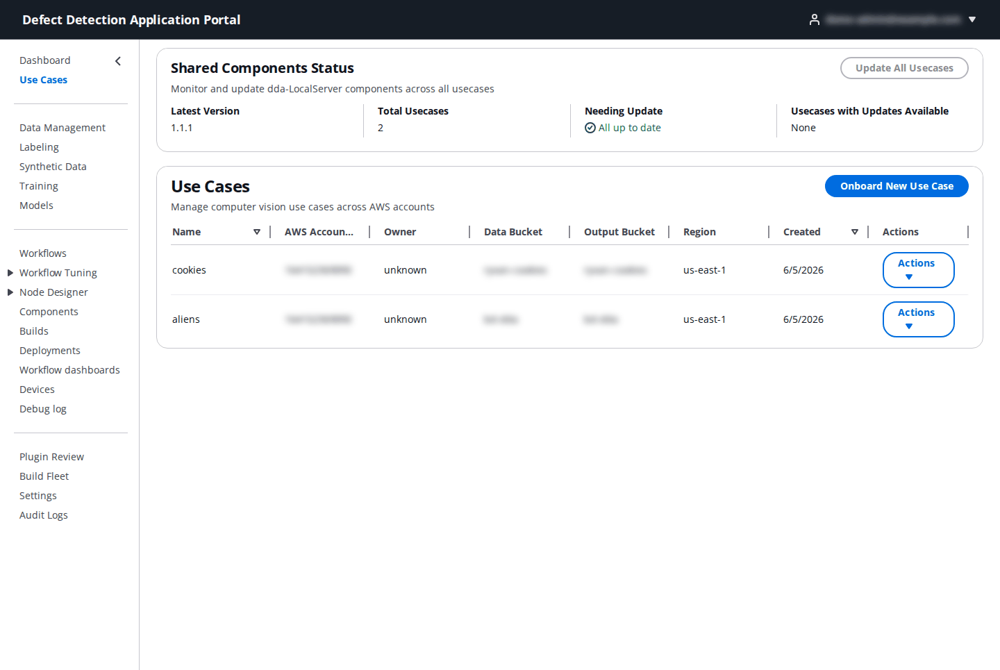
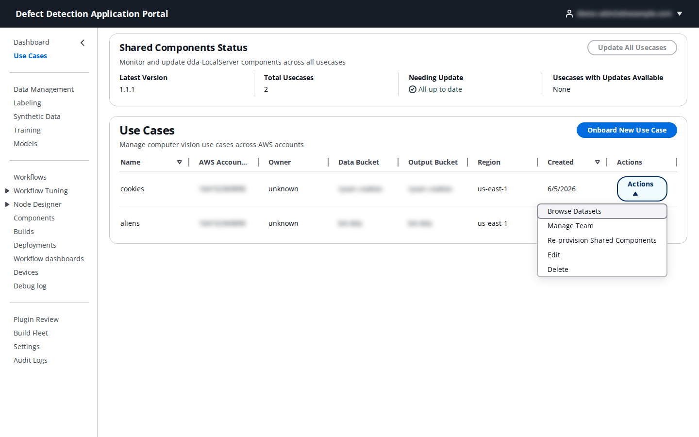
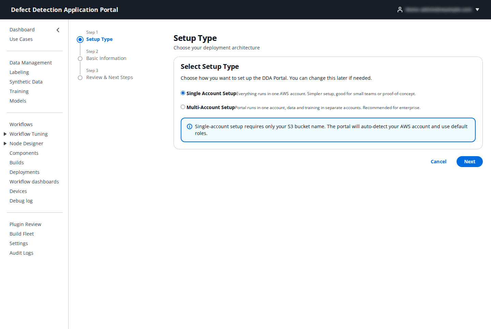
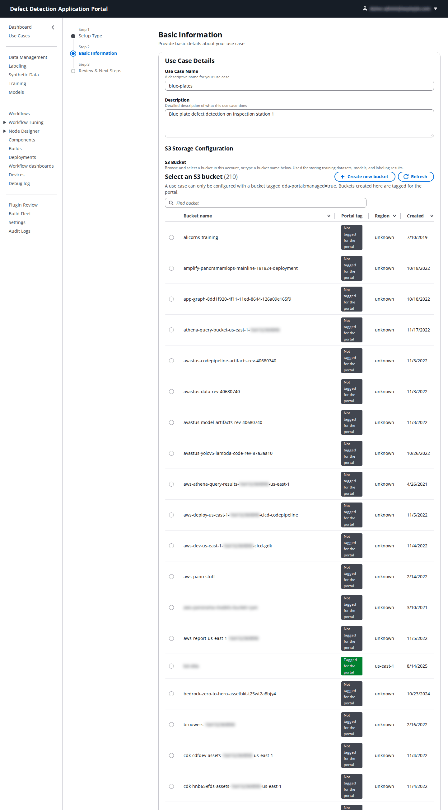
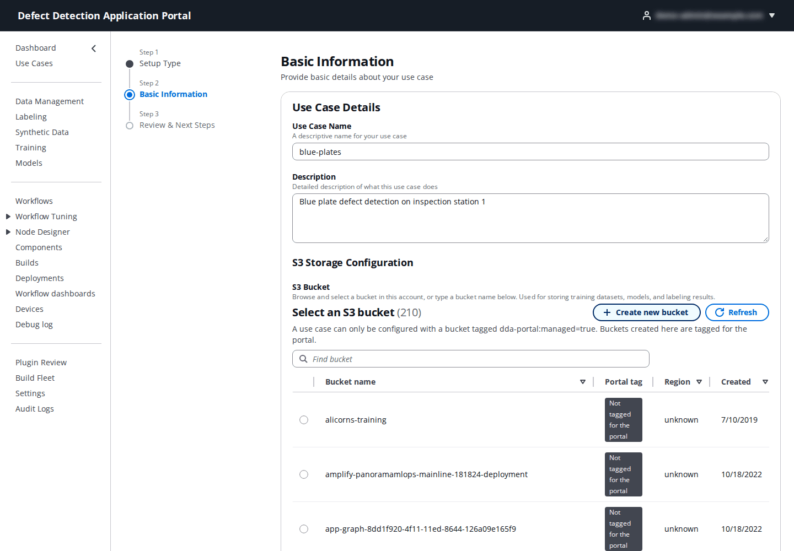
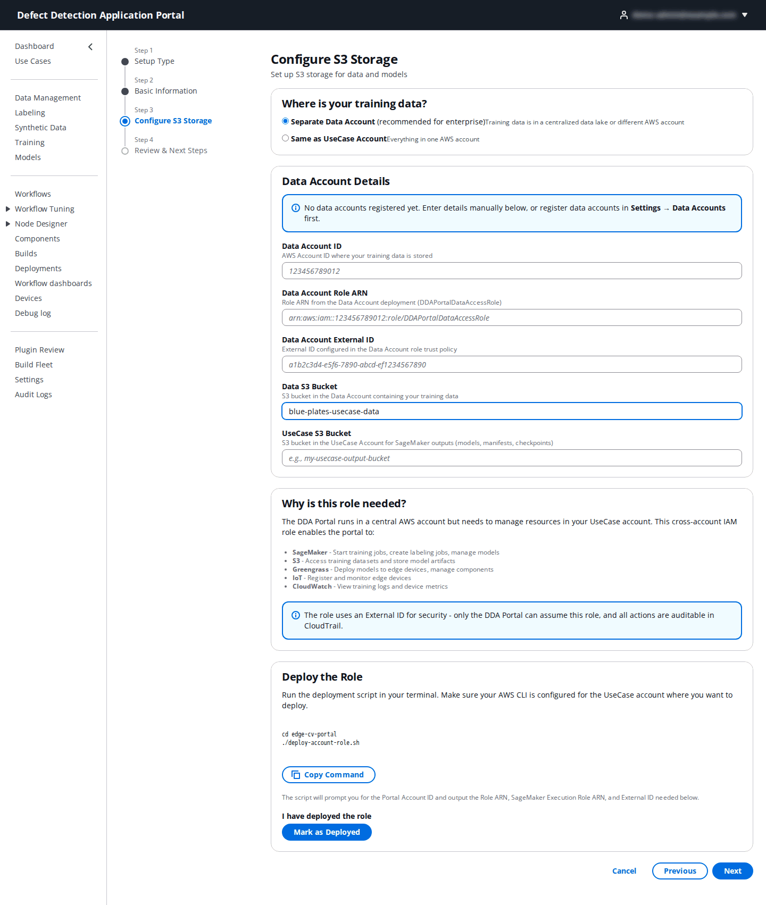
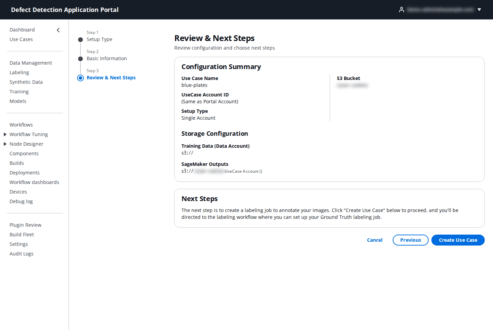
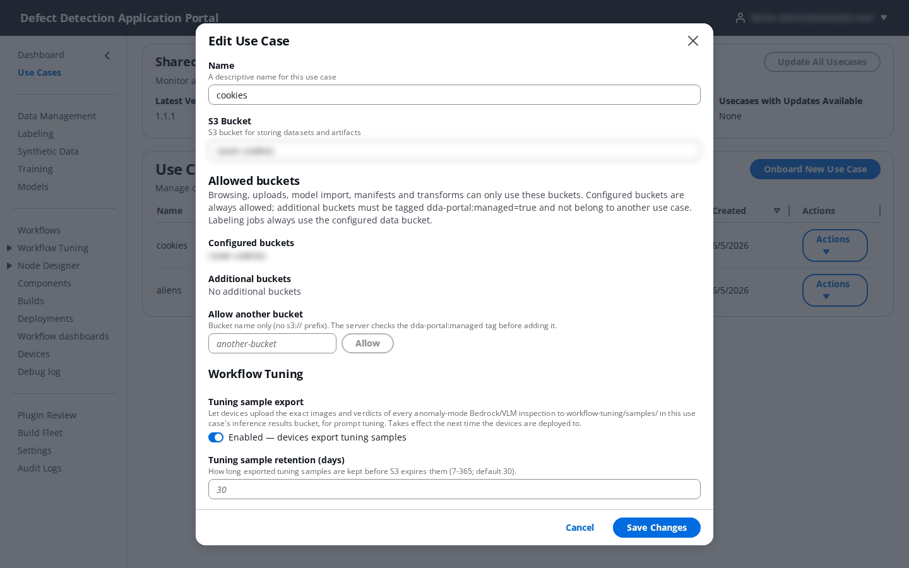
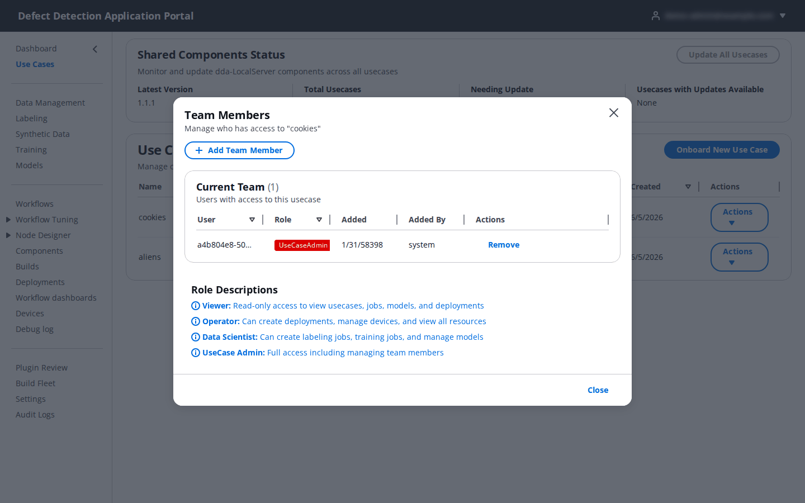

# 2. Use Cases

**Who:** PortalAdmin creates, deletes and re-provisions use cases; UseCaseAdmin edits the ones assigned to them and manages their team; every other role sees their assigned use cases read-only. **Video:** [Module 0: Portal Setup](https://youtu.be/HtH_4zT23Fo).

A **use case** is the unit everything else in the Portal belongs to: one inspection application (a product, a line, a plant) with its own AWS account, S3 bucket, team, devices, models and workflows. The cookies use case in the screenshots holds the blue-plates data and the Jetson stations used throughout this guide.

## 2.1 The Use Cases page

The page has two panels.

**Shared Components Status** (PortalAdmin) shows how the LocalServer Greengrass component is distributed to the use case accounts: the **Latest Version** published by the Portal, the **Total Usecases**, how many are **Needing Update**, and **Usecases with Updates Available**. In a multi-account setup, **Update All Usecases** copies the latest LocalServer versions into every use case account that is behind. In a single-account setup the counters stay at "All up to date".

**Use Cases** lists the use cases you can see, with their **AWS Account ID**, **Owner**, **Data Bucket**, **Output Bucket**, **Region** and creation date. Each row has an **Actions** menu:

| Action | What it does |
|--------|--------------|
| **Browse Datasets** | Opens the dataset browser for the use case's bucket (see [4. Labeling](04-labeling.md#47-dataset-browser)). |
| **Manage Team** | Opens the team dialog (2.4). |
| **Re-provision Shared Components** | (PortalAdmin) Copies the current LocalServer component versions into this use case's account again, after a new LocalServer build. |
| **Edit** | Opens the Edit Use Case dialog (2.3). |
| **Delete** | Removes the use case's metadata from the Portal after a confirmation. This cannot be undone. Data in S3 and resources in the use case account are left in place. |

## 2.2 Onboard a new use case

Click **Onboard New Use Case**. The wizard has three steps for a single-account installation and four for a multi-account one. The Portal must already trust the AWS account the use case runs in (see the README, [Step 5](../../README.md#step-5-set-up-accounts)).

### Step 1: Setup Type

| Option | Choose it when |
|--------|----------------|
| **Single Account Setup** | Everything runs in the Portal's own AWS account. The Portal detects the account and uses its default roles; all you provide is a bucket. |
| **Multi-Account Setup** | The Portal runs in one account while SageMaker, Greengrass and the data live in other accounts. You will need the cross-account role created by `deploy-portal.sh usecase`. |

### Step 2: Basic Information

| Field | What to enter |
|-------|---------------|
| **Use Case Name** | A short descriptive name, for example `blue-plates`. It appears in every use case selector. |
| **Description** | What the use case inspects and where (optional). |
| **UseCase Account Region** | Multi-account only: the region of the use case account's SageMaker, IoT and Greengrass resources. Pick one of the listed regions or **Enter manually...**. |
| **S3 Bucket** (single account) | The bucket that will hold datasets, models and labeling results. Either pick one from **Select an S3 bucket** or type a name. Only buckets tagged `dda-portal:managed=true` are eligible; the **Portal tag** column shows which are. A PortalAdmin can click **Create new bucket** to create a bucket that is tagged, ABAC-enabled and allowed for this use case automatically. Bucket names are 3–63 lowercase letters, digits, dots and hyphens. |

### Step 3: Configure S3 Storage (multi-account only)

First answer **Where is your training data?**

- **Separate Data Account** – the images live in a central data-lake account. Fill in **Data Account Details**, or choose a data account registered under **Settings → Data Accounts** to auto-fill them (see [19. Settings](19-settings.md)).
- **Same as UseCase Account** – the data lives in the use case account; only the use case bucket is needed.

| Field | What to enter |
|-------|---------------|
| **Data Account ID** | The 12-digit AWS account ID where the training data is stored. |
| **Data Account Role ARN** | The `DDAPortalDataAccessRole` ARN printed by `deploy-portal.sh data` in that account. |
| **Data Account External ID** | The External ID from the same deployment; it is part of the role's trust policy. |
| **Data S3 Bucket** | The bucket in the data account that holds the images. |
| **UseCase S3 Bucket** | The bucket in the use case account for SageMaker outputs: models, manifests and checkpoints. |

The **Deploy the Role** panel gives you the command for the use case account (`cd edge-cv-portal && ./deploy-account-role.sh`; **Copy Command** copies it). Run it with that account's credentials, then click **Mark as Deployed** and enter the **Role ARN**, **SageMaker Execution Role ARN** and **External ID** it printed, or upload the generated `usecase-account-*-config.txt` with **Upload Configuration File** to fill them in. **Verify Role Access** checks that the Portal can assume the role. If verification fails with `AccessDenied`, the use case account is not yet on the Portal's trusted account list or the External ID is wrong (README, [5.1](../../README.md#51-usecase-account-required)).

### Last step: Review & Next Steps

Check the **Configuration Summary** and **Storage Configuration**, then click **Create Use Case**. The Portal creates the use case, provisions the shared Greengrass components into its account, creates `DDAPortalComponentAccessPolicy` for its devices and makes you the use case's UseCaseAdmin. A bucket that is not tagged, not readable through the use case's role or already configured on another use case is refused with `bucket_not_eligible` and a remedy; fix the bucket and submit again.

## 2.3 Edit a use case

**Actions → Edit** opens the Edit Use Case dialog.

| Field | Meaning |
|-------|---------|
| **Name** | The display name. |
| **S3 Bucket** | The configured bucket. It is shown for reference; the bucket a use case was created with cannot be swapped here. |
| **Allowed buckets** | Browsing, uploads, model import, manifests and transforms can only use these buckets. **Configured buckets** (the use case bucket and its data account bucket) are always allowed. **Additional buckets** are extra buckets a UseCaseAdmin has allowed. |
| **Allow another bucket** | Type a bucket name (no `s3://`) and click **Allow**. The server checks that the bucket is tagged `dda-portal:managed=true` and does not belong to another use case before adding it. Labeling jobs always use the configured data bucket regardless. |
| **Tuning sample export** | When enabled, devices upload the image and verdict of every anomaly-mode Bedrock/VLM inspection to `workflow-tuning/samples/` in the use case's inference-results bucket, which feeds [9. Workflow Tuning](09-workflow-tuning.md). Takes effect the next time the devices are deployed to. |
| **Tuning sample retention (days)** | How long exported samples are kept before S3 expires them: 7–365, default 30. |

A multi-account use case also shows **AWS Account ID**, **Cross-Account Role ARN** and the optional **Data Account Configuration** (account ID, role ARN, External ID, data bucket and prefix) in this dialog. Click **Save Changes**.

## 2.4 Manage the team

**Actions → Manage Team** shows who has access to the use case.

- **Current Team** lists each member with **Role**, **Added** and **Added By**; **Remove** takes their access away.
- **Add Team Member** asks for the **User Email** of an existing Portal account and a **Role** for this use case: **Viewer** (read-only), **Operator** (deploy and manage devices), **Data Scientist** (labeling, training, models) or **UseCase Admin** (full access to this use case). The role you give here applies only within this use case and overrides the user's global role there.
- **Role Descriptions** summarizes the four roles.

Accounts themselves are created in the [User Manager](20-user-manager.md); this dialog only grants them a use case.
