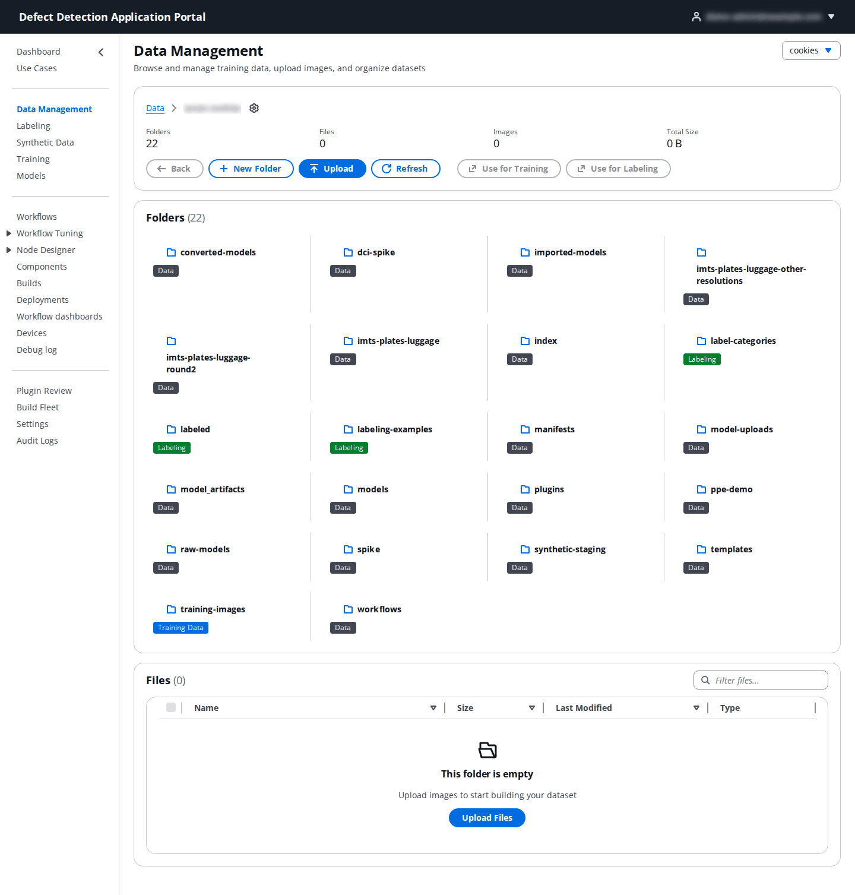
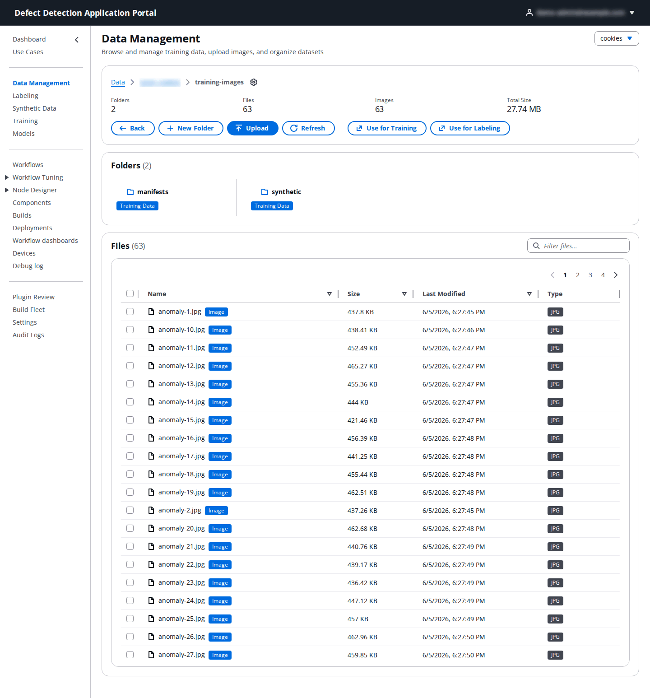
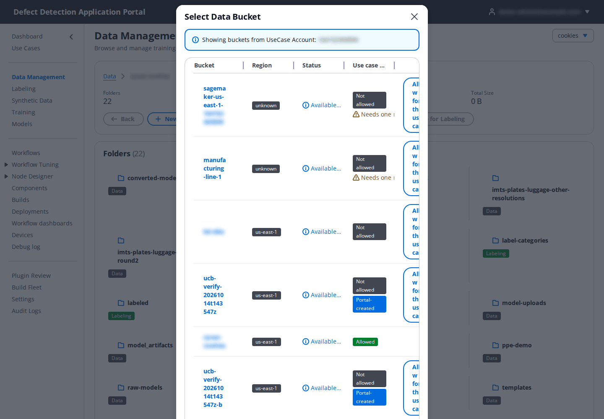
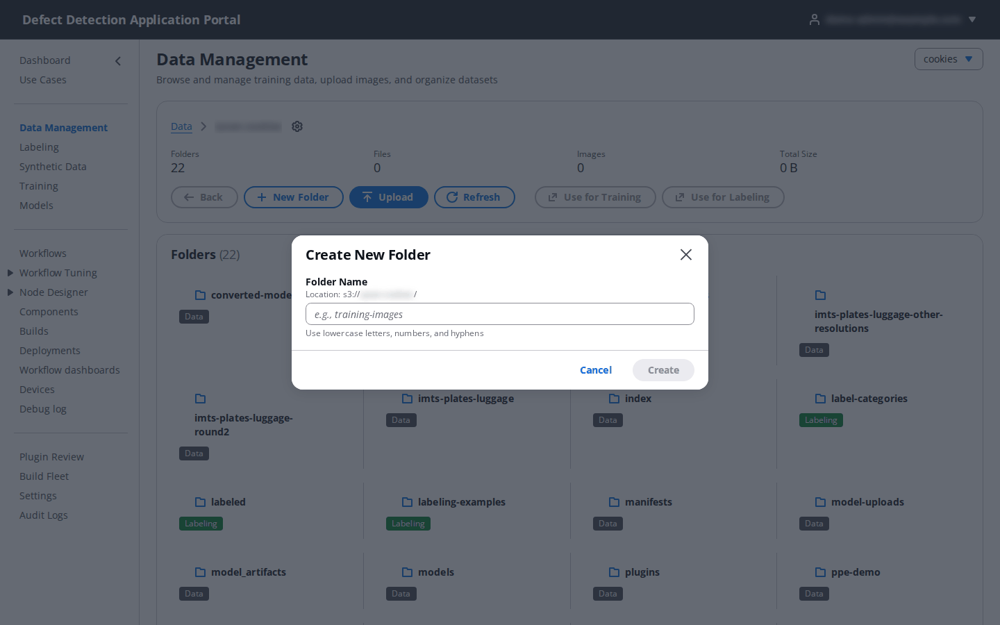
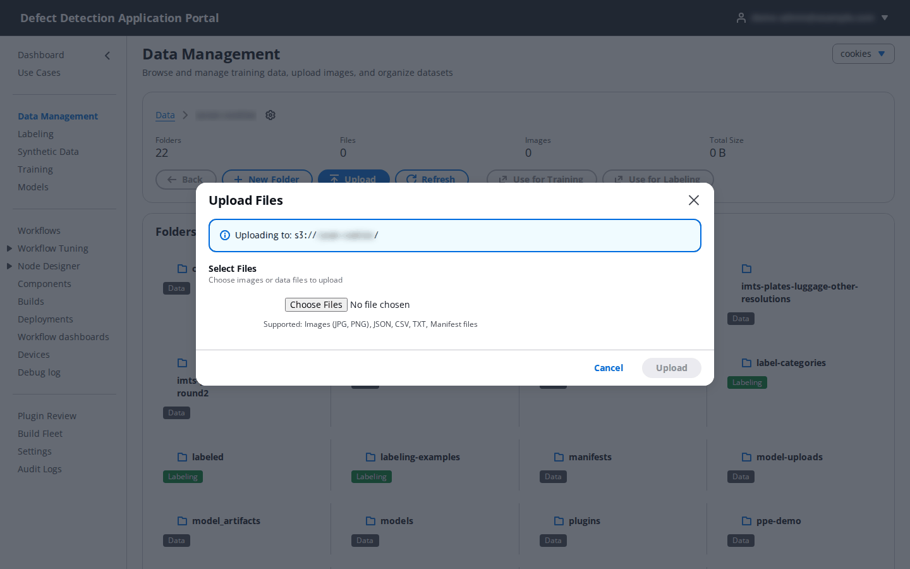

# 3. Data Management

**Who:** DataScientist, UseCaseAdmin and PortalAdmin upload and organize data; Operator and Viewer can browse. **Related:** [4. Labeling](04-labeling.md), [6. Training](06-training.md).

**Data Management** is a file browser for the use case's S3 buckets. You use it to look at the images already in the bucket, upload new captures, create folders, and hand a folder straight to a labeling or training job.

## 3.1 Browsing

1. Pick the use case in the selector at the top right. The page opens the use case's configured bucket at its root.
2. The breadcrumb (**Data › bucket › folder**) shows where you are; click an earlier crumb or **Back** to go up. The gear icon next to the breadcrumb opens the bucket picker (3.2).
3. The counters show the current folder's **Folders**, **Files**, **Images** and **Total Size**.
4. **Folders** lists the sub-folders as cards. Click a card to open it. Each card carries a purpose badge derived from the folder's name: a name containing `train` is tagged **Training Data**, `label` or `annotation` **Labeling**, `test` or `validation` **Test/Validation**, `output` or `result` **Output**, and anything else **Data**. The badge is a hint only; it does not change how the folder is used.
5. **Files** lists the objects in the current folder with **Name**, **Size**, **Last Modified** and **Type**, with a filter box. The list is paginated.

Two shortcuts act on the current folder once it contains images:

- **Use for Training** opens **Start Training Job** with this folder as the data path (see [6. Training](06-training.md)).
- **Use for Labeling** opens **Create Labeling Job** with this folder as the input images (see [4. Labeling](04-labeling.md)).

Both are disabled while the folder has no images.

## 3.2 Choosing a bucket

Click the gear icon beside the breadcrumb to open **Select Data Bucket**.

The dialog lists the buckets in the use case's account with **Region**, **Status** and **Use case access**:

- **Allowed** buckets can be browsed and written. These are the use case's configured bucket (and data bucket) plus any **Additional S3 buckets** that have been allowed for it. **Portal-created** marks buckets the Portal made itself.
- **Not allowed** buckets are listed but locked. A UseCaseAdmin or PortalAdmin can click **Allow for this use case** to add one; the bucket must be tagged `dda-portal:managed=true`, must not belong to another use case, and (for a bucket reached through a cross-account role) must have ABAC enabled, otherwise the dialog shows a **Needs one more step** remedy explaining what is missing. The same allow-list is edited from **Use Cases → Edit → Allowed buckets** (see [2.3](02-use-cases.md#23-edit-a-use-case)).

Every S3 read and write the Portal performs for a use case (browsing, uploads, model import, manifests, manifest transforms) is restricted to these allowed buckets, so a bucket you cannot see here cannot be used anywhere else in the Portal either.

## 3.3 Creating a folder

Click **New Folder**.

| Field | What to enter |
|-------|---------------|
| **Folder Name** | Lowercase letters, numbers and hyphens, for example `training-images` or `blue-plates-round2`. The folder is created inside the folder you are viewing. |

Click **Create**. Because S3 has no real folders, an empty folder is represented by a placeholder object; it becomes a normal prefix once files are uploaded into it.

## 3.4 Uploading files

Navigate to the folder the images belong in, then click **Upload** (or **Upload Files** in an empty folder).

| Field | What to enter |
|-------|---------------|
| **Select Files** | Choose one or more images or data files from your computer. The dialog shows **Uploading to:** with the exact bucket and prefix. |

Each file is uploaded directly to S3 through a presigned URL and shows its own progress bar and status (**pending**, **uploading**, **completed** or **error**). Keep the dialog open until every file reads completed, then click **Refresh** if the list has not updated.

Tips for a good dataset:

- Put one capture set in one folder (for example `blue-plates/raw-images/`), and keep normal and defective examples together; the labeling job sorts them.
- Use JPEG or PNG. Labeling, training and the workflow test panel all read these formats.
- Uploads through the browser suit hundreds of images. For very large sets, copy to the bucket with the AWS CLI and press **Refresh**; the folder appears as soon as the objects exist.

## 3.5 Where the Portal writes

The Portal keeps its own output under the use case bucket, so expect these folders to appear by themselves: `labeled/` (labeling output manifests), `manifests/`, `models/` and `model_artifacts/` (training and import output), `converted-models/` and `imported-models/`, `synthetic-staging/` (synthetic data previews), `workflows/` (packaged workflows) and `plugins/` (custom node builds). Browse them freely, but do not rename or delete them while jobs are running.
