# 4. Labeling

**Who:** DataScientist, UseCaseAdmin and PortalAdmin create and manage labeling jobs; Operator and Viewer can view them; **DataLabeler** accounts label images in **My Labeling Tasks**. **Video:** [Module 2: Labeling](https://youtu.be/pxSoAIOLp18).

Labeling turns a folder of images into a **manifest**: one line per image with its class, boxes or mask, which is what a training job consumes. The Portal offers two labeling backends. The **DDA Data Labeling System** is built into the Portal: you assemble a private team of DataLabeler accounts, optionally pre-label every image with a model, and the team approves or corrects the results in the browser. **SageMaker Ground Truth** hands the work to a Ground Truth work team instead. New users should use the DDA system; Ground Truth is kept for existing workflows.

## 4.1 The Labeling page

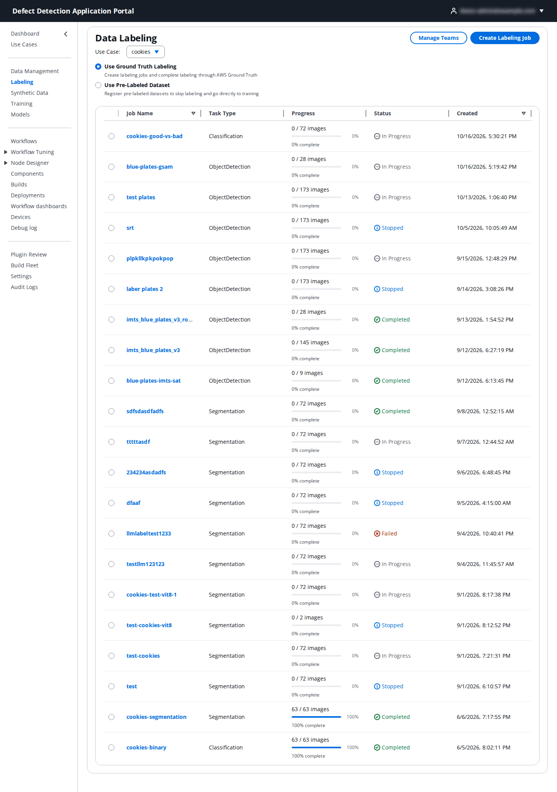

- **Use Case** selects whose jobs are shown.
- **Use Ground Truth Labeling** (the default view) lists labeling jobs; **Use Pre-Labeled Dataset** switches to registering manifests that were labeled elsewhere (4.8).
- The table shows each job's **Job Name**, **Task Type** (Classification, ObjectDetection or Segmentation), **Progress** (images submitted out of the total), **Status** and **Created** date. Click a job name to open it (4.5). Select a job's radio button to **Delete** it.
- **Manage Teams** opens the labeling teams page (4.6); **Create Labeling Job** starts the wizard (4.2).

Statuses: **Pending** (being created), **In Progress**, **Completed** (every image submitted and the output manifest written), **Stopped**, **Failed**, and **Deleting** / **Delete Failed**.

## 4.2 Create a labeling job (DDA Data Labeling System)

Click **Create Labeling Job**. The wizard has six steps. If you left an earlier attempt unfinished, a banner offers **Restore draft** or **Discard** before you start.

### Step 1: Labeling Backend

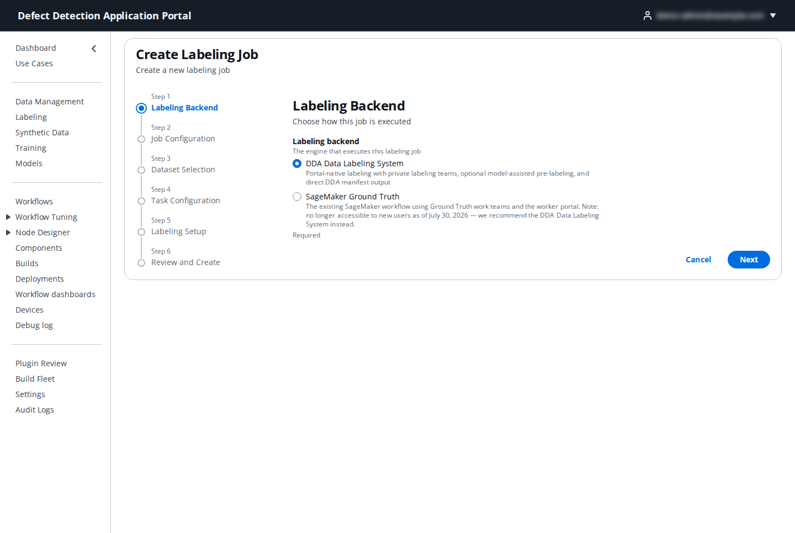

| Option | Meaning |
|--------|---------|
| **DDA Data Labeling System** | Portal-native labeling with private labeling teams, optional model-assisted pre-labeling, and direct DDA manifest output. Recommended. |
| **SageMaker Ground Truth** | The existing SageMaker workflow using Ground Truth work teams and the worker portal. No longer available to new users as of July 30, 2026. The remaining steps differ slightly (4.3). |

### Step 2: Job Configuration

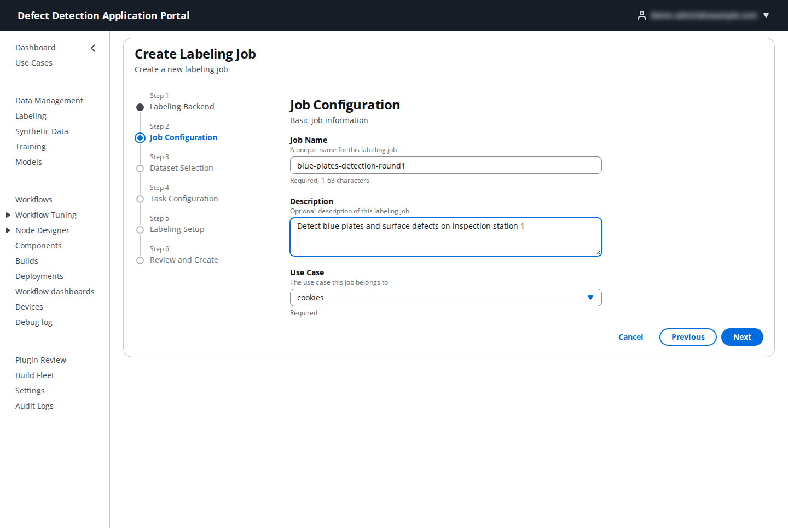

| Field | What to enter |
|-------|---------------|
| **Use Case** | Preselected from the use case selector. |
| **Job Name** | A unique name, for example `blue-plates-detection-round1`. It becomes the folder name of the output manifest. |
| **Description** | Optional free text describing the batch. |

### Step 3: Dataset Selection

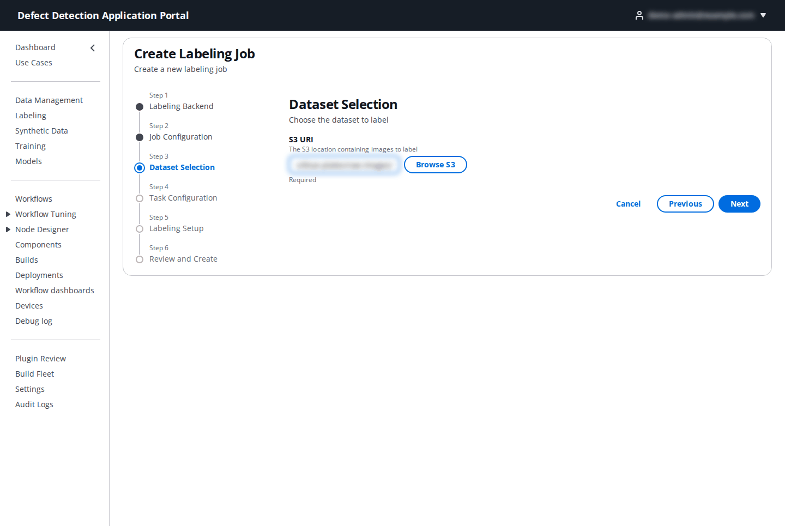

| Field | What to enter |
|-------|---------------|
| **S3 URI** | The S3 prefix that contains the images to label, for example `s3://<bucket>/blue-plates/raw-images/`. Type it or click **Browse S3** to pick a folder. The bucket must be one of the use case's allowed buckets; if you came here from **Use for Labeling** in Data Management the field is already filled. |

### Step 4: Task Configuration

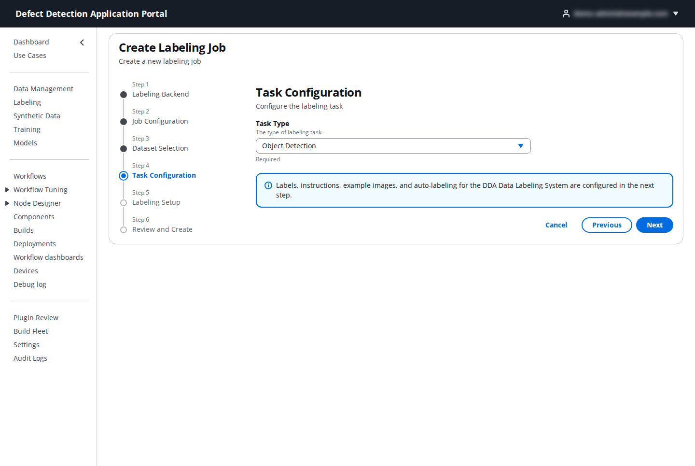

| Task Type | Use it for | Output |
|-----------|-----------|--------|
| **Image Classification** | Pass/fail or multi-class decisions about the whole image (good cookie vs. bad cookie). | One class per image. |
| **Object Detection** | Locating each object or defect with a bounding box (each blue plate, each scratch). | Boxes with classes. |
| **Semantic Segmentation** | Pixel-exact defect regions, when the shape or area of the defect matters. | A mask per image. Needs mask-capable labeling and more labeling time. |

For anomaly-style classification name the "normal" category first; the Marketplace training algorithm expects it that way.

### Step 5: Labeling Setup

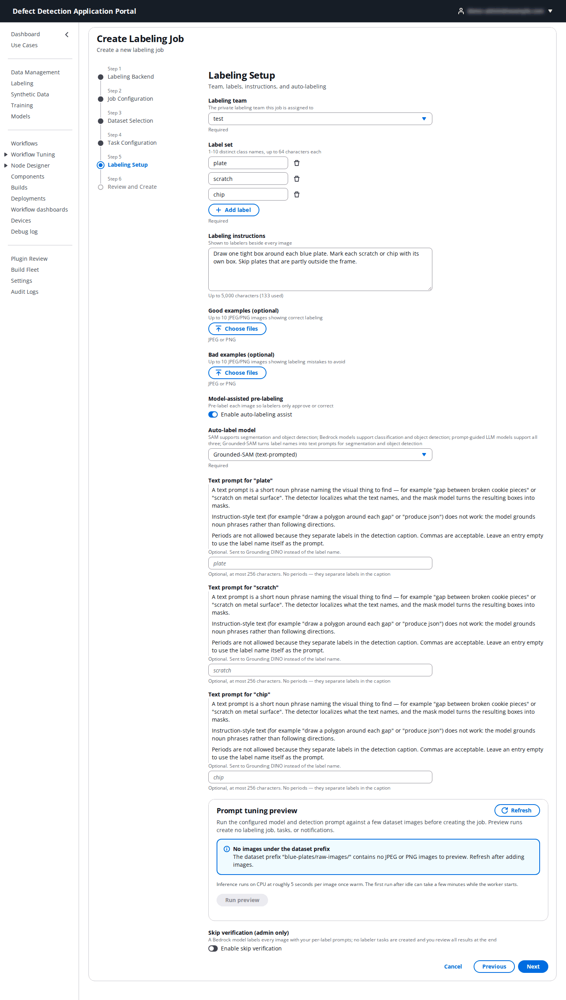

| Field | What to enter |
|-------|---------------|
| **Labeling team** | The private labeling team that will receive the tasks (created under **Manage Teams**, 4.6). Required. |
| **Label set** | One to ten distinct class names, up to 64 characters each; click **Add label** for each one (`plate`, `scratch`, `chip`). Labelers choose from exactly these names. |
| **Labeling instructions** | Shown to labelers beside every image, up to 5,000 characters. Say exactly what to mark and what to skip, for example "Draw one tight box around each blue plate. Mark each scratch or chip with its own box. Skip plates partly outside the frame." |
| **Good examples** / **Bad examples** (optional) | Up to 10 JPEG or PNG images each, showing correct labeling and mistakes to avoid. They are displayed to labelers as guidance and, with few-shot auto-labeling, sent to the model as examples. |
| **Model-assisted pre-labeling** | Turn on **Enable auto-labeling assist** to have a model propose labels before the team sees the images. Labelers then only approve or correct. |
| **Auto-label model** | Appears when assist is on. **Segment Anything (SAM)** supports segmentation and object detection; **Grounded-SAM (text-prompted)** turns your label names into text prompts for segmentation and detection and is the usual choice for detection jobs; **Bedrock vision models** support classification and detection; **Prompt-guided LLM models** support all three task types. For Grounded-SAM an optional **Detection prompt** (for example `blue plate. scratch. chip.`) is sent instead of the raw label names. |
| **Skip verification (admin only)** | A Bedrock model labels every image with your per-label prompts, no labeler tasks are created, and you review all results at the end in the **Admin Review** page (4.5). Use it for large, easy batches when you would rather audit than label. |

### Step 6: Review and Create

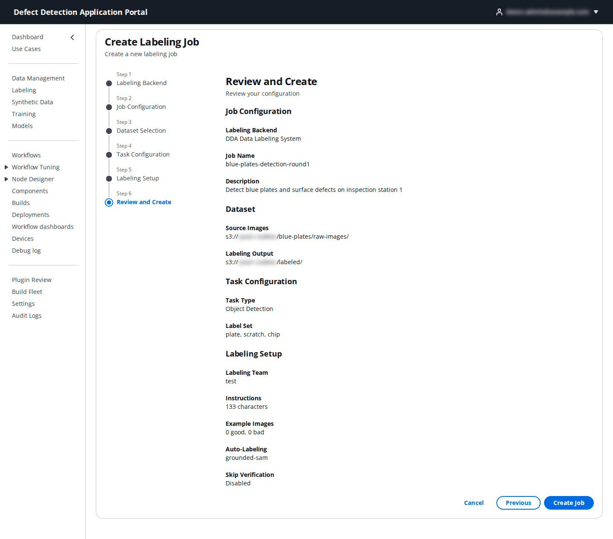

Check the summary: backend, name, **Source Images**, the **Labeling Output** location (`s3://<bucket>/labeled/`), task type, label set, team, instruction length, example counts, auto-labeling model and skip-verification state. Click **Create Job**. The job appears in the list as **Pending**, then **In Progress** once the tasks (and pre-labels, if enabled) exist. Each team member gets the job in **My Labeling Tasks** and an email notification if the Portal has an SES sender configured.

## 4.3 Create a labeling job (SageMaker Ground Truth)

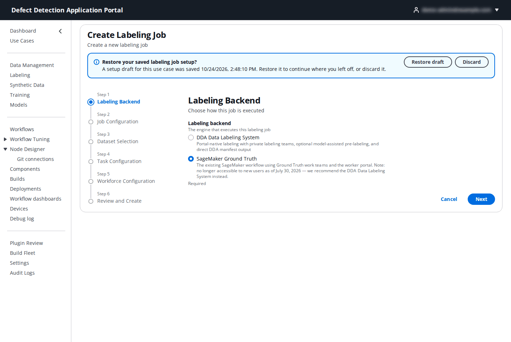

With **SageMaker Ground Truth** chosen, Steps 2 and 3 are the same, Step 4 collects the label details directly, and Step 5 becomes **Workforce Configuration**.

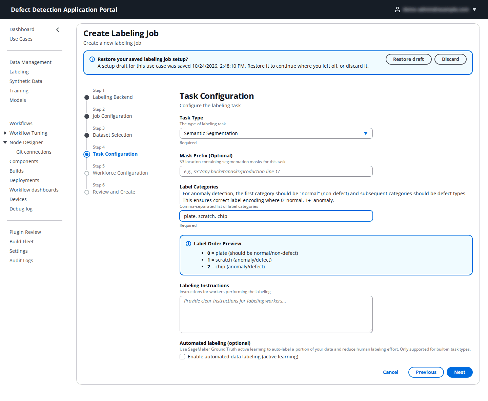

| Field | What to enter |
|-------|---------------|
| **Label Categories** | Comma-separated class names, for example `normal, defect`. |
| **Mask Prefix** (segmentation) | Optional S3 prefix of existing segmentation masks for this task. |
| **Labeling Instructions** | Instructions for the Ground Truth workers. |
| **Automated labeling** | Optional Ground Truth active learning that auto-labels part of the data to reduce human effort. Built-in task types only. |

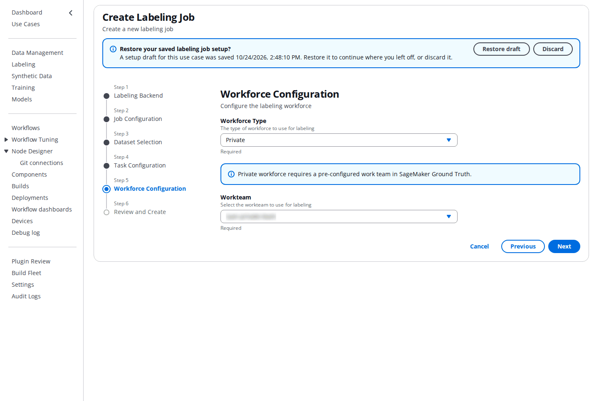

| Field | What to enter |
|-------|---------------|
| **Workforce Type** | **Private** (your own SageMaker work team, which must already exist in Ground Truth), **Public (Mechanical Turk)** (incurs cost and sends your images to public workers) or **Vendor**. |
| **Workteam** | The Ground Truth work team to use. |

The job's detail page then links to the Ground Truth **Worker Portal** and the **AWS Console**, and its **Actions** menu offers **Transform Manifest** to convert the Ground Truth output into the DDA manifest format (4.5).

## 4.4 Labeling as a team member (My Labeling Tasks)

A user whose role is **DataLabeler** sees a single page, **My Labeling Tasks**.

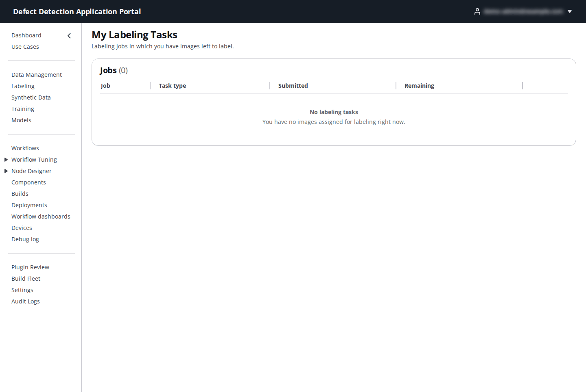

- **Jobs** lists the labeling jobs in which you still have images to label, with **Task type**, **Submitted** and **Remaining** counts. Open a job to start.
- The workspace shows one image at a time with the job's **Job guidance** (instructions and example images). For classification pick the class; for detection draw or adjust boxes; for segmentation paint or correct the mask. With pre-labeling on, the model's proposal is already drawn and you accept or correct it.
- Submit moves to the next image; **All done!** appears when nothing is left. A submission that cannot be saved is reported as **Submission not saved** with a **Retry**.

## 4.5 Monitoring a job

Click a job name in the list.

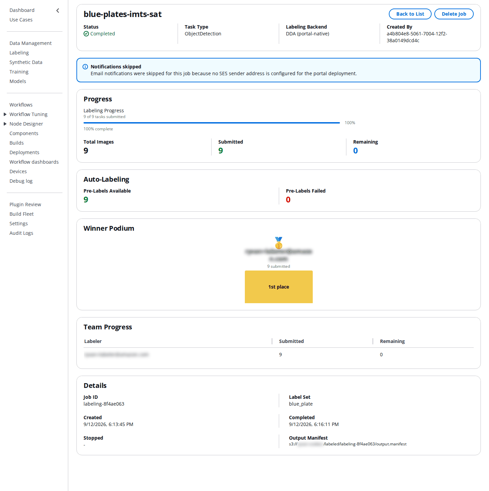

- The header shows **Status**, **Task Type**, **Labeling Backend** and **Created By**, with **Stop Job** and **Delete Job**.
- **Progress**: tasks submitted out of the total, **Total Images**, **Submitted** and **Remaining**.
- **Auto-Labeling**: **Pre-Labels Available** and **Pre-Labels Failed**. **Re-run pre-labels** retries failed pre-labels when the job is still in progress.
- **Winner Podium** and **Team Progress** show how many images each labeler submitted.
- **Details**: **Job ID**, **Label Set**, timestamps and the **Output Manifest** S3 URI. Copy this URI when a training job asks for a manifest.
- A **Notifications skipped** banner means no SES sender address is configured, so labelers were not emailed; they still see the job in **My Labeling Tasks**.

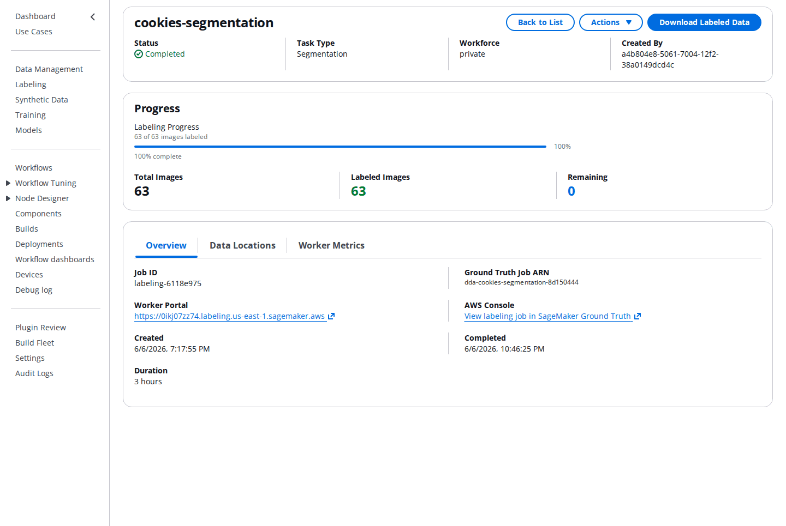

A Ground Truth job's page has **Overview**, **Data Locations** (input and output manifests) and **Worker Metrics** tabs, plus **Download Labeled Data** and an **Actions** menu with **Transform Manifest**:

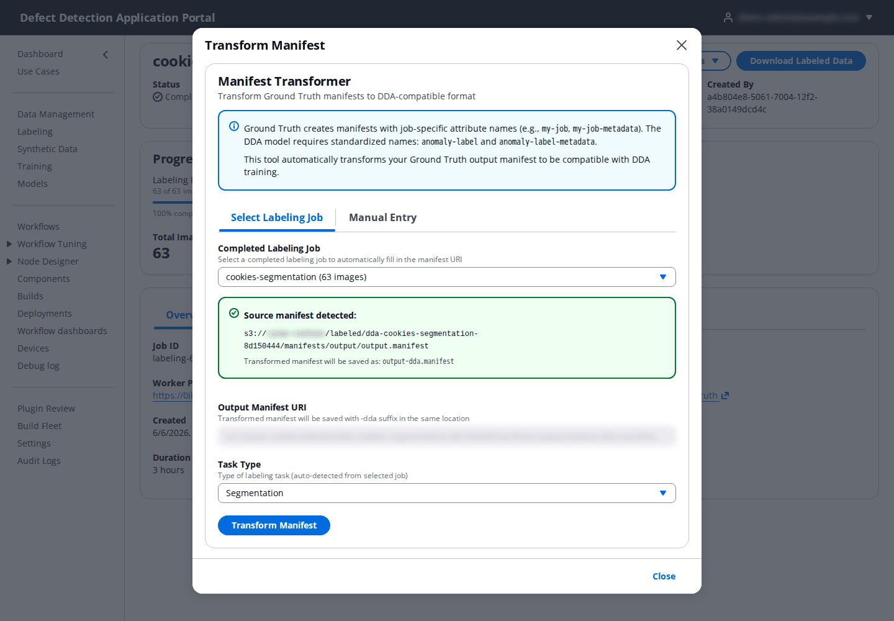

The transformer reads the Ground Truth output manifest and writes a DDA-compatible manifest; choose the job under **Select Labeling Job** or give the manifest path under **Manual Entry**, then click **Transform Manifest**.

**Admin Review.** For a skip-verification job, the detail page links to **Admin Review**, where every auto-labeled image is listed with the model's result. Accept or reject each result, **Save Decisions** as you go, and click **Finalize Review** once at least one result is accepted: the accepted results are written to the output manifest and the job completes. Decisions cannot be changed after finalizing.

## 4.6 Labeling teams

**Manage Teams** (or **Labeling → Manage Teams**) opens **Labeling Teams**.

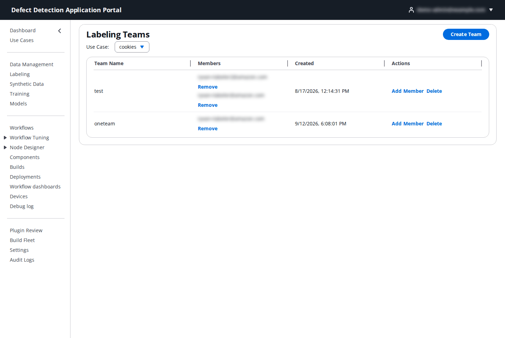

| Action | What to enter |
|--------|---------------|
| **Create Team** | A **Team name**, for example `station-1-inspectors`. Teams belong to the selected use case. |
| **Add Member** | Pick a **User** from the list of Portal accounts holding the DataLabeler role. Only DataLabeler accounts can join a team. |
| **Remove** | Removes a member; their unsubmitted tasks in in-progress jobs are returned to the pool. |
| **Delete** | Deletes the team. |

Create the DataLabeler accounts first in the [User Manager](20-user-manager.md).

## 4.7 Dataset Browser

**Use Cases → Actions → Browse Datasets** (also reachable as **Labeling → datasets**) lists the image prefixes in the use case bucket with their **Image Count** and **Last Modified** time, and lets you preview images before you label them. Datasets with 100 or more images per class train best.

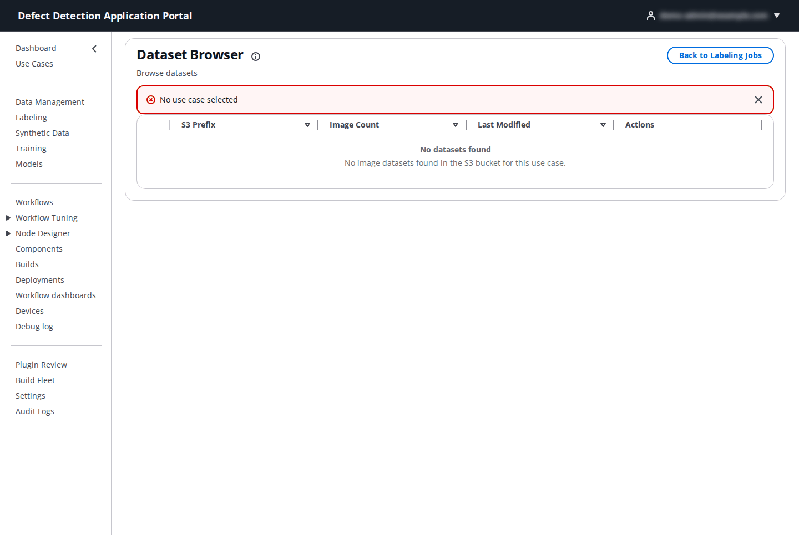

## 4.8 Pre-labeled datasets

If your images were labeled outside the Portal, switch the Labeling page to **Use Pre-Labeled Dataset**. The table lists the registered datasets with **Dataset Name**, **Task Type**, **Images**, **Label Distribution** and **Created**, with a **Delete** action. Click **Add Pre-Labeled Dataset**:

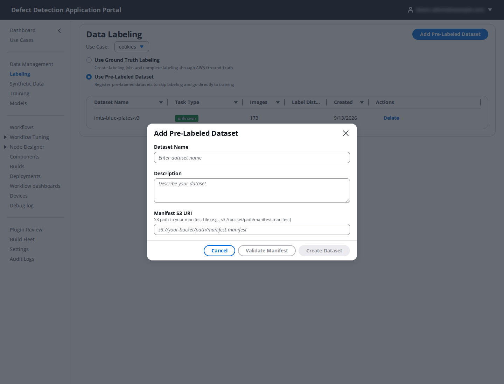

| Field | What to enter |
|-------|---------------|
| **Dataset Name** | A name to show in the training job's dataset list, for example `imts-blue-plates-v3`. |
| **Description** | Optional. |
| **Manifest S3 URI** | The manifest file, for example `s3://<bucket>/labeled/blue-plates/output.manifest`. It must be in an allowed bucket. |

Click **Validate Manifest** first: the Portal reads the manifest, counts the images and labels, and reports warnings with a **How to Fix** section for anything it cannot use. Then click **Create Dataset**. The dataset appears under **Pre-Labeled Dataset** in **Start Training Job** ([6. Training](06-training.md)). The manifest format is one JSON object per line with a `source-ref` image URI and the label attributes (`anomaly-label` for classification, `bounding-box` for detection); the companion page explains the **Required S3 Structure**, **Supported Task Types** and **Example Upload Commands**.
