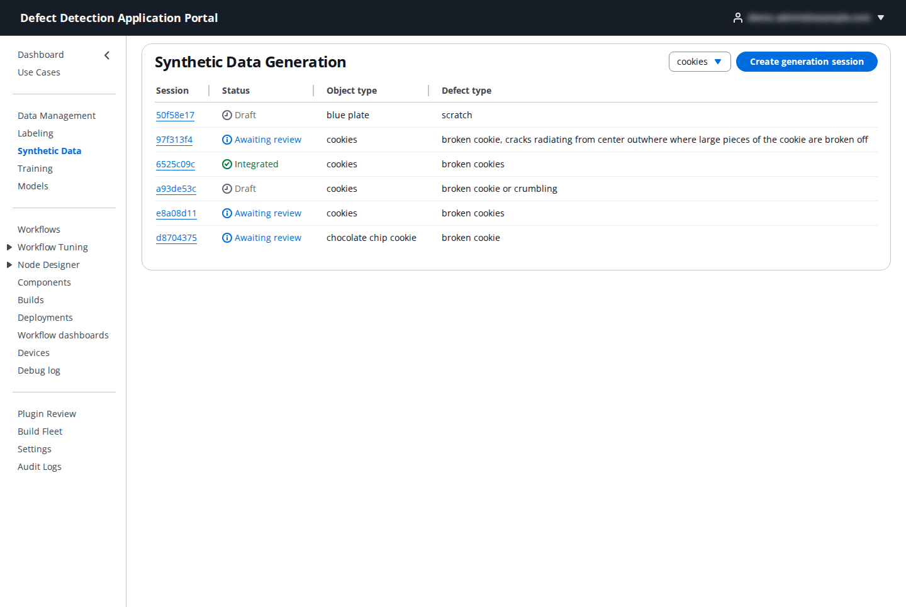
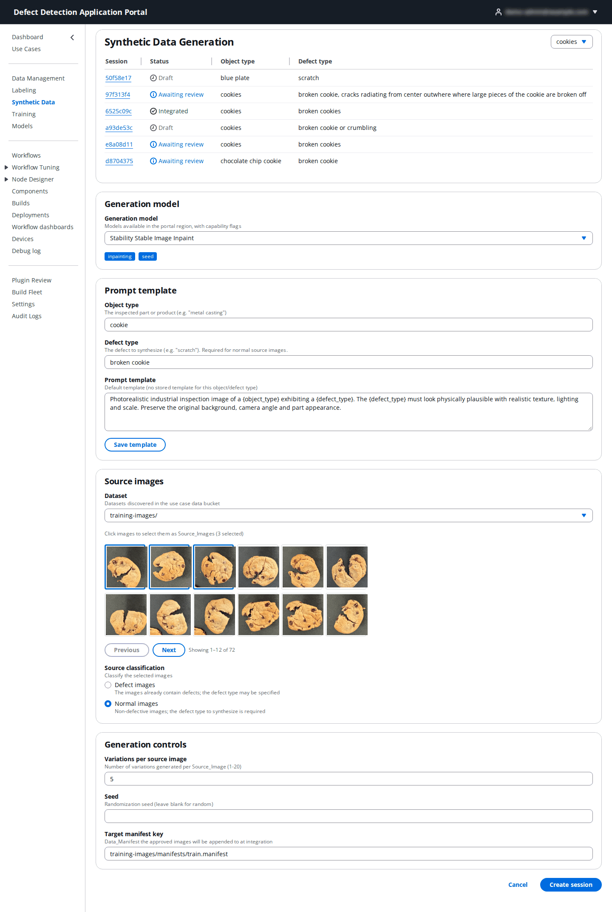
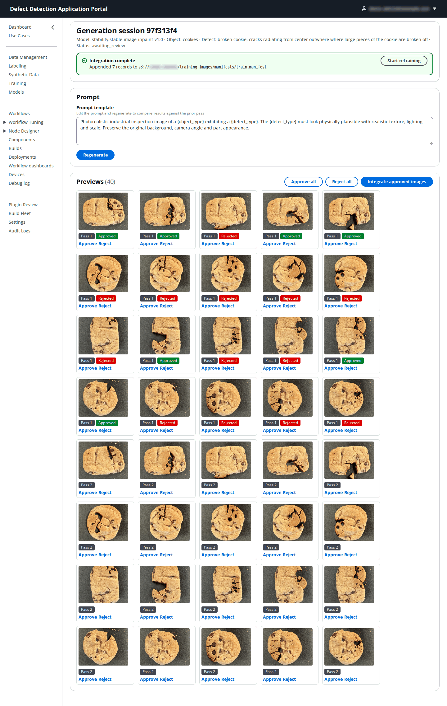

# 5. Synthetic Data

**Who:** DataScientist, UseCaseAdmin and PortalAdmin. **Video:** [Module 5: Synthetic Data](https://youtu.be/n-egAmfZiJw).

Defects are rare on a healthy production line, so a classifier often has hundreds of normal images and a handful of defective ones. **Synthetic Data** uses an image-generation model in Amazon Bedrock to paint a described defect onto your real normal images (or to vary your real defect images), lets you approve or reject each result, and appends the approved images to a training manifest so the next training run sees a balanced set. The example below generates broken cookies from the cookies use case's normal training images.

## 5.1 Sessions

The page lists the use case's generation sessions with **Session** (short id, click to open), **Status**, **Object type**, **Defect type**, **Model** and **Created**. Statuses run **Draft** → **Generating** → **Awaiting review** → **Approved** → **Integrated**, with **Failed** for a generation that could not run. Click **Create generation session** to start a new one.

## 5.2 Create a generation session

The form is one page in four panels. A yellow box at the top lists what is still missing (a model, an object type, at least one source image, a classification); **Create session** enables when it is empty.

**Generation model**

| Field | What to enter |
|-------|---------------|
| **Generation model** | A Bedrock image model available in the Portal's region, shown with its capability flags; the sessions here use **Stability Stable Image Inpaint** (`inpainting`, `seed`), since painting a defect into a region of a real image is an inpainting task. If the list is empty ("No generation models available"), the account has no image-generation model access in this region: request model access in the Bedrock console first. |

**Prompt template**

| Field | What to enter |
|-------|---------------|
| **Object type** | The inspected part or product, in plain words: `cookie`, `blue plate`, `metal casting`. |
| **Defect type** | The defect to synthesize: `broken cookie`, `scratch`, `chip`. Required when the source images are normal (there is nothing else to tell the model what to add). |
| **Prompt template** | Entering an object and defect type loads the default template, with `{object_type}` and `{defect_type}` placeholders: "Photorealistic industrial inspection image of a {object_type} exhibiting a {defect_type}. The {defect_type} must look physically plausible with realistic texture, lighting and scale. Preserve the original background, camera angle and part appearance." Edit it to describe your defect more precisely, for example "cracks radiating from the center where large pieces of the cookie are broken off". **Save template** keeps your wording as the stored template for this object/defect pair. |

**Source images**

| Field | What to enter |
|-------|---------------|
| **Dataset** | A dataset prefix discovered in the use case's data bucket, listed with its image count (`training-images/`, 63 images). The list can take a few seconds to load on a large bucket. |
| Image grid | Thumbnails of the dataset appear, 12 per page (**Previous** / **Next**). Click images to select them as source images; the caption counts the selection. Pick a representative handful of clean examples: each one produces several variations. |
| **Source classification** | **Normal images** when the selected images are defect-free and the defect must be synthesized (defect type required), or **Defect images** when they already contain defects and the model should produce more variants of them (the defect type may then be left out). |

**Generation controls**

| Field | What to enter |
|-------|---------------|
| **Variations per source image** | 1–20 generated images per source image; default `5`. Three source images at 5 variations give 15 previews to review. |
| **Seed** | A randomization seed, or blank for random. Reuse a seed to reproduce a run. |
| **Guidance strength (cfgScale)** | How strongly the prompt steers the model, when the model exposes it. |
| **Target manifest key** | The training manifest the approved images will be appended to at integration, for example `training-images/manifests/train.manifest` (an S3 key inside the use case bucket). |

Click **Create session**. Generation runs in the background; the session shows **Generating** and then **Awaiting review** as the previews arrive.

## 5.3 Review, integrate and retrain

Open a session from the list.

- The header repeats the **Model**, **Object**, **Defect** and **Status**.
- **Prompt** shows the template used. Edit it and click **Regenerate** to run another pass over the same source images and compare; each preview is tagged with the pass it came from (**Pass 1**, **Pass 2**, …), so you can keep the better pass and reject the other.
- **Previews** shows every generated image. Click **Approve** or **Reject** under each one, or use **Approve all** / **Reject all**. Judge them as an inspector would: a plausible break with the right lighting and background is approved; a distorted cookie, a changed background or an unconvincing defect is rejected. Only approved images are kept.
- If any variations fail to generate, a box below the previews lists each one with the model's or the service's error text so you can retry or adjust the prompt; failures never block reviewing the previews that did succeed.
- **Integrate approved images** copies the approved images into the dataset (under `training-images/synthetic/<session>/`) and appends their manifest lines, labeled with the defect class, to the **Target manifest key**. The green **Integration complete** banner reports how many records were appended and to which manifest. Rejected and pending previews are excluded.
- **Start retraining** opens a dialog pre-filled with the updated **Dataset manifest** and asks for a **Model name**; it starts a training job on the enlarged dataset (see [6. Training](06-training.md)). The training job records this session as its origin.

Generated images are staged under `synthetic-staging/<session>/` in the use case bucket until they are integrated.
