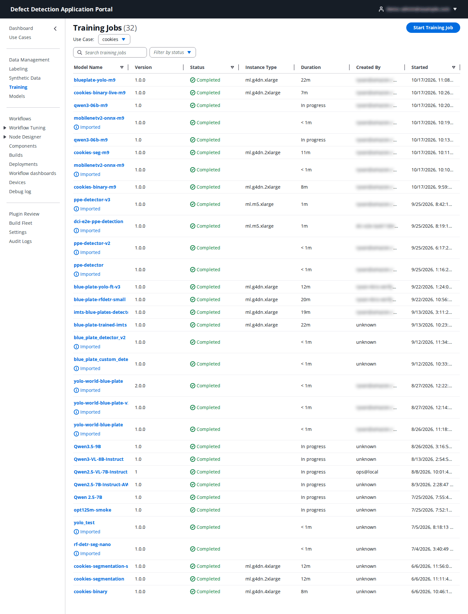
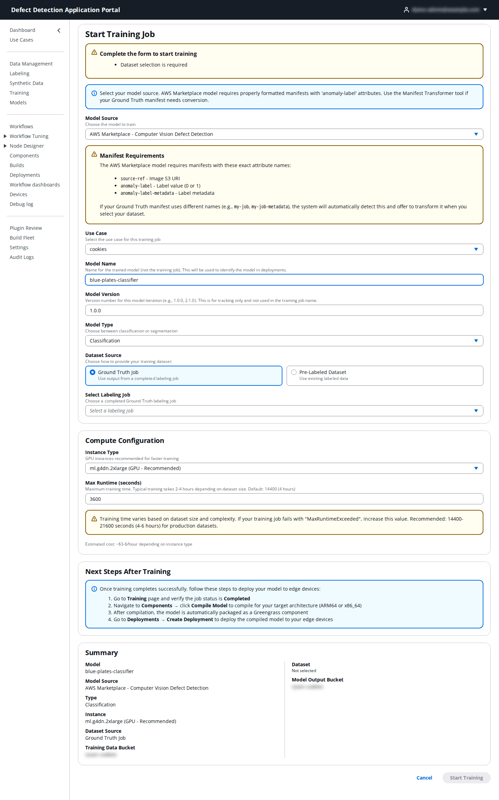
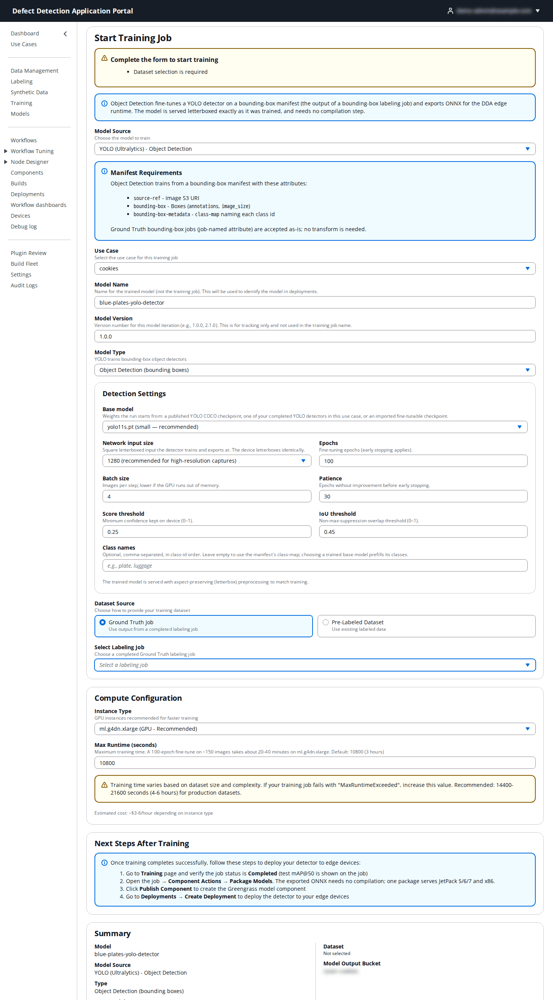
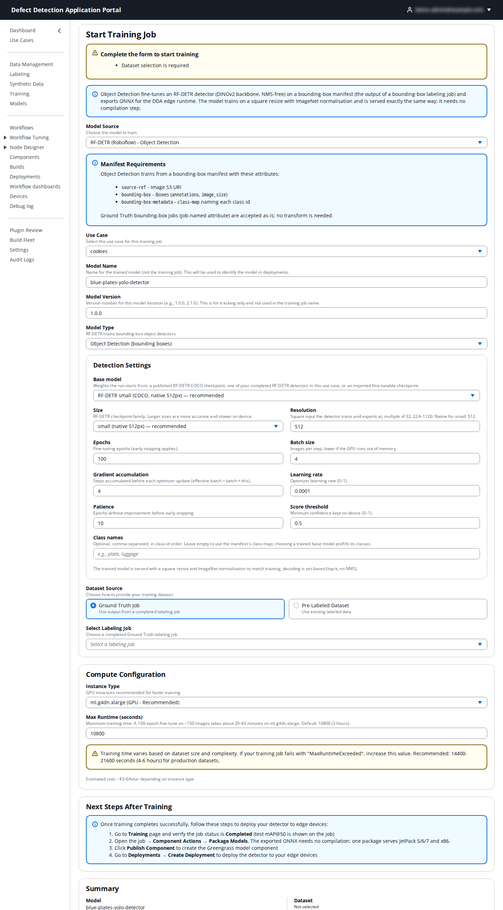
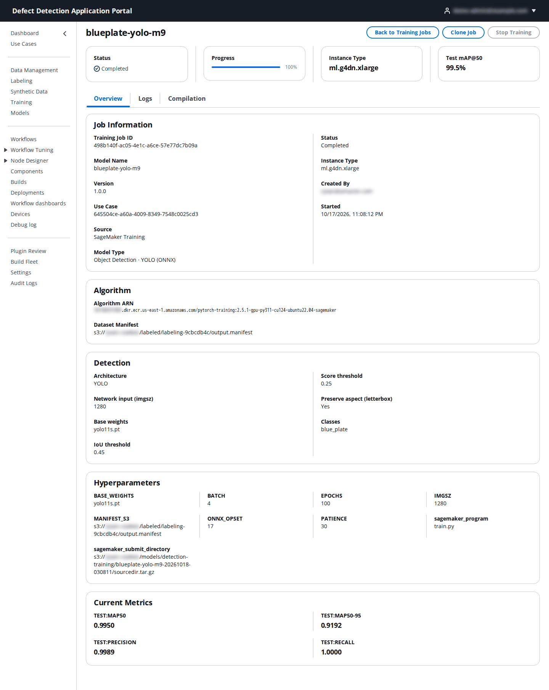

# 6. Training

**Who:** DataScientist, UseCaseAdmin and PortalAdmin start and stop training jobs; Operator and Viewer can view them. **Video:** [Module 9: Training Models](https://youtu.be/azKIaPPlhZM).

A training job runs on Amazon SageMaker in the use case account and produces a model that lands in the **Models** registry ([7. Models](07-models.md)). The Portal supports three model sources:

| Model Source | Trains | Needs | Result |
|--------------|--------|-------|--------|
| **AWS Marketplace – Computer Vision Defect Detection** | Anomaly **Classification** (normal/anomaly, optionally "Robust") or **Segmentation** (defect masks, optionally "Robust"). | An AWS Marketplace subscription in the use case account and a manifest with `anomaly-label` attributes. | A model that must then be **compiled** for each device architecture. |
| **YOLO (Ultralytics) – Object Detection** | A bounding-box detector fine-tuned from a YOLO11 checkpoint. | A bounding-box manifest (a detection labeling job's output). | ONNX for the DDA edge runtime; no compilation step, one package serves JetPack 5/6/7 and x86. |
| **RF-DETR (Roboflow) – Object Detection** | A transformer detector (DINOv2 backbone, NMS-free). | A bounding-box manifest. | ONNX for the DDA edge runtime; no compilation step. |

Pick Marketplace classification for pass/fail inspection, segmentation when you need the defect's location and area, and a detector (YOLO or RF-DETR) when you count or locate individual objects or defects, such as every blue plate on a tray.

## 6.1 The Training page

The table lists the use case's jobs with **Model Name**, **Version**, **Status**, **Instance Type**, **Duration**, **Created By** and **Started**. **Filter by status** narrows the list (**Pending**, **In Progress**, **Completed**, **Failed**, **Stopped**). Click a model name to open the job (6.4). **Start Training Job** opens the form.

## 6.2 Start a training job

The form is one page. The yellow **Complete the form to start training** box at the top lists what is still missing, and **Start Training** enables when it is empty. If you arrived from **Use for Training** in Data Management or from a labeling job, the dataset is preselected and the matching model source is chosen for you.

### Marketplace classification or segmentation

| Field | What to enter | Default |
|-------|---------------|---------|
| **Model Source** | **AWS Marketplace – Computer Vision Defect Detection**. The **Manifest Requirements** box lists the attribute names the algorithm expects (`source-ref`, `anomaly-label`, `anomaly-label-metadata`). | Marketplace |
| **Use Case** | The use case that owns the data and will own the model. | from the selector |
| **Model Name** | The name of the trained *model* (not the job), used to identify it in the registry and in deployments, for example `blue-plates-classifier`. | – |
| **Model Version** | A version string for your own tracking, for example `1.0.0`. It is not part of the job name. | `1.0.0` |
| **Model Type** | **Classification** (binary normal/anomaly; faster and smaller, best for pass/fail), **Classification (Robust)**, **Segmentation** (pixel-level defect masks; needs mask-annotated data) or **Segmentation (Robust)**. Robust variants simulate camera-angle and lighting variation and take 6–24+ hours. | Classification |
| **Dataset Source** | **Ground Truth Job** to use the output manifest of a completed labeling job, or **Pre-Labeled Dataset** to use a registered manifest. | Ground Truth Job |
| **Select Labeling Job** / **Select Pre-Labeled Dataset** | The job or dataset. A labeling job whose manifest is still in Ground Truth format is detected and the form offers to transform it (**Transform Manifest**) before training. | – |
| **Instance Type** | The SageMaker GPU instance: `ml.g4dn.2xlarge` (recommended) or `ml.g4dn.4xlarge` (more compute). | `ml.g4dn.2xlarge` |
| **Max Runtime (seconds)** | The maximum training time; the job is stopped with `MaxRuntimeExceeded` when it is reached. Typical training takes 2–4 hours; the form recommends 14400–21600 seconds (4–6 hours) for production datasets. | `3600` |

The **Summary** panel repeats the choices, including the training-data and model-output buckets, and shows an estimated hourly cost. **Next Steps After Training** reminds you what follows: verify the job is **Completed**, compile the model under **Models**, and create a deployment.

### YOLO or RF-DETR object detection

Choosing a detection source adds a **Detection Settings** panel and changes the instance list. The manifest must carry `source-ref`, `bounding-box` (annotations and image size) and `bounding-box-metadata` (the class map); a Ground Truth bounding-box job's output is accepted as is.

| Field | What to enter | YOLO default | RF-DETR default |
|-------|---------------|--------------|-----------------|
| **Model Type** | **Object Detection (bounding boxes)**. YOLO trains and serves letterboxed; RF-DETR trains on a square resize with ImageNet normalisation and no NMS. | – | – |
| **Base model** | The weights the run starts from: a published checkpoint (`yolo11n.pt` nano – fastest on device, `yolo11s.pt` small – recommended, `yolo11m.pt` medium – more accurate but slower; for RF-DETR a size: nano, small, medium or large), one of your completed detectors in this use case (to keep training it), or an imported fine-tunable checkpoint. Choosing a trained model prefills its classes. | `yolo11s.pt` | small |
| **Network input size** (YOLO) | The square letterboxed input the detector trains and exports at; the device letterboxes identically. `640` is fast but may miss small objects, `960`, `1280` is recommended for high-resolution captures, `1600` is slow and needs a large GPU. | `1280` | – |
| **Resolution** (RF-DETR) | The square input, a multiple of 32 between 224 and 1120. Each size has a native resolution (nano 384, small 512, medium 576, large 704); the native value is recommended. | – | `512` |
| **Epochs** | Fine-tuning epochs; early stopping applies. | `100` | `100` |
| **Batch size** | Images per step; lower it if the GPU runs out of memory. | `4` | `4` |
| **Gradient accumulation** (RF-DETR) | Steps accumulated before each optimizer update (effective batch = batch × this). | – | `4` |
| **Learning rate** (RF-DETR) | Optimizer learning rate, 0–1. | – | `0.0001` |
| **Patience** | Epochs without improvement before early stopping. | `30` | `10` |
| **Score threshold** | Minimum confidence kept on the device, 0–1. | `0.25` | `0.5` |
| **IoU threshold** (YOLO) | Non-max-suppression overlap threshold, 0–1. | `0.45` | – |
| **Class names** | Optional, comma-separated, in class-id order (`plate, scratch, chip`). Leave empty to use the manifest's class map. | empty | empty |
| **Instance Type** | `ml.g4dn.xlarge` (recommended), `ml.g4dn.2xlarge`, `ml.g5.xlarge` (A10G) or `ml.g5.2xlarge`. | `ml.g4dn.xlarge` | `ml.g4dn.xlarge` |
| **Max Runtime (seconds)** | A 100-epoch fine-tune on about 150 images takes 20–40 minutes on `ml.g4dn.xlarge`. | `10800` | `10800` |

Click **Start Training**. The job appears in the list as **Pending** and moves to **In Progress** when SageMaker starts it.

## 6.3 Transforming a Ground Truth manifest

If the selected labeling job's manifest uses Ground Truth attribute names (for example `my-job`, `my-job-metadata`) the form shows a notice and a **Transform Manifest** action. The transformer rewrites the manifest into the DDA format the Marketplace algorithm requires and points the form at the transformed copy. Bounding-box manifests for detection training do not need this.

## 6.4 Following a job

Click a job to open its detail page.

- The header cards show **Status**, **Progress**, **Instance Type** and, for detectors, the **Test mAP@50**. **Clone Job** opens the form prefilled with this job's settings so you can rerun with a tweak; **Stop Training** stops a running job.
- **Overview** tab: **Job Information** (training job ID, model name and version, use case, source, model type, who started it and when), **Algorithm** (the algorithm or training image and the **Dataset Manifest**), **Detection** settings and **Hyperparameters** as submitted, and **Current Metrics** (for detectors `test:mAP50`, `test:mAP50-95`, `test:precision`, `test:recall`; for Marketplace models the algorithm's accuracy metrics).
- **Logs** tab: the SageMaker training log, refreshed every 10 seconds while the job runs. Logs can take a few minutes to appear after the job starts. If a job fails, the reason is here.
- **Compilation** tab: for Marketplace models, the compilation jobs started from the model's page (see [7. Models](07-models.md)); for detectors, the ONNX export and its parity check (**Converted ONNX**, **Exporter**, opset, IR version, input shape).

When the job reaches **Completed**, the model appears in **Models** as a **Trained** candidate at the version you gave.
