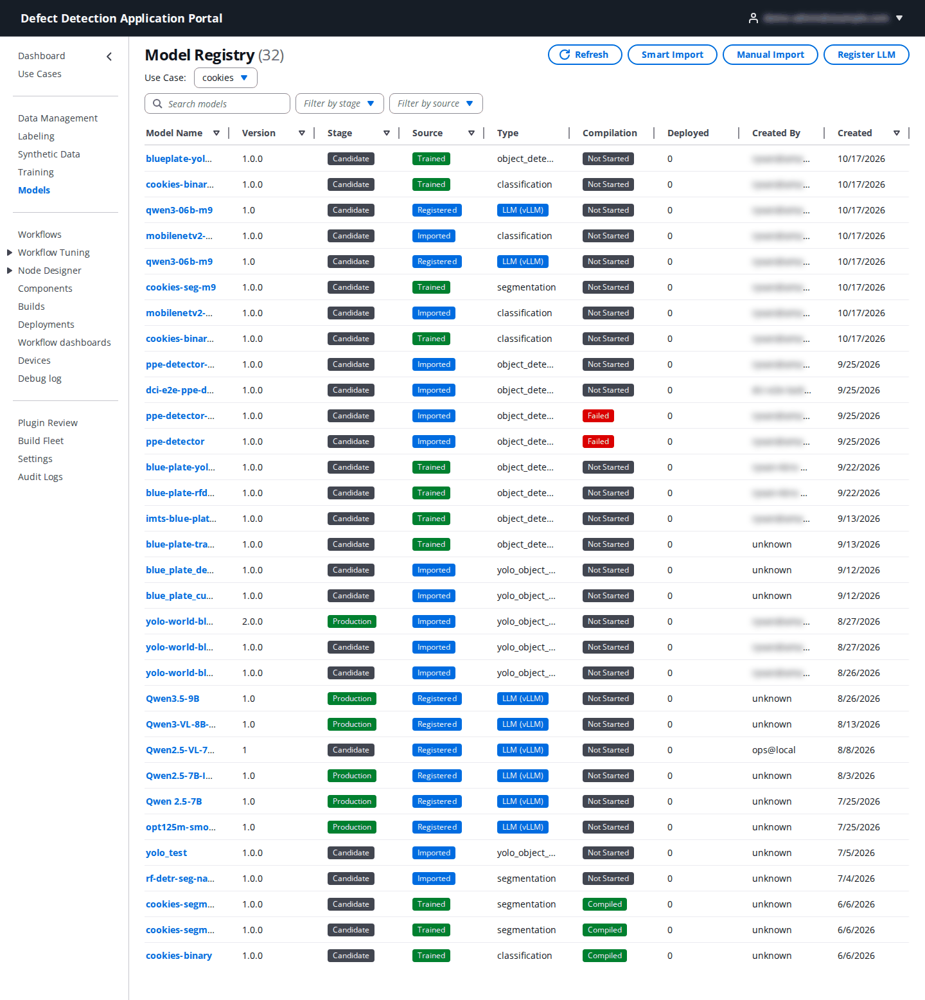
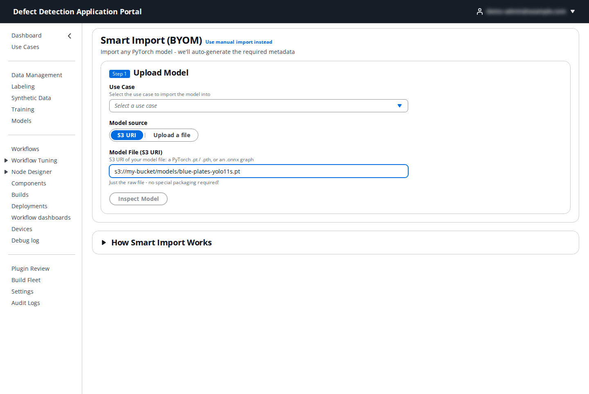
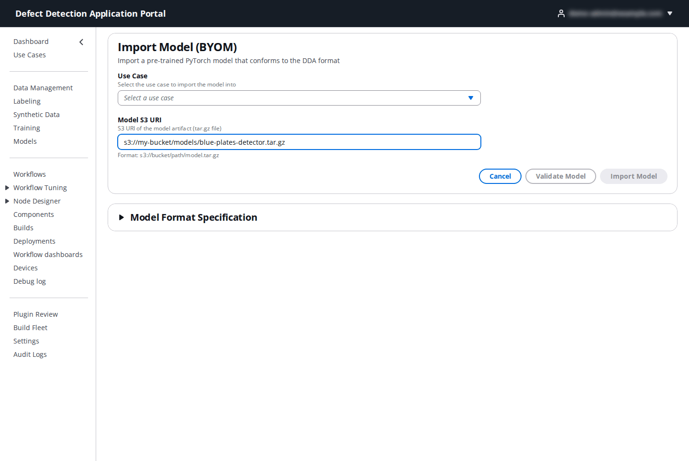
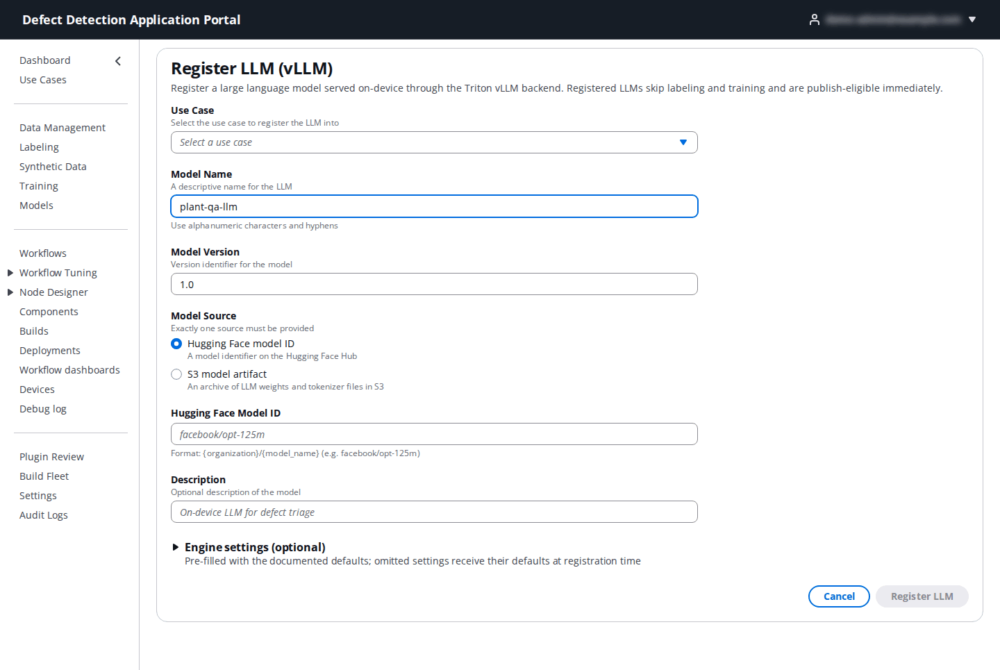
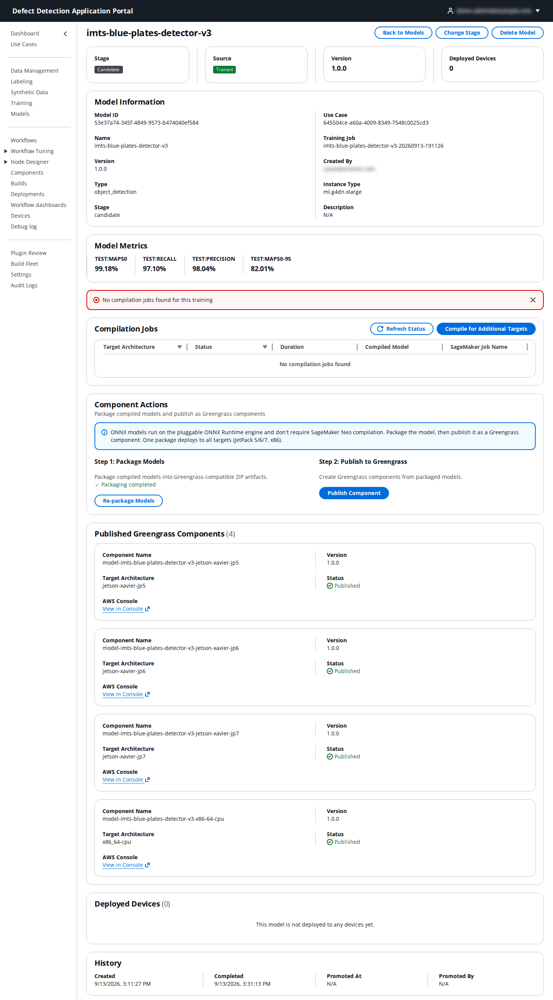
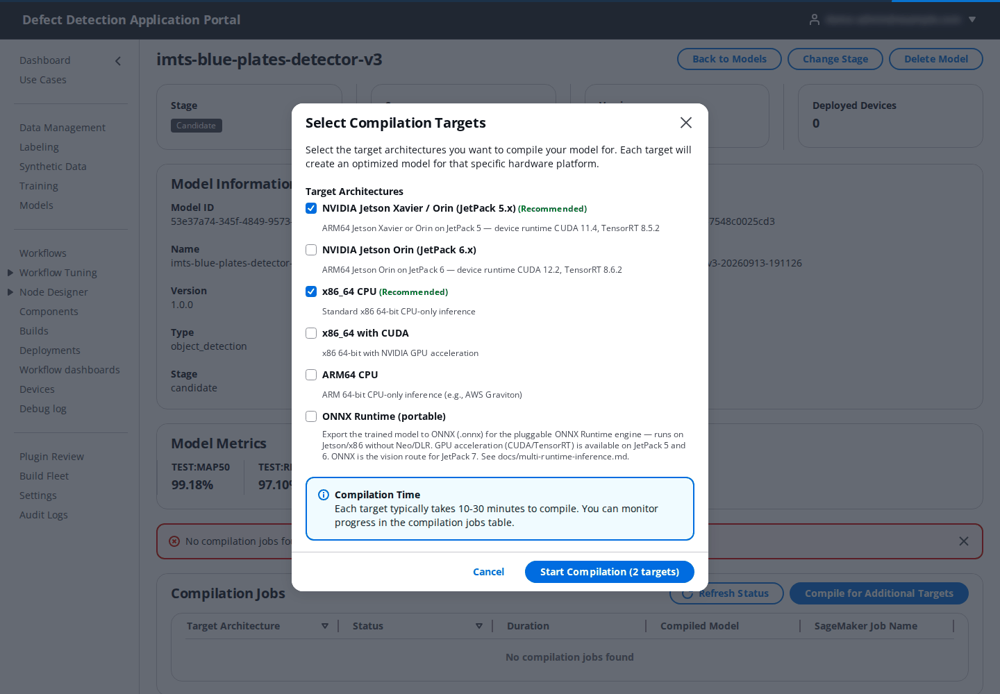
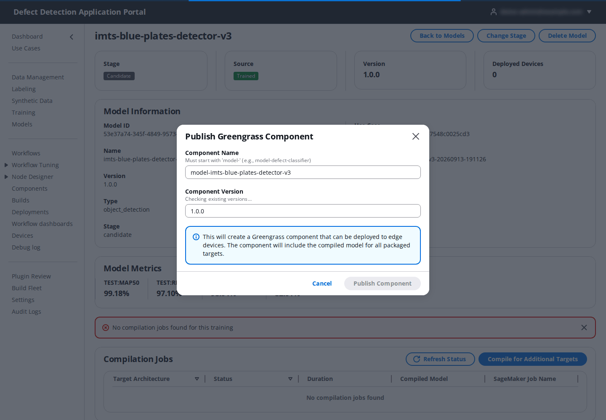
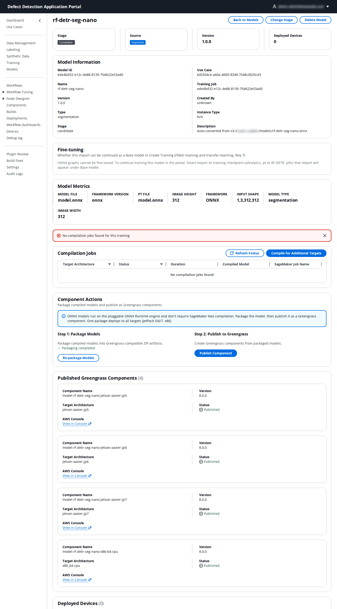
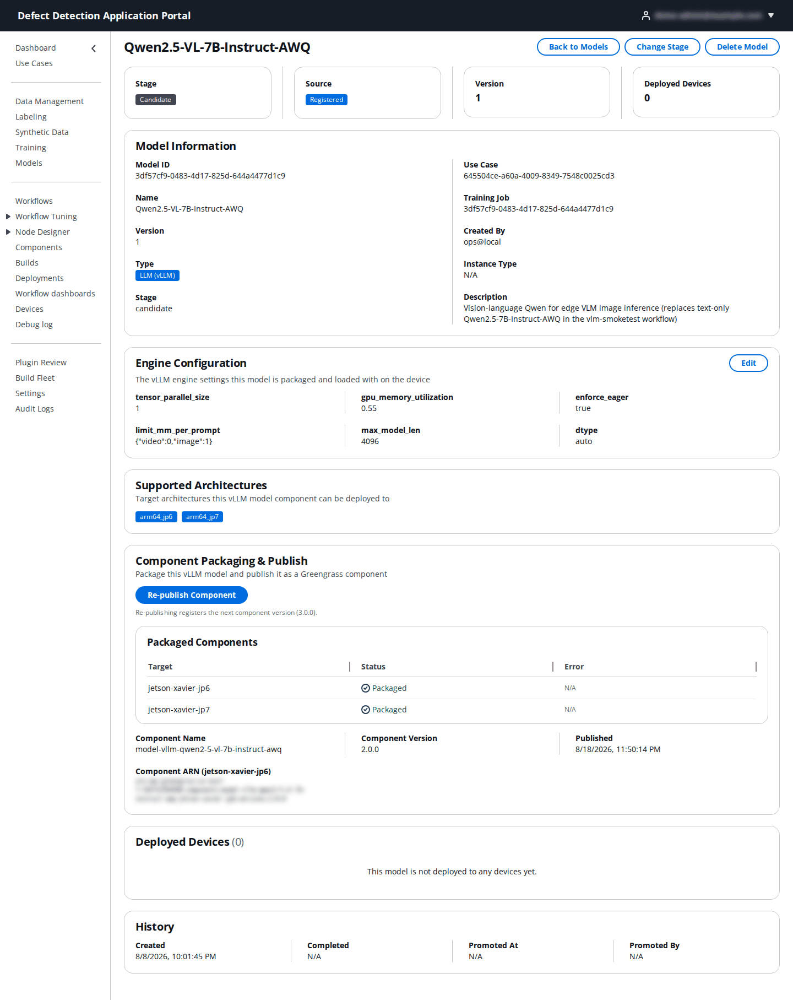

# 7. Models

**Who:** DataScientist, UseCaseAdmin and PortalAdmin import, compile, package, publish, promote and delete models; Operator and Viewer can view them. **Video:** [Module 9: Training Models](https://youtu.be/azKIaPPlhZM); for bring-your-own models see also the [BYOM guide](../../edge-cv-portal/BYOM_GUIDE.md) and the README sections on [ONNX models](../../README.md#using-onnx-models) and [LLMs](../../README.md#using-llms-vllm).

**Models** is the use case's model registry. Everything a device can run passes through it: models trained in the Portal, models you import, and large language models registered for the on-device vLLM runtime. From here a model is compiled or packaged for the device architectures and published as a Greengrass component, which is what a deployment installs.

## 7.1 The Model Registry

Each row shows:

| Column | Meaning |
|--------|---------|
| **Model Name**, **Version** | The registry entry. Click the name to open it. |
| **Stage** | **Candidate** (new), **Staging** or **Production**. Stages are labels for your release process; the Create Deployment page lists models of every stage. |
| **Source** | **Trained** (by a Portal training job), **Imported** (manual or Smart Import) or **Registered** (an LLM). |
| **Type** | `classification`, `segmentation`, `object_detection`, `yolo_object_detection`, or **LLM (vLLM)**. |
| **Compilation** | **Not Started**, in progress, **Compiled** or **Failed**. ONNX detectors and LLMs do not need compilation and stay at Not Started. |
| **Deployed** | Number of devices the model is deployed to. |
| **Created By**, **Created** | Who added it and when. |

**Search models**, **Filter by stage** and **Filter by source** narrow the list. The buttons at the top right start the three import paths: **Smart Import**, **Manual Import** and **Register LLM**.

## 7.2 Smart Import (recommended for your own models)

**Smart Import (BYOM)** takes a raw model file, inspects it, and writes the manifest and packaging the device needs.

**Step 1 – Upload Model**

| Field | What to enter |
|-------|---------------|
| **Use Case** | The use case to import into. |
| **Model source** | **S3 URI** of a file already in an allowed bucket, or **Upload a file** from your computer (it is uploaded to the use case's own bucket first). |
| **Model File (S3 URI)** | A PyTorch `.pt` / `.pth` checkpoint or an `.onnx` graph, for example `s3://<bucket>/models/blue-plates-yolo11s.pt`. Just the raw file, no packaging. |

Click **Inspect Model**. The Portal analyzes the file and shows **Model Analysis** with what it detected. Detector checkpoints (Ultralytics YOLO `.pt`, RF-DETR `.pth`) are converted to ONNX in a conversion job; ONNX graphs are used as they are.

**Step 2 – Configure** (the fields shown depend on the file)

| Field | What to enter |
|-------|---------------|
| **Model Name** | A descriptive name; alphanumerics and hyphens. |
| **Model Type** | **Classification**, **Object Detection**, **Segmentation** or **Anomaly Detection**. |
| **Runtime / export format** | **ONNX Runtime** for ONNX models (the pluggable engine that runs on Jetson and x86 without compilation) or **PyTorch / Neo (DLR)** for models that will be compiled with SageMaker Neo. |
| **Detection architecture** | **YOLO** or **RF-DETR**, for object detection. |
| **Input Image Size** / **Width** and **Height** | The dimensions the model expects, for example `640x640 (YOLOv5/v8/v10)`, `1280x1280`, `224x224 (ResNet, VGG)`. |
| **Network input** and **Input resize geometry** | For detectors: the network input and whether frames are **letterboxed** (scaled by one ratio and centre-padded) or **squashed** (stretched). This must match how the model was trained; a mismatch does not fail but silently loses detections. |
| **Number of Classes** and **Class names** | How many classes the model outputs and their names, comma-separated in class-id order (`plate, scratch, chip`). Without names the device labels detections with the numeric class id, so anything matching on a label string will not match. For a detector checkpoint the classes are read from the detection head and can be renamed but not added or removed. |
| **Score threshold** / **IoU threshold** | Minimum confidence to keep a detection, and the NMS overlap (YOLO only; RF-DETR is NMS-free). |
| **Segmentation architecture** | The on-device decoder for an ONNX segmentation model. |
| **Compilation Targets** | For Neo/DLR models: the device architectures to compile for (7.4). ONNX models skip this; one package serves every target. |

Click **Convert & Import** (or **Import**). The model appears in the registry as **Imported**, and the detector conversion, if any, is tracked on its page.

## 7.3 Manual import and LLM registration

**Manual Import** (**Import Model (BYOM)**) is for a pre-trained PyTorch model that already conforms to the DDA format: a `model.tar.gz` with the manifest the **Model Format Specification** panel describes.

| Field | What to enter |
|-------|---------------|
| **Use Case** | The target use case. |
| **Model S3 URI** | `s3://bucket/path/model.tar.gz` in an allowed bucket. **Validate Model** checks the archive before you import. |
| **Model Name**, **Model Version**, **Description** | Name (alphanumerics and hyphens), version in `x.y.z` form, optional description. |
| **Compilation Targets** / **Compilation Options** | The architectures to compile for. |

**Register LLM (vLLM)** registers a large language or vision-language model that the JetPack 6 or 7 LocalServer serves through its vLLM runtime. Registered LLMs skip labeling, training and compilation and can be published immediately.

| Field | What to enter |
|-------|---------------|
| **Use Case**, **Model Name**, **Model Version**, **Description** | As above; the example is `plant-qa-llm`, version `1.0`. |
| **Model Source** | Exactly one of **Hugging Face model ID** (`{organization}/{model_name}`, for example `facebook/opt-125m` for a smoke test or `Qwen/Qwen2.5-VL-7B-Instruct-AWQ`) or **S3 model artifact** (an `s3://` URI ending in `.tar.gz`, readable from the use case account). |
| **Engine settings** | The vLLM engine parameters the model is loaded with on the device: **dtype** (`auto`), **gpu memory utilization**, **max model len**, **tensor parallel size**, **enforce eager** and **limit mm per prompt** (a JSON object such as `{"image": 1}` for vision models). Leave the defaults unless the model's card says otherwise; a fit check against the target device's memory runs when the component is packaged. |

vLLM components can only be deployed to `arm64_jp6` and `arm64_jp7` devices; the deployment page refuses them for JetPack 5 and CPU-only targets.

## 7.4 The model page

Click a model name.

- The cards show **Stage**, **Source**, **Version** and **Deployed Devices**. **Change Stage** opens a dialog to promote (**Staging**, **Production**) or demote (**Candidate (Demote)**, **Staging (Demote)**); promoting makes the intent visible to the team, demoting moves it back. **Delete Model** removes the registry entry; it is refused while the model is deployed to any device.
- **Model Information**: model ID, name, version, type, stage, use case, the **Training Job** it came from, who created it and the instance type.
- **Model Metrics**: the training metrics, for example `test:mAP50`, `test:recall`, `test:precision`, `test:mAP50-95` for a detector.
- **Compilation Jobs** (Marketplace and Neo models): one row per **Target Architecture** with **Status**, **Duration**, the **Compiled Model** location and the **SageMaker Job Name**. **Compile for Additional Targets** opens the target picker:

  | Target | Device |
  |--------|--------|
  | **NVIDIA Jetson Xavier / Orin (JetPack 5.x)** | `arm64_jp5` devices (CUDA 11.4, TensorRT 8.5.2). |
  | **NVIDIA Jetson Orin (JetPack 6.x)** | `arm64_jp6` devices (CUDA 12.2, TensorRT 8.6.2). |
  | **x86_64 CPU** / **x86_64 with CUDA** | Industrial PCs without or with an NVIDIA GPU. |
  | **ARM64 CPU** | Generic ARM64 such as AWS Graviton. |
  | **ONNX Runtime (portable)** | Exports the trained model to `model.onnx` for the pluggable ONNX Runtime engine, which runs on Jetson and x86 without Neo. |

  Click **Start Compilation**; each target becomes a SageMaker compilation job (minutes to tens of minutes). **Refresh Status** updates the table.

- **Component Actions**: **Step 1: Package Models** bundles the compiled (or ONNX) artifacts into Greengrass-ready ZIPs (**Re-package Models** repeats it after a new compilation); **Step 2: Publish to Greengrass** creates the Greengrass model components (**Publish Component**). ONNX models note that they need no compilation: package, then publish, and one package deploys to every target.

  The publish dialog asks for the **Component Name** (prefilled, `model-<name>`), **Component Version** and the **Target Architectures** to publish for.

- **Published Greengrass Components** lists each published component with its **Target Architecture**, **Version**, **Status** and an AWS Console link. These are what the Create Deployment page offers under **Recommended** and **Portal Components**.
- **Deployed Devices** and **History** (created, completed, promoted at and by).

An imported ONNX model shows an extra **Fine-tuning** panel saying whether it can be continued as a **Base model** in a training job, and its import metadata (file, format, input shape):

A registered LLM shows **Engine Configuration** (with **Edit** for the vLLM settings), **Supported Architectures** (recorded when the component is packaged and published), **Component Packaging & Publish** with **Re-publish Component**, and the **Packaged Components** table:

## 7.5 From model to device

1. Train or import the model (above) and wait for **Completed** / **Imported**.
2. Marketplace and Neo models: **Compile for Additional Targets** for each device architecture you run, then **Package Models**. ONNX detectors and LLMs: **Package Models** only.
3. **Publish Component**.
4. Create or revise a deployment and add the published model component ([13. Deployments](13-deployments.md)); reference the model by name in the workflow's **Model Inference** node ([8. Workflows](08-workflows.md)).
