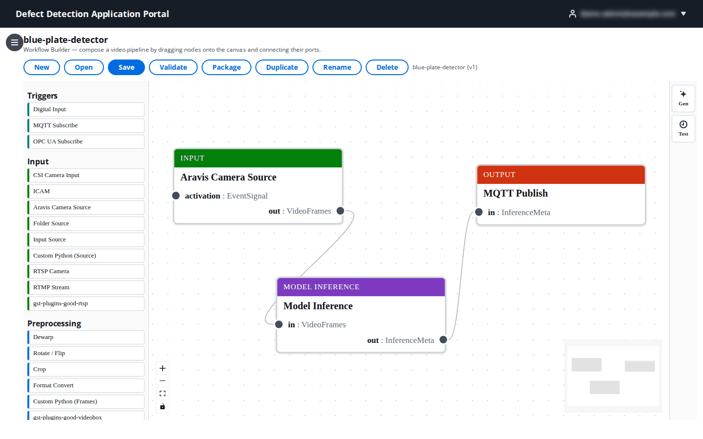
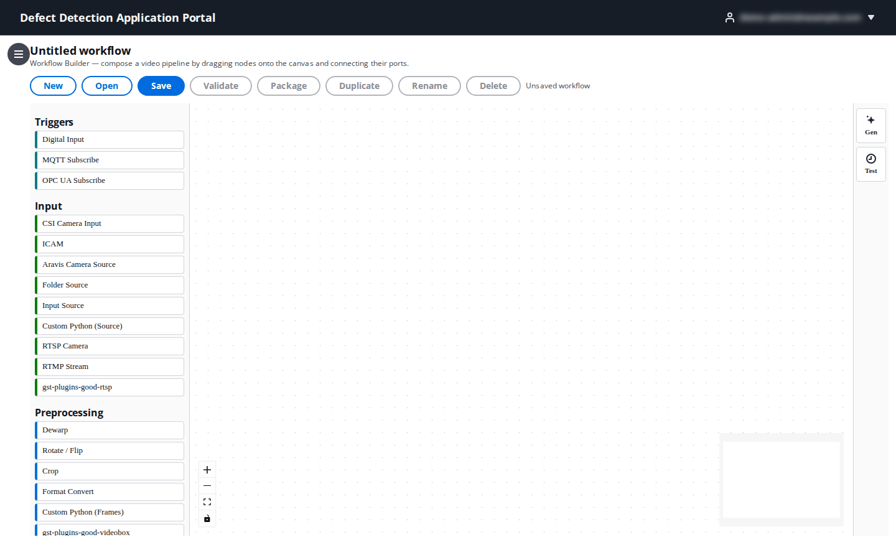
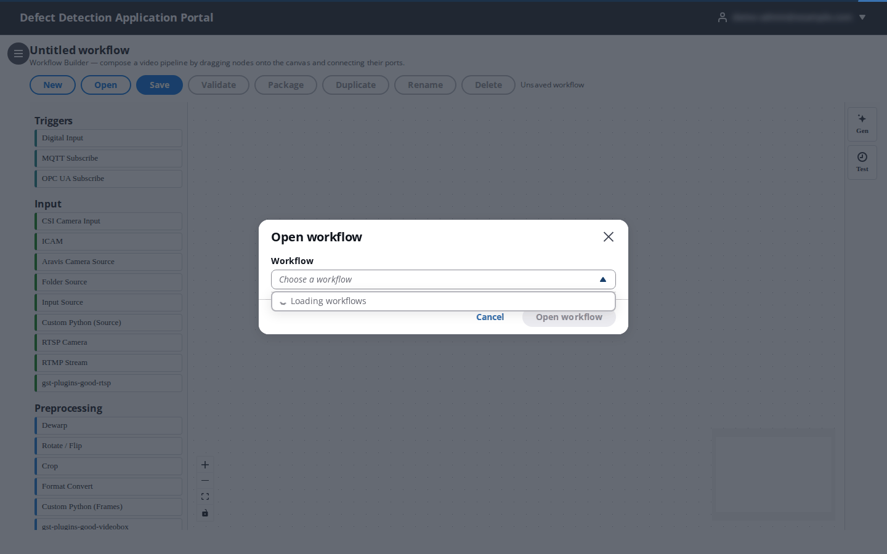
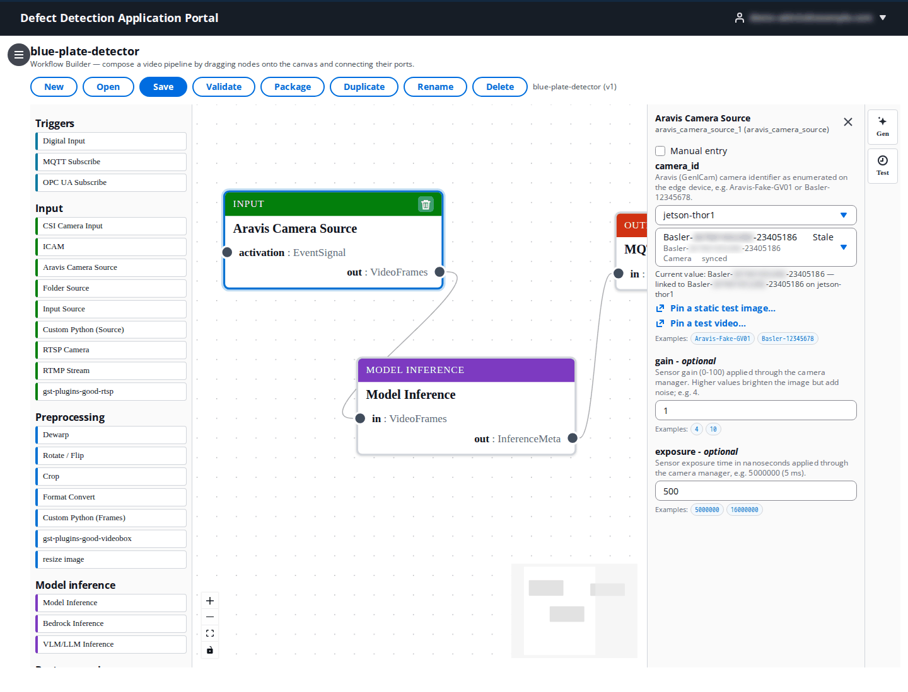
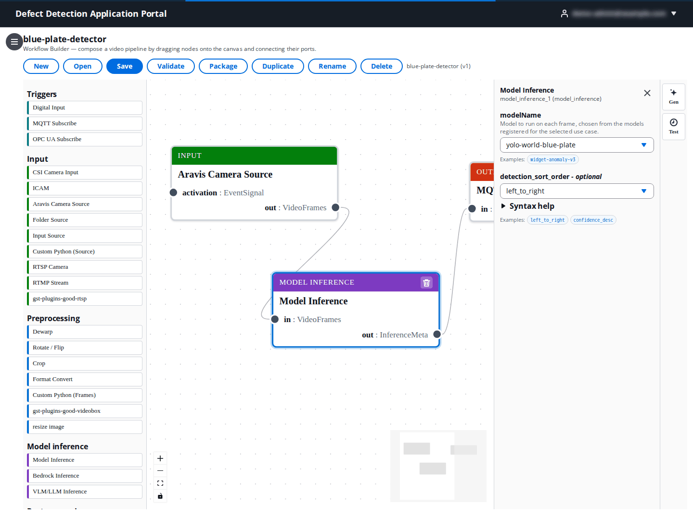
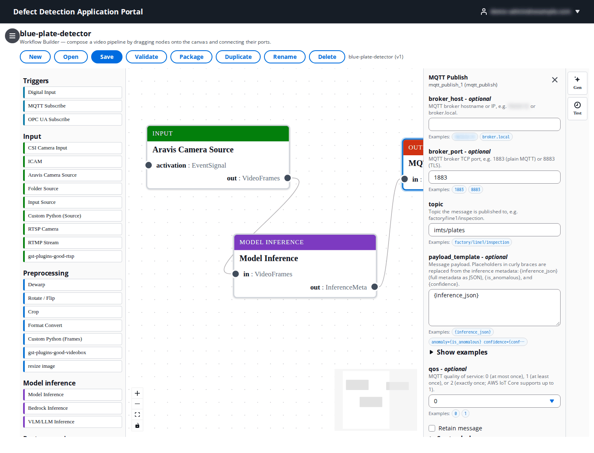
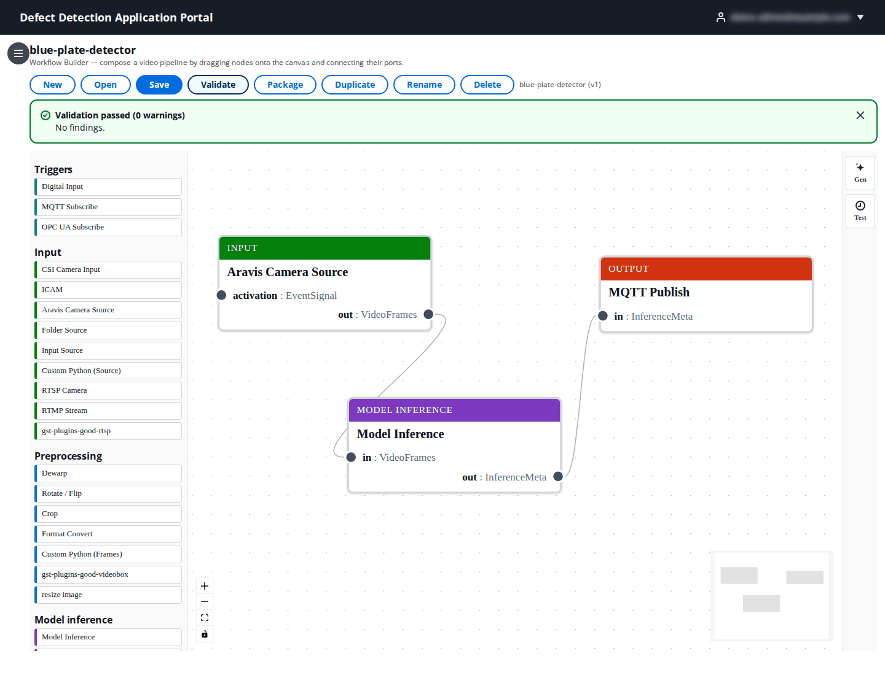
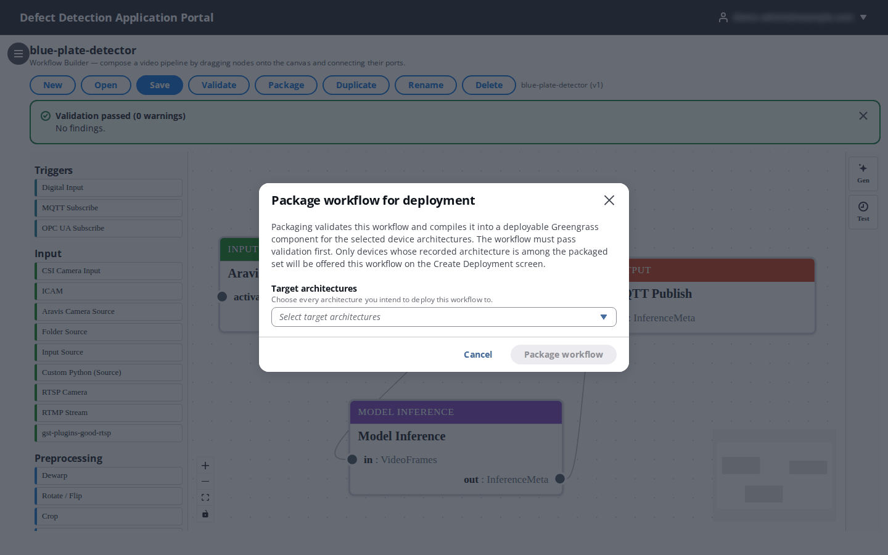
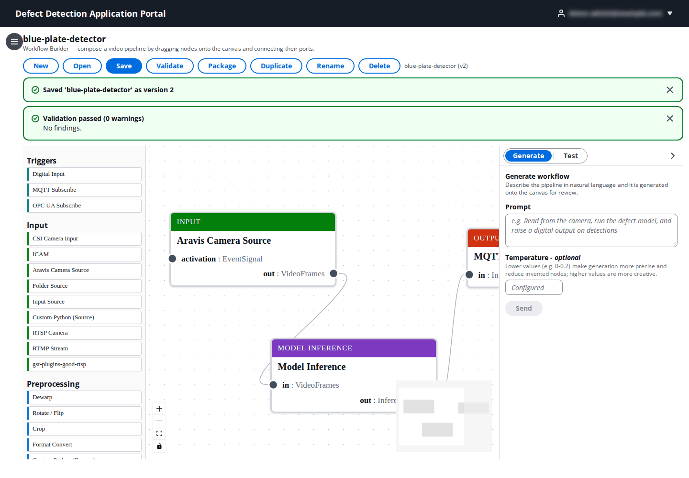
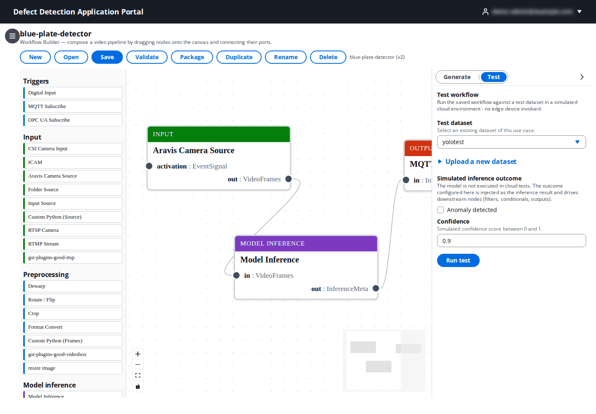

# 8. Workflows

**Who:** DataScientist, UseCaseAdmin and PortalAdmin create, edit, validate and package workflows; Operator and Viewer can open them read-only. **Video:** [Module 3: Workflows](https://youtu.be/vpL62wIT218).

A **workflow** is the inspection pipeline that runs on a device: where the frames come from, what triggers a run, how frames are pre-processed, which model (or LLM) judges them, and what happens with the verdict (a GPIO pulse, an MQTT message, a PLC write, a saved image). You compose it visually in the **Workflow Builder**, validate it, and **package** it into a Greengrass component that a deployment installs next to the LocalServer and the model components.

## 8.1 The Workflow Builder

The page has four areas:

1. **Toolbar** – **New**, **Open**, **Save**, **Validate**, **Package**, **Duplicate**, **Rename**, **Delete**, followed by the open workflow's name and version (`blue-plate-detector (v1)`). The side navigation starts collapsed here to give the canvas room; the menu button at the top left opens it.
2. **Node palette** (left) – every node type, grouped as **Triggers**, **Input**, **Preprocessing**, **Model inference**, **Post-processing** and **Output**. Custom nodes built in the [Node Designer](10-node-designer.md) appear in their palette category (for example `resize image` under Preprocessing). Drag a node onto the canvas to add it.
3. **Canvas** (centre) – the graph. Each node shows its category colour, its type, and its ports: inputs on the left, outputs on the right, each labelled with its data type (`EventSignal`, `VideoFrames`, `InferenceMeta`). Drag from an output port to an input port to connect them; only matching types connect, and a refused connection shows **Connection rejected** with the reason. Click a node to configure it, use the trash icon on a selected node to delete it, and the controls at the bottom left to zoom, fit the view and lock the canvas. The minimap at the bottom right helps on large graphs.
4. **Node configuration** (right) – the parameters of the selected node (8.3). The **Gen** and **Test** tabs on the far right open the generate and test panels (8.6, 8.7).

## 8.2 Create, open and save

| Action | What happens |
|--------|--------------|
| **New** | Clears the canvas into **Untitled workflow**. If the canvas has unsaved changes you are asked to confirm (**Discard and start new**). |
| **Open** | Lists the use case's workflows under **Choose a workflow**. The use case comes from the use case selector (set it on another page first if the list is empty). |
| **Save** | Saves the canvas as a new **version** of the workflow. The first save asks for a **Name** and optional **Description**; later saves increment the version (v1, v2, …). Validation, packaging and deployments are per version. |
| **Duplicate** | Saves a copy named `<name> (copy)`. |
| **Rename** | Changes the display name only; the workflow id, versions, packaged components and deployments are unchanged. |
| **Delete** | Deletes the workflow after confirmation. Deployed copies on devices are not removed until you revise their deployment. |

## 8.3 Configuring a node

Click a node. The configuration panel lists its parameters with a description, the current value and example values you can click to fill in. Required parameters are marked; optional ones say **optional**. Parameters that reference Portal objects offer pickers instead of free text:

- A **camera** parameter (here `camera_id` of **Aravis Camera Source**) is chosen in two steps: pick a **reference device** of the use case, then one of the cameras that device has enumerated (the status next to it says whether the camera is **synced** or **Stale**). The chosen camera is bound to that device: when the workflow is deployed to it, the node uses exactly that camera. **Manual entry** lets you type an identifier instead. **Pin a static test image…** and **Pin a test video…** pin a file to the device's static camera so the workflow can be exercised without a live camera (see [15. Devices](15-devices.md#156-cameras-tab)).
- `gain` and `exposure` are sensor settings applied through the camera manager; the examples (`4`, `10`; `5000000`, `16000000` nanoseconds) are typical starting points.

- The **Model Inference** node's `modelName` is picked from the models registered for the use case ([7. Models](07-models.md)); `detection_sort_order` fixes the order in which detections are listed in the run metadata (`left_to_right`, `right_to_left`, `top_to_bottom`, `bottom_to_top`, `confidence_desc`), which matters when a downstream node refers to "the first plate".

- Output nodes such as **MQTT Publish** take connection details (`broker_host`, `broker_port`, `topic`), a `payload_template` with placeholders (`{inference_json}`, `{is_anomalous}`, `{confidence}`) and a `phase` (publish on **completion** after inference, or on **capture** right after the frame is grabbed).

Parameter values are written to the workflow when you **Save**.

## 8.4 Node reference

Ports: a run starts from a trigger or a camera's `activation`, frames flow as `VideoFrames`, results as `InferenceMeta`.

**Triggers** (emit `EventSignal`; connect to an input node's `activation` port)

| Node | Starts a run when | Key parameters |
|------|-------------------|----------------|
| **Digital Input** | A GPIO pin changes. | `pin` (0–255), `trigger_edge` (`rising`, `falling`, `both`), `poll_interval_ms` (default 100). |
| **MQTT Subscribe** | A message arrives on a topic. | `topic` (filter such as `factory/line1/trigger` or `factory/+/trigger`), broker `broker_host`/`broker_port` (1883, 8883 TLS) and `qos`, or **greengrass** (use the device's Greengrass connection to AWS IoT Core, topic only) or **aws_iot** (mutual TLS with `iot_endpoint`, `iot_thing_name` and certificate paths). |
| **OPC UA Subscribe** | An OPC UA node value changes. | `endpoint` (`opc.tcp://host:4840`), `node_id` (`ns=2;s=Machine1.Reject`), `mode` (`subscribe` or `poll`), `sampling_interval_ms`/`poll_interval_ms`, optional user, password and security settings. |

Every trigger-driven input also has concurrency settings: `concurrency_policy` (`queue` further firings up to `queue_depth`, `drop` them, or `debounce` within `debounce_ms`) and `retry_limit` for reconnects.

**Input** (frame sources; output `VideoFrames`)

| Node | Source | Key parameters |
|------|--------|----------------|
| **CSI Camera Input** | An NVIDIA CSI sensor on a Jetson. | `gain` (0–100, default 4), `exposure` (ns, default 5000000). |
| **ICAM** | A V4L2 smart camera. | `device` (`/dev/video0`). |
| **Aravis Camera Source** | A GenICam/GigE Vision camera such as a Basler. | `camera_id` (picked per device), `gain`, `exposure`. |
| **RTSP Camera** / **RTMP Stream** | A network camera or stream. | `url` without credentials (`rtsp://192.168.1.64:554/…`), `processing_mode` (`continuous` at `frames_per_second`, 0.05–10, or `on_trigger`), `max_frame_age_ms`, `keep_recent_runs`. |
| **Folder Source** | Image files already on the device. | `location` (file or folder, e.g. `/aws_dda/images/latest.jpg`), `file_pattern` (`*.jpg`). |
| **Input Source** | A generic source whose kind (`source_kind`) is chosen at configuration time. | Concurrency settings as above. |
| **Custom Python (Source)** | Python that produces the frame for each run from the trigger context (`produce_frame(context)`), for example by downloading an image named in an MQTT payload. | `code`, `requirements`, `allowed_uri_prefixes`. |

**Preprocessing** (`VideoFrames` → `VideoFrames`)

| Node | Effect | Key parameters |
|------|--------|----------------|
| **Dewarp** | Lens-distortion correction. | `mode` (`fisheye`, `barrel`, `perspective`), `strength` (0–1). |
| **Rotate / Flip** | Rotates or mirrors every frame. | `method` (`clockwise`, …, `automatic`). |
| **Crop** | Removes pixels from the edges. | `top`, `bottom`, `left`, `right` in pixels. |
| **Format Convert** | Converts the pixel format. | `format` (`RGB`, what most models expect). |
| **Custom Python (Frames)** | Your own `process_frame(frame, metadata)` on each frame (NumPy array, `cv2`/`np` pre-imported). | `code`, `requirements` (pip packages, one per line). |

**Model inference** (`VideoFrames` → `InferenceMeta`)

| Node | What it does | Key parameters |
|------|--------------|----------------|
| **Model Inference** | Runs a registered DDA model (classifier, segmentation or detector) on each frame. | `modelName`, `detection_sort_order`. |
| **Bedrock Inference** | Sends the frame (and optionally a `reference` frame) to an Amazon Bedrock multimodal model with a prompt; the device needs cloud access. | `model` (default `us.amazon.nova-lite-v1:0`), `prompt`, `anomaly_mode` (on: the verdict `is_anomalous`/`confidence` drives downstream nodes; off: free-form text), `region`, `max_tokens` (256), `system_prompt`, `crop_detection_index` + `crop_margin_percent` (send only the Nth detection's crop), `reference_payload_path` + `allowed_uri_prefixes` (take the reference image from the trigger payload). |
| **VLM/LLM Inference** | Runs a vLLM model registered in the Portal on the device itself (JetPack 6/7). | `modelName`, `prompt_template` with `{field}` placeholders from upstream metadata, `anomaly_mode` (default off), `max_tokens`, `temperature` (0.7), `top_p`, `system_prompt`, `max_image_dimension`. |

**Post-processing** (`InferenceMeta` → `InferenceMeta`)

| Node | What it does | Key parameters |
|------|--------------|----------------|
| **Inference Filter** | Lets results through only while a `condition` holds (for example `confidence > 0.8`). | `condition`. |
| **Conditional** | Routes each result to its `true` or `false` output. | `condition`. |
| **Metadata** | Attaches values from the trigger payload (dotted paths such as `order.id`) and static JSON to the result. | `mappings`, `static_json`. |
| **Detection Counter** | Counts detections per class, optionally inside a `zone`. | `classes`, `min_confidence`, `zone`, `zone_rule` (`center` or `overlap`). |
| **Object Association** | Checks that every subject detection (for example `person`) has the required classes overlapping it (`hardhat, vest`). | `subject_class`, `required_classes`, `min_overlap`, `min_confidence`, `zone`. |
| **Event Gate** | Turns per-run verdicts into events with hysteresis: active after `activate_after` consecutive true runs, cleared after `clear_after` false ones. | `condition`, `activate_after`, `clear_after`, `emit` (`on_activate`, `on_change`, `while_active`), `repeat_interval_ms`. |
| **Custom Python** | Your own code on the metadata (or frames/events; the port types are configurable). | `code`, `requirements`, `input_port_type`, `output_port_type`. |

**Output** (`InferenceMeta` in)

| Node | Target | Key parameters |
|------|--------|----------------|
| **Digital Output** | A GPIO pin (reject gate, lamp). | `pin`, `signal_type` (`pulse`, `high`, `low`), `pulse_width_ms`, `condition`. |
| **MQTT Publish** | An MQTT broker, the device's Greengrass connection, or AWS IoT Core. | `topic`, `payload_template`, `qos`, `retain`, `phase`, broker or IoT settings as for MQTT Subscribe. |
| **OPC UA Write** | A PLC or SCADA node. | `endpoint`, `node_id`, `value_template` (`{is_anomalous}`), optional security. |
| **Modbus TCP Write** | A PLC coil or holding register. | `host`, `port` (502), `unit_id`, `register_type` (`coil` or `holding_register`), `address`, `value_template`, `pulse_ms`, `phase`. |
| **Capture to File System** | JPEG files on the device (takes `VideoFrames`). | `output_path` (`/aws_dda/captures`), `interval` (every Nth frame), `quality` (1–100). |

The condition language used by Inference Filter, Conditional, Digital Output and Event Gate compares fields of the result (`is_anomalous`, `confidence`, and dotted paths into analytics nodes such as `counter.people.total > 5` or `association.ppe.violations > 0`).

## 8.5 Validate and package

Click **Validate** after saving. The result banner reports **Validation passed** with the number of warnings, or lists the findings (unconnected required ports, missing parameters, incompatible nodes) with the node each one belongs to; fix them and validate again.

Click **Package** to compile the validated workflow into a deployable Greengrass component:

| Field | What to enter |
|-------|---------------|
| **Target architectures** | Every architecture you intend to deploy this workflow to: **ARM64 · JetPack 5**, **ARM64 · JetPack 6**, **ARM64 · JetPack 7**, **ARM64 (CPU)**, **x86_64 (CPU)**, **x86_64 (NVIDIA GPU)**. Only devices whose recorded architecture is among the packaged set will be offered this workflow on the Create Deployment page. |

Packaging validates the workflow again and compiles it for each selected architecture; the component is then listed under **Recommended** / **Portal Components** on [Create Deployment](13-deployments.md). Package again after each saved version you want to deploy.

## 8.6 Generate a workflow from a description

The **Gen** tab opens **Generate workflow**: describe the pipeline in plain language and it is generated onto the canvas for you to review.

| Field | What to enter |
|-------|---------------|
| **Prompt** | For example "Read from the camera, run the defect model, and raise a digital output on detections". |
| **Temperature** (optional) | Lower values (0–0.2) make generation more precise and reduce invented nodes; higher values are more creative. |

Click **Generate** (or **Send** in the chat history to refine). The panel reports **Generation validation findings**; structural errors that could be fixed automatically are listed under **Automatic correction applied**, and a result the Portal cannot make valid is shown as **Generation rejected**. Check the generated nodes' parameters before saving.

## 8.7 Test a workflow in the cloud

The **Test** tab opens **Test workflow**, which runs the saved workflow against a test dataset in a simulated cloud environment, with no device involved.

| Field | What to enter |
|-------|---------------|
| **Test dataset** | An existing dataset of this use case, or **Upload a new dataset**: a **Dataset name** and **Sample images** (JPEG or PNG, at most 500 MB in total). |
| **Simulated inference outcome** | The model is not executed in cloud tests; instead the outcome you set (**Anomaly detected** on or off, and a **Confidence** between 0 and 1, default 0.9) is injected as the inference result so you can check that the filters, conditionals and outputs behave as intended. |

Click **Run test** (the workflow must be saved first). **Test run progress** streams the log and **Per-node test results** lists each node's outcome; nodes that cannot run in the cloud (cameras, GPIO) are listed under **Some nodes were simulated**.

## 8.8 Worked example: blue plate detector

The `blue-plate-detector` workflow in the screenshots is the minimal production shape: **Aravis Camera Source** (the station's Basler camera, bound to a Jetson device) → **Model Inference** (`yolo-world-blue-plate`, detections sorted left to right) → **MQTT Publish** (topic `factory/line1/inspection`, payload `{inference_json}`, on completion). A richer variant adds an **MQTT Subscribe** trigger on the camera's `activation` port so the PLC starts each run, a **Conditional** on `is_anomalous` and a **Digital Output** pulse on the `true` branch, and a **Capture to File System** node on the frames for an audit trail.
