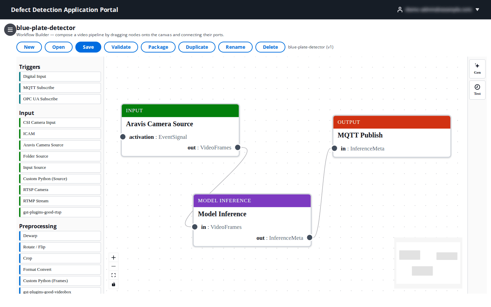
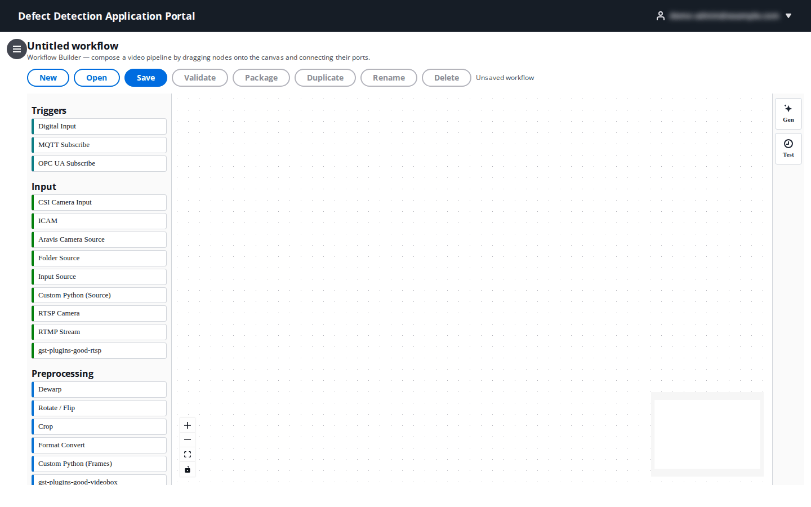
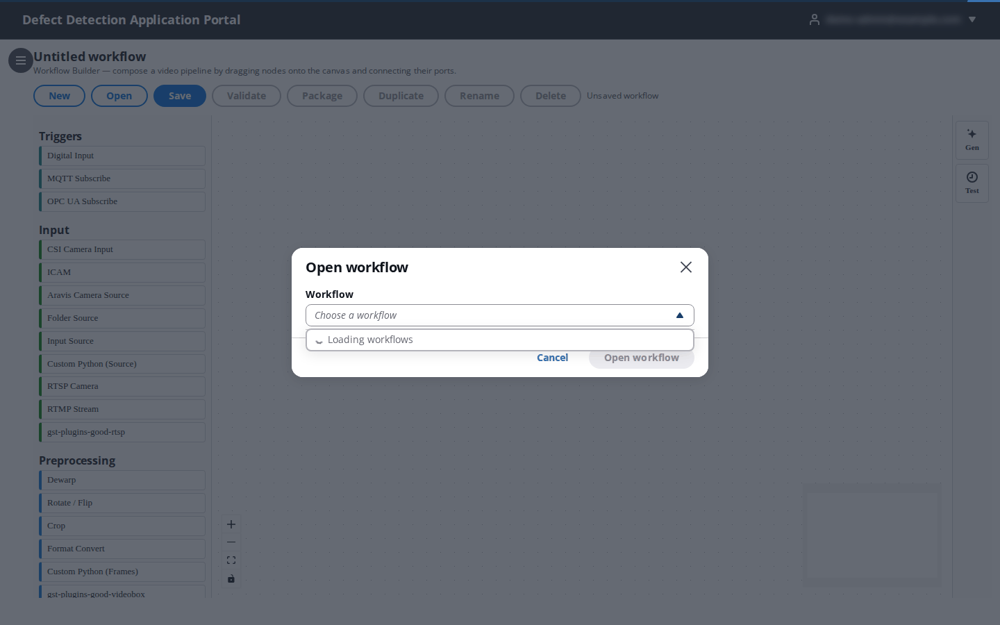
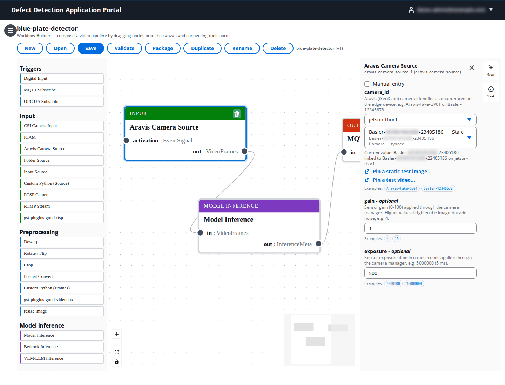
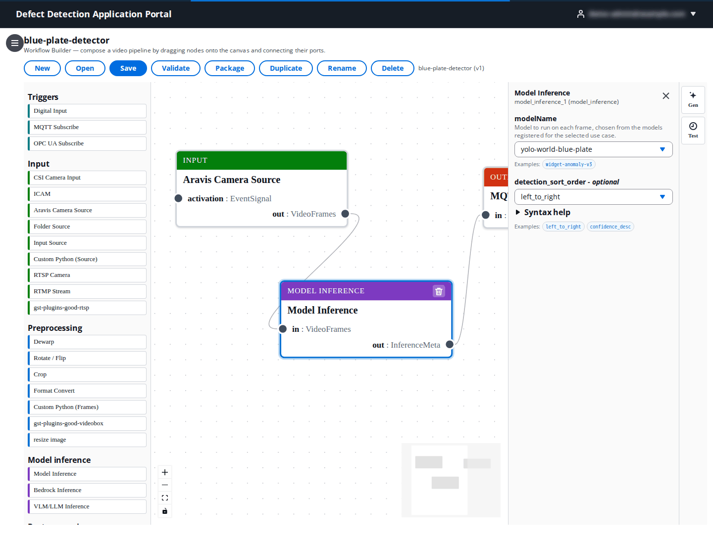
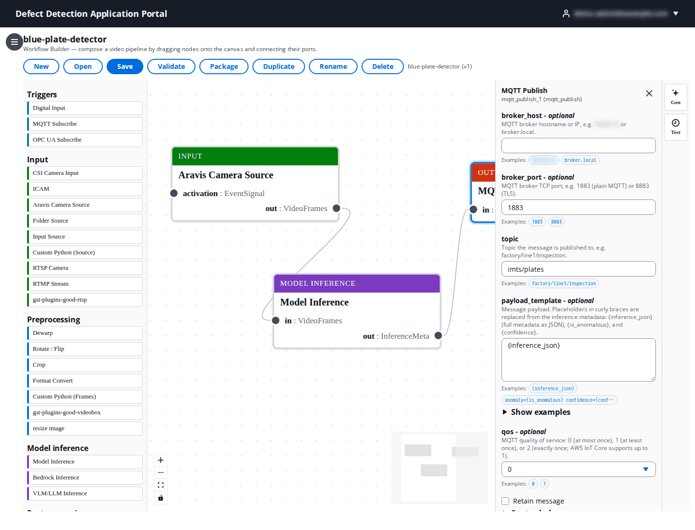
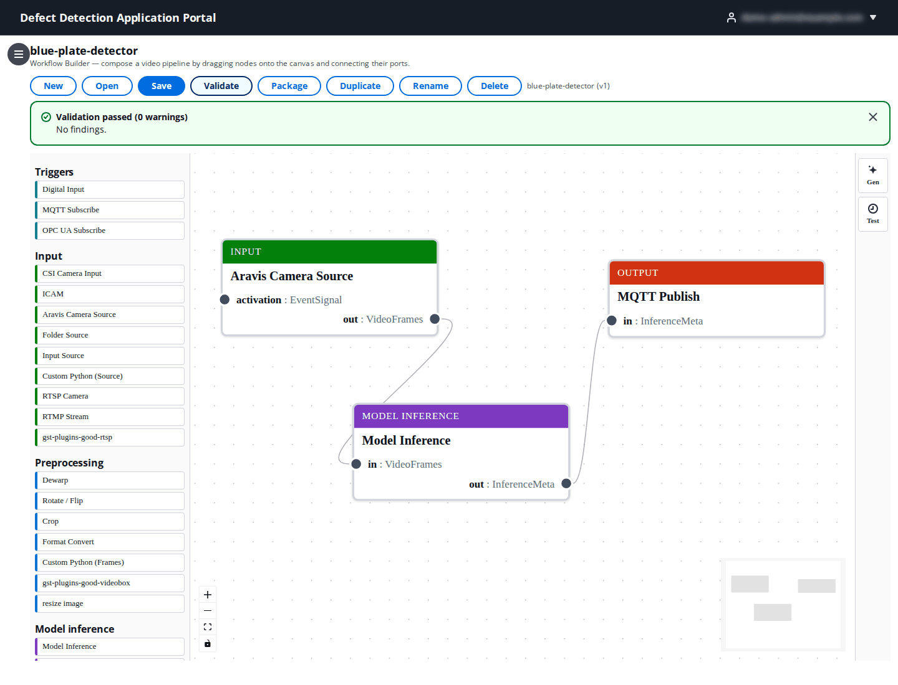
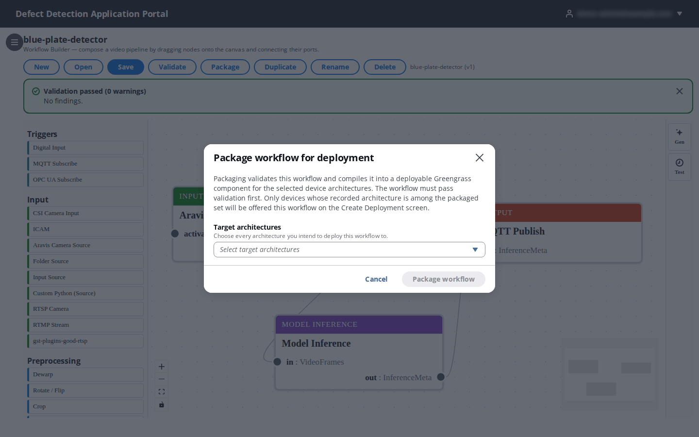
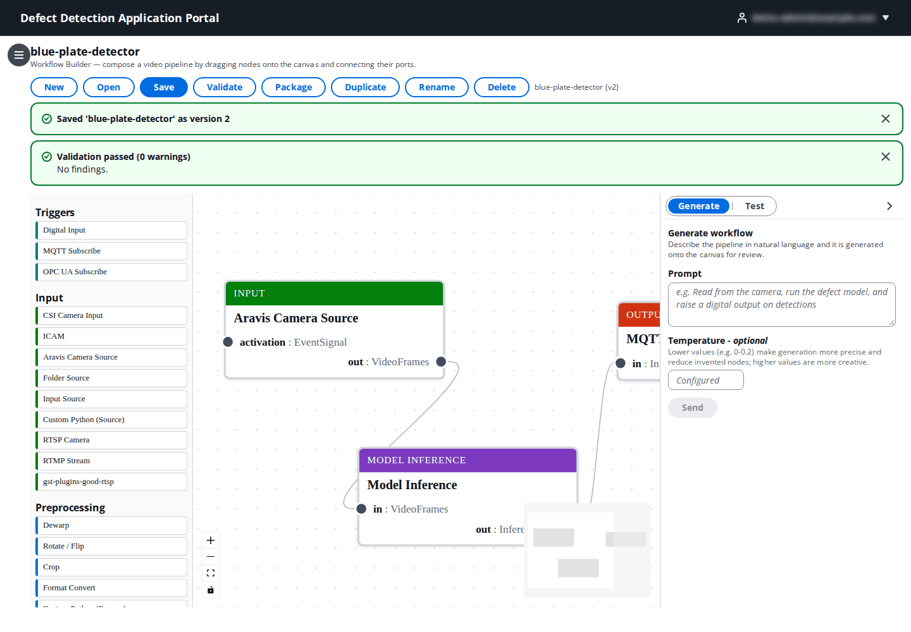
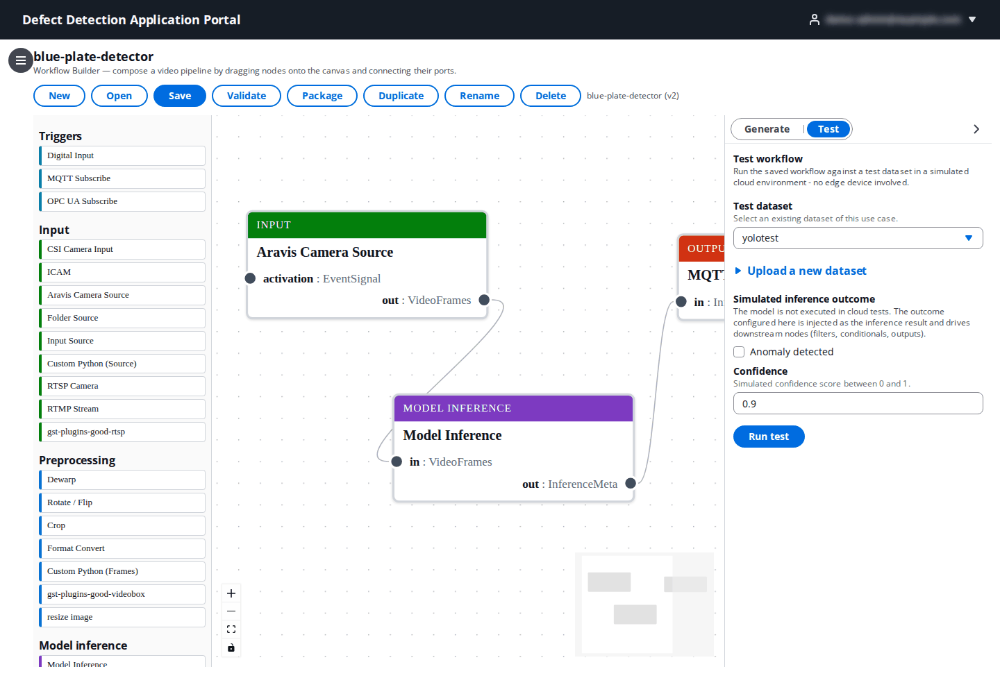

# 8. Workflows

**Who:** DataScientist, UseCaseAdmin and PortalAdmin create, edit, validate and package workflows; Operator and Viewer can open them read-only. **Video:** [Module 3: Workflows](https://youtu.be/vpL62wIT218).

A **workflow** is the inspection pipeline that runs on a device: where the frames come from, what triggers a run, how frames are pre-processed, which model (or LLM) judges them, and what happens with the verdict (a GPIO pulse, an MQTT message, a PLC write, a saved image). You compose it visually in the **Workflow Builder**, validate it, and **package** it into a Greengrass component that a deployment installs next to the LocalServer and the model components.

## 8.1 The Workflow Builder



The page has four areas:

1. **Toolbar** – **New**, **Open**, **Save**, **Validate**, **Package**, **Duplicate**, **Rename**, **Delete**, followed by the open workflow's name and version (`blue-plate-detector (v1)`). The side navigation starts collapsed here to give the canvas room; the menu button at the top left opens it.
2. **Node palette** (left) – every node type, grouped as **Triggers**, **Input**, **Preprocessing**, **Model inference**, **Post-processing** and **Output**. Custom nodes built in the [Node Designer](10-node-designer.md) appear in their palette category (for example `resize image` under Preprocessing). Drag a node onto the canvas to add it.
3. **Canvas** (centre) – the graph. Each node shows its category colour, its type, and its ports: inputs on the left, outputs on the right, each labelled with its data type (`EventSignal`, `VideoFrames`, `InferenceMeta`). Drag from an output port to an input port to connect them; only matching types connect, and a refused connection shows **Connection rejected** with the reason. Click a node to configure it, use the trash icon on a selected node to delete it, and the controls at the bottom left to zoom, fit the view and lock the canvas. The minimap at the bottom right helps on large graphs.
4. **Node configuration** (right) – the parameters of the selected node (8.3). The **Gen** and **Test** tabs on the far right open the generate and test panels (8.6, 8.7).



## 8.2 Create, open and save

| Action | What happens |
|--------|--------------|
| **New** | Clears the canvas into **Untitled workflow**. If the canvas has unsaved changes you are asked to confirm (**Discard and start new**). |
| **Open** | Lists the use case's workflows under **Choose a workflow**. The use case comes from the use case selector (set it on another page first if the list is empty). |
| **Save** | Saves the canvas as a new **version** of the workflow. The first save asks for a **Name** and optional **Description**; later saves increment the version (v1, v2, …). Validation, packaging and deployments are per version. |
| **Duplicate** | Saves a copy named `<name> (copy)`. |
| **Rename** | Changes the display name only; the workflow id, versions, packaged components and deployments are unchanged. |
| **Delete** | Deletes the workflow after confirmation. Deployed copies on devices are not removed until you revise their deployment. |



## 8.3 Configuring a node

Click a node. The configuration panel lists its parameters with a description, the current value and example values you can click to fill in. Required parameters are marked; optional ones say **optional**. Parameters that reference Portal objects offer pickers instead of free text:



- A **camera** parameter (here `camera_id` of **Aravis Camera Source**) is chosen in two steps: pick a **reference device** of the use case, then one of the cameras that device has enumerated (the status next to it says whether the camera is **synced** or **Stale**). The chosen camera is bound to that device: when the workflow is deployed to it, the node uses exactly that camera. **Manual entry** lets you type an identifier instead. **Pin a static test image…** and **Pin a test video…** pin a file to the device's static camera so the workflow can be exercised without a live camera (see [15. Devices](15-devices.md#156-cameras-tab)).
- `gain` and `exposure` are sensor settings applied through the camera manager; the examples (`4`, `10`; `5000000`, `16000000` nanoseconds) are typical starting points.



- The **Model Inference** node's `modelName` is picked from the models registered for the use case ([7. Models](07-models.md)); `detection_sort_order` fixes the order in which detections are listed in the run metadata (`left_to_right`, `right_to_left`, `top_to_bottom`, `bottom_to_top`, `confidence_desc`), which matters when a downstream node refers to "the first plate".



- Output nodes such as **MQTT Publish** take connection details (`broker_host`, `broker_port`, `topic`), a `payload_template` with placeholders (`{inference_json}`, `{is_anomalous}`, `{confidence}`) and a `phase` (publish on **completion** after inference, or on **capture** right after the frame is grabbed).

Parameter values are written to the workflow when you **Save**.

## 8.4 Node reference

Ports: a run starts from a trigger or a camera's `activation`, frames flow as `VideoFrames`, results as `InferenceMeta`.

**Triggers** (emit `EventSignal`; connect to an input node's `activation` port)

| Node | Starts a run when | Key parameters |
|------|-------------------|----------------|
| **Digital Input** | A GPIO pin changes. | `pin` (0–255), `trigger_edge` (`rising`, `falling`, `both`), `poll_interval_ms` (default 100). |
| **MQTT Subscribe** | A message arrives on a topic. | `topic` (filter such as `factory/line1/trigger` or `factory/+/trigger`), broker `broker_host`/`broker_port` (1883, 8883 TLS) and `qos`, or **greengrass** (use the device's Greengrass connection to AWS IoT Core, topic only) or **aws_iot** (mutual TLS with `iot_endpoint`, `iot_thing_name` and certificate paths). `payload_condition` (optional; LocalServer 1.0.2 or later): a rule in the condition language over `trigger.topic`, `trigger.payload` (the raw text) and `trigger.payload_json.<path>` (the parsed JSON body), for example `trigger.payload_json.body.station == 'B'`; a message that does not match, or whose fields the rule cannot resolve, is discarded before a run starts. A rule with a definition error discards every message; the trigger's health detail names the error. |
| **OPC UA Subscribe** | An OPC UA node value changes. | `endpoint` (`opc.tcp://host:4840`), `node_id` (`ns=2;s=Machine1.Reject`), `mode` (`subscribe` or `poll`), `sampling_interval_ms`/`poll_interval_ms`, optional user, password and security settings. |

Every trigger-driven input also has concurrency settings: `concurrency_policy` (`queue` further firings up to `queue_depth`, `drop` them, or `debounce` within `debounce_ms`) and `retry_limit` for reconnects.

**Input** (frame sources; output `VideoFrames`)

| Node | Source | Key parameters |
|------|--------|----------------|
| **CSI Camera Input** | An NVIDIA CSI sensor on a Jetson. | `gain` (0–100, default 4), `exposure` (ns, default 5000000). |
| **ICAM** | A V4L2 smart camera. | `device` (`/dev/video0`). |
| **Aravis Camera Source** | A GenICam/GigE Vision camera such as a Basler. | `camera_id` (picked per device), `gain`, `exposure`. |
| **RTSP Camera** / **RTMP Stream** | A network camera or stream. | `url` without credentials (`rtsp://192.168.1.64:554/…`), `processing_mode` (`continuous` at `frames_per_second`, 0.05–10, or `on_trigger`), `max_frame_age_ms`, `keep_recent_runs`. |
| **Folder Source** | Image files already on the device. | `location` (file or folder, e.g. `/aws_dda/images/latest.jpg`), `file_pattern` (`*.jpg`). |
| **Input Source** | A generic source whose kind (`source_kind`) is chosen at configuration time. | Concurrency settings as above. |
| **Custom Python (Source)** | Python that produces the frame for each run from the trigger context (`produce_frame(context)`), for example by downloading an image named in an MQTT payload. | `code`, `requirements`, `allowed_uri_prefixes`. |

**Preprocessing** (`VideoFrames` → `VideoFrames`)

| Node | Effect | Key parameters |
|------|--------|----------------|
| **Dewarp** | Lens-distortion correction. | `mode` (`fisheye`, `barrel`, `perspective`), `strength` (0–1). |
| **Rotate / Flip** | Rotates or mirrors every frame. | `method` (`clockwise`, …, `automatic`). |
| **Crop** | Removes pixels from the edges. | `top`, `bottom`, `left`, `right` in pixels. |
| **Format Convert** | Converts the pixel format. | `format` (`RGB`, what most models expect). |
| **Custom Python (Frames)** | Your own `process_frame(frame, metadata)` on each frame (NumPy array, `cv2`/`np` pre-imported). | `code`, `requirements` (pip packages, one per line). |

**Model inference** (`VideoFrames` → `InferenceMeta`)

| Node | What it does | Key parameters |
|------|--------------|----------------|
| **Model Inference** | Runs a registered DDA model (classifier, segmentation or detector) on each frame. | `modelName`, `detection_sort_order`. |
| **Bedrock Inference** | Sends the frame (and optionally a `reference` frame) to an Amazon Bedrock multimodal model with a prompt; the device needs cloud access. In `inspection` format it also parses a structured verdict, draws an **OK** (green) / **NOK** (red) overlay with the reported boxes and exposes both to later nodes. | `model` (any Bedrock model or inference-profile id, free text; default `us.amazon.nova-lite-v1:0`), `prompt`, `anomaly_mode` (on: the verdict `is_anomalous`/`confidence` drives downstream nodes; off: free-form text), `region`, `max_tokens` (256), `system_prompt`, `additional_model_request_fields` (optional JSON object sent as the Converse `additionalModelRequestFields`, for request fields only some models accept, e.g. `{"thinking": {"type": "disabled"}}` to turn off extended thinking on a Claude model that thinks by default; empty sends none; a model that does not accept a field refuses the call with a `ValidationException` (Amazon Nova refuses `thinking`), so set only fields the selected model supports; acts in every format), `crop_detection_index` + `crop_margin_percent` (send only the Nth detection's crop), `reference_payload_path` + `allowed_uri_prefixes` (the reference image, in one of two forms: a fixed URI such as `file:///aws_dda/reference/legend.jpg`, `s3://…` or `https://…`, loaded on every run, or a dotted path into the trigger payload such as `refs.0.image`, whose value is such a URI or base64 data; a `file://` URI must lie inside a `file://` entry of `allowed_uri_prefixes`, and an entry names a directory; a reference that cannot be loaded makes the run record an error, never a fallback to a single image; in `inspection` format nothing is added to the request but the image labels, so the prompt says what the reference shows, for example a legend of part shapes, unlike the legacy anomaly mode, whose default prompt compares the frame with a golden reference; a fixed reference is sent upright, opaque (transparency flattened onto white) and as a JPEG, capped to `max_image_dimension` in `inspection` format and never upscaled; on the legacy path a fixed reference gets the same handling without the cap, and a payload reference is sent as it is; see also [Several reference files](#several-reference-files) and [Uploading reference files](#uploading-reference-files)). Inspection mode (LocalServer 1.0.2 or later): `answer_format` `inspection` makes the model answer with exactly one JSON object `{"verdict": "pass"\|"fail", "confidence": 0–1, "reason", "objects": [{"name", "qc": "OK"\|"NOK", "reason", "bounding_box": {x_min, y_min, x_max, y_max}}]}`; any other text, a `pass` with a `NOK` object, or a `pass` with fewer objects than `expected_count_path` resolves to (a dotted path such as `trigger.payload_json.body.order.items`: a list's length or a positive number) counts as a failed attempt, never as a `pass`. `render_prompt` (fill `{field}` and `{json:path}` placeholders in `prompt`/`system_prompt` from the trigger payload and `{image.width}`/`{image.height}`; double literal braces; an unresolved placeholder fails the attempt), `attempts` (1–3) with `attempt_timeout_s` and `budget_s` (a further attempt starts only while a whole attempt still fits the budget; `ValidationException`, `AccessDeniedException` and `ResourceNotFoundException` stop at once), `box_scale` (`auto`: a 0–1000 grid for Nova models, pixels otherwise), `on_error` (`fail_run`, the default, fails the run; `record` writes the failure as `bedrock.<id>.error` and lets this branch's output nodes run), `error_verdict` (`error`, or `fail` to report a failed check with `confidence` 0), `enabled` (off: the node records an error without calling Bedrock), `max_image_dimension` (downscale the frame before sending), `annotate` (on: also outside `inspection` format, draw the answer's `objects` boxes and, with `anomaly_mode`, the OK/NOK banner on the whole frame sent and expose the file as `.annotated_image_path`; implied by `inspection`). Results are available to later nodes as `{bedrock.<id>.verdict}`, `.confidence`, `.reason`, `.objects`, `.error`, `.outcome` (`pass`, `fail` or `error`), `.latency_ms`, `.input_image_path` and `.annotated_image_path`. `enabled` and `annotate` act in every format; the other new parameters act only with `answer_format` `inspection`. |
| **VLM/LLM Inference** | Runs a vLLM model registered in the Portal on the device itself (JetPack 6/7). | `modelName`, `prompt_template` with `{field}` placeholders from upstream metadata, `anomaly_mode` (default off), `max_tokens`, `temperature` (0.7), `top_p`, `system_prompt`, `max_image_dimension`. |

**Post-processing** (`InferenceMeta` → `InferenceMeta`)

| Node | What it does | Key parameters |
|------|--------------|----------------|
| **Inference Filter** | Lets results through only while a `condition` holds (for example `confidence > 0.8`). | `condition`. |
| **Conditional** | Routes each result to its `true` or `false` output. | `condition`. |
| **Metadata** | Attaches values from the trigger payload (dotted paths such as `order.id`) and static JSON to the result. | `mappings`, `static_json`. |
| **Detection Counter** | Counts detections per class, optionally inside a `zone`. | `classes`, `min_confidence`, `zone`, `zone_rule` (`center` or `overlap`). |
| **Layout Check** | Checks that each listed class is detected exactly once in its own region of the frame, from the instance masks of an instance-segmentation model (RF-DETR-Seg). A class is `ok` when its mask overlaps its region with an IoU of at least `min_iou`, otherwise `misplaced`; `missing` when it is not detected and `duplicate` when it is detected more than once. The verdict is written to the run metadata under `layout.<nodeId>`: `pass`, `pieces.<class>.status` and `pieces.<class>.iou`, `flagged` (the detection ids of misplaced and duplicate pieces), `unexpected_classes` (detected labels that are not listed) and `ignored` (detections outside the car outline, see `min_outline_overlap`). A later node reads it by dotted path, for example `layout.<nodeId>.pass == false`. Gating (`conditional`, `inference_filter`) reaches executor bindings (`mqtt_publish`, `digital_output`, `s3_upload`, …), not `capture`, which is written during the pipeline; keep exactly one `capture` on the frame path. The Portal packages and deploys the node only for a LocalServer at or above the Layout Check floor ([13.4](13-deployments.md#134-revise-a-deployment)). Worked example: [8.9](#89-worked-example-car-assembly-check). | `expected_regions` (a JSON object mapping each class label to a closed polygon of 3 to 64 `[x, y]` points in normalized frame coordinates, 1 to 10 classes), `min_iou` (0.01–1, default 0.7; calibrate it), `min_confidence` (0.5), `min_outline_overlap` (0–0.5, default 0.1: a detection with less of its mask inside the union of the regions is ignored; 0 counts every detection). |
| **Object Association** | Checks that every subject detection (for example `person`) has the required classes overlapping it (`hardhat, vest`). | `subject_class`, `required_classes`, `min_overlap`, `min_confidence`, `zone`. |
| **Event Gate** | Turns per-run verdicts into events with hysteresis: active after `activate_after` consecutive true runs, cleared after `clear_after` false ones. | `condition`, `activate_after`, `clear_after`, `emit` (`on_activate`, `on_change`, `while_active`), `repeat_interval_ms`. |
| **Custom Python** | Your own code on the metadata (or frames/events; the port types are configurable). | `code`, `requirements`, `input_port_type`, `output_port_type`, `wall_clock_limit_s` (seconds one handler call may take, 1–120, default 10; raise it when the code calls a cloud service). |

**Output** (`InferenceMeta` in)

| Node | Target | Key parameters |
|------|--------|----------------|
| **Digital Output** | A GPIO pin (reject gate, lamp). | `pin`, `signal_type` (`pulse`, `high`, `low`), `pulse_width_ms`, `condition`. |
| **MQTT Publish** | An MQTT broker, the device's Greengrass connection, or AWS IoT Core. | `topic`, `payload_template`, `payload_format` (LocalServer 1.0.2 or later; `text`, the default: placeholders substitute as text, literal JSON braces must be doubled and an unknown placeholder stays literal; `json`: the template must itself be valid JSON and is rendered structurally — a string that is exactly one placeholder takes the value's native type, a string with embedded placeholders renders as text, and an object key or list element whose placeholders do not all resolve is **omitted**, so a message never carries a literal `{…}`; braces are not escaped in this mode), the `json`-only functions `{ulid}` (a fresh message id), `{now_iso}` (UTC timestamp) and `{latency_ms}` (milliseconds since the trigger message arrived), `qos`, `retain`, `phase`, broker or IoT settings as for MQTT Subscribe. |
| **OPC UA Write** | A PLC or SCADA node. | `endpoint`, `node_id`, `value_template` (`{is_anomalous}`), optional security. |
| **Modbus TCP Write** | A PLC coil or holding register. | `host`, `port` (502), `unit_id`, `register_type` (`coil` or `holding_register`), `address`, `value_template`, `pulse_ms`, `phase`. |
| **Capture to File System** | JPEG files on the device (takes `VideoFrames`). | `output_path` (`/aws_dda/captures`), `interval` (every Nth frame), `quality` (1–100). |
| **S3 Upload** | An S3 object (takes `VideoFrames`; its `out` port, `InferenceMeta`, lets an output node such as MQTT Publish run after the upload and use its result): the run's frame on this branch — or, with `source`, the image a Bedrock Inference node judged or annotated — is uploaded as a JPEG after the run, to `s3://bucket/key` with the device's AWS credentials (its Greengrass token exchange role) or by HTTP PUT to a presigned `https://` URL. | `destination` (a template; placeholders such as `{trigger.payload_json.body.image_key}` come from the trigger payload), `content_type` (`image/jpeg`), `strip_suffix`/`append_suffix` (rewrite the `s3://` key, e.g. `.jpg` → `.annotated.jpg`), optional `condition`, `timeout_s`, `retries`, `region`. LocalServer 1.0.2 or later: `source` (`frame`, the default; `input_image` or `annotated_image` take the image of the Bedrock Inference node that feeds this node — when that image does not exist for the run the upload is skipped with `not uploaded: no … image for this run`, not failed), `presign_get_expiry_s` (0 = off; otherwise a presigned GET URL for the uploaded object is generated on the device with that lifetime, at most 12 h; the URL stops working earlier when the device's token exchange credentials that signed it expire, so treat it as a short-lived convenience link and keep the key as the durable reference), `expected_bucket_owner` (12-digit account id checked by S3 on PutObject). After an `s3://` upload later nodes can use `{s3_upload.<id>.bucket}`, `.key`, `.uri`, `.https_url`, `.region`, `.bytes`, `.content_type` and, when enabled, `.presigned_url` and `.presigned_url_expires_at`; an `https://` destination exposes `.destination_kind`, `.masked_url` and `.bytes` only. Limitation: an output that feeds another output (S3 Upload → MQTT Publish) runs before it only when both belong to the same Bedrock Inference branch or neither does; on a workflow with a Bedrock node, an upload fed directly by the camera runs after that node's branch has already published. |

The condition language used by Inference Filter, Conditional, Digital Output, S3 Upload and Event Gate compares fields of the result (`is_anomalous`, `confidence`, and dotted paths into analytics nodes such as `counter.people.total > 5` or `association.ppe.violations > 0`).

### Several reference files

A Bedrock Inference node in `inspection` format can send several reference files: put one reference per line in `reference_payload_path`. Each line is a fixed URI, a payload path or an uploaded file (below), and the files are sent in list order after the input image.

- **Images and documents.** A fixed URI whose path ends in `.pdf`, `.txt`, `.md`, `.csv`, `.html`, `.doc`, `.docx`, `.xls` or `.xlsx` is sent as a document, unchanged; every other line, every payload path included, is an image, prepared as above.
- **Labels.** A single image keeps the label "Reference image". Any other list is labelled "Reference 1", "Reference 2" and so on, in order, and the prompt refers to the files by those labels. For the two lines `file:///aws_dda/reference/legend.jpg` and `file:///aws_dda/reference/assembly.pdf`, the request carries the prompt, then "Input image:" and the camera frame, "Reference 1:" and the legend, "Reference 2:" and the PDF; a prompt might say "Reference 1 is a legend of the part shapes. Reference 2 is the assembly instruction sheet. Judge only the Input image." Changing the number of lines changes the labels, so change the prompt with them; the **Candidates** tab of a tuning session lists the labels under the previewed message.
- **Limits.** At most 5 documents of 4.5 MB each and 19 images besides the input image. Lists and documents need `answer_format` `inspection`; the validator reports a list or a document on a legacy node, and lists over the limits, as errors.
- **Every file must load.** If any file cannot be loaded, the run records an error and no request is sent; while a file stays missing, every run of the node records it.
- **Models.** Models differ in document support. The validator warns when a node sends documents to a model the Portal does not know to accept them, and Bedrock refuses the request at run time if the model cannot take them.
- **Time.** Each file adds request time, which counts against `attempt_timeout_s`.
- **Artifacts.** The run's artifacts keep the images that were sent, not the documents.

### Uploading reference files

The workflow editor shows `reference_payload_path` of a Bedrock Inference node as a list of reference files, each row with the label the request will carry. **Upload file** adds a file; **Move up**, **Move down**, **Replace** and **Remove** change the list, and **Add URI or payload path** adds a typed line. An uploaded file appears in the parameter as a line `upload://<sha256>.<ext>`.

- **Accepted files.** Images: JPEG and PNG, up to 8 MiB and 8000 × 8000 px. Documents: PDF, TXT, MD, CSV, HTML, DOC, DOCX, XLS and XLSX, up to 4.5 MB. The content is checked, not only the extension.
- **Storage.** Files are stored with the workflow. A saved version keeps exactly the files it was saved with, duplicating a workflow copies the files its latest version uses, and deleting the workflow deletes them. The Portal artifacts bucket is versioned, so a deleted workflow's files, like its definitions, stay in S3 as noncurrent versions; only an administrator with S3 access to that bucket can purge a file uploaded by mistake.
- **On the device.** Uploaded files are shipped inside the workflow component, checked against their checksums on the device, and need no `allowed_uri_prefixes` entry. They need a LocalServer built from the release in the [Portal CHANGELOG](../../edge-cv-portal/CHANGELOG.md) entry "Workflow tuning for inspection-format Bedrock nodes, reference files and live tuning configuration", or from a later one; an older LocalServer sends the request without them in `inspection` format, or records an error on the legacy path.
- **Save first.** A workflow must be saved once before files can be uploaded to it.

### Configuration overrides (LocalServer 1.0.2 or later)

Two keys in the LocalServer component's configuration (its recipe's `DefaultConfiguration`; set them with a configuration-only Greengrass deployment revision using `merge`, undo them with `reset`) change a deployed workflow without re-packaging it and without restarting LocalServer. The component re-reads them every 5 s, so a change applies to the next run within about 5 s after the deployment reaches the device; in-flight runs are not affected.

- `WorkflowDisabled`: a map of Portal workflow id (the `<id>` in the component name `dda.workflow.<id>`; it is the same for every version of the workflow) or `"*"` (every workflow) to `"true"`/`"false"`. A disabled workflow's triggers discard every firing before anything runs, publishes or uploads; manual runs started through the API are not blocked. The check fails closed: only `"false"`, `false` or an absent entry enable; `"true"`, `true` and every other spelling (`"yes"`, `1`, an empty value) disable and log a warning. Always use the map form — a bare `"true"` is treated as an empty map, with a warning.
- `WorkflowNodeOverrides`: `{"<workflow id>" | "*": {"<node id>": {"<parameter>": value}}}`; the `"*"` entries apply first and the exact id's entries override them per parameter. Only these parameters can be overridden: Bedrock Inference `model`, `region`, `enabled`, `error_verdict`, `attempts`, `attempt_timeout_s`, `budget_s`, `max_image_dimension`, `max_tokens`, `box_scale`, `additional_model_request_fields`; S3 Upload `presign_get_expiry_s`, `timeout_s`, `retries`; MQTT Publish `qos`, `retain`. Values may be JSON scalars or their string spellings (`"false"`, `"2"`) and are checked against the node's parameter rules. The value of `additional_model_request_fields` is a JSON object, for example `{"thinking": {"type": "disabled"}}`, or its JSON text, checked like the node's own value: anything but a JSON object is ignored with a warning, and an empty object or empty text sends no fields. A LocalServer built before this parameter became overridable ignores it with a warning. Greengrass merges nested objects key by key, so to replace an earlier object, reset `/WorkflowNodeOverrides` in the same deployment revision or give the value as JSON text. Anything else — another parameter, an unknown node, a trigger or a GStreamer-level node, an invalid value — is ignored with a warning and the deployed value stands, so an override can never change a prompt, a topic, a destination or a payload template. Each run logs the node parameters it overrode.

Example — turn the Bedrock check of every workflow off and lengthen one workflow's presigned URL lifetime:

```json
{"WorkflowNodeOverrides": {"*": {"check": {"enabled": "false"}},
                           "<workflow id>": {"upload_annotated": {"presign_get_expiry_s": 300}}}}
```

## 8.5 Validate and package

Click **Validate** after saving. The result banner reports **Validation passed** with the number of warnings, or lists the findings (unconnected required ports, missing parameters, incompatible nodes) with the node each one belongs to; fix them and validate again.



Click **Package** to compile the validated workflow into a deployable Greengrass component:



| Field | What to enter |
|-------|---------------|
| **Target architectures** | Every architecture you intend to deploy this workflow to: **ARM64 · JetPack 5**, **ARM64 · JetPack 6**, **ARM64 · JetPack 7**, **ARM64 (CPU)**, **x86_64 (CPU)**, **x86_64 (NVIDIA GPU)**. Only devices whose recorded architecture is among the packaged set will be offered this workflow on the Create Deployment page. |

Packaging validates the workflow again and compiles it for each selected architecture; the component is then listed under **Recommended** / **Portal Components** on [Create Deployment](13-deployments.md). Package again after each saved version you want to deploy.

## 8.6 Generate a workflow from a description

The **Gen** tab opens **Generate workflow**: describe the pipeline in plain language and it is generated onto the canvas for you to review.



| Field | What to enter |
|-------|---------------|
| **Prompt** | For example "Read from the camera, run the defect model, and raise a digital output on detections". |
| **Temperature** (optional) | Lower values (0–0.2) make generation more precise and reduce invented nodes; higher values are more creative. A model that does not accept a temperature, such as Claude Opus 5.5, generates without it. |

Click **Generate** (or **Send** in the chat history to refine). The panel reports **Generation validation findings**; structural errors that could be fixed automatically are listed under **Automatic correction applied**, and a result the Portal cannot make valid is shown as **Generation rejected**. Check the generated nodes' parameters before saving.

## 8.7 Test a workflow in the cloud

The **Test** tab opens **Test workflow**, which runs the saved workflow against a test dataset in a simulated cloud environment, with no device involved.



| Field | What to enter |
|-------|---------------|
| **Test dataset** | An existing dataset of this use case, or **Upload a new dataset**: a **Dataset name** and **Sample images** (JPEG or PNG, at most 500 MB in total). |
| **Simulated inference outcome** | The model is not executed in cloud tests; instead the outcome you set (**Anomaly detected** on or off, and a **Confidence** between 0 and 1, default 0.9) is injected as the inference result so you can check that the filters, conditionals and outputs behave as intended. |

Click **Run test** (the workflow must be saved first). **Test run progress** streams the log and **Per-node test results** lists each node's outcome; nodes that cannot run in the cloud (cameras, GPIO) are listed under **Some nodes were simulated**.

## 8.8 Worked example: blue plate detector

The `blue-plate-detector` workflow in the screenshots is the minimal production shape: **Aravis Camera Source** (the station's Basler camera, bound to a Jetson device) → **Model Inference** (`yolo-world-blue-plate`, detections sorted left to right) → **MQTT Publish** (topic `factory/line1/inspection`, payload `{inference_json}`, on completion). A richer variant adds an **MQTT Subscribe** trigger on the camera's `activation` port so the PLC starts each run, a **Conditional** on `is_anomalous` and a **Digital Output** pulse on the `true` branch, and a **Capture to File System** node on the frames for an audit trail.
]633;E;cat /tmp/feat005_89_head.md;ee18f483-f536-45f8-8063-65475d68da3d]633;C
## 8.9 Worked example: car assembly check

A station checks whether the three pieces of a toy car (`front_fender`, `rear_fender`, `roof`) sit in their pockets. An RF-DETR-Seg model finds each piece's mask and a **Layout Check** node gives a verdict per piece and for the whole frame. The scripts are in `datasets/` (run with `python3` on a workstation; only the reference capture needs OpenCV) and `samples/car-assembly-check/` (the workflows, the grayscale handler and the device batch driver; its `README.md` has the node tables).

### Triage and labeling

1. **Triage the images first.** The Triage_File (`placement-triage.csv`, eleven columns) records for every image whether it is correct, which pieces are misplaced or missing, the per-class piece counts, any occluder (a hand) and any stray piece outside the car. It is the ground truth: it decides which images may feed the reference (the Known_Good_Set) and which validate the verdict (the Fail_Set must fail). `python3 datasets/assembly_triage.py --triage placement-triage.csv` prints the Known_Good, Fail_Set and Occluded_Correct sets and exits 1 if it lists any problem.
2. **Label by shape**, as an instance-segmentation job ([4.2](04-labeling.md#42-create-a-labeling-job-dda-data-labeling-system)). The instructions define each class by the piece's shape, not by the pocket it sits in, so a wrong-placement photo is labeled as a further example of the same classes. Policy: one polygon per visible piece, a misplaced piece labeled where it lies, a missing piece not labeled; a piece partly hidden by a hand is outlined on its visible part with the hand excluded; a stray piece outside the car outline is left unlabeled; an empty tray is submitted with zero instances.
3. **Check the labels against the triage.** `python3 datasets/check_assembly_manifests.py --labeled output.manifest --triage placement-triage.csv` compares each image's per-class instance counts with the triage's counts and checks the manifest's shape.

### Manifests and training

1. **Derive the grayscale manifest** from the labeled one: the geometry is identical, only the image prefix changes. `python3 datasets/rewrite_manifest_source_refs.py --manifest output.manifest --out gray.manifest --from-prefix s3://<bucket>/assembly-photos/ --to-prefix s3://<bucket>/<grayscale prefix>/ --verify-dir <local grayscale folder>` rewrites only the `source-ref` prefix and writes nothing if any line is refused.
2. `python3 datasets/check_assembly_manifests.py --labeled output.manifest --derived gray.manifest --triage placement-triage.csv --images-mono <local grayscale folder>` checks that the two manifests are identical apart from the prefix and replays the training converter's split.
3. **Train both variants** with the same settings, one per manifest: **RF-DETR (Roboflow) → Instance Segmentation (masks + boxes)** ([6](06-training.md)). Package each model for instance output ([7](07-models.md)).

### Reference and calibration

1. **Capture the reference** (the `expected_regions` value) from one image that the triage confirms correct: `python3 datasets/layout_reference.py --manifest output.manifest --source-ref s3://<bucket>/assembly-photos/<image>.jpg --triage placement-triage.csv --out expected_regions.json`. It turns each label's mask into a polygon of at most 64 vertices (raster IoU at least 0.98 with the mask) and refuses an image whose triage row is not Known_Good.
2. **Calibrate `min_iou` from the labels:** `python3 datasets/layout_reference.py --calibrate output.manifest --regions expected_regions.json --triage placement-triage.csv [--test-files test.txt]`. It prints each label's IoU distribution over the Known_Good_Set and `recommended_min_iou`, and checks that every Fail_Set image fails with the pieces its triage row names flagged or missing (exit 1 when one does not).

### The workflow

Create the workflow from `samples/car-assembly-check/workflow.json` (the `definition` body of `POST /workflows`) and fill its two placeholders with `expected_regions.json` and the calibrated `min_iou`. Shape: source → **Grayscale_Node** (`custom_python_preprocess`) → **Model Inference** → one unconditional **Capture to File System**, and **Layout Check** (`layout`) → **Conditional** `layout.layout.pass == true` → **MQTT Publish** to `dda/car-assembly/pass` or `dda/car-assembly/fail`.

The grayscale model was trained on grayscale images, so the Grayscale_Node sits immediately upstream of Model Inference (downstream of any `rotate`), with `requirements` empty and `wall_clock_limit_s` 10. Its `code`, pasted unchanged from `samples/car-assembly-check/grayscale_handler.py`:

```python
# ITU-R 601-2 luma (0.299 R + 0.587 G + 0.114 B), the weights Pillow's mode "L"
# used for the training set. Paste into a custom_python_preprocess node's "code";
# requirements empty, wall_clock_limit_s default. The bridge pins frames to RGB,
# so only the RGB branch runs on a device; the others keep the handler honest.
def process_frame(frame, metadata):
    fmt = (metadata.get("frame") or {}).get("format")
    if fmt == "GRAY8":
        return None  # already single-channel: pass through
    if fmt == "RGB":
        gray = cv2.cvtColor(frame, cv2.COLOR_RGB2GRAY)
        return cv2.cvtColor(gray, cv2.COLOR_GRAY2RGB)
    if fmt == "BGR":
        gray = cv2.cvtColor(frame, cv2.COLOR_BGR2GRAY)
        return cv2.cvtColor(gray, cv2.COLOR_GRAY2BGR)
    raise ValueError("grayscale handler: unsupported frame format %r" % (fmt,))
```

- **Orientation.** The model must see frames in the orientation of the training photos. A production camera mounted like the camera that took them (whose frames are upside down relative to the training images) needs a `rotate` node with `method = rotate-180` between the camera and the Grayscale_Node. The pinned Static_Image_Camera image is already in that orientation, so the sample workflows carry no `rotate`. A wrong orientation shows as every piece `misplaced` with similar low scores.
- **The outline rule.** A detected piece with less than `min_outline_overlap` (default 0.10) of its mask inside the car outline, the union of the expected regions, is ignored: it is listed under `layout.<nodeId>.ignored`, never counted and never flagged. A spare piece in frame therefore never fails a correct build, while a piece set down outside the outline instead of in its pocket leaves its class `missing` and the image fails. `0` turns the rule off.
- **A hand over the car is not detected** by this check: a hand is not a class, and a piece it hides counts as `missing` or is judged on its visible part. Use a station interlock to stop a run while a hand is in the frame.

### Deploy, batch run and the verdict

1. Package and deploy the workflow ([8.5](#85-validate-and-package), [13](13-deployments.md)); the device's LocalServer must be at or above the Layout Check floor.
2. **Batch run on the device host** with the `folder_source` form `workflow-batch.json`: `python3 batch_run.py --registration-id <id> --workflow-id <id> --folder /aws_dda/batch-input --images ./originals --triage placement-triage.csv --expect-local-server-version <version> --out gray.json` runs one image at a time and writes a Result_Export.
3. **Recalibrate from predicted masks:** `python3 datasets/layout_reference.py --calibrate --results gray.json --local-server-version <version> --regions expected_regions.json --triage placement-triage.csv`, set the new `min_iou` in a new workflow version and re-run the batch. Repeat the batch run after any change to the model, the reference, the resolution or the LocalServer build.
4. **Read the verdict on the device:** the HMI's run results (a Layout Check section with a row per piece and the misplaced pieces highlighted on the frame), `GET /workflows/executions/{id}/metadata` (`layout.layout`), the node status, and the MQTT topics. The Portal Results tab shows a verdict for workflow-engine runs only once `results-tab-workflow-runs` is deployed on the Portal and on the device and its `WorkflowRunUpload` switch is on; until then read the verdict on the device.

### Grayscale or colour: the A/B comparison

Fix the winning criterion before reading any number. Run the colour variant from `workflow-color.json` with the same `folder_source` substitution; its batch run doubles as its predicted-mask calibration. Then `python3 datasets/compare_variants.py --gray-meta <gray training_metadata.json> --color-meta <colour training_metadata.json> --gray-results gray.json --color-results color.json --labeled output.manifest --regions expected_regions.json --triage placement-triage.csv --gray-min-iou <v> --color-min-iou <v> --local-server-version <version> --out ab.md` writes the comparison table. Bind the winner in the production workflow version.

Switching **from grayscale to colour**: remove the Grayscale_Node and connect the source (or its `rotate`) to Model Inference; set `modelName` to the colour model; set the colour variant's own calibrated `min_iou`; the camera must deliver colour frames; keep `expected_regions` (the reference does not depend on the variant).

Switching **from colour to grayscale**: insert the Grayscale_Node immediately upstream of Model Inference and downstream of any `rotate`, with the handler pasted unchanged; set `modelName` to the grayscale model; set the grayscale variant's own calibrated `min_iou`; keep `expected_regions`.

Either way, save a new version, deploy it and make a batch run before recording results.

### When the setup changes

- **Camera or fixture moved:** the reference assumes the framing of the images it was captured from. Recapture it, recalibrate and deploy a new version. Every piece `misplaced` with similar scores is the sign; check the orientation first.
- **A new camera:** before any verdict from it is recorded, make one known-good run (exactly one instance of each class, each of the right class). If it passes with every IoU in the known-good predicted-mask range, keep the reference; otherwise recapture it from that run (`layout_reference.py --overlay <saved overlay body> --metadata <saved metadata body> --out expected_regions.json`). Then repeat the predicted-mask calibration on that camera's captures, recorded with a capture-only workflow written at that time (camera → `rotate` as the mounting requires → one `capture`).
- **Too slow:** if the Layout Check takes longer than its budget on the device (200 ms for three pieces at 4608 × 3288), the fallback is a numpy path on the device behind the same scoring function, pinned output-identical to the pure path. If the Grayscale_Node is too slow (median above 500 ms), feed it the whole field of view downscaled at the same aspect ratio, never a `crop`; the reference stands, but repeat the batch run and the predicted-mask calibration at the new resolution.
