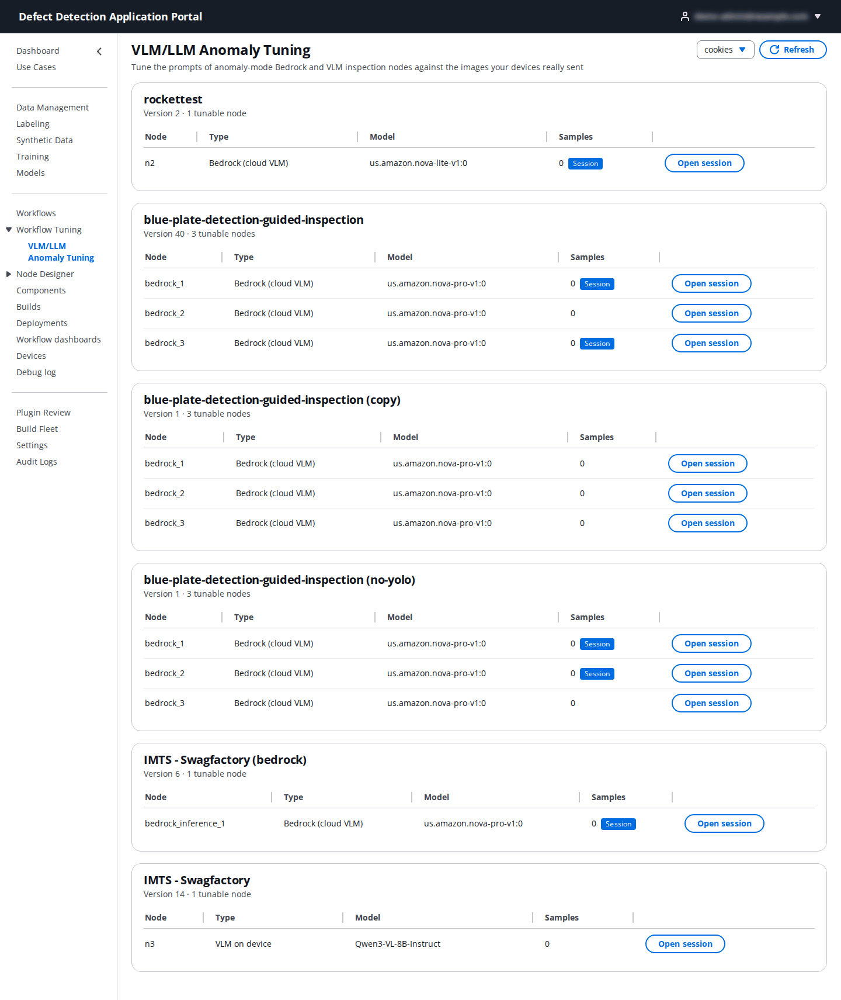
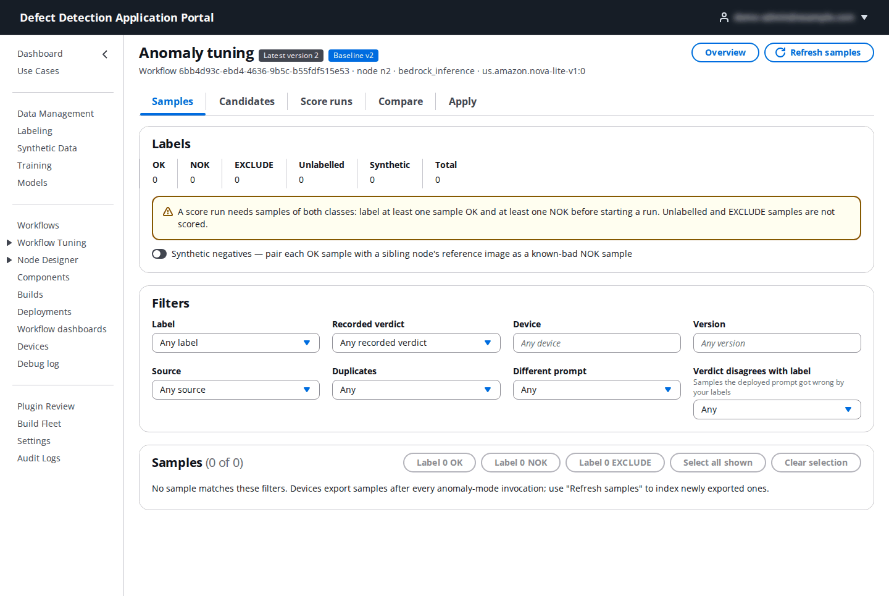
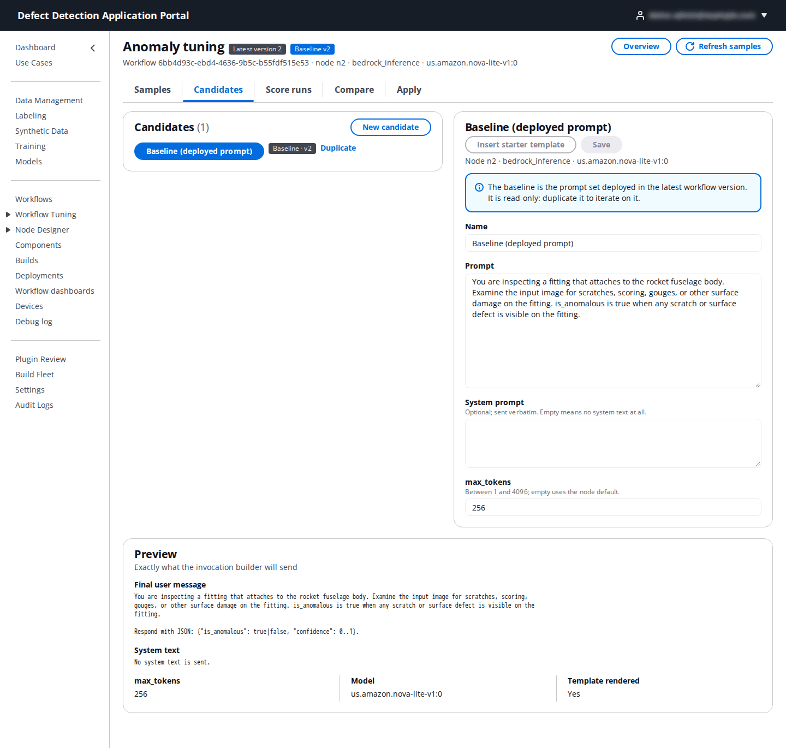
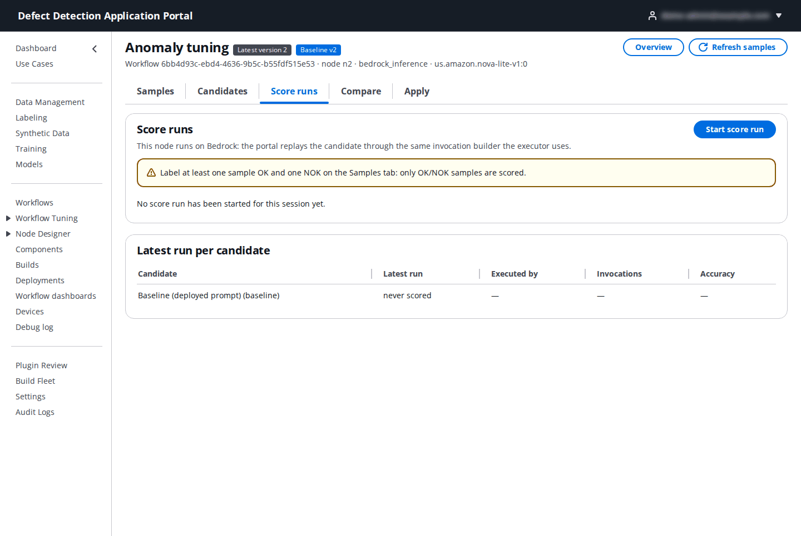
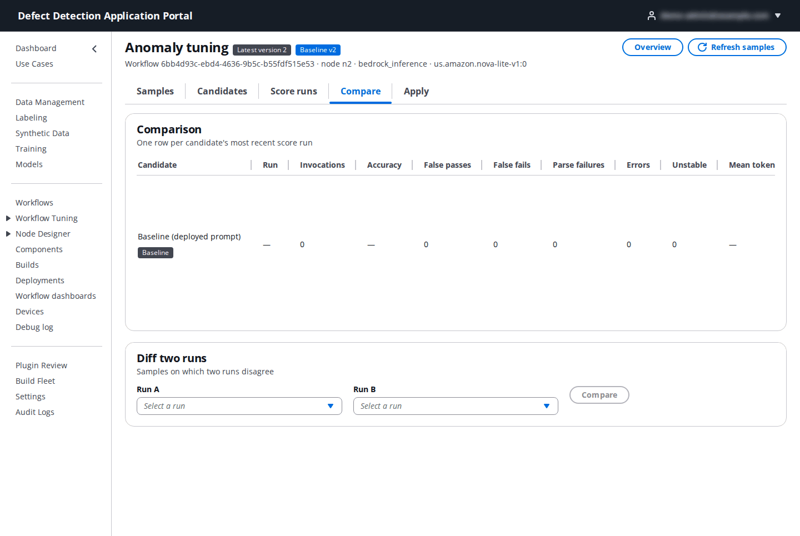
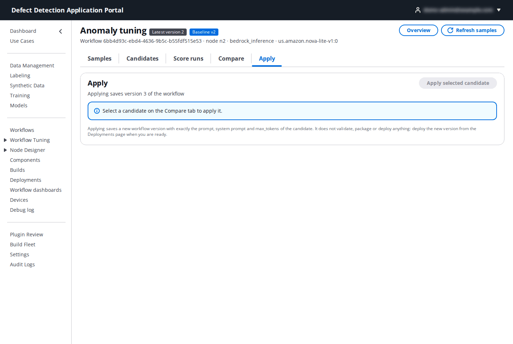

# 9. Workflow Tuning

**Who:** DataScientist, UseCaseAdmin and PortalAdmin. **Video:** [Module 10: Prompt Tuning](https://youtu.be/ZnxGwMxCB1M).

Workflows that judge images with a prompt, through a **Bedrock Inference** or **VLM/LLM Inference** node in anomaly mode, are only as good as their prompt. **Workflow Tuning** lets you improve such a prompt against the images your devices really sent: label the real samples OK or NOK, write candidate prompts, score each candidate against the labelled samples, compare the outcomes, and apply the winner as a new workflow version.

**Prerequisite.** Tuning works on exported samples. Turn on **Tuning sample export** for the use case (**Use Cases → Edit → Workflow Tuning**, see [2.3](02-use-cases.md#23-edit-a-use-case)) and redeploy the devices; from then on every anomaly-mode inspection uploads its image and verdict to `workflow-tuning/samples/` in the inference-results bucket. The overview page tells you when export is disabled.

## 9.1 Overview

**Workflow Tuning** in the navigation opens a landing page with the available tools; **Open VLM/LLM Anomaly Tuning** (or the **VLM/LLM Anomaly Tuning** sub-entry) opens the overview.

Each deployed workflow of the use case that has a tunable node is a panel listing, per node, its **Type** (**Bedrock (cloud VLM)** or **VLM on device**), the **Model**, the number of exported **Samples**, and a **Session** badge when a tuning session already exists. Click **Open session** to open or create the session for that node. **Show all workflows** includes workflows without tunable nodes.

## 9.2 A tuning session

A session belongs to one node of one workflow. Its header shows the workflow, the node and the model, with **Latest version** and **Baseline** badges, and **Refresh samples** pulls newly exported samples. The work runs through five tabs.

### Samples

Every exported sample is a card with the image, the device, the workflow version it ran on, the **recorded verdict** and the prompt it was judged with. Filter by **Label** (OK, NOK, EXCLUDE, Unlabelled), **Recorded verdict** (anomalous or normal), **Device**, **Version**, **Source** (**Live** from devices or **Backfill**), **Duplicates**, **Different prompt** and **Verdict disagrees with label** (the samples the deployed prompt got wrong by your labels).

Label the samples: select the cards (or **Select all shown**) and click **Label … OK**, **Label … NOK** or **Label … EXCLUDE**. OK means the image is acceptable, NOK means it is defective, EXCLUDE removes it from scoring (blurred frames, wrong part). Scoring needs at least one OK and one NOK sample.

### Candidates

The **Baseline (deployed prompt)** candidate is the prompt set deployed in the latest workflow version; it is read-only, so **Duplicate** it to iterate, or click **New candidate**.

| Field | What to enter |
|-------|---------------|
| **Name** | A short name for the variant (`stricter-scratch-wording`). |
| **Prompt** | The user prompt sent with the image. Describe what the inspector sees and exactly when `is_anomalous` is true. **Insert starter template** gives you a sound starting point. |
| **System prompt** | Optional; sent verbatim. Empty means no system text at all. |
| **max_tokens** | 1–4096; empty uses the node's default (256). |

**Save** stores the candidate. The **Preview** panel shows the **Final user message** exactly as the invocation builder will send it, including the JSON-format instruction appended in anomaly mode, plus the **System text**, **max_tokens** and **Model**.

### Score runs

| Field | What to enter |
|-------|---------------|
| **Candidate** | The candidate to score. |
| **Repeats per sample** | 1 to 3. Repeats reveal verdict instability; **1 (no repeats)** is the quickest. |
| **Device** | For a **VLM on device** node only: the device that exported samples for it and reports the workflow; the run executes on that device. Bedrock nodes are scored in the cloud. |

**Start … invocations** runs the candidate's prompt against every labelled sample (the button shows how many invocations that is). **Latest run per candidate** lists the runs with **Executed by**, **Invocations** and **Accuracy**.

### Compare

The table has one row per candidate's most recent score run: **Invocations**, **Accuracy**, **False passes** (NOK samples judged normal — the costly kind), **False fails**, **Parse failures** (the model did not return the expected JSON), **Errors**, **Unstable** (repeats disagreed) and **Mean tokens**. **Outcomes** shows every sample's outcome for a run, filtered by **Category** and sorted by confidence; **Diff two runs** (**Run A**, **Run B**) lists the samples on which two runs disagree, with each run's **Raw answer**. Select the candidate you want to ship.

### Apply

**Apply selected candidate** writes the candidate's prompt, system prompt and max_tokens into the node and saves it as a new workflow version (**Save version N**). The tab warns when the candidate's latest run still has false passes. The new version then needs to be packaged and deployed like any other ([8.5](08-workflows.md#85-validate-and-package), [13. Deployments](13-deployments.md)); it becomes the new baseline for the session.
