# 10. Node Designer

**Who:** DataScientist, UseCaseAdmin and PortalAdmin. Promoting a plugin to production also needs a PortalAdmin's security review ([17. Plugin Review](17-plugin-review.md)). **Video:** [Module 4: Custom Node Designer](https://youtu.be/si5gOzzPhn0).

The built-in workflow nodes cover cameras, models and PLC outputs. When a station needs something else, say a custom resize, a region blur, or a GStreamer element from an upstream module, the **Node Designer** lets you create that node as a **plugin**: a GStreamer plugin project whose source lives in the Portal, is built for each device architecture on AWS CodeBuild, is simulated against sample frames, is reviewed, and is finally **registered** as a custom node type that appears in the Workflow Builder palette and deploys with the workflows that use it.

## 10.1 The plugin library

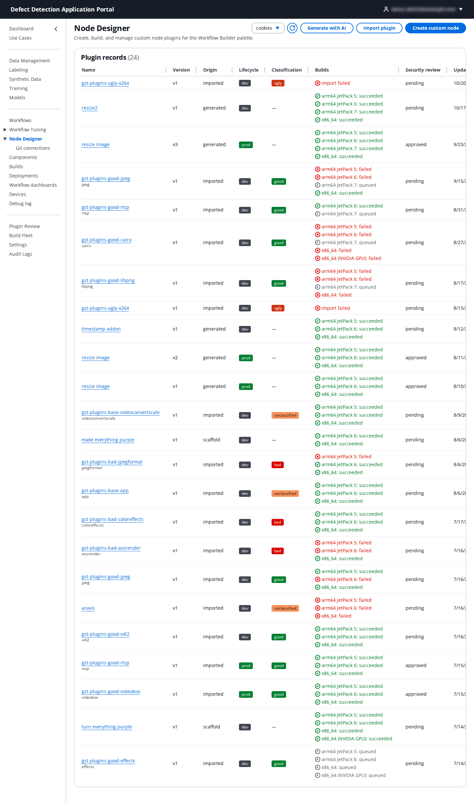

**Plugin records** lists every plugin version of the use case:

| Column | Meaning |
|--------|---------|
| **Name** / **Version** | The plugin and its version (`v1`, `v2`, …). Click the name to open it. |
| **Origin** | **scaffold** (created in the wizard), **generated** (created with AI) or **imported** (from a GStreamer module or a Git repository). |
| **Lifecycle** | **dev** → **test** → **prod**. Only prod plugins may be registered as node types for production workflows; a prod version's source is locked. |
| **Classification** | For imported upstream plugins: the GStreamer module's licence classification (**good**, **bad**, **ugly**, **unclassified**). |
| **Builds** | One line per target architecture (arm64 JetPack 5/6/7, x86_64, x86_64 NVIDIA GPU) with **queued**, **succeeded**, **failed** or **import failed**. |
| **Security review** | **pending** or **approved**; set in Plugin Review. |

The buttons at the top offer the three ways to make a plugin: **Generate with AI**, **Import plugin** and **Create custom node**. The use case selector scopes the list.

## 10.2 Create a custom node (scaffold wizard)

**Create custom node** opens a four-step wizard that generates a complete plugin project (**Plugin_Scaffold**) around a Python hook you fill in.

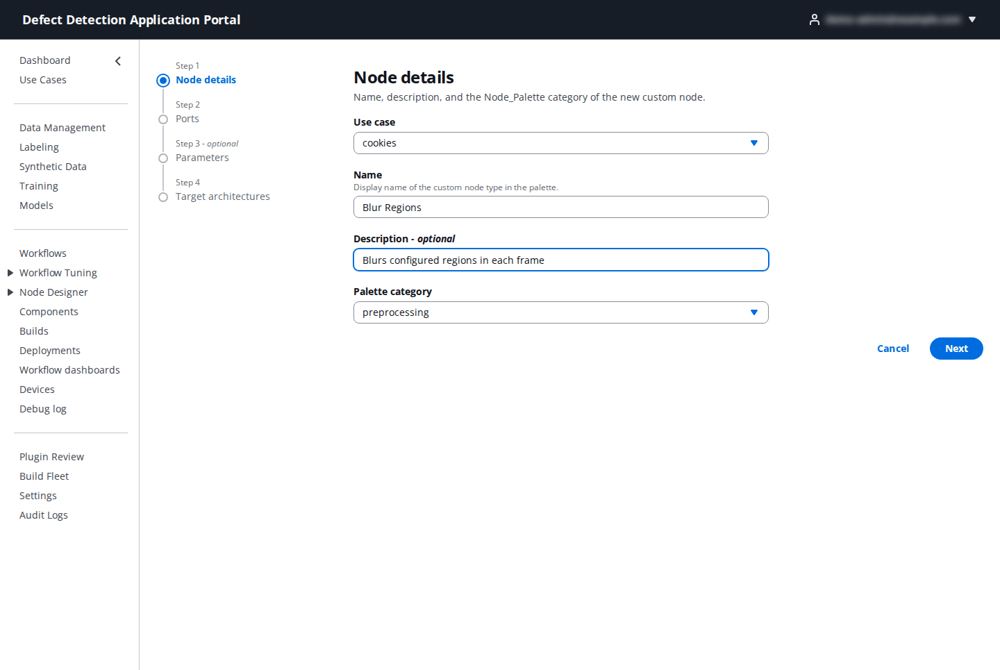

**Step 1: Node details**

| Field | What to enter |
|-------|---------------|
| **Use case** | Preselected. |
| **Name** | The display name of the custom node type in the palette, for example `Blur Regions`. |
| **Description** | Optional; shown as field help in the node configuration panel. |
| **Palette category** | Where the node appears in the builder palette (`preprocessing` by default). |

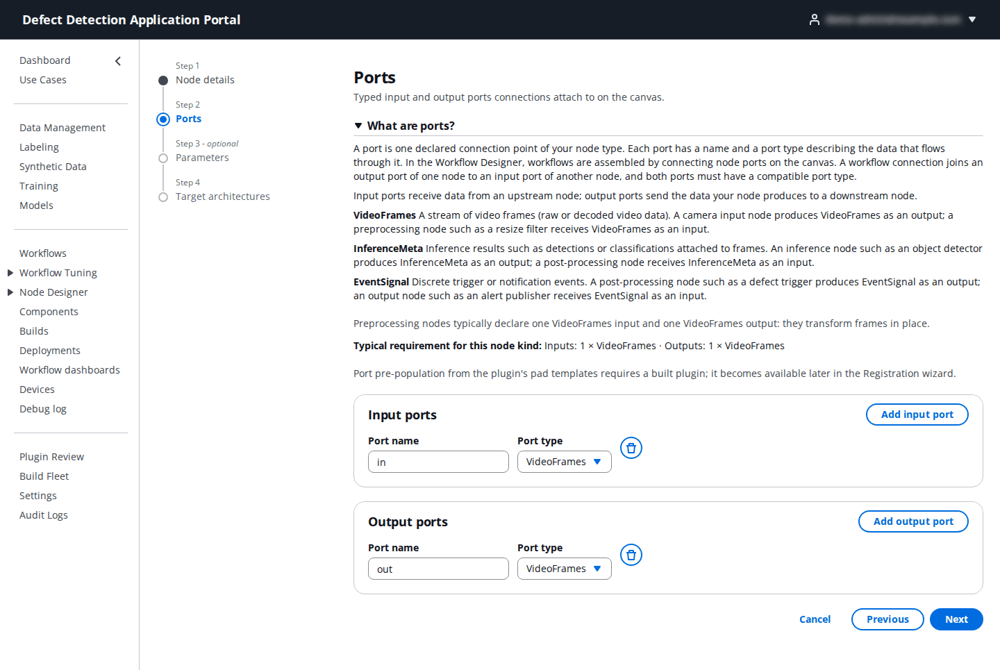

**Step 2: Ports** – the node's **Input ports** and **Output ports**, each with a **Port name** and **Port type** (`VideoFrames`, `InferenceMeta`, `EventSignal`). A frame filter has one `VideoFrames` input and one `VideoFrames` output, which is the default.

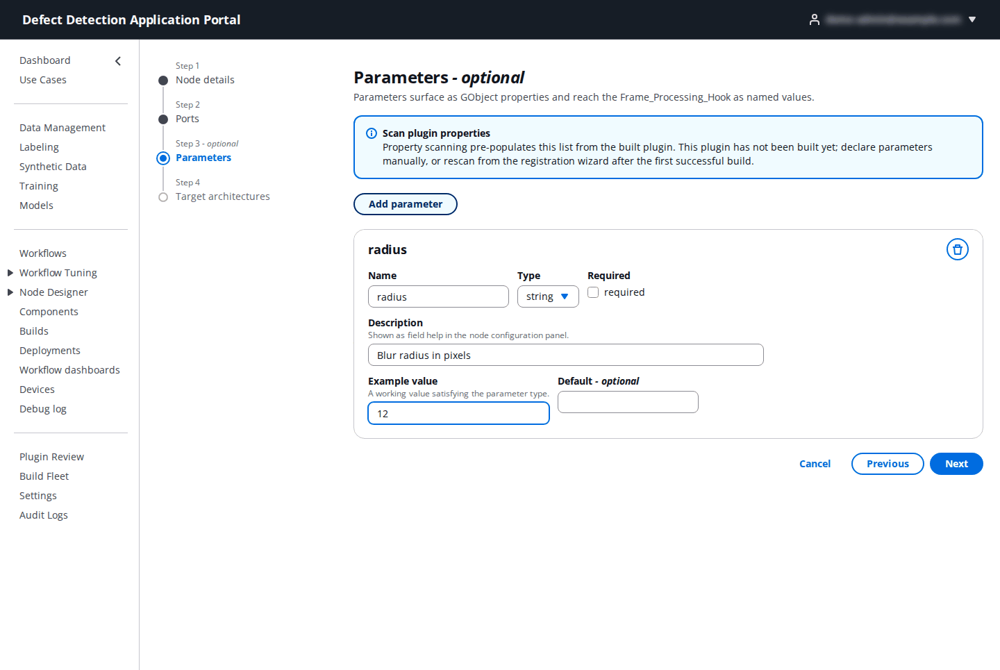

**Step 3: Parameters** (optional) – click **Add parameter** for each setting the node exposes in the builder:

| Field | What to enter |
|-------|---------------|
| **Name** | The parameter name your code reads (`radius`). |
| **Type** | `string`, `int`, `float`, `bool` or `enum`. |
| **Required** | Whether the builder insists on a value. |
| **Description** | Shown as field help. |
| **Example value** | A working value satisfying the type (`12`); it is shown as a clickable example in the builder. |
| **Default** | Optional default. |
| **Allowed values** | For `enum`: comma-separated values (`low, medium, high`). |

Parameters reach your code as named values, so the generated hook reads them instead of hard-coding.

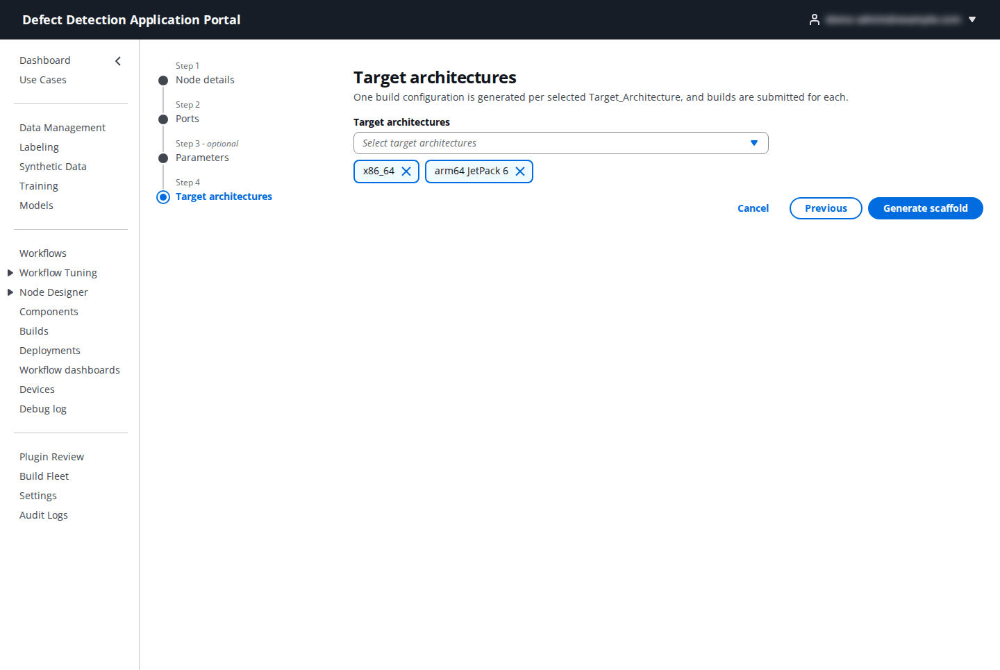

**Step 4: Target architectures** – the device architectures to build for. Choose every architecture your devices use; more can be added later. Click **Generate scaffold**.

The scaffold opens in the plugin page (10.5): a `README.md` explaining where to write your code, `builds/<arch>/meson.build` per architecture, `plugin/gst<name>.c` (the GStreamer element) and `plugin/frame_processing_hook.py` where you implement `process_frame(frame, params)`. The frame arrives as raw bytes with `frame_width`, `frame_height` and `frame_format` in `params`, next to your declared parameters. Edit the hook, **Save**, then **Build**.

## 10.3 Generate a custom node with AI

**Generate with AI** collects the same **Node declaration** (name, description, category, target architectures, ports and parameters) and adds a **Prompt**:

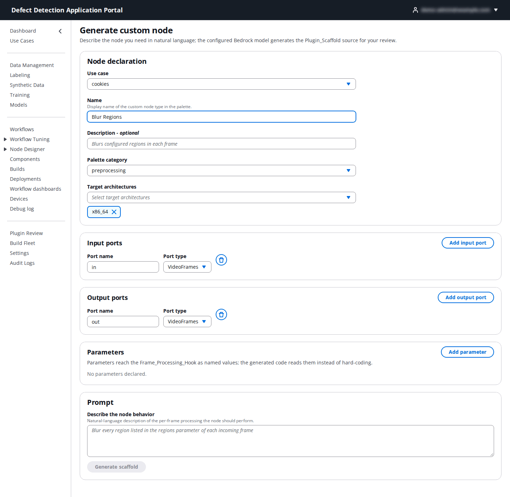

Describe the node behaviour in natural language ("Blur every region listed in the regions parameter of each incoming frame"). The configured Bedrock model generates the plugin source for your review; refine it with follow-up prompts in the **Conversation**, edit the source if needed, then **Accept and create plugin record**. The result is a **generated** plugin record that you build, simulate and register like a scaffolded one. On the plugin page the **Code assistant** box does the same for an existing file: describe the change ("Blur all faces in the frame using a Gaussian blur"), click **Generate**, review the proposed code, and accept it into the editor.

## 10.4 Import a plugin

**Import plugin** brings in an existing GStreamer plugin instead of writing one.

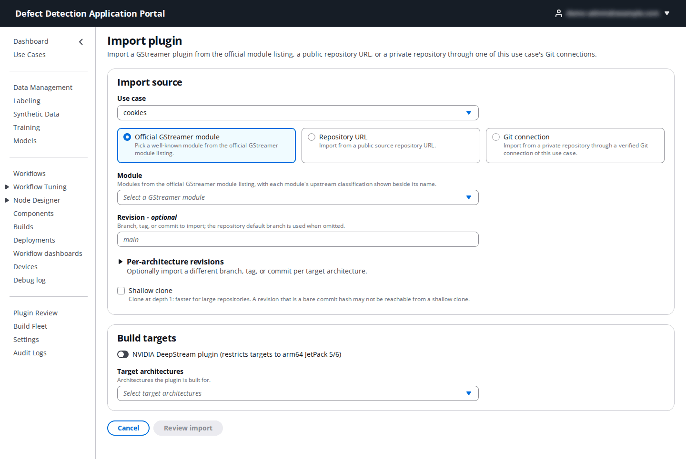

| Import source | Fields |
|---------------|--------|
| **Official GStreamer module** | **Module** – a module from the official GStreamer listing (`gst-plugins-good`, `-bad`, `-ugly`, `-base`), shown with its upstream classification. **Plugins to import** – the module's plugins; none are selected by default, so tick the ones you need (for example `rtsp` or `videobox`) or **Select all**. **Revision** – optional tag or commit. |
| **Repository URL** | A public `http`, `https` or `git` URL containing the plugin source, plus an optional **Revision**. |
| **Git connection** | One of the use case's verified Git connections (10.7) for a private repository, with the **Branch** (pre-filled with the connection's default), an optional repository **subdirectory** holding the plugin, and **Shallow clone** (depth 1, faster, but a bare commit hash may be unreachable). The token stays in the Portal. |

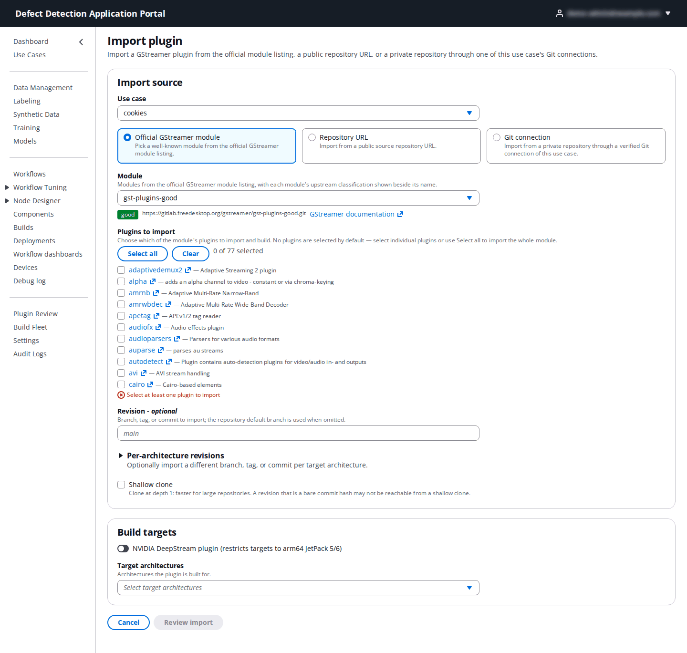

Under **Build targets** choose the **Target architectures**. Click **Review import**: the **Upstream classification** step shows the module's licence class so you can decide whether it is acceptable, and warns when **Some target platforms may not be compatible**. Confirm, and the import clones, classifies and builds the plugin (**Import in progress**; refresh the library to see the builds).

## 10.5 The plugin page

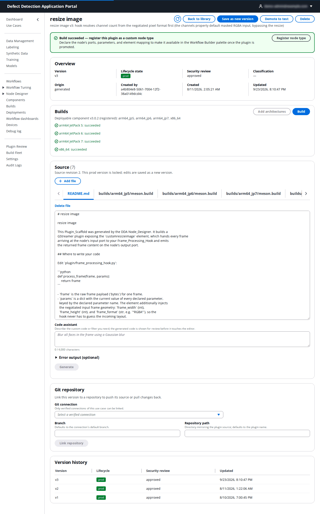

- The header shows the plugin's description and the actions **Save as new version**, **Promote to test** / **Promote to prod** / **Demote to test**, **Delete**, and, when a build has succeeded, **Register node type** (or **Update node type** once registered).
- **Overview**: **Version**, **Lifecycle state**, **Security review**, **Classification**, **Origin**, who created it and when.
- **Builds**: the **Deployable component** version and one line per architecture with its state. **Build** submits a build for every requested architecture; **Add architectures** requests more (only architectures not yet requested are offered, and builds start for the added ones only). After a successful x86_64 build you can **Scan plugin pads** and **Scan plugin properties** to pre-populate ports and parameters from the element's pad templates and GObject properties; scanning never changes what you already declared.
- **Source**: the file tree as tabs, an editor, **Add file** and **Delete file**. The **Code assistant** (10.3) proposes code from a description and an optional error output. A **prod** version is locked: edits are saved as a new version (**Save as new version**), so production deployments are never changed under you.
- **Git repository**: link the version to a verified Git connection (**Git connection**, **Branch**, **Repository path**, **Link repository**), then **Push** the source to the repository or **Pull** changes back; **Sync operations** lists the history. **Unlink repository** removes the link.
- **Version history**: every version with its lifecycle and security review.

**Lifecycle.** A new plugin starts in **dev**. **Promote to test** when the builds succeed and the simulation looks right; a PortalAdmin then approves it in Plugin Review, after which **Promote to prod** is allowed. To change a prod plugin, demote it to test or save a new version.

## 10.6 Simulate and register

**Simulate** (from the plugin page) runs the built plugin against sample frames and shows its output and emitted metadata.

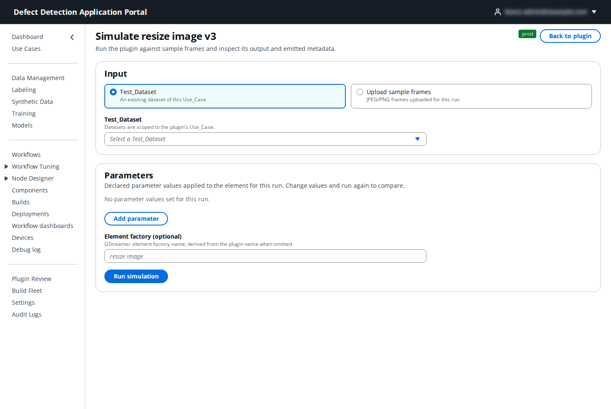

| Field | What to enter |
|-------|---------------|
| **Input** | A **Test_Dataset** of the use case, or uploaded JPEG/PNG images for a quick check. |
| **Parameters** | Declared parameter values applied to the element for this run (**Add parameter**). Change values and **Run simulation** again to compare. |
| **Element factory** (optional) | The GStreamer element factory name; derived from the plugin name when omitted. |

**Register node type** opens the registration wizard, which needs at least one successful build:

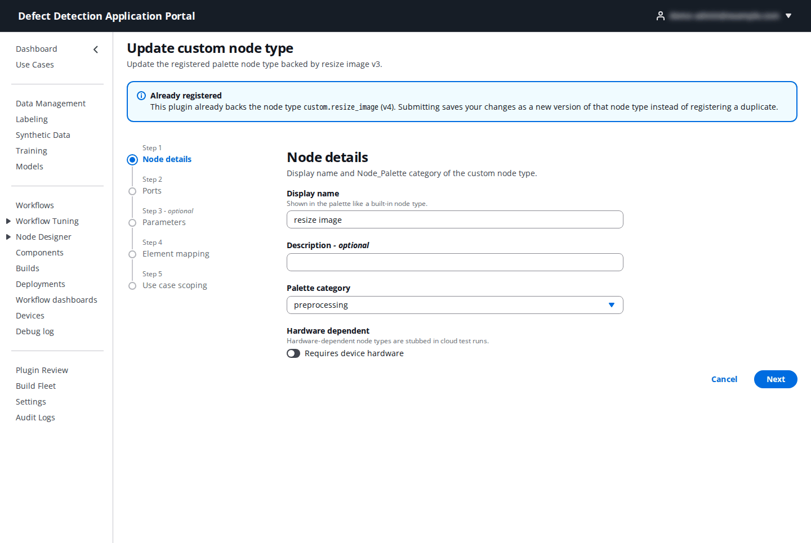

| Step | Fields |
|------|--------|
| **Node details** | **Display name** (shown in the palette like a built-in node type), **Description**, **Palette category**, **Hardware dependent** (hardware-dependent node types are stubbed in cloud test runs). |
| **Ports** | The input and output ports, pre-populated from the scaffold or the pad scan. |
| **Parameters** | Name, type, required, description, example value and allowed values, as in the wizard. |
| **Element mapping** | The **Element factory** name and the **Element properties**: which GStreamer property each parameter sets (`{parameter}` placeholders). |
| **Use case scoping** | The **Use cases** whose builders show the node. |

After registration the node appears in the Workflow Builder palette and the plugin's **Deployable component** is added to deployments of workflows that use it. A plugin that already backs a node type shows **Already registered** and offers **Update node type** instead.

## 10.7 Git connections

**Node Designer → Git connections** lists the repositories plugin source can be pushed to and pulled from. Tokens are stored in AWS Secrets Manager and never displayed.

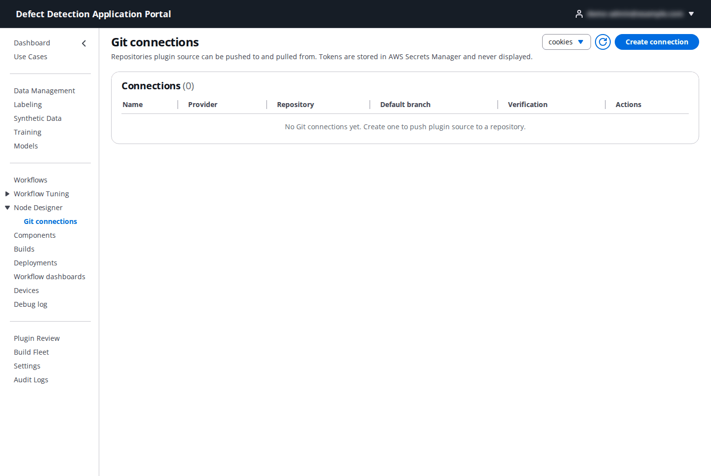

Click **Create connection**:

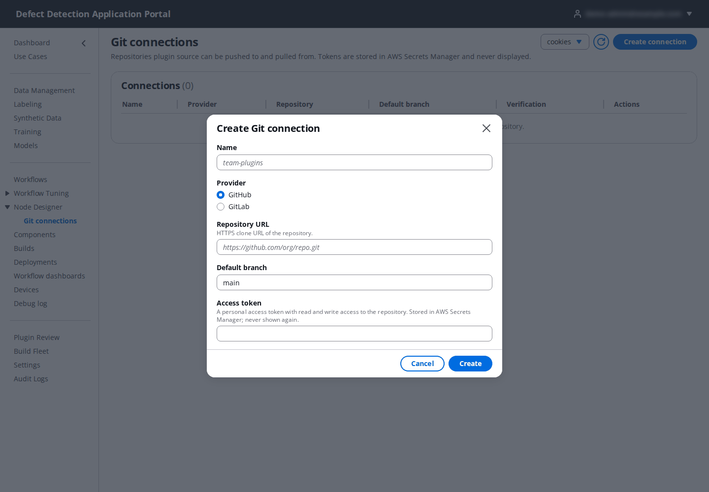

| Field | What to enter |
|-------|---------------|
| **Name** | A label such as `team-plugins`. |
| **Provider** | **GitHub** or **GitLab**. |
| **Repository URL** | The HTTPS clone URL (`https://github.com/org/repo.git`). |
| **Default branch** | The branch pushes and pulls default to (`main`). |
| **Access token** | A token with read and write access to the repository. |

The connection is **verified** against the repository before it can be used; the **Verification** column shows the result. Use **Edit** to rotate the token (**New access token**) and **Delete** to remove the connection.
