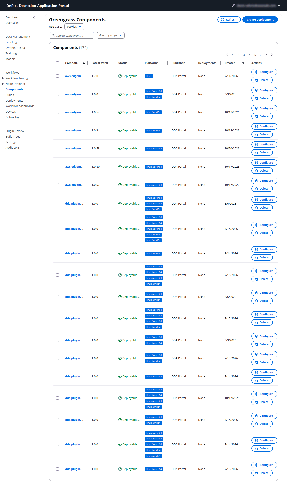

# 11. Components

**Who:** every role can view; Operator, UseCaseAdmin and PortalAdmin can deploy, configure and delete. **Related:** [13. Deployments](13-deployments.md).

Everything that runs on a device is an **AWS IoT Greengrass component**: the DDA LocalServer itself, each published model, each packaged workflow, each custom node plugin, plus the AWS-provided components (log manager, secure tunneling, …). **Components** is the inventory of those components in the use case's account. You rarely need to create anything here; it is where you check what exists, which version is the latest, and where you start a deployment or a configuration change for a specific component.

## 11.1 The component list

The page lists the components visible to the use case (132 in the screenshot; the list can take a while to load on a large account). Each row shows:

| Column | Meaning |
|--------|---------|
| **Component Name** | The Greengrass component name. DDA components follow fixed patterns: `aws.edgeml.dda.LocalServer.<variant>` (the edge application per architecture: `arm64JP5`, `arm64JP6`, `arm64JP7`, `amd64`, `amd64Nvidia`, generic `aarch64`), `aws.edgeml.dda.InferenceUploader`, `model-<name>-<target>` for published models, `dda.workflow.<id>` for packaged workflows and `dda.plugin.<id>` for custom node plugins. |
| **Latest Version** | The newest published version. |
| **Status** | **Deployable** when the latest version is deployable. |
| **Platforms** | The OS/architecture pairs the component supports (`linux/aarch64`, `linux/amd64`). A component with no matching platform is hidden from a device's deployment. |
| **Publisher** | `DDA Portal` for Portal-published components, `AWS` for public ones. |
| **Deployments** | Deployments currently including the component. |
| **Created** | When the latest version was created. |

**Search components** filters by name. **Filter by scope** switches between **All DDA Components**, **Private Components** (your account's) and **Public Components** (AWS-provided). The list is paginated.

## 11.2 Actions

- **Create Deployment** (top right) opens the Create Deployment page with the selected components pre-added; tick one or more rows first ([13. Deployments](13-deployments.md)).
- **Configure** (per row) opens the component's configuration page (11.3).
- **Delete** (per row) deletes the component version from Greengrass after confirmation. The Portal refuses to delete a component that is currently deployed to devices and tells you which deployment holds it.
- Clicking a component name opens its detail page with the **Versions**, **Recipe** (the Greengrass recipe YAML) and **Tags** tabs and the list of **Deployed Devices**.

## 11.3 Configure a component

**Configure** creates a configuration-only deployment: it changes the component's configuration on selected devices without changing which components they run. The page reads the component's configuration schema and shows one input per parameter.

| Field | What to enter |
|-------|---------------|
| **Deployment Name** | A name for this configuration deployment, for example `InferenceUploader-Config-v2`. |
| **Target Devices** | The devices to deploy the configuration to. |
| **Component Parameters** | The component's own settings. For `aws.edgeml.dda.InferenceUploader` these are the upload settings described in the [Inference Uploader guide](../../edge-cv-portal/INFERENCE_UPLOADER_CONFIG.md); the **Environment Variables Preview** shows exactly what the component will receive. |

Review the **Deployment Summary** and submit. **Configuration Deployment Created** confirms it; follow the rollout under **Deployments**.

## 11.4 Where components come from

| Component | Created by |
|-----------|------------|
| LocalServer variants | A Build Fleet build ([12. Builds](12-builds.md)). In a multi-account setup, copied into the use case account when the use case is created or re-provisioned ([2.1](02-use-cases.md#21-the-use-cases-page)). |
| Model components | **Publish Component** on a model's page ([7.4](07-models.md#74-the-model-page)). |
| Workflow components | **Package** in the Workflow Builder ([8.5](08-workflows.md#85-validate-and-package)). |
| Plugin components | A successful plugin build in the Node Designer ([10.5](10-node-designer.md#105-the-plugin-page)). |
| Inference Uploader | Published with the Portal; optional on devices ([Inference Uploader setup](../../INFERENCE_UPLOADER_SETUP.md)). |
