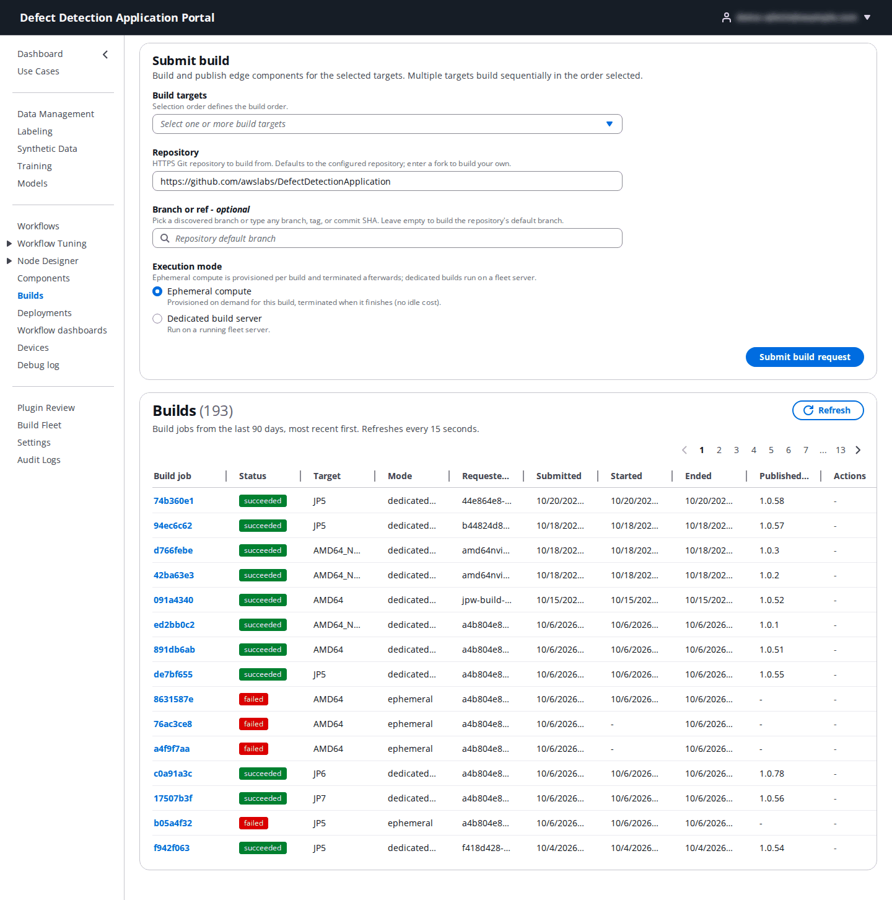
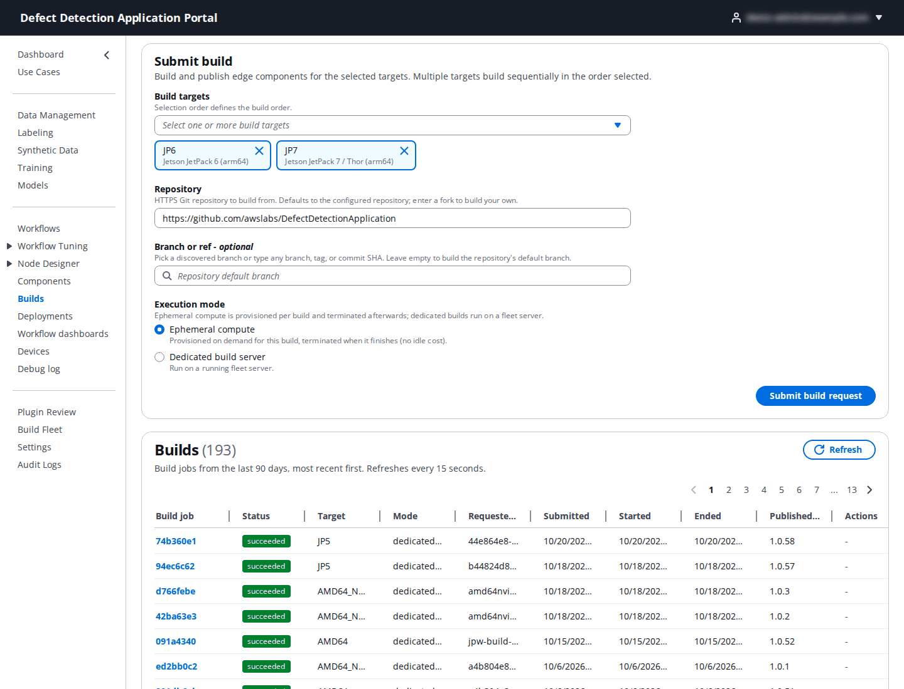
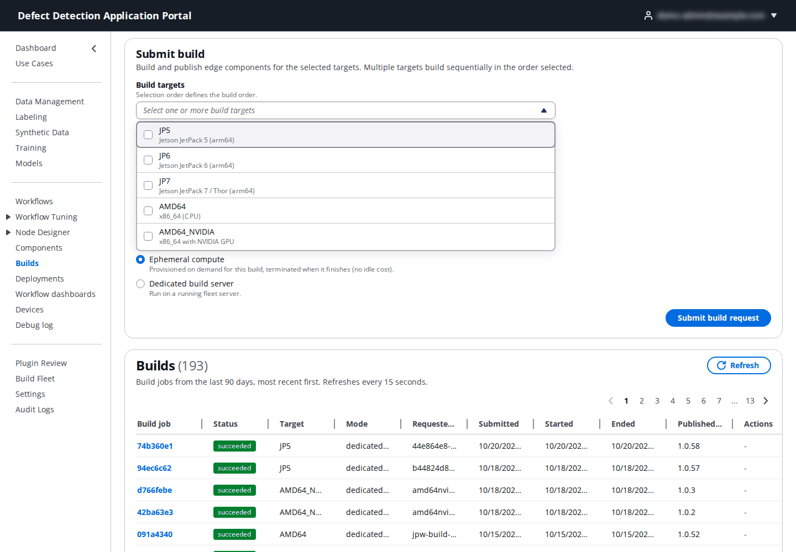
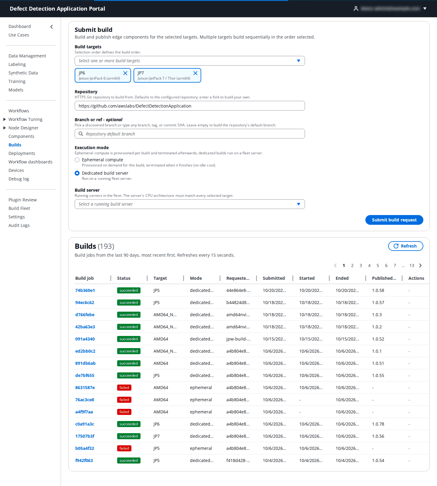
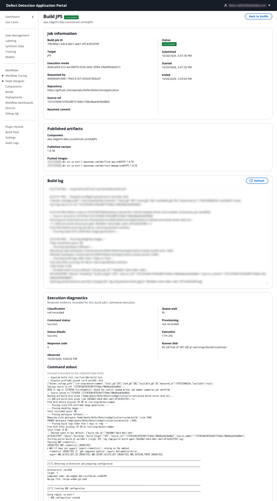

# 12. Builds

**Who:** DataScientist, UseCaseAdmin and PortalAdmin submit, monitor, cancel and retry builds. Build defaults and dedicated servers are PortalAdmin matters ([18. Build Fleet](18-build-fleet.md), [19. Settings](19-settings.md)). **Video:** [Module 6: Build Servers](https://youtu.be/ZNJBk94Ucjo). **Reference:** README [Step 4](../../README.md#step-4-build-the-dda-localserver-component-build-fleet).

The DDA application runs on each device as the **LocalServer** Greengrass component, `aws.edgeml.dda.LocalServer.<variant>`, with one variant per device architecture. **Builds** is where that component is built from the GitHub repository and published: the Portal provisions build compute, builds the container images for the target, pushes them to ECR and publishes the next component version in the Portal account. You build once per release per architecture; devices then pick the version up through a deployment.

## 12.1 The Builds page

The page has the **Submit build** form at the top and the **Builds** table below (jobs of the last 90 days, newest first, refreshed every 15 seconds).

## 12.2 Submit a build

| Field | What to enter | Default |
|-------|---------------|---------|
| **Build targets** | One or more targets. Each becomes its own build job; the jobs run one after another in the order you selected them. | – |
| **Repository** | The HTTPS GitHub repository to build from. To build a fork enter `https://github.com/<owner>/<repo>`. Only HTTPS GitHub URLs are accepted. | the configured repository (`https://github.com/awslabs/DefectDetectionApplication`) |
| **Branch or ref** (optional) | Pick a discovered branch or type any branch, tag or 40-character commit SHA. Branch discovery works for public repositories; for a private one you can still type the ref. | the repository's default branch |
| **Execution mode** | **Ephemeral compute**: a build instance is provisioned for the job and terminated when it finishes (no idle cost). **Dedicated build server**: the job runs on a running server from the Build Fleet, chosen under **Build server**; its CPU architecture must match every selected target. This option is unavailable until the fleet has a running server. | Ephemeral compute |

| Target | Component | Devices |
|--------|-----------|---------|
| **JP5** | `aws.edgeml.dda.LocalServer.arm64JP5` | Jetson on JetPack 5 (`arm64_jp5`) |
| **JP6** | `aws.edgeml.dda.LocalServer.arm64JP6` | Jetson on JetPack 6 (`arm64_jp6`) |
| **JP7** | `aws.edgeml.dda.LocalServer.arm64JP7` | Jetson Thor on JetPack 7 (`arm64_jp7`) |
| **AMD64** | `aws.edgeml.dda.LocalServer.amd64` | x86_64 CPU (`x86_64`) |
| **AMD64_NVIDIA** | `aws.edgeml.dda.LocalServer.amd64Nvidia` | x86_64 with an NVIDIA GPU (`x86_64_nvidia`) |

Click **Submit build request**. The page confirms how many build jobs were created. Portal builds always use the default build options: the JetPack targets compile the GPU ONNX Runtime from source, and JP6 and JP7 include vLLM, so a Jetson build takes a few hours. The generic ARM64 CPU component (`LocalServer.arm64`, for Graviton-class devices) cannot be built from the Portal.

Every build of a target publishes to the same component, whatever the repository or ref. A build of a fork or a test branch therefore becomes that component's latest version, which Create Deployment adds by default. Build only refs that are meant for rollout.

## 12.3 Monitor a build

The **Builds** table shows **Build job**, **Status**, **Target**, **Mode**, **Requested by**, **Submitted**, **Started**, **Ended** and, for succeeded jobs, the **Published version**.

| Status | Meaning |
|--------|---------|
| **queued** | Waiting, for example behind the previous target of the same request or a build already running on the dedicated server. |
| **provisioning** | The ephemeral build instance is starting. |
| **building** | The build is running. |
| **publishing** | The component is being published to Greengrass. |
| **succeeded** | Published; see **Published version**. |
| **failed** | The build or the publish failed, or the job exceeded its runtime limit. |
| **interrupted** | The build compute was lost before the build finished (for example a reclaimed Spot instance). |
| **cancelled** | Cancelled by a user. |

Click a build job to open it:

- **Job information**: target, execution mode (with the server id for dedicated builds), requester, **Repository**, **Source ref**, **Resolved commit**, and the submitted, started and ended times.
- **Published artifacts** (succeeded jobs): the **Component**, its **Published version** and the **Pushed images** in ECR (`dda/flask-app` and `dda/react-webapp`).
- **Build log**: the build output, refreshed every 30 seconds while the job runs. Output can take a few minutes to appear after the job starts.
- **Execution diagnostics**, when retained: classification, command status and response code, queue wait, provisioning and execution times, the timeout budget, last heartbeat and progress, runner disk space, and **Command stdout** / **Command stderr** excerpts.
- A **Build failed** alert with the error; when the publish step failed it lists what was and was not published.

Actions: **Cancel** (table) or **Cancel build** (detail) while a job is queued, building or publishing (a running build is cancelled only once its process is confirmed stopped; a provisioning job cannot be cancelled). **Retry** for an interrupted job reruns the same target and mode; for a failed job, submit a new build. A job that runs past **Max runtime (hours)** (default 4) or the runtime budget set for its target and mode fails.

## 12.4 After the build

Each successful build publishes the next patch version of its component (the first build publishes `1.0.0`), tagged `dda-portal:managed=true`. In a single-account setup the version appears on **Create Deployment** right away under **Recommended** and **Portal Components**. In a multi-account setup the Portal copies LocalServer components into each use case account: creating a use case copies the latest versions, and after a later build a UseCaseAdmin or PortalAdmin runs **Use Cases → Actions → Re-provision Shared Components** (or **Update All Usecases**). The copy currently covers the `arm64JP5`, `arm64JP6`, `amd64` and generic `arm64` variants, so `arm64JP7` and `amd64Nvidia` builds appear only in single-account setups.

To move a device to the new version, revise its deployment and click **Update to latest** on the LocalServer row ([13.4](13-deployments.md#134-revise-a-deployment)).

JetPack 7 builds need an Ubuntu 24.04 arm64 host: ephemeral JP7 builds select it automatically, dedicated JP7 builds need an ARM64 server launched with **Ubuntu 24.04**. If JP7 builds fail on the runtime limit, a PortalAdmin can raise **Max runtime (hours)** or add a JP7 entry under **Runtime budgets** in **Settings → Build Infrastructure**.
