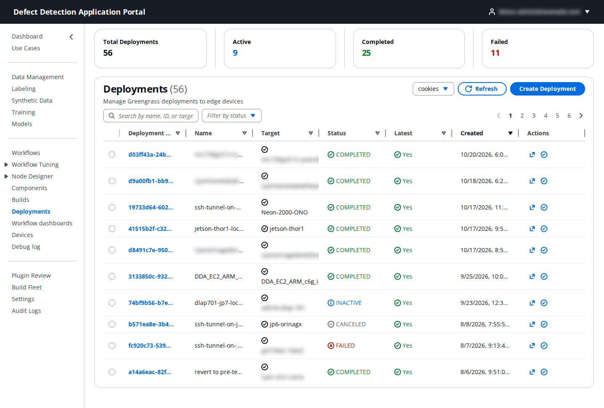
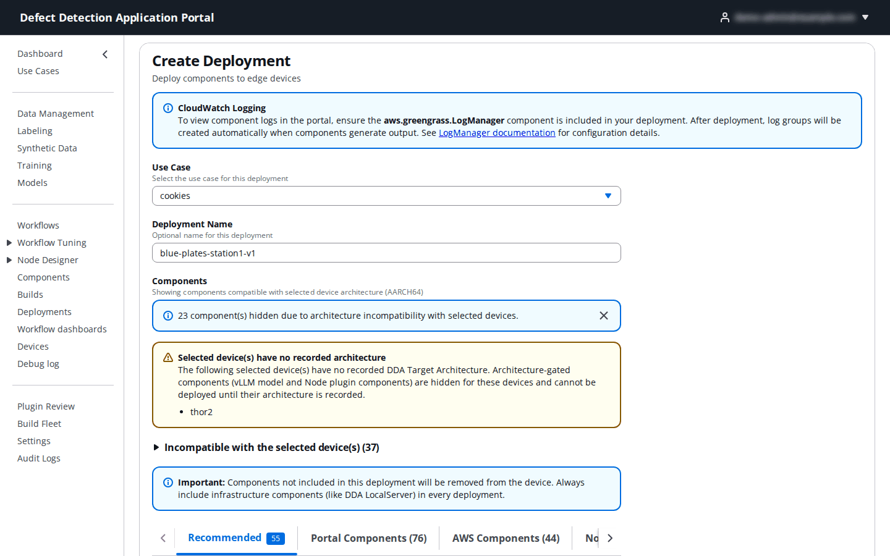
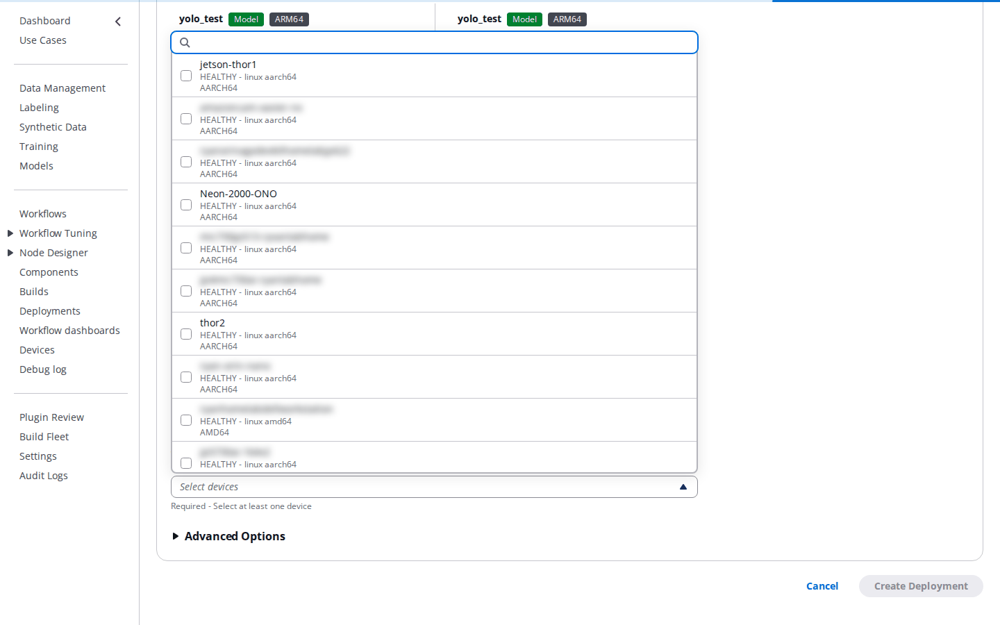
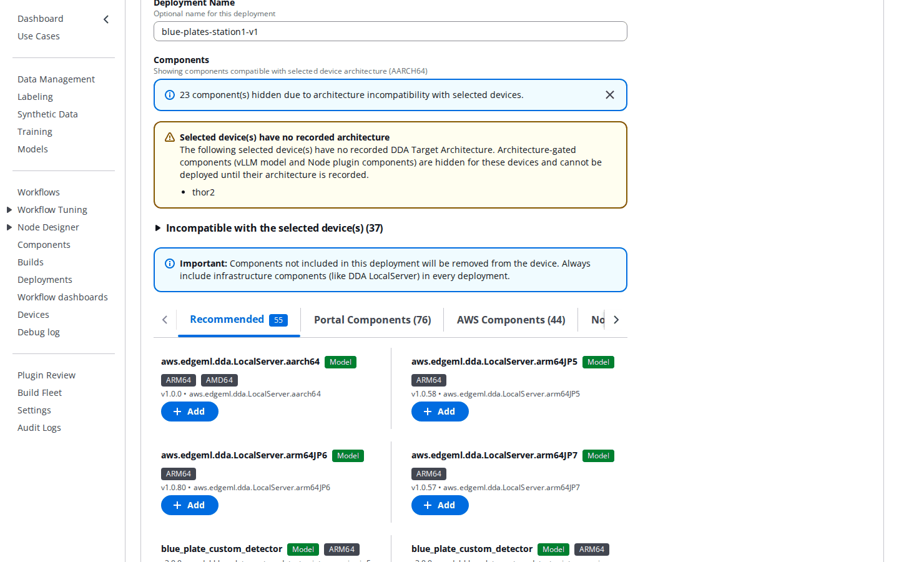
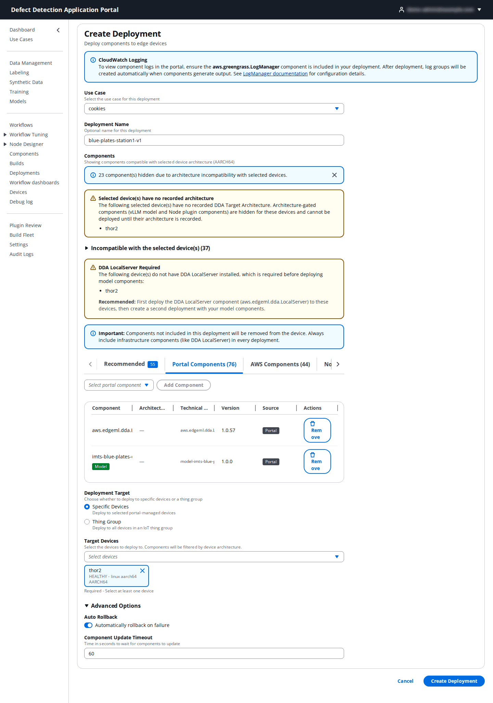
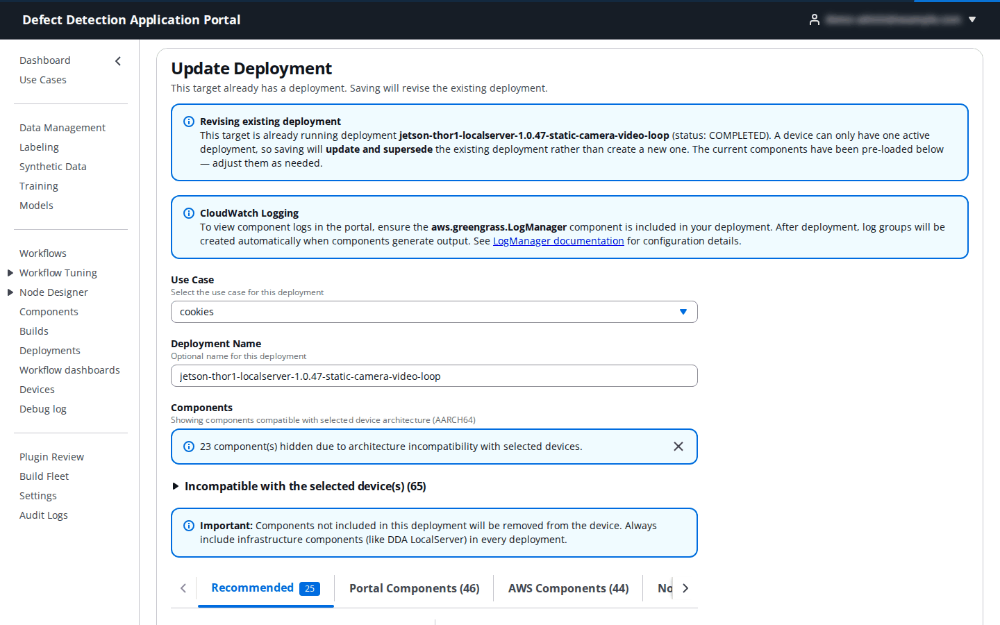
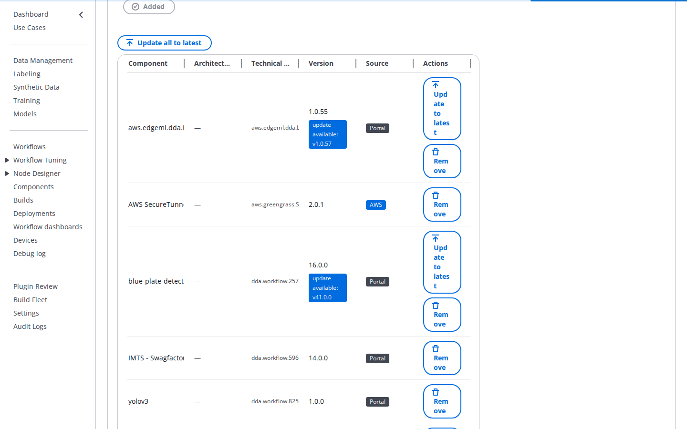
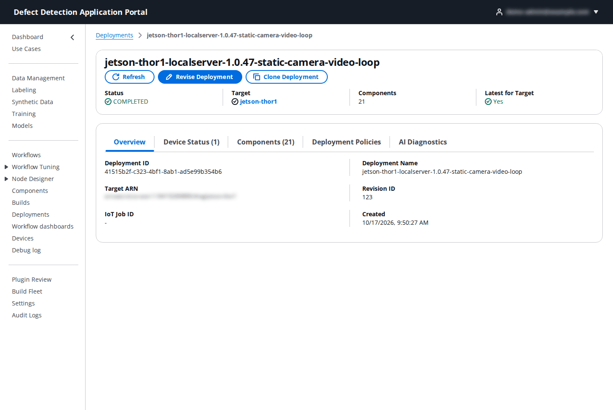

# 13. Deployments

**Who:** Operator, UseCaseAdmin and PortalAdmin create, revise and cancel deployments; DataScientist and Viewer can view them. **Video:** [Module 7: Deployments](https://youtu.be/FTYq8aql-CU). **Reference:** README [Deploy DDA Application to Edge Device](../../README.md#deploy-dda-application-to-edge-device).

A **deployment** is the complete list of Greengrass components a device (or a thing group of devices) runs: the LocalServer for its architecture, the model components, the workflow components, custom node plugins and the AWS helper components. Each target has exactly one current deployment; a new deployment for the same target replaces the previous one, which the Portal treats as a **revision**. Everything you leave out of a revision is removed from the device, so a deployment is always the whole picture, never a delta.

## 13.1 The Deployments page

The table lists the use case's deployments with **Deployment ID**, **Name**, **Target** (device or group), **Status** (`ACTIVE`, `COMPLETED`, `FAILED`, `CANCELED`, `INACTIVE`), **Latest** (whether it is still the target's current deployment) and **Created**. **Filter by status** narrows the list; **Refresh** reloads; **Create Deployment** opens the form. Click a deployment ID to open it (13.5).

## 13.2 Create the first deployment of a device

Every device needs the LocalServer variant that matches its **Target Architecture (DDA)** before models or workflows can run on it. Register the device first ([15. Devices](15-devices.md)); it must appear in the device list with an architecture.

| Field | What to enter | Default |
|-------|---------------|---------|
| **Use Case** | The use case the device is registered in. | from the selector |
| **Deployment Name** | Optional. Pick something that says what and where, for example `blue-plates-station1-v1`. | `portal-deployment-<timestamp>` |
| **Deployment Target** | **Specific Devices** (one device, see below) or **Thing Group** (13.6). | Specific Devices |
| **Target Devices** | Choose the device. The list shows each device's health, platform and architecture. Pick **one** device per deployment: with several devices selected the Portal cannot detect or revise an existing deployment. | – |
| **Components** | What the device should run (next). | – |
| **Advanced Options → Auto Rollback** | Roll the device back automatically if the deployment fails (Greengrass failure handling `ROLLBACK`; off means `DO_NOTHING`). | on |
| **Advanced Options → Component Update Timeout** | Seconds to wait for components to update (`timeoutInSeconds` of the component update policy). | `60` |

Select the device first: the **Components** section filters itself by the device's architecture and tells you how many components it hid as incompatible (**Incompatible with the selected device(s)** expands the list). A device with no recorded architecture is flagged (**Selected device(s) have no recorded architecture**); set it on the device page before you deploy, or the JetPack variants cannot be told apart.

The component tabs:

| Tab | Contents |
|-----|----------|
| **Recommended** | The LocalServer variant for the device's architecture and the published model and workflow components compatible with it, as cards. Click **Add** on each one you want; an added card shows **Added**. |
| **Portal Components** | Every Portal-published component (LocalServer variants, models, workflows) in a searchable dropdown with **Add Component**. |
| **AWS Components** | Public AWS components such as `aws.greengrass.LogManager` or `aws.greengrass.SecureTunneling`. |
| **Node Plugins** | Custom node plugin components from the Node Designer. |

For a first deployment add exactly one LocalServer variant (two variants on one device conflict) and nothing else, or add the model and workflow components at once if they are already published. The selected components appear in a table with **Component**, **Architecture**, **Technical name**, **Version**, **Source** and a **Remove** action.

Review the warnings the form shows:

- **DDA LocalServer Required**: the device does not run LocalServer yet and you added model components. Either add the LocalServer variant to this deployment or deploy it first.
- **Components will be removed**: when you submit, the Portal lists components installed on the device that are not in this deployment and asks you to **Continue Deployment**. Add anything that should stay.
- **Selected devices are incompatible with vLLM model component(s)**: vLLM components only deploy to `arm64_jp6` and `arm64_jp7` devices.
- **CloudWatch Logging**: keep `aws.greengrass.LogManager` in the deployment to see component logs in the Portal; the Portal adds it automatically when LocalServer or a model is included.

Click **Create Deployment**. The deployment's detail page opens. Verify on **Devices → device → Components** that `aws.edgeml.dda.LocalServer.<variant>` reaches **Running**; the first install downloads several gigabytes of container images and can take a while.

## 13.3 What the Portal adds for you

When a deployment contains LocalServer or a model component the Portal also includes `aws.greengrass.Nucleus` (pinned to the version the device runs), `aws.greengrass.LogManager` (uploads logs to CloudWatch every 5 minutes), `aws.greengrass.ShadowManager` (syncs the camera registry, camera bindings and model status with IoT Core) and, when the use case enables it, `aws.edgeml.dda.InferenceUploader`. These are not shown in the component list, and they are not listed in the **Components will be removed** dialog either. `aws.greengrass.SecureTunneling` (Remote Access) is also not listed there: if a deployment leaves it out, enable Remote Access again on the device afterwards.

## 13.4 Revise a deployment

To change what a device runs, add a model or workflow, or move it to a new LocalServer build, revise its deployment rather than creating a new one.

1. Open the deployment (**Deployments → ID**, or **Devices → device → Deployments**) and click **Revise Deployment**. Selecting the same single device on an empty Create Deployment form has the same effect.
2. The form becomes **Update Deployment** with the **Revising existing deployment** banner naming the running deployment, and pre-loads its name and components.
3. Change the list: **Add** components from the tabs, **Remove** rows, or update versions. A row whose component has a newer version shows an **update available: vX.Y.Z** badge with **Update to latest**; **Update all to latest** does it for every row. This is how a new LocalServer build or a re-packaged workflow reaches a device.

4. Click **Update Deployment** and confirm the **Components will be removed** dialog if it appears. With **Auto Rollback** on, a failed revision is rolled back automatically.

A component you remove that another remaining component still requires (a model under a workflow, LocalServer under a model) stays installed as a dependency; the Portal stops with **Deployment not submitted: de-selected component(s) will remain installed** and asks you to acknowledge or to remove the dependents too.

Shortcuts that open Create Deployment with components pre-selected (**Deploy** on the Components page, **Deploy this workflow** after packaging, **Clone Deployment**) select only those components and do not load the device's current deployment; add LocalServer and everything else the device should keep, or start from **Revise Deployment** instead.

## 13.5 Following a deployment

- The header cards show **Status**, **Target**, number of **Components** and **Latest for Target**. **Refresh** reloads (automatic every 5 seconds while `ACTIVE`); **Revise Deployment** and **Clone Deployment** (same components, no target) are the two ways to build on it; **Cancel Deployment** is available while it is `ACTIVE` and only affects devices that have not received it yet.
- **Overview**: deployment ID and name, **Target ARN**, **Revision ID**, **IoT Job ID**, creation time and, on failure, the per-device failure details.
- **Device Status**: each device's **Status** (`QUEUED`, `IN_PROGRESS`, `SUCCEEDED`, `FAILED`, `REJECTED`, `TIMED_OUT`, `CANCELED`), **Reason**, **Description** and **View Logs**.
- **Components**: every component with its **Version** and whether a **Configuration Update** was included.
- **Deployment Policies**: the failure handling and update policy values.
- **AI Diagnostics**: **Analyze Logs with AI** summarizes the devices' logs for the deployment; a **Models not ready on the device** banner appears while the device's model components are still loading.

## 13.6 Thing group targets

Choose **Deployment Target → Thing Group** and enter the **Thing Group Name** (for example the device group chosen in Add Device). Every device in the group receives the group's components, including devices added later. The group has one current deployment of its own; revise it from its detail page. Group deployments get no **Components will be removed** dialog and the Portal cannot check member architectures, so keep one architecture per group, add that LocalServer variant, and check the component list before submitting. A device that also has its own device-level deployment runs both at once and its components can conflict; the Portal lists such members (**Devices in this group have individual deployments**) and asks you to **Deploy anyway** or to cancel the individual deployments first. Decide per device, before its first deployment, whether it is managed individually or through its group.
