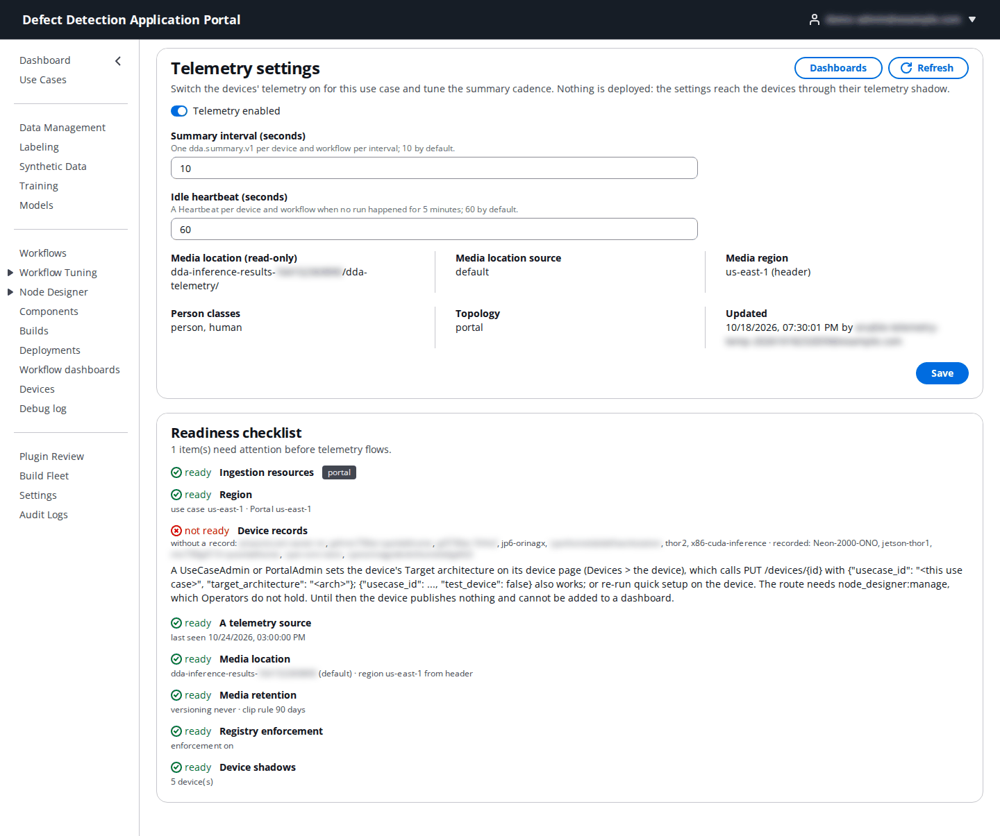
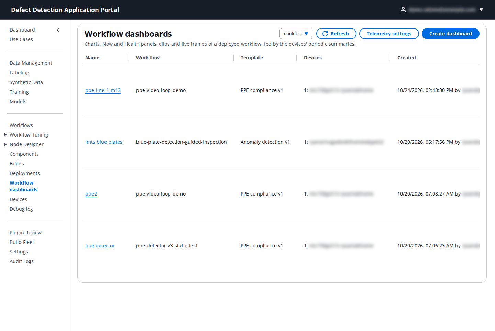
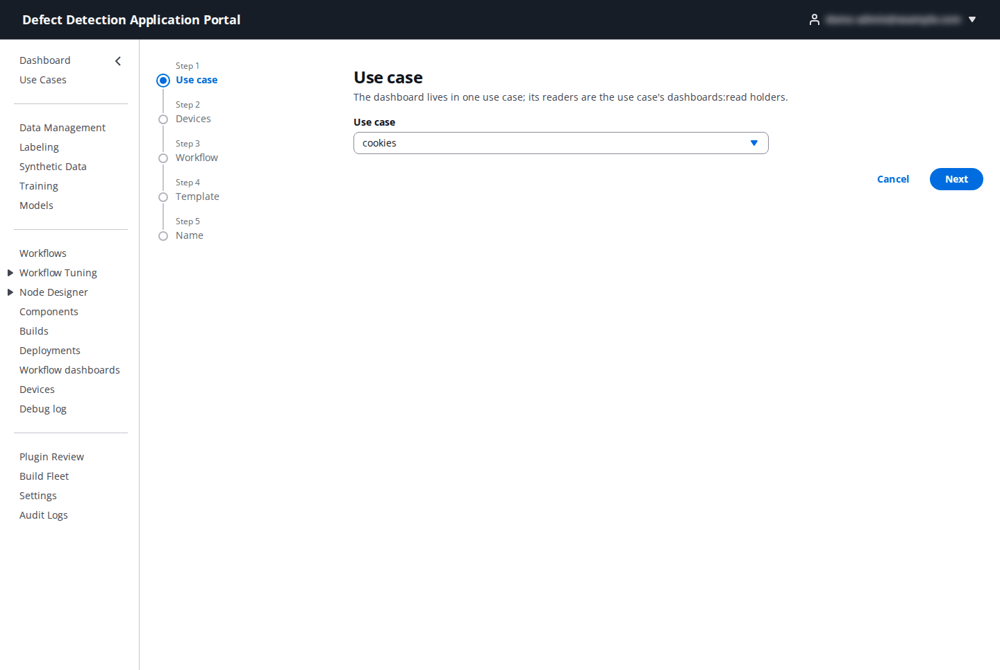
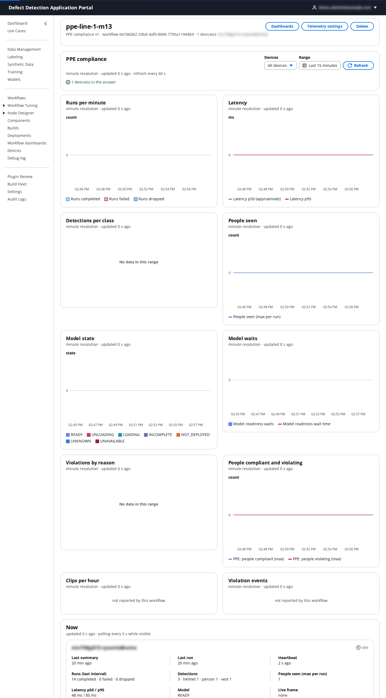

# 14. Workflow dashboards

**Who:** every role except DataLabeler can open dashboards; Operator, DataScientist, UseCaseAdmin and PortalAdmin create and delete them; UseCaseAdmin and PortalAdmin manage telemetry settings. **Video:** [Module 13: Dashboards](https://youtu.be/wTwUSNUQbac). **Reference:** [Workflow telemetry dashboards](../workflow-dashboards.md).

A workflow dashboard shows how a deployed workflow is doing on the line: runs per minute, latency, detections per class, people seen, the model's readiness, and for PPE workflows the compliance picture, plus a **Now** panel per device, a **Health** panel, and a **Live** frame. The data comes from short summaries the devices publish every few seconds once telemetry is switched on for the use case; nothing is deployed to enable it.

## 14.1 Enable telemetry for the use case

Telemetry is off until a UseCaseAdmin or PortalAdmin turns it on. Open **Workflow dashboards → Telemetry settings**.

| Setting | What to enter | Default |
|---------|---------------|---------|
| **Telemetry enabled** | On to have the use case's devices publish summaries. | off |
| **Summary interval (seconds)** | How often each device sends one summary per workflow, 5–60. | `10` |
| **Idle heartbeat (seconds)** | How often a device sends a heartbeat for a workflow that has had no run for 5 minutes, 30–300. | `60` |
| **Media location** (read-only) | The use case's inference-results bucket under `dda-telemetry/`, where clips and live frames are stored, with its region. |

**Save** writes the settings and pushes them to the telemetry shadow of every device registered for the use case; the result lists each device's outcome. The **Readiness checklist** below tells you what still blocks data from arriving: ingestion resources, region, device records (every device must have a record naming this use case; set the device's target architecture on its device page to create one), a telemetry source (a LocalServer release with the telemetry agent must be deployed), the media location and its retention rules, registry enforcement, and whether every device accepted the shadow.

## 14.2 Dashboards list

The list shows each dashboard's **Name**, **Workflow**, **Template**, **Devices** and **Created**, with a **Delete** action. Click a name to open it. **Create dashboard** starts the wizard.

## 14.3 Create a dashboard

The wizard has five steps:

| Step | What to enter |
|------|---------------|
| **Use case** | The use case (preselected from the selector). |
| **Devices** | One to twenty of its devices. Only devices with a record for the use case are offered. |
| **Workflow** | The deployed workflow to watch. |
| **Template** | **Generic detector** (runs, latency, detections per class, people seen, model state and waits), **Anomaly detection** (runs, anomalous share, latency, model state) or **PPE compliance** (the generic panels plus violations by reason, people compliant and violating, clips per hour and violation events). Each template is shown with its availability for that workflow on those devices: `available`, `partial` (some panels got no summary in the last 24 hours) or `unavailable`. |
| **Name** | Unique within the use case, for example `Line 1 PPE`. |

Creating the dashboard writes the chosen devices' telemetry shadows so they know the use case and the person classes; the first summaries appear within a minute when telemetry is on. A use case holds at most 100 dashboards.

## 14.4 Reading a dashboard

- The header names the template, workflow and devices, with **Dashboards** (back to the list), **Telemetry settings** and **Delete**.
- **Devices** filters the panels to one device or **All devices**; **Range** picks the time window (**Last 15 minutes** by default); **Refresh** reloads (panels refresh every 60 seconds by themselves).
- Chart panels have minute resolution and say when they were last updated. **Runs per minute** stacks completed, failed and dropped runs; **Latency** shows p50 and p95; **Detections per class** and **People seen** come from the detector's output; **Model state** shows one band per state (`READY`, `LOADING`, `NOT_DEPLOYED`, …) and **Model waits** the readiness waits. **No data in this range** means no summary carried that measure; **not reported by this workflow** means the workflow lacks the node the panel needs (for example the clip helper for **Clips per hour**).
- **Now** shows, per device, whether runs are flowing, the ages of the last summary, last run and heartbeat, the newest counts (runs, detections per class, people seen, latency, model state), the live-frame age and the latest events. It polls every 5 seconds while visible.
- **Health** shows per device the sequence gaps (summaries that never arrived), the last hour's telemetry counters, failed and dropped runs, the model state and the Greengrass core-device status.
- **Clips** (PPE template) lists the violation clips, newest first, with **Play** and a download link.
- **Live** shows the newest frame of one selected device (**Live device**) with its per-class counts; a frame is `live` when at most 10 seconds old, otherwise `stale`, `paused` or `unavailable` with the reason.
