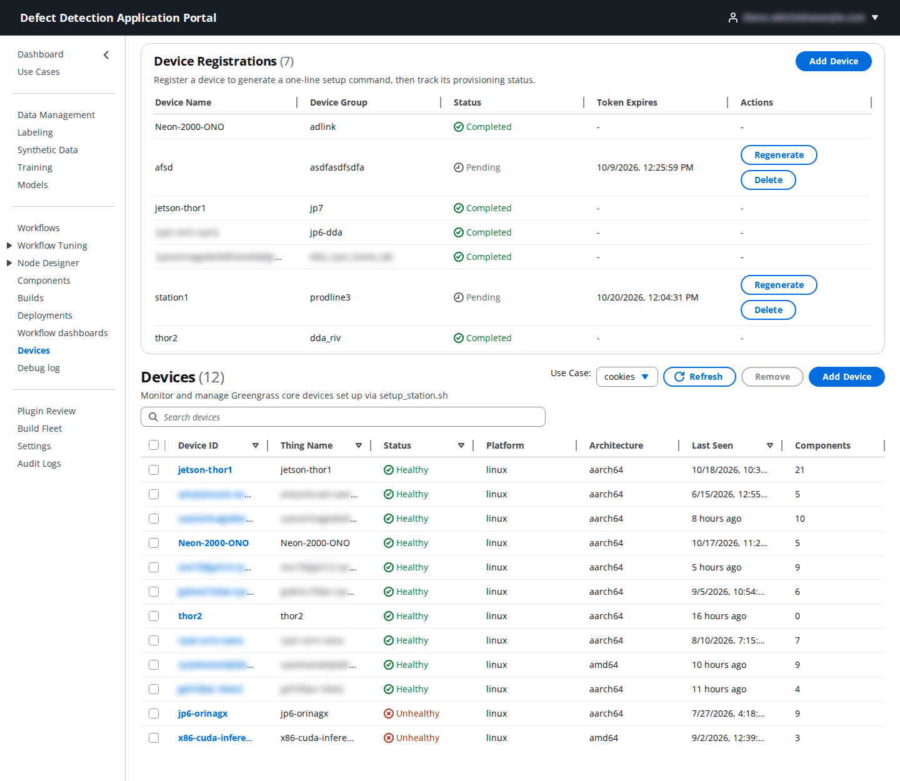
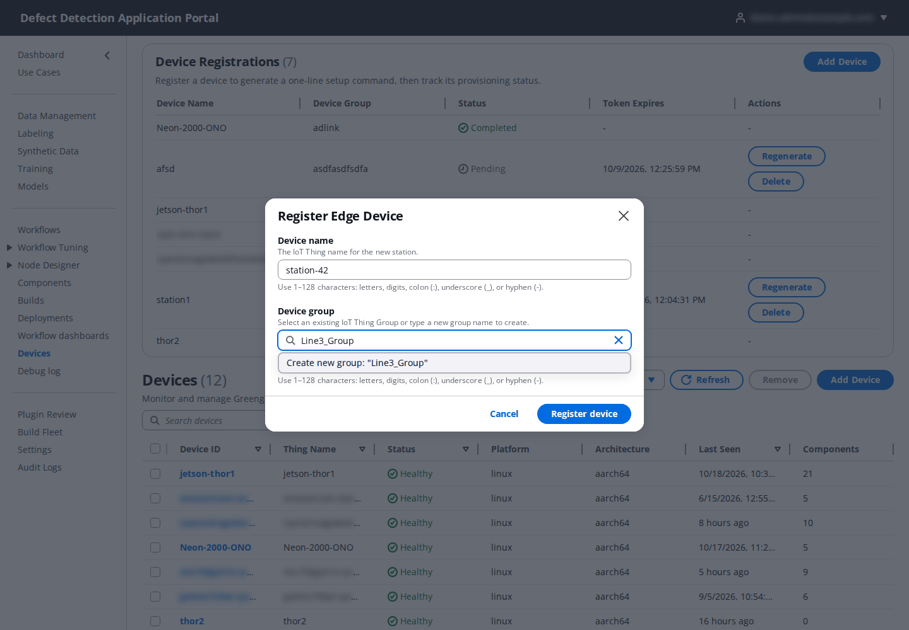
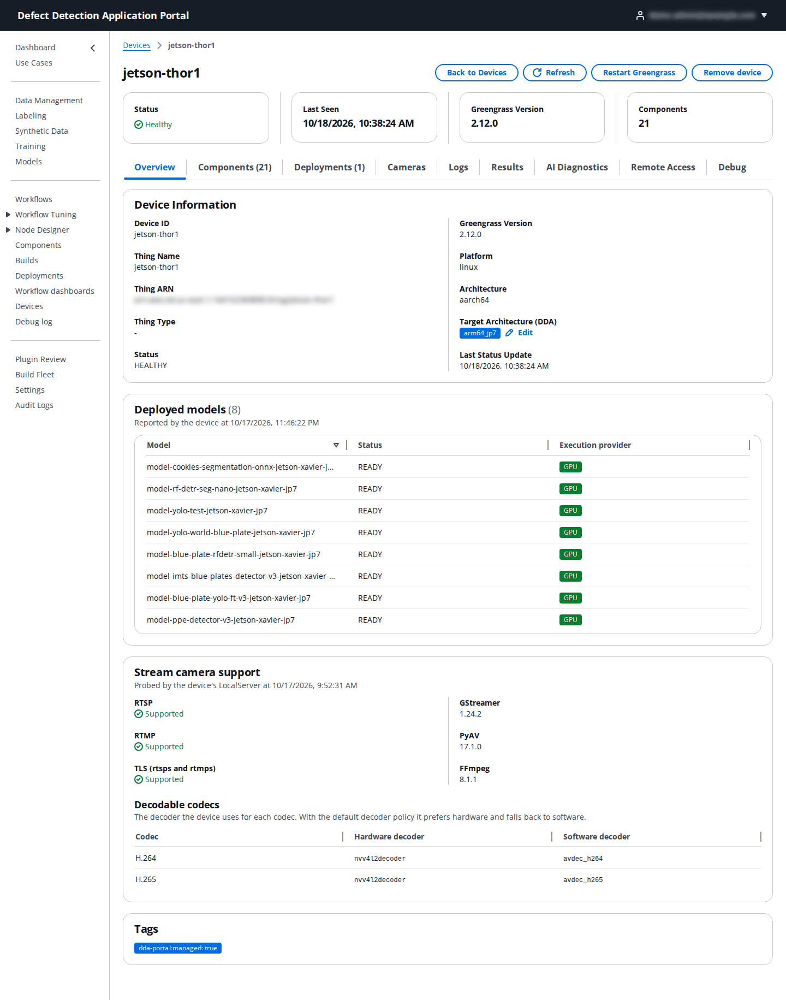
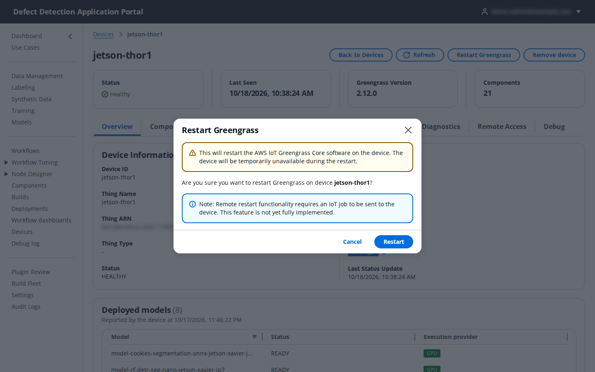
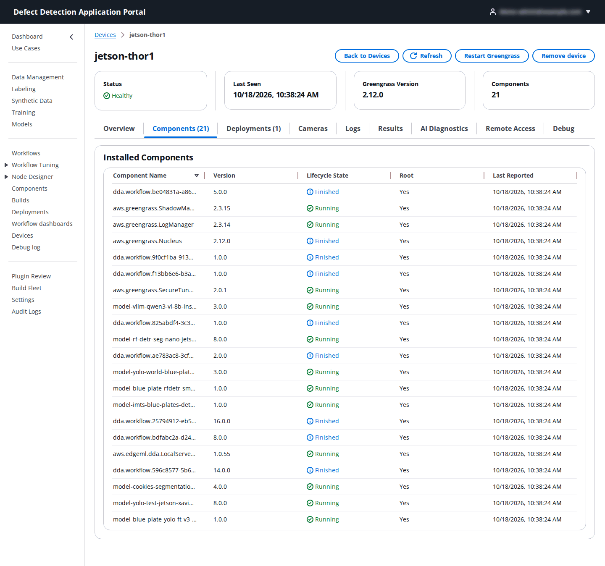
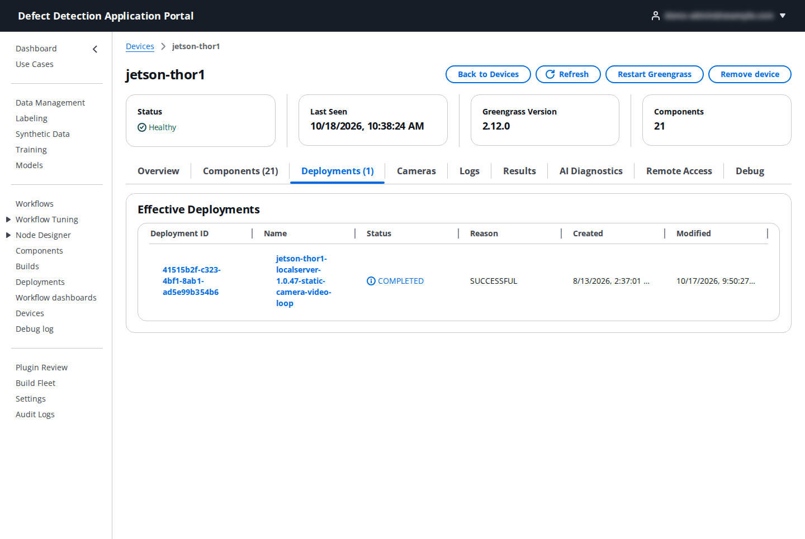
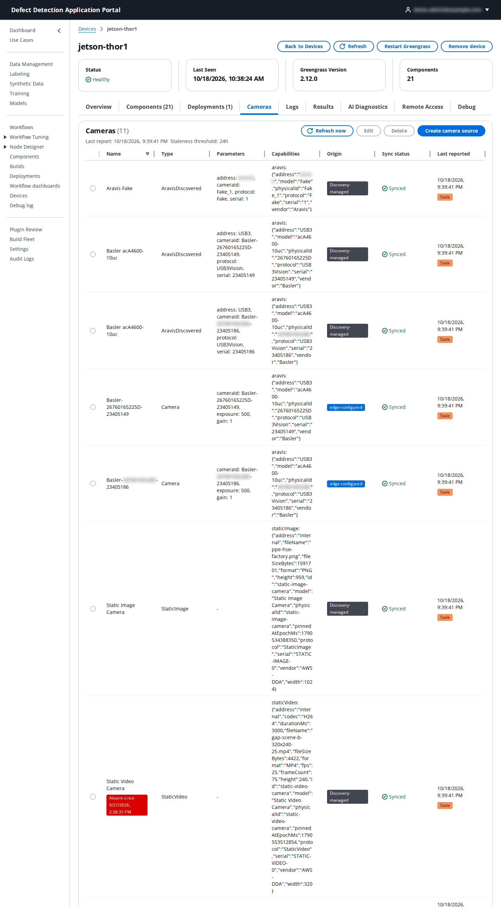
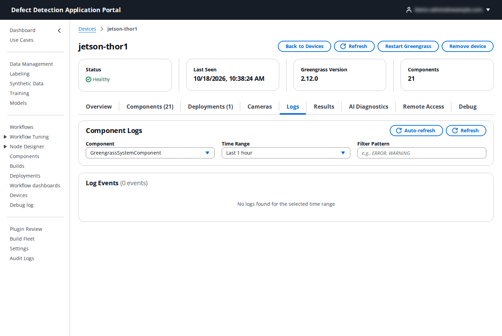
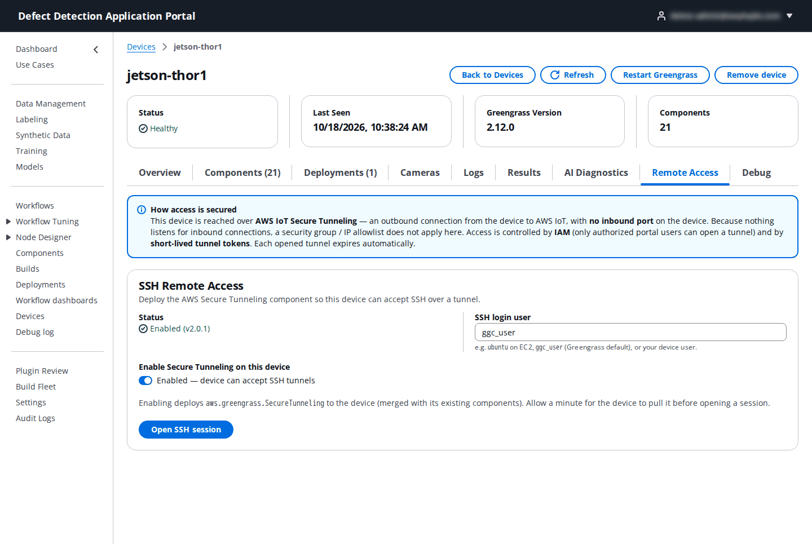

# 15. Devices

**Who:** Operator, UseCaseAdmin and PortalAdmin register, deploy to, restart and remove devices; every other role can view them. **Videos:** [Module 1: Device Setup](https://youtu.be/PFdFycCQXA0), [Module 8: Devices](https://youtu.be/r8nz33LQPoc). **Reference:** README [Step 7](../../README.md#step-7-set-up-edge-devices-add-device) and [Remote Device Access](../../README.md#remote-device-access-ssh).

A **device** is an edge computer, a Jetson or an industrial PC, running AWS IoT Greengrass with the DDA LocalServer. **Devices** is where you register a new station with a one-line setup command, watch its health, look at its components, cameras, logs and inference results, and reach it over SSH.

## 15.1 The Devices page



The page has two panels for the selected use case.

**Device Registrations** tracks the stations you have registered but that may not have finished setup: **Device Name**, **Device Group**, **Status** (**Pending**, **In progress**, **Completed**, **Expired**, **Failed**), **Token Expires**, and the **Regenerate** / **Delete** actions for registrations that are not completed.

**Devices** lists the Greengrass core devices tagged for the Portal: **Device ID**, **Thing Name**, **Status** (**Healthy** or **Unhealthy**), **Platform**, **Architecture** (`aarch64` or `amd64` as reported by Greengrass), **Last Seen** and the number of installed **Components**. Click a device ID to open it. Tick devices and click **Remove** to decommission them (15.9).

## 15.2 Register a device (Add Device)

Create the use case first: every device is registered under one. Then click **Add Device**.



| Field | What to enter |
|-------|---------------|
| **Device name** | The IoT Thing name for the station: 1–128 letters, digits, colons, underscores or hyphens, for example `station-42`. It must not exist in the account or in another registration. |
| **Device group** | An existing IoT thing group, or type a new name to create one (`Line3_Group`). The device joins the group during setup; if the group already has a group deployment, the device receives it once set up ([13.6](13-deployments.md#136-thing-group-targets)). |

Click **Register device**. The **Setup command for `<device name>`** dialog shows a one-line command and when its token expires; click **Copy command**. The command downloads the installer, verifies its checksum and runs it with a single-use setup token:

```bash
curl -fsSL https://<portal-api>/quick-setup/bootstrap -o /tmp/dda-qs.sh && echo "<sha256>  /tmp/dda-qs.sh" | sha256sum -c - && sudo bash /tmp/dda-qs.sh --endpoint https://<portal-api>/quick-setup --token <setup-token>
```

On the device (Ubuntu 20.04, 22.04 or 24.04 on x86_64 or aarch64, with `sudo`, `curl`, `sha256sum`, `tar`, `lsb_release`, 2 GB free and internet access), paste the command into a shell and keep the session open until it prints `✅ Station Quick Setup completed successfully`. The installer checks the prerequisites, installs Java, Python, the AWS CLI, GStreamer and Docker (and the NVIDIA container runtime on Jetson), installs Greengrass under `/aws_dda/greengrass/v2`, creates the IoT thing in the device group, tags it for the Portal, detects the **Target Architecture (DDA)** and reports back. No AWS credentials or repository checkout are needed on the device.

Token rules: a token is valid for 90 minutes and works once; run the command with at least 15 minutes left. **Regenerate** issues a new command and invalidates the old token; **Delete** removes a registration that has not completed. Do not use either while the command is still running on the device.

Then click **Refresh**: the registration goes **Pending → In progress → Completed**, and the device appears in the **Devices** table as **Healthy** once Greengrass connects. It has no DDA components until you create its first deployment ([13.2](13-deployments.md#132-create-the-first-deployment-of-a-device)).

## 15.3 Device overview



- The header cards show **Status**, **Last Seen**, **Greengrass Version** and the number of **Components**, with **Refresh**, **Restart Greengrass** and **Remove device**.
- **Device Information**: **Device ID**, **Thing Name**, **Thing ARN**, **Thing Type**, **Status**, **Platform**, **Architecture**, **Last Status Update** and the **Target Architecture (DDA)**: `arm64_jp5`, `arm64_jp6`, `arm64_jp7`, `x86_64`, `x86_64_nvidia` or `arm64_cpu`. The setup records it; if it shows **Not recorded**, click **Edit** and choose it, because Create Deployment can only filter the LocalServer variants, and vLLM and plugin components can only be offered, for a device whose architecture is known.
- **Deployed models**: each model component on the device with its **Status** (`READY`, `LOADING`, …) and **Execution provider** (`GPU` or `CPU`), as reported by the device. A **GPU inference degraded** banner appears when a model fell back to CPU.
- **Stream camera support** and **Decodable codecs**: what the device can do with RTSP/RTMP cameras, per codec, with hardware and software decoders.
- **Tags** and **Attributes** of the IoT thing.

**Restart Greengrass** sends an IoT job that restarts the Greengrass Core software; the device is unavailable for a minute or two. Confirm with **Restart**.



## 15.4 Components tab



**Installed Components** lists every component on the device with **Version**, **Lifecycle State** (`RUNNING`, `FINISHED`, `BROKEN`, …), whether it is a **Root** component of the deployment, and **Last Reported**. After a deployment, this is where you confirm that `aws.edgeml.dda.LocalServer.<variant>` is **RUNNING**.

## 15.5 Deployments tab



**Effective Deployments** lists the deployments that apply to the device (its own and its group's) with **Status**, **Reason**, **Created** and **Modified**. Click a deployment to open it and **Revise Deployment** from there ([13.4](13-deployments.md#134-revise-a-deployment)).

## 15.6 Cameras tab



**Cameras** is the device's camera registry, synced from the device through its shadow. Each row shows the camera's **Name**, **Type** (`AravisDiscovered`, `Camera`, `StaticImage`, `StaticVideo`, `RTSP`, …), **Parameters** (camera id, protocol, serial, gain, exposure), **Capabilities**, **Origin** (**Discovery-managed**, found by the device; **edge-configured**, created on the device; or Portal-created), **Sync status** and **Last reported**, with a **Stale** badge when the device has not reported recently. **Refresh now** asks the device for a fresh report. Workflows refer to these cameras through the camera picker in the builder ([8.3](08-workflows.md#83-configuring-a-node)).

- **Create camera source** adds a stream camera: **Name**, **Type** (**RTSP**, **RTMP**, **Camera (V4L2)**, **ICam**, **NVIDIA CSI**, **Folder**), **Stream URL**, **Transport** (default `tcp`), **Latency (ms)** (0–5000, default 200), **Decoder** (default `auto`: hardware when available), **Maximum frame dimension** (320–4096, default 1920), **Stall timeout (s)** (2–60, default 10), optional **Username**/**Password** credentials, or type-specific **Parameters** as JSON such as `{"devicePath": "/dev/video0"}`. **Edit** and **Delete** act on the selected row. Changes reach the device over the sync channel; a device that is disconnected or has never synced its registry is flagged.
- **Static image camera** pins a still image (JPEG, PNG or BMP, at most 50 MB) that the device serves as a camera, so a workflow can be exercised without a live camera: **Choose image**, then **Replace image** or **Remove pinned image**. **Static video camera** loops a test video the same way (**Choose video**, **Pin video**, **Remove pinned video**). The workflow builder's **Pin a static test image…** shortcut leads here.
- **Sync conflicts** lists camera sources where the edge version and the Portal version disagree, with **Re-apply portal version**.

## 15.7 Logs, Results, AI Diagnostics



- **Logs** shows the **Component Logs** uploaded to CloudWatch by `aws.greengrass.LogManager`: choose the component (for example `GreengrassSystemComponent` or the LocalServer), a time range (**Last 15 minutes** to **Last 7 days**), an optional filter such as `ERROR, WARNING`, and **Auto-refresh**. Logs appear only when LogManager is in the device's deployment, which the Portal ensures for DDA deployments.
- **Results** browses the **Inference Results** captures the device uploaded to the use case's results bucket: enter a **Capture prefix** and click **Load captures**.
- **AI Diagnostics**: **Analyze Logs with AI** reads the device's recent logs and lists detected issues with suggested fixes.

## 15.8 Remote Access and Debug



**SSH Remote Access** uses AWS IoT Secure Tunneling, so the device needs no inbound port, public IP or VPN. **Enable Secure Tunneling on this device** adds `aws.greengrass.SecureTunneling` to the device's own deployment (and keeps its other components); set the **SSH login user** (`ubuntu` on EC2, `ggc_user` for the Greengrass default, or your device user). **Open SSH session** then creates a short-lived tunnel and shows a source access token; on your computer run the AWS IoT local proxy with that token and `ssh -p 5555 <user>@localhost`. Full steps are in [docs/connect-to-device.md](../connect-to-device.md). Disable the component when it is not in use; tokens expire after 60 minutes by default.

**Debug** lists the device's workflow debug sessions and offers **Start debug** ([16. Debug log](16-debug-log.md)).

## 15.9 Remove a device

**Remove device** (or **Remove** on the Devices page) decommissions a device in DDA: its registration and Portal record are deleted and its certificates are deactivated so it can no longer connect. This cannot be undone. The device itself is not changed; if it is still running it keeps its software, so use this for a decommissioned device or one you will set up again under the same name.
