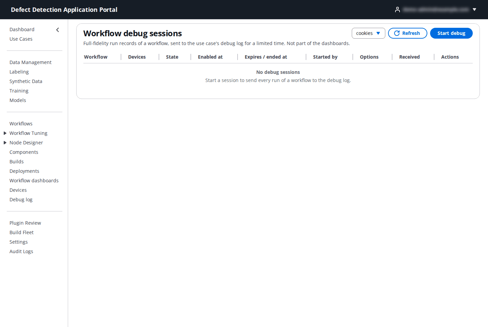
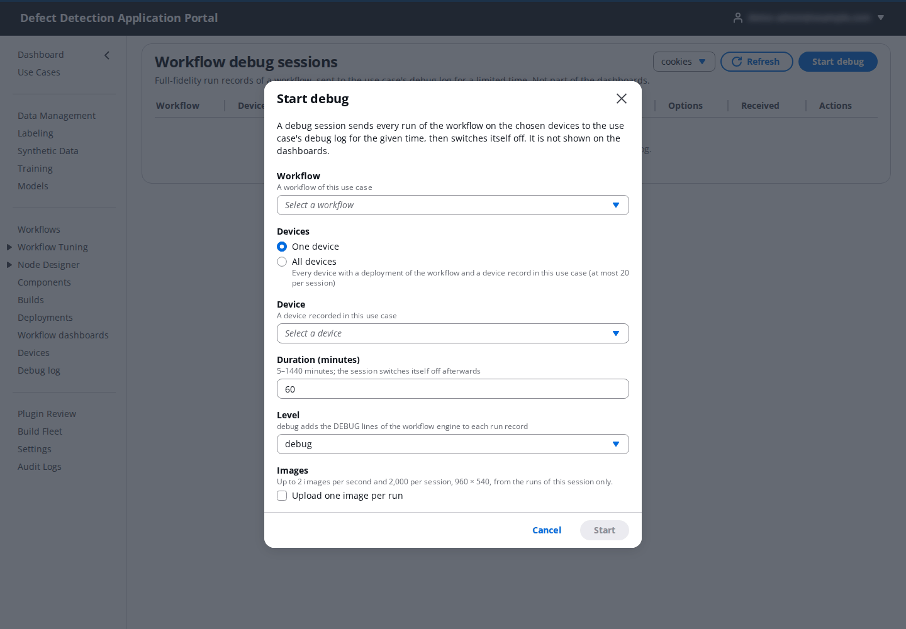

# 16. Debug log

**Who:** every role except DataLabeler can read debug logs; Operator, DataScientist, UseCaseAdmin and PortalAdmin start and stop sessions. **Reference:** [Workflow debug mode](../workflow-debug-mode.md).

When a workflow misbehaves on a device, the dashboards' summaries are too coarse and the component logs too generic. A **debug session** switches one workflow on one or more devices into debug mode for a limited time: every run then writes a full-fidelity record (its trigger, each node's outcome, timings, dropped frames and, optionally, one small image per run) to the use case's debug log in CloudWatch Logs, which you read live in the Portal. The workflow itself is not changed, and nothing from a debug session appears on the dashboards.

## 16.1 Debug sessions

The table lists the use case's sessions with **Workflow**, **Devices**, **State**, **Enabled at**, **Expires / ended at**, **Started by**, **Options** (level and images), **Received** (records so far) and **Actions** (open the viewer, **Stop**). History stays visible for 30 days.

States: **pending** (created, at least one device has not accepted it yet) → **active** (every device accepted) → **stopped** (you stopped it) or **expired** (time up). Only pending and active sessions produce records.

The same list, limited to one device, is on the device page's **Debug** tab ([15.8](15-devices.md#158-remote-access-and-debug)).

## 16.2 Start a session

Click **Start debug**.

| Field | What to enter | Default |
|-------|---------------|---------|
| **Workflow** | A workflow of the use case. | – |
| **Devices** | **One device** (chosen under **Device**), or **every device** that has a deployment of the workflow and a device record in this use case. | one device |
| **Duration (minutes)** | How long the session runs, 5–1440. | `60` |
| **Level** | `debug` adds the engine's DEBUG lines to each run record; `info` keeps records smaller. | `debug` |
| **Images** | Upload one image per run (50–300 KB each). Available only when registry enforcement is on and the results bucket carries the debug-images lifecycle rule. | off |

Click **Start**. Creation is all-or-nothing: either the session exists on every device or nothing is created. The Portal refuses, with a remedy, a device without a record naming this use case (set its **Target architecture** on the device page), an "all devices" choice that matches nothing, a session that already covers the same device and workflow, and sessions beyond the caps (per use case, per device, devices per session).

**Stop** removes the session from every device and marks it stopped; a session that reaches its end is marked expired within five minutes.

## 16.3 The viewer

Open a session to tail its records. The viewer shows the device's stream for a **Write-time window** (default **Last 15 minutes**, at most 24 hours), ordered by each record's own time, and polls every 3 seconds while the tab is visible. Filter by **Execution id**, **Node id**, **Level** (`DEBUG`, `INFO`, `WARNING`, `ERROR`) and **Type**:

| Type | Meaning |
|------|---------|
| **run** | One completed run: trigger, per-node results, timings, verdict. |
| **log** | An engine log line (at level `debug`). |
| **drop** | A frame or firing the device dropped, with the reason. |
| **session** | Session lifecycle events. |

A record written long after the device sent it (a retried upload) appears at its place in time with a **late** badge; a long backlog shows **catching up**. **Download NDJSON** saves the chosen window (up to 50,000 events, one JSON event per line) for offline analysis; the on-screen body renders the last 2,000 events. A PortalAdmin can also **Open in CloudWatch** to see the stream in the console.
