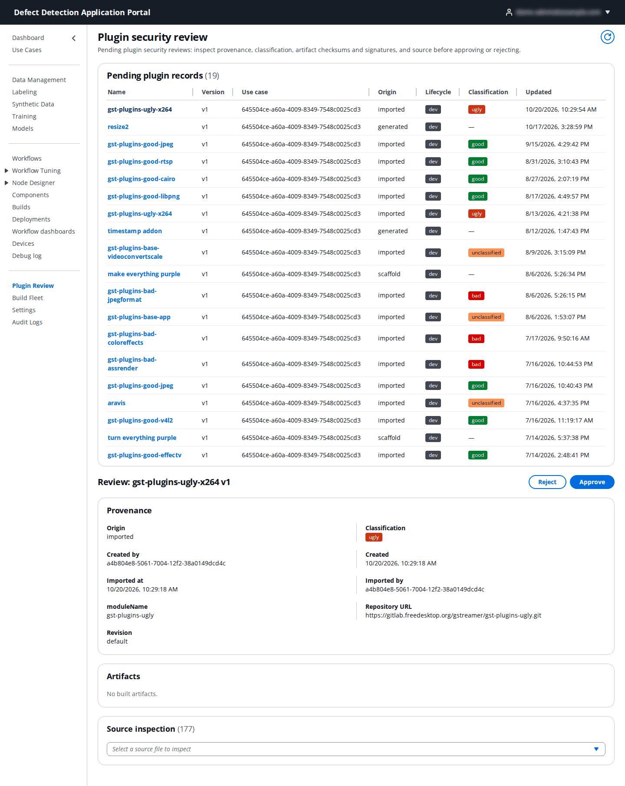

# 17. Plugin Review

**Who:** PortalAdmin only. **Related:** [10. Node Designer](10-node-designer.md). **Video:** [Module 4: Custom Node Designer](https://youtu.be/si5gOzzPhn0).

A custom node plugin runs native code inside the LocalServer on every device it is deployed to, so before a plugin can be promoted to **prod** and registered for production workflows, a PortalAdmin reviews it. **Plugin Review** is the queue of plugin versions waiting for that security review.

## 17.1 The review queue

**Pending plugin records** lists every plugin version across all use cases whose security review is still pending: **Name**, **Version**, **Use case**, **Origin** (**imported**, **generated** or **scaffold**), **Lifecycle** and **Classification** (for imported GStreamer plugins: the upstream module's licence class, **good**, **bad**, **ugly** or **unclassified**). Click a name to review it.

## 17.2 Reviewing a plugin

The **Review: `<name>` `<version>`** section opens below the queue with three panels:

| Panel | What to check |
|-------|---------------|
| **Provenance** | Where the code came from: **Origin**, **Created by** and **Created**, and for imports the **Imported by** / **Imported at**, the **moduleName** (`gst-plugins-ugly`), the **Repository URL** and the **Revision**. Confirm the source is the one you expect and that the licence class is acceptable for your deployment. |
| **Artifacts** | The built artifacts per architecture with their checksums and signatures. **No built artifacts** means the builds have not succeeded yet; a plugin is normally reviewed after it builds. |
| **Source inspection** | A dropdown of every source file (177 in the example). Pick a file to read it inline. For scaffolded and generated plugins read `plugin/frame_processing_hook.py` and the C element; for imports look at anything that touches the network or the file system. |

Decide:

- **Approve** marks the review approved. The plugin's owner can then **Promote to prod** and register it as a node type ([10.5](10-node-designer.md#105-the-plugin-page)). The approval travels with the version: demoting a prod plugin to test and promoting it back does not need a new review, but a new version does.
- **Reject** opens **Reject security review** with an optional **Notes** field; write what must change. The plugin stays in dev/test and the notes are shown on its page.

Every approval and rejection is recorded in the [Audit Logs](21-audit-logs.md).
