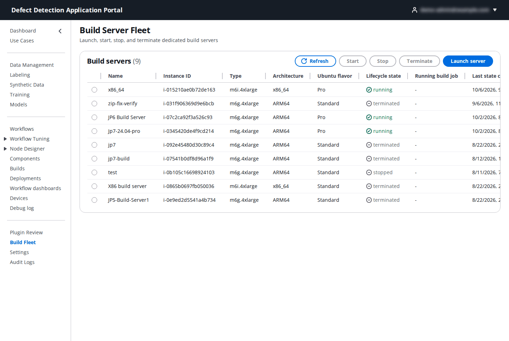
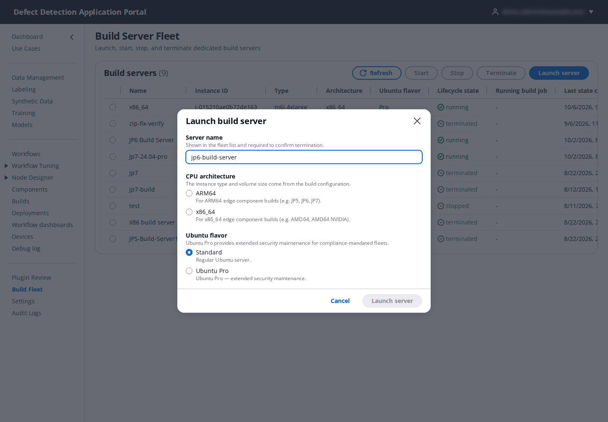

# 18. Build Fleet

**Who:** PortalAdmin only. **Related:** [12. Builds](12-builds.md), [19. Settings](19-settings.md). **Video:** [Module 6: Build Servers](https://youtu.be/ZNJBk94Ucjo).

By default a build runs on **ephemeral compute**: an EC2 instance is launched for the job and terminated afterwards. When you build often, a **dedicated build server** is faster, because it keeps the Docker layer cache and the compiled dependencies between builds. **Build Fleet** is where a PortalAdmin launches, starts, stops and terminates those servers. Build instances have no SSH key and no inbound rules; the Portal runs builds on them through AWS Systems Manager.

## 18.1 The fleet

**Build servers** lists each server with **Name**, **Instance ID**, **Type** (instance type), **Architecture** (`arm64` or `x86_64`), **Ubuntu flavor**, **Lifecycle state** (**launching**, **running**, **stopped**, **terminated**), the **Running build job** if any, and **Last state change**. Select a server with its radio button to enable **Start**, **Stop** and **Terminate**; **Refresh** reloads.

| Action | Effect |
|--------|--------|
| **Start** | Starts a stopped server. It is ready for builds when it shows **running**. |
| **Stop** | Stops a running server (no compute cost while stopped; the workspace and caches stay on its volume). Only while no build runs on it. |
| **Terminate** | Permanently destroys the instance and its build workspace. You must type the server name to confirm. Only while no build runs on it. |

Stop servers you are not using. A stopped server keeps its cache and starts again in a minute or two.

## 18.2 Launch a server

Click **Launch server**.

| Field | What to enter |
|-------|---------------|
| **Server name** | Shown in the fleet list and required to confirm termination, for example `jp6-build-server`. |
| **CPU architecture** | **ARM64** for ARM64 edge component builds (JP5, JP6, JP7); **x86_64** for x86_64 builds (AMD64, AMD64_NVIDIA). A build can only run on a server whose architecture matches every selected target. |
| **Ubuntu flavor** | **Standard** (regular Ubuntu server) or **Ubuntu Pro** (extended security maintenance for compliance-mandated fleets). |
| **Ubuntu version** (ARM64 only) | **Ubuntu 22.04 (default)** for JP5 and JP6 builds, **Ubuntu 24.04** for JP7 builds. The Portal rejects a JP7 build for a server on another release. |

The instance type and volume size come from the build configuration in **Settings → Build Infrastructure** (defaults `m6g.4xlarge` for ARM64, `m6i.4xlarge` for x86_64, 200 GB). Click **Launch server**. The server shows **launching** while the build environment installs itself, then **running**; it then appears under **Build server** on the Builds page when **Dedicated build server** is selected.
