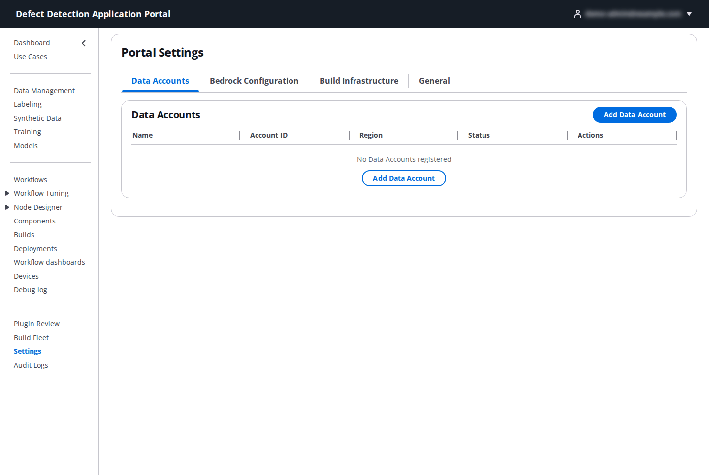
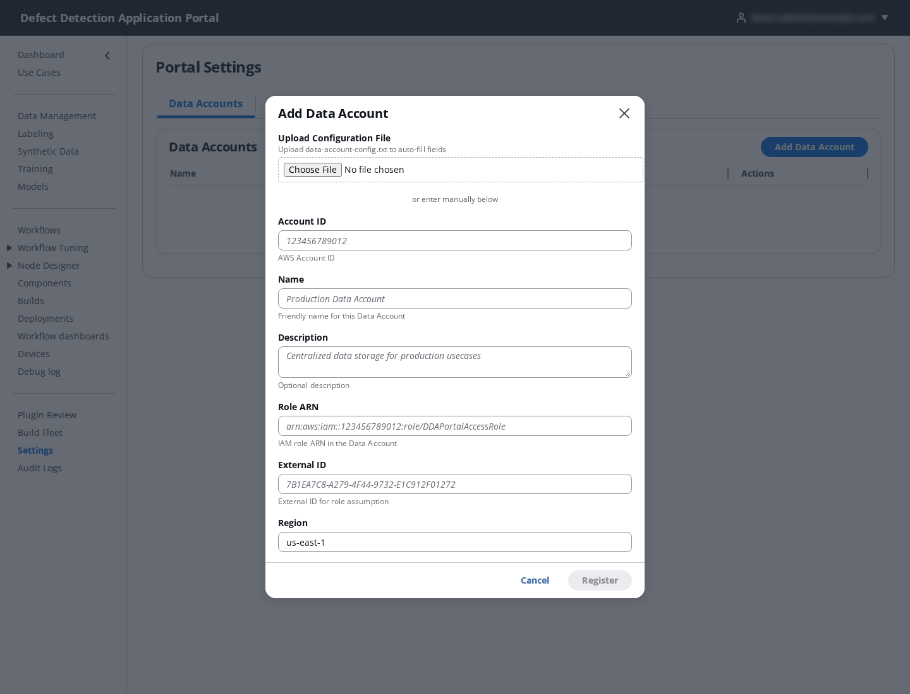
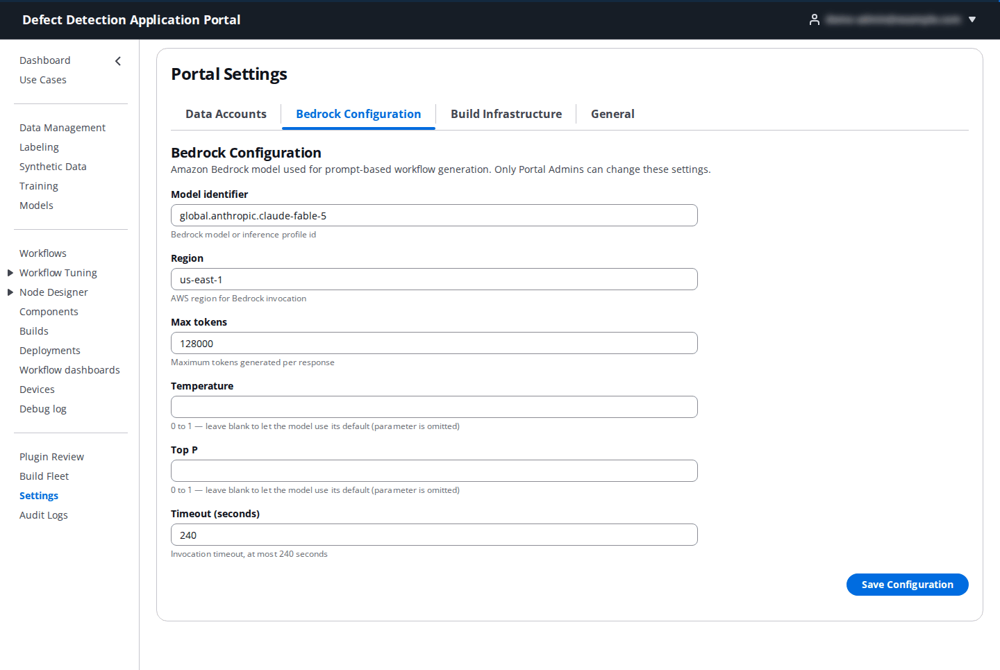
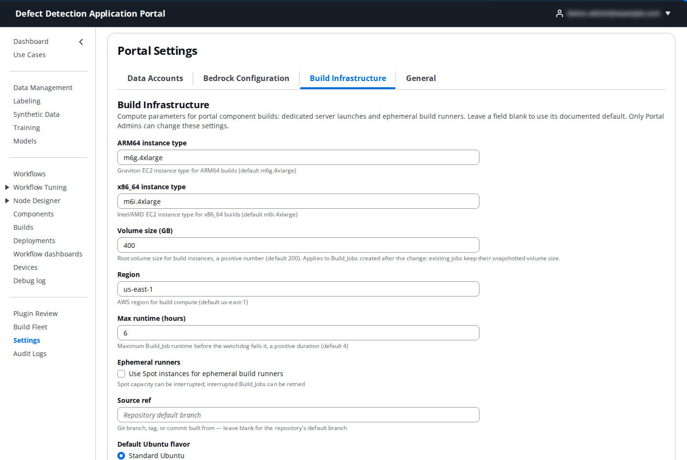

# 19. Settings

**Who:** PortalAdmin only (the page is reached from the navigation or the user menu). **Video:** [Module 0: Portal Setup](https://youtu.be/HtH_4zT23Fo). **Reference:** README [Step 4.1](../../README.md#41-one-time-setup) and [Step 5.2](../../README.md#52-data-account-optional-for-multi-account).

**Portal Settings** holds the installation-wide configuration: the registered data accounts for multi-account setups, the Bedrock model used for AI generation and the assistant, the compute parameters for component builds, how the auto-label worker spreads pre-labels over its runs, and the assistant's own settings. It has five tabs, and a sixth, **Assistant**, when the Portal is deployed with the assistant.

## 19.1 Data Accounts

In a multi-account architecture, training data can live in a central **Data Account** that several use cases read from. Registering it once here lets the onboarding wizard fill in the account details from a dropdown instead of asking for them each time. The table lists each account's **Name**, **Account ID**, **Role ARN**, **Region** and **Description**, with **Edit** and **Delete**.

Click **Add Data Account**:

| Field | What to enter |
|-------|---------------|
| **Upload Configuration File** | Upload the `data-account-*-config.txt` written by `./deploy-portal.sh data` in the data account; it fills in the fields below. |
| **Name** | A friendly name, for example `Production Data Account`. |
| **Account ID** | The 12-digit AWS account ID. |
| **Role ARN** | The `DDAPortalDataAccessRole` ARN in that account (`arn:aws:iam::<account>:role/DDAPortalDataAccessRole`). |
| **External ID** | The External ID the deployment printed; it is part of the role's trust policy. |
| **Region** | The account's region, for example `us-east-1`. |
| **Description** | Optional. |

Click **Register**. Buckets in the data account still need to be tagged `dda-portal:managed=true` and ABAC-enabled before a use case can use them ([Administrator Guide](../../edge-cv-portal/ADMIN_GUIDE.md#tag-s3-buckets)).

## 19.2 Bedrock Configuration

The Amazon Bedrock model the Portal calls for prompt-based generation: the Workflow Builder's **Gen** panel ([8.6](08-workflows.md#86-generate-a-workflow-from-a-description)), the Node Designer's **Generate with AI** and code assistant ([10.3](10-node-designer.md#103-generate-a-custom-node-with-ai)), and the assistant panel ([25](25-assistant.md)).

| Field | What to enter | Default |
|-------|---------------|---------|
| **Model identifier** | A Bedrock model or inference profile id, chosen from the list or typed. The account must have access to the model in the chosen region. The default, Claude Opus 5.5 through its global inference profile, may serve a request in any commercial region; a regional profile such as `us.anthropic.claude-opus-5-5` keeps requests in its geography. | `global.anthropic.claude-opus-5-5` |
| **Region** | The region for Bedrock invocation. | `us-east-1` |
| **Max tokens** | Maximum tokens generated per response, including any thinking the model does. The default depends on the model: Claude Opus 5.5 gets its maximum output, 128000; any other model gets 4096. While no max tokens is saved, saving with the field at the model's default keeps it unsaved, so every request, including auto-labeling with a **Bedrock:** model, uses the default of the model it calls. Once you save another value, it is used whatever the model, auto-labeling with a **Bedrock:** model included, up to each model's maximum output: a request above it, such as 128000 to Amazon Nova Pro (maximum 10000), is sent again with that maximum, at the cost of one more round trip that Bedrock answers before the model generates anything. Choosing another model while the field shows the previous model's default changes it to the new model's default. If the form does not know one of the two defaults (a typed model id, or a model the list does not include), the field keeps its value; saving the new model with the field unchanged keeps the max tokens already saved, or uses the new model's default if none is saved, and the field then shows the value in effect. Bedrock bills the tokens a response uses, not this limit, but it reserves the limit against the account's tokens-per-minute quota when a request starts and returns the unused part when the request ends. | `128000` for Claude Opus 5.5 |
| **Temperature** / **Top P** | 0 to 1; leave blank to let the model use its default (the parameter is omitted). Lower temperature gives more literal, predictable generations. A model that does not accept one of them, such as Claude Opus 5.5, is sent the request without it. | blank |
| **Timeout (seconds)** | How long a generation may take before the request is abandoned. | `240` |

Click **Save Configuration**.

## 19.3 Build Infrastructure

Compute parameters for Portal component builds, used by dedicated server launches ([18. Build Fleet](18-build-fleet.md)) and ephemeral build runners ([12. Builds](12-builds.md)). Leave a field blank to use its default. A build keeps the settings in effect when it was submitted.

| Field | Meaning | Default |
|-------|---------|---------|
| **ARM64 instance type** | Graviton EC2 instance type for ARM64 builds. | `m6g.4xlarge` |
| **x86_64 instance type** | Intel/AMD EC2 instance type for x86_64 builds. | `m6i.4xlarge` |
| **Volume size (GB)** | Root volume size for build instances. Applies to jobs created after the change. | `200` |
| **Region** | AWS region for build compute. | `us-east-1` |
| **Max runtime (hours)** | Maximum build job runtime before the watchdog fails it. | `4` |
| **Ephemeral runners** | Use Spot capacity for ephemeral builds. Spot is cheaper but can be interrupted; interrupted jobs can be retried. | off |
| **Source ref** | Git branch, tag or commit built from when a build request leaves **Branch or ref** empty; blank means the repository's default branch. | blank |
| **Default Ubuntu flavor** | The flavor applied when a server launch omits the choice; set **Ubuntu Pro** to mandate compliance fleet-wide. | Standard |
| **Per-target volume sizes** | **Add per-target volume size** to give a **Build target** (JP5, JP6, JP7, AMD64, AMD64_NVIDIA) its own volume size; JP6 needs at least 200 GB. | none; every target uses **Volume size (GB)** |
| **Runtime budgets (per target and mode)** | **Add runtime budget** to give a target and **Mode** (ephemeral, dedicated, or blank for both) its own limits: **Hard runtime (hours)** (a non-extendable ceiling), **Heartbeat lease (min)** and **Progress stall (min)** (liveness leases), **Queue wait (hours)** and **Provisioning (min)**. Raise the JP7 budget if Thor builds hit the limit. | none; every build is limited by **Max runtime (hours)** |

Click **Save Configuration**.

## 19.4 Assistant

The settings of the assistant panel ([25. The assistant](25-assistant.md)). The tab is shown only when the Portal is deployed with the assistant.

| Field | Meaning | Default |
|-------|---------|---------|
| **Assistant** | **Enabled** shows the panel to every user except accounts whose only role is DataLabeler. **Disabled** hides it in every browser within a minute, stops turns in progress and refuses new ones; conversations are kept and come back when it is enabled again. | Enabled |
| **Actions** | Lets the assistant propose changes, each of which the user confirms on a card before it runs. **Disabled**: the assistant only looks things up and points to the page for a change. The note under the switch lists the destructive tools the assistant may propose; in this release there are none. | Enabled |
| **Conversation retention (days)** | Inactive conversations are deleted after this many days, 1 to 365. | `30` |
| **Model** | Read-only: the model and region of **Bedrock Configuration** (19.2), and whether the model accepted tool definitions. A model that rejects them leaves the assistant in guidance-only mode: it answers from this guide and runs no look-ups. | – |
| **Bedrock guardrail id (optional)**, **Guardrail version (optional)** | An Amazon Bedrock guardrail applied to every model call; the version is `DRAFT` or a version number. | none |
| **Limits** | Read-only: the per-user and per-turn limits, which the deployment sets. | – |

The two switches apply as soon as they are changed; **Save** stores the retention and guardrail fields. Every change is recorded in the Audit Logs as `assistant_settings_changed`. The limits and how to deploy or remove the assistant are in the [Administrator Guide, Portal assistant](../../edge-cv-portal/ADMIN_GUIDE.md#portal-assistant).

## 19.5 Auto-Labeling

How the auto-label worker spreads the images of a labeling job over its runs when **Model-assisted pre-labeling** is on ([4.2](04-labeling.md#step-5-labeling-setup)). The worker's queue hands each run up to 5 images, which the run labels one after the other within its 300 s limit. A run that runs out of time is stopped, and the queue gives the same images to a new run twice more. Images that still have no pre-label after that stay **Pending**: they are not shown to labelers, and **Re-run pre-labels** only retries failed pre-labels ([4.5](04-labeling.md#45-monitoring-a-job)).

| Field | Meaning | Default |
|-------|---------|---------|
| **Images per worker run** | 1 to 5: how many images a run labels. The run puts the other images of its batch back on the queue, where another run picks them up at once. A Grounded-SAM image takes about 2.5 s plus 4.5 s per label, plus up to about 140 s while the Grounded-SAM worker starts. With that start-up, 5 fits jobs of up to 6 labels, 4 fits 7 labels, and 3 fits 8 to 10. Lower values mean more runs in parallel, each with its own start-up, and the value applies to every auto-label model. Leave blank to use the default. | `5` (blank) |

Click **Save Configuration**. A saved value applies to the next run, within seconds; runs in progress keep the value they started with. The 300 s run limit, the 240 s allowed per Grounded-SAM image and the batch of 5 are set at deploy time. Saves are recorded in the Audit Logs as `update_autolabel_configuration`.

## 19.6 General

Reserved for general portal settings; it currently shows "General settings coming soon".

## 19.7 Deployment switches

Some features are switched at deploy time rather than on this page. They are set as CDK context when the Portal infrastructure is deployed (`deploy-infrastructure.sh`, `-c <key>=<value>`), reach the Lambda functions as environment variables and the browser through the frontend's `config.json`.

| Switch | CDK context | Lambda environment | `config.json` | Default | Effect when off |
|--------|-------------|--------------------|---------------|---------|-----------------|
| **RF-DETR-Seg instance segmentation** | `enableRfDetrSeg` | `PORTAL_RFDETR_SEG_ENABLED` on the Training, Model Converter and Packaging functions | `rfDetrSegEnabled` (written by `deploy-frontend.sh` from the stack's `RfDetrSegEnabled` output) | **on** — the context key absent, or any value other than `false`; an absent `rfDetrSegEnabled` also means on | The Portal hides the **Instance Segmentation** model type in **Start Training Job** and the **Instance Segmentation (RF-DETR-Seg)** tile in **Smart Import**, and `GET /models/types` omits the type. A request that still asks for it is refused with `403` and the reason `RF-DETR-Seg is disabled on this portal`: creating an RF-DETR-Seg training job, converting or importing an RF-DETR-Seg checkpoint or graph, and the Output mode override when packaging; the MCP tools that call these functions relay the same 403. **Inspect Model** still works and reports such a file as RF-DETR-Seg but not convertible, with that reason (`convertible: false` for a checkpoint, `disabled_reason` for a graph). Existing RF-DETR-Seg models, their packages and deployed workflows are not affected. |

Turning the switch off and on again is a redeploy of the infrastructure followed by the frontend deployment (`-c enableRfDetrSeg=false` to turn it off; omit the key to turn it on).
