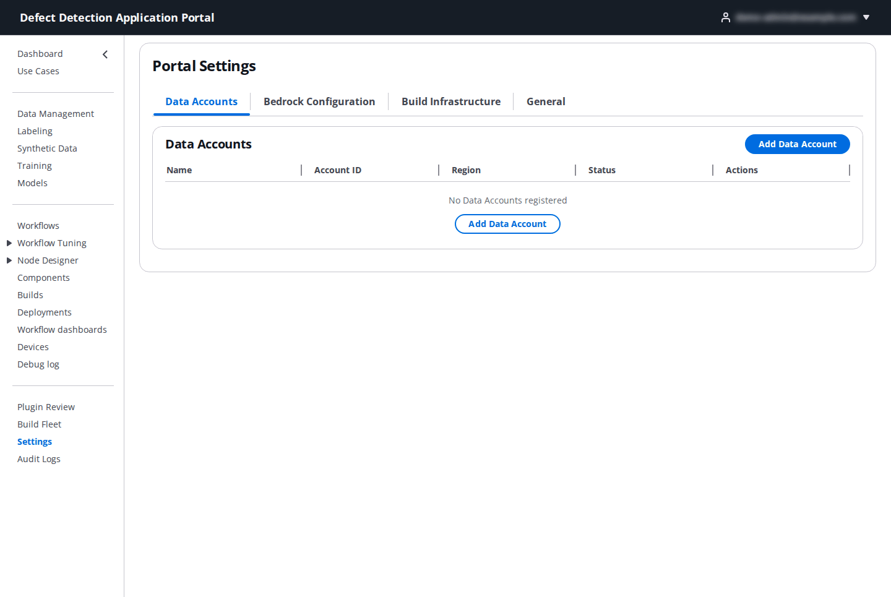
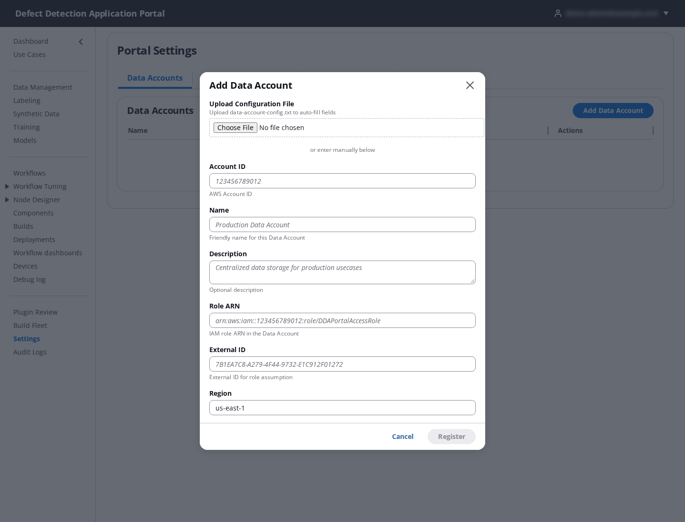
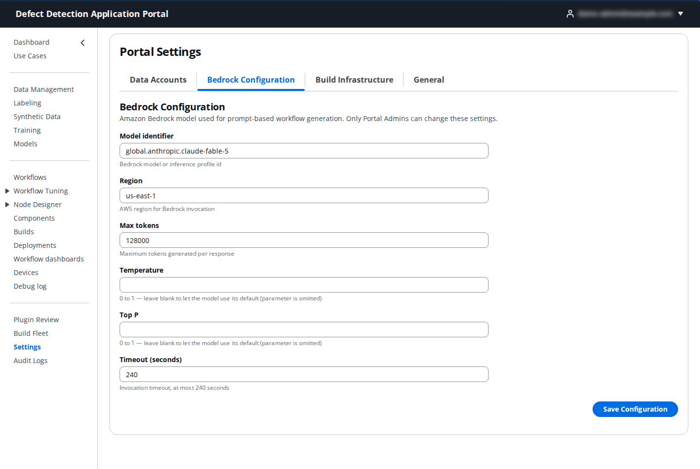
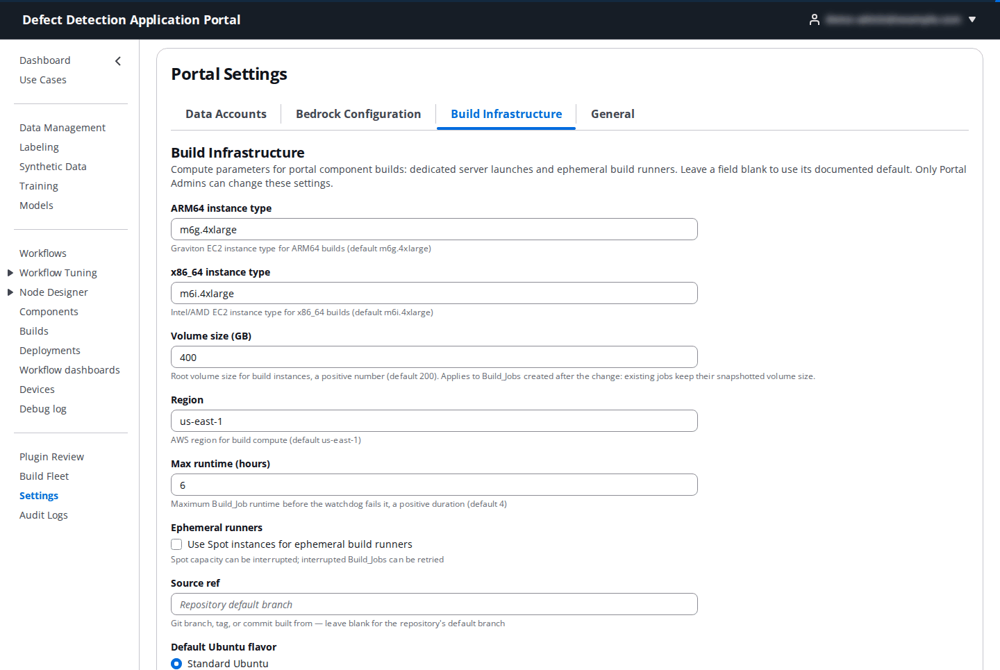

# 19. Settings

**Who:** PortalAdmin only (the page is reached from the navigation or the user menu). **Video:** [Module 0: Portal Setup](https://youtu.be/HtH_4zT23Fo). **Reference:** README [Step 4.1](../../README.md#41-one-time-setup) and [Step 5.2](../../README.md#52-data-account-optional-for-multi-account).

**Portal Settings** holds the installation-wide configuration: the registered data accounts for multi-account setups, the Bedrock model used for AI generation, and the compute parameters for component builds. It has four tabs.

## 19.1 Data Accounts

In a multi-account architecture, training data can live in a central **Data Account** that several use cases read from. Registering it once here lets the onboarding wizard fill in the account details from a dropdown instead of asking for them each time. The table lists each account's **Name**, **Account ID**, **Role ARN**, **Region** and **Description**, with **Edit** and **Delete**.

Click **Add Data Account**:

| Field | What to enter |
|-------|---------------|
| **Upload Configuration File** | Upload the `data-account-*-config.txt` written by `./deploy-portal.sh data` in the data account; it fills in the fields below. |
| **Name** | A friendly name, for example `Production Data Account`. |
| **Account ID** | The 12-digit AWS account ID. |
| **Role ARN** | The `DDAPortalDataAccessRole` ARN in that account (`arn:aws:iam::<account>:role/DDAPortalDataAccessRole`). |
| **External ID** | The External ID the deployment printed; it is part of the role's trust policy. |
| **Region** | The account's region, for example `us-east-1`. |
| **Description** | Optional. |

Click **Register**. Buckets in the data account still need to be tagged `dda-portal:managed=true` and ABAC-enabled before a use case can use them ([Administrator Guide](../../edge-cv-portal/ADMIN_GUIDE.md#tag-s3-buckets)).

## 19.2 Bedrock Configuration

The Amazon Bedrock model the Portal calls for prompt-based generation: the Workflow Builder's **Gen** panel ([8.6](08-workflows.md#86-generate-a-workflow-from-a-description)) and the Node Designer's **Generate with AI** and code assistant ([10.3](10-node-designer.md#103-generate-a-custom-node-with-ai)).

| Field | What to enter | Default |
|-------|---------------|---------|
| **Model identifier** | A Bedrock model or inference profile id, chosen from the list or typed, for example `us.anthropic.claude-sonnet-4-5-20250929-v1:0`. The account must have access to the model in the chosen region. | – |
| **Region** | The region for Bedrock invocation. | `us-east-1` |
| **Max tokens** | Maximum tokens generated per response. | – |
| **Temperature** / **Top P** | 0 to 1; leave blank to let the model use its default (the parameter is omitted). Lower temperature gives more literal, predictable generations. | blank |
| **Timeout (seconds)** | How long a generation may take before the request is abandoned. | – |

Click **Save Configuration**.

## 19.3 Build Infrastructure

Compute parameters for Portal component builds, used by dedicated server launches ([18. Build Fleet](18-build-fleet.md)) and ephemeral build runners ([12. Builds](12-builds.md)). Leave a field blank to use its default. A build keeps the settings in effect when it was submitted.

| Field | Meaning | Default |
|-------|---------|---------|
| **ARM64 instance type** | Graviton EC2 instance type for ARM64 builds. | `m6g.4xlarge` |
| **x86_64 instance type** | Intel/AMD EC2 instance type for x86_64 builds. | `m6i.4xlarge` |
| **Volume size (GB)** | Root volume size for build instances. Applies to jobs created after the change. | `200` |
| **Region** | AWS region for build compute. | `us-east-1` |
| **Max runtime (hours)** | Maximum build job runtime before the watchdog fails it. | `4` |
| **Ephemeral runners** | Use Spot capacity for ephemeral builds. Spot is cheaper but can be interrupted; interrupted jobs can be retried. | off |
| **Source ref** | Git branch, tag or commit built from when a build request leaves **Branch or ref** empty; blank means the repository's default branch. | blank |
| **Default Ubuntu flavor** | The flavor applied when a server launch omits the choice; set **Ubuntu Pro** to mandate compliance fleet-wide. | Standard |
| **Per-target volume sizes** | **Add per-target volume size** to give a **Build target** (JP5, JP6, JP7, AMD64, AMD64_NVIDIA) its own volume size; JP6 needs at least 200 GB. |
| **Runtime budgets (per target and mode)** | **Add runtime budget** to give a target and **Mode** (ephemeral, dedicated, or blank for both) its own limits: **Hard runtime (hours)** (a non-extendable ceiling), **Heartbeat lease (min)** and **Progress stall (min)** (liveness leases), **Queue wait (hours)** and **Provisioning (min)**. Raise the JP7 budget if Thor builds hit the limit. |

Click **Save Configuration**.

## 19.4 General

Reserved for general portal settings; it currently shows "General settings coming soon".
