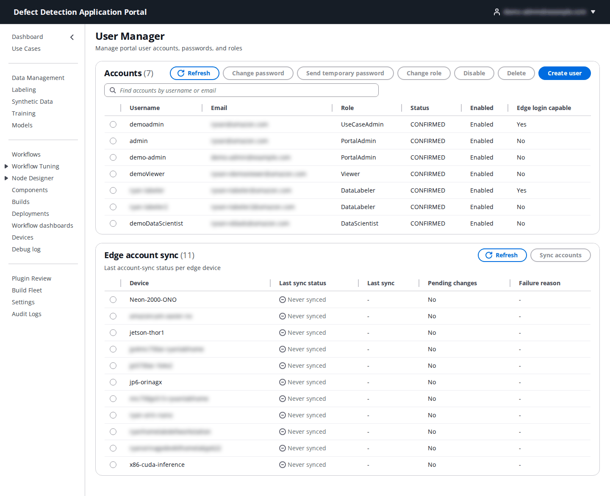
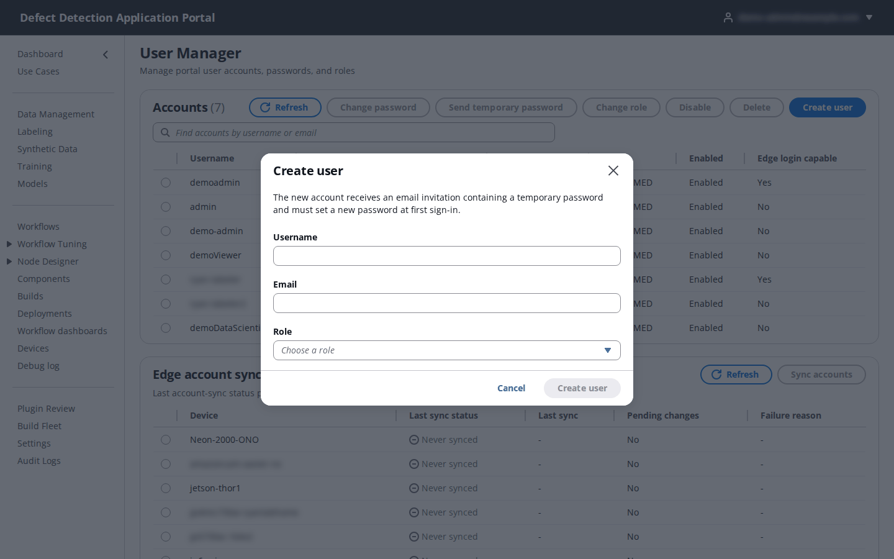

# 20. User Manager

**Who:** PortalAdmin only (user menu → **User Manager**). **Video:** [Module 11: User Access](https://youtu.be/_HDKtKvft3c). **Reference:** [Administrator Guide, Portal Users and Privilege](../../edge-cv-portal/ADMIN_GUIDE.md#portal-users-and-privilege-portal_identity-registry).

Portal accounts live in Amazon Cognito, and what an account may do is recorded in the Portal's user registry. The **User Manager** is the only place that keeps both in step: it creates accounts, sets their global role, resets passwords, disables, enables and deletes them, and pushes selected accounts to edge devices for local station login. Self sign-up is off, so every account starts here (the very first PortalAdmin is created from the command line during deployment, see the README [3.2](../../README.md#32-create-portal-admin-user)).

## 20.1 Accounts

**Accounts** lists every Portal account with **Username**, **Email**, **Role** (the global role), **Status** (Cognito's account state, for example `CONFIRMED` or `FORCE_CHANGE_PASSWORD`), **Enabled** and **Edge login capable** (whether the account can also sign in locally on a station, see 20.3). Select an account with its radio button to enable the actions:

| Action | What it does |
|--------|--------------|
| **Change password** | Sets a **New password** / **Confirm password** for the account. **Password type** decides whether it is permanent or must be changed at the user's next sign-in. |
| **Send temporary password** | Generates a temporary password and emails it to the account's address; the user sets a new one at sign-in. Use this for "I forgot my password" when the user cannot use the reset-code flow. |
| **Change role** | Changes the account's global role. This updates the registry row, which is what takes effect. |
| **Disable** / **Enable** | Blocks or restores sign-in. Disabling also stops an already-issued session on its next request. |
| **Delete** | Removes the account and all its role rows (global and per use case). |

The Portal refuses to delete, disable or demote the last remaining PortalAdmin.

## 20.2 Create a user

Click **Create user**.

| Field | What to enter |
|-------|---------------|
| **Username** | The sign-in name, for example `jane.doe` or `station1-labeler`. Not an email address: the email is a sign-in alias, the username is permanent. |
| **Email** | A mailbox the person can read; the invitation and any password reset go there. |
| **Role** | The global role: **PortalAdmin**, **UseCaseAdmin**, **DataScientist**, **Operator**, **Viewer** or **DataLabeler** (see the role table in the [guide index](README.md#roles)). A global role applies to every use case until a use case row overrides it. |

The new account receives an email invitation containing a temporary password and must set a new password at first sign-in. Then give the account its use cases: **Use Cases → Actions → Manage Team** assigns a per-use-case role ([2.4](02-use-cases.md#24-manage-the-team)); a DataLabeler is instead added to a labeling team ([4.6](04-labeling.md#46-labeling-teams)).

A typical team: one PortalAdmin, a UseCaseAdmin per use case, DataScientists for the ML work, Operators for the line, Viewers for stakeholders, and DataLabeler accounts for the people who label.

## 20.3 Edge account sync

The LocalServer on a device can require a local login for its web UI and the station HMI. **Edge account sync** pushes Portal accounts to a device's local credential cache so the same usernames and passwords work at the station, without the device calling the cloud.

The panel lists each edge device with **Last sync status**, **Last sync**, **Pending changes** and **Failure reason**. Select a device, choose the **Accounts to sync** and click **Sync accounts**. The selected accounts are transferred to the device over its shadow; disabled or deleted accounts are sent as disabled so the device revokes them. An account is **Edge login capable** only when the Portal holds a captured credential verifier for it (created when the user set a password through the Portal); accounts without one sync but cannot log in locally until their password is set again.

Whether a device actually asks for a local login depends on its LocalServer configuration; see [22. Device web UI](22-device-web-ui.md#221-opening-the-interface-and-signing-in).
