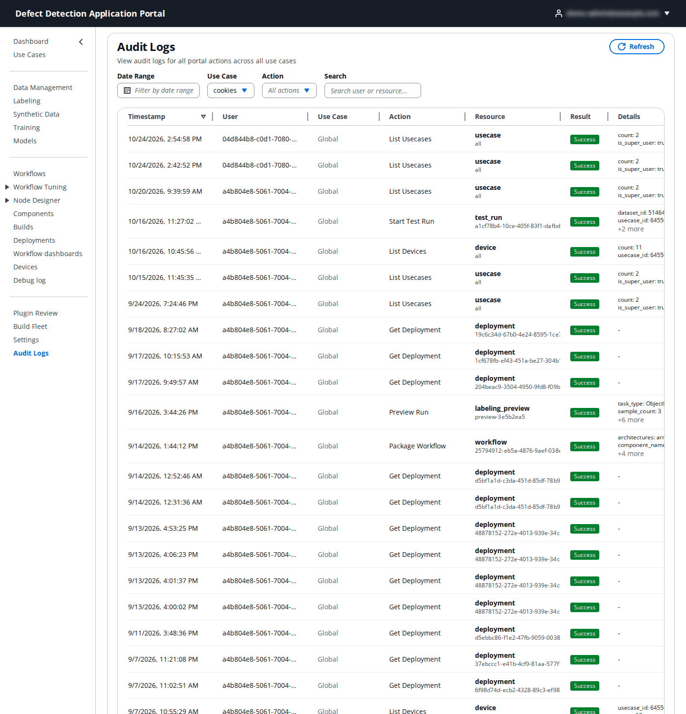

# 21. Audit Logs

**Who:** PortalAdmin and UseCaseAdmin.

Every action a user takes through the Portal API is recorded: who did it, in which use case, on which resource, and whether it succeeded. **Audit Logs** is the viewer for that trail. Use it to answer "who deployed this", "who changed that role", or to confirm that a denied action was in fact refused.

## 21.1 The log table

| Column | Meaning |
|--------|---------|
| **Timestamp** | When the action happened, in your local time zone. |
| **User** | The Cognito user id (the account's `sub`) of the caller. Match it to an account in the User Manager or hover for the email where available. |
| **Use Case** | The use case the action belonged to, or **Global** for account-level actions (use case listing, user management, settings). |
| **Action** | What was done, for example `List Usecases`, `Get Deployment`, `Package Workflow`, `Start Test Run`, `Preview Run`, `List Devices`. |
| **Resource** | The resource type and id (`usecase all`, `deployment <id>`, `workflow <id>`, `labeling_preview <id>`, `device …`). |
| **Result** | **Success** or a failure or denial (for example `unauthorized_access` for a refused call). |
| **Details** | Extra fields of the record (`count`, `is_super_user`, `architectures`, `component_name`, …), with **+N more** to expand. |

## 21.2 Filtering

| Filter | What it does |
|--------|--------------|
| **Date Range** | Limits the table to a time window. |
| **Use Case** | **All use cases**, or one use case. A UseCaseAdmin sees only their use cases; a PortalAdmin sees everything. |
| **Action** | **All actions**, or one action type from the list. |
| **Channel** | **All channels**, **Web & API**, or **MCP** for tool calls from AI assistants ([24. MCP support](24-mcp-support.md#245-mcp-calls-in-the-audit-logs)). |
| **Search** | Free text matched against the user and the resource. |

**Refresh** reloads with the current filters; **Load More** pages further back in time. The viewer is read-only; audit records cannot be edited or deleted from the Portal.

Beyond user actions, the trail also records system events such as plugin review decisions, telemetry enablement, dashboard creation and deletion, bucket allow-listing (`bucket_abac_enabled`) and, under registry enforcement, every denied request.
