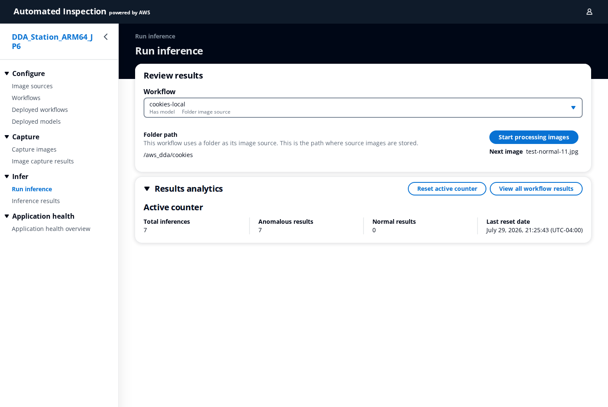
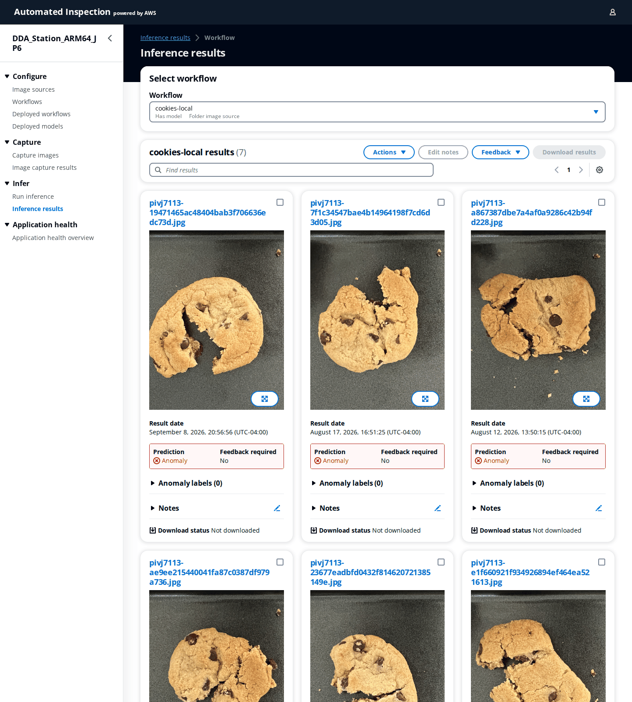
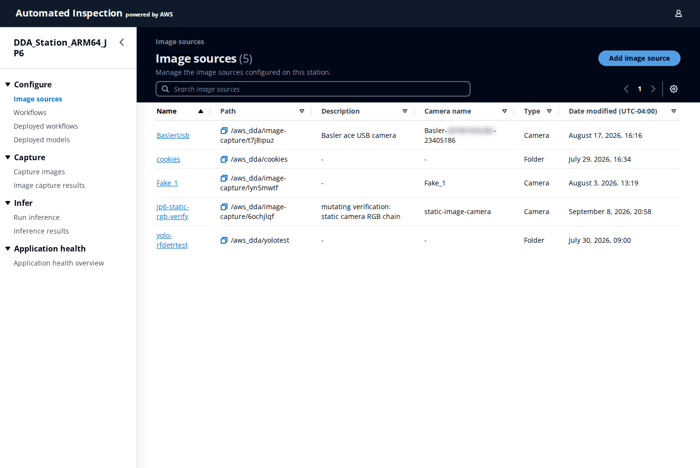
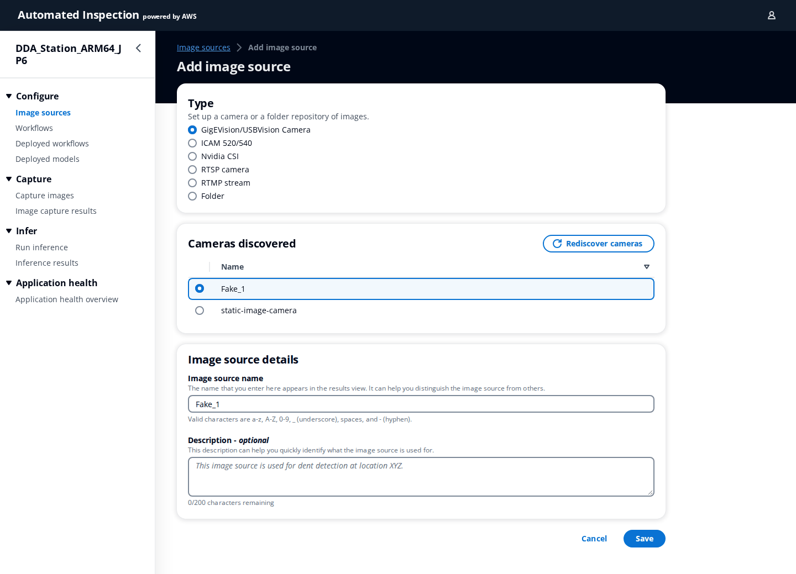
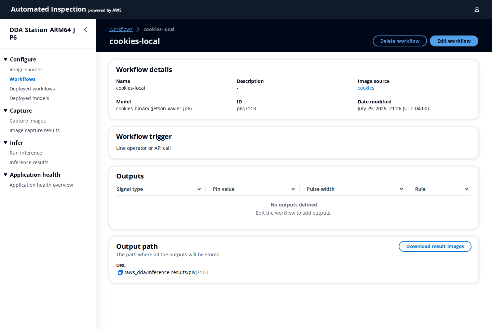
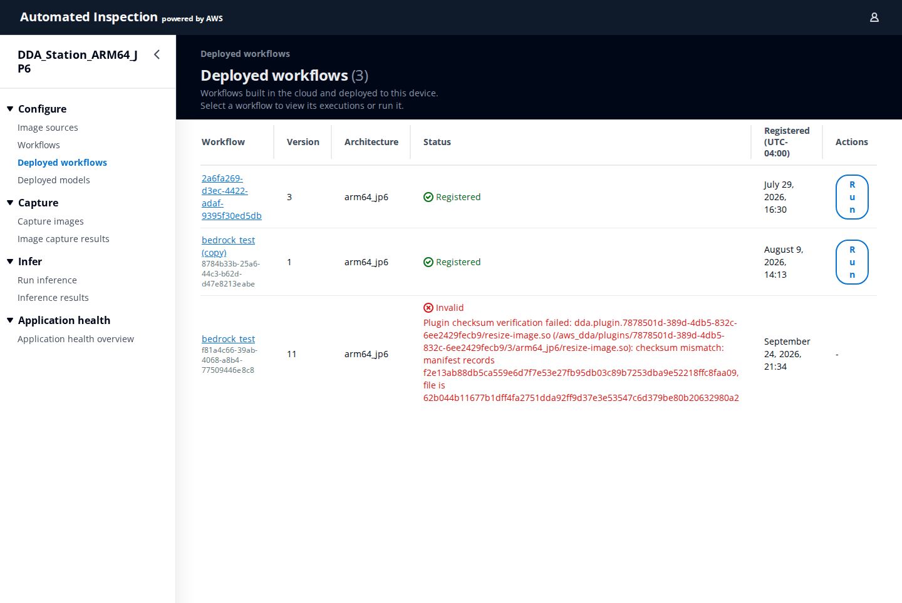
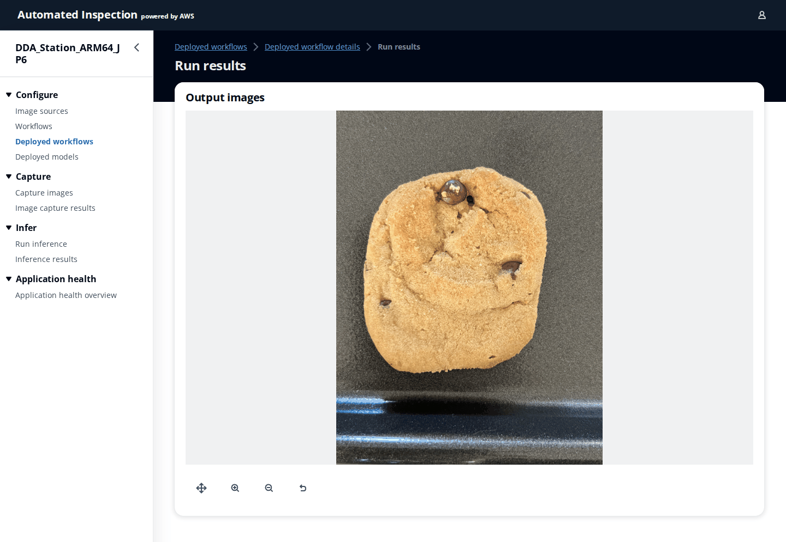
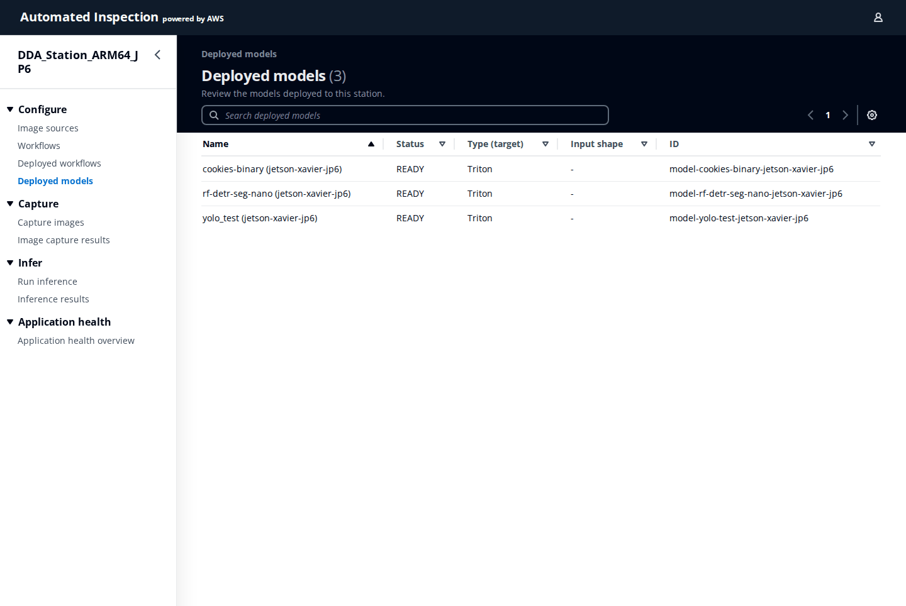
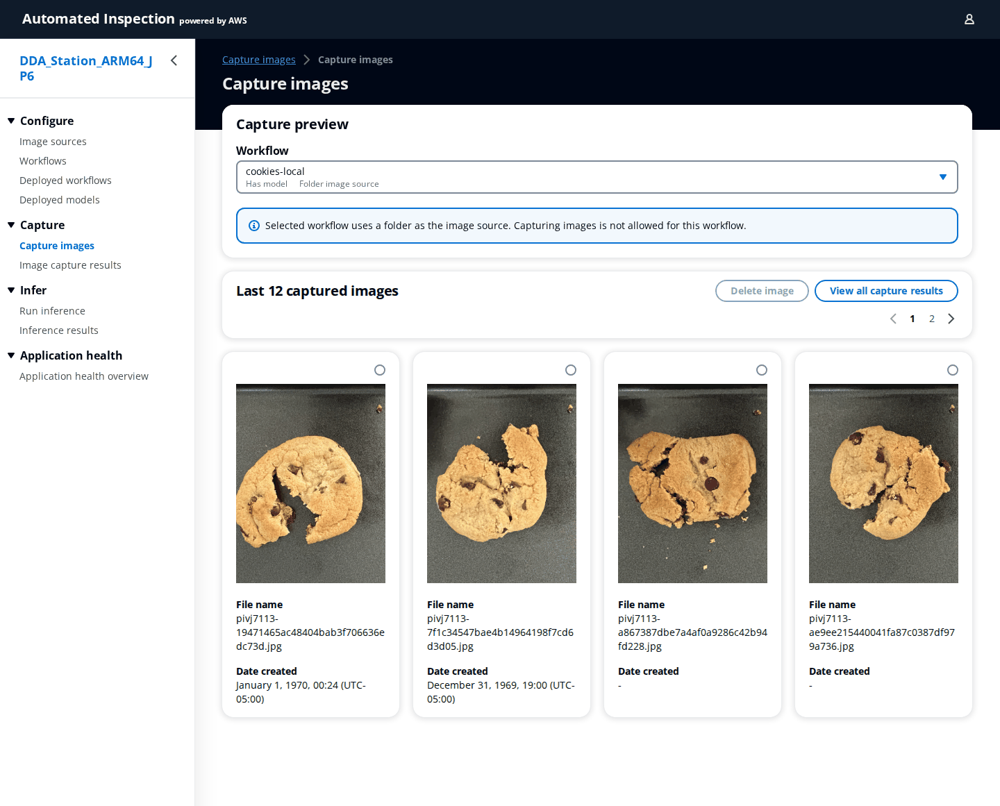
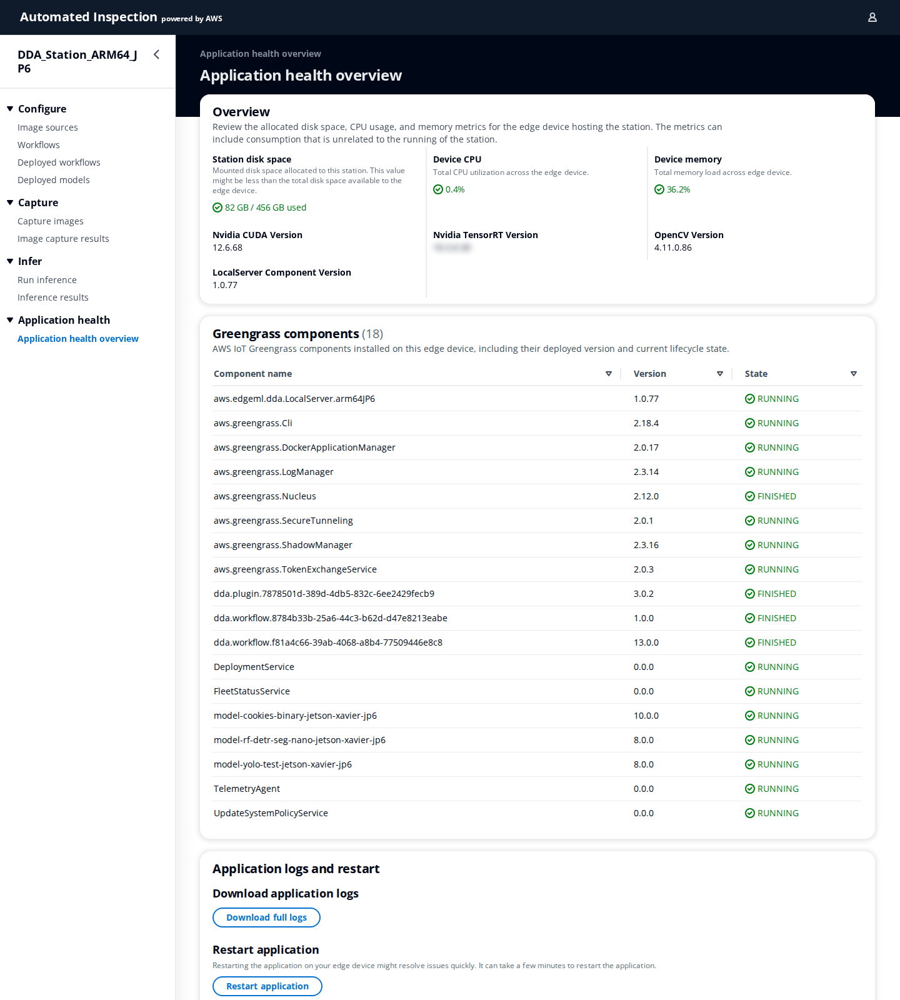

# 22. Device web UI

**Who:** anyone at the station with network access to the device; when local login is enabled, an account synced from the Portal ([20.3](20-user-manager.md#203-edge-account-sync)). **Video:** [Module 12: Edge Software](https://youtu.be/pInKqoADn2c). **Reference:** README [Edge Device Management](../../README.md#edge-device-management).

Each device runs the DDA **LocalServer**, which serves its own web interface, branded **Automated Inspection**. Where the Portal manages the fleet, this interface operates one station: it runs inference on a chosen workflow, shows live and historical results, manages the station's image sources and locally defined workflows, lists the workflows and models the Portal deployed, and reports the device's health. It works without the cloud, over the plant network.

## 22.1 Opening the interface and signing in

In a browser on the same network open `http://<device-ip>:3000` (or `https://<device-ip>:3443` when the LocalServer runs with TLS). The interface talks to the LocalServer API on port 5000 (5443 with TLS) of the same host, so both ports must be reachable from your computer. From elsewhere, use an SSH tunnel (`ssh -L 3000:localhost:3000 -L 5000:localhost:5000 <user>@<device>`) or the Portal's [Remote Access](15-devices.md#158-remote-access-and-debug).

If the device's LocalServer has local login enabled, a sign-in form asks for a username and password; use an account that a PortalAdmin synced to this device. With local login disabled (the default on a fresh station) the interface opens directly. The station name at the top of the navigation (`DDA_Station_ARM64_JP6` in the screenshots) identifies the device.

## 22.2 Navigation

The side navigation has four groups:

| Group | Pages | Purpose |
|-------|-------|---------|
| **Configure** | **Image sources**, **Workflows**, **Deployed workflows**, **Deployed models** | What the station can capture from and run. |
| **Capture** | **Capture images**, **Image capture results** | Collect images from a camera without running a model, for example to build a training set. |
| **Infer** | **Run inference**, **Inference results** | Run the inspection and review verdicts. |
| **Application health** | **Application health overview** | Resources, installed components, logs and restart. |

## 22.3 Run inference

1. Choose a **Workflow** (a locally defined workflow, see 22.6; the dropdown notes whether it **Has model** and its source type, for example **Folder image source**).
2. For a folder workflow the panel shows the **Folder path** and the **Next image**; click **Start processing images** to run the model over the folder. For a camera workflow the live camera view appears and runs are triggered by the workflow's trigger (an operator click, a digital input, or an API call).
3. The result of each run is shown with its **Prediction** (`Normal` or `Anomaly`, or the objects detected), the **Processing time**, the **Model** and, when the model is unsure, a **Feedback required** flag asking the operator to confirm.
4. **Results analytics** keeps an **Active counter** of **Total inferences**, **Anomalous results** and **Normal results** since the **Last reset date**; **Reset active counter** starts a new shift count, and **View all workflow results** opens the history.

## 22.4 Inference results

Select the workflow to see its stored results as cards: the captured image with an **Anomaly labels** overlay toggle, the **Result date**, the **Prediction**, whether **Feedback required** was raised, and **Notes**. Tools above the grid:

- **Find results** filters by file name; the page size is **12**, **24** or **48 results**.
- **Actions** on selected cards, **Feedback** to record the operator's **Human feedback** (confirm or correct the prediction, which can be used to improve the model later), **Edit notes** to annotate a result, and **Download results** to export the selected images and metadata. **Download status** on each card shows whether it has been exported.

Click a file name to open the result's detail page with the full image and metadata.

## 22.5 Image sources

An **image source** is a camera or an image folder the station can capture from. The list shows **Name**, **Path**, **Description**, **Camera name**, **Type** and **Date modified**. **Add image source** opens the form:

| Field | What to enter |
|-------|---------------|
| **Type** | **GigEVision/USBVision Camera** (GenICam cameras such as Basler, discovered automatically), **ICAM 520/540**, **Nvidia CSI** (Jetson camera module), **RTSP camera**, **RTMP stream** or **Folder** (images already on the device). |
| **Cameras discovered** | For camera types: pick the camera from the list; **Rediscover cameras** scans again. |
| **Stream URL**, **Transport**, **Codec**, **Credentials** | For RTSP/RTMP: the stream address, **TCP** (most reliable) or **UDP**/**Auto** transport, **Auto** / **Hardware only** / **Software only** decoding, and optional credentials (the camera then connects without them in the URL). |
| **Capture path** | For a folder source: the path where the source images are stored, for example `/aws_dda/cookies`. |
| **Image source name** | Shown in the results view; letters, digits, underscore, space and hyphen. |
| **Description** | Optional. |

Click **Save**. The source's detail page shows **Camera details** and **Connection status** (a camera connects when a workflow, preview or capture uses it; **Connect** forces a connection), **Image settings** (**Gain**, the primary brightness control, and **Exposure**, the secondary control, plus the read-only **Gstreamer pipeline**), and a **Region of interest** editor to crop what the model sees. **Edit** changes the name and description; **Delete image source** removes it.

## 22.6 Workflows (local)

Besides workflows deployed from the Portal, a station can hold simple local workflows that pair an image source with a deployed model. The list shows **Name**, **Description**, **Image source**, **Model**, **ID** and **Date modified**; **Add workflow** and **Edit workflow** open the form:

| Field | What to enter |
|-------|---------------|
| **Name**, **Description** | Identify the workflow in the Run inference dropdown. |
| **Image source** | One of the station's image sources. |
| **Model** | One of the deployed models; it runs on every captured image. |
| **Workflow trigger** | **Line operator or API call** (a button in the UI or a REST call) or **Digital input** (a GPIO pin with **Rising edge** / **Falling edge** and a **Debounce time** in milliseconds). |
| **Outputs** | Optional GPIO outputs: **Signal type**, **Pin value**, **Pulse width** (ms) and the **Rule** that fires it (**Anomaly**, **Normal**, **All results**). |

The detail page also shows the **Output path** where results are stored (`/aws_dda/inference-results/<id>`) and **Download result images**, which exports images for a **Time range** and **Image classification** (**Normal and anomaly results**, **Normal results**, **Anomaly results**) in a chosen **Image quantity**, a quick way to collect new training data.

## 22.7 Deployed workflows and deployed models

**Deployed workflows** lists the Portal-packaged workflows registered on the device with **Workflow**, **Version**, **Architecture**, **Status** (**Registered**, or **invalid** when the device cannot load it) and **Registered** time. **Run** starts one run by hand. Click a workflow for its **Registration details** and its **Executions**: every run with **Status**, **Started** and **Finished**, and per run **View results** (the output images and verdict), **View run log** (the engine log of that run) and **Run status** (the workflow graph with each node coloured by its run status).

**Deployed models** lists the model components on the device with **Name**, **Status** (`READY` when loaded in the inference server), **Type (target)**, **Input shape** and **ID**. A model that stays in `LOADING` for long shows up as a warning here and in the Portal.

## 22.8 Capture images and capture results

**Capture images** takes pictures from a workflow's image source without running inference: choose the **Workflow**, watch the **Capture preview**, and capture single images or let the auto-capture run at the configured interval; the **Last 12 captured images** appear below. **Image capture results** lists everything captured per workflow, with the same filtering, notes and **Download results** tools as the inference results. Use it to gather normal and defective examples for labeling in the Portal.

## 22.9 Application health

- **Overview**: **Station disk space** (used of the mounted disk), **Device CPU**, **Device memory**, the **Nvidia CUDA Version**, **Nvidia TensorRT Version**, **OpenCV Version** and the **LocalServer Component Version**.
- **Greengrass components**: every component on the device with **Version** and **State** (`RUNNING` for services, `FINISHED` for one-shot installers such as model and workflow components). This is the same list the Portal shows on the device's Components tab, read locally.
- **Application logs and restart**: **Download full logs** saves the LocalServer's application log; **Restart application** restarts the LocalServer containers (inference stops for a minute).
