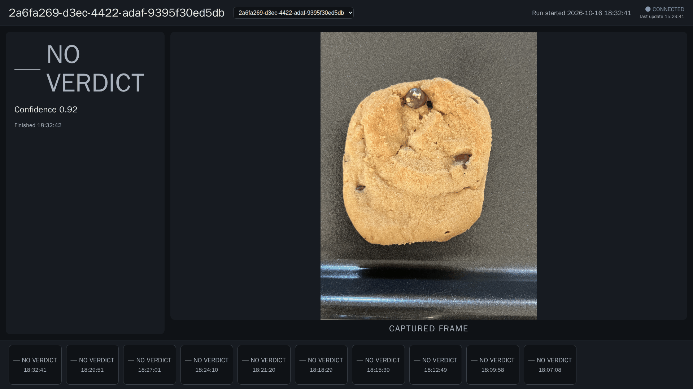
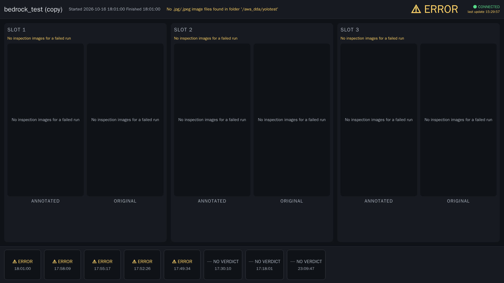

# 23. Quality Station HMI

**Who:** line operators, on the station monitor; set up by whoever deploys the device. **Reference:** [hmi/README.md](../../hmi/README.md).

The **Quality Station HMI** is a full-screen operator display for a 1920×1080 monitor at the station. Where the device web UI ([22](22-device-web-ui.md)) is for configuring and reviewing, the HMI shows one thing, large and live: the verdict of the latest inspection run, the captured frame, and the recent history. It is a static web page served by the device's LocalServer (or by a tiny standalone server), and it polls the LocalServer's REST API every 2 seconds. Nothing runs in the cloud; the HMI works as long as the station does.

Two layouts ship with DDA:

| Page | For | Shows |
|------|-----|-------|
| `index.html` – **Quality Station HMI** | A single-inspection workflow (one verdict per run). | The verdict, the captured frame, and for workflows with a reference-comparison node (**Bedrock Inference** or **VLM/LLM Inference** with a reference image) the reference image next to the captured frame. |
| `triple.html` – **Triple Inspection HMI** | A guided inspection that judges three positions per run (built for the blue-plate guided-inspection workflow). | Three **slots**, each with its annotated and original image and its own verdict. |

## 23.1 Quality Station HMI

- **Top bar**: the workflow name on the left, a dropdown to switch between the device's deployed workflows, **Run started** with the time of the current run, and the connection badge on the right: **CONNECTED** with the time of the last update, or a disconnected state when the LocalServer stops answering.
- **Verdict panel** (left): the result of the latest run as an icon and a word, so no state relies on colour alone: **✔ PASS**, **✘ FAIL**, **— NO VERDICT** (the run produced no `is_anomalous` value, as in the screenshot, where a detection-only workflow was shown), or **⚠ ERROR** with the run's error text. Below it the **Confidence** (0–1) and the **Finished** time.
- **CAPTURED FRAME** (centre): the image the run analysed. For a reference-comparison workflow the left panel shows **REFERENCE (COMPARED AGAINST)** and the right panel the captured frame.
- **History strip** (bottom): the last runs, newest first, each with its verdict and time. Click a tile to show that run instead of the live one; the display returns to live when a new run arrives.

The verdict is derived from the run's `is_anomalous` field: `true` → FAIL, `false` → PASS, absent → NO VERDICT. A failed run shows ERROR with the error message, or "No error details are available for this run."

## 23.2 Triple Inspection HMI

The triple layout binds to one workflow by name: the `workflow` query parameter of the kiosk URL (`triple.html?workflow=<name>`), else the build-time default (`blue-plate-detection-guided-inspection`). When that workflow is not deployed on the device the page says so (**Workflow not deployed**) and waits.

- **Top bar**: workflow name, **Started** / **Finished** times of the current run, the run's error text when it failed, the overall verdict, and the connection badge.
- **SLOT 1–3**: one panel per inspected position with its **ANNOTATED** image (the model's drawing) and the **ORIGINAL** image, and the slot's own verdict, decided independently from its `is_anomalous` value. A failed run shows "No inspection images for a failed run" in every slot, as in the screenshot (that run's folder source had no images).
- **History strip**: the recent runs with their verdicts; click one to review it.

## 23.3 Setting up a station display

1. **Build** the bundle on a workstation with Node.js 18+: `cd hmi && npm ci && npm run build` (or `npx vite build --base=./ --outDir dist` for the standalone server). The output in `hmi/dist/` is plain static files.
2. **Serve it**, one of two ways:
   - **Through the LocalServer.** Copy `dist/` to a path the backend can see (`<repo>/hmi/dist` on a checkout; for the container, a host path mounted into it with `HMI_DIST_DIR` set) and restart the backend. The HMI is then at `https://<device>:5443/hmi/` (local auth on) or `http://<device>:5000/hmi/` (auth off), same-origin with the API.
   - **Standalone.** Copy `dist/` and `serve-hmi.sh` to the device and run `./serve-hmi.sh` (port 8081 by default; `PORT=9000` for another). It stamps the API address into the page (`API_BASE=5000` for the LocalServer on the same host, or a full `http://<ip>:5000` for another machine). This avoids rebuilding the component for a kiosk change.
3. **Point the station browser at it in kiosk mode**: `chromium --kiosk https://<device>:5443/hmi/` or `chromium --kiosk http://<device>:8081/triple.html`. The layout targets 1920×1080 and stays usable at 1280 px wide.
4. **Login.** The HMI asks the LocalServer whether local login is enabled. If it is, a login form appears naming the LocalServer address, and an account synced from the Portal signs in ([20.3](20-user-manager.md#203-edge-account-sync)); the session is kept in the browser so a kiosk reload does not prompt again. If local login is disabled, the HMI opens directly.
5. **Pointing at another LocalServer.** `?api=5000` or `?api=http://192.168.1.10:5000` on the page URL redirects the HMI to another station's API; for safety only the page's own host, private IP ranges, `.local` names and explicitly allow-listed hosts are accepted, and anything else is ignored with a notice.

Troubleshooting: a login form on a device with local login off means the page could not reach the API (`API_BASE` unset or wrong when served standalone); a persistent disconnected badge means the LocalServer is down or unreachable on port 5000/5443; **Image unavailable** on a frame means the run's image was not stored (check the workflow's capture settings).
